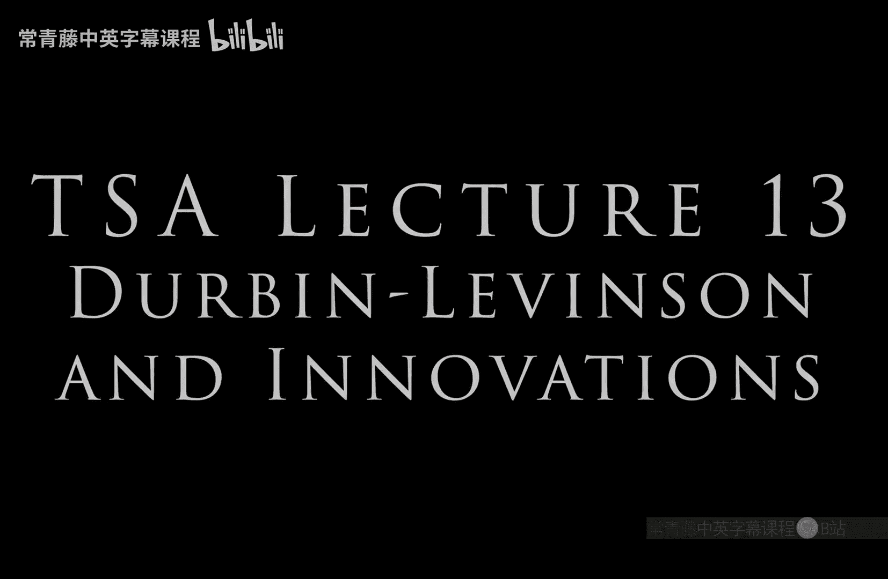
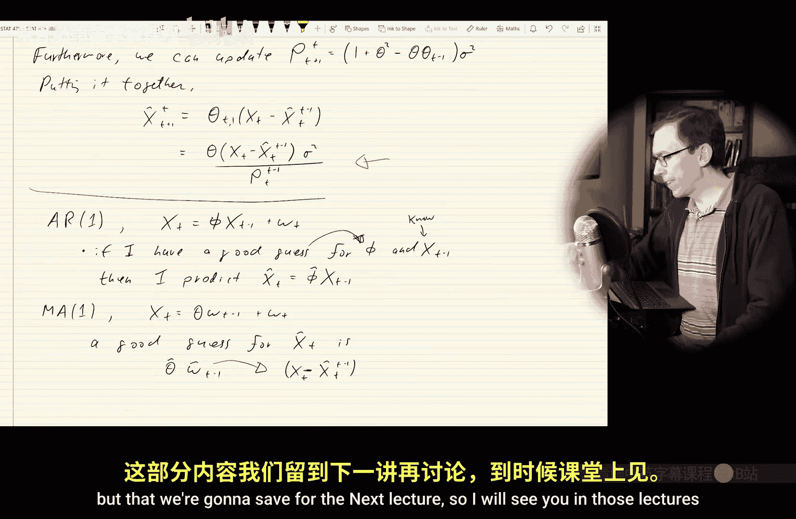
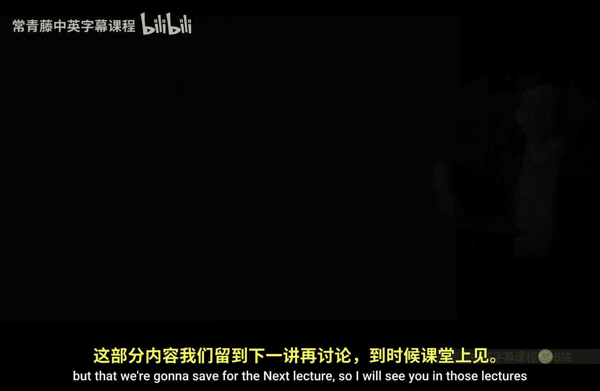

# 阿尔伯特大学【中英⚡时间序列分析｜STAT479 2021 Time Series Analysis】 p13 P13 Lecture 13： Durbin-Levinson and Innovations Algorithms -BV1nwqYBDEos_p13-

🎼And welcome back to another lecture of Statistics 479 time series analysis in today's lecture。

 we're going to be going a little bit further into the autoregressive process if you recall last time we were trying to do forecasting。

 we were trying to do linear forecasting and we ended up with a big linear system of equations it's hard to solve we need to figure out a way to do it and today we're going to talk about two different algorithms to solve that system。

🎼Okay， so when trying to do forecasting and trying to get a linear predictor there are different ways we can go about it the first thing we're going to talk about today is something called the Durban Levinson algorithm and the main idea is。

 well， we want to predict the T plus first data point based on the previous T data points just like we did in the last lecture but now we're actually going to do it for real and we're going to use specific properties of the topt matrix in order to come up with an algorithm to solve that system of equations that we saw last time。

Going beyond that though， there's a whole not way we can approach it instead of having a linear combination of the data points。

 we're going to have a linear combination of the residuals。

 something called the innovations and this is going to lead us to an innovations algorithm it's innovative it's kind of interesting and we're going to look at it today in today's lecture so let's get over to the notes and see what's happening。

😊，And welcome back to another lecture of statistics 479 time series analysis today we're going to go a little bit further into the idea of forecasting it's what we started with in the last lecture。

 the idea of forecasting for an autoregressive process but now we realized after the last lecture it's not straightforward at least mathematically it is but algorithmically we have to figure out what to do luckily there are two different methods that we'll be discussing today the Durban Levinson algorithm and the innovations algorithm we're not going to go into excruciating detail on these but we will look at them and try to get a sense of where the ideas are coming from so that you have some intuition going in when you're using software that might have implemented these methods so。

Let's just jump into the notes and see what that's all about。All right。

 so where did we leap off last time well， last time we had this idea that we wanted to do forecasting for the well。

 in just in general， in some sense。We were specifically thinking about the autoregressive process。

 but ultimately we really just wanted to come up with some prediction， X hat。

 we'll say capital T plus one， which is going to be the prediction based on some linear combination。

I guess I'll leave out the I will leave alpha put alpha no in there， why not？

Now it's just going to get in the way， we'll forget about alpha not assume it's all means zero。

 there is no alpha not， we already got rid of it。Anyway。Yeah。

 the idea is that we want to do some type of linear predictor and our linear predictor is going to look something like。

 well， this it's going to be a big linear combination of all of our data points and what we saw from last time is that we can actually solve this well first we can write this as vector alpha transpose vector X。

And this we found out can be written as K transpose gamma inverse X where。K。

Is a big vector of auto covariances。Kx1 all the way to Kx capital T。

Now I'm going to make sure I didn't write that backwards because I think I wrote it backwards。Yep。

 I wrote it， wait。Yes， I think I wrote it backwards。

It's supposed to be k capital T Kx at capital T all the way down to Kx at1。

 and then our gamma matrix here， our gamma matrix is going to be the big matrix of auto covariances from zero on the mainagonal KX at one on the first off diagonals。

And so on all the way up to the corner where we would have a Kx at， I guess， capital T minus one。

 yes， good。And over here， I guess we have another Kx0。All right。

 so we have our giant matrix of autocovariance is again we can't actually compute all of these in any reasonable way because we'd have to estimate it from the data。

 but in a mathematical sense， we have a system of equations that we want to solve so then the question we were left with last time。

😊，Is how。To solve。This system。Of equations。Even if we knew。What？K X at various lags， HR。

 let's say for H， say from0 to capital T， which typically we don't actually know that we'd have to estimate it from some data。

 but in this case， the question is， even if we have that， how are we going to do this linear。

 solve this linear system。Because， again， inverting gamma is， well， annoying。

 We don't really want to have to do that to find because。

I guess that's not technically the linear system， Line system I'm talking about is going to be。Gamma。

Let me think。Yes， gamma。Well， it's alpha transpose is equal to k transpose gamma inverse。

 which is a kind of a weird way to write it， but if we transposed everything。

 it would look like alpha is equal to not k， sorry， gamma inverse， which is symmetric。

 so I don't have to transpose it， or I guess I do， but it's the same thing。Times k。So again。

 we have a big system of equations， we want to solve it， how do we do that。Strictly speaking。

 I guess it should be k is equal to gamma alpha where alpha is the unknowns if we want to write as an actual linear system of equations。

 the point is invering gamma is kind of annoying。So what are we going to do， Well。

 the first thing we're going to discuss is the Durban。1even。Lvinson algorithm。

So the Durban Levinton algorithm actually isn't really a statistics thing at all。

 it's from numerical linear algebra。Actually， to be honest。

 I don't know the origin of either Durban or Levinson and what they were studying。

 but this is more of a general way to solve a system of equations in linear algebra that just so happens to be super。

 super useful in the context of forecasting for time series。

 which is why it shows up in like every time series。

 book or textbook that you might pick off the shelf。Well， anyway， so what is this doing。

 so like I said， what we're trying to do here is solve that system of equations。

So before we go forward， we have to define something we're going to define or we'll put in some notation we've already talked about what this is。

 but our notation is we're going to denote。Capital P。Of T and T plus  one。

 which is kind of annoying annoying notation。 But we're going to have to run with it。

 This is going to be the mean squared prediction error。

Where we're going to have Xt plus1 minus x hat。T plus one squared and yeah。

 I guess this is all within the expectation just to be precise about it。

 even though it's just a lot of brackets to keep track of and we saw in the last class that this is equal to the auto covariance at lag zero just the variance minus。

This K transpose gamma inverse K。Yeah， no transpose。So again。

 the mean squared prediction error can be thought of as being the variance of the white noise process minus some other term here where this other term is going to tell us how correlated our our time series is with itself。

 I guess how autocor it is， if the time series has strong autocorres。

 this thing will be bigger and our mean squared prediction error would be smaller。

 so there's two extreme cases maybe we can do a side note。Two extremes。The first。Is that if。

X is just one。W， that is if Xt is just W T is just white noise。Then。Well， what happens？

Then K X H is equal to0 for H greater than0 and。Oh no。

 you can still invert that matrix good because the diagonals just， okay， so it still make sense。

And then。We have that to be， well， using this。Od notation with the PT T， T plus1。

 This is just going to be。KX is0， which is just the variance。Of Xt。So again。

 what I'm saying is that if you have a white noise process。

 then even if you have lots and lots of observations of it， predicting the next guy。

 the mean squared prediction error is just the variance itself because there's really nothing you can do to predict the next white noise term from the previous ones。

 they're all uncorrelated or well， independent in the Gaussian case。

 but even just for uncorrelated white noise we're trying to do a linear predictor and the whole idea of being uncorrelated means there's no linear relationship。

 so yeah we can't do anything this subtraction， this negative term here that I underlined in green would just be zero。

 so that's no good。Like I it just is what it is， you can't really predict white noise from white noise because it's just noise。

The other extreme is that if。X T is equal to C A not an a constant。 So this is another really。

 this is an even stupider time series。 at least white noises is a reasonable time series。

 You can't do much with it when it comes to prediction， but you can at least study it。

The Con time series is extremely uninteresting， except for the fact that we can say that。

I guess there's there's no notion of variance， so that's kind of。Well， maybe if we just forget about。

Yeah， I guess it doesn't even really make sense because you can't really write down the variance。

 my point。Was that if everything was one in some sense。

 if you had something like Kx of H is equal to one。

 because every lag would be perfectly correlated with itself。Okay。

 so this isn't exactly mathematically precise， but I'm still going to write it down anyway just for fun。

 this would be for all h greater than equal to zero then in this case you would have something like one minus that thing。

 but that thing I think in that case。No， you actually this whole example doesn't make any sense。

The whole example doesn't make any sense because you can't invert gamma because gamma would be a matrix of all ones。

 the matrix of all ones is singular so you can actually invert it so that's kind of a dumb example on my part sorry about that we're just going to cross that one out but。

TheIt doesn't make sense mathematically， but you could still say if。X T is constant， is close。

To constant。Then。The mean squared prediction error。Willll be。Let's say very small。

Wwhich maybe we could make more precise if we really tried to。

 but that's roughly yeah it doesn't make sense， like I said， if you have a constant time series。

 everything kind of breaks because it doesn't even make sense。

 but if you had something that's really close to constant。

 something where the noise is incredibly tiny and the correlation。

 I guess the correlation is very strong。I be it would be something like a。No， never mind。

 I'm going to stop meandering。I guess I should say it's close to constant but you would also need to have a strong correlation between the adjacent points or otherwise that also wouldn't make sense because in some sense white noise could look really close to zero。

 a very low noise， white noise but it would still be white noise you'd still have terrible prediction air so we'll just forget about that second example。

 the white noise example makes sense it's basically the worst possible case for prediction because you can't predict all right so。

Given all of that， the idea is that。In general。Inverting。A。T by T matrix。Takes。

I think order of T cubed operations。I'm going to put a little question mark here。

 I'm not like 100% sure， but I'm like 95% sure that it's a cubic。

The standard way of inverting a matrix is cubic in time。

 but yeah I'd have to double check that to be absolutely sure。However。If。Gamma。Well。

 I should say not not if it's a topless made is， as I should say。

 gamma is something special called a。Tlets。Yeah， got that right， topitz matrix。

Ts matrix is basically one where you have constants down the diagonal so here we see that every diagonal has。

 you know if you pick a diagonal， it's the same value down the entire diagonal now。

If I recall strictly speaking， I don't think a topless matrix has to be symmetric。

 we have the added benefit that our matrix here is also symmetric。

 again I would need to double check my linear algebra to make sure that that is in fact the case。

 but I'm pretty sure the standard toppleless matrix just means that the diagonals are fixed at certain whatever value it is。

So the point is that gamma is a toppleless matrix。So。The Durban Levinson DL algorithm runs。

And I think it's order T squared time， so it's a pretty nice savings in the sense that you' went from cubic time。

 complexity to quadratic time， and the idea is to well the idea。Is iteratively。Solve。4。Alphas。

So rather than try to invert the whole matrix and then just do it。

 what they're going to do is you're going to try to iteratively solve for in some sense。

 rows of alphas。And to do that， what I mean is that what we really want is if we go back up to。

Where did it go now。Oh it's the very first thing I think I wrote。

 which is this thing equation way up here， if we consider this prediction this you could call this the one step ahead predictor because it's based on all the data up to capital T for predicting t plus one well we could do this for every data point not just capital t plus one。

 but we could do it for well one and two and three and so on。

 so what we're going to do is we're going to consider。We'll say consider all。One step。Ahead。

Predicctorors。And what that gets us is something that's going to look like well。

We're going to use a new notation here， we're going to use superscripts and subscripts。

 it's kind of annoying to look at， but we need to know what data points are being used to predict what data point so the notation we'll use here is12 and what this means as I'm predicting x2 based on x1 and everything that came before it which is nothing because x1 is just the first data point。

And we're going to have new alphas alphapha 1，1。X 1。And then the next one down。嗯。

The next one down is X。Two， three， which is that I want to predict x3 from x2 and x1。

 and I'll use the notation here。Pray that I get all the subscripts and superscripts correct。

It's going to look something like this。So here， Al2，1， and two， two are the alphas for the， I guess。

 second row of this or this iteration that we're going to be doing。Anyway。

 I'm going to write one more out just to make sure it's as clear as possible， which is34。

 and then we have an alpha， all right，3，1， x1。We have an alpha3，2， x2， and we have an alpha 3，3 x3。

 so in some sense we could say， well， I could use again the first guy to predict the second guy。

 and I can use the first two guys to predict the third guy。

 the first three to predict the fourth and so on all the way down to the one that we're actually interested in the one that we want to solve。

Which is using all T data points to predict the。T plus first obviously， I guess。

Point in the time series。So this would be a T2。And this would go all the way to T， T， X T。 All right。

 lots of Ts。Now。How do we solve this well if you read up on the Levinson recursion or the Durban Levinson algorithm or sometimes they call it Levinson Durban depending on who you ask。

You'll find a more general setting for how to actually run this recursion now in these notes I'm not so concerned with going through all the gritty details of it。

 honestly， most of the time you're probably not even going to think about it it's happening behind the scenes。

 but I still think it's good to at least write it down。

 so we know approximately what it's doing even if we're not going to go through all the gritty linear algebra details。

 there are text you can find if you want to actually read through all of the gritty details。

I just don't think it's overly enlightening to have in this course and rather just spend time doing other things。

That being said， we still got to get through exactly what's going on here。

 so how do we start this while we start？With。A zero， zero。 and what's that equal to or I think alpha。

 sorry， Al zero， zero， which is equal to zero， right， Okay， great and。P0，1。 So this。Yeah。

 this is terrible notation now as I think about it， I think I copied this， no， no， it should be T。T。

 no， it yes， should be T。 sorry， not T 0，1， but T。1，0。Yeah。I have this backwards， it should be t01。

 which is the mean squared error of predicting the first data point based on nothing。

And that's just the variance that's like I kind of was ranting about before。

The if you're trying to predict a data point based on nothing useful or nothing at all。

 you just have the noise， the mean squared prediction error is the variance。

 ideally if we it's the worst case scenario， if we had more information we would reduce this。

 but we don't at this point in our iteration。All right。

 so then the idea is we start with this and then。So this is the initialization and then at some point given that we've already run this recursion t times to get alpha T1 through alpha T little T little T So again。

 the idea is we would run this and every time then we would get the ones row。

 then we'd get the two row， the three row， now we're at the little T row。

And we want to use this to get the next row in our giant recursion here。Let's try that。

 Well we get the answer， I guess， is that alpha。T plus1。I was sorry comma one。That is。

The first column， alpha。Tea。Plus one comma1， so the the first coefficient that we're trying to estimate well we can get that by using the previous coefficient。

 so first we need the auto correlation row at time。Ti。I just want to double check。No。

 I think it's t plus one。Yeah， I have to double update those notes。Yeah， so this is at T plus one。

 and then we sum。I from1 to T of alpha。Tea。I。And then row。X， I。And in the denominator， well。

 we got a one here。And we have a sum I from one to T。 and now we have。Kind of the same thing。

But with one difference， now we're running the auto correlation backwards。T minus I。Okay， so。

What's going on there， well。It's it's part of this iterative algorithm。

 which involves kind of you can if you read up on it。

 you can see there's kind of like a forward and a backwards vector going on here。

 but one way that I like to think about this is that if I multiply the top and the bottom by the autocovariance。

Then well what's the autocorlation， it's the autocovariance divided by the variance。

 which is just Kx at zero， so if I do that then what I end up with is something that's going to look like Kx at lag t plus1 minus the sum I from1 to T alpha t Ikx at lag I。

Divided by the variance。Kx at lag zero。Minus the sum I from one to T， alpha T， I， K， X at T minus I。

 right， So I'm not sure if that actually helps make things a little clearer。

But you can kind of imagine what's going on here in the sense that I have my linear combination here of auto covariances in both the numerator and the denominator going forward and going backward in some sense because of I versus minus I and I'm looking at the difference between this prediction。

I say prediction because it's not really a prediction。

 but it's based on the alphas for the next auto covariance versus this for the， I guess the variance。

 which would be at lag。0。Just double checking to make sure I got that right。Anyway， the again。

 the finer details are not super critical， but the what we're doing here is we're iteratively salt doing these linear combinations of auto covariances to get rows well to get I guess what we're doing is we're taking。

All of these guys and using them to get。The next one。 And then the question is， well。

 what about the other alphas in that row， Well， the other alphas can be computed。I guess in。

So this is the first guy。And then the next alpha， I'll say then。The next alpha。

 which is or the next alphas。Alpha T plus1。I for I greater than one is going to be。Alpha。t。

T minus I-1 minus。Alpha， let's say， T plus1。1。Alpha。T。I。Okay， so we use。

The double check to make sure that's actually supposed to be a one and not an eye。

 but we use we use this first measurement。To compute the coefficients for all the rest of them。

All I want to do is double check， no， it can't be an eye， but it could be an eye。

 that seems like that makes sense。And then lastly， what you can do is you can update the mean squared error and the mean squared error。

Is number four， I think I have this again， yeah， I know T for T plus one。

Is going to be the mean squared error of the previous step。

 which is predicting time point t from t minus1 time points。Times1 minus alpha。Squared。T plus1，1。

All right， we're just having a few technical difficulties today。

 but we are slowly working our way through the lecture。😊，So where were we， Well。

 what I was saying is that， all right， we have this algorithm。

 It's not the most interesting thing to stare at unless you really like numerical linear algebra。

 The summary is that。Inverting a giant matrix is hard。 On the other hand。

 if we have a nice type of matrix like a tops matrix。

 then solving a linear system based on that matrix is easier to do and you can do it in an iterative fashion and you can use it to get your one step ahead predictions going all the way from the first guy all the way up to the teeth。

 the capital teeth guy going through here and you can also get the mean squared errors along the way the mean squared errors are updated by multiplying by one minus alpha squared So that's kind of an interesting thing it's kind of telling you。

I guess in some sense， how much influence is the first？Element having on the teeth element。

This is kind of saying。Here we have the。Coeicient for x1。 So in a sense。

 it's saying when I'm trying to predict。Let's say predict。T plus one。

 when I'm trying to predict T plus one， what？Sort of benefit what help am I getting from the first guy who's kind of far away so when we start this right we're using the first data point to predict the second so if we have an AR1 process well that's going to be useful but as we go further along then suddenly that first guy probably won't be giving us any new information when little T is big so the mean squared error will probably stop updating at that point it'll just be multiplying by one。

Which tells us that， okay， we've kind of we have like a finite horizon for how useful that first data point is。

 but anyway， staring at these equations can sometimes give you some intuition。

 it doesn't give you a lot of intuition at least in my opinion。

 but at least you can get a little bit from it。Now we're moving forward and we're going to look at something called innovations。

The innovations。Algorithm。So the innovation algorithm， well first of all， what's an innovation。

 you might have seen this term floating around as you looked at time series texts。

 but we need to talk about well。And innovation。I never quite figured out where this terminology came from innovation。

 I need to do a better job at looking this up， but an innovation is basically the residual for the one step ahead estimator so。

And innovation is。A。Should say the or a residual for。The one。Step。I had。Estimate。I。e。

If we want to look at it for， well， I guess for time point T。

 what we're saying is it's going to be xt minus the prediction of Xt based on all the previous time point。

 so again we're using this notation with the superscript t minus1 to say that x hat here is predicting time point T based on t minus1 and all the past data。

So that's what it is it's I mean this formula is the residual， it is the teeth innovation， I guess。

 for our time series so first of all。I guess a good thing to be aware of is that。X T minus X hat。

T T minus1 and X， S X hat S S plus1， sorry， minus1 because we're using the previous time points to predict S。

 Well， these two things are uncorrelated。4our。T， not equal to S otherwise。 it's of course。

 they're going to be correlated because they're the same thing， but。That's kind of neat because well。

 first of all， why would they be uncorrelated right because in some sense。

 when you're computing a residual for this， when you're computing the or like the a residual for the prediction here。

 you're sort of taking Xt and then you're kind of subtracting off all of the information about Xt that you can get from the previous time points。

 t minus1 all the way down to one So in some sense。

 the teeth innovation or the teeth residual is really just saying what's the new information that came with Xt that I didn't know about before I got to Xt。

So it's effectively like the extra noise that's coming into the series that is not dependent on the previous time points。

 I feel like you could almost think of a time series like，This where you have。You have like one， two。

 three， four， and then you have some influence through time， but then you also have like white noise。

Going in at every time point， kind of injecting some noise in as well。So in some sense。

 the innovation or the residual is just telling us what is unknown。

 what is new about the teeth time point that was not known from the previous time points。

And in that case， if you have to， it's sort of like localized in time。

 you're not going to have correlations then between x that will let the teeth innovation and the S innovation。

 you can't really say that， can you， the S innovation。

But that's going to be actually really important because。Then。Covariance。Matrix。4。The innovations。

Is diagonal。And diagonal matrices are great because you can invert them really easily and they're pretty nice to work with compared to just about any other matrix that you have to deal with。

 even topless matrices are still a lot worse than diagonal matrices。

 which I guess are a trivialal special case of。Tos matrices， but forget that。Anyway， okay。

 so what in the world is the innovations algorithm， I told you what the innovations are。

 they're the one step ahead prediction residuals。What does the algorithm say， well。

 the algorithm says first we initialize as usual。And in this case。

 we're going to initialize x at0 of one at one to be zero。

 So this is the prediction of the first time point based on the zero with time point where we don't have any information and we're going to predict it to be zero again。

 we're always centering the mean first so that。It should be mean zero。

 so it's reasonable to say that well if it's mean zero and I don't know anything else。

 I might as well guess zero being the mean as my prediction。Then what we do is okay。

 and we also write down the usual P。01， which is the mean squared prediction error。

 which is just the variance of the process。 so that's not too exciting， but then the idea is。

So then the next step is that given。Um。Observations。X， T。Through x1。And。Predictions。X hat。

T T minus1 all the way down to， I guess x， this kind of sillyy one， which is x01。Hat。Then。Compute。

Well what are we computing， we're going to compute。L。T plus first estimator or the prediction。

 I should say。Which is going to be the sum J from1 to T。Of let's see。 theta。 Theta is kind of a。

Very specific choice in in notation here， but right now its data is just a coefficient and we're applying it to the。

😊，Let's make sure we do this right。Yeah， the X。T plus J minus first or the x plus1 minus J innovation。

 which is just the same subscript T plus1 minus J hat with a T minus J plus1 minus-1， et cetera。

 in the。In the numerator。If we stare at this for a second。

 let's not do the rest of the innovations algorithm。

 what we're saying is that if we have a bunch of predictions。Yeah。

 I didn't actually tell you what the thetas are the thetas are coming but the thetas are just some numbers the moment so what are we doing here well what we're doing here is we're trying to predict the T plus first observation based on the previous T innovations or the previous T residuals now this is in contrast to Durbin Levinson above where what we're trying to do is predict the T observation the T plus first observation from the first。

T raw observations and what happens with Durbin Levinson is that these T observations are correlated with each other because unless they're all white noise in which case it's kind of silly to do prediction anyway。

 but the point is that for regular time series models， Arma models， are models and whatnot。

 these X's will have some correlation， and that comes right into play when we go back to that crazy matrix of gammas at the beginning of today's lecture that keeps scrolling back up。

 but there's a lot to show you up that they're at the top。

So innovations is kind of this equation is kind of doing the same thing。

 it's saying I'm going to predict based on a linear combination of the past observations。

 but now we're not doing past observations alone， we're doing past residuals or past innovations and these things are uncorrelated with each other。

 which makes life a little bit nicer。I still haven't told you what theta is。

 but we're getting there anyway， the idea that given some theta。

 which I will write down in the second we can。😊，Do a linear have a linear predictor in terms of the innovations for the teeth T plus first time point and at the same time we can also update our mean squared prediction error。

And we update the mean squared predictionction error by basically saying it's the variance。

 which again is again， the worst case mean squared predictionary you can have。U。

I hope it can't get any worse than that or else something's probably wrong。

 and then what we're going to do is we're going to sum J from zero to t minus1。

And we're going to sum those thetas again， which I still haven't told you what they are。

 but we're getting there T。T minus J。And the previous mean squared prediction errors。Okay。

 so up to not telling you what theta is yet， what we're saying is that the current mean squared prediction error is the variance minus a linear combination of the past mean squared prediction errors。

 then the last thing to figure out is what is theta well theta is also I can also write that down。T。

T minus J。What do we have here？Oh yeah， I forgot this is also also kind of a mess。K。X。T minus J。

So the auto covariance at lag t minus J。And the sum。K from 0。To J probably shouldn't use K。

 but it's little K， I guess versus big K。And then we're summing this J。J minus k。

 iterative algorithms are just the worst， right？Tea。T minus k。P， the mean squared predictionctionary。

And in the denominator， we have a one divided by。P。J， J plus one。 Okay， so theta is kind of a mess。

It's again recursively defined based on previous values of theta。

 so what you would have to do is start at the very top where I guess in that case I didn't initialize but I guess we'd want to initialize theta probably to zero or something and then we would work through this by summing the previous values of theta in rh t。

 so if this is the rh and this is kind of the column index or indices then we're summing from k from0 to j minus1 so we're kind of going through the thetas and then on the other side here we're also going I guess through the。

Well， at the J row we're also going through the thetas again。Yeah， it's kind of a mess。

 I don't really like these big equations that show up in time series because I find that they're not the most intuitively interesting bits。

 the intuitively interesting thing that I like is the innovations themselves。

 the idea that we're just。Trying a different linear a linear combination of different things based on the data in order to predict the T plus first guy。

But we are going to do an example which will hopefully make this a little bit clearer。

 so the example that we're going to do。The example is so the。Okay。

 so the the hint is that we chose thetas because the thetas are going to actually be really closely related to the moving average process and that the innovation algorithm is going to be useful for moving averages。

 so maybe before we do the example。Now one notes not erasing。There we go。So before we do the example。

 I want to。Stare at this thing for a moment。So let's go back to the Durban Levinson algorithm。And if。

X T is。And A R process。Then。The big。System。Of equations。Becomes。A small。System of equations。Because。

In that case。Again， the we're trying to do this giant linear combination。

 but if we have an AR process with order P， we know that all we have to do is go P time points back in time to predict the current time or the next time point。

 right， anything after that is completely irrelevant because of the way the model works， right？

But so that's why let me write that down before I throw out the butt。Xt is equal to Wt plus the sum。

I from one to P of。Phi I， X， T minus I。 So again， if we're trying to predict the T or the T plus first guy based on the entire past。

 we only need the previous P time points。 if we know we have an AR process。 So the。

Durbin Levinson is kind of good。For AR。Well， okay， well what happens if we have an MA process well if we have a moving average process。

 remember what we can do if we have I should say an invertible moving average process。

 what does that mean well the invertible moving average process is going to look something like this so this is。

Maybe actually well， I'll just write it here。And remember what that's going to look like。

 it's going to look like an infinite。Some into the past， not or f anymore， but。

I forget the notation I was using in the previous lecture， I think it might have been pis。

 so we'll just try pi pi I。X T minus I so。Again。This is。Infinity。

 well infinity doesn't really exist in data， so we could replace this with a capital T。

Or I guess sorry， not a capital T because I'm using lowercase T here so we could have a t minus1。

So the idea is that if we have an AR process， we just have P time points we need。

 if we have an MA process， we need the entire series to do to solve that linear system equation。

 so what we'll say is bad。4。M A， mainly because I have a P up here and I have an infinity or a t minus1 there。

So。That's really where the Durban Levinson algorithm comes in and says， okay， this is great。

 we can solve this system of equations if the time horizon right if the causality kind of bit is is is short。

 if we only need Px's， then I don't need to solve a big system of equations， but。😊。

If I'm in this MA case， I have， I can write this as an invertible format as an infinite sum of x's going back into the past。

 that's a lot of x's to put into your linear system of equations， so it's not great。

On the other hand。By destroying the correlations， by basically doing this subtraction。

 the innovations algorithm。Is better for， so the we'll say innovations。I。

I'll say not that it's not good for AR， but it is particularly。Particularly good。4。M A and。

Armma models。So what we're going to do is we're going to do an example of that to try to see what's going on。

So now we can jump into the quick example。And the example is going to be a moving average process。

 well， it's just going to be the MA1 process because if we're going to do an example。

 we might as well keep it simple。Since these things always get。Complicated as we go forward。

This is just our MA1 process。All right， okay， so how are we going to do this well first step one。

 what's the auto covariance？We've done that before， it's just going to be sigma squared。

Times 1 plus theta squared。And what's the auto covariance at LaG one？

It's going to be about sigma squared again。Times theta。 And then it's going to be。0。No， not zero， Kx。

I'm putting zeros everywhere， but where I'm supposed to Kx at lag H is going to be zero4 h greater than or equal to two。

All right， so these are the。Things we need to know。And then we start。

 so I had my start there backwards， I forgot to put this in， we start with theta0，0 equal to1。

Not zero， but equal to1。And。Well， what happens？All right。

 so we start with theta00 equal to one and where do we go from there。

 well by going up to that formula that well。The crazy formula for theta here， which。

It looks really annoying when it's written in general， but when we do it for just an MA1 process。

 it's not so bad。 what we get is theta。I know I'm kind of reusing theta but there's。

 you'll see how we go what's coming here。Then we get a theta 11， and that is just going to be the。

Auto covariance at lag 1 minus well，0。Divided by the auto covariance at lag zero minus zero。

 and this from what we have up above is just going to be theta。Divided by 1 plus theta squared。

And it turns out that this。Is equal to sigma squared theta divided by the mean squared prediction error。

At lag well not lag the means grade prediction error at time1。 Remember， this thing is， again。

 the notation can be confusing。 This is just K X。Zero so all I'm doing is I'm I'm undoing what I did in the first place。

 which was canceling out the the sigma squares， but it's just a different way to write it just to double check the equation above see this is kind of the reason why I'm writing it this way so we can see what the what it looks like with the。

Mean squared prediction error there in the denominator。Okay， so that's just the first。

Coicient for the， I guess first row of our recursion。Now for the second row in our recursion。

 we start with theta22 and what we get is。KX at LaG2。-0。And we divide that。Well， once again。

 by the same thing， Kx at lag zero minus zero， I guess I don't really need the square brackets there and this is just going to be zero because again。

 the auto covariance here is zero all right， so that's easy。When we go to the next。

 so now there's two coefficients right in this row， we have a theta 22 and a theta 21。For theta21。

What we get。Is we get Kx at lag1 and then we subtract theta11 and theta 22。

 it's going to be0 again based on the previous line， but unlesss you write it all out。

Times the mean squared predictionction error at， I guess for the first time point。

And we're going to divide this all by the mean squared prediction error for the second。Time point。

And this crazy thing， well， the second term here again is just a zero。

 the first term we know what it is， it's going to be sigma squared times theta and we're going to be dividing by。

 oh look it's the means square prediction error so that's why I wrote this in this way right you can kind of see where we're going with this。

If we。Continue this pattern。 What we find is that theta T comma J is going to be 04。

J greater than one and theta T comma 1 just happens to be。Sigma squared。Theta divided by P。T， T。

 sorry，-1。Yes。Okay， so what it means is that most of the coefficients， the thetas in the theta。

 you know sub i subj or subt subj are going to be zero in the above recursion so staring at this thing again again。

 it's kind of messy to look at， but ultimately because that theta22 is0。

 it starts propagating and a lot of these things end up being zero。

 especially also because I should say the autocovariants will be zero for most positive lags。

 any lag two or greater so these are mostly zero and that makes the entire recursion quite simple again。

 it's one of the reasons why people like this innovations algorithm specifically for moving average processes。

All right， so what does this mean well？So furthermore。We can update。

The mean squared prediction error， which is going to be。

Write these denominators that I haven't actually computed yet。And we can write that as。

1 plus theta squared minus theta and theta T minus-1。Sigma squared。 Alright， so again。Why， well。

 if we go back up here， we have this formula that sort of popped out of the。

That popped out of the method here， the algorithm。And yeah， we have our， well。

 we have the one plus theta squared coming from this。

 and then we have some subtraction happening over there。

At have the double check to make sure that's actually。I feel like that thing should be squared。No。

Wait， no， I know， I think that's fine。So when we put it all together， we're almost there。

Putting it together。What we end up with is a one step ahead predictor prediction。Something like this。

 which is going to be theta。T minus-1 X， T minus X hat。T -1 T。 again。

 it's we're just predicting the current the， I guess we're predicting the next time point based solely on the previous innovation and nothing else。

 So that entire linear combination just becomes one term， because all the other thetas， sorry。

 that's not supposed to be a -1 that's supposed to be a comma1。

 all the other thetas are going to be 0。 And if we write this out using。The other notation。

 we get theta， which is not。One of the coefficients， it's the MA， it's the MA term。Sorry。

 I probably should have used a different theta。Then theta。Anyway。

 we end up with something that looks like this。So if we。Stare at this for a little bit。

 What are we have I forgot the hat？What are we saying while we're saying that if we want to predict the next guy in our time series。

 we can use the residual， the innovation from the current。

Time multiply that by theta our moving average piece and then we scale it by。

 I guess sigma squared and the。The mean squared prediction error。So why is this interesting well。

 first of all it's interesting because it's kind of a simple formula， but also。Note。That。

How do I want to say this？嗯。Well， what I'm trying to say is that。

This difference is kind of like trying to figure out what the white noise is because if you're if you're looking at the residual like what's a residual a residual is kind of trying to I don't want to say predict because you're not predicting the noise is trying to get a sense of what the noise is we can we know where we think we're going and then there's going to be some added noise on top of that so in some sense we're trying to get a handle of the white noise term and use that to predict the next guy。

Yeah， I feel like rather than jumping into a whole bunch of R code now we'll save the R code for the next lecture and I'm going to ramble a little bit more about these AR and MA processes so to see if hopefully this makes a little bit more sense。

If we have an AR1 process， we have something like xt is equal to phi xt minus1 plus WT。

The point is that if。I have。A good。Yes。4。Phi and。X， T minus1。Then。I predict。

X hat T to just be whatever Phi hat X T minus one hat and this is just sort of saying well if I can if I have a good guess。

 maybe actually I don't need a hat here because maybe I already know what this value is。

A good guess for Phi。 And if I know what this is。So if I can take a good guess at what the coefficient phi is。

 and I know what x is， then I can predict the next guy by just taking the xt minus1 and multiplying by phi hat。

 it's sort of like yeah， that makes sense， but the problem is the MA process because if I have xt is equal to theta wt minus1 plus WT。

Well。A good。Guess。4。X hat T is。 well， theta hat and W hat T-1。 But then you think， well， wait。

 what in the world is W hat， How am I supposed to predict the white noise。 Well。

 I kind of predict the white noise。By looking at the residual。

And of course we scale it by sigma squared and all this other stuff that going on here。

 so there's a couple little scaling things that go on in this formula up here。But yeah， X。Hat。

T T minus1 so。Roughly speaking now， I don't want to say this is equal。

 we're not actually predicting white noise， but。One of the key things to note with this is that。

Again， we don't we don't have W， we never have W， we don't know what it is。

 it's kind of some hypothetical white noise that's driving our time series from behind the scenes。

 but we can try to get a hint at what it is by predicting the t minus first time point looking at the actual t minus first time point and seeing how they differ and saying。

 well， this is what I think it should be this is what it actually is the difference is going to kind of be like an approximation of the white noise so that's why that's kind of the intuition behind what this innovations approach is doing it's saying let's try to。

Pretend we know what the white noise is and then write our predictor。

 our one step ahead predictor as a linear combination of these white noise pieces or these residuals。

In the AR case， we have the actual data so we can just write down and say， well。

 if I have the data points， I can just write a linear predictor for the next data point based on the current data points。

That's the big difference again， these two things。These two pieces are very there's a lot of really interesting detail in the AR and the MA process。

 the AR process has only requires P time points to really understand。

 whereas the MA process in some sense is infinite to actually understand it。

But then there's other weird issues that go on， like in the MA case。

 the autocovariance eventually just goes to zero， whereas in the AR case it never strictly goes to zero。

 it just gets close to zero。Yeah， there's a lot of weird quirks that go on in time series and we're gonna we're not done yet of course we're only just a little bit more than halfway through the lecture。

 so we have a lot more to do what I want to do what I don't have time to do right now is to actually look into a lot of forecasting methods in time series but。

I think what we're going to do is what we will do instead is look at estimation for the Arma model forecasting for Arma which is kind of the same idea and then after all of that we can spend some good time in our trying to look at how to do forecasting for these time series because there's a lot of other little quirks that come into play when we actually try to work with real data like here on on the page we're kind of still working hypothetically with the equations but when we jump into the real data then things become。

🎼Well， even more interesting and we can try to see what happens and how we can do forecasting for our time series。

 but that we're going to say for the next lecture， so I will see you in those lectures。

