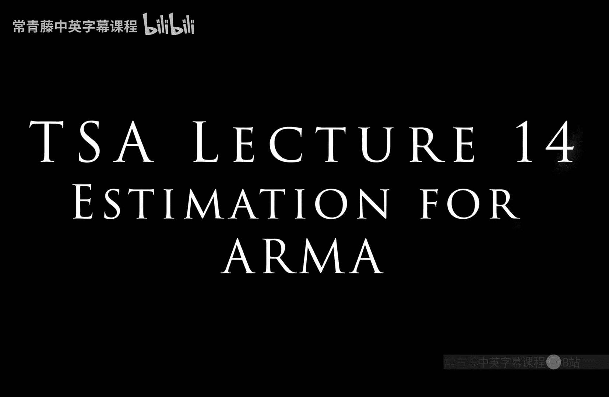
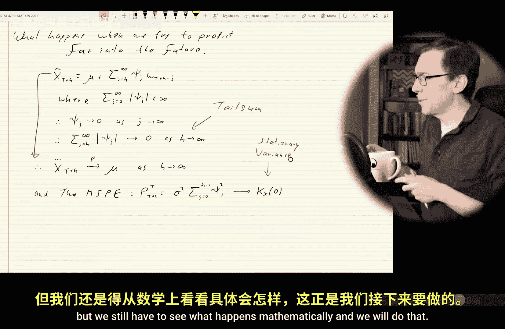

# 阿尔伯特大学【中英⚡时间序列分析｜STAT479 2021 Time Series Analysis】 p14 P14 Lecture 14： Estimation for ARMA -BV1nwqYBDEos_p14-

And welcome back to Statistics 479 time series analysis Today we're going to be doing well the same thing we've been doing for the AR process。

 but we're going to be doing it for the ArA process， I'm talking about estimation， forecasting。

 it's going to be a pretty good lecture。🎼あ。

🎼So when dealing with the pharma process we're going to be using the same types of tools that we were doing for the AR process specifically we're going to be using maximum likelihood now maximum likelihood is a good friend of ours but it's going to require a strong assumption and that assumption is that our white noise is Gaussian not a unreasonable assumption but it's something to take into account nevertheless now going forward we're going to find that the equation R quite messy so we're not going to go into them in excruciating detail I'm going to try to spare you some of the nitty gritty details and we're going to try to focus on the big picture what's going on because ultimately there's going to be a function and R that's going to fit these models for you but it's good to know what they're actually doing what these functions that is are actually doing when you try to plug your own data in and that's what we'll be talking about in this lecture and we're here again with another lecture of statistics for 79 time series analysis today we're going to do in some sense exactly what we did before。

But before well what did we do we looked at estimation and forecasting for the AR process the autoaggressive process today。

 what we're going to do is do the same thing， but for the Arma process So now we're going to include in MA piece in our model it's going to complicate things a little bit。

 but ultimately the main ideas are still going to be the same we don't have access to the U Walker equations because of the MA piece。

 but what we do have is we still have our good friend maximum likelihood which we can work with assuming of course。

 that the white noise process is Gaussian if the white noise is not Gaussian。

 the armorma process is not Gaussian and then we can't use maximum likelihood。Luckily。

 most things are Gaussians， so we're kind of okay as long as we're just aware of the fact that if we have a process whose noise looks very skewed in one direction。

Very heavy tailed， very strange behavior like that。

 Then we have to be a little bit careful when we use one of these methods to fit。

Fit an armA model to our data and this is really the same thing that you would do in linear regression right I mean linear regression as we would teach it at the undergrad level has a lot of very strict requirements if your data doesn't fit those requirements you have to be a little bit more careful and try maybe more sophisticated method but at least for today we're going to assume that all noise is Gaussian and we're going to start to estimate some parameters for an arm process so how do we do that well let's go check out the notes and see。

All right， so the first topic of today's lecture is going to be estimation。4。Arma。Pakq。So again。

 the idea that we're going to do is we're going to specify a P， specify a Q。

 and then try to estimate。The parameters phi1 through P theta one through Q， the mean， the variance。

 in fact， I'll just write it all down right what we're trying to get is we want to be able to estimate。

The mean mu， the variant sigma squared， the auto regressive parameters。

 phi 1 through phi p and the moving average parameters theta 1 through theta Q。

 So we actually have a lot of parameters that we have to worry about fitting even if P andq are not too big。

 there's still a lot of different things we have to estimate and as I mentioned what we're going to do is we're going to do this via maximum likelihood。

So ultimately， we want to do the same thing we did with maximum likelihood in the case of the autoaggressive process。

Um， so if we take a maximum likelihood approach to estimation。

 what we really just want to do is write down the likelihood of mu of。

Theta or of sigma squared of the phis， which I'm just going to write phi because I don't really want to write lots of Phis and the same with theta。

 So we want to write down the likelihood now。The joint likelihood is going to be a big multivariate Gaussian distribution。

I don't know what that is， so instead what we're going to do is we're going to use the same type of conditioning argument that we did in the auto regressive section of estimation that is what we're going to do。

Is instead of writing the joint density function， we're going to write a product T from one to capital T of F。

X T conditioned on all of the previous measurements。Now this is。Basically。This is conditioning。

On all。Past。Observations。So in the AR case， we only had to condition back as far as the order of the process。

 if we had an ARP process， we only had to go P time units back but we have an MA process now where we have an Arma but we have an MA piece and the MA piece is going to require us to condition all the way back through time all the way back to X1。

 so we have a little bit of a more complicated conditioning here but we're still allowed to decompose our joint density into the product of conditional densities and that's what we're doing here。

And all of these densities F are going to be Gaussian。All right。Another thing is。Assume， as always。

 Xt is。I guess causal and invertible。For the AR and the MA respectively。

 as I mentioned in the previous lectures when we looked at these things。

 there are equivalent processes that will be non-causal or non-inverttable and will give you the same behavior stochically you'll get the same looking data out。

 which is kind of a weird thing to think about， but this non-unness issue is why we want to enforce that what we'reestimating is going to be something that is causal and invertible so that we're only estimating one thing。

 we're not trying， we don't have data that could be represented by two distinct models we have data and it's going to be one specific model that we' are going to estimate from it so that's an important thing in statistics。

 the idea of identifiability does show up a lot in statistics。So give this。Right。We can。Right。She。

X T。As an infinite linear process， do I need a sum there， or else it's not going to be infinite。

I equals zero to infinity of phi I W T minus I。Right where phi I are going to be some coefficients depending on oh sorry。

si， the pitchfork1 is a psi， okay， so this is psi I from one to infinity where thess are going to depend on the phi's and the thetas to keep my Greek in line。

Anyway。Yeah， so we can write it that way， we can write it in this infinite。

In this infinite linear process， causal linear process form。And。Furthermore。What we have is that for。

The random variable， so this is kind of weird but I'm going to write the random variable X T。

Given X T -1 through x1。 So this is。A unitivariate random variable。 I'm taking X T。

 I'm conditioning it on the past measurements。 It's still going to be a random variable。

 So this thing is going to be have a normal distribution， Gaussian distribution。The mean， yes。

 so the with。I'll just write it on the next line with mean。Being the prediction。

 the the one step ahead prediction， which we denote as X hat T minus1 and T。 So this is again。

 this is the prediction。This is。No， I didn't change my color， there we go。This is the prediction。Of。

X T from。X T minus1 through x1。 so all it's really saying is that the mean value is going to be of our random variable is what we would predict it to be。

 right。And what's the variance， well the variance？We'll say with variance and the variance in this case is going to be。

 well， we can just write it down， it's the expected value of the random variable Xt here。Minus X hat。

T T minus1 squared。this thing is the mean squared prediction error。

 so the variance of this random variable is coincide with the mean squared prediction error。

 which we denoted in the previous lecture as P with a t in the subscript and a t minus1 in the superscript saying that it's the mean squared prediction error for predicting time point T based on all of the previous time points t minus1 and into the past now。

This is good because it means that if we have a Gaussian distribution and if we know what the mean is and we know what the variance is。

 we know the entire distribution， so what that means。Yeah， well， what that means， therefore。

The likelihood， which i'm just going to write as L right now because I don't really feel like writing all the parameters in there。

 so the likelihood which was。Just to indicate。Up here， star， red star。

There it is so the likelihood right is just going to be the product now T from one to capital T of well。

 what's it going to be it's going to be。Let's see if we can do this with the normal distribution。

 it's going to be。Two pi times the variance， which is yeah。The mean squared prediction error T。

T minus1， this is all to the minus12。And then there's going to be an exponential and the exponential is going to be something like one over two times the variance P T T minus1。

 and then we're going to have to have x， I guess。Yeah， I guess I need a variable。

 so we'll just say x or something or no I guess it's X T。X T minus its mean， which is x hat。

T minus1 T squared。 So that's what our likelihood is going to be。 And the problem is。

 we need to figure out well， wait。What is。The mean squared prediction error。

We want to eventually the point is eventually what we want to do is we want to plug in all the values we get all the things we have here so that the likelihood is in terms of all of our parameters。

 mu sigma squared phi and theta and the idea is that then we can do what we normally do which is take a log。

 take a derivative， find the maximum likelihood estimator by well maximizing the likelihood finding the estimator that maximizes the likelihood to just say the same thing in a different order。

 so to do that what we have to do is get the likelihood into a form that we can start taking derivatives of partial derivatives of to get what's going on here。

For the mean squared prediction error， well， we can start with the case where t is equal to 1。

 and in that case we would have a P10， which we're just going to call the variance of。

I guess the variance yeah， for the process， the variance of。X， T。

It's stationary so the variance maybe xt is a little confusing because I said t is equal to one it's stationary so the variance will be the same for all time points I just need to write something there so I could write x1 right if I really wanted to it's you know this is equal to the variance of x1 etc but what we can do is we can use this form of a causal linear process of above to note that since white noise is uncorrelated and well actually in this case it's Gaussian so it's independent white noise because it's Gaussian white noise Furthermoremore the psi coefficients have to decrease fast enough to make that thing absolutely convergent。

So what that means is that I can write this out， basically I can flip the variance in the subation and I get something that's going to look like sigma squared from the when I take the variance of those terms for the W's。

 the white noise， and I'm going to get a bunch of psi I squared。

I can write down at least in this case what it would be andsi is going to end up being a related to my parameters。

Phi and theta。So then the question is， well， what happens when t is greater than one？Well。

 from last lecture。T greater than one。We can use。What we learned about from Durban。Lvin son。In。

The past lecture。Which， if you recall from the past lecture with something like， a PT。

Plus1 t is going to equal to the previous guy， P minus1 t times sum updating。

 basically times sum alpha coefficient。Something that looked like this。Now。

 as I kind of point out in my written note， I'm not so concerned about the precise computation because all this stuff is going be kind of pushed under the rug in a second。

 but the idea that I want is that you intuitively understand what's going on here。

 not that you can go through and get out every nitty gritty detail and partial derivative because it's just not worth it to go through all of the individual details。

 it's kind of tedious and boring and I don't think you really learn anything from it。

But what I want to do is I want to give you the intuition about what we're actually doing here and how this is all coming together。

The idea。Is that？We。Can write。Pi。T minus1 T， which again， is the mean squared prediction error。

 It's the variance for our normal distribution。 And what we're going to do is we're going to write it as something that's going to look like sigma squared times R T。

 Now， okay， we could figure out what R T is， but I don't really want to。 the point is that R T。

Does not。Depend。On。Sigma squared。So is that clear the idea is that we start with our first mean squared prediction error just being the variance。

 which is sigma squared times something else， then when we update it using Durban Levinson。

 we just keep multiplying by some alpha which is in terms of things that do not depend on sigma squared。

 so ultimately we're going to have sigma squared times something and that something is not going to depend on sigma squared。

That's going to matter because therefore。We get our likelihood once again。

 which I'm going to put that little red star to indicate that once again we're back to writing down the likelihood and every time we write it。

 it gets a little bit more intelligible。So in this case what we're going to get well actually we don't need that product because I'm going to take the product over everything so inside the first thing in the product is a two pi and our variance term or our mean squared prediction error term。

 so we're going to have a two pi two pi is going to be multiplied by itself t times or I should say two pi to the minus1 half。

And there's also going to be a sigma squared in there that's coming from the P。

 so what we end up with， the first thing we get is a two pi sigma squared。

 and that's going to be to the minus capital t over two because I multiply t of them。

 capital t of them together。So the other thing we're going to get are going to be these Rts。

 which I can keep as a term unto themselves。And that's going to look like T from one to capital T R T。

The minus1 half。Yeah， because in this case every RT is going to be different。

 we're just taking the product of all of them， but there still is a power of minus one half from the Gaussian distribution。

And then what we're left over with is。Something in the exponent and that something in the exponent is going to be minus。

 and I'm going to write it as notation S mu phi theta divided by two sigma squared。

 So if you recall from when we did estimation for the AR process with maximum likelihood。

 we had this S term in the exponent。 That was the conditional or the unconditional sum of squares depending on which part of the lecture you're referring to。

In this case。Where in this case， what we're going to have is that s of mu phi theta again。

 there's no sigma squared dependency here， which is going to be important when we start taking derivatives。

 so this is going to be the sum。T from1 to capital T of well。This guy， X T minus X hat X hat。

X T minus x hat， t minus1 t， but there's one more thing in the denominator， which is that Rt term。

 which is a little mysterious because。I don't want to write it down because it's just a big mess of terms。

 it's not really pleasant to deal with， but the point is that it's still there and this is what we have some sort of sum of squares I forgot the square。

It's not a sum of squares if you don't square it。There we go， words to live by anyway。

Now what we have is we have some type of sum of squares equation and if we do the calculus that we've done multiple times already。

 then we can say du du du。V。Calculus。We get。That。The estimate。

 the maximum likelihood estimate for the variance for sigma or the sigma squared which is the variance of the white noise process。

 remember， the variance of Xt is up here， it's sigma squared times something else。

 but the sigma squared is the variance of the Gaussian white noise that is under sort of you know driving the time series。

 the Arma process that we're working with。Now。Yes， what were we doing。

 we were writing down the estimator and we're going to get what we normally get whenever we try to estimate the variance of a Gaussian distribution using maximum likelihood and what we're going to get is we're going to get the sum of squares where we fill in the parameters with hats and we divide by n。

RightThis is more or less it's a little bit maybe less clear in this case。

 but it's the same thing that you get every time you try to take the derivative of or you try to find the maximum likelihood estimator for the variance of a Gaussian distribution some of something squared divided by n sometimes we end up you know subtracting one or more or2 or p from n based on the number of parameters。

 but that's not the maximum likelihood estimator that's the unbiased estimator。

 so in this case we're just doing maximum likelihood。All right， so。

Now what we would need to do is we would need to figure out what mu hat the phi hat。

 remember Phi hat and theta hat are just placeholders for phi1 through phi p theta1 through theta p so they're actually kind of vectors of parameters。

So basically， yeah， now what we need to do is， a yeah， that's right。

 maximize the concentrated likelihood is a new term。So。Then。We get something。Called。Concentrated。

Likelihood。Okay， so what is that， Well， what that's going to be is that we。Basically。We。Replace。

Sigma squared。Above。By S。Of mu。Phi theta over n。Because we kind of， again。

 this is one of those goofy things in math， right， It's like we。

 we know that there's a sigma squared hat and it exists， and it's a thing。

 and it depends on other parameters。 I don't know what it is yet。

 but I can still work with it in the likelihood equation and the neat thing is that if I plug that in。

 Then well， things become a little bit simpler。 So we're gonna write down the likelihood for the。え呵。

😊，Dot， dot， dot， therefore。Star likelihood equation。

We're going to write it down another time and now we're going to get a two pi。

 our sigma squared here is going to be S。Mux phi theta， there's going to be a divided by n here。

 so let's increase the size of these parentheses and then。

Take it to the minus t over two power there's still going to be this R T thing here， which， yeah。

 it's kind of annoying， but it's just there。inus1 half then the interesting thing is what happened in the exponent because in the exponent。

 what we'd be getting is we take our s mu phi theta and divide it by s of mu phi theta。

 so the whole thing cancels out and we're left with just an n over2。

So this is I guess not really L it's the likelihood it's the concentrated likelihood we basically say okay。

 we have an idea of what stigma squared should be so we're just going to plug it in and push forward and by doing that now we're going to take the derivative the partial derivative of this thing with respect to mu and phi and sigma squared in order to well find the。

The estimators， that is the we can solve for them the maximum likelihood estimators for everything else。

So this means that we're going to get a。Log。That's not a very good log。A。对。We can do this。

Log likelihood and the log likelihood in this case is going to be some coefficientency。

 which is all the junknct of depending on n and2 pi that I just don't care about。

 and then we're going to have the stuff that we do care about， which is minus T over2。Times the log。

Of。嗯。Well， here a。Except I'm doing one silly thing I switched。

I switched the sample size because right in statistics。

 very often we treat the sample size as denoted as lowercase n in this case our sample size is actually capital T。

I mean everywhere I think I just started doing it down in the likelihood equation yeah， down here。

 so this guy should actually be a capital T just it's the same thing right I'm dividing by the total sample size。

 but to be precise the total sample size in time series world is capital T so this should also be a capital T。

And this guy here should be a capital T。Okay， so yeah， besides that。

 we're all good and then what we're going to get is we're going to get the log of S。Mu。

Phi theta divided by capital T and to go back and make that more clear in my notes and then we're going to take the。

Derivative of this guy。 Well， not the derivative。 Sorry， it's a log。

 And we're going to have a minus one half。Times the。Some。All right， so where were we， Well。

 what we're going to do is we need to write down T from one。To capital T of the log of Rt。

This is going to be our log likelihood， which we can then take derivatives of and try to estimate the parameters or。

 I guess， solve in some numeric sense on a computer。So okay。

 I don't particularly want to do that because it would require us to write down all of these terrible terms。

What I really want you to take away from this is just the intuition about what we're doing。

Let me finish this statement and just say then。We。Can。Solve。4。New hat。Phi hat。

 and Theta had given all of these terms。I just want you to go through the thought process of what we did right what we did was we said okay。

 we have Xt， it has a normal distribution because we're assuming it's Gaussian process I don't want to write down the joint density so I write down the joint density as a product of conditional densities right I know what the mean and the variance are in terms of the one step ahead prediction predictionor and the one step ahead mean squared prediction error so then what I have is my giant likelihood equation a what I need to do is plug in something for P。

After I plug in something for P now I know I can I can get that right if I plug everything into the an algorithm I can access all of the P's。

 it's just that in an equation sense it's going to be really messy to write down。

Then what I do is I come down here and I get my likelihood in a nice form where I have my sigma squared。

 the variance of the white noise separated from all the other parameters。

As often happens with a Gaussian distribution， I can get the estimator for sigma hat squared and then the new trick which might be something new。

 I mean all of this so far is stuff that you would see if you just did maximum likelihood estimation for the normal distribution。

 the Uniivariate normal in like stats 101 class。It's just the notation is a little bit more terrible。

 but what's interesting then is this idea of concentrated likelihood where you then plug this guy back into the likelihood to simplify the exponent and give yourself something to work with and then from there we just。

 I guess brute force our way through and can get all of the parameters luckily there are our packages that will just calculate this for you。

 but it's really good to know the thought process that goes into where these estimators are coming from and how they come about。

And furthermore， what I think is more interesting to focus on is also the asymptotic properties of the estimators because right in stats we estimate things the things we estimate very often are going to be asymptically normal it's kind of a like constant theme and all of statistics okay I have data I estimate a parameter what's that parameter it's normal enough and sure enough we get asymptotic normality in this case so。

The next little section is going to be。Asymptotic normality and this is important because asymptotic normality means that if our data size is large enough。

 our estimator should look normal， if we know what the mean and the variance should be。

 then we can do hypothesis tests and we can say okay is this parameter significantly different from zero that is is this actually a significantly parameter in my model or not。

 we can do confidence intervals， we can say okay here's the AR parameter or the MA parameter that I computed。

But you know where do I think the true parameter lies boom， you know。

 95% confidence interval brought to you by asymptotic normality？

Though I've always been a more fan of the non asymptotic approaches to statistics。

 but theyre less popular， I guess， just because they are kind of newer。Well， more or less， anyway。

 before I get off on a side tangent。Let's denote。对。

Deote beta to be a big parameter vector of phi phi 1。Through 5 p。And。Yes， theta 1。

Through theta P or Q。Theta Q and we're going to denote I'm going to write this in a different color that if I put a hat on beta。

 I'm just putting a hat on all of the elements inside the vector。

 so we're going to have beta which is the vector of true parameters we' frequent to statistics at the moment。

 so we have true parameters for the model and then we have beta hat beta hat is the vector of estimators for all of those parameters。

So。What are we getting well we get？Deote this。Um， where。啊。say where。The hats。Indicate。

MLEs maximum likelihood estimators。Then that is the stuff that we would have gotten from up here if we solved all these。

I guess derivatives are optimized， the maximized the likelihood with respect to all the parameters。

Right， so then what we get is that the square root of T， the sample size。Times beta hat minus beta。

 which is the difference of the two vectors， converges in distribution。

To a normal zero sigma squared random variable with matrix， gamma Pq。

 I'll write that down in a second。This is as capital T goes to infinity。

 so another reason why I say in the project component of your course。

 I'd like you to make sure that the data size you have is。Big enough， you know。

 don't come with like a time series that has 15 observations because we really want t to get big in order so that we can trust all of these estimators or at least the normal approximation the normal the asymptotic normality of these estimators right we're never asymptotic're never we never have infinite data。

 but we have enough that we say we're close enough to being infinite or asymptotic。

 I guess I've never really liked that argument， but it is sort of standard practice and it does actually work in practice so can't fault it too much anyway。

 I didn't tell you what that matrix gamma is so。The first point is that we have asymptotic normality。

 Hooray， we have an asymptotic normal distribution。Where gamma PQ is going to be。Well。

 I'm not going to tell you exactly what it is yet I'm just going to go one step further down the rabbit hole and tell you that this matrix is a block matrix。

In terms of what we'll call gamma Phi phi， gamma Phi theta。Gammma theify。Gmma， Theta， Theta。

What if there are any like Frrater sororities that are gamma theta phi， if they are。

 there must be into time series。So going forward， what are these matrices now。

 I'll say another where， iterative wheres here。Where。I'm going to say gamma phi phi IJ。

 the IJ entry of that matrix is going to equal the autocovariance of y I didn't tell you what y is yet。

 but I will in a second。I minus J where。U。Capital Phi， B of y。T is equal to W T。 That is。Y T is the。

A R piece。Of X T。So。Okay and we haven't told you what the other gamma matrices are yet。

 but let's stare at this for a second， what we're saying is the matrix gamma。

 the phi matrix gamma is going to be a matrix of autocovariance is again， as I mentioned。

 autocovariance is basically this entire course。And the autocovariances are not for x， therefore y。

 and what is y， y is the process。Is basically X T if we just deleted the moving average piece， right。

 I should point out here that。We had， I didn't actually write this down at the beginning。

 but we would have something like this。Stta。BWT here I guess I'm saying we'll say mean zero so I don't have to put in a mean term and worry about messing that up。

 but that's what we have right， we have our Arma Pq process has two pieces to it。

 it has an autoregressive piece and a moving average piece in this case。

 we're just looking at the autoregressive piece for that matrix and as you might guess for the other matrices。

 we're going to look at the well， for the other matrix。Gamma phi theta， no， gamma theta theta。IJ。

 the IJith entry of that is going to be denoted as K of y prime。I J， so okay， well what's that well。

 where we just have wares all across the board here。

W prime T is going to be the moving average operator applied to WT。So， this is the。M A piece。Of X T。

So that's what we're kind of doing here and then I guess the last thing we need to figure out is what are those off diagonal block matrices？

I guess we'll say that。Gammma。Phi theta I J is the cross covariance between y and y prime i minus J and likewise the reverse of that theta phi it's symmetric so you can just transpose it。

 but you can also write this as y prime y I minus J even though they're the same thing right。No。

 I could transpose it together to work because。It's going to be a P by Q or Q by P matrix。

 so besides the transpose they're basically the same thing。Right， so that's the result。

 I think somewhere possibly in the textbook there's a nasty long proof of it。

 which we're not going to do in this course because I'd rather just spend the time explaining the concepts and then doing some examples in R。

 though at this rate， we might be doing the examples in R probably in the next lecture。

 once we talk about forecasting a bit in the latter half of today's lecture。

But before we're done with this section on asymptotics。

Let's do a simple example or two simple examples。So example。One， which is the AR1 process。Which is。

 of course， just xt is going to be phi xt minus1 plus Wt。And。With。The auto well the variance。

 the auto covariance at lag zero from many lectures ago， it always seems to pop up。

 it's going to be this thing， it's sigma squared， the variance of the white noise divided by one minus phi squared。

U。So。Therefore， the point is that this gamma matrix above。This guy here in green。

Is going to be pretty simple because it's a 10。 So it's not even a matrix。

 It's just one single value。 And what's that value， it's。Just。Iel like I need to， oh yeah， I would。

I think we need to divide all of these by sigma squared because we don't want the sigma squared being in here twice see I have a。

Make sure i'm not messing something up I have my sigma squared in there。

 so I don't want a sigma squared to pop out of here， so in some sense I guess I would need to。

Divide all of these things by sigma squared。So that I don't have。2 sigma squares in my in my matrix。

 The point is， is that what I want here for this guy is just。1 minus phi squared。

To the to the minus one， but I don't want that sigma squared floating around。Therefore。

 what we get is we get that our estimator phi hat is going to converge。Let me double check this。Yes。

Our estim is going to converge。In distribution。To phi with。If we， well。

 I'll just write it out and then we'll talk about it。I think we need a sigma squared in here。

And a1 minus phi squared。Yeah that looks better， I think I forgot the sigma squared in my typed up notes for this lecture。

So what we're saying is that okay， this is good right。

 we have our estimator here and it's going to converge in distribution to the right。

 the thing we want， which is phi， and we have a variance which goes to zero as t goes to infinity as we get more data。

 so the variance is also going to depend on one minus phi squared。

 which is quite interesting because that means if phi is really close to one。

 remember it can't be one or else we have a random walk， it's not stationary， everything falls apart。

But if it's close to one， then it's going to shrink the variance by some constant。

 so the variance in some sense will be smaller as phi gets closer to one， which is quite interesting。

Whereas the in some sense the worst case scenario for the variance would be if phi is equal to zero then the variance is just that of white noise right so that's another interesting thing to point out because I was kind of mentioning this with the mean squared prediction error in the previous lecture that I said okay the worst possible prediction error is just the variance of the white noise and then if you're lucky you can gain some information from previous observations and the prediction error will go down well in this case right what we basically have is the。

We have two pieces here for the variance， we have a sigma squared and we have a one minus。

Phi squared。 And when we look at these two things， we have the variance of。WT。

 and this is the influence。From。The A R。I guess one process。

 so it is kind of nice to look at these formula and kind of see what's going on here。So by symmetry。

 we actually get well， I'm going to do another example and by symmetry it's actually just going to be the exact same thing。

 but we're going to write it out anyway just to make sure it's clear。In this case。

 we're going to have our MA process， which is going to be theta WT minus1 plus WT for theta less than one。

 so it's invertible， etca。So what's going to happen here and this is kind of funny is that well first the。

A a。Polynomial。Is。What it's going to be。1 minus。Theta， not one minus1 plus theta。B。Ah。

 that is not how you write a polynomial。Theta of b is equal to1 plus。Theta。B。

And that's kind of neat because what we're ultimately going to do is then try to。Basically。

 look at this as an AR process， so。Therefore。Well， the AR1 model。Theta。

Be applied to some time series why。Equal to WT。Has。The same。Behavior。As above。

Which means that we're going to get the exact same thing out。Which in this case is just going to be。

 well， the same thing we had before， but I'm going to replace the。The Phi is with a bunch of thetas。

That needs to be a theta squared。Cool， so that's a kind of a little weird， tricky thing。

 but it's basically saying that， yeah， we get the same behavior in both cases of our estimators。

 at least for the AR1 and the MA1 and we see the same thing which is the closer our parameter is to zero。

 theta or phi， the closer our process to white noise， at if theta or phi 10 towards one。

 I guess minus one as well， but let's say they 10 towards one， we start to move towards the well。

 the random walk in the one case or in the moving average case。

 I guess we'd be on this weird cusp between invertible and noninvertible。Yeah。

 I actually don't know what that process would look like that's a bit of a strange process I haven't really thought about that one。

 but ultimately what we're doing is we can kind of see how we move from something that's close to white noise to something that's well。

 not close to white noise。And then the last question is。Howo。Do。We pick。P。And Q。When。Estimating。And。

Armma or fitting， I should say， I mean， estimating the parameters。 but when we fit。When fitting。

And Arma。P Q to our data。So how do we choose the order P and Q， well there's a couple ways。

 one is we could just use something called auto dotarma。In the forecast。Package。

Which does it for you， but then the question is well then how does that function pick the P and the Q and？

We can say or。Arerima。And I think that's just in the stats package， the default one and R。U。And the。

 the point is， we can。Use。AI C。Or BIC for model selection。

 and that's exactly what that autoarma does behind the scenes。It basically says， okay。

 I think I forget if it defaults to AIC or BIC but whatever it defaults to。

 you can switch it to the other one and it'll say， aha。

 I'm just going to fit a whole bunch of are models until I find the one that minimizes the AIC or the BIC or whatever you give it。

And that's sort of yeah， standard model selection type approach。

 you can do it manually using the arema function in the stats package。

 you can fit a few models and then decide， well， which one has the smallest AIC or smallest BIC。

 that'll be my favorite， depending on if you like AIC or BIC。

 even though very often they're probably going to give you the same answer， but not always。

 so you have to be a little careful。And you get to do that in your next assignment that you should be working on and actually fit some AMM。

 some arerima models to some actual time series data， so that's pretty neat。All right。

 and we have one more thing that we're going to start discussing in today's lecture and finish it in the next lecture and that's forecasting for the ArRma process we'll start it today。

 talk about some of the basics， we'll finish it up in the next lecture and then we'll just look at some R code for fun for estimating and for forecasting arema。

 Arma and Arma processes。😊，So moving on， we're going to talk about forecasting。For Arma。Pq。Right， so。

What are we doing Well， let's just write it down。 I forgot to write down the model last time。

 but we'll write down the model。Right here。Just so， we have it。In the front of our head。

And somewhere on the white there， the one node page so that I can point at it if I have to。

 So we're going to ignore the。I part the integrated part。

 it's not going to be an aromama model it'll just be an armor model。

 but you can do a lot of these things for arema models too。

 you just have to well account for the differencecing。And we assume。Ca锁。And invertible。As always。

 basically。不。So again， what we want to do is we want to predict， say。Well。What we want。Is an。H step。

Ahead。Prediction。Very often we just do a one step ahead prediction but。Okay。

 we can do H steps ahead and what that's going to look like is it's going to be some estimator x hat T plus H。

And it's really just going to be the expected value of， well， x， I was seen capital T。

Because we're saying our data goes all the way to capital T。

 we want to predict H time units into the future， what is it going to be。

 well it's just going to be the expected value of that random variable conditioned on our entire data set。

All right。But there's going to be a little twist we do here， and that's。It's。Mathematically。

Niceer to condition。On。Infinite。Data。Okay， so we actually get a different term。

 which is going to be x tilde T plus H。And this is going to be， well。

 the expected value of Xt plus H。Conditioned on x capital T back to x1。

 but we're not going to stop there。 we're going to include an x0 and an x -1 and go off to the infinite past。

 Now that data does not exist in our data set。 We only have the first the T measurements and we do not have any ones that go past that what we're going to do is use x tilde to mathematically understand the forecasting or the。

The estimator， the predictor， I should say， the H step ahead predictor。

 and then we're going to switch Tilde to hat。At the very end， so。Stick with me here。

 it's pretend now that okay， we have access to lots of data。

And it's not completely a terrible thing to think about because as T， the data size gets large。

All of this stuff that I underlined in red becomes fairly negligible and these two predictors become very close to each other。

 so again， we don't have the ability in the real world to work with X Tilda because we don't have infinite data but we can mathematically try to understand it and that's what we're going to do。

So the next thing we need is we need to write out our process both as a causal and an invertible process。

So this is kind of， I guess， step one is get these things。Step2。

Is we need to write out the causal and invertible process so causal。

A causal linear process going back to one of the first lectures is going to be X。

T plus H is just going to be W T plus H。Plus。OrAn infinite sum j from 1 to infinity of psi Jw capital T plus H minus J。

And we're also going to have our inverible。Process and in this case we get not an x。

 but we have a Wt plus H and this will be a big sum of x is xt plus H。Plus。

 the P sum J from 1 to infinity of pi， my new parameters， pi J。X。Capital T plus H minus J。All right。

 so we have this， this is something that we did back in， I think chapter one of the lecture notes。

 but it's good to write it down because we're going to need these tools going forward。Mainly。

 we're going to apply this conditional expectation to these terms and see what happens。So now。

Combining。1。And two， what we get。Well。Okay， we're almost at that point first。Note。

That the expected value of。WT conditioned on。Capital or X。Capital T。

All the way to x0 and on to the infinite past。 So this is again， infinite past。 Well， this。

 we know what this is， this is either going to be WT itself。

This is if little T is less than or equal to capital T or it's going to be zero if little T is in the future。

m，Okay， so why， well， one。So why is this true， well， for one point if。

T is greater than T if little T is greater than big T， as I like to say。

 the white noise lives in the future of our data， so it's but it's basically more mathematically what we can say is that if this is true then。

WT is。Independent。Yeah， I think we're still assuming Gaussian in this case， I guess no。

I'll say uncorrelated just to keep it as general。 we don't actually well， no we're conditioning。

 so we do need independent。 Yeah， so I guess we probably need to emphasize。

 I don't think I did that that in this case， we would need。At least independent IID white noise。

Of the past measurements， X T。All the way into the past。Again， this is because the process is causal。

 which means that it only depends， the x's only depend on the current time and the past。

 WT lies in the future， it's independent of all of that stuff。And then two， we say that if。

T is less than or equal to T。Then。We have。诶。1 to one correspondence。Between。The x is and the W's i。e。

Conditioning on X T going into the past is kind of equivalent to conditioning。

 This is terrible notation， by the way， but I hope it makes the point WT。Into the past。

Right the Xt is just a linear combination of Xts and WTs。

 so we can always just invert it somehow and say that if we know what every Xt is from now into the infinite past。

 well then we know what every WT is from now into the infinite past by just。

 I guess reworking the equations， it's equivalent conditioning。So we have that。U。Oh， and。

And then I will say similarly。What we have is that， so this is， I guess。

One thing we need and the next thing we need is going to be that the expected value of xt。X， yeah。

 a little X little T conditioned on the entire infinite。

Past x capital T through zero and on the past。Well。

 it's going to be one of two things if it's either just going to be itself， this is if。

T is less than or equal to capital T， and otherwise it's going to be x tilde， right， this is。

X tiltil at T， if。T is greater than capital T right because that's exactly what we wrote down back in step one。

 we said， well， in this case we're just replacing capital T plus H with little T。

 but it's the same thing。Okay， we have that。Therefore。Our causal。Representation。Becomes what， well。

Well， I should say applying this yet to the causal representation。

 what we end up with is where was that causal representation。

 I just have just not quite enough room to fit it onto the same page but。That's okay。

What we end up with is an X tilde。T plus H。Is going to be。The sum。In this case， J。

 but we're not starting from zero， we're starting from H and going to infinity。Ofsi， J。W。

 capital T plus H。Minus J。Okay， so what happened there？This is after。Taking。那个。Conditional。

Expectation。Of each side。So let's look to make sure we know where that came from up here。

 my causal representation， I have an xt plus h， if I take the expected value of xt plus h conditioned on the data。

 I get an x tilde t plus H on the right hand side if I take a conditional expectation of each of these ws with respect to the data。

 I either get the W or I get a zero， so what happens is the first， I guess H minus1， well。

 h from0 to h minus。The indices from zero to h minus one of the Ws all vanish because when I take the expected value。

 they become zero， they lie in the future of our data set and the only thing that remains are the。

The the W's and the Phis for J from H onward。This is why it's really convenient to be able to condition on the entire data。

Some infinite analog of our data set。All right， then。

As we fight our way through this member what we're doing， we're trying to do prediction here。

 we're trying to understand what this predictor is， so then we end up with the fact that X。T plus H。

 the thing that we're trying to understand minus X tilde T plus H。

 the predictor of mathematical convenience， if we subtract one from the other。

 we get a finite sum and that is quite nice actually， I like finite sums。

J from0 to h minus1 of phi J W T plus H minus J。And that means we can write down the mean squared prediction error。

The mean squared， prediction， error， or using that P notation that we were using in the last lecture and earlier in this lecture。

If we want the mean squared prediction error for T plus H。

Given the data from T into the infinite past， again。

 we're still doing infinite past here because it's mathematically nicer。 Well。

 that's just the expected value of this thing， X T plus H minus X tilde T plus H squared i。e。 it。

This thing。Squared， and that's just going to be sigma squared。As is always out front。

 the sum J from0 to h minus1 times the psi j squared。And it's a finite summations， that's great。

 we don't even have to， I mean， it is causal so we know that the infinite sum would have to converge。

 but we don't even have to worry about that in this case。All right。

That was the causal representation。Looking。Hat。The invertible。Representation。

 there was a reason why I wrote down both of them。While we can do the exact same thing right all I did up here was apply the conditional expectation to the causal representation。

 if I do the same thing for the invertible representation。

 what we find out is that we get a zero because I should just write it all out。

The invertible representation is a WT， and let's go find it。Yeah， X T plus H and then a bunch of pis。

Is equal to x。T plus H plus the sum J from 1 to infinity of pi J， X， T capital T plus H minus J。

So what happens is when I apply the conditional expectation here to both sides of this equation。

 well I get a zero because。I guess T， well， I shouldn't use T。

Capital T plus H lies in the future of the data set。

And then I'm going to get my X tilde here when I take the conditional expectation of that term。

And then we're going to get two things out here。We're going to get a J from one to。

 I think it's H minus one。Pi J， X， Tilde。T plus H minus J plus the sum J from H to infinity of pi J X。

 T plus H minus J。So anything that lies has an index that's greater than capital T gets a tilde stuck on top of it。

 otherwise we just keep the series the same as before because we're conditioning on the data points that we。

Or just looking at。Therefore。What we have is that the。The predicted。Value。X tilde t plus H depends。

On the data。X T。Going into the infinite past， and。The previous。H is it H or H minus1。

 I think it's H minus1。 Yeah， H。Minus1 predicted values。

So what that mean is that if we want to predict the H。

H I can't put a TH after H just doesn't work if we want to predict the H time points into the future。

 we'd start by well predicting one and then two and then three and then four and then so on up to H。

Which makes sense because so often in time series we have things like autoregressive processes where the previous observations tell us what happens in the next case and that's what's happening here。

All right。Yeah， we have a little bit more time。 So what I'm going to talk about is we're just going to finish up our discussion on X Tilde today and we're going to leave the。

We're going to leave figuring out how to turn X tilde into X hat for the next lecture。

 but we're not quite done yet because I want to talk about the。What happens？When。We try。To predict。

Far。Into the future。Feel like I should go into like an audio editor and have like future future future future future。

 but that would just be silly， so we're not going to do it but it is an interesting point right in time series we're often trying to predict future measurements。

 we want to know what the price of our stocks going to do we want to know what the price of or the price what the number of COVID cases is going to do。

 we want to know what global temperatures are going to do hopefully they're not all going to go up except for our stocks of course we want those to go up but the other two let's have them not go up But the thing is how far ahead can we actually feasibly predict in a time series because time series are super noisy so does it even make sense to predict that far into the future Well you can。

And we can figure out mathematically what we'll get out。U。Yes。

 what we need to know is a couple things well first of all， what we have is we have our。

Predicctor well。What I'm going to do is I'm going to write out X。

I'm going to write out the causal one， which has fallen off the top of the page。Once again。

J from H to infinity of Psi JW T plus。Not T capital T。Capital T plus H minus J。

 so that's our causal representation。Where。We know that the sum。

J from zero to infinity of the absolute value of the phi J has to be finite， this came up back in。

 I think one of the first lectures where we talked about a causal linear process that the coefficients have to be absolutely summable。

Okay， but that's actually quite interesting because therefore， well there's a couple things。

 we know that phi J has to go to0 has J goes to infinity I mean， yeah。

 if it's summable if it's absolutely summable the terms the coefficients， the things the sum ands。

 I guess it's the word I'm looking for have to go to zero but there's something else that's even more interesting and that's the sum of J H to infinity。

Of the absolute value of phi J has to go to 0 as H goes to infinity。

 And this is what we call a tail some。If we only sum， if we start our summation at H instead of zero。

 well， it's going to be slightly smaller as we push H to infinity， this thing also has to go to zero。

So what does that mean well therefore。Let's bring this guy down here。And what it tells us is that。

X hat。T plus H is going to tend towards the mean mu。As。H goes to infinity。

 So as we predict further and further into the future。

 what are we predicting we're predicting the mean， we're saying I have a stationary process。

 it has mean mu。If I watch this process for you know years and years and years。

 what's the best prediction I have， it's the mean， right， that's all we have to work with。

Because it's kind of saying it could fluctuate up， it could fluctuate down。

 but on average we know what it's going to be。And。Yeah I guess actually I should be more precise。

 this is convergence and probability， we have that by showing that the variance yeah actually goes to zero。

I wonder if you can show that almost sure convergence， that's just sort of mathematical fun but。

Yeah that's always a harder thing you always have to show that it actually converges but in a fast enough way to become homeless sure but we don't really need that I'm just going to skip ahead and say that。

Um and。The mean squared prediction error is。P， T。T plus H。

 and that's going to be sigma squared times the sum J from 0 to H1 Phi J squared。

 So what happens as we take H to infinity， Well， this。Just goes to the sum of well。

 we're just going to sum the phi squares from0 to infinity and I'm pretty sure we saw that earlier in the lecture this is just。

K X at lag 0， it's。The variance。The stationary variance， I guess， to be precise。

So what does that mean that means as we move far into the future。

 the best guess we have for prediction for our armor process is the mean and。

What what's the variance of our estimate， well it's just the variance of the process itself because as we move forward to the future。

 our data that we've observed no longer has any direct relevance to for prediction again this is for a stationary Arma process that means that we are assuming that there is no trend if we have an increasing trend we could still assume that that increasing trend will continue again。

 sadly for maybe global temperatures。But if we have a stationary process， the mean is constant。

 it's not increasing， nor is it decreasing， that's why it's always our best predictor。

It is what we would predict in the future also I made a mistake here。

 this hat is supposed to be a tilda。I'm so used to just writing。

X hat and mu hat and everything because that's what we do in stats but。We're gonna stop for today。

 but next time what we need to do is we need to figure out well what happens if we don't have an infinite past for our data。

 which is every data set we're ever going to look at right we need to at least to the best of my knowledge there isn't any that goes infinitely into the past though it would be quite interesting if there were one regardless what we're going to try to do is figure out how to replace the X tilde with the X hat the same thoughts process that went into understanding X tilda goes into X hat because as I mentioned for a large data set they're basically the same thing because the piece that you're kind of throwing away the X0。

 the x minus1 are not really going to have much influence。

 but we still have to see what happens mathematically and we will do that but we will do that in the next lecture see。

