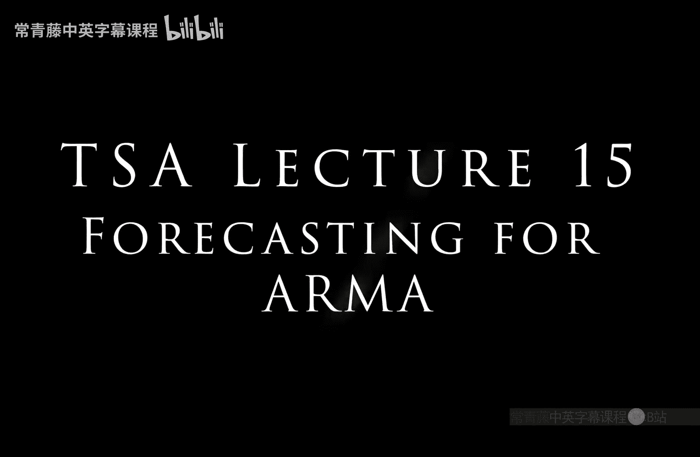
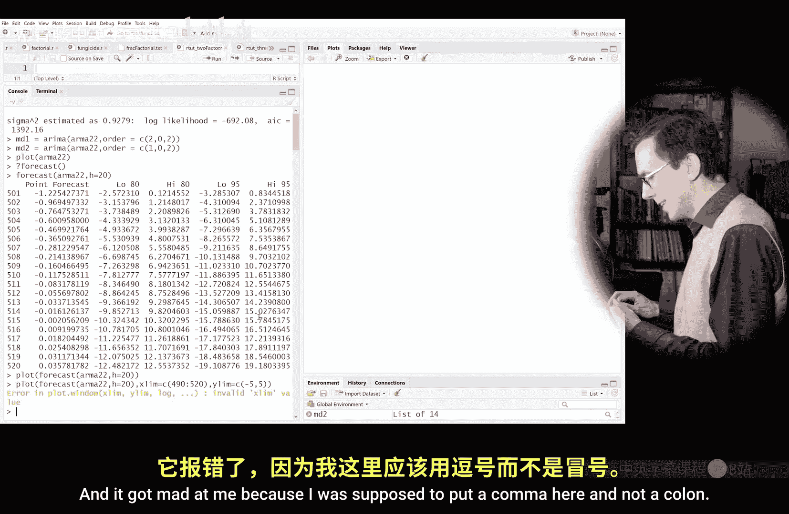
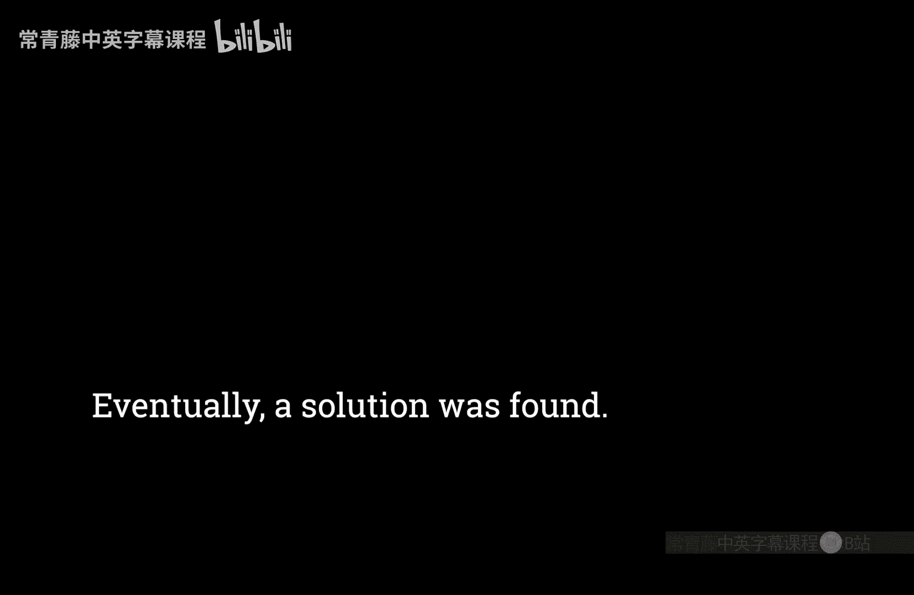
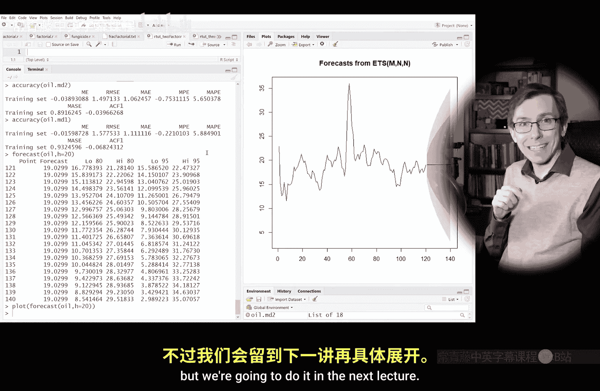

# 阿尔伯特大学【中英⚡时间序列分析｜STAT479 2021 Time Series Analysis】 p15 P15 Lecture 15： Forecasting for ARMA -BV1nwqYBDEos_p15-

And welcome back to another lecture of statisticss 479 time series analysis last lecture we looked at the ArA process。

 we looked at how to estimate coefficients and we started talking about forecasting。

 but we didn't really get past the mathematical nuances of forecasting in this lecture we're going to get into real forecasting with real data。

🎼あ。

So what we have to talk about is how to do forecasting with real data because real data is not infinite。

 something that we don't often like to talk about， but in fact you do not have infinite data。

 you only have a finite amount and you have to feel figure out how to do forecasting for a finite amount of data but're also going to take a small diversion and talk about backcasting because sometimes you don't want to predict forward。

 you want to predict backwards， Lastly we're going to take some time today and look at a bit of R code and some real data because we've been doing a lot of studying so far of the mathematics but it's really good to get a sense of how this works for real data。

We're gonna jump into the notes I'll see you there and welcome back to another lecture of statistics 479 time series analysis today we're going to continue our discussion of forecasting for the Arma process we started it in the last lecture after doing estimation and we talked about some mathematical ways to understand forecasting specifically we pretended that our data extends infinitely into the past but it doesn't we don't have infinite data to work with we have a finite amount of data because that's typically how data works so what we have to do is look a little bit closer at our forecast because right now we're sort of in this ideal math world of forecasting we have to forecast in the real world that's what we're going to do today so let's jump into the notes and see what we get all right so what I wanted to do was just start by recalling some of the notation that we used in the last lecture。

😊，That we're on the same page， so first of all， we'll just say this is forecasting。For Arma。Pq。Now。

 when we're doing forecasting for an armor process， right， first we need to note， well。

 what does the Ar process look like？It is going to look like capital 5hi b。

Of Xt is equal to capital theta。B of WT， so we have our our auto regressive piece。

 we have our moving average piece and we're going to assume， of course， that this is causal。

And invertible。As usual， and furthermore， we had two different notations for forecast for predictions。

 predictors， I guess， we had our H step ahead predictor。Capital T plus H。

 which is the expected value of well， just the time series process itself at time T plus H given the observed data capital T down to1。

And then we also had this notation。Of x tilde capital T plus H。

 which is going to be the expected value of x T plus H。

Given the data and all the hypothetical data that would extend into the infinite past again。

 physically we don't have that mathematically we can always think of our stationary process as extending infinitely in time in both directions。

 we want to use the past to predict the future， it's stationary that's good。

 but the thing is that we don't typically have infinite data going all the way into the past。

 so we have to figure out what's going on here。So to speed ahead to what we did last time。

 we found a couple things， I guess what we found， there's all the good stuff right。

 what we basically found is that there's a couple ways to look at the process。

So I'll say from last time。What we had was this idea that well， we can write Xt or x Tilde。

T plus H in its causal form and it's going to look like mu， the mean of the process again。

 we can assume mu is zero， but if it's not zero， we can also adapt our equation for a nonzero mean。

And now。What we're going to do is we're going to have our summation here。

 but we're starting at H and we're taking Psi。Jy。W capital T plus H minus J。So the point is， is that。

 as we noted last time， this is a tailsome。From。H to。

I'll say two because H is not converging to infinity， so I shouldn't use an arrow。

 they are right arrow。I should just say H2 infinity。

And we saw some properties at the end of the last lecture， most notably that。In the limit， X Tilde。

Capital T plus H will just converge to the mean that is our prediction will。

 this is as H goes to infinity， I should say。So what that means is that our prediction far into the future is just the mean of the process and again this makes sense。

 I mean you always think of stochastic process as like some stock market that's jumping up and down but that's a random walk in this case we have a stationary process stationary process looks a lot like white noise okay it's not white noise there are autocors there's moving average pieces but。

It's going to be fluctuations above and below some mean mu。So if we go really far into the future。

 our data in some sense no longer matters， we're just going to say， well。

 the best guess we got is the mean， whether it's zero or whether it's mu or otherwise now。

What I didn't do。In the last lecture was I didn't talk about the convergence。

So I think I mentioned briefly that this converges in probability。

 and I thought mathematically it would be nice to actually show that before we move on to the next section。

 this is kind of a standard trick to show convergence and probability。

 we're going to use something called chby Cheev's inequality。

 which is a really useful tool in probability theory and statistics when you're dealing with random variables。

 especially when you want to show convergence and probability because it's all about the variance。

 remember chby Cheev's inequality about the variance。Okay， so。What are we doing， Well。

 what we want to do is we want to。Basically， prove。This convergence。Well， how do we do that， Well。

 converging in probability basically says that we want the probability that X。

Tilde T plus h minus mu is greater than epsilon， and we want this thing to go to zero。

 so this is the probability that our random variable differs from the mean the limit that we believe is there by some amount epsilon epsilon。

 this is basically for any。I should put that in。Any。Epsilon greater than0。

 So for any epsilon greater than0 as H goes to infinity， we want this thing to go to0。

 How do we show it Well， the first thing we note is we can use this definition here that the green arrow is pointing at。

 And if we subtract the mean we find out that we're just looking at the probability that our tail sum J from H to infinity of psi J W capital T plus H minus J。

We want to know what the probability the probability that this thing remains bigger than epsilon now we already said last time intuitively this thing can't be bigger than zero in the limit as H goes to infinity because we need。

Basically， if this was in a series sense， right， we need the tail sum to go to zero so that the series converges。

 we know the series converges， we know that it converges I think absolutely。

 but what we need to do is we need to try to make it more precise in the case of random variables because this isn't just a series with real values real valued summans。

 it's a series with random variables。And what we can do is we can apply the Jebyev inequality and what that says is that this probability is bounded above by the variance。

Of the thing in the probability statement， which is the sum。J from not zero。

 j from H to infinity of Psi Jw T plus H minus J。And this is divided by epsilon squared。

Now the thing in the X or the numerator that is the variance。

 well this is just the variance of a sum of a bunch of white noise processing pieces。

 I guess white noise terms and what we end up with is well we're going to get epsilon to the minus2 here and then we're going to have well。

Maybe I won't write it like that， I'm going to write Sigma squared。

Epsilon squared in the denominator， and then we're going to get the sum。

H from not H J from H to infinity of psi J squared。And we already know that this has to go to。

Zero as H goes to infinity because。Well， a couple things sigma squared over epsilon squared is fixed。

 that's not changing we're not taking epsilon to zero。

 this isn't one of those epsilon delta type things where we take epsilon to zero we just have epsilon is any fixed positive number this will work and。

The summian， J from H。Well， the summation from。1 to infinity of P psi j squared is finite and if a summation an infinite summation is finite that means the tail sum has to go to0 as you take H to infinity so that is where we kind of formalize this a little bit better and we don't just say a yeah。

 we just kind of go to the mean as as you try to predict H further and further and H steps further and further into the future。

But what it does tell us right is that now we actually have convergence and probability now。

We could try to do， I think convergence almost surely it's a stronger result。

 I'm not actually sure if it would hold。If you want to try it at home and you really like probability theory。

 you can give it a shot， I would probably look at the Brell Can telllilemmas because those are the only tools that I always think about when I think about proving almost your convergence of something but we're not going to get into that in this course。

 we just want to basically try to be a little bit more rigorous about the result。

And there's one other thing that we also noted from last time。

 so this is bullet point statement one and the other bulleted statement is that our mean squared prediction error。

T plus ht is equal to sigma squared the sum， and now it's just the sum j from0 to h minus1 of P psi j squared so it's kind of like the opposite sum right our the sum we had in the proof is from H to infinity。

 this one is J from0 to h minus1 and we know that in the limit this thing will converge and this is just a bunch of real numbers so we don't have to talk about probabilistic convergence and this case it' just going to converge。

To J from zero to infinity of Psi J squared and we know that's。

Finite and equal to the variance of the process， X T for whatever t you want， it's stationary。

 all the variances are the same。All right， so that's kind of the recap of where we're at。Yeah。Now。

All right， so what do we do with the fact that we're working with X Tilda and not X hat so this is the section called truncating。

The infinite past。Seems like a good title for a short story or something if anyone's a fiction writer out there。

Anyway， yeah so。What are we doing？Well， what we're going to do is we're going to note that so there's two approaches。

 one is that if。That。Data size， T is small。We can。Just solve。mA linear system of equations， as noted。

 I think a couple like a lecture or two ago。But if T is large。

 we're not going to be able to do that and we're going to have to。Go forward iteratively。

So now what we're going to do is we're going to use the invertible representation because remember last time I said there's two different ways we can write a process。

 we had the causal way of writing the process as a linear causal process that's at the top of the screen here this is X Tilde right I'll put that in here as a。

Casal。嗯。Representation。But what we also have if we come down here is the。Not the causal。

 but the the invertible。 So if we consider the。Invertible。Representation。

Then what we have is we have that x tilde T。T plus H A is going to be， well， two things， right。

 first of all， if we have terms that lie。In J from1 to infinity or not one to infinity，1 to H minus1。

 these are the things that lie outside of our data set to the in the future。

 I should say these lie in the future of our data。We have our pi I and our X tilde。T。

And T plus H minus J。So we said this last time we're going to predict based on the previous。

 we're going to predict the H guy， the H step ahead estimator based on the previous。

Estimators or sorry predictors I should say strictly speaking we're doing prediction not estimation so what I meant to say was the H step ahead prediction is based on the h minus first and h minus second and so on predictions and it's also based on。

Previous， the actual data set， which is J from H2 infinity because we're still pretending that we have infinite data and we get something that looks like this。

Right we got this from looking at the invertible representation and then taking the expected value。

 remember the invertible representation is that white noise WT is an infinite sum of x's。

 whereas the causal representation is Xt， the process is an infinite sum of white noise。

 there are two different ways to write it and you can think of it in a sense that the causal representation is like an infinite moving average process and the invertible representation is like an infinite autoregressive process。

When you have an armor model， you have to account for both pieces there。Anyway。So。We can also。

So I should say。Um，Let's see， I kind of want to write these on top of each other。

Yeah now we'll just write on the next line， I'll say also。Givenive in。Arma coefficients。

Phi1 through phi P and theta 1。Through theta Q right we're going to pretend that we just know what they are。

 Of course we don't actually know what they are yet， I mean。

 we'd have to estimate them from the data， but。Whatever we pretend we know what they are。

 then what I can do is I can write X Tilde。T T plus H。Well， I can just write this as the。

Trying to think if I should explain this slightly better or if this makes sense。

 I'm going to write it all out and then I'll just tell you where this came from in case it doesn't make sense where it came from。

Why I'm writing an Arma process with a bunch of ex tildas。So first I'm just going to write this out。

 we have the ArmaP or the A piece， we have the MA piece as usual。

 which is going to look like theta J now I'm going to write W Tilde T。

T plus h minus J and what this is， right？This。Comes。From。Applying。The expected value operator。

Conditioned on the infinite data into the past。Applying this too。The harmma model。

So basically what we did to get this equation here is we took the conditional expected value of each side and we turned the terms x and w into x tilde and W tilde now we defined W tilde last time and I'm going to find it again so that we can properly define it this time。

When the world happened to W Tilda， I know it's here somewhere， a yes。There it is， we'll say where。

W Tilda of。I guess it's a different notation。Capital T。

T plus h minus J is going to be the expected value of W。T plus H minus J conditioned on， well。

 the data， just like I wrote in blue up above into the infinite past and this thing。

 as we saw last time is going to take on two different values if w lies well。

 it's going to be Wt plus H minus J if let's see if we can do this。

 J is equal to H or greater or j is grid than or equal to H and it's going to be0 if j is less than H。

Because if J is less than H than W T plus H minus J lies in the future of our data set。

 the expected value is0 if J is。Greater than or equal to H W lies within our data set。

 and the conditional expectation is just the W that we had in the first place because again of like this one to one correspondence between x's and Ws。

Now， okay， we have， so we kind of understand what this equation is。Where do we go from here？

So similarly， well no， we know what extil is， so we're good with that。Yeah。And yes。

 we actually have another way of writing W。Tilda here or W W Tilda。So W Tilde T and little T。

 so this is okay slightly different notation but I'm just using little T to make it easier to look at well this is going to be a two different things we're going to have the moving average or not the moving average。

 sorry the auto regressive operator apply to X Tilde capital T lowercase T and then we're going to take subtract。

The sum J from 1 to Q。Of theta J。W Tilde T minus J。So this is once again。

 it's basically the same thing I have up above， I'm just rearranging the terms slightly。

All right and we're back and I realized I made one slight mistake here when I introduced the invertible representation。

 what we were supposed to do is trunc it， and I didn't actually trunccate it。

 I just wrote out the infinite sum going into the infinite past。

 but the idea here is that I can truncate this and while basically replaced the infinity with a capital T plus H。

And what we're doing now is we're。Basically saying， okay， I want to predict X Tilde。

At time I want to predict X at time T plus H given the first T observations。

 we wrote this as an infinite sum but I don't have infinite data so what do we do well we just kind of scribble out the infinity and replace it with a T plus H I guess this is technically supposed to be a T plus H。

Minus1， so that the smallest index on the x will be one， right。

 because t plus H minus t minus h plus1 is just equal to1。

So yeah that was a slight misstep on my part， the point is is that we can just do that and now when we take this and we plug it in to this equation。

 we can effectively just compute everything， I mean it may not be straightforward， but。If we。

 if we use our data to predict the first。H step aheads， H I guess H minus one， like the first step。

 second step， third step and so on， we can plug them into the Arma part of this and then we also have to compute these white noise pieces W and the white noise pieces are computed down here based on again the past Ar pieces and the past white noise pieces so when we're doing forecasting for time series it's really a step by step thing we try to go H is equal to one step ahead we use our data to try to figure out well one what I guess what the data is itself and what the white noise pieces are we have the data we can figure out the white noise we predict the next point now we have that one then we use the entire data set and our one step ahead prediction to do a two step ahead prediction and so on。

If it's not clear， we're going to do an example and hopefully that will make things a little bit clearer because。

Yeah， it can be a little bit like， okay， yeah， that's it， it was like， well wait， that's that's it。

 yep， that's it。So let's do an example， in this case。

 we will take the simplest Arma example I can do， which is the Arma 11 process and we're going to write that。

As X T。Plus。Xt plus1。Is equal to phi。X T。Plus， W。T plus one。Plus， theta， W， T。All right。

 so now we have our Arma 11 and we can write down the one step ahead prediction so the。Basically。

 one step。Ahead。Prediction。She。Is。Well， it's X Tilde。Capital T。T plus1 is equal to phi。

X capital T plus theta W tilde T。I guess T。Um，Yeah， because it's the teeth。

 white noise piece effectively we。Remove this。And we。Estimate or。

I feel like estimate is the wrong word we predict。This， and we already have this。

So right we have the XT data point， the WT plus1 lies sort of。

 I guess ahead of our data set that just becomes zero。

 when we take the expectation up above that I mentioned， and the WT here when we take or capital T。

 I should say when we take the expected value of that， we just get W Tilde T。Now。

If we go for the H step ahead prediction。The H step ahead prediction。

Is going to be continuing this onward， but the W start to not matter anymore because if we go back up to our definition here。

 any W after。Capital T and into the future to capital T plus one and so on。

 once we take the expected value， the W Tilde just becomes zero。

 so we're only going to be looking at the AR piece here。Which is going to look something like。X。

Tillda。T T plus H is going to be just phi。Times X。Yeah， T。

T plus h minus1 this is for h greater than or equal to2 so all it's saying is is that what are we going to do if we want to predict the future of our armma 11 process well the first thing we do is we figure out what w Til is and we get X T the actual observe。

 the final observed data point。Then to get the next guy。

 we just take the previous estimate prediction， multiply by phi。

 then we multiply by phi again to get the next one and the next one multiply by phi again and so on just until we're satisfied。

 I guess or until it converges to zero and it' kind of boring。So in that case。

It's kind of interesting。So。Basically， we need。2。Thanks。Which is X T and。And estimate。4。W。T。

 which is。This W tilda T T and that's all we need to do forecasting now granted the entire data set could be used to estimate phi and theta and things like that like we talked about in the previous lecture using maximum likelihood so we still want to have lots of data right but the point is for forecasting I guess we really only need that Xt and we still need to figure out what W is so in that case we're going to have to work a little bit harder。

So then the question is。How。To get W Tilda TT。Okay， well， let's think about that for a second， right。

 we know。So we have， if we rearrange the above equation， where is it a？

If we rearrange our Arma equation here underlined in green。

 what we end up with is a wt plus1 is equal to xt plus 1 minus phi x T minus theta wt now if we take the conditional expected value of this what we end up with is we end up with the idea that w。

Tilda T T plus1。Is equal to X t plus 1 minus phi Xt。Minus theta。W Tilda T。Little T。All right。

 so what do we do well？So then we solve。Itteratively。Starting。With。W tilde T0 equal to zero。

 so we start with white noise at time zero being0 and our observation x not being zero。

And then we just start computing so we go in here and we say， okay， well， if I have that。

 then that means that what。W Tilde T with a1 is going to be x0， no x1， sorry。X1 minus0， minus0。 Okay。

 so that's kind of boring， but。We're done， right， we got that， okay。

 so we know that the first white noise piece is just the first observation。

The second white noise piece， well what's that going to be？In that case。

 it's going to be the second observation。Minus phi times the first observation。

 but then we also have to subtract theta times the previous guy and the previous guy is just x1。

 so when we put all this together， we end up with x2 minus phi plus theta times x1。

And we can keep going like this if we really want to。I think I have， yeah， no。

 I have the actual formula here， so。So what we get。No， well now， something slightly different。

 I'm going to write one more out here。Just because I think it's interesting and hopefully enlightening to see that if we continue iterating。

 we're going to in x3， we're going to subtract our phi x2。

 and then we're going to subtract theta times the previous noise term。

 which the previous white noise estimate。Prediction， I guess if we're。

I never know what to call a W Tilda right because we're not really estimating white noise。

 we're not predicting white noise we're just kind of。Getting it， I guess。We want to predict x。

 we don't care about predicting W anyway if we shove all these things together。

 we're going to get an x3 in this case we're going to get a minus。

 actually this is probably useful to write out not just because I like writing out iterations but because we can see and what's happening here and what's happening here is that we're going to get a plus theta。

5hi plus theta x1。 so you can kind of see how this recursion' is going to happen。

 We're going to keep multiplying by。Stta in this case。

Which is interesting because in the next line we're going to keep multiplying by phi。

 so now i'm wondering if we got all that correct but。If we push forward。We can， that's try。

 of course， this is W。So writing。X T in causal form。

What we end up with right so what we also want to do is we want to understand what the mean squared prediction error is doing that's going to be important right because that's kind of the the variance of our estimate of our prediction。

 the variance of our prediction well if we write this Arma process this Arma 11 process in causal form。

 what we get is going to be xt is equal to WT plus the sum。I from one to infinity ofsi I W T minus I。

 So we already did that。 That's just， but the point is， is that we can actually compute whatsi I is。

 and we can do that。I guess just using the tools that we had from way back at the beginning of the course when we talked about causal linear processes。

In this case。What we're going to do is take i from one to infinity and if we do a little bit of work。

 we can find that the answer for whatsi is should be phi plus theta。Times phi I -1。

 then then the W T minus I is still sitting here。 So what we have now is a。

We have the representation， the causal representation in terms of phi and theta。

That's why I was confusing myself with the above things because in the above equations。

 we're looking at W， this is kind of like the invertible。Setting。

And what we're actually doing is multiplying by theta。Where is down here？We're multiplying by phi。

 so it just kind of threw me off for a second and I'm thinking I I doing this right no， we're good。

 we're good， we're in two different settings， causal， invertible。

 different ways to represent the process， different coefficients in front of the x's and the white noise terms respectively so。

😊，Anyway， what were we trying to do， oh yes， we were trying to get the mean squared prediction error。

Then the mean squared prediction error using this notation P capital T。T plus H。Well。

 we said before it's going to be a finite summation。

J from0 to h minus1 of these psi j squared coefficients。

Now when we put this using we what we have up above。

 we know that psi of zero is going to be one that's corresponding to like the one that's sitting in front of this guy out here。

 but doesn't really。Doing anything， so we get a one。And then we get， well。

 the phi plus theta squared， and then we get a summation。J from1 to h minus1 of phi。

And now2 J minus 2。Right。Just double checking， that means we would start with。Yes。

 because there's an I minus1 there。 I wanted to was trying to make sure that the 2 is correct。

 but yeah， of course， the phi to the minus1。 So it becomes two， I think I switched I to J。

 but it becomes2 J to the。Yeah， or phi to the 2 J minus2。Well。

 that's a finite geometric series so we can sum that up and what we end up with is a one。

 a phi plus theta squared and then we get the sum of a finite geometric series。

 it's going to look something like one minus。Phi to the 2 j minus2 because again。

 we're going to H minus1， so we have to kind of。Take one step back from the usual geometric series solution and we get something that looks like that。

So hold on， that's supposed to be an H。So we get something that looks like that and then we say okay。

 well what is this， well it's I guess the mean bird prediction error and as we take H2 infinity。

What happens well this top thing vanishes and we end up with a。One plus。

Phi plus theta squared divided by 1 minus phi squared as desired from way back when we talked about this stuff。

Again， the idea is that we just end up converging into the variance of the process itself。

When we take H to infinity。Look if there's any interesting intuition here。

No not that I can think of I think that's more or less the idea Okay， so again forecasting。

 I feel like it's not exactly the most exciting thing to write out。

 but it is kind of neat what we learn from all of these equations is that。

When you're trying to do each step ahead prediction well the first thing you need to do is do one step then two step then three step and so on if you just have an AR piece it's pretty simple because you just use the previous data points to predict the future data points if you have a white noise piece you have to work a little bit harder and you can work your way up to the white noise as we did here iteratively by starting at time one and then going two。

 three， four and so on and you end up with an equation that looks like this this is just going to be the。

Invertible representation of the data。But we can still use that to estimate or predict white noise。

 whatever you want to call it。Right， so we're going to talk about one more thing and then we're going to do some R code。

 so that's always good。And the last thing I wanted to talk about is the idea of back casting。Because。

 okay， we're talking about forecasting， we're using the data set to predict into the future but。

We have a finite data set we could actually predict into the past。

 so if we want to run time backwards， we could say， hey。

 if temperatures are going up as we move into the 21st century well maybe they'll go down as we move back into the 19th century based on whatever measurements we have and it is actually a perfectly valid mathematically to consider forecasting and reverse。

 and it's sometimes not always， but it's sometimes quite useful。All right， so。The goal。Is to predict。

H steps。Backwards。In time。All right， so how do we do that？Well， again。

 what we want is we want a linear estimator， so let me write that out here。We want a linear。

Estimator and the linear estimator is going to look something like x hat T1 minus H。

Is equal to the sum。H。From one to capital T of alpha I X I。

 So this is just a general form of a linear estimator。 It's a linear combination of my coefficients。

 Then the question is what's alpha right， That's what we want to know。So what we can do is。

I'll say as before。We consider。Multiplying both sides of this equation by。Well， X T。

What we do is then taking an expected value， so we look at this above equation without the hat。

And what we say is we say x1 minus H。In times X T。And we want to say that is going be is equal to i from1 to T of alpha I expected value of X I X T。

All right， great， well， that's just a bunch of auto covariances like it always is。

 this is going to be the auto covariance。Of T plus H minus1。And this， on the other hand。

 is going to be a linear combination。Alpha I of autocovariances of t minus i。Cool。

 so we have a linear combination of autocovariances just like we did back when we looked at forecasting for the AR process and forecasting in general。

So what do we do， well， we write out a system of equations。Therefore， we can get。K。

 the big vector of auto covariances， which is going to run from H。All the way down。

Two capital T plus H minus1。And we're going to have the big matrix gamma and big matrix gamma。

Is going to be。Exactly what big matrix gamma always is。

 it's going to be a big matrix of autocovariances， it's going to be T by T。

Where we go from zero to t minus1。Something that looks like that right。

 so this is our big matrix of auto covariances and。We get k is equal to gamma alpha。And solve。

As before。Meaning that if T is small， we can just invert this thing if T is not small。

 we can do one of these iterative methods like Durban Watson， which is based on。Not Durban。

Watson Durban Levinson right there's too many Durban did too much's in too many things we can use the algorithm。

 the Levinson recursion or the Durban Levinson algorithm to solve this recursively because we have a topitz matrix or we could use one of the other methods that we talked about before mainly the point is is that everything is reversible and mathematically it's kind of the exact same thing which is pretty neat in fact there is one fun fact to。

Leave you with。Which I think。Yeah， we have enough time to do excellent。

So we have one more fun fact and that is。4。A stationary。Gausan。Process。The vector。X， T plus1。Through。

X 1。Is equal in distribution to the vector。Texex。I'm starting it from zero， I'm going to say x。Oh。

 I see T plus one to one， I see what I was doing。0。X1。X。Tea。嗯。

Basically the point is that if I have a Gaussian process well first of all it's stationary so if I take a vector of data points。

 I can shift them to the left， I can shift them to the right， it is not going to change anything。

 but the。Covariance or the auto covariance is also stationary and it's symmetric。

And because it's symmetric， I can flip the order of it and I get the same autocovariance out and the nice thing about the Gaussian process is if the mean is the same。

 if the autocovariance is the same， the process is exactly the same which means that if I have a Gaussian process and I run it forward in time or if I run it backward in time it's gonna look exactly the same that's a stationary Gaussian process just to be precise because if it's not stationary then。

You could run into， well， you're going to run into trouble because the autocovariance may not be symmetric in that way。

But if the autocovariance is symmetric like it is for a stationary process， you can flip it around。

 it looks exactly the same， so I think that's kind of a neat thing to realize。And in the end。

 when you start looking at this， you realize that actually forecasting for stationary processes is pretty boring because。

All you're basically doing is using the past few measurements to kind of get a little bit of an idea of where the process is going。

 but ultimately the forecast is going to go right to the mean anyway。

 the interesting bit is sort of in the trend right because ultimately okay。

 we want to understand the noise of our let's say stock prices or commodity prices or whatever。

 but in the end we're going to be looking more at the trend。

 the non-stationary trend going up down or otherwise。

 rather than just worried about where the noise is going because the noise is just the noise in the end of the day。

But don't take my word for it， let's jump into our studio and see how forecasting works on some real data and some simulated data so we'll do that now al right and we're back in our studio and now we're going to look at some actual data and look at how to do forecasting in our studio so I've already loaded in a couple packages we have the TSA package the forecast package that's a reasonable one to one one to one to use and the T series package。

Mainly because I often forget which time series functions lie within which each package。I figure a。

 why don't we just load them all in Well， I didn't want to look at this oil price data set。

 but I'm thinking perhaps the best thing to start with first is to just create some data so as usual I'm going to create some white noise。

I'm going to create 500 white noise observations。I'm also going to create an AR one。

Let's do an AR2 process， it's more interesting。Arima dotsim。

And what we're going to need to do is give it a model a。

 I forgot to set a seed so that you get the same answers as I do or the same randomness as I do。

 so we're going to start over。Set seed 2 B479 course number go okay。

 and now we're going to generate that white noise and we're going to generate that AR2 process that I wanted to generate in this case we need the model the model is going to be well。

Yeah， that's right I'm going to need。I believe I need a list。Yeah。

 a list component with the AR and the MA yeah。Yeah。So my AP is going to be， let's say，0 point。

Seven a list。So we're going to have 0。7 and let's say。0。2。 I think that should be。

Sufficient enough that one is no longer a root because if you plug one into the characteristic polynomial。

 you would get 0。9， I think， or you would get 1 minus 0。9， which is 0。1， which is not zero。

So let's hope that we get something that is close to a random walk， but not a random walk。Anyway。

 what I was supposed to do is say AR is equal to this and just as a placeholder。

 I'm going to say MA is empty， hopefully R doesn't get mad at me for telling it that。

And and we're going to say let's generate 500 data points and plot that AR2 process to make sure yeah。

 there we go we get something that's kind of random walky， but not a random walk。

 it's getting close to being a random walk if I change the point2 to a 03。

 then we have a random walk， then we're in a little bit of trouble， we're not there yet。Similarly。

 why don't I do an MA to process using the exact same two coefficients and keeping the AR process？

Empty。So that I can have something that well it looks like that。

 so again MA process is not getting close to a white noise process， it's a whole different thing。

So we don't have to worry about that and keeping with my， I'll call this Arma tutu。

And I think I'm just going to use the same coefficient again。

 but now in both pieces because why not just for consistency's sake， let's see what that looks like。

 it should be like a combination of both of them， so yeah you get like an interesting little random walk ish behavior it's not quite we'll call it a pseudoran walk because it's not quite a random walk。

嗯。Oh I bet that someone in mathematics has already proposed a pseudoran walk as some type of probabilistic object because you just know it has happened semiran walk。

 pseudoran walk， quasi random walk， it's probably all out there in some esoteric articles but。

For now we're going to work with these things。All right。

 so what do we do Well I realized that there's actually two things that we want to do we need to talk about estimation first and then we need to talk about forecasting because we did estimation in the last lecture and I promised that we would actually look into doing estimation for the Arma process so how do we do that well there's different ways we can do that we can use the aromama function it's in the TSA library I believe it should fit to our data。

😊，So I give it the data AR2， for example， I tell it to an order， so let's give it the correct order。

 which is 200 remember this is ama so the middle number corresponds to the number of differencecing the number of difference operators to apply in this case I'm saying just do an AR2 model and。

Let's see what we get。All right， we got something that looks pretty close to the right answer。

 we got a 0。7， we got a 0。2 。23 and an intercept term because yeah。It has that too。Well。

 what would happen if I gave it the wrong answer， let's say I tried to fit an armma22 to it well now。

 well first of all， these coefficients don't look as good， there's a couple things to note。

First of all， this coefficient this AR2 coefficient is a lot smaller than the standard error that lies below it。

 so notice that some things have changed here， first of all。

 the standard error in the correct model is pretty small right it's 0。

0435 whereas the standard error in the incorrect model is quite high it's 0。

5 I mean it's quite high correspond in contrast to the coefficients in three cases I guess in this case it's a little bit lower。

 but in the three cases the standard error is larger than the actual coefficient itself that's probably a bad sign but if we want a better measure we can always go to。

Why is the AIC smaller？No it's not smaller it's because I can't read numbers。

 we have 4 or 1413 over here we have 1417。So the AIC is in fact bigger for this latter model by four units。

 whatever that means， what it does mean is that by AIC criteriait， and remember。

 AIC is model selection， we'd want to pick the model with the smallest AIC。

Now of course it's not perfect， we might be able to find a model that's very close。

 let's try an AR3 process in this case we haven't。We have an AIC that's a little bit closer。

 It's still bigger by two units。 In this case， we have an AR 3 coefficient。

 which is basically negligible。 It's saying， okay， you wanted three and a third order AR process。

 It's not a third order A R process。 But I'm just gonna give you a coefficient anyway。

 And the coefficient is。Almost numerically zero up to the noise。

So that's these are kind of the things that you would look at and you would say， okay。

 I think we have an AR2 process now。If you don't want to go through all the headache of trying to fit different models yourself。

You can use autoarma in the forecast package and it'll just tell you what it likes the best in this case it picked AR2 and it gives you the AIC。

 the AICC which I honestly forget the formulas like a correction to the AIC probably like a finite sample correct I'm not sure I won't speculate it also gives you the BIC if you prefer fitting with respect to that there's no right answer for fitting one versus the other some people I think in certain cases like AIC or BIC over the other but yeah I don't think there's a strong case that you should be using one or the other here but maybe there's an article out there or a stack exchange post that says otherwise that I'm not familiar with。

Anyway， well why don't we try the same thing we can use autoarma on our MA2 and it a it didn't quite get the right answer that's quite interesting See what it did it did it got the MA pieces here first of all they have a negative sign and second of all。

 the ARP there's an A piece in here and it actually looks like it has some significance to it in the sense that it's just a big number with respect to the standard error remember。

We can kind of look at the estimate with respect to the standard error to tell how significant in some sense our coefficients are。

嗯。But that's quite interesting。 I like it when that happens because it means we can fit the correct model using the a process and or the a function and try to see if we actually get。

What we get， presumably we're going to get a larger AIC or B IC or whatever it's using。Oh yeah。

 we get a much bigger or no， we get smaller。Okay， so why did it do that well let's try。This model。

And that's interesting， it's doing something different a I see what I did wrong I missed one key thing that was going on here in autoorma。

 it didn't fit an Arma 12 model， it fit an arema 112 so it actually included a first difference。

 that's quite interesting。So it decided that it would rather have a first difference in here。

 so let's compare those two now。Yeah， what we would have is we would have this model， which is MA。

 this would be the correct model， which is getting coefficients pretty close to the one that I selected。

My mouse go。Um。But what it tried to fit was an ama model with an AR1， an I or D value of one。

 a first difference， and then a two。And for some reason， in this case， I'm getting a。

I got an AIC of 1410 and an AIC of 1413 here， which is quite peculiar because I think up here in autoorma。

 it seems that what we got was an AIC of 1415。Even though the coefficients are fitted。

 look about the same。It's quite interesting。 This is a bit of a。Peculiity。

What I'm wondering is if the the two fitting methods are using different。Criterion。

 and so let's see what this one is doing。Now we're just kind of investigating on the fly。

 I like this。So right， there's an estimation method that you can set。And in this case。

 it's not going to tell us what different estimation methods we can use great。

 I think up above it says something like there's a CSS MLL an ML and a CSS off the top of my head。

 I'm not sure what it's referring to except that ML is most likely maximum likelihood。

 mean in a separate R package you have。Auto dotarma。And auto dotma， yeah。

 is going to select based on AICA。And。I mean， yeah， the method。It's maximum oh。

 CSS is conditional sum of squares that makes sense。The fitting method。

 maximum likelihood or minimize conditional sum of squares， the default。It's not really a sentence。

 but that's okay the default is to use conditional sum of squares to find the starting value the maximum likelihood so presumably they seem like they should be doing the same thing。

 but they're giving me different answers which is quite interesting。At the very least。

 I think this is also good evidence that the autoarma function is very useful because it's going to try a bunch of different models。

 but it is good to try some yourself。The reason is is that if we forget about autoorma for a second。

 if we just look at these models， we might get AICs that are very close to each other or BICs that are very close to each other and it just means that just because one is slightly smaller or slightly greater than the other doesn't mean that we have to choose the one that has the smallest AIC。

 if the two AICs are extremely close to each other。

 it means that these models in some center are extremely close to each other。So ultimately。

You could almost pick either and you might want to look at both of those models and try to see how they represent the data。

 because ultimately if you're trying to use the models to fit to the data。

A lot of these models are going to give you very similar residuals。

 so they might still have a very nice fit， mainly because any coefficients that shouldn't be there are kind of set to zero and if you do a first difference of a process then you often。

You often end up getting just a different time series process with different coefficients that you can estimate。

So again， these are all little things to be aware of when you're doing estimation。Oh yeah。

 we never did our。Estimation for our Arma 22， so let's try that just to see what happens。

We'll start with auto Arma just to see。And autoorma once again。No， it gave me。

 I was worried it was going to give me the exact same coefficients as before。

 it gave me different coefficients。Um， then the last time， but in this case。

 it gave me a still a 11 two。So it didn't quite get what we wanted。

 it's interesting that it seems to really like that model， it really likes taking a first difference。

So if I take my Arma22 and I plug in again， the right answer that I know because I generated this data。

 well， what we end up with is。Yeah， the well， oh， you know what it is？I bet it's the intercept term。

I'm betting that it's the fact that the autoarma is not fitting。

 I believe it's not fitting an intercept term， and that's probably why。It's doing that。 I don't see。

I'm going to take a guess and say that's the difference because for some reason we seem to be missing that in this case。

Anyway， if we were to try something different。An Ar arima 112 process。

 we should get something that yeah has a larger AIC value here。

So I think that's the downfall of autoarma is going to be my guess hopefully since this is recorded and you can watch this if I say something wrong and forever and ever。

 but hopefully that's not the case also I did want to note in this case。

 it's not clear that the AR2 piece should actually be there。

 we know it should be there because that's how we generated the data。

 but if we go back to the fitting the correct model。What we see is a very small AR2 coefficient。

 especially when you look at the large standard error that's associated with it。

 so if I were looking at this data and I didn't know what the right answer was。

 I might think to myself well maybe I should fit an AR1 MA2 process。

And hey now there's an interesting result， we actually get a smaller AIC with this model。

 so again it's not the model that we wanted， but it is giving us a smaller AIC based on the data。

 so it's one of these things right time series is a very exploratory subject。

 you have to just try a lot of different models and get a sense of what's going on， look at the AIC。

 look at the estimated coefficients， look at the variance， the standard errors。

 all of these things to try to get an idea about what's going on with your data right。All right。

But we're not done yet， we still need to do some forecasting。Okay。So what we should do。

Is we should actually know it's funny， I think we can even do forecast compare two forecast methods to each other。

 but I didn't actually prepare that， but we can try it anyway。So we're going to call this， well。

 we'll call model one， the one that I wanted to fit。And then it will call model 2。Let's say。This one。

 so we have two different models our process， if we plotted again， the Arma data。

Is going to look like that so it's kind of jagged and noisy。

It almost looks like there might be something seasonal going on here。

 but there isn't in the fact that it kind of fluctuates up and down and up and down。Now。

 what we we going to do， we're going to use forecast。In the forecast package。

 so it's always nice when a package has a function that has the same name as the package itself。

But it's a very easy to use function， it basically says。

A gott to keep my voice going for just a little longer。

It basically says we give it a object and we tell it how far to fit into the future and then it's going to just tell us some stuff about it。

If we go all the way down here， or theyre going to give us an example？Yeah。

 in this case they use ETS to fit， it's a different way， different thing for fitting talk。

But then what they do here is， yeah， they basically say。Yep。

 use forecast and I believe they can you can use H or yet number of periods of forecasting。

 so let's try that。And I believe it should give us a nice plot。Arma22。

 and we're going to say h is equal to I don't know 20。I didn't plot。 I thought it。

Let's see if this works。Yeah that's what I was looking for I have to tell it to actually plot my forecast so let's try to zoom in here。

 so let's see we need X from a。Exll limb from about， say， whatever for。902，5，20。And the Y limit。

It looks like it's going to be between， let's say， plus and minus5。So let's try and zero in on that。

And it got mad at me because I was supposed to put a comma here and not a colon。

so there we go， there's our beautiful forecast right， we have our data。

 it's jumping around and then it stops here and says， okay， how are we going to forecast well？

We're going to start tending towards the mean every so as slowly。

 the big cone is giving a sense of the variance or the mean squared predictionctionary I should say。

 and as you can see if we go back to the plot that I didn't zoom in on，It in fact。

 spreads out pretty fast。We can go really far into the future， but again。

 it's not the most interesting thing to look at because effectively the prediction goes right to the mean and then it just spreads out we go back to the plot we're looking at 80% confidence。

I guess prediction interval and a 95% prediction interval so yeah it's。Quite wide， I mean。

 there is a lot of variance in the data if we tried doing this for。The M A。Which one too， let's see。

 yeah， it still does spread out quite rapidly。But yeah， there's not a lot， like I said。

 forecasting in this case is not the most exciting thing now。Yeah。

 I think we still got a few minutes， so I'm just going to run even further off script than I already have because I know there's a way。

 I think yeah， accuracy is what I wanted to find。Oh， good。嗯。

Luckily it started with an a I couldn't remember what the function was I wanted so this returns a range of summary measures of forecast accuracy because when you're picking a time series model right you don't just want to。

😊，You can consider the coefficients， you can consider the AIC or the BicC。

You could also consider the forecast accuracy it's kind of like。I don't want。

 it's almost like a It know， I don't want to say I'm thinking like a leave one out prediction type thing where you try to predict based on your model。

 but in this case you just use the data going forward in time to predict the next guy。And。

What we get is well， a couple different things。 So I think what we should be able to do is plug in our。

We should be able to plug in our model like MD1。Which was the model fit with the two， the Arma 22。

 and we should be able to give it our data， which is Arma。2，2， I think。And what is it doing wrong？

But the model itself and the model object should have everything within it。

Why don't you give me a bunch of naands？Roughs。It's just not working today， right？

All right， and we're back after a couple are technical difficulties as you can see by all of these warning messages。

 so I ran into a problem that is I fit my models using the Ama function。😊。

Lowercase A in the TSA package。But the accuracy function is in the forecast package where there is an arema function with a capital a。

 so what I was supposed to do was load in the forecast package and then instead of fitting my models with a lowercase a arema I'm supposed to fit them with a capital a arema so。

Good job， R。But anyway， yeah we can do that and as you can see here in the forecast package there is another method for fittinging arema it is a wrapper for the one that's in the stats package because of course the stats package also has a function called arema that you can use to fit arema models。

😊，But the important thing is， is that by fitting。Basically by using capital a Arma to fit the model。

 then what I can do is I can well look at the summary。

 which is going to give me all the prediction errors that I wanted。

 but it's also going to give me a lot of other stuff that's going to get in the way。

So what I want to do is I want to go back。And try what I was trying before and look at the accuracy。

 so here let's slide this over so we can maybe stare at it on one line。

Is it going to give me one line？There we go so at the bottom of the screen here what we have is the training accuracy of model one and this is with respect to many different criteria。

For example， this I think is the mean air， the root mean squared air， the mean absolute air。

Can I get them all right， The mean prediction error， the mean absolute prediction error。

 the mean absolute squared error and。I'm not sure where ACF1 is。

 but I wouldn't be surprised if it has something to do with the auto correlation。Let's see。

MPE is mean percentage air， I was close， an absolute mean percentage air。

 mean absolute scaled air and the auto correlation of the errors。

The point is there's tons of different forecasting accuracy measurements。

 so if you were already upset that you had to decide between AIC and BIC。

 well now you've got a ton of different measurements all for saying how accurate is your forecasting using lots of different values here。

What we can do is we can also look at this for our two different models and in fact。

Why don't we try this？See if R is going to be。How many times did the？

Correct model give me a better accuracy than the model that was chosen as a better fit for our data。

And in all of them it failed except the root mean squared error。 So yeah。

 basically if we remember what we did before， Model1 M1 is the Arma22 model from above。

So that's how I generated this data as an ArA22 model。

 but if you notice the AIC is bigger than an ArRma 12 model where the AIC is slightly smaller。

 we also notice here that the standard error from my coefficients in the ladder in the ArRma12 is actually better than is smaller in the sense what I mean by better。

 then the standard errors in this model above。So in some sense。

 even though the data I know I generated as an ArRA 22 model。

 it seems that the Arma12 better fit this finite sample of data and that's okay because actually in most of the measurements it's giving us a better prediction error。

 except of course in the root mean squared case where the。

Model one is actually doing better than model two。Yeah。

 but if you also notice in the root mean squared case they are almost numerically the same we have a 96322 and a 96328 so okay technically model one is doing better but it's in the what fourth。

 fifth decimal place so it's basically equivalent statistically actually looking at most of these we notice that the prediction errors are almost identical in many cases and that's a good thing to note because it's kind of saying that okay I can pick one model I can pick another model but ultimately we're getting about the same thing in each case。

So we shouldn't worry too much about it in some sense， though， overall。

 it seems that this model2 is actually preferable to model one。All right， so given all of that， well。

 maybe we should look at some real data。So as I was going to start this section of the lecture。

There is an oil price。Of course， it's not auto completing now oil。Man。

 R is just not cooperating on a。Night like tonight。Anyway， we have this oil price data。

 I think I have to say data。Ooiled out price to make it come out， and then I can say plot。

Oil dot price。And we have something that， wow， looks like that because something must have happened around 2001 that drove the price of oil up really high。

Anyway， what I don't want to do is I don't want to deal with that giant spike。

 so I think what we will do is look at our data set， I think this is monthly so。Let's truncate this。

All right， so we've got 241 measurements， oh I guess that's yeah 20 years worth or so。

So let's try plotting。The first 10 years or so。Yes。Yeah， of course it's。I'm going to call it oil。

Baainly， because now what we can do is we have something that's not going to massively shoot off。

You know， into the sky as we go forward， we do have a big spike there。

 that's actually quite interesting。The big spike。Right around， I guess， 91 or 92， I'm wondering。

What that would have been。Is that the。No， the Gulf War was 89， I forget。Anyway， yeah。

 there was a spike there， it looks like around 91 or 92。Anyway。

 we can use the methods that we looked at before on this data set so we can use autoarma to try to fit an arema model and it comes up with an MA1。

 after a first difference it should say， which is quite interesting。

 it makes me think that maybe the process looks nonstationary if you were to fit。Hero。

A ama model to it so I'm going to fit ama， but I'm going to make sure that I use capital a so that we can look at the forecast accuracy。

And the order I'm going to fit is going to be， well， the same one as before。嗯。And in this case， yeah。

 we get that one。I'm going to say， M D。Oil。tmd1。But we could also try some other models just to see what they look like so what happens if we don't take a first difference of our process well now we get an MA piece really。

 really close to one and that's telling us that this process is almost non invertible that's bad we want it to be invertible probably similarly if we do an AR1 now that one actually didn't give us something that's completely non invertible so that one actually。

Didn't do so badly， I mean， it did give us a higher。It did give us a higher AIC， I should say。

 than this model， but it did do much better than。No it gave us a lower AIC what am I saying it's something about looking at these numbers is just tricky so actually in this case this is quite interesting the arema model the arerima one or the Arma 11 with the first difference being zero gave us a smaller AIC again I suspect it's because autoarma probably has something to do with the。

The non zero mean that needs to be accounted for。I'm going to try just to fit a couple more models just to see what happens the Arma2。

One model seems to give me an AIC that is nearly identical。

 It is ever so slightly smaller to the point that。They're probably about in fact。

 in the BIC in this case is actually bigger。Right， there's a lot of。Abiguities， right。

 you never know exactly what the right answer is。 We could try an Arma 1。

2 that also gives me a bigger AIC and B IC。 So let's stick with Arma 11。

I kind of like that model personally。And we'll just call this oil dot。Model。

 I guess two because I already fit model one， but model that was not as good of a model， I think。

All right， so now we have oil dot model two and we can look at things。

 we can look at the forecast accuracy of this one。And yeah we get some values， again。

 they're not the most intelligible values， they're really meant more for comparison purposes。

 but if we look at this model one， we do see that the forecast accuracy is bigger。

 interesting with the percentages like that。In these cases。Yeah， it looks like overall model。

Two is doing better than Model1， so the Arma 11 is actually not so bad for this case。And lastly。

 if we really wanted to， we could forecast。With our。我有。And say H is equal to maybe 20 and see， a。

 of course， I forgot to plot it， so it's just going to spit out a bunch of values。Y， so once again。

 it basically just lays constant at the mean and you can see that actually if we just stare at the values that are spit out at me。

 it's basically the forecast is 19。02 onto infinity。

It didn't even really fluctuate at all in this case。

 we have the low and the high at 80 and 95% confidence in which case they do start to expand quite a lot。

 though they probably weren't going to predict the giant spike that happened once we crossed into the 21st century。

Regardless。This is a lot I know of different things to do but see I worry a bit that it feels a little bit messy。

 but in some sense this is kind of time series is a bit of a messy subject because ultimately what you're going to be doing is you're going to be trying different models you're going to be using AIC you're going to be using BIC you're going to be using forecast accuracy。

 you're going to look at the estimated coefficients， you're going to stare at it。

 maybe try a first difference test for stationity， we didn't actually do that in this case we could do that but the fact that we have a very nice fitting arm armma model without a first difference makes me think that it's probably not we don't have to worry about stationity at least in this case but these are all things that we have to consider when we look at time series data。

 it's a very exploratory subject it's a lot of fun there's no real right answer in some sense you just kind of have to work your way through it and see what you get。

So yeah， with that。There's something else that we haven't discussed yet for arema models and that's seasonal arema models because very very often you're going to see seasonal fluctuations in your data。

 we don't see any here but if we recall that prescription drug data set which I specifically didn't choose for this example because it has a seasonal component that's something that we want to model and that's something that we will model but we're going to do it in the next lecture so see you there。

