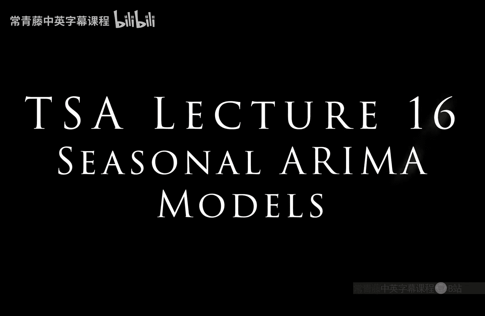
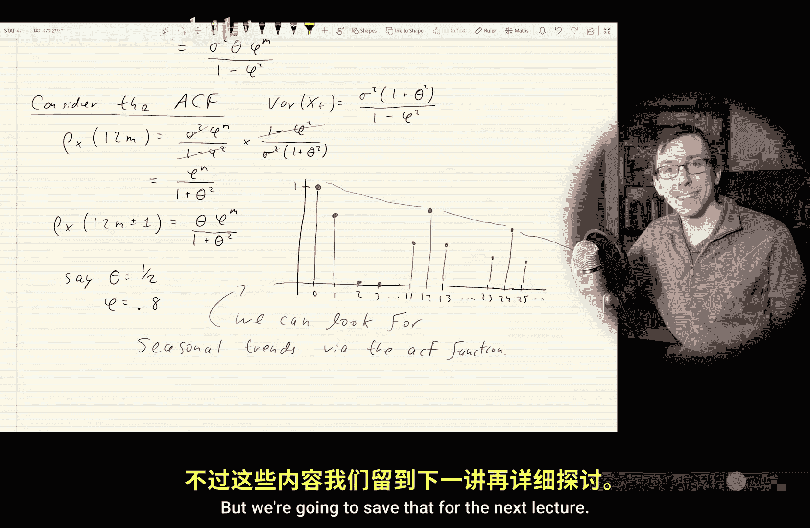

# 阿尔伯特大学【中英⚡时间序列分析｜STAT479 2021 Time Series Analysis】 p16 P16 Lecture 16： Seasonal ARIMA Models -BV1nwqYBDEos_p16-

AndWele back to another lecture of Statistics， 479 time series analysis in this lecture we' be doing well Ama once again。

 but now it's seasonal Ama because the seasons are changing and we need to talk about seasonal models for time series。

🎼あ。

🎼So effectively everything we're going to be doing in today's lecture is exactly the same as what we did with Arma。

 but we're going consider the fact that there could be seasonal trends that is， for example。

 the weather， the weather gets hotter in the summer。

 colder in the winter and if we look at the weather year on year on year we would expect to see the same type of trend there's going be local fluctuations of course but we would imagine that the summer of last summer is correlated with this summer and will be correlated with next summer and similar to the winters and what we're going to do is we're going to look at how to fit a seasonal time series model specifically a seasonal arema model in order to analyze these types of periodic trends in time series so let's go take a look at the notes。

And welcome back to another lecture of statistics 479 time series analysis today we're going to be well in some sense just doing AR and Arma and Arma again。

 but in this case we're going to be looking at seasonal models。

 so all of the models the models that are all subsetting from the arema model， the AR， the MA。

 the ArRma and so on we can also think of them as being seasonal models。

 so intuitively seasonal models。You know， kind of make a lot of sense。 So let's imagine an example。

 like。Say we want to look at the price or the sales at a retail store let's say a clothing store or something so watching the sales say I don't know monthly or even daily。

 let's say throughout the year what we'd expect is perhaps in December there to be an increase people are shopping for Christmas time say then maybe a drop in January。

 maybe there's another increase when the seasons change into the summer people want to go buy new clothes for the summer or back to school in the fall so you could imagine that throughout the year。

 you might see little ups and downs in the purchases of clothing say。Now。

 if we watch this over many years， we would expect to see the same spikes at the same time points。

 every December we'd still expect the shopping to go up for Christmas and then down in January and so on。

And this is where we get into the idea of a seasonal arema model where what we're going to be doing is we're going to be well just trying to fit an ama model as usual but looking for periodic trends and this is very very common in time series data it could be monthly or annual or even weekly cycles that you might see in your data and it's really good to identify them because it can help us in understanding better understanding the time series data that we're looking at I guess an even easier example than clothing sales would be temperatures if we're measuring the average temperature in Edmonton or let's say the daily high temperature for example in Edmonton we'd expect it to go up in the summer and down in the winter every year so if we're watching many years over time then we'd again expect some type of a seasonal trend in our data so how do we model that well。

Let's go look at the note and we will sort that all out。All right， so in this lecture。

 as I mentioned， we will be discussing the idea of seasonal arema。Modttles。Underline。Okay。

 so as I mentioned in the introduction， we can effectively take any are model that we've already discussed and add a seasonal。

 think of it as a seasonal model that is take the context that is the the equations for an arema model and then turn it into a seasonal one so instead of just having an are model we might have one that has a seasonal。

Period of length two or maybe length 12 if we're doing every month or length whatever seven if we're doing every week for example。

 but let's write out some examples so the first thing is we can have our usual AR one process that's just going to be Xt is equal to phi Xt minus1 plus wT right I've written this a lot of times but if this is let's say。

Say。T is equal to。Months， so。Let's say that T indicates a month of the year and we're watching some autoaggressive process where we're taking a measurement every month。

 again， maybe it's average temperature， I don't know if an AR1 process would be a good model for average monthly temperature。

 but let's just pretend as an example this is what it might be。

But the idea is that we could also consider a seasonal。AR1 model。I can write that correctly。

 AR1 model， and in this case， we could say maybe not well seasonal。

 but maybe what we can say is annual。Again， we could have different periods for our season and you。

 well， there we go。Got the words right in this case。

 what we might have is something that looks like xt is equal to phi x T and now instead of minus1。

 I'm going to put minus 12。And there's my seasonal model。

 it looks a whole lot like an AR1 in some sense。It's like。And A R 12。But。With。Phi 1 equal to。

All the way up to phi 11 all being zero so to a certain extent it's just another autoregressive model but it's a very special one we don't want to think of it as a general order 12 autoregressive model because that in some sense implies that there would be other coefficients that may be non-zero if we try to fit an AR model to data that has a let's say a cycle or a season of period of length 12 then we'd still be trying to fit these other phis here and we probably don't want to do that instead we'd want to target the idea that we have a model with a specific cycle length or period length here hidden within it so then of course the question is going to be well how do we determine a good length for our seasonal components for our model but that's a whole otherher thing right now we just want to stare at this and say okay。

嗯。I have an AR process and it's going to have a period of 12。

 so if we were to actually look at this data。Well， what it might look like， let's say we have one。

 two， three。12。13， 14， and so on， then we might be observing say time series points like this。

And the idea is that we have an auto regressive process。

 but what we're doing is we're linking points that are 12 time units apart。

So in some sense in this pure seasonal AR one， I'll say seasonal AR1 model here。

 effectively the points in between one and 13 don't in some sense interact with each other what we're saying is is that the value at time one is going to affect the value at time 13 and two is going to affect the value at 14 and3 at 15 and so on。

 so in some sense this is like we'll say。Like。Having。12。Independent。AR ones running。Together。

Because if you look at the dependencies here， if I have a model like this seasonal AR 1 one one that I wrote at the top。

 effectively I have 12 different AR processes， one that starts at time1。

 one that starts at time two and all the way up to the one that starts at time 12 and none of them in some sense are interacting with each other stochically。

 they depend on the012 time points into the past， and they have some white noise which is uncorrelated。

 and only。Sort of exists in the given time point T otherwise it's not interacting with other time points so in this very specific case the points in some sense are not talking to each other locally now this is an extreme case typically you might have a mixed model where you have some seasonal component and you have some nonseasonal component but in this pure case we're basically running 12。

AR processes sort of in parallel or kind of offset from each other。

 so it's a good thing just to imagine what's going on there。Now， in general。What we do is we write。

That X T。Is going to equal phi x t minus S plus Wt and what we're going to call this。Is an AR1。

 and then we're going to put a subscript S down here， so make sure that's didn't。

You kind of see that there's a little subscript S hiding here this is going to be an AR1 process with a season whose period is S so that could be 12 it could be two。

 it could be 50 it could be 365 right it's just the seasonal component period the length of the season and we're assuming that the length is fixed throughout the time series so we're not going to have any kind of variable season lengths it's kind of interesting I'm not sure if anyone's ever investigated that or if there's even data that would have variable season lengths but in this case we're not going to be dealing with anything like that we're going to have fixed fixed period for our season。

And then furthermore， continuing with our in general， what we can do is we can write。We also write。

An Arma， Amra， and， I've lots of typos。Armma。What I'm going to write is P prime Q prime and S。

 and this is a seasonal。Arma。With。Period。S。And。AR order。P prime and MA A order。

Q prime Now we use the primes because we're eventually going to try to combine a nonseaal autoregressive or armor model with a seasonal armorma model。

 and we need to make sure that we don't double can use the the variable P because we can have a different order P prime for our seasonal model than for our nonseasonal model So now there's going to be a lot more parameters that we're going to need to fit in our model so mathematically what this can what we write this as。

Is in an equation form we still have an auto regressive operator now I'm going to do phi sub S with a B。

 and then I'm going to take this to the F。Power。Good thing I have the filter here or that would be a lot of air blowing into the mic。

嗯。And then we'd have the moving average piece on the right hand side。

 theta sub S and B to the X's power。Applied to WT and again here we're assuming mean zero and all of that I guess the nonzero mean would could be factored into this if we really wanted to。

 but again it's usually easier just to ignore the mean so that we don't have to deal with that extra piece of the equation anyway it's exactly the Arma model the only difference is that we're effectively plugging in a B to the S power here。

 so that means that if we had say something like。If Phi。Of S B S， for example。

 let's say E G could be something like。I don't know， one plus。5hi or maybe minus5 to keep with the。

The notation from above phi1 B S plus phi2 B S square B2 S or and so on you know we could have something like that So it just means that we're doing an arm process but we're kind of increasing the the gap between the current time point and the next relevant time point which is now either S units back in time or two S units or so on but beyond that it's really just the same thing and if we were to just ignore all the intermediate time points。

 it would just be an arm process， but we're also going to have we're again we're going to be trying to combine this with a nonseasonal component。

Oh yes， so we also need actually I should probably change the notation because I see my in my written notes that I need to be a little bit more careful about the notation because we need to make sure our parameters don't conflict with each other so here what we'll do is we will write。

Phi S B to the S power as something like one minus script phi。1 b S， and then minus script phi2 B。

To S minus all the way down to our。P prime B to the P prime times S。 and similarly for。

Theta in this case we just need to identify because we're we want to make sure that our our parameters。

 we know what all of our parameters are， so here we're going to need a script theta。

 which let's see if I can draw that。Yeah， looks pretty good。Again， BS and。

if I need to think if I'm going to。Do this well， There we go。

This is2 s and so on all the way down to script Theta。

Not three Q prime B to the Q prime S so what I'll say is forget about these code with this one up here because I don't want it to be confusing because eventually we want to use regular phi and regular theta as our nonseasonal Arma parameters and script phi and script theta as our seasonal Arma parameters。

 there's going to be a lot of parameters in this model。

 I guess if assuming P and Q and P prime and Q prime are big。So basically we。Can combine。A seasonal。

And non seasonal， the thing we've been talking about for the entire course up till now， Arma。Yeah。

And what we get。Is going to be something that's going to be denoted as Arma。P， Q。

 and then crossed with。P prime Q prime S。 so now we have well that And if we if we write this out using the equation like we did up here with our operators。

 we're going to end up with two operators on the left and two operators on the right。

 So mathematically what we're doing is we first apply， I guess not first， it's actually second。

 But if we're writing from left to right， we're going to have our。Seasonal auto regressive operator。

 we're going to have our non seasonal auto regressive operator and both of these are going to apply to X and then on the right hand side。

 we're going to have our seasonal moving average operator， our non seasonal。

Moving average operator and apply that to WT so here we have again。This is。Seasonal。AR operator。

 regular。AR non seasonal， seasonal。MA and regular。MA classic。

There we go so this is what we have and mathematically it's nothing it's annoying to look at。

 but it's really nothing that profoundly different than what we did before we just have even more operators getting multiplied together we have a whole bunch of backshifts so now we're going to have like x's and x's backshifted to different times and also seasonally but ultimately there's nothing too different going on there。

😊，And one more thing before we'll be doing some examples and we'll definitely look at some data。

 so don't worry about that but。诶。We can also。Do a an arema。

So we can actually do a seasonal ama model and now we can have。P D Q， right。

 so that's the autoregressive， the difference and the moving average。

And we can if I and write we can have a P prime D prime Q prime so now we can have seasonal different and we need a subscript S here。

 which is going to be the period so now we can do seasonal difference as well as non seasonal difference and we'll write this all out。

And what we get is something that's going to look like。Phi S， B to the S。5i。B。

And then what we're going to do is apply the seasonal difference operator， which we're going to call。

 I guess NaBla sub S to the D prime and then the regular different operator。

 which is to our NaBA to the D wonder what the origin of NaBla is right just such a I do not know where that comes from we're going to have to look that up later because I do not know。

I always want to say Delta， but it's not Delta， it's Navela's upside down Delta。Anyway。Yeah。

 we have our moving average piece here that remains unchanged from the above。So now we get。

A seasonal。Diffing。And we get a non。Seasonal or regular。Diffencing。All right， so then the thought is。

 well， actually I should probably just make sure I define what those operators are just so that we're clear。

Right， just going back to the regular differentcing operator。

 the regular differentencing operator is a one minus。B。

The backshift operator and it's taken to the D power。

 whereas the seasonal difference is kind of what you'd expect it to be based on the other equations。

 it's one minus b， but taken to the S power and then taking the whole thing to the deep power。

 oh sorry the D prime prime to make sure that we indicate that these are different orders。All right。

 so we've got a lot of things to deal with hereLuckiily there are packages that'll just do it for you。

 but it is good to understand what's going on here。So。What I'll say is note。The auto。Dot。Arima。

Function in。Forecast the forecast package。Can。Select。A seasonal。Model for you。Yeah。

So I think there are other ways that you could probably manually fit a seasonal model I would have to double check to see which our packages allow for seasonal models and which have not implemented it or not the automo will try to check some seasonal models in fact。

 if you look at the documentation in that function they even allow you to switch of like a boolean variable the switch whether you want to consider or not consider seasonal models if you do consider seasonal models the runtime is a lot longer I mean it's if you don't consider seasonal models it's almost instantaneous I guess unless maybe you have a really big time series if you do consider seasonal models it can take a little bit longer to compute but it will find a good seasonal model for you and we'll be doing that later we will be looking at。

We will be looking at different R packages you can use to fit these and do estimation and forecasting and you know model comparison with AIC and BIC and all the fun stuff that we've done so far for the Arma。

 the AR the arema， the MA we can do it for this as well I also wanted to point out that sometimes you'll see people right。

Wheres good color to use we'll use blue Sometimes people will put an S in front of this and call it a sarima model for a seasonal auto regressive integrated moving average。

 that's a good acronym。😊，So just so you know， the terminology， if somebody says sarima。

 they might be referring to a seasonal Ama model。You have to be a little careful though because it doesn't work。

For other things like tangent。SAR is not a seasonal auto regressive， but this is sometimes a sign。

Multaneous。AR from spatial statistics。Which is like non causal spatial time series models。So。

You can't I mean， sometimes there could be some ambiguity if you say an SAR that might not necessarily be a simultaneous or it might not be a seasonal AR。

 but it could be a simultaneous AR， so the acronyms aren't great， but at least serrima。

 I think usually just as a seasonal arema model。Yeah。All right， so now that we've， you know。

 kind of done a lot of that， let's let's do an example of， well。

 the one that I just wrote down the seasonal arema or seasonal auto regressive。So let's consider。

The seasonal。AR process。Because it's always good to start with something a little bit easier as an example。

 and we're going to start with the same thing that I wrote up above， which is going to just be。

I guess phi X T minus 12 plus Wt， so we're going to try to understand what this thing is doing。

All right， so the seasonal autoregressive model now the first thing I want to do is I want to change the notation and change this to a script file to try to coincide with what I wrote above just so we indicate that we have a something different in case we want to combine this with a non-seasonal autoregressive process and。

As with。The usual。AR1， the non seasonaleaal AR1， we want our parameter script phi to be less than one in magnitude just as we did before。

 so that we have a stationary causal process otherwise， yeah we're going to run into some trouble。

Now we can write this in different ways， we can write this in terms of the autoregressive operator as1 minus phi b to the 12 power applied to Xt is equal to WT so this is one way that we can write this now what does the autocovariance look like because if you've learned anything in this course。

 you've learned that really everything we're doing is based on the autocovariance function。

 so we probably want to figure out what the autocovariance looks like in this case？So to。Compute。

Auto。Covariance。Well， what do we do well what we do is let's start with the model as I wrote above and let's do what we did way back in。

 I forget like one of the first lectures。Why don't we just apply the definition recursively and see what happens。

 so I am not writing subscripts here， that is not good， we need our subscripts t minus 12 and WT。

 so if I apply this definition recursively， I end up with a phi a phi X t minus well， 24， I guess。

Plus。Wt minus 12 plus WT， something like that， which。

If we expand this is going to be a phi squared x。T minus 24。Plus， I guess。

 phi squared Wt minus 12 plus WT。Not phi squared， just phi itself。All right， so if we do this。

 I guess infinitely。Using the fact that phi is less than one in magnitude。

 so this first term is going to end up vanishing because it's going to10 to zero geometrically。

Then what we're left with is going to be a subation of all the white noise pieces。

 we're going to take J from zero to infinity， but now we have something slightly different we have scriptfi to the J power。

 that's the same as before。But the index for our white noise is now going to be minus 12 times J。

 So besides the minus-12， this is basically the almost。The same。

As before where what we would have gotten is something like xt is equal to the sum j from。

 I think zero to infinity of nonscript phi to the J power Wt minus J right。

 this is the causal linear process form as just to reemphasize that。Casal linear process。Excellent。

All right。Well， we can just compute the variance so the。The variance。

Of XT is going to be the same as it always is right in this case what we're going to do is we're going to apply the variance again if you're happy with the previous lectures where we kind of discussed why I'm allowed to do this mathematically we can just apply the variance。

To each term here， we're going to get a script phi squared J。

 consider the variance of my WT minus 12 J， and it doesn't matter that I have a seasonal component。

Because I'm still summing to infinity， which means I'm going to get my not an equal sign there。

 I'm going to have sigma squared the variance of the white noise process。Times this geometric series。

And this geometric series is just going to give us exactly what we had before。

 which is one minus phi squared。Yep， so there's our variance。

now we have some different things happening， though， so if we want to compute again， this is。

KX at lag 0 is the variance。If we wanted to compute。Kx at lag H， let's say。H equal to1211。

 or it's in， let's say， the values of  one to 11 well。Actually even 12， I think no。

 no lags lags sorry yeah， lags from one to 11 then what happens well let's let's just use the linear process definition or form of our series that here and just kind of fight our way through the mathematics。

So when I want to do this， I'm computing the covariance here between two infinite sums。

One is going to be J from0 to infinity of phi to the J power Wt minus 12 J。

 just like it is up in the blue box。And then we're going to do the same thing。

J from zero to infinity phi to the j power WT， but now I'm going to subtract an H I'm going to lag it back by H units and I'm still going to have a minus 12 j there okay well again the covariance is bi linear so if we are happy with the convergence of these infinite end series then again phi is less than one in magnitude we have the geometric convergence we're all good with all that what we're going to do is we're going to swap everything。

And we're going to end up with something like the sum。I from。I think zero to infinity。

The sum J from0 to infinity， and then we're going to combine phi。

J phi I get multiplied together to get phi to the J plus I。

 and then we're going to take the covariance of the thing on the the W's。

W T12 J and W T minus H minus12 J。 Okay， so what are these covariances。Well， they're all zero， right。

 they're only going to be non zero if the two indices equal each other。

 So right this thing let's say。Let's kind of like just note that the covariance。

OfW T and WS is going to equal right sigma squared if T is equal to S and it's going to equal0 if t is not equal to s。

 Well， the problem here is that these two things are never equal to each other， right。So here。Yeah。

What we have is we have a t minus 12 J when is that going to be equal to。T minus H minus。12。Oh。

 I should have an eye in there， sorry， just to。We'll say 12。I。Yes， so in this case。

 if we cancel out the T's and we move around， rearrange the terms a little bit。

 what we're going to end up with is something like H has to be a multiple of 12。Well。

 it can't be a multiple of 12 because we specified that it's。Somewhere between one and 11。

 therefore this condition here never happens and therefore this is going to equal zero。And in fact。

 it's not just H from1 to 11 it's any lag that is not a multiple of 12。

 so the point is that we actually have that Kx H is equal to zero for all H not。Divisible。

By 12 in this example right we could replace 12 with S。

 I'm just using 12 because again it's a it's a very natural season to have period to have for your seasonal model if you have monthly data which is often a case that you'll run across with real data。

All right， so then what happens when H is a multiple of 12？If H is equal to let's say， 12 times。

Something。12 times， I need another letter now。We'll just say 12 times。

R and hope that I don't get myself into trouble using R。

 I don't think I'm going to get myself into trouble。Then。Well， what happens Well， in this case。

 what we're going to get is effectively the。The same thing we did in the AR one case。

 so we can do a specific example first， which is going to be Kx at lagG 12。If we do this。

 then going back up to where are we？This formula up here。So if we。

If we use that same that same formula hold， but now we're going to have indices that actually equal each other and what we're going to end up with is something that's going to look like sigma squared phi。

Times the sum j from0 to infinity of phi to the 2 j。

 and in this case we're just going to get sigma squared phi over1 minus phi squared。

And we can effectively extrapolate this idea。To say that if I have some multiple m of 12。

 I'm going to get the exact same thing， but I'm going to be taking the phi and the numerator to the m。

Power。And we have what the auto covariance looks like。Yeah。So again， this。Is identical。2。Auto。

Covariance for some process。Yt。Equal to phi Y T-1 plus W T。 If we only look at every 12th 12th lag。

 So again， that's why I keep emphasizing that if we just have a purely seasonal AR process。

 what it's going to look like is it's just going to look like 12。

Independent or at least uncorrelated， depending on our choice in white noise。

 12 uncorrelated AR1 processes that are all offset by some you know， number one through 11， I guess。

啊。嗯。Yeah。Like I said， the main point to take away is。A key point。Is don't。Fit。And A R 12。wo。

And AR112， this is something just to keep in mind， like I said before。

 if we have an autoaggressive process， that's an AR1 with a season of length 12。

 that's one parameter we have to worry about but if we try to fit an AR 12 model to it the U walker equation。

 maximum likelihood， whatever method you're using is going to try to fit 12 different parameters and you're going to have way too many parameters for your model now you might be able to identify the fact that many of them look like they should be zero but it's better to use methods that will try to identify a seasonal model rather than just fit in fitting a really big autoaggressive model because again。

 technically all these seasonal models are just autoaggressive model。

 we're just make an emphasizing that the intermediate parameters are all equal to zero。All right。

 so why don't we look at something a little bit more interesting？Let's look at a seasonal。Yeah。

Armma process。And in this case， what we're actually going to do is a。Well， do a mixed。

Seasonal armma process to try to see what happened if we try to mix a little bit of both of them。

 so in this case we're going to consider a model that is going to be an Arma。Let's see an armma。Z。

One crossed with a1，0，12。 So what should that look like？Well。

 what it's going to look like is it's going to look like a， this is a non。Seasonal。M A。One。

 and this is in， this is a seasonal。AR1 with a period of 12。

 so we're going to take a seasonal auto regressive and combine it with a non seasonal moving average。

 so what does that equation look like？Like I said， theres nothing。

 there's nothing too sort of profound about all of these。

 but I think it's useful just to write them out so that we can get a sense of what they look like mathematically and how they behave。

So we'd still have the same auto regressive seasonal auto regressive operator that we had as in the previous example。

 and then on the right hand side we would have our non seasonal moving average operator。

Which is going to be a nonscript theta here just to emphasize。That looks like this。

So if we were to well undo the operator notation， we would end up with something that looks like Xt is equal to the seasonal Xt minus 12。

Plus theta。WT minus1 plus WT。All right， so what can we learn about this process well let's see first of all。

 we should probably do what we always want to do， let's compute the variance and let's compute the auto covariance and see if we can make some sense out of what that tells us。

So the auto covariance in this case， or I should say the variance。Kx at lag zero。

 which is just the variance of the process X T here we're again assuming that phi is and theta。

I should just put that in just to be emphasize that we want phi to be less than one in magnitude and we want beta to be less than one in magnitude。

 So we have a causal inverible。Armma process here。Otherwise， again， we could run into some trouble。

 so we're going to make sure that we keep that the way we like it。Okay。

 so what happens when we try to do this well let's just plug in the the definition and see what comes out so here what we're going to get is we're going to get the variance。

Of five， when I say definition， I mean。Plug in this equation right here into the variance and see what happens。

그。All right， so we get something that looks like this all right。

 so how do we compute the variance of this guy well what we can do right the variance is kind of a expect is an expectation of that thing squared we're assuming it's mean zero what we can do is we can actually break it up and take the variance of each piece。

So what we can do is we can say that this is going to be the variance。Of Phi。X T minus 12。

The variance of theta Wt minus1。And the variance of WT， So why can we do that？

Well all of these three terms are uncorrelated right WT is white noise。

 It only depends on things at time T Wt minus1 happens one time point into the past。

 so WT and WT minus1 are certainly not correlated because we always at the minimum we assume that our white noise is uncorrelated。

 we often assume stronger that it's right independent that it's Gaussian etc ceter。

 but at the minimum these two white noise terms have to be uncorrelated， also X t minus 12。

Is an observation 12 time points into the past， which means any white noise that happens。

In the future of that time point， it's going to be uncorrelated with it right because X T is a causal process。

 it only depends on things at time point T minus12 and into the past since both WT minus1 and WT lie in its future if that makes sense。

 they are also uncorrelated， so all of these three things are uncorrelated with each other。

And from here， we just compute， we get a phi squared times the。Well。

Times the variance right the variance is stationary here of Xt so we get something that looks like that over here I'm going to get a theta squared and the variance of the white noise process is just sigma squared。

😊，And lastly， I'm just going to get another sigma squared now what we do。

Is we factor this out and we rearrange the pieces and what we get is that the variance of the process is going to look something like what？

It's going to be Sigma squared。One plus theta squared divided by1 minus phi squared。Yep。

 that looks good。 All right， so that's going to be the the variance of our。

Mixed seasonal Arma process in this case， the 0110 with a period of 12。

 even though the period in this case does not affect our。Does not affect our variance。

 I guess it would if we had a period of well no， even if we get a period of two。

 it wouldn't matter unless we had a period of two and an MA2 because then there could be some non vanishing correlation between。

The seasonal part and the non seasonal part， which would be a little bit strange。

 but right now we're good， we're good。그。All right， so what about the auto covaris？

For lags that are not zero。So this is the first thing then the next thing we want to look at is if。

H is equal to 12 I here I use 12 times M， so I'm going to try to keep with the notation that I picked in this lecture and use 12 times R。

So again， if H is， this is H is a。Multiple of 12。Okay， so if H is a multiple of 12， well。

 then what happens？Well， we're going to get Kx。At lag H is just going to be Kx at 12 times R and what we're going to get is we're going to get kind of the well。

We're going to get two things I'm trying to think what the I know what the answer is I'm trying to figure out the right way to explain it right well here I'll write down the answer and then we'll stare at that。

So it's going to be something like sigma squared phi to the r1 minus phi squared。Okay。

 so what happened to the moving average piece？Well。I'll say recall。그。That。4。U。An MA A1 process。

 let's say Yt is equal to theta wt minus1 plus wt。 what do we know about that。

 we've computed the auto covariance for that a lot right the auto covariance for this thing Well at lag 0。

 it's going to be1 plus theta squared for h equals0。 it's going to be just theta。ThatH is equal to1。

 and it's going to be zero for h greater than or equal to2。So effectively， if H is a multiple of。

I guess I should emphasize。A。Thank。Just to be precise， I should say R greater than or equal to 1。

 If r is equal to0， we get the variance and that one plus theta squared term pops back in。

 But in this case， we don't have that happening。 Instead。

 what we have is the moving average piece no longer has any influence。

That is there's no correlation once we move beyond a lag of one when we're at a lag of two or higher。

 it doesn't affect anything that is contributing zero in some sense to the auto covariance instead we just have the moving average or the autoregressive piece and that's going to be exactly what I found I think right up here except that I did use M that's really funny。

And I had M in my mind right and then I'm like I'll use R instead， but then I ended up writing M。

 so maybe what we'll do is we'll just change these all to M's。

Then they coincide with what I had written in my notes。그。It doesn't really matter， but。Right。

 we just need to be consistent throughout the lecture。

And we'll make this a green and luckily I can turn an R into an M pretty quickly。Excellent， okay。

Remember， this is roughly what's going on here。But then we also need to think about what happens at lags between。

So。What about？Lags。Yeah。Between。zero and 12 and 24 and etc ceter， 12 times m。

 so if we have a lag that lies somewhere in between zero and 12 or that is two multiples of 12 if it's not divisible by 12 but it's not well I guess zero is technically divisible by 12 if it's not divisible by 12。

 then we have to figure out well what's going on there。So well， there's a couple things that happen。

First of all， let's consider。Let's consider， I guess。If H is going to equal。All right， let's do。2。

Three up to 10。Moud12 so again， this is mod 12 if you haven't seen modular arithmetic that just means reduce it's the remainder。

 so it basically means。Take H divide by 12 and get。The remainder。Yeah。I mean， a lot of you。

 if you're taking a math degree or a sta degree in a math department have probably seen modular arithmetic somewhere。

 but just in case the the idea of saying mod 12 says just reduce H by 12 and divide by 12 and then take the remainder that's left over so if H is equal to。

27， we divide by 12， we would get two and whatever's left over， which I guess would be three，12。

 so 27 would equal， we'll do that， I'll write that out。EG27 is equal to3， mod 12。Just to indicate。

 so what I'm trying to get at is that if we have lags that are between two and 10。Then。Well。

 what happens for the ARP？Then we know that K X。H。Well， it's going to be the covariance， but if we。

If we just kind of intuitively think about this， right， what's going to happen well the。

The MA1 is going to contribute a zero， right， because the lag is greater than。

The lag is greater than one。And the AR。1，12 is also going to contribute as zero because it only cares about lags that are multiples of 12。

 so in this case all of these are actually going to be zero。

 so we're going to get no correlations there。Yes， but we're still going to have to consider。

What happens when H is equal to1？Or 11。Mod 12。 And here we have to kind of work out what's going to happen。

 So the， the easiest way to think about this is just start with。Well， two examples。

The first would be Kx at lag one， so that's a good one to try to just compute by hand and see what happens Well in this case。

 what we're doing。Is we are computing well， the expected value。Again。

 we're assuming that it's means zero。 So we're going to compute the expected value of。

X T and X T minus1 right， that's just the auto covariance at lag one。 Well。

 what we can do is we can apply the definition of X T。

 which is somewhere up there off the top of the page， but luckily I remember it。Hope I remember it。

It is phi x t minus 12。Plus theta wt minus 1 plus Wt。

 and we're applying this or multiplying this by xt minus1。All right。

 so what can we figure out from here？Right， well， what we get， we got a couple things。

 let's break up this expectation linearly here we're going to get something like phi times the expected value x t minus 12 x t minus1。

Then we're going to get。Beta。The expected value of x。T minus1 W T minus1。

And then we're going to get the expected value of W T X T minus1。

 so those are the three things we got to deal with。

The first one is another auto covariance at this point it's the autocovariance at lag 11 and hence why I started this section by pointing out that we have to consider both 11 and one。

But okay so we have this at lag 11 what's this other piece going to be this middle piece well this one is a little bit maybe not straightforward。

 what it's going to be is sigma squared theta I'll explain that in one second。

 I also just want to write down that odd the expectation。

 the third expectation here is going to be zero and that's once again because WT lies in the future of xt minus1 xt minus1 is a causal process these things are uncorrelated。

 this thing goes away。Now， just to emphasize where。

This came from why we ended up with a stigma squared for the middle term here。

If we consider the expected value of。X T minus1。Wt minus1。

 if we again apply the definition of this time series。

 we replace xt minus1 with a phi X t minus 13 because we're starting at t minus1 and subtracting another 12 from it。

Then we're going to get a theta。Or not X， a theta。W。T minus2 and AW T minus1 all times W T minus1。

And the point is that this guy is uncorrelated with these other two terms。

 The only thing that matters is this one。 and when I。

Compute the expected value of w t minus1 squared， I end up with sigma squared。

So that's where the sigma squared comes from here。Okay。

 so we don't know what the auto covariance is yet， we just know that the auto covariance at lag1 is somehow related to the auto covariant at lag 11。

Well。Let's try to compute the autocovariance at LaG 11 and see if that helps us。Spoiler alert。

 it will， but yeah， we can just do that。And let's start above just like I did above。

 we're going to do the exact same type of expected value in this case。

 I'll say xt times X t minus11 and then just kind of。Well， fight through the whole thing again。

What we end up with。Is an expected value of using the definition of the process。Phi x t minus 12。

Let's see plus theta wt minus 1 plus Wt， and we're multiplying this by Xt minus 11。Now。

 if I break this into pieces， we get a phi an expected value of x t minus 12， x t minus 11。

We're going to get a theta expected value。W T-1， X， T-11， and lastly。

 an expected value of W T X T-11。 Well， we are in luck because the last two terms are both going to be 0。

Right they're going to be zero for the same reason why all these terms keep becoming zero because the white noise lives in the future of the process Xt minus 11 and Xt minus 11 is causal it only can be correlated with things that are in the present or in the past of its time WT minus1 and WT or in the future these things are both zero and the first term just so happens to be well the auto。

Covariance at lag1 again， stationary is wonderful because it allows us to do all of this。

 If the process weren't stationary， we'd be doomed， can't do any of this。 but it is stationary。

 So we， we got all this。 So this is great because now what we can do is we have two equations that we can combine。

😊，Now we have two。Equations。To consider。The first， which is about running off the top of the page here is that。

KX at lag1 is going to be phi。K X at lag 11 plus sum。

Term that does not depend on the autocovariance well。I guess it's not in terms of K， I should say。

And then we find out that Kx at lag 11 is going to be phi K X at lag1。 All right。

 so we can just basically plug and plug it in and go。Right， if we know what。Kx1 is。

 so what we do is we combine these two things。And well， what do we get？Well。

 we get that Kx at lag 1 is going to equal phi times while kx at La 11。

 which is just phi Kx at lag 1。And then we're going to also get a plus sigma squared data here。

 so if we solve for this and rearrange the equations， we find out that。KX at lag1 should be。

Sigma squared theta divided by 1 minus。Phi squared。All right， we got something。

And what else do we get， Well， what else do we get， We also get that at lag 11。We get phi。Times。

 well， that thing that I just wrote down。Kx at lag one。So we end up with just a sigma squared。

 a theta， a phi。And a1 minus phi squared。All right， so that's kind of neat。

So what can we what can we do from here well if we want to， we can then extend onward beyond。

1 and 11， right， because what we ultimately wanted was not just the autocovariance at lag 1 and the autocovariance at lag 11。

 but we were interested in all H that are either equal to 1 or 11 mod 12。

 So the next thing we might be interested in is H is equal to 13。

 So let's try that and see what happens and， you know。

 get a pattern inside our head as to what's going on here well。If we want to know what happens at 13。

 well， we can do this exactly as before in this case， if we go back to what happened with lag 11。

 we're going to get the exact same thing here， but with a 13。X T X t minus 13。

 and the exact same issues are going to occur except that in this case。

 I'm going to reduce this down to something that's going to look like phi。

X t minus 12 x t minus13 by the symmetry， right， this is just going to be。Well。

The same thing it's the exact same thing as lag 11， so it's actually equal at lag 11 and at lag 13。

 we get the same auto covariance。Which is taking， in some sense the。Wan， where is that？Oh。

 it's way up here。It's the auto covariant at a multiple of 12 notice this equation here in the red box and we're multiplying that thing by theta。

So all we're doing is we're saying， okay， if we're a multiple of 12。

 we have this thing that's going to look like phi divided by one minus phi squared and there's always a sigma squared in the front there if we're one off from that we're going to be multiplying by theta if we're two or more off then we're going to multiply by zero unless。

Unless we're so far off that we're now a multiple of 12 again， but yeah。So in general。

What we can show。We have that K X at lag 12 m plus or minus 1 is going to equal to L。

 the expected value of X T X T minus 12 plus or minus1。

 if we go through this whole thing again that we did will'll end up with something that's going to look like phi。

Okay。A， so actually mine I read out the right would just not skip that step。

It's going to be X t minus 12， X T minus。12 plus or I should be 12 M， sorry。12 m plus or minus1。12。M。

Plus or minus1。When I look at that， it's just going to be phi k x， and in this case。

 my lag is going to be 12。M minus1。Plus or minus1。Well。Wait。

 a minute its hold I wait we just want to make sure I do this right。 Oh yeah， of course。

 because if if M is equal to one， then I get plus one and minus one， which are both going to be。

They're both going to be。The same thing by symmetry。

 the auto covariance at a lag of minus-1 is the same as the auto covariance at a lag of plus one。

 Okay， sorry I was just。Confusing myself there for a second。So in this case。

 what we can basically do is use what we did before。

 basically the point is we just keep multiplying by phi。Bye， bye， for， every。Multiple of 12。

That's an exclamation point because I'm excited， not a factorial。

 so I'm going to delete that just so it's clear。And what we end up with is an auto covariance that's going to look like。

Sigma squared。Data。Phi to the in power， one minus phi squared。 All right。Now。

 what else can we do here？We're more or less at the end of what I wanted to talk about here what I'm going to do is we're going to talk about the autocor so we can get a sense of what the ACF plot should look like if I had this model and I plugged it in now in the next lecture we're going to spend a lot of time looking at actual data in R and。

Simulated and real data in R and trying to understand how to look at seasonal models there's a lot to do。

 so I want to spend a lot of time on that， but dedicate a lecture to data analysis In this case。

 let's just try to fight our way through it mathematically so going back up here what happened to our variance Well our variance。

Way up here is going to be sigma squared， 1 plus theta squared。

 1 minus phi squared in the denominator。Let's say consider。The ACF。

 the auto correlation because auto correlation function is one of our friends that's going to tell us a little bit about what's going on with our time series data。

If we go back to where we were before， so what we found。Was that？Well。

 let me write it out because I need to make sure。That the variance of xt is going to equal sigma squared1 plus。

Data。Was it no theta squared， yes， of course， because it's just like it is for the MA process。

1 minus phi squared， so if we were to consider the auto correlation at lag 12。M， well。

 what's that going to be， that's going to be the autocovariance at a lag of meta。At lagG 12 m。

One minus phi squared， and we're going to divide this whole thing actually。

 why don't we just multiply by the reciprocal？We're going to divide by the variance。

 which is multiplying by the reciprocal of the variance。And we get something。That should look like。

 well， things cancel out。That cancels out。 that cancels out。

 and we're left with just a phi to the m power。1 plus theta squared。

And if we were to consider the auto covariance。Correlation， autocor。At 12 M plus or minus one。 Well。

 we'd get the exact same thing except we'd multiply by theta。 So now we'd end up with a theta。Fi。M。

1 plus theta squared。 So what does this auto covariance function look like， Well， we can。

Plootted out。 Let's pretend that both of these are positive because I don't really want to deal with sign flipping。

 So let's say。That theta is equal to， I don't know， one half and phi is equal to。I don't know， point。

E or something。Okay， so all right， I'm not going to get this exactly right because of the one plus theta squared in the denominator。

 but effectively what we're going to get is well at lag0，1，2，3。

 and then we're going to just skip all the way to 11 not to scale。11。12。13。

 and then we're going to skip all the way to 23，24。25 and so on。 So what would we expect to see Well。

 if we have a value of one here， in fact。I'm not going to。Well。

 we'll just I'm just going to write phi， so it doesn't really matter that I'm going to give it a magical value of 0。

8。So we're still going to have， of course， one at one， that's always the case when we're offset by。

By a lag of one well now what we're going to get is we're going to get something like theta divided by one plus theta squared in this case。

 if that's like one half plus it's well I'm just going to make up a value。

 it's going to be something like this， we're just going to pretend that's the value。

Maybe I should change the color scheme here， red。Then we're going to get a bunch of zeros and all the way until we get to 11 and at 11 we're going to have the exact same thing that we had well let's do 12 first at 12 we're just going to have the usual auto covariance thing where what we do is we decrement by multiplying by phi phi is less than one so we're going to get something a little bit smaller here let's switch to red because I kind of like。

Maybe we'll get something like this and then to the left and to the right we're going to multiply by theta。

 which is one half so we'll have half strength at those and then we're going to get some other decrement。

At 24 and half strength。Here and here， so what are we getting while we're getting a geometric decay。

That is going to continue onward。From at multiples of 12。

 but at all the offsets we're also going to have a similar little pattern。

 So this is something you might see in practice right you plug in your auto you plug in your data to the autocovariance function in R and what you see are these little spikes and maybe it looks like not just a single spike at various lags but you see a few spikes centered around maybe every multiple of 12 or otherwise。

 and then this is a pretty strong indicator that you have a seasonal model So the takeaway is。

We can look。4our。Seasonal trends。Va。The ACF function。

So as usual the ACF function is really nice for exploring time series data and trying to understand what in the world is going on when you have a time series that you're actually working with。

 if you see something like this where it kind of vanishes then comes back and then vanishes then comes back that's pretty good hint that there's a seasonal component to your data。

 your time series， similarly if one of the coefficients like phi in particular had a negative sign。

 then these spikes would flip below the axis and above and below。

 they're still going to geometrically decay to zero right so if phi is not that big。

 then after a few periods of 12 24 and so on， the values are going to go to zero pretty fast。

 if phi is very close to1 like my hypothetical 0。8。

 then it's going to take longer to see that well the signal is going to be stronger so you're gonna to see a much stronger signal in the ACF it's not going to go to zero as fast。

All right， so that is really everything I wanted to talk about with respect to the seasonal arema process now there's really again。

Mathematically， there's not a lot more going on than with just the regular arema actually trying to compute things like auto covariances。

 It's a little more tedious。 but roughly it's all the same thing。

 It's just a more complicated arema model with different parameters and different offsets。

 When we're trying to do fitting and forecasting， estimating parameters， model selection。

 all of the same things we talked about before。 still hold。

The hard part is that we would need to try to figure out what a good season， seasonal period is。

 We need to figure out what S is。 So typically you can kind of just。Pick one that makes sense。

 so there are functions in R that will find one for you if it's not obvious if you have monthly data。

It's probably going to be 12 or maybe it's quarterly， maybe it's every four。If you have daily data。

 you might want to look at a period of seven for every week or maybe 30 approximately for every month now months are weird because they don't all have the same number of days。

 but these are the things that you can kind of look at and you can use intuition about the data that you have at hand。

To try to take a good guess at what the season should be。

 it's not it's atypical that you would have a data set with no idea what the season is and you just have to try like tons of different seasons but it could be the case and luckily there are functions that will try to find a season for you。

 and we will look at all of those， how to do estimation。

 how to do forecasting everything in R look at some cool data sets。

🎼But we're going to save that for the next lecture， so I will see you。

