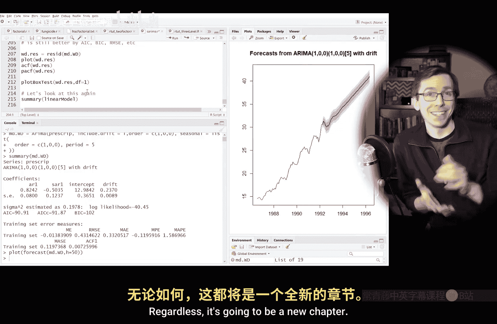

# 阿尔伯特大学【中英⚡时间序列分析｜STAT479 2021 Time Series Analysis】 p17 P17 Lecture 17： Seasonal ARIMA in R Studio -BV1nwqYBDEos_p17-

And welcome back to another lecture of Statistics 479 time series analysis in today's lecture we're going to continue to look at seasonal arema models。

 but we're going to do it in our studio and that is always a good time。

So in today's lecture we're going to spend the entire time looking at the prescription drug data set that we had looked at earlier in this course。

 but now we're going to use all the tools we have about fitting Arma processes。

 fitting a rhma processes and fitting seasonal models to our data as well as looking at linear models and lots of different ways to model time series so as I've said more than once time series is really an exploratory subject we have to spend a lot of time fitting models and trying to figure out what works best for our data set and that's what we're going to do in today's lecture so come join me and we're going to look at some our studio code。

And welcome back to another lecture of statisticst 479 time series analysis today we're going to look at the seasonal arema model again。

 but we're going to look at it in our studio with some real data this will probably be a more useful lecture or one of the more useful lectures because we're actually going to look at how to analyze real data in our rather than just staring at a bunch of equations on my notepad today we're going to be going back to that prescription drug data set that we looked at way back at the beginning of the course。

 but now we have a lot more tools in our repertoire that we can use to try to analyze it with time series basically。

So let's get into our studio and see what that's all about。All right。

 so we're here in our studio and our goal is going to be to fit some remodels to the data。

 so the first thing I'm going to do is load in a bunch of standard time series packages like the TSA package。

 the T series package and the forecast package。And I will also upload all of this code onto ECl。

 it should be uploaded like I would my normal lecture notes so that you can try it yourself rather than trying to write down everything you see on the video。

 which would be kind of annoying。Anyway I also wrote this quick function which I'm going to load in。

 I call it plot box test because basically what it does as well it plots a bunch of box tests remember we looked at the box pierce and the Liung box test in R both are run with the box dot test function and do you remember what therefore right there testing whether or not our residuals have any correlations in them so remember we estimate the autocovariances。

And we try to determine whether or not any of them are significantly different than zero。

So all I did here was write a function that runs both the box Pierce variety and the Liung box test variety of this statistical test and applies it to the data at various lags starting from whatever the degrees of freedom are and going up to 16。

 remember we have to tell R how many degrees of freedom we use to fit our model so that we can subtract them before we run the box test。

 so that's all that this function is doing， but it's going to give us some nice plots a little bit later on when we actually have well models and residuals to look at。

Okay， so most importantly， we're going to load in this prescription drug data set if we go back and look at the。

The manual page for it， we have the cost per prescriptions time series。

 the monthly US average prescription cost for the month of it looks like whatever eight is。

 which I guess is August of 1986 all the way up to March of 1992 Again I don't actually know what the units are because I didn't dig into this textbook to find it and the our package is quite non-descript but that's okay we have some unit presumably per capita or something spending and it looks like this so it's definitely not stationary from the first thing we notice secondly。

 we also notice that not only is it increasing but it does seem to have some humps here and that is really hinting strongly that there's some sort of a seasonal model going on and if we look really closely we might notice that these bottom peak seem to happen right around the year mark。

Which is also hinting that there might be a cycle of length， a period， I should say。

 a period of 12 in our data。But again， these are all things that we're going to try to test and try to sort out when we stare at this prescription drug data set using different tools。

So the first thing I think we should try is to look at both the augmented Dickie Fuller test and the Philip Perone test。

 so ADF test says we have a very small P value， what does that mean Well that means that we reject the null hypothesis that there is a unit root。

In our， I guess， auto regressive polynomial， that is。

 we reject non stationity and conclude the alternative hypothesis that the data is stationary but。

That's after removing the linear trend， right， remember the ADF test because obviously if we stare at this time series。

 it's not stationary， it is increasing， very， very clearly increasing， but the ADF test， remember。

Says it removes a constant and a linear trend， so basically it fits a line to the data with a slope and an intercept and removes that and then looks at the process and what it says is after removing a linear trend it looks stationary so。

Before we go forward， let's try the PP test。And that tells us more or less the same thing。

 It gives us a small P value。 So again， it's not as small as。Poin0，1，8， but it's still fairly small。

 So these two tests together make us think that probably。

Probably our time series is stationary after we kind of。Tilt it。

 we get rid of that linear trend just for the sake of exposition right the PP test or the Phils Perone unit route test is really doing the exact same thing as the augmented Dickie Fuller test it uses a different technique as we discussed in a previous lecture for estimating and computing test statistics。

 but the end goal is the same and the interpretation of the P value is the same。Right。

So we have that and what it told us was if we。Remove a linear trend we should have something that looks stationary so let's just remove a linear trend and see if what we get so what i'm going to do here is fit a linear model to my data the prescription drugs data just using the LM function like we would in regression class and I tell it that I want my response is the well the time series itself and the predictor is just the time。

And what we get actually， let me plot the prescription data again so you can actually see what we get。

 It's always good to look at the models fitted to the data。And if we。

Draw a line for our linear model， color and red， we get a straight line and it actually looks like it's a pretty good fit。

 right， I mean it's。It's kind of hitting all of these humps here in the latter half of our time series。

But what we can also do is look at summary to see what it tells us and it gives us an intercept term。

 the intercept is kind of nonsensical because it would correspond to year zero。

 but the time variable is quite interesting， it's very。

 very strongly significant and it tells us that the increase is about 2。8。

Units dollars per whatever per year。 remember that the time series here is indexed by year。

 even though it's sampled every month， So this is a a subtlety to remember that if we look at the prescription。

 the time for our prescription drugs，We have observations for every month， but the unit。

I every year so when we look at a time or a linear model like this， the rate of change is per year。

 not per month， so it's always good to keep this in mind because it's an easy way to make a mistake and to look silly when you're trying to talk about data if you get the units wrong。

But yes so that's what we have here and our linear model also if we use the usual things like the F statistics right it has very strong P values。

 very big R squared values， we do have to be a little careful though because remember the linear model is assuming uncorrelated。

IID errors， whereas in this case we don't have that， we have， well， correlated potentially， well。

 I should say we potentially have correlated errors， we don't know if we do yet。We do， but we don't。

 you know， a priori we don't know that we have correlations in our airs。

 the next thing we need to do is look at the residuals and determine whether or not there is some pattern in the residuals。

So if I put the residuals into my Dat dot res thing here。

And plot it I get something that looks like that so if you ever see residuals that look like that you think yeah there's there seems to be something a of little bit peculiar here。

 mainly there seems to be some periodic fluctuations in my residuals remember in regular linear regression the residuals should look more like white noise they shouldn't have any discernible patterns like that or else the model is not a good one to fit。

So let's look at， oh yeah， and this is just。The zero line to show that they're kind of about zero they do dip below so another thing to note is that they start up above zero。

 then they kind of dip down， then they start to well spread out a bit。

 but they are kind of going back above zero so it also makes me think there could even be a little bit of nonlineity in here like a quadratic effect in time。

 but for now we still have this intuition from our unit root tests that we should have something that looks stationary once we remove the linear trend so what it's basically telling us is that this time series here。

Should appears to be stationary， so if it's stationary。

 then let's look at the auto correlation function。Okay。

So if you see an auto correlation function that looks like that， it's kind of screaming。

 there is some periodicity in my data， there is some kind of repeating。

There is some kind of repeating pattern， there's probably some seasonal trend going on here。

 not necessarily， but that's usually what you see and I think if we really wanted to。

 we could take the lag to something like 30 Now the data size itself I think is only like 68。

70 data points， so it's not really great to go this far out because you're getting a much worse estimates at 30 lag than you would at a lag of  five but we still do see this nice periodic fluctuation。

 we could even take a guess that we see that well it seems to drop down at around 5 or 6 to its lowest point then around 10。

11 and 12 it reaches a peak it drops back down at what appears to be maybe 17，18。

19 and then comes back around again at 22，2324。So。There does seem to be a hint that there might be a cycle of length。

12。In the data， and that's natural to think about because it's monthly right。

 so whenever you have monthly data。A period of 12 is a really natural seasonal trend to look for in a time series。

 It doesn't have to be there and maybe we'll find something else interesting。

 but I'm just going to delete this。 So we're back down to。The more sensible thing。

So that's what we learn from this and furthermore， well。

 the time series doesn't just immediately vanish， so there's probably not。

 it's not just a moving average model， it looks kind of like an autoregressive model in the sense that it's fluctuating but it's also decaying a bit as we go。

When we look at the PAF we see well some different behavior now we see a big spike at lag1 and then everything else is pretty negligible。

 it's all below the noise floor， now maybe there's some periodic behavior here but we don't quite see that so。

Do you remember what happens when you see a PACF plot that has a big spike at lag one and then kind of vanishes right after that？

Do a dramatic pause。While it's hinting that we have an autoregressive process of order1 because remember an autoregressive process of order P will have its PACF vanish as soon as the lag goes beyond P and here we see a very strong signal from the PAF at lag1 it immediately vanishes once we get to lag two and then all of these are below our noise floor now again our data size is not massive in fact why don't we just look at it。

So I know what the number is。Yeah so the data size in this case yeah was 68 that's what I thought。

 so it's not giant， it's not a giant time series， so the noise floor is a bit big but we still see that it seems to vanish and that's hinting that there might be an autoregressive process of order one and this is a non-seasonal component so we have two things going on here。

It feels like there's an AR1 nonseasonal and then from the ACF。

 it feels like there's some type of seasonal， possibly AR process possibly not going on here。

 but that's the intuition we can gain from staring at the ACF and the PAF plot。

 so let's try to fit some models。In this next section what I have is I have three different are models。

 nonseasonal at this point， just regular are models。

 I should say Arma models because the differencecing is zero because I already removed the linear trend I'm not applying a first difference now a first difference would remove a linear trend。

 but I already did that using the LM function。So we don't need to do it a second time。

Right so I'm going to fit my three models， this is AR1， MA1 and Arma 11。

 and now what we can do is we can stare at these， I'm going to give myself a little bit more room down here in the terminal so we can see the output。

Right， so our AR1， we get yeah a pretty strong value of 0。

78 kind of like what we see here with this big spike and that seems reasonable the standard air is quite low so that kind of gives me a feeling that this is probably a nice。

At the very least， this seems to be a significant coefficient if we consider the idea of asymptotic normality that occurs when you're fitting these models。

Okay， the AIC is only for comparison purposes， so we don't know if this is good or not and the same with things like the root mean squared air。

But when we look at the next model， now we have something to compare it to。Okay， so for the MA model。

 we still see a significant coefficient estimate compared to its standard error right if we saw something here like the mean where the mean right now is much smaller than the standard error it makes me think that the mean is not statistically significantly different than zero。

 but the MA coefficient is very different than zero that's a good thing。

 but if we look at the AIC it is now 121 whereas if we go back up。

 we saw that the AIC here was only 100， so the first model is looking a lot better in both AIC and BicC and this corrected AIC all of which are about 20 units of。

Information criteria bigger in this second model and right we want these things to be as small as possible so right now the AR1 is looking much better than the MA1 but。

Maybe we want to include。Both an AR and MAP。In this case。

 we get a marginally smaller AIC if we go back up to the AR1。We had a 100。75 now we have a 100。

28 so it's marginally better the MA coefficient does not look that statistically significant it is bigger than the standard error it's not massively large so there could be something happening there but it's not clear the AIC did not change much so it's kind of like I got a new parameter that improved the fit a bit but I also lost some points because I included another parameter。

In the case of the BIC， it actually I think went up right if we go back to our BIC here， it's 107。

4 down here it's 109。6， so now we have an issue the AIC went down very slightly the BIC went up very slightly。

 I think our adjusted or corrected AIC is a 100。9 for the Arma it is a 101。

1 for the AR so it's not clear which model fits better than the other with respect to the information criteria。

For the sake of going forward， I just chose the AR1 model because it's simpler。

 it has fewer parameters in it and。That's the one I thought， well。

 they're probably going to give about the same fit to the data。

 so why don't we just take the AR1 and see what that tells us。

Actually it's funny I'm going to go off script for a second。

 I'm curious to see what happens if we just try to fit an AR model to this data if it decides that it wants more than with the UL Walker equation。

 which is again a separate member remember when we're using the arema function we're using maximum likelihood。

 whereas if I type in AR it defaults to the UL Walker equation。

 a slightly different way to fit the parameters for big datas， there's really no difference。

 but for small dataset sets there will be some differences。Anyway， let's see what happens。Okay。

 so it gave me a bunch of parameters actually， it gave me five。

Yeah that's actually quite interesting that might be hinting that there's more going on here than just a simple AR1 or even a Arma 11 maybe maybe there's actually more to look at。

 but for the sake of the code that I prerote for for this lecture we're going to stick with just the。

The AR one process for now we're going to do more models later this is all this entire lecture is prescription drugs so get comfortable with this data set we're going to be looking at it for well。

A while， at least until my voice or T runs out。Or the code runs out ideally。Anyway。

 now that we have these models， I'm going to extract the residuals from the AR1 process so that we can look at them right and this is what the residuals now look like。

Just in contrast， remember where we started， we started with the prescription data。

 we fit a linear model to it， which kind of shifts it so that now it doesn't have that linear trend anymore and we had residuals that look like that。

 So that's that's like I said is no good。 that's definitely there's definitely some。

Some trend in there。When we plot the residuals after fitting an AR model to the。

To the the residuals right so we have residuals of residuals right。

 we fit an AR model to the residuals of our linear model and the residuals of the AR model look like this so。

😊，Now they're starting to look maybe a little bit more white， noisy。

 right that's what we're going for right， we're trying to get rid of all possible correlations in our residuals。

So let's plot the ACF。Okay， so now we don't see any we don't see any big spikes but we still see a weird periodic trend in this case it oddly enough seems to have a spike at five and a spike at 10 and then there's another one at 12 so now it's asking the question is there actually a is there a cycle of period 12 in our a seasonal a season of a seasonal trend of period 12 in our data or is it something else like 10 or five。

 I don't know let's keep going。We'll look at the PF。

 and the PF also seems to have this negative spike here at 5。 So that's a bit strange。 Well。

 what we can do is we can try to use the box test to determine whether or not the。

The residuals or sorry whether or not the correlations。

 the autocors computed for this residual process are significant or not。

 so I just type in box test and I plug in my data and if you're reading the comment here。

 yeah' that's wrong right because what you might do is you might just think a I remember box test tells me whether or not my whether or not these auto not these not the partial whether these autocors are significant or not。

 so I'm just going to take my residuals and shove them into box test but。

That would run into a trouble because we forgot to account for the fact that we've actually fit a few parameters to our data。

 So we had this residual process and what we did was we fit an AR one to it， we also had a mean。

 So if we go back to the。The summary up here， well not this summary， the summer or the first summary。

 what we actually fit were two parameters， we fit a mean to our data and we fit an autoaggressive order one process so what I had to do instead was actually decrement the number of degrees of freedom by two and that means we have to start at a lag of three or higher。

 remember from that lecture where we introduced the box test we need to make sure the lag is at least one unit greater than the number of parameters that I fit in my model。

And if I do that， well now I get a P value that looks a little bit more significant。

 it looks like it's about one and a half percent， which is much more interesting than 14%。

But if we look again at our plot here， we see this biggest spike around five。

 so what would happen if I changed my lag to five because remember we can run the box test at lots of different lags。

If we do that， well now we get a P value that's about 0。12% or 0。13%。

 so now it's looking pretty significant and similar to the picture of the ACF plot here on the right。

What we find is that yeah， there are still some significant correlations in these residuals。

 so we're not done yet， we have to try to fit a better， more complicated。

 a seasonal in this case model。But before we're done。

 we can use that function that I wrote at the top of this R file， which is called plot box test。

 and if I give it the residuals and the number of degrees of freedom to decrement。

 then what it does is it plots both the box Pierce P values and the yng box P values。

I still haven't figured out if it's Jung or Liung， I found both pronunciations online and it was really bugging me。

 the researcher whose name is Greta Jung or Liung who apparently is from Finland or a Finnish American according to her Wikipedia page。

I kept trying to figure out how to pronounce that， and I'm not sure if you're supposed to keep the L silent or not。

Sorry， and the very， very， very rare chance that you actually ever watch this video。

 I apologize for not knowing whether or not the L is silent or not in your name。Anyway， tangent。

What I plotted here。Was the P values for the lags， I didn't actually I should have changed this index to lags here but I plotted the P values against the lags from in this case on the log scale and each of these gray lines is a power of 10 so I have 10%。

 1% 0。1% 0。01% and what we see is that okay if we do three or four then we get P values that are above 1%。

 but then quickly they drop down to about one in1000 then they drop down to like one in 10。

000 as we increase the lag so this is pretty clear that。

These P values are getting very small as the lag increases and there are some significant correlations in our residuals。

 so these are all just telling us the same thing over and over again but I'm just trying to show you different ways that you can look at a time series process right you have ACF you have PAF you have the box test you have the two different versions of the box statistic which yes are're going to give you similar P values but you can still compare them and you can use all of these to get some sort of big picture about what's happening and at least here what's happening is that our residuals have some correlations in them so we're going to do what my comment says here and try some seasonal models so。

What I'm going to do is I'm going to keep the AR1 in my data， the non nonseasonal AR1。

 and that's what this first bit says， it says， give me an AR one process not seasonal and for the seasonal model。

 give me a seasonal AR1 and in this case I chose a period of five。

 I chose a period of five because five was the biggest and I guess spike in my ACF and PAF plots here。

Um， now granted， yeah， there are spikes that go above on this other side， but I thought。

 why don't we just try five？Even though intuitively。

 I really want it to be 12 because 12 months of the year， but let's go with what the data says。

Anyway， besides that everything is the same， I just included a seasonal component now note that I had to tell it a list。

 give it a list object and tell it that the order is within the list and the period is also within the list so there's two components to the seasonal model it's the order of it and there's the period。

Right， so we can fit that， then I do the same thing。

 but I change my AR1 seasonal model to an MA1 seasonal model。And then we do a seasonal Arma1。

 one here。So I'm basically doing the same models as I did before。

 except I'm doing them seasonally rather than just looking at them non-seasonly well now that we have these three models fit to our data。

 we can just look at the summary and see what we get so remember these models also are applied to the same residuals from our linear models so we can compare the AIC and BIC values to those that we found before and if you recall the best。

 I mean the new ones are here so you can kind of see where we're going with this but if we go back to our original nonseasonal model。

What we had was we had an AIC close to 100 and a BIC of about 107。

 so what happens when we add in a seasonal AR， well， wow。

 the AIC drops now to about 89 and the BIC drops to about 97 so this model is fitting a lot better。

To the data than the previous one without the seasonal component note that now we have three parameters being fit。

 We have the A 1， again， a pretty big value compared to its standard error。

 We have the seasonal A R1。 In this case， it's negative， which kind of makes sense because we saw。

A negative spike here in the other residuals。And and then we have our mean which is still looks pretty insignificant。

 but that's okay， we don't really care about that， I mean we we already removed a linear trend including a slope and an intercept so it kind of makes sense that the mean should be not interesting but it's included here anyway。

 I think you can force the aroma function to not fit a mean but we'll just leave it in。

 it doesn't really matter。Anyway， so we have that， but then we still want to know how our other models do so if we replace this seasonal AR1 with a seasonal MA1。

 well now the AIC has increased a bit here we're about 89 here we' like 9495 and similar with the BIC and this corrected AIC。

 they all increase so it's telling me that okay， this is still a model that seems to fit the data better at least with respect to information criteria than what we saw for the non-seasonal model above。

But it's still not doing as well as our seasonal AR model。And then lastly。

 let's look at the seasonal wow， what did I just do， I think I just ran everything。Well， that's。

 I guess spoiler alert， sorry about that。I didn't even know you could do that in R。

 I'm not sure what button command I hit that just ran my entire code but。

Let's just go back up because I think I just overwrote some of the function， so， you know。

 even when I carefully write out all the R code beforehand。Things can still go awry。Okay。

 so now I' refit all of these。And we're back to where we were before and if we look at the seasonal Arma 11 model。

 well now we get an AIC that has dropped a little bit， it went from。

 I think 89 to just a little bit below basically it dropped by about one unit now at's 87。

9 and our BIC is 99， whereas our previous BIC was up 97， so once again we're faced with a dilemma。

 the BIC went up slightly， the AIC went down slightly， what model should we pick。

Well honestly they're probably going to be doing about the same thing。

 I think here the root mean squared error for the training set that is the data set the error tested on on the training set the data itself。

 you can give it a training test set if you really want to。

 but in this case it's just doing the root mean squared error on its own data we get a 0。

42 if we go back up to that other one well we got a 0。43 so it's slightly worse but not by much。

Again， there's a bit of an。Art to this。 and it's not really always straightforward what the right model is to pick。

 so in this case， I'm going to just decide that we'll stick with the seasonal Arma 11 model and we'll go forward with that and see what we get。

So yeah， now we have a model that has a non seasonal AR1 and a seasonal Arma 11。

 and then there's that mean which again， we don't really care about。All right。

 so let's look at the residuals for this model。Oh I have it oh I think I chose the other one。

 well let's choose this one。 let's look at the residuals for this model and see what we get。

All right， so these are the new residuals for our model if we look at the ACF。

 what do we get a now everything looks like it's below the noise floor I like the looks of that。

PAACf。Everything's below the noise floor， okay， so that's two for two right now where we don't see anything interesting happening in either the ACF or the PAF。

 let's use my plot the box test function。And what do we see， we see tons of P values。

 note note that I had to change， oh， I changed this to three。

 but actually I should change this to four because I fit a nonseasonal AR1， an Arma 11 seasonal。

 and a mean， so that's four。Okay， so if I do that， the first four P values are set to one because they don't count。

 we need to look at lags of five or greater and in both cases of our two different test statistics。

 all of our P values are at worse around maybe 10% or 20% basically there's nothing significant here which makes us think that our residuals which again look like this。

 are uncorrelated and we actually are in a good state， Hooray。

So now what we can do is we can actually do some forecasting because we have a model that has accounted for all of the correlations in our residuals。

 and that's really the goal here， right？The goal is to try to identify all of the time series pieces。

 the AR， the MA， the seasonal bits， and then when we remove those and we're left with just the residuals of that thing。

It should just look like white noise and in this case that's what we got。

 we got something that looks like white noise。O。And that's good because that means we can then try to do some forecasting so I'm going go back to my11 and this is what we get for forecasting and remember we're forecasting the residuals of our linear model so remember at the beginning we fit a line to the prescription drugs data and then we looked at the residuals and we're trying to fit time series to the residuals and what we get is something that looks like this so what is this telling us。

Well。It seems to be pretty clearly capturing the periodic nature that we see from the actual data here in black and is also decaying as we go off into。

 I guess the future as we predict further and further into the future here I predicted 50 time points if we were to predict 500。

I always do that500。 it eventually kind of decays back to zero。 This is because of that AR one piece。

Kind of pushing it。Yeah。I guess it's also the other piece too， the other AR， I mean。

 both pieces would kind of decay as you go off into infinity， right？

So that's where we see this going， we see it just sort of decaying off to the mean。

 but at the very least we get a sense of what it's doing in the near term。

 so if we don't go out to like some stupid number like 500 if we just look at the next 50 months。

 so this is like saying we look at the next two years of prescription drug prices。

 we expect to see some periodic fluctuations in the residuals。

 but ultimately there's that linear trend that says drug prices going up by about $2。8。

 I guess whatever unit of dollars per year with residuals that will be fluctuating in a sort of roughly periodic pattern like this。

Now， if we were to ignore the seasonal part， what would it look like， well。

 I can still take my AR1 nonseasonal model that I fit further up on the page and I could try to forecast with is that。

And in that case， yeah it looks a little bit weird right oh you know what。

 I completely messed that up it's because I accidentally ran all my code and I overrode it so I don't want that part that plot yet。

What I want to do is refit my nonseasonal models， the problem with this code is that I overwrite the models in the next section。

 so what that means is that this is not the model that I wanted to fit。

So it will do a quick little correction there。And figure out where I was in my there's my forecast。

 so going back to where we were， this was the forecast with the seasonal component in it。

 if we try to forecast the residuals without a seasonal component。

 we get something that looks like that。So it just basically says I'm just going to go right back to the mean sort of regression to the mean in a sense。

 not exactly the same concept， but the same idea that we're just going our time series is going to go right back to the mean after about I don't know。

 let's say 68 to 80 so I guess one year from now， 12 months from now we're basically back the residuals are back to the mean and we don't really know where else we're going if we look at this data then we still see periodic fluctuations that seem to happen about every maybe five or six units for these spikes。

 you know again we had a period of five and it does seem to fit the data really well according to all of the test statistics the ACF。

 the PAF， the box test that we have。The other thing we could do is we could look at things like the the forecast air。

 so when I refit。Well， I didn't do the summary， but we could look at things like the root mean squared error。

 the AIC， these all give us different indications of how well fit how well these models fit the data。

But。We have another tool in our repertoire and that is oh wait we haven't gotten there yet there's one other thing that I wanted to do yes before we try ama models and that is let's just try to force 12 months in there because I really want it to be like a 12 month period not a five or a 10 month period so let's see what happens if we try to do this again overriding the previous model let's see if we override it and try to do 12 months and what do we get well we get an AIC that's still better than the then the non-seasonal model it's not as small as the one of order 5 in this case order 12 is giving me an AIC of 93 the order 5 was like an 89 so it is the order 5 was giving us a smaller AIC in this case。

But we can still look at the residuals and what do we see， Well， those are the residuals for the。

For the process fit with a seasonal period of 12， it still looks pretty noisy。

 but as I've often said in this course， it's hard to tell what's going on with residual plots。

 It's better to use things like ACF In this case， we still don't see spikes going that far above the noise floor。

 We do see a spike at five。Because the data size is not massive。

 it a it's debatable whether or not these spikes at five and 10 are actually significant or not。

The PAcF， we also don't see anything going above the noise floor when we use the box tests and the young box test。

What we find is that， yeah， we do have a few P values that drop below about 5%。

 They don't get down to 1%。 So again， it's kind of ambiguous。 I get the sense that this model。

With a seasonal period of 12 is not doing as good of a fit as the one with a seasonal period of five。

 So for whatever reason， that one， the one with5 did seem to fit the data better than the one with 12。

 at least。Fit the residuals after removing the linear trend， as we did at the beginning of this。

This R code。Right and then we can also do forecasting just to see what happens and we get something that looks kind of the same again。

 it fluctuates up and down a bit， taking into account the seasonal trend that we fit in this model。

 but eventually it kind of regresses right back down to the mean in the。

I guess English word of regress and not in the statistical word of regress。

It tends to the mean as we predict further and further into the future。All right。But。

Instead of using linear regression to remove that linear trend。

 we could just use the are function itself because the aroma function allows us to do a differentcing and as I've mentioned when we have a polynomial trend in our data。

 if we take enough differences first second third differences。

 we'll remove that trend so if we have a linear trend in our data。

 we might actually want to fit an arema model with a first difference to get rid of that linear trend so let's try it。

Well first， let's just look at the first difference so if I take the first difference it's not going to be it's different right it's different than the residuals above for the first this is kind of like part two of the lecture in part one just to emphasize what we were doing was that we fit a linear model using a the LM function and we tried to fit time series to that process those are the residuals of the linear model now。

What we're going to do。Is we are going to look at the first difference process。

 which is a different time series process， so a different time series model may actually work here。

As usual， I'd recommend that we start with the ACF and the PAF because again。

 based on the very beginning when we did both the Dicky Fuller and the Philip Perone test。

 we saw that after removing a linear trend， this thing looked stationary。

 therefore doing a first difference would also mean that this would look a bit look stationary so it's reasonable to do ACF and PAF if we don't have a stationary process。

 we can't use these because we'll get weird erroneous results。Okay。

 so what in the world is this well a couple things happened first of all。

 now it's doing fractions of a year on the horizontal axis and if we count 12，3，4，5。

 we still see a spike at five for whatever reason， so that's actually still there and then 6，7。

8910 spike 1112 spike。So this is kind of strange， we seem to have a spike at five and we also have a spike at 10 and 12 for the ACF。

For the PAF we don't see it as clearcut as before， remember before we saw that big spike that indicated that we have an autoregressive process of order one whereas now it looks more possibly periodic but most of this is happening below the noise floor。

 we still see a spike that's at one2， three4，5 so again five seems to be the magic number here for some reason。

We can always try to just fit an auto aggressive process to our data just to see what happens using the U Walker equations and note that I'm fitting it to the first difference of the prescription data。

And we get an order seven， Okay， so that's indicating a couple things。

It's indicating that we probably don't have a pure AR order seven process。

 we probably have either a moving average piece or a seasonal autoaggressive or a seasonal moving average piece or some combination of those。

Interesting though， we note that the first coefficient and the second coefficient are really small。

 the third one is relatively bigger than small， then five is bigger。

 six is bigger and seven is starting to get a little bit smaller again so again the biggest coefficient here is actually order five and again makes me think maybe there's some order five periodicity to our data。

It's negative， so it would kind of be like go down at five， go up at 10， go down at five。

 go up at 10 if that makes sense。Anyway， it never hurts to like fit a bunch of models and just see what they do。

So I'm going to fit a couple models， the first one is the just a first difference。

And if I just take a first difference， I'm basically looking for white noise in the process now because of these spikes here。

 I'm guessing that that's actually no， it's funny， I never actually did my box test。

 we should do the box test， my plot。Box test function。Where if I give it the first difference？

And my prescription now in this case， we haven't actually fit any parameters to the data we just took a first difference so I can set this to zero。

 hopefully my code handles that it does excellent。And we actually see very significant lag or significant P values for small lags they eventually kind of go away。

 but that again is indicating that yeah we probably don't have a stationary or a。

We probably don't have uncorrelated residuals here。Now。

I can fit a model that just assumes that we have a random walk。

 this is basically like the random walk or the linear trend model it's saying that if I take a first difference want to like I want to get white noise right usually we want the residuals of these to look like white noise so if the first model is true then it' basically saying I take a difference。

 I get white noise in this case we have the AR1 with a first difference。

 the MA1 with a first difference and the Arma11 again with a first difference。

So let's stare at these and look at AICs now the AICs here are not comparable to the ones we did before because these are for a different time series。

 so remember that we're doing something a little different here。Well， this one。

As a baseline gave me an Aic of 114。3， okay。If I look at the AR one， well， now I'm at 110。

 that looks better。If I do the MA， I get a 112。 that's a little bit worse if I do the。

Arma 11 I'm at 110 so I think that was really similar to the previous one the BIC is 117 if I go back up here I get a 115 and a 110。

 so right now it looks like the model0 or 10 being the AR1 model with a first difference remember。

 is the best one with respect to AIC and BIC。So let's look at the residuals right。

 this is exploratory time series data here， we're just kind of fitting models。

 looking at the residuals， doing it again and again to try to understand what's going on here。

And we can look at the ACF， actually I didn't plot the residuals。

 I always like to plot the residuals because it's always good to look at the data。

Reule number one of statistics， look at the data， and that's our residual process。

Is there something periodic going on there， I don't really know。

 so we'll look at the ACF and the PACF。And once again。

 we do still see some spikes above and below here in the ACF and the PAF if I try to fit my。Ploot。

Box test。In this case， I can give it my Ama Res。In this case， I fit only one parameter。

 oh it's not here。 it's down here。 I only fit one parameter because when you take a first difference by default。

 you're not fitting a mean。Because the mean would be first differentd into oblivion anyway。

 so by default it says， well， I'm not going to fit a mean because you just took a first difference and you would have deleted the mean anyway。

 so there's no point。We can fit a drift though， and that would be something interesting to consider later。

 but right now we're just going to say that we have one parameter。And yeah。

 in this case we see it's kind of going in the opposite direction。

 we start off with insignificant test statistics， but as the lag increases。

 suddenly we start to get more significant test statistics at the 1% and at the 0。1% level。

 so that tells me that yeah we're not done yet， we probably need some type of a seasonal model。

 especially based on those ACF and PAF plots。Oh。I just did another lecture before this。

Let's keep that voice going for just a little bit longer。All right。Let's try to fit some。

Seasonal models。Well， we can fit the。Seasonal AR1， the seasonal MA1， the seasonal Arma 11。

 and then we can stare at the。And then we can stare at the。The summaries， so。In this case。

 we get our AIC of 110， okay， that's kind of like where we were before。Now again， Aic of 111 eh。

That's worseoo， an AIC of 106。 So in this case， having a non seasonal AR1 and a seasonal armma has actually given us a smaller AIC。

So。That seems like it's giving us a good AIC， let's try and forecast and see what happens。Ha。

So if you notice my green comment here。Does this look like a good forecast to you？I mean。

 right if you fit this model and you took it to your boss at the pharmaceutical company you're working for and you said。

 this is where I think drug prices are going to go， you're probably going to get fired because yeah。

 it should be going up right is probably not going to just start going horizontally so something。

Something went wrong here。Now。Let's look at the residuals of this model。

And we can plot the residuals that looks pretty noisy， we can plot the ACF。

 that looks like it's below the noise floor we can plot the PAF that has。

 well it still has a spike around one year so that's kind of hinting like there might be some order 12 thing going on and I can plot my test statistics here for the box test I do get a few P values that are dropping around the 5% level so nothing like strongly significant like one in a thousand but we still have some P values that are looking a bit significant and remember I had to take away the three parameters that I fit being the non-seasonal AR and the seasonal Arma 11。

Okay， sohuh maybe this model is not a good fit to the data。

 but it's a little confusing right it's like go what we could try。We could try other periods。

 we could try to put in a period of 12， or you know what？

Maybe we should just use autoarma because autoarma is going to just do it all for us。

And then we type in autoarma and what does autoarma come up with， it comes up。

With a first difference， so there's no non-seasonal part here we're just taking a nonseasonal first difference。

 but there's no AR， there's no MA and for the seasonal part we just have a single AR1 parameter and a period of 12 so there's the 12 that I was kind of hoping would show up here and not only that our AIC is now 79。

9 which is lower than that 80 whatever that we had with our previous no。

 I think our previous model was like 100 or something。 Yes， it's like 106。

 so we're doing a lot better AIC and BIC wise。Notice that the mean squared air and some of these things don't actually change that much。

 but well actually this one changed， I think， yeah， the absolute air dropped a bunch。

 but the mean squared air not as much。Okay，Maybe we want this model instead。

 let's take a closer look at it。All right， so we have our new model， it was fitted by the autoarma。

 and remember autoarma。Is going to try a lot of different seasonal and nonseasonal arema models and choose the best one with respect to AicC and Bic。

 Now， you do have to be a little careful because sometimes you might get a slightly more complicated model than necessary because the AicC is marginally smaller than another equivalent model。

 So sometimes it is good to try other ones。 Now， this one looks pretty simple。

 There is no nonseasonal piece and there's only a seasonal A1。

 So I kind of like that because I love my simple models， kind of the Ohams razor approach。 It's the。

Simplest model is often nice to see。Now， just to take note。

 you can tell it what order to check for the AR， for the MA， for the seasonal AR。

 for the seasonal MA， and all of these pieces。And also where to start and things like that。

 you do have to be a little bit careful because this function can be computationally taxing if you have a really big time series and you want to search a lot of parameters to the point that you can actually parallelize it。

 and I think by default， no it doesn't parallelize by default but you can parallelize it on your computer to speed up the running。

But what you really want to do is see what the forecast looks like。

Now that looks like a good forecast right， it's kind of heading off in the direction we want。

 it looks like it naturally extends from our data and continues to increase as we move into the latter half of the 90s or the mid-90s。

And we still see this fluctuation here up and down from our seasonal component。

If we were to increase this really far into the future。

 we see that the variance really spreads out here right。

 this is the one problem with our first difference in the sense that。

The variance is going to keep increasing and when we're out in 2030 we have no idea what prescription drug prices would cost。

 hey， maybe they're going to be negative， that's probably not the case。

 but oil went negative when COVID hit so hey， you never know what could happen。

 that's probably not going to happen they're just going to keep going up but。

The point is that you can kind of see the long range behavior of our prediction。

 though typically we wouldn't be predicting that far into the future。

 we just want to predict the next year， the next couple years。

 and it looks pretty reasonable with what we get。Now。

What else can we do well we can look at the residuals again。

 it's always good to look at the residuals for this model to make sure that it actually is good。

There's our residuals， yeah， this is a little bit funny the way how it just fits the beginning really really well with that and then we have some noise。

ACF looks really good。PAACF looks really good。Box tests。 what in the world that I do again。

 I hit it again。 It must be when you hit shift， control， shift enter。

 I think just runs all your code at once。 Anyway， this is what I wanted to show you。Luckily。

 we're almost at the end。 So I didn't overwrite too much， but。Yeah。

 all of our box test statistics seem to have insignificant P values。

 that's a pretty good hint that this model， the the one chosen by autoarma is actually a really good one。

Though I would encourage you not to just use autoarma and take whatever it gives you。

 try some different models， see what they do and explore the data and don't just pick the first one that this one spits out at you because there are other things you can try with the modeling and it is really good to explore your data and not just take whatever the code gives you even though in this case it gave us a really good model。

 so thank you Auto dotarma and whoever coded it。Let's check。Who coded this。

 it must have been usually there's authors on some of these。Ah Rob Hiinndman or Hndman。

 Hindman will say， well thank you Rob for coding this， it worked really well on this data set。

 so I'm glad that we have access to it。But before we're done。

 let's just fit some other models because we kept seeing that weird period of five showing up。

 what would happen if we tried to fit the same model。

 which is an AR1 with a period of five and no non-seasonal piece。In this case， well。

 the AIC is a lot bigger， it's no longer whatever it was 80 some or yeah， 80， 79。9。

 it's now well up over 110， 114。And what happens if we try to forecast with that， well， yeah。

 that one just kind of dies off so that's that's that's no good。

But we could try an AR1 and non seasonal and seasonal， and what would that do？

So if we try to include an AR， oh， I did it again。Soir。Problem hitting these buttons with my fingers。

So if we try to include an AR one piece， the AIC actually jumps up from 80 to close to 100。

 so that's actually doing much worse and if we were to plot that forecast。

 we see that it kind of increases and then it just kind of dies off so it's kind of a funny looking model if you look it in the long range。

What it does is it keeps increasing for another year or two and then it just flattens off because of the way the AR one piece。

 the non seasonal AR1 is influencing the seasonal bit in the long run。

 it's just pushing it to like shut down and go to the mean。Okay。

 we have one more model to look at and then we're going to be done with this data set and that's fitting an arema model with drift。

 so what I could do。Is instead of fitting a model with a first difference。Remember。

 I could instead ignore the first difference but tell the arema function that I want a drift term because the drift term is going to give us kind of a linear increase or decrease。

So here I'm fitting an AR1。And yeah I'm running off the page。

 I'm also I'm fitting an AR1 and a seasonal AR one with period five， and I'm giving it a drift term。

 so what does that do？Well that is going to give me a smaller AIC now it's not 80， it's 90。

 but it's still something that's giving me a drift term which tells me how much I'm increasing every time step and I also get an intercept in there and I get my AR1 and my seasonal AR1 there's no first difference in this case so it also includes a mean。

If I look at。The forecast for that now that looks more reasonable。

 It doesn't maintain the periodicity。 Again， this AR one piece kind of kills off our periodicity。

 but we do still。Keep increasing in this model， the variance doesn't blow up。

 which is another interesting peculiarity， so we can look at this more in the equations。

 but in this case because we're not doing that first difference。

 the variance tends to the mean squared air and just stays there。

 so basically these liner this band is corresponding to approximately what we think residuals。

 the variance of the white noise process should be。Um。Yeah。

 and we can look at the residuals there if we really want to。And what do we get， we get that thing。

 we get AIC or ACF， PF looks good and these test statistics look good。

 so a lot of these models were not good， but this one where with a period of five and a drift term WD for with drift is actually a good fitting model it does have a higher AIC than the one autoar shows。

 but we're still getting very strong statistical results。Lastly。

Let's look at that linear model again， so this told me that I should have an increase of about 2。

8 per year。Well， a year has 12 months， so that means I should increase at about 0。2345 every month。

And up here， the drift term。2370， so here you can kind of see what's going on。

The drift term is very similar to the linear model term that I fit originally。

 but in this latter case， all of the parameters are being fit together。

 I believe using a maximum likelihood approach， but I would have to double check the documentation。

 whereas in the original part of this lecture， we fit a linear model using least squares and then went on to consider the residuals。

But the key thing is that we actually get a very similar increase both in the linear model and in our drift model here。

Yeah， we're basically done， but just for fun， I'm going to go back up here and what would happen if we just killed off the non seasonal part？

In this case， I get an AIC that oha， that AIC is terrible。Okay， so that's no good。

That's actually quite interesting that it's so bad。

 I guess it completely screwed up this beginning here。

 so it seems to be like there's something quite wrong there。When I removed the all right。

 well'll just forget about that model， it's not interesting， this one seems to be good。

If we increased it to order 12， though。Yeah， now we're getting an AIC of 95。 that's no good。

 But if I remove that。Nope， that still gives me terrible AIC I was hoping that the order 12 would kind of capture the periodicity in the data。

 but that is not the case so I'm going to go back to my original model so that when I upload this you can see the code that I ran the first time yeah that looks better it's kind of。

Connecting a little bit better there。All right。So that is exploratory data analysis using for arema models and seasonal ama models in R。

 there is a lot of fun you can do because it really just comes down to fitting some models。

 looking at AICs， looking at ACFs， looking at PAFs， doing box tests。

 doing ADF tests and the PP tests and all these other tests， looking at linear models。

 adding in drift terms， there's so many different things you can try。

In order to try to model your data， so hopefully this lecture gives you gave you an idea of how you can approach a time series process if you're trying to analyze it yourself because。

There's really no right answer right， I mean we can find different models that fit the data really well and we can find other models that seem to give good residuals but then give really strange forecasts so you have to be really careful when you're fitting time series models to your data。

But we'll be going forward into a new section after this， it's going to be on spectral methods。

 it's a whole sort of right turn into the frequency domain。

 maybe left turn is the right way to say it， I forget regardless it's going to be a new chapter we'll be starting that in the next lecture so。

😊。

It's always a good day when we get to use。The blue Jay is back。

I hope you enjoyed this and I will see you in the next one。

