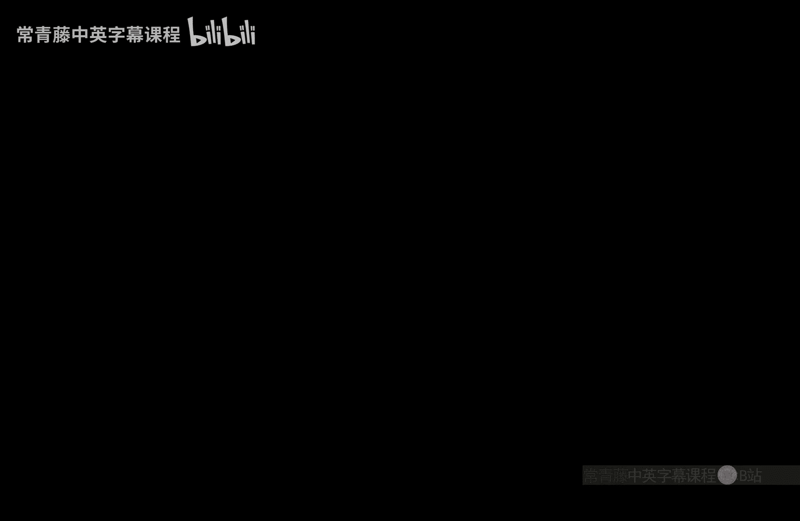
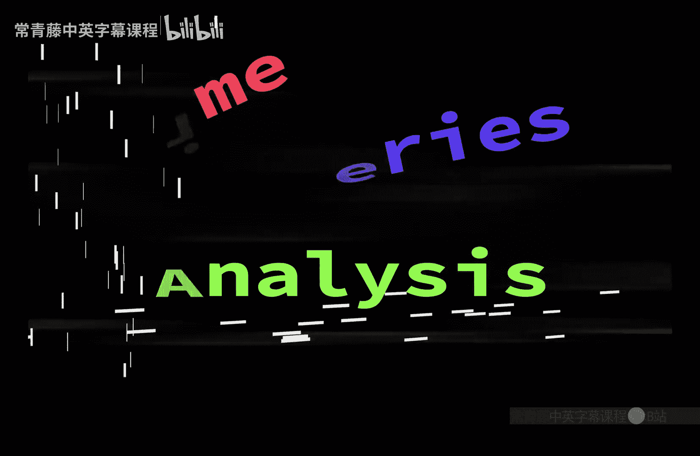
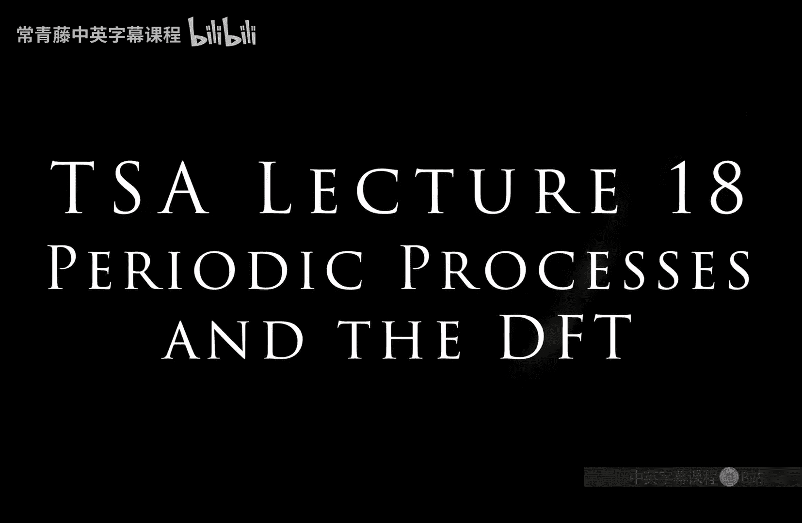
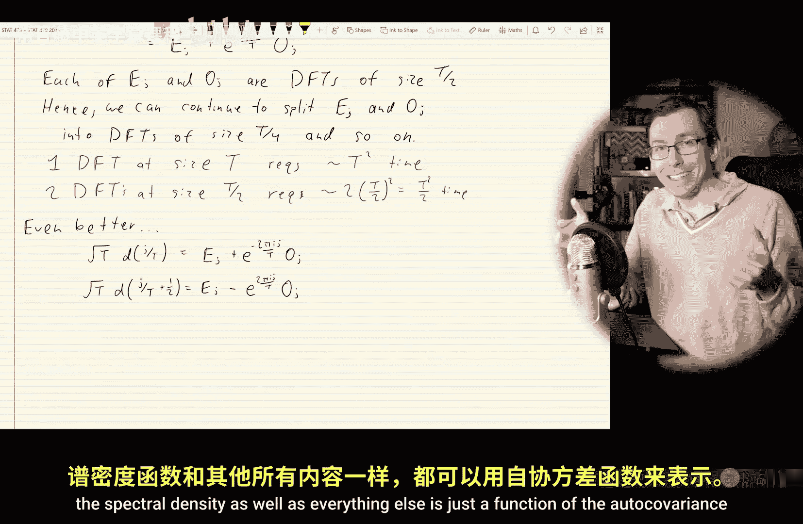

# 阿尔伯特大学【中英⚡时间序列分析｜STAT479 2021 Time Series Analysis】 p18 P18 Lecture 18： Periodic Processes and the DFT -BV1nwqYBDEos_p18-

Welcome back to another lecture of Statistics 479 time series analysis。

 Today we're starting the final chapter of our notes， it's on Spec Stas。

So so far in this course， everything we've done has been from the time domain that is we're looking at time series。

From the perspective of time， which makes a lot of sense， but whenever you have a signal in time。

 you can also flip it on its head and you can consider the frequency domain and that's what we're going be doing in today's lecture we're going to be considering the frequency way of analyzing time series data we're going to start with the concept of a periodic process which is a lot like well it's a stationary process it is in fact stationary and it's just going be a little bit different and it's going to allow us to figure out what frequencies are most powerful most significant in our time series data so how are were going to deal with all of this well let's go take a look at the notes and find out。

And welcome back to another lecture of Statistics 479 time series analysis Today we're going to start the last section of the course。

 at least the last main section， maybe if there's extra time we'll do a couple bonus lectures。

 but the last main section is what we're going to be talking about。

Is analysis of time series in the frequency domain。

 this is spectral methods because we have a signal in time right we have a time we have time series data now。

If you've ever seen anything about signals processing。

 you know that you can always look at a signal in the time domain as we've been doing for this entire course。

 but you can also flip it on a TE and look at it in the frequency domain and it will give us another lens to look at our time series data and to try to understand what's happening with it。

 This is specifically useful when we have periodic fluctuations in our time series。

 specifically things that we looked at before like in our seasonal ama models because when we have in a seasonal process we have this periodic sort of fluctuation and if we're looking in the frequency domain。

 we can see that kind of lighting up at certain we can see the periodicity lighting up at certain frequencies So how in the world are we going to do this。

 well， we're going to have to use some tools like the Fourier transform。

 So it's a pretty good area to study and let's get into the。Notes and jump right into it。All right。

 so this is going to be the beginning of the frequency domain。Section。Now。

 the first thing we're going to talk about is the idea of a periodic process。

 so we're going to reconsider our time series， but using a different。Say basis for representing it。

 But first， I want to use the notation that。We。We'll use mega。To。B a frequency。So for example， Omega。

Equaling 1，12 is a。Kind of like a per month。Frequency。

So this is something we might see if we have data that has a month or an annual， I should say。

 a per month frequency， I guess， of one year， maybe that's a confusing English thing to say。

Basically， the idea is that if we have monthly data and if it repeats itself every year。

 if there's some annual cycle to it， like let's say temperatures。

 if we take the average monthly temperature and we look at it for years and years。

 we would expect there to be a cycle of length 12 hiding in our data。

 that means the frequency would be one over 12。And it's something that we could use， again。

 spectral methods to try to detect that in our data。All right。

 so what we're going to focus on in today's lecture is the idea of a periodic process。

So the periodic process I'm going to write as x transpose is equal to a constant or some coefficient amplitude times the cosine of2 pi。

Omega T plus phi。 Now， Phi is kind of unfortunate。 It's the phase。

 And I know phi is usually our auto regressive parameter。

 Phi is going to disappear in a second when we use some trig identity。

 So we don't need to worry about that， But just in general， right， If we have。

 if we represent X T like this， What we have as we have a is the amplitude。Amitude， there we are。

 we have， of course， omega the frequency t is the time phi is the phase。

So this is just going to be some， I guess， periodic signal。

Where the phase phi offsets the signal in and in time， right this is all in in T。

 So this is still T and this would be， I guess the。I'm not even sure what the vertical axis would be。

 but a， the amplitude is going to tell us like how strong our signal is right this is a and the offset。

Um， where would the offset be， I guess the offset would be from like here to here would be phi。

Right so phi again shifts it a， the amplitude makes it bigger or smaller in height。

Now what we're going to do is we're going to rewrite this。Okay。Rewrite as X T。

Is equal to u1 times the cosine of 2 pi omega t plus u2 times the sine of 2 pi omega t。

So now we have a linear combination of a cosine and a sign。 and if we， I guess， recall our tri。

Identities， I can say where。Yeah。U1 is going to be a times， I think it's the cosine， yeah。

Do I remember my trig identities， I hope I do。Right。

 u1 is going to be a times the cosine and U2 is going to be a times the sine。

 but I think there's a minus sign there。 Yes， there's a。Minus sign there。Right， this comes from。

The trig identity that the cosine of x plus y is equal to。Cosine x， cosine， y minus， not cosine。

 minus the sine。Of x and the s of y。All right。So what we're going to do is we're going to think of u1 and U2 as uncorrelated mean zero random variables and now we have a random process。

Basically， if。You won。And you two are uncorrelated。RVs for random variables。Then。We have a random。

 We have X， T， a。I guess some sort of random process。 It's not that interesting right now。 It's just。

 we have a random coefficient in front of the cosine and a random one in front of the sign。

 So not that interesting yet， but it will be in a second at the very least， what we can do is。

 if we treat you  one and U2 as， again， uncorrelated random。Variables。

 then we can do things like we would do with a random with random variables like compute and auto correlation so。

If we， I guess all， we also need a variance。A uncorrelated random variables。

We'll say such that the expected value of u1 is equal to the expected value of u2 is equal to zero and。

The variance。Of u1 is equal to the variance of u2 is equal to sigma squared。So from here。

 we can actually compute the auto covariance of x because x is still a。

I guess a time series at some sort of stochastic process in T。

 and we can consider the autocovariance at a lag of H。So in this case。

 what we're going to do is just write out the whole thing， it's a little messy。

 but it's perhaps the best way to do it we're just going to get well u1 cosine。

 I think we yeah we'll do it that way，2 pi omega T plus H。Plus， u2 sine2 pi omega T plus H。

Coma and then the other thing we're going to get is u1 cosine。2 pi omega， just a T。

 Nope H and the U 2 s2 pi omega T。And yeah， we want to compute that thing luckily we can， well first。

 I guess break things up。We can break things up over the I guess using the fact that the covariance is a bilinear form so we can break things up over the addition signs and because we know that u1 and U2 are uncorrelated。

 we only have to consider。When u1 is paired with u1 and when u2 is paired with u2。

 because otherwise the covariance will be0， what I mean by that is we'll have two pieces rather than four。

 we'll have the covariance of u1 cosine2 pi omega。T plus H and u1 cosine2 pi omega T。

And we're going to add to that the covariance of u2， not cosine， u to sine。2， pi mega。T plus H。

U2 s2 pi omega T。Right and again， the other cross terms have to be zero because you1 and U two are uncorrelated。

Now， in this case， because we just have， well， that there mean zero。

 and the only thing that's random here are the u1s and U2s。

 this quickly turns into just being sigma squared。Times。I guess the cosine。Two pi mega。T plus H。

There's a lot of tri that's coming in equations in this section。Cosine 2， pi omega T。Plus， nope。

 I think it's， is it a plus？Not it was supposed to be， oh no， it is it is a plus yeah。Plus， sign。

2 pie。Omega。T plus H。Let me double check that。 Actually， no， there's a typo I have。

 I was thinking there's a。I mean， yeah， there is a typo here。Nope， never mind。

 There isn't because I was trying。 I was getting confused with the fact that we have a minus sign here。

 but the minus sign is absorbed within the U2。 So it's not really there。

 I was worried that I forgot a minus sign。But I think we're good。

 so we'll just keep pushing forward with another sign2 pi omega T。And if we trigger identity it。

 we should be able to get something that looks like sigma squared cosine。Of。Two， pi omega H note t。

What we this means so this is actually quite interesting。 So what it means is a couple things。

 first of all， well， the autocovariance will fluctuate in H right cosine kind of starts up and goes down and then goes up and then goes down so we our process will go from being highly correlated to not correlated to negatively correlated to0 to high you know positive correlation and so on。

 but furthermore。Yeah。There's no T here。Therefore。It stationary。

And that's good times right because we like stationary processes。

 so this is another type of stationary stochastic process that you might see Now， again。

 in this case， it's not the most interesting because we just have two random variables。

 a U1 and a U2， but we can extend this to more complicated stochastic and more complicated stochastic process。

And what we can do is。I'll say。To make。This more interesting。We can。Consider。Frequencies。Omega1。

Think think I was using Q， right， is my index。 Yes， omega 1 through omega Q。

And then we can write down a more interesting periodic process that is going to be the sum J from one to Q。

Of well， two things。I guess summed up Q times， which is going to be U J1。Cosine。2 pi。

Omega J T plus U J 2， sine2 pi。Omega J T。All right， Oh， yes。With。As as before。U J1。And U J2 mean。0。

 uncorrelated。Random variables。Oh， yes， and with the。

Uncorrelatedlate means 0 random variables with potentially， yeah。

 and they could have different variances with。Variances。That are sigma squared。Jy， yes。

So the point is， is that U J1 and U J2 have the same variance and are uncorrelated。

 but we might have。U I1 and U I2 where you have a different variance still uncorrelated。

 but you have a different variance there。And。Then we can compute the auto covariance of this new more general periodic process X。

 and it's going to be kind of the same thing as above。 But if we just do it， I guess Q times。 well。

 we're just going to sum up Q of these things。Thanks to again。

 linearity or I guess bi linearity of the covariance we can。Get away with。Well， this。

The cosine of2 high omega J H， so our auto covariance now is going to look like a sum of a bunch of cosines with various frequencies。

And this is nice because then you could have multiple different signals with different or I should say multiple frequencies on top of each other within the same signal。

 and that's kind of neat。Now， oh yeah， there's one little issue that we have to mention。A I say。

 I'll say warning。 Maybe we'll do it in red because red is a good color to write the word warning。

Morning。There could be aliasing。Alialia Sang。When。嗯。I'll say discretereetly。Sampling。X T so。Okay。

 what are we talking about well what we're saying is is that。

We have this idea of a general periodic process X T in some sense， T is continuous。

 but when we take time series data， we're going to be sampling it at a in this course。

 a fixed in a uniform rate。Now the sampling rate can affect what the process。What the data。

 what the process looks like from the data。 and this is the idea of aliasing。

 So aliasing in this context。You've probably heard of it if you ever have done either graphic design or if you're a gamer and you know about antialliasing for GPUs or I guess if you do like audio engineering。

 aliasing can come up all over the place when you have discretely sampled things that are trying to be turned into or discretely sampled things from what is otherwise supposed to be a continuous object。

Right， so the idea of aliasing is simply that。A high。Frequency， may look。Like。A low frequency。嗯。If。

Sort of sampled。Discreetly。What it means is that sometimes you get two different frequencies that might look the same in your data because you don't have enough sample points to disambiguate them。

So the example that I have in my online notes that I plotted nicely and I'm going to draw here and hopefully it doesn't look too messy is that imagine we have some signal that's just fluctuating up and down at a nice high frequency periodic rate like this。

That's not so bad。 Let's see if I can draw the next part。

But now let's say that we're going to sample and this is let's say the T axis and we want to sample this at some discrete time。

 so we sample and we sample and we sample these are supposed to be equally spaced so let's pretend they're equally spaced。

And we sample and we sample and we sample， I guess， something over here。Okay。

 it's not exactly perfect， but the idea is that when you try to reconstruct a signal from my sampled points。

 it might look like a low frequency wave where， in fact， what you have is a high frequency wave。

 You're just not sampling it fast enough to be able to detect that。

 So this is the idea of aliasing where you basically have this overlap of a low frequency and a high frequency that both would give you the same looking data。

 So it's just something to be aware of when you're dealing with time series and you're specifically with periodic processes and signals signals analysis。

But anyway， okay， so we have the idea of a periodic process right I'll highlight it in green because it's going to be kind of。

Okay。So this is the kind of thing that we would want to say try to fit to some data。

 right what we have is we have a model for a time series XT， if we have data XT。

 we might want to try to fit coefficients， U IJ1 and UJ2 to some data and see what we get。Well。

 we can do that。And now we're going to do。Regression。And。The Fourier transform。

I'm not sure if you actually do the Fourier transform in a undergrad statistics。Degree， I mean。

 if you took a math pro like pure math probably talks about the Fourier transform， but。

I'm not sure where exactly it would show up， I mean it could show up easily in say a course in analysis or measure theory。

 but that would probably be saved for more advanced。

 I guess it could show up in other areas to like applied math so anyway the Fourier transform super important and it allows us to switch from time to frequency domain and back again and will'll also talk about the fast Fourier transform because yeah actually computing a Fourier transform can be quite。

Computationally tedious。Anyway， yeah， so let's say given。A time series。Which is going to be x1。

Through X T。And then just for convenience， we're going to say with。Tea。Being an odd number。

Because otherwise we're going to have one extra term。

 which I'm going to write down in a second anyway， but。For。T being an odd number。Basically， we。Can。

Right。Our process X T as a linear combination。 So we're going to get beta not。

 That's our intercept term。 And then what we're going to have is we're going to have a subation and this submation is going to be from。

 man， my notes need some。Patching up， I'm going to try to get that done。

It's going to be a summation from 1 to t minus1 over two。

And here we're going to have a beta J1 cosine。2 pi。T times J over capital T。

 That's going to be our frequency。Beta j2 times the s of2 pi T j over T， there's our frequency again。

 right。The idea is that this， if we can basically， well。So note。That。Cosines and signs。Form。A basis。

What's that mean， Well， i。e。 we。Get a regression。That perfectly fits the data。

Now if you recall from regression class， we typically don't want to perfectly fit the data with a regression。

 but the。The idea here is that what we can do is if we have enough。Cosines and signs。

 we can accurately reconstruct all of our data points and I guess if we treat T as continuous。

 we can interpolate between them。The data points。This is like。A high。Degree。Polynomial。

So remember if we have a really high degree polynomial。

 we can fit it exactly to all of our data points now we don't want to actually do that with linear regression。

 but the point is that we could if we have。T data points， then if we have a t-1 degree polynomial。

 it will go through， well， we can find a， we can find a t-1 degree polynomial that will go through all of our data points and similarly。

 we can do the same thing with cosines and signss because they form a basis here。So again。

 this is just the idea that we can in some sense try to get coefficients and these coefficients beta will correspond to different frequencies and that's going to be well。

 interesting in a moment。But we also have to do one more thing， which is figure out what happens if。

If T is even， well， then we get a slightly different thing。 We still get our beta n。

We still get our sum J from1 to T or T over2。 it's slightly different now， T over2 minus1 of。

Beta J 1， cosine 2 pi T J over T plus beta J 2 sine 2 pi T J over T。

 But we're missing one extra thing。 and that one extra thing is going to be plus。

Beta T over2 cosine pi T。 So we get one extra beta floating around if we have T being even by itself。

 otherwise they all pair up inside this summation。All right。

 so then the question that we're faced with is。Why are we writing a time series in terms of some giant linear combination of trig functions？

So that's always good。To ask yourself why。Are we doing this， and we're doing this because。Any。Large。

Say significant。Betas will。Correspond。To， a prominent。Frequency。Cycle。In our data。

Our time series data。So what that means is that if we were to actually try to fit one of these giant trig polynomial。

 say， to our data set， then we're going to get a bunch of coefficients beta。

 and if we see any really significant or very large values in magnitude large values of beta。

 that tells us that that frequency， that is specifically that J over t frequency is somehow prominent in our data。

So， basically。We can think。Of this。As one big linear。Regression。Problem。Where the design matrix。

 there's going to be a design matrix that corresponds to all of the betas here。

 we have our intercept term beta not and then we have a whole bunch of betas in our subation here。

All right。Okay， so there's a bunch of different。Tig identities we can use to help sort out what's going on with our design matrix。

So right， typically。We would have something like beta hat is equal to x transpose x。

X transpose y where in this context。X is a design matrix。And。Y is actually going to be X T， the data。

 the time series data， so it's not the best notation to use because it conflicts with what we had before。

 but just recalling what we would do in linear regression class， oh。

 I forgot my x transpose X inverse， there we go。Um。

 but it turns out that things are actually a lot simpler here because in this case。Design matrix。

Has orthogonal。Columns。And that's always a good time。

That's basically what I do all in the design of experiments course I'm teaching right the whole idea is well if we have orthogonal columns。

 that's great for estimating different， I guess terms in an Anova table， for example， but anyway。

 in this case we can show that now I don't want to go through all the tedious equations to actually do that。

 but roughly。😊，Actually， we're gonna just stop and I'm gonna copy them right over because I don't really want to write all these out and with the magic of video editing。

 we're back and we have all of the equations copied right here。

 so I don't have to write them out by hand。 It's wonderful because they're not the most interesting things to look at。

 but basically what we're trying to get at is that if we take a column of our design matrix and do a dot product of it with itself。

 what we're going to get Why is it not switching my color man， Microsoft fail again。 Well。

 I guess we're doing the whole thing in black unless I can just I can change the main marker but onenote decided that I can't change。

😊，To a different one because it seems to think I'm trying to be an eraser。Well。

 we'll just go with it。Microsoft anyway， what we have here is that we have our columns。

Of our design matrix。 And if we do a dot product of a column with itself。

 what we end up with is an n over2 unless。Where is it， we specifically。

Have the case where j is equal to0 or j is equal to t over2 in the case that t is even in that case we get an n。

For the cosine bit and we get a zero for the sine bit， this is actually the reason why we well。

 no never mind， forget that。U。Yeah， and then every other dot product of columns is going to get us zeros here。

Right， so what that means is we have an orthogonal design matrix。

There we go so we have an orthogonal design matrix and that means that。Computing beta hat is simpler。

So rather than having to compute X， transpose X and then invert a giant matrix， which。

 as we've talked about in the case of forecasting， we don't want to invert a giant matrix if we can avoid it。

 So let's not do that Instead， what we can do is we can basically identify that。Beta hat J。

One is going to be2 divided by T。Times the sum。T from one to capital T of x。

T times the cosine of2 pi。T J over T and the。Beta J2 is going to be the same thing。

But it's going to be for。The sign。X transposedse times the s of2 pi T J over T。

 And this is specifically for。J not equal to0 or t over 2。 In those cases， we have a specific。Well。

 yeah， this is important and this is important。 and then we have two specific formula。

 which is beta hat zero。 that is right， if we're trying to estimate the intercept term。

 what is it going to be。It's the sample mean。X bar just equal to1 over t， sum of the x。

Little T and lastly， if we want to estimate beta t over two for even values of T。

Then what we end up with is a one over t times the sum。

Of what T from one to capital T of an alternating sign minus-1。To the T X T。So these formula。Again。

 might be a little confusing at first， but just， I still can't change my。

Marker because of course I can't。Micro， you're killing me。Just killing me。All right， fine。

 I guess we're just going to have to do the entire lecture with the no extra colors。

 So it makes me a little bit sad， but we can get through this together。All right。

 what I was getting at is that。In linear regression。In simple。Linear。Regression。

What we have is we have that well， y is equal to。Beta odd plus beta 1 x plus epsilon。

 And if we want to estimate beta hat 1， what we end up with is something that's going to look like the sum of Y I times X I divided by the sum of X I squared。

 So here， the Y I are actually corresponding to the X T。

 the data points and the X I in linear regression are corresponding to the design points。

 the cosines and the s。 and the denominator ends up just being the， oh， here I used n over 2。

 or I was supposed to use a T over 2。 There's another。Typo that I need to go and。Anyway。

 that's what we have going on here we basically have a linear regression setup and what we want to do is compute this thing for all of the well Js。

 I guess so all of the different frequencies and then we can use that to。

Get a sense of what frequencies are prominent in our time series data。

And this leads to the idea of a scaled。Not a sailed， a scaled。Perioogram。

There's a lot more terminology in this section that's new。

 So the scaled periodogram is going to be P and it's going to be P of j over t where so it's it's evaluated at a specific frequency。

 which in this case is going to be omega being j over t and what it's going to be is the sum of the squared coefficient J1。

And J2 squared。啊。Can't change colors anyway if。Basically。If。This is big。Then。

J over T is a significant。Frequency。In the time series。In the time series， TS。Okay， so all right。

 I'm basically just saying we have some function of the frequencies。

 and it's going to give me the squared sum of the two coefficients here。 But this is going to be。

Important。Because we can use the discrete Fourier transform to compute all of these。Oh， yes。

 and one other key thing to note。Also， this。P J over T is the variance。For the。Well。

 it's basically the variance for the。For the J frequency。For the J over T  for。4 beta J1。Cosine。

2 pi T J over T。 This isn't exactly the right way。 I think to write it because technically。

 it's not a random variable。 So I should probably。Rewrite this slightly， but。

You can think of it as a decomposition of the variance for different frequencies。

 So if we have a bunch of variation in our time series data， we can attribute。

That variation to each of the different frequencies from one over t2 over t all the way up to。

 I guess。T minus1 or t over， I guess it's t minus。or one half which would be t over2 over t so the T's cancel't out anyway。

 the idea is that there's going to be kind of a way to think about the scaled periodogram as the variant of our time of the components of our time series。

All right， so。Next is computing。This for。Large。Tea is not feasible。

So what we can do is we can use the Fourier transform if t happens to be what they call a highly composite integer。

So。But。If T is。Highly composite。Which basically means。I。e。 it。Has lots。Of small prime factors。一据。

Let's say。2 to the。I don't know what's a good number two to the。10 would be 1000 or no。Yeah。

 10 to the， we'll do two to the 10。Equal 1024。Yeah， so for example。

 if it's just two times two times two times two times2， then it has well。

 lots of small prime factors in that case， I didn't finish this sentence。

 but if T is highly composite then。We can。Use the discrete Fourier transform or DftT。

So what's the discrete for a transform？Well， the discrete Fourier transform basically says I'm going to compute a D at J t at frequency j over t。

 and what that's going to be is something that's going to look like one over the square root of capital t times the sum t from1 to capital t of x t。

E， the exponential of minus2 pi I T， J divided by T。

Where I here is the imaginary number I and J is the corresponding。

 I guess corresponds to a frequency。一。Now。Why are we writing this， Well， if we write this out。

 remember we have a complex exponential and e to the I theta is going to be nice。来。Okay。

 I can manually change the color。Right， I'll say recall。

That E to the I theta is going to be the cosine of theta plus。I s theta。Now。

 the one peculiar thing is that sometimes the coefficients will change or the scaling will change in the discrete Fourier transform。

 you always have to be a little bit careful with。The specific implementation or the way that the Fourier transform is written down。

But if we define it like this。Then what we end up with is we can rewrite this submation as。

A sum of two。Yeah， well， I guess。There I'll do it as one big sum， why not？X， T cosine。Two。

 pi T J over T。Minus I X T s。Two， pi T， J over T。All right。

 I swear we're actually going somewhere with this， we're almost getting to what we want。

mBecause what happens is if we have this setup then。Therefore， the。

If we want to consider the squared magnitude or the absolute value of this thing squared member。

 this is a complex number， so the discrete Fourier transform is giving me a complex number。

 I've got my real part cosine， my imaginary part， I times the sine。

If I take the magnitude of it and square that， it's basically the pythagorean theorem what I'm going to be doing is I'm going to take。

The well， I'm going to get a one over t because I'm squaring everything。

And then I'm going to find the real part and the real part is going to be squared。

 so what I end up with is the sum of all the real pieces here， the cosines that is。

T from one to capital T X T cosine2 pi T J over T。 The entire sum is squared。

 And then what I do is I add to that one over T times the summation of the second bit here that signs。

And remember， I'm taking a magnitude so I drop the eye and I'm squaring it so I don't have to wrap the entire thing in a square root。

2 pi T J over T， and this whole thing is squared。Okay， so this is an。An unsscalecaled periodtogram。

That is still bugging me that I can't change the color without going through the menu。

This is what they call an unscaleed。Periotogram。And if we。If we were to write。

 then what we find out is that。The periodogram， P J over T is going to be4 divided by T。

To double check that to make sure that I'm my。Yeah。Yeah， I'll double check that in one sec。

 It's 4 over t times the squared magnitude d j over t squared。

 So if we go back up to what this thing is right， the squared I make sure that we're doing this right。

 So the squared periodogram or not the squared， the scaled period perioddoogram is the sum of the squared beta j I and or beta j1 and beta j2 now beta j1 and beta j2。

 correspond to these guys up here。So if I square them。

 I should get something like four divided by t squared times the sum of this in this big sum squared and that's where we would have a4 over t squared So when we I guess take this thing and multiply by4 over t squared we recover that so we're good All right so this is this is what we want。

And I guess。We can say that this is going to be our scaled periodogram。And again。

 sometimes the definition that you might find in a given。Coding package might be slightly different。

 so you have to be a little careful how scaling is actually done。All right， so。

What are we doing next all right， and we're back and now I've actually been able to recover by resetting everything。

 the ability to change the color on my pen， so I'm happy again let's look at the last bit of this lecture。

😊，So what we have here right is the idea of that we can use so what are we doing right because sometimes when we just fight our way through all of these equations。

 it's like what in the world is the point of all this Well the point is that let's go back to the beginning。

We have this idea of a periodic process， the betas are going to correspond to different frequencies。

 if the sum of the squared betas， that is if my scaled periodogram is big。

 that tells me that that frequency is present， strongly in my data。

Now we can make that more precise statistically later， but that's just roughly the idea。

Now to actually compute all of these， if we go back up here。

 we don't want to actually have to compute all of this by hand because t could be really big。

 it could be like say 1000 and j is going to run from I guess1 to t over2 right or t over2 minus1 depending on or t minus1 over two。

 I mean depending on if t is even or odd now we don't want to have to compute all of these by hand。

So what we can do is we could consider the discrete Fourier transform because it turns out that if we applied the discrete Fourier transform。

 which just says multiply my data set Xt here by a bunch of complex exponentials and because we're defining it this way we're going to scale it by the square root of the sample size。

 but really what it just says is take those data points， multiply by complex exponentials， sum it up。

All right， and that's going to give us what we want but。Then the question is， well。

 is that any easier than computing what we already had， And the answer is well。

 not really until we consider the fast Fourier transform。

 So what we want to do is we want to figure out。 So the next thing is。Next is how。Do。We compute。

D J over T quickly。Right， because so far we haven't really done much。

 but just noticed that the discrete Fourier transform will give us what we want。

 which is kind of equivalent to just doing linear regression with all of these signss and cosines as our basis functions or in our design matrix。

So there's a couple things to note first， so first we want to note that。Note。That the。

Discrete Fourier transform is symmetric about。T over two or sorry， about one half。So I guess， yeah。

 t over two over t， it's basically one minus J over t。

The magnitude here is going to coincide with the magnitude， the squared magnitude of just J over T。

 This is because。Why， well， it's because trig functions。

 right and trig functions say that the sign of2 pi minus。Theta is equal to minus the sine of theta。

 and I think the cosine yeah is even， so the cosine of2 pi minus theta is just equal to the cosine。

Of theta。 So if we square these things and sum them the sine difference in the sign。

 the plus or minus the minus sign next to the sign will vanish anyway。 So it won't really matter。

 So because of this， we can say therefore。We only need。To consider。嗯。I guess D J over T。4。J from one。

To T over two， that's assuming T is even if it's odd， then I guess t minus1 over two。Or equivalently。

We can just write J over t should be less than or equal to a half。All right。So。What do we have？

The Dft。Is a。Big。System。Of。Linear。System of equations like everything seems to always be a big linear system of equations。

 mainly because if it's not a big linear system of equations， we're kind of stuck。

 at least in this case， if we have a linear system of equations， we know what we want to do。

 we just have to figure out how to efficiently solve it。 If it's a non nonlinear system。

 then we're kind of in big trouble。 usually， So that's a good thing。

 We have a linear system of equations。 And we're going to write D， which is the vector of。

I guess the discrete Fourier transform vector is as w times x for。

D basically being our D1 over T all the way up to whatever D。

 I'll just say one half if we assume that t is even， but adjusted again。

 if it's not one half X is just our data set x1 through X T and W is going to be some matrix。

 it's going to be our discrete Fourier transform matrix， which is going to just be， well。

 all of these signss and cosines that we have shoved in up here。그。Okay， so if we have that。

What do we do， Well， the idea is that。This。Matrix。Yeah。Mulultipplication takes。

On the order of t squared time。So again， if t is a really big time series we don't want to do this matrix multiplication。

 I mean okay computers are pretty fast， I guess if we really wanted to and you could I guess feasibly you could parallelize this by applying X to each row of W individually。

 so yeah maybe you can just kind of brute force your way through it but。

We could be a little fancy and use something called the fast Fourier transform。

 so that's always nice。So instead。We could。Use。The FFT or the fast Fourier transform。Um。Which uses。

A sparse。Representation of the matrix W。And runs。In。T log to T time。

 so computationally it runs a lot faster。 it's now linear with this logarithmic term on it rather than t squared which is going to be a lot bigger。

 but we need T to be a power of two for this to work most efficiently now there's a lot that's gone into how to do fast Fourier transforms。

 people spend lots of time there's more than one algorithm but。Basically， will。Consider。

The divideide and conquer algorithm。Iway always say conquer or conquer， conquer， conquer。With a Q。

 yeah， divide and conquer algorithm。Which is。When。T is equal to some big power of two。

 It doesn't have to be big， I guess it just has to be a power of two。

For some M and the idea is what we're going to do is we're going to take our data and we're going to split it in half and then we're going to split it in half again and again and again。

 and that's why there is a log to T in the time because what we can do is we can just。UWell。

 we can just basically， we can just split this up in sort of a binary fashion。

 which takes the time from T to log T。For the second T and the T squared， I guess。Anyway。Yeah。

 the idea is。I。e。 split。嗯。Data。Into odd。And。Even。Indices。Which is going to be something like x1， x3。

 x5， etc cetera， and x2， x4， x6， etcter， so why does that matter？I mean， the idea is right。

 if we have this where we can continue to split and split and split into our data in half in half again and in half again。

 so it matters because we can。Rewrite。Discrete Fourier transform as well。

 scaling it by the square root of T， so I don't have to drag around a square root of T everywhere。

We can write DJ over T。To be the sum。T from 1 to capital t over2， and that's going to be x to T。

E to the， let's see if we can get this， that's why don't we write it out。

We'll write it out long form like this， so I have more room to write it all down minus2 pi I J over。

T divided by two， let's write it all out and then see if we can make some sense out of this thing。

Plus， and then we're going to have a coefficient of E to the minus2 pi I J over T。

 and we're going to multiply that by another subation T from one。To capital t over 2 of x。2 t minus1。

 this is the odd bits。E， well we'll say X。Exponential of minus 2 pi i。Jy。No， I forgot the T。

Over here。T， J。Tee。I guess the order doesn't really matter。

 but I'll try to keep it like this T over two。All right， so what did we do， Well。

 let's go back and look at the original discrete forier transform that I wrote somewhere up here。

 Okay， it's the thing that I kind of circled in green。 So all we're doing is we're taking the。

Index T， and we're splitting up the odd bits and we're splitting up the even bits。

 So what happens is we。Effectively， just replace we're we're replacing tea with like。

T doubled in some sense。 So what we get now is we're running T just from one to T over two。

 which changes our denominator and things a little bit。 But more or less everything's the same。

 The idea is that we've just taken that giant sum for our DFT and split it into two section two pieces。

 the even bit and the odd bit。 and we will denote the even bit as EJ。

And we're going to denote the odd bit。 Well， first， we have to multiply by that coefficient。

 which is。Minus2 pi I J over T， and we're going to multiply that whole thing by Oj being our odd bit。

All right， so we've split it into two pieces， how does that help？Well， it turns out that each。Of。

E J and。Oh， not theta。 So used to writing theta。 O， J。are。DftTs。

 they're discrete Fourier transforms of。T over2 of size will say T over 2。

So the point is that I've turned one DftT of size t into two DftTs of size t over two。

And I can keep doing that。Hence。We。Can。Continue。To split。E i。And O， or E， J and O， J into。

DftTs of size。T over 4。And so on。Right， so does that actually help at all well yeah。

 it kind of does because if computing a discrete Fourier transform takes T squared time。

 then just to give a quick example。1。DftT。At size。Tea。Requires。Let's say。About t squared time。

But two。DftTs。At size。T over2。Require。Well， what， too。Times t over2 squared or。

T squared over two times。y， that's kind of neat。 So we've basically cut our run time in half just by doing one split。

 And if we were to keep doing this again and again and again， those halfs kind of add up。

 and we end up with a log 2， kind of。There's actually one more thing we can do to make this even better so。

What I'll say is。Even better。Dot dot， dot is that there is some redundancy in our calculations。

Even better， it turns out that the square root。Of T times the discrete Fourier transform at。Jy。Tea。

Is going to equal。 Well， it's going to equal what I wrote before。

 It's going equal E J plus E the -2 pi。I J over T O J。And more interestingly。

 is that the square root of。D at。J over T plus1 half。Is going to equal Ej。Minus。E to the。

 I think it's the same thing。 Yeah，2 pi。I J over T times Oj。So in some sense， if we split our data。

 we get two Fourier transforms or two DFTs for the price of one。All right。

 so what are we doing here well in summary， again the idea。

Because I feel like there's a lot of equations in this lecture and I want to make sure that it's kind of clear that you haven't lost the plot right you haven't missed the forest for all of the trees that we've had to fight our way past。

So in summary， what are we doing， well we're considering our data represented as a periodic process that I wrote in green here。

Well， I I highlighted it in green but more so the idea is that we can use regression to try to find significant frequencies in our data now we don't want to do that by hand。

 but it turns out that doing regression on a time series data like this is equivalent to computing the discrete Fourier transform and then the question is well how do we compute the discrete Fourier transform well we can do that in many ways。

 if T is not too big， we can just brute force it as a by multiplying the transformation matrix by x that is our data X by the transformation matrix W。

But if we have a larger data set and we want to be a little bit more clever。

 we can use the fast Fourier transform now I presented one way of doing the FFT here。

 which is this divide and conquer method it works when T is a power of two obviously your time series data may not be a big power of two there are other fast Fourier transform methods out there and different things I'm not going to get into all of them because that's not really the point of this course but I thought it was worthwhile to take the last part of this lecture just to explain what's actually going on here because I think it's kind of neat this idea of dividing and conquer in order to compute the Fourier transform。

So that takes us to the end of what we wanted I wanted to talk about today in the next lecture。

 we get to go into something even more interesting。

 which is the spectral distribution and the spectral density and what do you know。

 we're going to get some theorems and it turns out our good old friend。

 the autocovariance will be back again because we're going to be able to write our spectral density in terms of the autocovariance like everything in this course。

 the spectral density as well as everything else is just a function of the autocovariance and we will look at that。

😊。

🎼In the next lecture， so see you then。