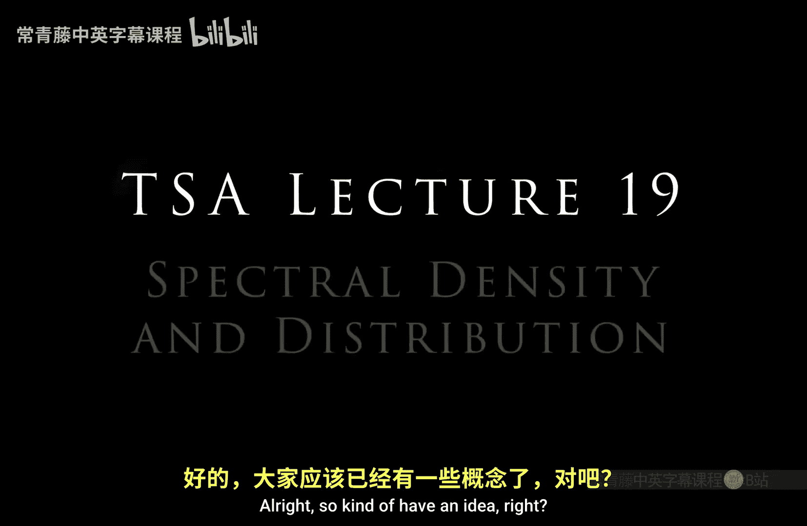
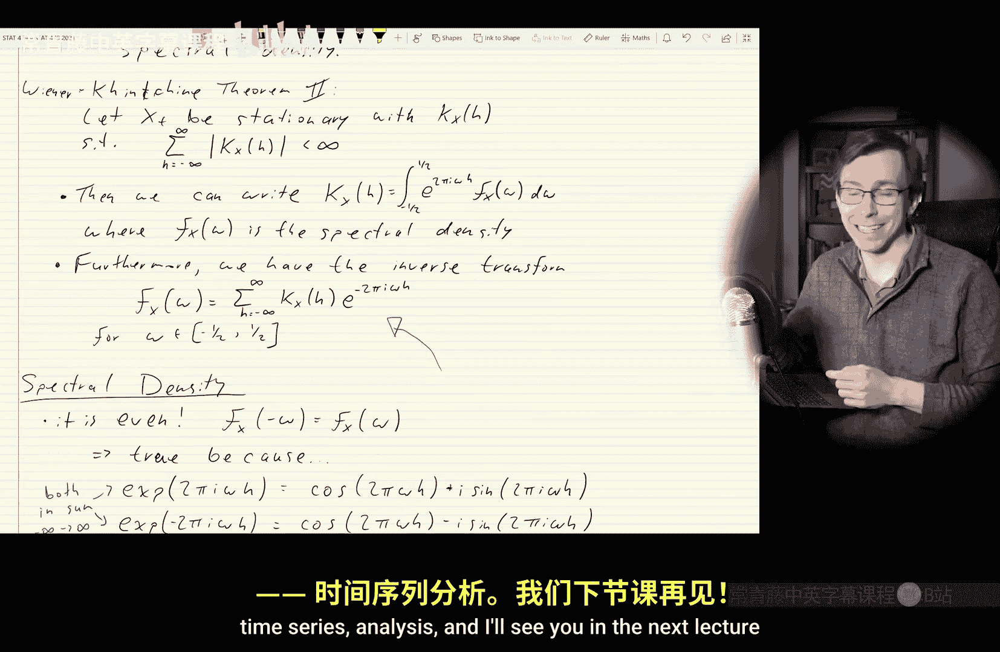

# 阿尔伯特大学【中英⚡时间序列分析｜STAT479 2021 Time Series Analysis】 p19 P19 Lecture 19： Spectral Density and Distribution -BV1nwqYBDEos_p19-

🎼And welcome back to another lecture of statisticstistic 4，7，9 time series analysis。

 We started our final section on spectral methods for time series。

 What we're going to do today is look at the spectral density and the spectral distribution。😊。

🎼あ。All right， so。kind of have an idea right I mean I'm assuming you know what the probability density function and the probability distribution functions are or the cumulative distribution function to be precise Well。

 what we're going to be doing today as we'll be looking at the spectral versions of both of those objects so what are the spectral versions of those objects well they correspond to what frequencies are most prominent in our time series data so if we have say some time series data that we're looking at and we want to know what the most prominent frequencies are。

 we can look at the spectral density， if it exists。

 which we'll talk about in today's lecture and we'll try to figure out exactly what's going on。

 what are the strongest frequencies in our data and you know what it's all related to the autocovariance function our dear friend and we'll find out how it all fits together in today's lecture so。

Let's get into the notes and welcome back to another lecture of Statistics 479 time series analysis today we will continue our discussion of time series in the spectral domain。

Last time we looked at the periodic process， the idea was to write out the process in terms of sine and cosine functions。

And then to look at the coefficients that go in front of them。

 if the squared sum of the coefficients is big， that indicates that the corresponding frequency is prominent in the time series。

 so it's sort of like a strong frequency in the signal that we have now today we're going to go a little bit further and we're going to look at something called the spectral distribution and the spectral density。

 so the terminology here is very deliberate right we know it a distribution function and a density function right a CD and a PDF。

The cumulative distribution function for a random variable and the probability density function for a random variable。

 well today we're going to look at the spectral density and the spectral distribution and it turns out that these things are really closely related to the autocovariance because like I said this whole course it's really just autocovariance all the way down at the end of the day。

 whatever we're doing somewhere somehow the autocovariance is behind it。Right。

 so what are these spectral densities and spectral distributions。

 well let's jump into the notes and find out。All right。

 well the first thing we're going to have to do is write down a couple theorems。

 it's always a good day when you get a good theorem in a class and these ones are quite nice。

So what we're going to consider are called the Wiener Kinchin theorems and there's two of them Weener and Kinchin were both two fairly bright mathematicians。

 probabilists and whatnot back。I don't know， probably about 100 years ago now。

Though it's interesting， I don't know the history of this theorem。

 but I'm pretty sure that Wiener was I want to say American and Kinchin was well not I think he was Russian I want to say so there's a good chance that this theorem is named this way not because they work together but because they well came up with the same idea independently。

 though I honestly don't know the history of this theorem and now I feel bad for speculating on the origin of both Wiener and Kinchin when I'm actually recording this I should have actually read it beforehand rather than just speaking extemporaneously。

 but maybe at the end of the lecture will revisit this and figure out who these two guys actually are but for now we need their theorem so first of all。

 this is the section on spectral。Density。And distribution。

And what we'll start with is the first of the two。Waner Kin next I'll write that way。

Queener Kinen theorems。If you've studied stochastic processes。

 you've probably heard of the weener process， which is just a renaming of brownie in motion I'm pretty sure brown or was。

I think he was British， if I recall， so they both got their names associated with that process。

Anyway， this is Wier Kchen Theorem one and what it says is that。Let X T be stationary。

 always a good start。Stationary with。Auto covariance。K X H defined as usual。

 which is just the covariance between x T plus H and X T so nothing new there but just running it down to be explicit then。

There exists。A unique。Monotonically increasing function。嗯。Moo。Tically， increasing。Function。

 which we will denote。As F capital F x。Of omega。 And this。Is called。

The spectral let's changed the color to emphasize it。The spectral distribution。

Of course I haven't told you what the spectral distribution does yet。

 that's the conclusion of the theorem and the spectral distribution is such that。😊，F of x。

At the value of minus1 half。Is going to be zero。So it starts at zero at minus a half at。

Plus one half。It takes on the value of Kx0， which again is just the variance of the process at any time because it's stationary。

 the variance is the same no matter what t is。And I guess most interestingly is what happens between minus one half and plus one half。

 well， it turns out that we can define。The spectral or not the spectral。

 the auto covariance function at lag H。To be the integral from minus1 half。2，1 half of。

E to the two pi I complex exponential omega H。And this is integrated with respect to Dfx omega。

 right， so this。Basically， this is a。Threemen。Stils。Stillilches， I think it is， yeah。Silt j。

Inteegral。Now that I think about it， of course， we know who Bernard Riman is not sure who Stilches is I have to look that one up to so many different names right got to keep track of them all regardless hopefully you've seen the reman Stilches integral just basically saying instead of integrating with respect like Dx I have or D omega I have Df X omega but if you took a course in distribution and probability theory that should look familiar right because this is very similar to the idea of integrating with respect to a random variable right so here F is looking a lot like a CDF function a distribution function。

 but。😊，It's a little bit different。Recall in contrast。A C， D F。F of。X， say is increasing。From。Zero，2。

 one。So it has a similar connotation， but it is a different object here。

 it's still an increasing function， but it goes from zero to the variance。

 I guess if you normalized it by the variance， then it would look more like a proper CDF。

 but we're not doing that right now。So this is basically saying that there exists a function called the spectral distribution such that when I integrate do this complex integration over all frequencies from minus1 half to plus1 half。

 remember mega is thought of as a frequency， what we get out is the autocovariance。So on his own。

 that's maybe not the most interesting thing because we know what the auto covariance is。

 but I don't really know what this F is， right， this or spectral distribution is a little bit more arcane。

So we can actually get something better out of this if we look at the second Wier Kinch theorem。

 but first， maybe I'll just write down explicitly。So actually I'll make a little bit of room here from this blue box。

And I'll extend my parentheses here。I。e。 right， this integral， well when I say DF。X omega。

 what I kind of mean is this is equivalent。To。F where is a little F。X， omega， d omega。But this is if。

Yeah， this is basically if。If。Fx is differentiable。

RightSo if I can take the derivative and it exists。

 then there's a little f and I can write the integral in terms of a integral we're more familiar with just the ren integral rather than the Riman Stch's integral but。

Even if I can't do that， I can still write down the re Stuls integral in terms of the distribution function。

Right。Oh， that's right， yeah， if the autocovariance is absolutely summable， oh yeah。

 there's a couple， that's right。So we had to talk about strengthening this。Strengthening the above。

 which is basically if。The auto covariance。KX H is absolutely summable。

 I got to make sure I get all my conditions right here because right if we're doing proper theorems。

 everything has to be just right terminology so we need this to be absolutely summable。Then。

The spectral density or spectral sorry distribution。

The spectral distribution being Fx at frequency omega is absolutely continuous。Is abs continuous？

Right， and then continuing our cycle of then， then if it's absolutely continuous。

 the derivative exists almost everywhere then。Fx omega， which is the derivative。Of。Fx omega。Exists。

Almost everywhere， Ae。And。Is called。The spectral density。All right。So yeah。

 basically our autocovariance is going to be absolutely summable I'm pretty sure we did that in an assignment question if I recall。

 I'd had to double check that I mean if you had a really dumb autocovariance like it's all one all the time well that's no good but if you have the autocovariance is much like the ones we've seen in class things that well for the moving average process。

 the autocovariance just goes to zero after a finite number of lags so that's definitely summable in the autoregressive case we have that geometric decay in the autocovariance so that's definitely going to be summable as well again assuming that these processes are nice the way we expect them to be if we have when I say auto I guess autoregressive I'm thinking that it has to be an autoregressive that's causal so that it doesn't blow up right so there are cases where this will fail but most of the cases that we would study。

In this class are going to work with this fall into this setting and if we fall into this setting。

 we get a spectral density and if we get a spectral density， we get another theorem。嗯。

And that's going to be the Wiener。Kitchen。Kint chinin。

Kinchent inequality is actually one of my favorites。I like Kinchen。

 even though I know nothing about the person man， except that he has his name associated with some pretty cool results in mathematics。

So this is Wier Kinch theorem part two and what it says is once again。

 we have to let X T be stationary as。Always。And autocovariant， okay， I don't want do write it again。

With。KX H， the auto covariance， such that。The auto covariance is absolutely summable。

 which means that if I sum H。From minus infinity to plus infinity of the absolute value of Kx lag H。

And have that that has to be finite right， this is the auto covariance being absolutely summable。

So if that's true， then。We can write。What， we can write the auto covariance。Oh yeah。

 this is just the this is not the most this isn't the best part yet， the best parts to come。

 this is just what I already set up above we can write the auto covariance in terms。

Of a classic Reman integral。Which is going to look something like E2， pi， I， mega H。F， X， omega。

 little F， by the way， D W where。Little F of x is what we already said it is， is the spectral。

Density function。But more interestingly is the inverse transform because like I said。

 I don't know what the spectral distribution is or the spectral density off the top of my head。

 but I know what the autocovariance is， we know what that is because we've calculated it basically in every section of this course。

And so then we get， so this is the then， the next thing is a furthermore。We have。

The inverse transform。Transform the transform being the fact that up above we're turning the spectral density into the spectral distribution in this case we have the inverse transform where we're going to turn what did I say we're turning the spectral density into the autocovariance is what I meant to say up above now we're going to turn the autocovariance into the spectral density and the inverse transformer is going to look like。

F of x， omega is going to be the sum。H from minus infinity2 plus infinity。

 and that's going to be Kx H。E to the now minus， minus2 pi。I， omega H， because again。

 auto covariant is a discrete valued in this sense。 I mean， again， you could have。

You can talk about continuous times stochastic processes where the autocovariance can take on any argument。

 but here we're doing discrete time， so H is going to be an integer。

 so we're going to sum overall H rather than doing some type of integral。Oh， and this is。

4 omega in the closed interval minus1 half。Two1 half。Cool。All right， so。

What can this tell us about the spectral density because I have this idea in my head that is going to be a lot like a probability density。

 but don't quite know what's going on yet in this case it's contained on a interval a closed compact interval here between minus1 half and plus1 half so。

Well， let's see what we can get out of this。So let's see。Let's call this the spectral。Denssity。

And what can we learn about the spectral density， well， first of all？It is even。Okay， why， well。

 it's even because I mean， well， first of all， what does that mean， that means that F。X， wait。

 you X minus omega is going to equal to F X plus omega。And that's because， well。

 why should that be true？This is。True。Because。Yi。Dat dat dat。

If we consider the exponential of2 pi i omega H， then what is this thing going to be， well。

 this thing is going to be the cosine of 2 pi。Omega H。My ear。Plus。Do I want a minus sign in there。

 well， we'll just do it this way plus I sign。Two pi I omega H。 And then you're thinking， well。

 wait a minute。What's going on here？Right， because。If I consider the negation of that。

 I get a negative2 pi I omega H， and that's not the same thing。

That's cosine 2 pi omega h minus i sine 2 pi i omega H。But both of these appear in the sum above。

 So this guy and this guy are both。In。The sum。From minus infinity to infinity。

 so basically what happens is is that if I plug switch omega with minus omega。

 I go up to this summation here and I summit backwards basically and by symmetrymetry of autocovariance。

 this works， I mean effectively right we could even write this out maybe more properly in the sense that if I have an Fx minus omega。

Then that's going to be the P summ h from minus infinity to infinity of Kx H E to the plus actually。

How do I want to write this， we'll start off writing it the correct way or the simplest way。

 which is2 pi I omega H， but then what we do is we note。

That this is the same submation minus infinity to plus infinity of。

How do I want to write this we can sub I want to substitute in。Basically。

 I want to switch H for minus H so I can switch this to minus H because by symmetry。

 nothing has changed。And2 pi minus 2 pi I omega minus H。Right。

 and what we end up doing is we end up basically summing all of the same terms。

 but where're instead we're running H backwards so we can replace H with。And what comes after H？Jay。

 I don't really want to use spell you can。How about R R feels like a good lag variable。

 so what we're effectively doing is running R from infinity to minus infinity of Kx， not sum。

Of K X R。E to the minus2 pi I omega R， which because summation is commutative。

 even when I'm summing to infinity。Yeah， we end up with just the auto or the spectral density at omega。

Cool， so now we have two things that we know we know that the spectral density exists only on a finite interval from minus1 half to to plus1 half。

 and it's symmetric about the point zero because it's an even function。

So what else can we get out of this？Well。Consider the fact that the variance。

Of Xt is equal to what it's equal to Kx at lag zero。

 and if we go back up to that summation that just fell off the top of the page。

What we're saying is that oh wait， I want to do this slightly backwards， not the summation。

 I want that integral， what that means that if I plug in a zero here。

 then my e to the two pi I omega0 just vanishes it becomes a1 and what we find out is that we can write the variant of a process as the integral from minus one half。

To one half of just。The spectral density。Integrated over， I guess， with respect to Omega。

So what does that mean， Well， that means that we can think of the variance as an integral。

A subation in some sense， of all of the different frequencies。So。This is the variance。As a。

 I'll say sum。Of all。The different frequencies。Well， sum of all the different frequency。Intensities。

 I should say。Because I say some because we're actually integrating so it's kind of like a sum right that's the whole point of the integral but it's it's a little different what we're saying here is that the variance is we're taking the spectral density which is kind of like the intensity of。

😊，The of a given frequencies in our data in our time series XT and we're integrating over the whole thing。

 so we're kind of like adding up all of the intensities of the different frequencies and that's kind of interesting because this is。

😊，This。Is a lot。Like。The Anova decomposition。That is that the total。Some。Of squares。

Can be written as， you know， other sums of squares like a。Treatment sum of squares， plus residual。

 sum of squares， or if you take a course like my design analysis of experiments course。

 you'll see that yeah， you can get lots more different treatments and block sum of squares and other sums of squares in there。

 but。😊，Ultimately it's a similar intuition， it's telling us that in the Inova case。

 we can take our total sum of squares， the total amount of variation in our data and we can break it into pieces corresponding to different factors in our model in time series world we're taking the total variation or the total。

😊，Vance in our signal and we're breaking it into the contribution from each of the discrete。

 well each of the frequencies in this case continuous in practice discrete because we're sampling discretely。

 but we'll get into that。Anyway， yeah， we can actually do a simple example to see what actually comes out and what a spectral density would look like。

 so let's do that All right so for a simple example。

 let's consider the periodic process that we talked about in the last lecture。😊，So what we have is。

 let's say example。So let's consider xt is going to be what well。

 it's going to be u1 times the cosine of2 pi omega t2 pi omega n t for some frequency， omega n。

And then we're going to have you too。And that's going to be times the sign of2 pi omega not。T。

All right， so that's our simple， simple periodic process。

 it's just a cosine wave and a sine wave here you want and U two are uncorrelated random mean zero uncorrelated random variables。

Then we can say then。🤧Okay。Auto covariance is what it's going to be Kx like H。And that's going to be。

 well， we already did that in the last lecture， that's just going to be sigma squared。

Times the cosine of。Two， pi， omega n H。So we did that。

 but it turned out that right we can write the cosine in terms of two exponentials。This is。Nope。

 in never mind this is something different I was getting confused with hyperbolic functions there for a second here what we would have is something that looks like。

E to the yeah， I think I forgot the I in there，2 pi I。Omega n H。

 and then I have to add to it e to the2 pi I or sorry minus2 pi I omega n H。

Right because effectively when I have a complex exponential， it's going to give me a cosine。

 which is going to always be positive and then one of these is going to have a plus sign。

 one's going to have a minus sign， they're going to cancel out with each other and will'll be left with just two times the cosine。

 the two cancels out with the two in the denominator and we are good to go and it turns out that this thing。

Is the integral？From minus1 half to1 half of e to the 2 pi i omega H。I guess we can write it as D F。

 actually we should write it this way because I don't know if this is going to be。Differententable。

 it's going to be two spikes basically， well， I guess it is in the sense it's going to be flat and just。

 yeah， it's not going to be the most interesting thing。

So basically the idea is that we can write it in this form where。F x， the spectral density function。

 not at H， but at omega。Is going to be what， well it's going to be zero。For。Omega。

Less than omega not。Then it's going to be。Well， it's going to actually what I should do is I should write this as a。

 let me write this a little bit better。We're going to write this。In three pieces at once。

This thing is going to equal three things。It's going to equal zero this。Omega less than omega not。

 It's going to equal。 Well， half the variance， I guess， Sigma squared over 2 for omega。

In the interval from minus omega n to plus omega。I should double check to make sure that's a closed interval。

And then it's going to be sigma squared for omega greater than omega n。

So should that be a closed interval or not， what we should have is a function that has those two spikes at minus omega n and plus omega n。

That makes sense。And。Yeah， see， my intuition is telling me that it should be a half open interval。

 but when I wrote it a year ago， I had it as it closed， I want to say this is probably what I want。

Because that's typically the way that I would think of a step function like this。

All so if we draw this out what we're going to get。Let's see。

So we're going to have our minus one half。Our plus one half somewhere in here。

 we're going to have the magic frequency omega n negative and omega n and what our function is going to look like right。

 is it going to be zero， well I guess we need two more points。We need our。Sigma squared。

And our sigma squared divided by 2。So what we do is we basically have zero。And then that's open here。

 and then that just jumps right up。To。One or not one to sigma squared over two。

 and then that jumps up。To sigma squared。And that ends right here。All right。

 so that's our spectral distribution function， not the most exciting one。

 but it's a good example of what we can get。Yeah， as I noted in my notes。

 the auto covariance is not absolutely summable in this case， so there is no。

Spectral density right because we'd have these like giant infinite spikes in some sense， I mean。

 if you just imagine trying to take the derivative of this red line it's not going to work so well。

But what we can note is that。Note。That the sum。Of K X， H。For H from minus infinity to plus infinity。

 well what's that going to be， well that's going to equal sigma squared， which has to be positive。

 and then it's going to be the sum， well the same sum over h， which I'm not going to write again。

 there' the absolute value of the cosine of2 pi omega n H。

And that thing will constantly keep fluctuating up。 so in this case。

 we have a process which will have。I want to say long range。

 but almost like infinite range dependency in the sense that if it just so happens that well。

 I guess it can happen for any age but。The problem is it depends on what omega is。

 if omega is an integer， then it's super easy to show。If。Omega or not every integer， but。

Is equal to something like one over。And。For N being an integer。Looks like an H。Ben。Right。

 the cosine of2 pi h over n is going to equal H over n looks terrible because there。Like there we go。

 H over n in absolute value is going to be equal one for all h equal to， I guess。Well。

 zero plus or minus n plus or minus2 n。嗯。Actually， we could even do n over two， right。

 because the cosine of。Pi， the cosine of0 is 1， the cosine of pi should be minus1。

The point is we get a lot of ones and if we sum up an infinite number of ones。

 we get infinity and thus this thing diverges， it does not absolutely sumable Now if omega is not an integer。

 you can kind of come up with the same argument， it just isn't as。

Easy to it's not as like obvious to see。Right basically I don't want to sum up one to infinity。

 It's not going to sum up So in this case， yeah we don't have absolutely summable auto covariants。

 therefore no F of x omega， even though I'm pretty sure there's a way you can kind of。

Hand Waly define it by having， I think， two delta functions at minus omega n and plus omega n。

We're dealing in this realm right now， so we're not going to worry about that。

I think this is Remond Stulioius versus Leb integral， but yeah。

 I'm going to have to brush up on my real analysis to make sure I'm getting all that right。

Let's do another example。Example。Two， which is white noise。Our favorite little WT process。

 so what is white noise while white noise has an auto covariance。Right here。

 we already know what the auto covariance is， this was， I think， lecture one of the course。Well。

 I didn't define autocovariance， I think in lecture one， maybe lecture two， regardless。

 the idea is that white noise is going to have a variance of sigma squared， this is h is0。

 and it is uncorrelated for all other values of H。So it's zero everywhere else。

 what can we learn about the spectral density then？Well， first of all。Um， this。Is。

Absolutely summable。Because just about every value in it is zero except for one。

 which is sigma squared so that's great that's absolutely summable。

 we can do that and what that means is that we can actually write。Well， what does that mean。

 that means。Another， therefore， is that the spectral density function。Is going to be what。

 well it's going to be the sum H from minus infinity to infinity of X， K X， H。

E to the minus2 pi I omega H， but only one of them is not going to be0。

 that's when h is equal to  zero， which is going to be sigma squared。Therefore。

 a lot of there four is here in a row。This is just sigma squared， so our spectral density。

Is going to be even less exciting than the last one。If we have our minus1 half。And our plus1 half。

 and we have some value stigma squared in here， then our spectral density is going to look。

 we'll do it in red。Like this。Right across。I was supposed to go through the black line， but I didn't。

 so we'll move。The black line and delete my other line in the process。Good start here。Yeah。

 there's my sigma squared Okay， so it's just uniform in some sense。

 minus one half to plus one half and that's not exactly a uniform distribution because it's not distribution or not a density function。

 but still this is the I this is kind of another extreme case that we might consider。All right。

 so what else can we do？Well。Now we're going to move into a slightly different section。

 not exactly different， we're going to move into the next section which is about looking at filtering and the Ar process and we're going to get another theorem out of this so it's always a good lecture when you get lots of theorems。

😊，Filt， fittering， fil。Where's the L Go， the L goes before the T filter ring。And。The Arma process。

Spelling ability is inversely proportional to the amount of math excitement I have。

Too much math and I forget how to spell words anyway， luckily I have them in front of me here。So。

Consider。Time series， considering no， consider。X T a time series。With。Fx omega， the spectral density。

Yeah。Now the question is。Can I use the spectral density？

For of Xt to find a new spectral density for some other process Yt because like I said。

 we have these nice theorems here， right？But where's that nice theorem here？

Where do we in or Kin go there it is that's the one I wanted。

 we have this nice theorem but ultimately I don't really know what a spectral density should look like。

 I know what the autocovariance is so now I know that if I have the autocovariant I can use it to get my spectral density assuming it's absolutely summable。

But。What else is there a better way to do it than to just calculate the autocovariant and shove it into that infinite doubly infinite sum。

 and it turns out there is？Because if I have a time series Xt， then。For some。Y t。

 which is equal in this case to the sum。J from minus infinity to plus infinity of Ajx。

T minus j because we always index it going backwards in time this is。For some。Fixed。

 that is not random AJs。That are。Absolutely summable。

As is often the case with coefficients in this course。

I need to sum J from minus infinity to plus infinity of the absolute value of the A J。All right， so。

The idea is that I could take a process Xt and I could find a related process Yt by some linear combination。

 possibly infinite of the Xt， and this is basically like all the Ar processes we did Xt here could be white noise right and the AJ could be coefficients that could give us Yt which would be an arm process hence why this is a Arma it's also called filtering because oftentimes you can think of the AJs as a filter being applied to the process Xt so Xt here doesn't have to be white noise that's just a natural thing to think about because we started。

All our time series with white noise and that's how we get our armor process。

 but XT could be another time series process that we're just applying some type of linear transformation to to get Yt like a moving average smoother right and if we want to understand what the spectral density would look like for a moving average smooth version of Xt well we can do that we can apply some properties to turn the spectral density for X into the spectral density for Y。

So how do we do that？Basically， we。Can。Consider。A to be a function from the integers。Into the reels。

 right？Where。A。That's it。Of J is just going to be the coefficient AJ。All right。And this。Is called。

In blue， in pulse I。Immpulse， not impulse I。Imp response。Function。Okay。So what else do we need Oh。

 I didn't actually finish the。Infinite sum has to be the infinite sum of the absolute values of the AJ has to be finite for this to make sense and but beyond the impulse for response function。

 we can also。😊，Also， get it。Fier transform。Which is called well， I'll write down what it is first。

 this is going to be capital a of mega。And this is going to be the infinite sum j from minus infinity to plus infinity of A J E to the minus 2 pi i omega J。

Where here I write is complex number。 I and J is the index that we're summing over。

I think the engineers or something， I think electrical engineers is it that they like to use J as the imaginary number。

 the square root of minus1 the mess， but yeah here I is our imaginary number， J is our index。

And this。Is called terminology today。This is called。The， well。

 if the a is the impulse response function and we've just turned it into a omegas and omega is a frequency。

 we're going to call this the frequency。Response function。All right。And the question is。

 why are we defining all of this stuff， right？I always hate it when they define tons of things and you have no idea where we're going with any of this。

Well， this is going to lead us into yet another theorem for today in this one。

 unlike the weener Kinch ones we're actually going to prove because it's kind of a short little proof。

 but I think it helps illustrate what how the autocovariance and the Fourier transform and all of these pieces kind of fit together anyway I should write down what the theorem is before I。

Tell you what we're going to do with it。All right， so once again， let。

 that is not what I wanted once again， let X T， B， a stationary time series。Because otherwise。

Can't work with it。Yeah。Well， we can， we just need to keep taking differences into the is stationary。

 I guess， but anyway。With。Spectral density。Fx little Fx omega。 so now we're implying。

 I guess implicitly that the autocovariance is summable。Furthermore。I just wrote it above。

 but to make sure that we are。Doing a good proper theorem with all the pieces included well say let A J B such that ST T。

 such that the sum of what from J from minus infinity to infinity of the absolute value of the AJ is finite。

Yes， then。The spectral density。The spectral density， for fo for。Why， which， why T， I should say。

 why T， which is going to be。The sum。J from minus infinity to plus infinity of A J X T minus J。

 so again， our filtered X process， then that is the spectral density for that is make sure I still have。

English working here。FY， omega， and what we're going to do is simply multiply。

The absolute value of a。Omega squared by F X， omega。That's really neat。

 That means that if we want to update our。Let me circle that in or box that in green。

What that means is that if we want to update or figure out what the spectral density is for some new time series process after filtering X with some coefficients a。

 then it turns out that it's just take the spectral density for F， and multiply by。

 well the squared magnitude of our frequency response function at frequency omega。So。Cool。

 let's prove it and then maybe we can do an example。And that would probably be， yeah。

 it's probably about good for today， so。Proof。Well。

 here what we're going to do is we're just going to compute the auto covariance directly for our process Y。

 like I said， this whole course is just auto covariance。So KY H。

Is what well it's the covariance and we're just going to brute force and we'll write it down exactly as it is in terms of x so here we're going to get a j from a minus infinity to plus infinity of aj X T and here we have plus H minus J。

And then we also get the same summation， but this time we're not going to have an H in there。

 we're just going to say A Jx。T minus J。All right。Well， again。

 covariance is bilinear and the AJs are absolutely summable and X T is a stationary process。

 So if you believe that I can do this， I'm just going to。Effectively。

 take the summmatations out of the covariance。It's always good to be a little skeptical in math like can you actually do that。

 well yeah， thanks to the nice conditions on the things in the sum， yes we can do that。

Though we do have to be careful if the things in the sum were not absolutely sumable or there were some convergence issues because then we'd be flipping around a bunch of infinities and that's never a good time in math so。

Oh yeah， I don't want to use I。Because we need our imaginary number I。

 so we'll use summation index L from minus infinity。Two plus infinity。All right。

 and we're going to be summing AJ。A。And we're going to sum K X。H。Minus J plus。L。AllRight。

Because what we're doing。Let's make sure that I got that right when I wrote this down a year ago。

 right what this should be right is the covariance between x t plus h minus J and x t minus L。

 so that's going to be the autocovariance of t plus h minus J minus t plus L。

 yep that looks good because the T's cancel out。And the L is positive and the J is negative。

 so we're all good to go。All right， so now we have a giant double sum of autocovariance is another good reason why we need that autocovariance to be absolutely summable because we are summing it up a lot。

Anyway。Um， what are we doing well， we're going to replace the auto covariance now with the definition in terms of an integral with respect to the spectral density that is。

Weenner Kin number two。So we have our sum， I'm not going to write the indices again because they're kind of annoying。

 so I'm just going to write some J， sum L。And we're going to have the coefficients here and we're going to have our integral from minus1 half to plus one half。

E to the two pi I omega。H。Minus J plus L and then integrated with respect to F omega， not f omega Fx。

Of mega。D， omega。Okay， so are we getting anywhere here where now I'm going to once again flip the order of a bunch of limits。

 I'm going to move the summation back in to our integral here。😊。

And we'll just make sure that that's actually okay， yep。

So now what I'm going to do is I'm going to take my two sums and I'm going to put them back inside the integral and what we end up with is the integral of a product of two things。

We're going to have the sum。In this case， J。I'll write it out again， minus infinity to plus infinity。

 and we're going to have the A J E to the minus2 pi I omega J。Basically， I took。This guy， this J。

 and I put him over here， and then what happens to H and L， Well， what happens to L。

 I should say the next thing I get is the sum。L from minus infinity to infinity of well。

 A L E to the minus。Minus2 pi I。Omega L， okay， so we got L now。 All right， we're almost there。

 We have one more piece， and it's something that we're not summing over。

It's just the H term E to the two pi a， but I wasn't supposed to put a minus sign in there for the L there we go because L has a plus in front of it。

 J has a minus in front of it， it doesn't matter because we're summing for all indices from minus infinity to plus infinity but better just to keep it as precise as possible。

Anyway， the H is left out here at the end and then we still have our F X omega D omega。

 So just to finish my。Long bit of arrows， we have our H terms。

What we're doing is we're just taking the H minus J plus L and we're breaking it into three pieces。

 we're bringing those subations back inside the integral and in some sense undoing the double sum that I did before it's kind of funny。

 we needed to do the double sum so we get a bunch of autocovariances。

 replace the autocovariances with the integral。with respect to the spectral density。

 but then we undo it and we end up with these infinite sums inside the integralural。Okay， so。

What can we do with those， Well you notice， well， wait a minute。 I know what those are。

 Those are just。 I just wrote that down， didn't I。What is A？

Capital a omega is the sum over all indices of this A J E to the minus2 pi I omega J。 Well。

 that means that this thing。Is a omega？And this thing is also a omega。Well。Is it a mega or is it？

The complex conjugate of a omega and there I actually was incorrect before that minus sign is important。

That's kind of interesting， right， because you're summing over all the same things。

' think about that。But anyway。I can get my。Good， we're back。Now this thing's going to。

Nope good we're still good I thought my pen was dying on me I was a little worried there I'm like we're not done with the lecture yet we still have a little bit more to go pen anyway right this is the this is a on the left here as defined up above with the minus2 pi I omega J and the exponent and here we have the complex conjugate this is because we have a plus sign in the exponent and when I multiply well a complex number by its complex conjugate what do I get well what I get。

Is just the squared absolute or the squared magnitude。The squared absolute value。

 I guess in this case， I get， well， I'm going to move this E to the2 pi I H to the front。

Omega H that is， then I combine these two to get。This thing squared I。

When I multiply a complex number by its complex conjugate， I get the squared magnitude。

And I still have the spectral density just kind of floating around here。Yeah。

And now it turns out that we are done， so why are we done？We're done because。So we are done。Because。

The Fourier transform。Is unique。Which means that if I have something and I take its Fourier transform。

 I'm going to get a specific other thing and nothing else can Fourier transform into that other thing except for the thing I started with。

That's a weird confusing sentence， isn't it basically I'll just say the Fourier transform is unique。

 that's a bunch better way to say it and what that means is that，Well。Where is my？Yeah， effectively。

 that means that。Well。We'll use blue this guy。Right， is what well？

K y at lag H is just going to be the integral or minus1 half。To one half of。

E to the two pi I omega H。F， Y， omega， d omega， and basically the point is， is that by uniqueness。

 this thing has to be this thing。그。그。Cool， and then we're done and we have that we can just quickly update a spectral density by figuring out what the frequency response function is。

 which once again is just a depending on the coefficient AJ is just going to be a sum of a bunch of complex exponentials。

Just a sum of complex exponentials。All right， so。Yeah， let's do an example。

And we'll save the spectral statistics for the next lecture。All right so。The example。Yeah。

Is going to be our Arma PQ process。And the ArPQ process will say Xt。

 and what we're going to do is we're going to have the standard setup with capital phi of B。

 the autoregressive operator applying to Xt and capital theta of B。

 the moving average operator applying to WT。And we're going to rewrite。This。

As what we're going to rewrite this as xt equal to the well， the ratio。

 the fraction here with omega b or not omega theta b in the numerator and phi b in the denominator。

 this is of course assuming that phi is invertible or the process is invertible。

And we're going to write this and I'll write that out in a second。

 we're going to write this as our infinite causal sum J from0 to infinity of psi j。Omega T minus J。

So here we have。This is Ca。And this is our causal linear。Process。Yeah。All right。

But what that means is that we can think of any Arma。

 any causal Arma process as a filtered white noise process that is I'm taking my WT and I'm applying some sort of。

Filtering I'm basically doing like a dot product with a bunch of coefficient psi。

 So here thesi are going to become the A's from above。But let's look at this a little bit closer。

Yeah。All right， so。4， all right， let's see if we can do this capital Psi。

Of B equal to the ratio or sorry I don't want of B， I want Z the complex number。

If I consider a capital psi of Z whereas Z is a complex number。

And that's going to be the ratio of my two polynomials evaluated at Zed。Then what do I get well。

 I get， well， really just the same thing I had above。

 but now I'm replacing the white noise pieces with Z to the J so。J from zero to infinity of。si J。

 Z to the J。So then what do we get， well， what we get？Then therefore。

 what we have is we have that well。Alright here。So。si J are like the。Aj here。

 so what we have is we have that our frequency response function is going to be what， well。

 let's just go look again to make sure we remember what it is。

 it's the sum of these AJ times my complex exponential e to the minus2 pi i omega J。

So what we're going to do is we're just going to rewrite the exact same thing out。

But we're going to say J from minus infinity to plus infinity of psi J。E to the2 pi I mega J。But。

 this。Thing here， these two things are basically the same thing。I mean。

 I guess I could also start this at zero because all of the size。All of the size for psi being。

 I guess with negative indices would be zero。 so I could just start this summation at zero。

 and thus these two things are the same， so I could actually just write the impulse response function as evaluating。

The operator psi at2 to the minus2 pi or the polynomial， I guess， I omega。Which is equivalent。Two。

 looking at this ratio of two polynomials， the moving average polynomial at minus2 pi i omega。

And the autoregressive polynomial at。E to the minus2 pi I omega。 S。 so what does this all mean well。

Since。F， mega。Yeah。F omega man typos everywhere， F x omega is or not， oh yeah， it's not typo。

 that's what I wanted。F of the problem is omega and W basically look the same so I'm going to try to make this explicit FW of omega being the spectral density for white noise Now we already did that in our kind of trivial example up above。

 we found that it's just sigma squared。So since that's true， then。The spectral density。

For my Arma process， x， my Arma PQ process x is just going to be， well。

 the squared magnitude of this ratio here。Evaluated at the complex exponential。Yeah， it's a。

This whole thing squared times sigma squared， and thus we have。The spectral density。4。Any。Arma。

PQ process。Neat， so that， that's pretty good， right。

 It basically means that we can figure out pretty quickly what the spectral density is by just taking the polynomials。

 which are given to us in our definition of the armor process and well。

 putting a whole bunch of shoving the， the complex exponential in there and taking the magnitude and squaring it。

 so。😊，Yeah， there's not much else more to say than that Now we can get these spectral densities and that's going to allow us again a different lens to look at our time series so going forward we're going to look a little bit more about how to actually do statistics with these frequency bits because so far we've just kind of calculated things for distributions but again。

 it is ultimately a stats class and we're going to want to figure out how to do some statistics with it all right and we're back for really quick bonus part of the lecture which is going to be some our code looking at a periodic process we did the periodic process in the last lecture and I thought it would probably be good to take a moment and actually look to see what the periodic process is doing so first what we'll do is set see to be 128 a good number。

😊，And we'll take T the span of our process of our time here to be a power of two。

 it doesn't have to be a power of two。 we are going to compute the discrete Fourier transform using the FFT function in R it's part of the basic stats package there is an FFT and。

I'm not sure what M V FftT is I look into that， but regardless。

 it's going to compute our fast Fourier transform。 and I think it can handle。Yes。

 FFT is fastest when the length of the series is being transformed as highly composite that it has many factors like two to the two or two times two times two times two times two nine times。

If this is not the case it may take a long time to compute and use a large amount of memory。

 so again this is the idea that we talked about in the last lecture that I probably don't want to solve that big system of equations。

 but it depends on how powerful your computer is luckily if our time series is something like 512 then the FFT can just crush it really fast using things like that divide and conquer method now I don't know exactly which FFT algorithm is coded in this package。

 but all I know is it seems to work pretty well。😊，Anyway。

 what we're going to do is we have our our time and we have。

 let's say the well length is just going to be the length and I'm going to create a signal。

 so I'm going to create it by combining a sign， a cosine another signine and another cosine and notice that I have different frequencies in here。

 I have 32 over the length， I have 16 over the length。

 I have another 16 over the length and I have a 96 over the length which is then added。

There's a phase in here of plus pi over six， so I can do that。And now I have， well。

 why don't we just look at what that looks like？So right now there's no randomness， that's terrible。

 I don't want that。Okay， that's better it's kind of crazy looking but that's my nice periodic signal but we don't want to just stop there we want to add a little bit of noise to it so what I'm going to do is I take my signal and I add some random normal noise to every piece and now if I plot it well it looks a little bit like that still the same picture I didn't add a ton of noise to it just enough to make it I guess statistically interesting。

Now， what we can do is we can use the FFT function to compute well。

 the FFT and what we're going to do is we are going to scale this FFT by multiplying by two and dividing by the length Now。

 as I mentioned in the last lecture。😊，Every FFT kind of has its own normalization going on。

And in this case， I think I got this code， I forget， I found this last year。

 so somewhere I discovered that this is the right way to， I guess， normalize the output of this FFT。

Anyway， it doesn' not really important， the point is that I'm just scaling it by two divided by the length and then notice that I'm wrapping it in modD MOD。

 so modD is going to compute the modulus， right？Yeah。

 it's just sort of standard complex numbers and basic functions for complex numbers。

 it's it's going to compute the absolute value， it's going to compute the magnitude and then I'm going to square that so this is just the squared magnitude of the Fourier transform after scaling it a bit and this is going to be what I call XX P gra for the periodogram for time series Xx。

Right， so I think I didn't compute that yet， all right， so I computed it。

 it runs pretty fast on this laptop。Now what I'm going to do is I'm going to get the frequencies。

 which are going to be all the possible frequencies zero to length minus one divided by length。

And what I can do now is I can plot the periodogram with respect to all of the frequencies and this is what I get so here we see a couple big spikes right these are the frequencies going from0 to1 remember it's symmetric about the01 half so if I imagine a magical line here at one half。

 I see the same giant spikes on either side equidistant from the01 half。

What I can do is I can order the periodogram and find the strongest frequencies in my data in this case I can take the top 16 frequencies though in some sense I only really want the top three because they seem to be the most interesting so now down here in the bottom left corner。

What we have are the strongest frequencies in the data。And if we wanted to。

 we could probably figure out。What their perioddiogram is by just。Taking this thing。

And I think I should be able to say sort。This and I think I want decreasing true and then let's take the first 16 of them。

Right so these are the spikes that I'm seeing I see a 14。3 a 14。3 a 9。9 a 9。

9 then it goes down to 3 and 18 and so on。 So these are the the most significant ones now remember they come in pairs so I have my five and a third frequency but I also have a 1。

23 and that course the  five and a third corresponds to this big spike right here and the 1。

23 corresponds to the big spike on the other side so in some sense I actually don't care about every other one of these I just care about the number that's greater than。

I guess two， right， because if I had a point exactly at one half， it's frequent the。

The frequency or the sorry， I'm not computing the frequencies here。

 I'm computing the one divided by the frequency， so this is like the cycle length。

I want the frequencies that are less than one half。

 which would correspond to periods or cycle lengths that are greater than two。

So in this case I would have well I have my five and a third。

 I have my 32 and I have my 16 and that's going to correspond to these first ones and then after that the rest of these are all pretty negligible so there is another there are more frequencies that come in like 4。

2 and 51。2 but those ones are quite negligible as they correspond to very small values in the periodogram。

 the top three are well like I said， 5 and a third 32 and 16 so then the question is well what are those numbers。

 well if we go back to how we generated are periodic process， what we would see。

Here is that I have well， 32 divided by 5，12。 so let me invert that if I take 5，12 and divide by 32。

 I get a cycle of length， Oh，16。 Well， that one's here and if I take。32 and divide by 16。

 I get a cycle length of， oh，32。 Well， that one's also here。

 And notice that 32 is a stronger signal than 16。 And I had a。Well。

 a three and a one here versus a two。I have a slightly stronger signal there。

 but then the strongest signal seem to be coming from five and a third。

 which just so happens to be 512 divided by 96。5 and a third。

And that's the cycle length corresponding to the frequency of 96 divided by 512。

So what I'm doing right， what these spikes are corresponding to is I have three spikes and they're corresponding to the three frequencies that are present in my periodic process and from there I can get the cycle length because oftentimes we want to know what the period is because that will tell us if we have a seasonal model in our data so we might have something that's repeating every 16 and 32 time steps。

 whether it's day or month or year or whatever we're doing or second if we're watching a high frequency process right you know maybe if you have a cycle lengthth of five and a third。

 that's a little bit harder to deal with because we have discrete time but it could still happen oftentimes if we had a cycle lengthngth of five and a third well a third is kind of hard because it's not really close to an integer if we had five point。

02， we might just round down to five and say， oh， the cycle length is close to5。 if we had 5。9。

 we might round up to 6 and say the cycle length is close to 6 five and a third。

 it's kind of close to one， but。It might just mean that there's also some higher frequency in our data。

 I mean again， the periodic process is a little different than the time series that we're thinking about when we want to know how frequently something or how what the period is for a seasonal model。

嗯。😊，Anyway， yeah there's one more thing I have well there's I think two more things I have here but yeah we're not going to do the Anova bit yet that's for the next lecture but what we will do is we can add some more noise and see what happens So if I do this entire thing again。

 but I just add on a ton of Gaussian white noise。Then what happens well？

What we get is we still get some strong signals， but we also have some erroneous ones in here。

If I go back。And I。We'll just do it like that if I go back and I try to compute the strongest frequencies in my data。

 I get some other things going on， so I still get my 32 that's good。

 I still get my five and a third they've switched positions， but they're both still strong。

And I still get my 16。 so great， I actually got my three signals。

 but I also got some other weird ones like I have an 18 and 0。28， I have an infinity because。

That's zero， one divided by zero， right， because I'm looking at these as cycle lengths。

 not as frequencies。If we go back to our periodogram。

That I sorted up above we can look at the values and they seem to decrease like 10，10 and  five。

 but then I also get some that are like 3 and 2。7 and 2。5。 so then the question is to identify that。

Which ones of these are actually significant in the data。

 which ones are not and we're going to look a little bit more at this in the context of AO but we haven't discussed that exactly yet。

 so we're going to save that for a little bit later maybe in the next lecture。

 but for now I just want to show you what。😊，You might see right you have a signal here。

 it looks pretty noisy， it's not clear that there's any periodicity in here。

 but after hitting it with the FFT and getting my periodogram， I can identify that yeah。

 there are some pretty strong periodic signals in our frequencies that is that show up in this noisy data。

Which is great because this is kind of like you know。

 if you have a radio wave over a noisy channel and you want to pick out the certain frequencies that are being sent。

Anyway， that's more or less all I wanted to say， it's just a little bit of a bonus note。So yeah。

 back to the lecture notes。All right that more or less wraps up what I wanted to talk today about with respect to the spectral distribution and the spectral density。

 So why did we spend a whole lecture talking about this， Well， ultimately， right。

 we have time series， It's a signal in time。 we want to be able to look at it in the frequency domain and trying to look at the spectral density if it exists。

 hopefully it does， willll give us a new way to look at a time series process， right。

 because as I mentioned before， you can think of the spectral density as a decomposition of the variance of the process into。

Contributions from different frequencies。 So if there are some strong frequencies in the in a process。

 like in the periodic process， which yes is not stationary。

 but we can still look at the spectral distribution function and notice that if we were to imagine what the spectral density would look like。

 it would look like kind of a。😊，Two big spikes， right that just kind of shot up at the frequency of interest。

In contrast， if we have white noise， we have a flat line and this gets back to something that I mentioned way back at the start of the course。

 that white noise， why is it white right why is it called white noise， well in a sense it has。

All of the frequencies equally represented inside it。

 it is sort of perfectly random and chaotic and that's exactly what we have here with the spectral density being flat it's kind of saying that every frequency has its equal contribution。

And what we can do now is we can identify what the spectral distribution should look like for different time series processes and if we have data。

 right because again， it's a stats class。If we're going to actually have data。

 what we can do is we can estimate the autocovariance so we can compute it directly this way。

 but if we estimate where in the world that theorem go，I know it's here somewhere。

Come on Wier Kinchen， there you are， that's what I wanted because ultimately if we have an estimate of the autocovariance function。

 what we can do is we can， well， Fourier， transform it and we can get out a spectral density and we can learn a lot from that spectral density。

So with that。I have a couple more things to mention one is I decide to double check just because this is going online。

 I want to make sure I get everyone's name correct。

 we have Norbert Wiener who was around for the first half about of the 20th century American mathematician looks like he was born in Missouri so I was right there and then we have Alexander Kinchin who is a Soviet mathematician born in Krovvo。

 a Russian empire， I guess he was born prior to the Soviet Union but he did die in the Soviet Union around the same time actually as a Norbert Wiener just a few years before so presumably they never actually worked together on that theorem but yeah。

Oh and lastly I double checked Stilches for the Reman Stil'ches integral yeah he was a Dutch mathematician that's one I actually just didn't know about to be on which I feel bad because I've used his integral so many times from the 19th century he died around while around the same time that。

Kinchen and Wiener were born and lastly we have a Brownian motion which is an equivalent way of referring to the weener process。

 but it's brownian motion named after Robert Brown who was a Scottish botanist so I should be a little careful there I think earlier in my talk I said possibly British and that's a big foauxpa so sorry about that one。

 Scottish botanist and。Gets the name Brownie emotion come from him so there's a couple little fun facts for the end of the lecture because why not you know it's always good to know where all these names are coming from。

😊，But more importantly， time series， what we'll be doing now going forward is looking a little bit more at spectral statistics right because so far we've done a lot of stuff with the spectral。

In the spectral domain， but we haven't really done any statistics yet。

 and that's what we have to do next because it is after all， statistics course。

 time series analysis and。

🎼I'll see you in the next lecture。