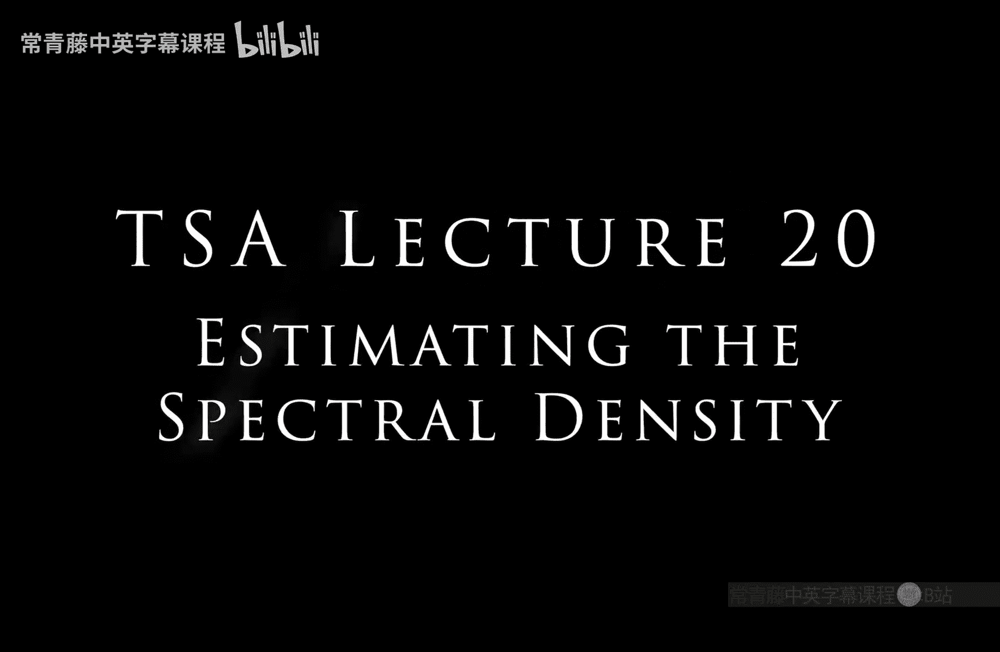
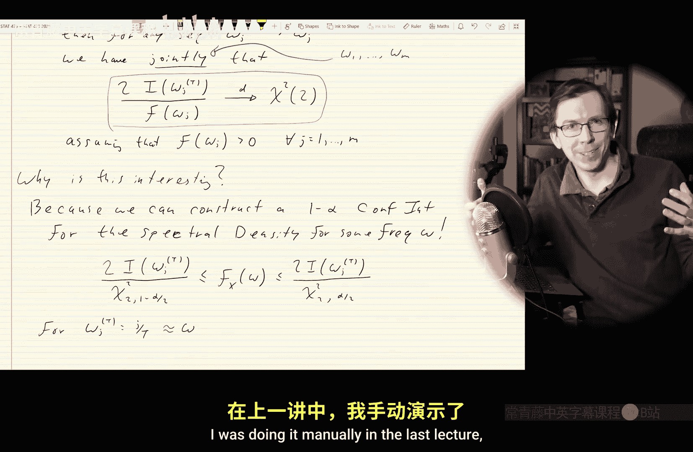

# 阿尔伯特大学【中英⚡时间序列分析｜STAT479 2021 Time Series Analysis】 p20 P20 Lecture 20： Estimating the Spectral Density -BV1nwqYBDEos_p20-

And welcome back to another lecture of Statistics 479 time series analysis in today's lecture。

 we're going to actually do some real statistics with spectral methods。

🎼And we're going to try to estimate the spectral density function。

 And it turns out we've already done it。 The answer is the periodogram。

 and we'll find out more details in today's lecture。😊，🎼あ。

🎼All right， so in today's lecture we have to talk about statistics specifically for the spectral density。

 because in the last lecture， we spent a lot of time looking at the spectral density。

 but we didn't did it from a mathematical perspective。😊，Bired anyway。

 we studied the spectral density mathematically， but nobody ever just hands you a spectral density。

 they hand you data and you had to figure out what the spectral density is。

 and we're going to look into that we're going to talk about spectral Anova which is the spectral version of analysis of variance and we're going to look at confident intervals for the spectral density。

 a lot of good topics today so let's get into it soon as I find my way back to my office。

And welcome back to another lecture of statisticsistic 479 time series analysis today we're going to continue our discussion of spectral methods for time series and specifically we're going to look at spectral statistics right because so far most of what we've done is just consider some hypothetical process XT。

 maybe it's an arm process， maybe it's not as long as it's stationary I guess for good。

 like a periodic process for example。AndWhat we did was we thought well we can compute things like the spectral density or the spectral distribution。

 we can look at the periodogram in some hypothetical sense， but ultimately if we have data。

 we're going to want to compute this for our actual data we never really get a mathematical model of a time series in our hands。

 we get time series data and we have to know how to analyze that。

What we'll be talking about today is things like how to， well。

 what happened when you actually compute a periodogram from real data that isn't just an infinite stochastic process。

 but a finite amount of data， how we can use that to estimate the spectral density。

 and then also we can look at some a theorem at the end。

That will tell us kind of how good our estimate is in the sense of like a central limit type theorem。

 because ultimately we can try to get some confidence bands and also do some statistical hypothesis testing to determine if there's a significant frequency in our spectrum。

 I guess。All right， well， anyway， let's jump into the notes and let's see what this is all about。

All right， so we are on lecture 20 and this is spectral。Statistics。

And there's a lot of different topics that we can discuss in the realm of statistics for spectral methods。

 so we'll cover some of them today， we'll probably do another lecture on this in the next I guess follow up in number 21。

 but for today let's go back to what we started with before which is the idea of a discrete Fourier transform。

 so given。We'll say data， a time series， data x1。Through Xt。Basically， we can Fourier transform。

Do a DftT， a discrete Fourier transform kind of like we talked about before。

 and in this case what we end up with is d omega J is equal to1 over root T again。

 sometimes the scaling up front can change depending on what textbook you're reading or what computer package you're using。

 but this is what they're going to use here。And we get our XT， our data。

 and we multiply by the complex exponential e to the 2 pi I omega J。T， all right。

 so that's our discrete Fourier transform。 we've seen that before， and this is for。

Not T for omega J being J divided by capital T。So these are all the different frequencies that we can in some sense try to detect in our data if we have T data points。

 we can have， you know， the bigger T is basically the finer partition to the frequencies are。

Now we can break this into two separate pieces right because a complex exponential is actually a cosine and a sign right there's going to be a real part corresponding to the cosine and imaginary part corresponding to the s so instead of the DFT we can also consider the cosine transform。

Transform。Wwhich is simply just the same thing as above in this case。

 I'll write it as D sub C to correspond to the cosine and we're going to have everything the same with the scaling coefficient with T going from1 to capital Txt。

 but now I'm going to replace the complex exponential with the cosine。The cosine of2 pi。

 no I in this case， the I has kind of vanished as we move from the complex exponential to the trig functions。

 right omega J T， and similarly we also have the sine transform。Yeah。

And the sine transform is exactly what you'd probably expect， it's going to be the same formula。

 but I'm going to flip the cosine with the signine。

And we get something that looks like this sign2 pi omega J T， Okay， great， and if we really want to。

 what we can do is we can note。That。The discrete Fourier transform， that is the whole thing。

 D omega J in this case， can be written as D sub C， omega J minus I。D sub S， omega J。

Just going back to the idea that a complex exponential can be written in terms of， well。

 trig functions cosine plus or minus I sine depending on， in this case it's a minus sign。

 so we get a minus I sine transform。Okay， so we have that and we're just going to try to get these all written down so we can use them in what's to come right。

 we need that we need the two transforms， we also need to note the inverse DftT。So the inverse。

Discreet Fourier transform remember Fourier transforms kind of a is a is just a linear transformation。

 so I can always well。Linear transformation are not necessarily invertible。

 this one is we we can invert it。So in general， you can't always invert things， but in this case。

 you can。And we can recover the data from the discrete Fourier transform。By just summing J from0。

To capital t minus1 of d omega J。Times E to the two pi I omega J T。 in this case， right。

 we don't have。 this is omega sub J just to make sure that's clear since my。

There it is mega subj times t and here we don't have a minus sign again because it's the inverse transform sometimes you see the transform written without the minus sign and the inverse with the minus sign。

 there's a little bit of ambiguity there， but as long as you're kind of consistent working through it and you know that sometimes you'll see authors define things slightly differently。

 it's always good to be aware of that。Anyway， this is basically for all t from one to capital T。

 so all we're saying is that we can invert our transform， we can take our data。

 create the D the discrete Fourier transform of it， and then if we want we can go right back。

 we can take the DFT， turn it back into our time series data。So they're equivalent in some sense。

And from here， we got the periodogram。Whi we talked about， I think two lectures ago。

 the perioddiogram for a given frequency omega J is going to be the squared magnitude of the discrete Fourier transform at that frequency omega J。

But if we use the sine and cosine transform， we can write it just as a squared sum。

 now these are real， that is the cosine and the sine transform are real numbers so I can drop the modulus or the absolute value sign there。

The bars that are on either side， right？And I can just say it's the sum of the squared cosine transform plus the squared sine transform so this is all kind of follows from complex numbers。

 I guess。But now what we're going to do is we're going to go look at the the。

The periodogram a little bit closer， right because ultimately we're plugging data in there。

 so we're estimating in some sense the periodogram。

 and I want to understand what it is that we're estimating when we plug data in。So first of all。

 yeah， we're going to center it。So next。We center her。DftT。For。

J not equal to zero and what we end up with。Is that we get D omega J。One over the square root of t。

Times the sum T from one to capital t and here we're going to say xt minus x bar and this is e to the minus 2 pi I omega subj T Now this works and you're probably maybe wondering to yourself well why did I specify that J can't be zero。

Well， the idea here is is that basically。Why does it， Why is this true Well， for J？Not equal to zero。

 the sum of all these complex exponentials。E to the minus2 pi I。

 omega J T just so happens to be zero。Now， you can。Kind of imagine this。Well。

 let's see what is the best way to do this？I guess two pi omega J is going to give us some fraction of the unit circle and t is just going to kind of walk around it。

 so in a sense。This is probably not the best picture， but we're going to do it anyway。

 If you imagine that all of these complex exponentials lie somewhere on the unit circle。

 then what it's like saying is we're going to take this point and add this point and add this point and add this point and add the antipattal point。

 which I'm messing up here a little bit， but。The point is is that when I add two antipal points together I get zero。

 so by the symmetry of the whole thing， if I sum up all the complex exponentials here。

 I just get zero， which means I can add and subtract a constant and nothing changes for my DFT。

Now I have to have j not equal to zero because if j is equal to zero， omega J， actually。

 I'll just write that out。Right for j equal to zero。

 omega j is equal to zero and e to the minus2 pi I omega J t is just equal to1 and if I sum up one a bunch of times I'm going to get t so it doesn't work in that case。

 but in all other cases we can center it and that's going to be good because if we center everything。

 we're going to get something well it's going to be the autocovariance that's the spoiler but。

You'll see in a second where I'm going with this。Basically， the point is is that。M。Periotogram。

Becomes。What， well， it becomes I。Of omega J。And that is going to equal in this case again。

 it's the squared modulus of the discrete Fourier transform。

 So I'm just going to use this new centered discrete Fourier transform I say new。

 but it's the exact same thing because like I said for J not equal to zero this thing is equal to the regular discrete Fourier transform because I can always add and subtract a constant inside that parentheses without changing anything。

Anyway， I'm going to use the new way of writing the discrete Fourier transform within this equation。

And。Okay， so we get something that looks like this minus2 pi I omega， J， T。Yeah， as I've said before。

 apart from other stat classes， time series has lots of equations and lots of that you have to kind of fight through。

Well， anyway。I can square this whole thing。All right， so what we're going to do， right。

 is we're going to square the。Inside of this whole thing， I mean， the one over t is just one over t。

When I square a sum， what I end up with is a double sum here。

 I'm going to take t from little t from one to capital T and little S from one to capital t。

And we're going to multiply two things together here。

 which is going to be x t minus x bar xS minus x bar， and then we're going to have E。

To the minus2 pi。I， mega J。T minus S。All in here。Al right。

 so now things are starting to look a little bit familiar， right， I have the sum of。Well。

 a product of X T minus x bar times X S minus x bar。 well， if we。Rewrite this a little bit。

 what we end up with is something that's going to be， well， one over T still there。

Then what I want to do is I want to change the way I'm writing this summation a bit。

 we're going to switch to take H。Which is kind of loaded notation because we always used H to be a lag。

And we're going to run this from minus capital t plus 1 to plus capital t minus1。

And we're going to take out that complex exponential。Which is going to be minus2 pi。I， mega。Jy。

And now what we're going to do and。Is we're going to change t minus S to be H。

So what we're doing here is we're doing a。There it is。

 we're doing a substitution basically we're going to replace when we go from between the previous line to this line。

 we're going to replace what is it。I guess we want S。To become t minus H。

So that what ends up happening is is that we now have。

The sum over all the H's and we're also going to sum， hopefully we get all these things correct here。

 T。From one to capital t minus the absolute value of H because H could be negative or it could be positive and what we're doing is we're summing well。

 the x is x T plus。H。Minus x bar。X， T minus X bar。I think it's supposed to be plus H。

Ah no S is supposed to be plus H there it is T plus H， okay， that makes more sense。I think。

Up to a minus sign， which won't really matter in the end。 I think we've more or less got it right。

 because ultimately what we're what I'm trying to get at is that when I combine all these things。

 I end up with the estimated auto covariant。 so this。Ends up just being if I take。This guy。

And I take the one over T out front， then that is just our estimated auto covariance at a lag of H。

So what I end up with is just the sum in this case， H from minus t plus1 to t minus1 of K hat。

H sub x， I guess， because this is yeah， the auto covariance for the time series process X or the estimated auto covariance。

 and then I have my complex exponential E to the minus2 pi I omega J H here。As before。All right。

 so we now have our。IThink we have everything we need， right？Yes， and there's actually one other。

Subtle point that I didn't note before and that that we can actually drop the absolute value sign。

What I mean by I didn't know before is that I don't recall mentioning this in the last lecture when we looked at a sum like this。

So then the question is， well， why am I dropping the absolute value sign？And the reason is because。

K H。K hat and I forgot to put the X there。Not super important， but always good to remember that。

Anyway， we know that this is symmetric， right， it's an even function。

And if I take the Fourier transform of an even function， it's going to be。Real valued， right。

 because。If we kind of work our way through this， we would have something that would look like。Well。

 for H， we would have k hatt X H， which in this case is going to be， oh， not equals times。

The cosine of 2 pi omega J H。Minus I sign。To pie。Omega J H。

But then we would also have a term that looks like K hatt。At minus H。 And when I use minus H， well。

 the cosine， first of all， I mean， the auto covariance is an even function。

 So I can just get rid of that minus sign。 But what I'll end up with is a minus。Well。

 I'm just going to skip that and just say the cosine is even therefore we still just get a two pi omega J H。

 now sine is odd， so I get a plus I sine to pi omega J H。

 and what's neat is that when I add these together what I end up with is just，Well。

The auto covariance times 2 at lag H times the cosine。

 So it turns out that we're actually just doing a cosine transform because all of the sine pieces cancel out。

 so。This thing。If we kind of follow this down the rabbit hole one step further， let's go down here。

This is actually going to be a cosine transform of the auto covariance function。Okay。Kx。H cosine2。

 pi， omega J H。 And I think I haven't lost any terms。 hopefully， Oh， and I guess technically。

 there's it well no， there's no。Two in front of this because。

I'm summing both the positive and negative indices here h from minus t plus 1 to plus t minus1。Cool。

 so there's a couple things to note here。 The first is this formula， well。

 maybe not the cosine transform， but this formula here looks kind of familiar， right。

 Didn't we just see this in the last lecture。Right。

What I'll say is I'm going to do this in green from last time。Winner Kinchen。Theorem。Number two。Says。

That the spectral density fx omega is equal to the sum in this case。

 I think it was H for I'll just double check it， I think we're going from plus or minus infinity because we're working in the sort of math world where we can just yeah take our autocovariance here。

From minus infinity to plus infinity of。K X omega times the complex exponential E to the minus-2 pi。

I， mega H， and this is assuming， of course， as before。That。Our K X。

 our auto covariance is absolutely summable。 That is。

 if I sum from minus infinity to plus infinity of the absolute value of the auto covariance。

 I get something finite。So the point is that here in green， we're in math world。And up here in black。

 I guess we're in Ste world。And what it tells us is that。Yeah there we are。

 sort of the conclusion here。Is that the periodtogram？The periodioto Gram。Is。An estimator。

 an estimate。Estimators say for the spectral。Density。Suming the spectral density exists， of course。

 and all that。So that's kind of neat right， it means that we computed this periodogram two lectures ago。

 we computed the spectral density last lecture and what we find is that they're actually kind of the same thing but the periodogram here is living in our stats world where we are estimating the autocovariance and the spectral density is more of a I guess it's a mathematical object in the sense that we're just taking some sense the true autocovariance function and some we're doing a complete Fourier transform of it H from minus infin to plus infinity which you can never do with real data Yes。

 and there's one other thing that I have to mention before we move on to the next section and that's that there's well two things going on here one is that we would never have infinite data so we can't really compute the true spectral density from a finite set time series data。

But furthermore， we also don't really want a sum。This far out because if you recall from like the second lecture in the course。

 what I said was that okay， we can compute the spectral， not the spectral entity。

 we can compute the autocovariance function for any lag but we can estimate it。

 we can estimate the autocovariance function for any lag。

 but when the lag gets really big our estimator becomes bad because there's fewer data points to use。

 so。Note。Is that。K， X， H of X is a poor。Etimator。For large。H， so。Instead。We should。Use。

Our periodtogram。Omega J， I guess it was， and I was using yes， omega J。

Is going to be the sum in this case， H from， let's say， minus M to plus M of K hat。X， H cosine。

 I'll just do the cosine version because it's the one at the top of the screen。

 but I could also write the complex exponential if I wanted to。So instead。

 our periodogram will look something like this。For some choice。Of。M。

 which is going to be much less than T so that we can get a good estimate of all of the auto covariances right now。

 what do we choose for M， Well， I don't have a good answer for that。

 I assume that somewhere in the R packages that compute these things。

 They probably have their own built in choices for how they actually do all of this， but。In our case。

 it's just good to note that。Well， what are we taking away from this。

 we're taking away that our periodogram is estimated from the data and the periodogram is an estimator for the spectral density。

 but we have to account for the fact that we only have a finite amount of data and that these autocovariance estimates start to become a bit。

Untrustworthy， say as H gets bigger because we have fewer data points to estimate it with right when we estimate the auto covariance for a stationary process。

 we basically take a window or two data points of distant H apart from each other and we slide that along the data。

If H is really big， there's a lot less sliding we can do versus if H is small。

So just good things to remember。Okay， the next topic in spectral statistics we're going to talk about is spectral andnova。

Yeah。All right， so you've probably seen AOva， whether or not you've taken a course in design of experiments。

 you can check out my other course of design of my other lecture course right now on design of experiments。

 which is also being uploaded to the same YouTube channel。

 but assuming you don't want to sit through you know many， many hours of that。

We're not really doing design of experiments， we're just doing aOva here and I'm imagine that you have seen aOva in a past course in statistics。

 say 101 or 102。Typically when we do a Nova。we're talking about the analysis of variant。

And what we're doing is we're taking the variation in our data and we're breaking it into pieces。

 so typically in aOVA， you would have， say a treatment that you're applying and you might have some errors or residuals that would be the simplest one- way AOVA setting。

So we take our total sum of squares， which is like the total variation in the date observed data and we break it into two pieces。

 the piece that's coming from the treatment and the piece that isn't。

 which would be the errors so we would have our two pieces our treatment sum of squares and our air sum of squares and depending on the sizes of those two objects and their respective degrees of freedom。

 of course， we can determine whether or not the treatment we have is significant with respect to the collected data now。

In the case of spectral methods for time series， it's going to turn out that there's a very natural way to think of this as an anova problem。

Of course， we're not going to actually want to use AOVA methods on this because aOA methods would solve a giant linear system of equations。

 which is not what we want to do in this case， we'd want to use like a fast Fourier transform。

 but mathematical layer and stuff it's the same idea， so that's why we're going to write this out。

So maybe I'll put a little warning here。Don't actually do this。Yeah。Use。FFT instead。

 I should say don't actually do this with real data when you could just use a fast Fourier transform。

 but we can still write out our equation as our。We can still write this out as a giant linear model like we did back two lectures ago。

 so we can take our data X T。And we can assume that we have some giant。Tggingo metric。

Expression that will fit our data。T minus1 over2。 and then we have。Some crazy thing here。

 which is going to look like beta J1 cosine。2， pie。

T J over capital T to switch to that notation just to have that like we did two lectures ago。

 and then we'll have a beta J2 s2 pi T J over T。Right， so we had that big thing and I said， okay。

 two lectures go and this is also。Assuming。Assume capital T is odd for simplicity。

Because otherwise I'm going to have that extra term floating around and it's just going to be annoying and it doesn't really matter for this what we're doing here So we'll just assume t is odd so I don't have to keep that extra term floating around anyway two lectures ago what we saw was that we can actually estimate the beta parameter around parameters here using least squares regression again we don't actually want to do that in practice because if t is big we'd be solving some giant system of equations that would be very sad for a computer to do instead we could use an FFT but。

Mathematically， I can write it down with no trouble and find out that it's just going to be。 well。

 the sum of the， in some sense， the dot product of the data vector X with the cosine vector。

Cosine 2 pi T。J， or I'll do the little J， J over T here， like I was writing before。

 just to emphasize that J and T and capital T are kind of linked。Right， well， this is just to。

Over the square root of t times the discrete cosine transform at mega J。Cool， and similarly。

We get the exact same thing for the beta J2s。Which is going to look the same。

 but it's going to be a signine transform， which we'll write out just for completeness sake。TD。

 all right。So we have those two pieces now。And yes， what else， Oh yes and。I guess we had one。

Other thing we have to write down， which is the intercept term is just x bar。 So not that exciting。

 but included just for the sake of completeness。 So again， two lectures ago。

 we talked about this that in some sense， we can。😊，Think of our process X T as a。

We can we can fit precisely to it， having a saturated model in terms of cosines and signss because they form an orthogonal。

Basis。Now， when we do that， we can use least squares and we can calculate the coefficients that would recreate our data。

Exactly and again these coefficient are really just dot products between the data vector and either a cosine or a sine vector I mean all of linear regression is just like dot products and linear algebra right。

Anyway， the point is that。Therefore， what we can do is we could actually write x t minus x bar。

Equal to， well， I'm just going to add these things together。

 but it's going to look like two over the square root of T， the sum。

J from1 to capital t minus1 divided by 2。Discrete cosine transform at mega J。Times the cosine2 pi。

T J over 2。And then we're going to have。Discrete sign transform。Sign。Yeah。

That is the sign of2 pi Tj over capital T。All right。So what is all this leading to， well。

 it's leading to the idea that I can square and sum this thing， so if I were to square it。

X t minus x bar squared and summit for all t from one to capital t。

 so across so this is a total sum of squares like we would see in anovava。On the left hand side。

 in fact， it is the total sum of squares of our data set。

 even though our data set at the time series and not some type of designed experiment like we would typically see when we look at AOva。

Well， when I。Square and sum up the right hand side what happens？Well， what happens？Is that well？

I'll just write down the answer， which is we get a two。I should check to make sure that's not a four。

I could see me making that typo when I wrote this out， but it's not that important for the。

The conclusion。So it turns out that most things kind of disappear here。And we end up with。

Omega J squared。Ds omega J squared。Which can also be written as two。Times the sum。

J from1 to2 minus1 over2。Times the periodogram， which I think no， no， that's written correctly。

 x the periodogram is the squared modulus of the DFT， so I don't need。I was thinking。

 do I need to square this thing again and I'm no， it's inherently squared because this thing I is equal to the squared modulus of d omega J。

So' always trying to keep track of all this notation can be a little bit tricky， right？Anyway。

 the point and also you might wonder like where did everything go well here what happens is if you imagine the steps that I skipped。

 I squared this submation here and what end up happening is you get a bunch of cosine squares。

 cosine times cosines， cosine times sine， sine times sine and so on and they all kind of turn into well。

 either the coefficients like t or root t over two that's right that's where the two goes。

Or they vanish and go to 0。 in the case that we don't have everything squared up。 This was from。

 if you recall， I think two lectures ago， I copied over that giant。

Page of formulas that was just like sums of cosines and signs and they basically are all zero because they're all orthogonal to each other that's what's happening here that i'm not showing the steps because it's tedious and not overly enlightening in my opinion but roughly the idea is that the cosines and the signss are basically orthogonal to each other so every cross term sums up to zero and the only ones that don't sum to zero is when I square the ones that correspond to squaring the cosine transform and the sine transform and then the coefficients cancel out so that's the hand wave the point I'm trying to get at here is that。

We've decomposed。A。Total。Some。Of squares into。A sum。Of the。Let's say， frequency。Omega J sum。

Of squares。So in a sense， this is really the same idea as a Nova in aOva like I said before just to repeat myself。

 we have a total variation or total sum of squares in our data and we're breaking it into pieces。

 the piece coming from the treatment， the piece coming from the airs。

 maybe we have more than one treatment in our design and we might have the variation with treatment one。

 the variation with treatment2 and then the errorss。

 the unexplained variation or the errorss in this case what we're basically saying is I have the total sum of squares for my data。

 which is。In some sense， a measurement， a quantity of variation in our data。

 And what we're doing is we're decomposing it into a bunch of variations attributed to each frequency omega J。

 So now I have a ton of different frequencies because T is probably large。

And I can see how much of the variation in our data is due to each individual frequency。

 if they're all about equally weighted， we're probably in kind of like a white noise case。

 if we see some imbalance， then we might be able to detect some prominent frequencies in our signal in our data here。

And we actually can think of this even a little bit more precisely in the sense that。Okay。

So at the end， I'll say if。Wei。Wanted to。We could。Treat。Each。2， I， omega J。As a。Some。Some。Some of。

Squares with。2 degrees of freedom associated with it。 And when we add them all up。

 we end up back with the total sum of squares， which is going to have t-1 degrees of freedom。

But as I mentioned， we don't want to actually do this now in some R code。

 which I'll show you maybe in the next lecture， I did do this by hand， and it is kind of neat。

 you can do it， but typically if you're going to do this for all possible frequencies。

 you're not going want to use the AOV function in R。

 you're going to want to use a fast Fourier transform， they're doing the same thing basically。

 but the FF is much more efficient then whatever AOV does now， now that I think about it。

 I'm not sure what AOV does because the AOV function fits in an analysis of variance model。

 but if you had a large factorial experiment。You could have a pretty big system of equations that you would have to solve。

 and there are more efficient ways to do that。Like the Yates method rather than just brute forcing it with like a big system of equations。

 which is also kind of related to the Fourier transform so all these different things are together。

 but hopefully the R functions know what they're doing and we don't have to worry too much about it。

All right， what's next？So next we have to talk about what the next section is called large sample behavior。

Yeah。Basically， the idea is。We。Can estimate。F x omega by I omega， right， the spectral density。

By the periodogram。And the question is， how good is that， right？ How good is that estimate。

 And based on my data size， Because very often in statistics， we work asymptotically。

 we think to ourselves， okay， as the data size gets bigger。

 I get a better estimate of the thing I'm trying to estimate in the sense that the confidence interval。

 the confidence band around it goes to 0。 The variance of my estimate goes to0。

 and I get a pretty good。😊，Guess at what the underlying truth is。

 the thing that I'm trying to estimate。 So once again， if we're trying to estimate spectral density。

 well， how good of an estimator is the periodogram。 And that's what we're going to do next。

 All right， So in this section。As usual。So we assume。

Or we don't really have to assume and we just take。X T。To be a stationary。Process。With。Man。

Mu so we'll have a non zero potentially non zero mean in this case just because why not we've been kind of a I like to be lazy and just assume the mean is zero all the time。

 but in this case， we can try and do it differently。Now。What we'll have is we'll have。

 I should also say with。Mean youu。And。Absolutely， sumable。Autocovariance K X， H。So， that。FX。

 mega exists。Which is the spectral density for the process。 All right。

 so now we have all our pieces in place。嗯。Oh， yes。 And what we're going to do is we're going to。

I'm going to say。To make。Things easier。We。Will write。The periodtogram。Using。Mux， instead。Of x bar。

Now。In the real world we wouldn't have the true mean mu。

 we would have x bar if the data size is big x bar is going to be really close to mu and if we mathematically try to work with x bar it's annoying because we have to consider the fact that it's a random variable so if we're doing things like expectations and whatnot we got to deal with that and there's a little bit of a headache there if we just use mu as the parameter。

 the fixed nonbasian right we're trueing mu is a fixed non not random parameter mu then we don't have to worry about that headache so for this section we're just going to well take the easy way out and replace X bar with mu。

If we really wanted to， we could go back and fix it， but for the sake of the exposition here。

 it's not going to make any real difference except that。

Dragging X bar around will make everything a little bit more tedious。Anyway。

 I'm going to write this out as we did this minus t minus1。

I'm going to write this out as we did before。2 pi I， omega J， H。

And the sum now T from 1 to capital T minus H。Of X。T， what is it plus？Plus， H。

Minus mu instead of x bar this point， X T minus mu。 Okay， so this is the periodogram。

 Only I'm just replacing。 I'm using the same formula that we had found above when we were trying to show that the periodogram is closely related to。

 well， the autocovariance and the spectral density。

 The reason I'm writing it like this is so that I can take an expectation of it。

 If I take the expected value of the periodogram what do I get。Well。

 what I end up doing is I end up taking the expected value of well most of this stuff is not random right so I end up with T。

 I end up with my sum over H here which I'm not going to rewrite the indices because it's annoying and。

I'm going to have to write another time in the next line anyway， Anyway。

 I just have to take the expected value。 In fact， I can even bring it。Yeah， I guess within this sum。

 but I don't need to bring it within this sum because。Doubles。Yeah， no。

 I definitely don't because I want this to be the auto covariance。T plus h minus mu X T minus mu。

 all right。So again， expectation is a linear I can bring it with I can this complex exponential is not a random variable。

 so it doesn't affect our expectation when I take the expected value of this sum what I end up with is。

T minus h times the auto covariance， I guess I am kind of taking the expected value of the inside because the expected value of this thing。

 maybe I will flip it。Just because I think it'll explain more where the next formula comes from。

Again， expectation is linear， so I can just bring the expectation inside both summations。 Now。

 the expected value here is just going to be。Kx。At lag H， the auto covariance。

 And I'm going to sum this thing up t minus h times。 It's not changing。 It's the same thing。

 There's no remember， it's stationary， so little T does not play in to the auto covariance anymore。

 Once I take the expected value。There's nothing really happening with little T。

 so what I end up with is actually a capital T minus H。

 which is the number of terms in that inner sum。Divided by T， which is the T from out front here。

 and then I sum over all H。From minus t plus1 to t plus1 of k， oh no。

 not no hat because I took an expected value。 So now we're not dealing with the estimated autocovariance。

 we're dealing with the true autocovariance。It's always good to keep track of all those things。Okay。

 so we get something that looks like that。Okay。All right， so what are we going to do。

 well we want to know what happens as the sample gets big right because that's what we said we're doing large sample behavior so。

What？Happens。When。Tea goes to infinity。Well， okay， our subation indices go to plus or minus infinity and the thing out front tends to1 because t minus h over t will10 to1 as t goes to infinity。

 but we actually have to do one other little tricky thing and that's to figure out what happens with the frequency right because there's a t hiding in our frequency here。

Omega J is going to be J over T。 So we actually， it's a little bit more complicated than youd think at first。

 you want it just to become the spectral density， and that's what it's going to become。

 but we have to be a little bit more careful mathematically than just replacing T with infinity。So。

The point is we also。Need。A sequence of。Omega J。Ts。That such that。Omega J， capital T tends to sum。

Fixed omega as t goes to infinity。So for example。What you might have is， well， omega 1，2 is one half。

Omega。One，4 is one quarter。Omega3，8 is equal to38s。And then say five16th and something like that。

Omega， well， I'll just write it all out like I have the example。We could do5，16s， we could do mega。

11 over 32 is equal to 11 over。Yeah， 32， et cetera。

So in this case we'd be tending towards some omega which is one third。

 so this is just an example that as the sample size increases by a factor doubles that is。

 as I'm double the sample size from 2 to 4 to 8 to 16 to 32。

 I can get a sequence of omegas that tends towards some target like one third。

 the point being here that again， if I want to take t to infinity in this expression。Here。

Then I need to figure out what happens to omega， not just what happens to t because capital t is hidden within omega as well anyway。

The point is that in this case。What we find。Is that the expected value？Of the。Periotogram， again。

 the periodogram is an estimator。 The expected value of the periodogram。

 And then I think I was using a notation。Oh yeah， I need to give the specifically。

With some T here for our frequencies， then this thing。Is going to tend。To。F。X， omega。Which is just。

 as we noted from the Wiener Kinchen theorem， H from minus infinity2 plus infinity of K X。H。

 E to the 2 pi I， Oomega， J， H， no J。Omega。H。I put a J in my notes。

 but I don't want a J there because now we're tending towards some。Limiting omega， right。

 like I did said up here in gray。Right， so what do we have， we have simply that。Yeah。

 we're going to tend to the spectral density as long as we just。Feal。

 the omega Js so that they actually tend to something because otherwise。

It would just go to zero right if we just fix to J and then took t to infinity。

 then omega J would tend to zero and that would be really boring because then we would just have the spectral density at zero。

 which is not overly interesting， I think， anyway。Right， so we got that。Oh， yes。

And then going further， furthermore。By。Absolute。Some ability。Right of。K， X， H。

 we have something else。 We have that。그。Therefore， we have that C can equal the sum。

H from minus infinity to plus infinity。Of H。Oh， that's right with the strength I was going say this isn't the condition I want。

 this is a stronger condition。Let me write this sentence better after I write down what I want。

Not by absolute sumbil， what I'm supposed to say is strengthening。Absolute some ability to。

And then get rid of that。 therefore， make sure the English is right here。

 So if we strengthen the idea of absolute sum ability， remember。

 absolute sum ability just says the absolute sum of K X H is going to be finite。Well。

 now I'm multiplying by an H in absolute value。 So that's just making it well。

 harder to get that sum ability condition。 We need K X H to decay faster。

So the point is that under a stronger condition on the autocovariance。We get。That。The covariance。

Between the discrete cosine transform at。S omega J。And the discrete。Cosine transform at some omega K。

 remember， because of symmetry， the s isn't really there Like a lot of times I'll write this as just a discrete Fourier transform like I did over here。

 but by symmetry there's actually no it's actually a discrete cosine transform because of the fact that the autocovariance is an even function so。

Anyway， the idea is that the coefficients， the discrete Fourier transform at two different frequencies。

What's the covariance here， well， if they're equal to each other。

 we're going to get something that looks like。The spectral density。At J。

Over to plus some kind of epsilon T， which I'll mention in a second。 Otherwise。

 we just get an epsilon T。And this is。Omega J equal to omega。K。

 and this is omega J not equal to omega K。Right， so what's going on here。 Well， again。

 the the variance of the discrete cosine transform is the expected value of the squared。

Discrete cosine transform。 That's going to get us right back to the idea of the spectral density that we did up above here。

 I mean， it's basically kind of the exact same thing that we were doing。And the idea though。

 is that it's going to be the spectral density again， there's like a two floating around here。

But there's also going to be an epsilon， which is going to be an error term。

So here I should say where。Epsilon T。Is an error term。Such that。

The absolute value of epsilon T is bounded by C over T where this C here。

Is the same C that I wrote up here。So depending on how quickly the autocovariance goes to zero。

 the smaller this subation will be and the smaller the air term will be。The idea right。

 is we're trying to get down to some statistical notion of what's happening with our。Well。

 our periodogram， but also very closely related to that our discrete cosine transform and ultimately how we're going to estimate the spectral density。

So roughly this means that we have。Well。This thing has a well， then never mind it's just。

It is what we have here。 and as T gets big， the air term vanishes right， So the air C here。

 it's also worth noting note。C。Not a function。Of T， which is good。

 because what that means is the data size gets larger。

 the air term shrinks and that we're just going to keep dividing by a bigger and bigger number T。

So what does that mean？Yeah。So。Furthermore。So if。X T is just white noise。Yeah。Well。

 what happens if it's just white noise， right， the in this case the。The spectral density is constant。

Basically。嗯。Then。Fx omega is just going to be sigma squared for the entire any frequency。

And what this means is that in the limit。As T gets really large， right。

 because we're still dealing with a finite amount of data。Yeah。And as our data size。Goes to infinity。

 We find out that the discrete cosine transform at any given frequency will converge in distribution to a。

 well， a normal distribution。With mean zero and variance sigma squared。Oh yeah no。

 of course we're computing the covariance here。 I was like， wait。

 shouldn't it be that we're tending towards sigma square。 Yeah。

 this is the variance we're getting out here。 Sigma square divided by two for the covariance that I calculated above。

 This also happens for the discrete sine transform。And furthermore。

 these two things are going to be well。And I'm going to say Iidd in。The limit。

Is it IID or just uncorrelated， I'm going to remove IID and just say uncorrelated。

Probably if it's a Gaussian white noise process， then it's going to be IID。 But in this case。

 I'm just going to say uncorrelated to be safe， even though I think the answer might be IID。

 the point is is that the covariance here goes to0 as t goes between two different frequencies。

 So ultimately what I'm going to get is all of my discrete cosine and discrete sine transforms should look like one giant。

Multivariant normal distribution that completely has a diagonal covariance matrix。

 So there's no co there's no well， there's no correlations between these things in the white noise case。

 right， this is all in the white noise case。Anyway， right， so we got that。Oh good。

 we're coming right down to the end of this section。Therefore， since。The periodogram。

Sometimes I feel like I'm kind of like running around randomly。

 but there is an ultimate goal here right and what we're getting at is that the periodogram。

Is going to be the sum of these two things squared。

And when I sum up two squared random or normal random variables。

 I get something that's going to look like a scaled chi squared random variable。Since this is true。

 what we have is that2 divided by sigma squared times I omega J is going to converge in distribution to a chi squared distribution with two degrees of freedom。

 which。Is a lot like what we talked about in the previous part about Anova saying that there's two degrees of freedom associated with each frequency in the periodogram。

 So this is pretty cool because now we have some kind of。😊。

What we have is we have some type of limit theorem for what the limiting behavior of the periodogram should look like again。

 this is。Under。White noise。Just to emphasize that we're still assuming that we have white noise here。

Now， in general， we get a theorem。嗯。For I think we need， yeah， a linear process。For a linear process。

X T equal to the sum in this case， will take J from minus infinity。To plus infinity of pi J。

 omega T minus J。 So it might not be causal note， might not be causal， but。We do need thesi J。

To be abs sum， absolutely sumable。Yeah。We need in this case。WT， I IDD， white noise。

Not necessarily Gaussian in this case， because by the central limit theorem don't have to we don't need Gaussian white noise to get this convergence and distribution。

 but we will need I ID noise。That's right。 Oh， with。Don't put the comma in yet。With。Variant。

Sigma squared。And。With。K X， H， such that we have this stronger sum ability condition。

Which is H from minus infinity to plus infinity of absolute value。 H absolute value K X， H。 So again。

 we need the auto covariance function to go to0 fast enough to make this happen。 Now。

 this does happen， right， if we have a moving average process。 Well。

 the autocovariance function vanishes after a finite number of lags。

 So that definitely is strongly sum ofable like this。If we have an AR process。

 we know that the autocovariance function will decay geometrically to zero。

 which will also give us a nice absolutely strong sumability condition here。So。

For Ar processes we're good， we're done if we have a periodic process it doesn't work so well。

 but for all the nice Ar models that we've been worrying about for this entire course。

 this condition holds so maybe I'll just write that in the margin just so you can see it。Holds for。

Arma。Pq。Which is great。Because that's more or less the only thing we've been talking about in this course the whole time are Ar models and this works for Ar models。

Okay， so let's continue this theorem。Then。4。Any sequence。Omega J T going to Omega。

I think I use J here， omega J。Yeah。We。Have jointly。 So this is another keyword， jointly that。2。

Let's see。 Yes， Two times I， the periodtogram。Omega J。

The capital T index divided by the spectral density。

Tends in distribution to a chi squared random variable with two degrees of freedom。Assuming。

 of course。That。Yeah。F。Omega J is。Greater than 0 for all J， let's say， equal 1 to M。Oh， yes。

 I should highlight that。 What I meant by jointly is that。This is a joint。

 convergent and distribution for， say， omega 1。Through mega。M so again， in in with random variables。

You could have convergence and distribution of one random variable in distribution or you could have another one in this case they're jointly converging at once。

 so it is good to just be aware of that aspect of it。

So what it means is that for all the frequencies in some sense or a discrete number of frequencies。

 we would have this joint convergence and distribution to a chi squared random variable with 2 degrees of freedom。

 So that's kind of neat because， again， the numerator is an estimate， the periodogram。

 The denominator is an unknown function。 The spectral， the spectral。Spectral density。

I want to say spectrogram， but that's not the same。There's so many different things。

To keep track of here。Okay， so we have one final conclusion。

 the question that we always want to ask ourselves is why do we care about the formula in the big blue box and the reason is so again。

 why。Is this interesting， always a good question to ask in any math or stats class？

It's interesting because we can。그。Because we can construct。A 1 minus alpha。Confidence interval。4。

The spectral。Spectral density。That's kind of neat。 Okay， what would that look like， Well。

 this is at some， oh， let's just say for some。Yeah。For some frequency， omega， not factorial。

 just exclamation point because I'm excited about it。

 and what it would look like right is to just rearrange this convergence and distribution equation above and what we would end up with is something that looks like two times the spectral or not the spectral actually two times the periodogram at some frequency of interest。

I guess here， okay， I'll I'll。I'll write it like this。And we're going to divide by chi squared。2。

1 minus alpha over 2。And this is less than or equal to the spectral density at omega。

 and this is less than or equal to。To。I。Omega J T。Divided by chii， squared 2。Alpha over two。

And this is for。Yeah。Some chosen frequency。Which is approximately omega， I mean， I guess。

What we would want to do maybe is try to pick the the omega J that's really close to omega。 So again。

 if I had T as a power of two。Because I like powers of two because the Fft is really fast， but if。

If the frequency I'm interested in is one third， well I can't get one third by having a denominator that's a power of two。

 but I can get something that's really close to it and that's the point is that。Outside。

 on the left and right hand， upper and lower bounds here。

 omega J is the closest discrete frequency that I can get to the desired frequency I want。 So again。

The easy answer would be like if I had one third， that's a natural frequency we might be looking for。

 Oh well， my camera died a while ago。All right， so I wasn't paying attention and I realized that my camera actually had died and turned off because I was so intently focused on all of this。

So we'll just wrap up what I was saying and what I was saying is that here we have a nice confidence interval for the spectral density。

 and this is really nice because what it tells us is that if I can estimate my periodogram at a bunch of discrete frequencies。

 omega Js，Then I can estimate what I think the true spectral density will look like at some given frequency omega and assuming the sample size is large enough。

 I can find an omega J that's really close to omega。

 and I can use the chi square distribution to get upper and lower bounds here on the spectral density。

And that's great because now we can get a sense of what the actual spectral density looks like in some statistically valid。

 asymptotically valid way。All right， so that is more or less everything I wanted to talk about today We did a lot of different statistical methods we talked about how to use the basically all around the same idea。

 which is how to use the periodogram to estimate the spectral density right we said well we can do that and not only that we can in the limit get a nice confidence band for the spectral density。

 we can also think of this as an aOva problem mathematically even though in practice we wouldn't actually want to solve this as a linear system of equations because it would be a giant system of equations and that's never a good time going forward we're gonna to do a little bit more with estimation of the spectral density because there's a lot more that we can talk about with respect to spectral methods and we'll be doing that in the next lecture as well as looking at some R code because you can do this type of estimation in R we did this a little bit in the last lecture。

😊，But we can do it with more sophisticated functions。

 I was doing it manually in the last lecture using the FFT function to show you what's happening。

🎼We actually can use some real built in functions that will do a lot more for us and all of that will be coming up in the next lecture。

 so I will see you。