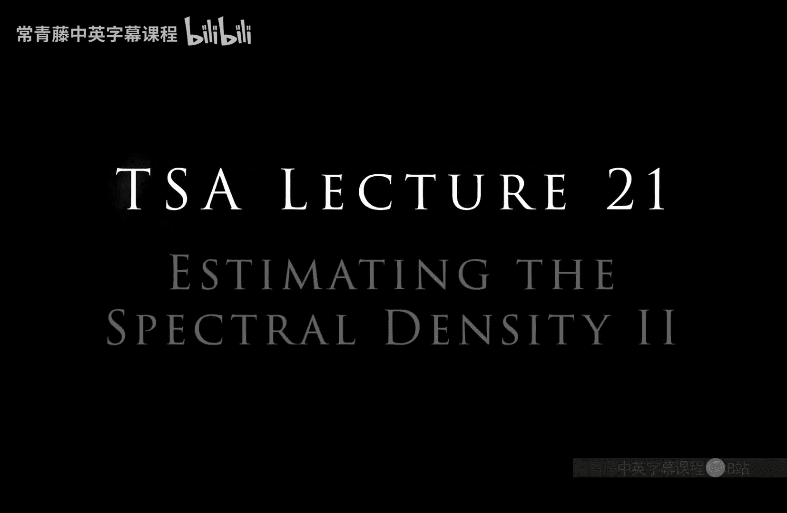
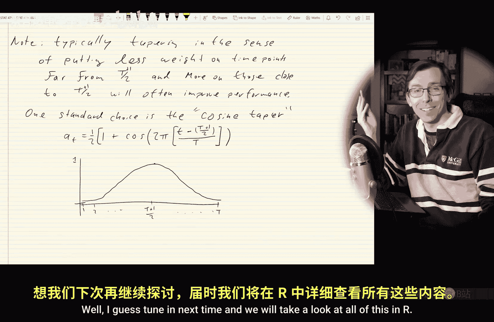

# 阿尔伯特大学【中英⚡时间序列分析｜STAT479-2021-Time-Series-Analysis】-p21-P21-Lecture-21：-Estimating-the-Spectral-Density-II--BV1nwqYBDEos_p21-

And welcome back。L statistics479 Cri series analysis today what we'll be doing is continuing our discussion of estimation of the spectral density because we're not done within the yet。

🎼あ。So when estimating the spectral density， we already figured out it's the periodogram and it works pretty well。

 but we can do better， we can consider other methods of estimation。

 like do we really need all of those frequencies， we could actually reduce the number of frequencies where we estimate the spectral density and instead get better estimates for the frequencies that remain we can also consider the idea of banding。

 that is we could average local frequencies together to get a better estimate。And beyond that。

 we also have the idea of tapering， smoothing， and lots of other cool techniques that we'll be talking about in today's lecture。

Let's go check out the notes and welcome back to another lecture of statistics 479 time series analysis。

 Today， we're going to continue our discussion of estimation of the spectral density。

 It's really an important part， because we ultimately want to know what the spectral density is Well。

 what it looks like， because it's going to tell us a lot about our time series data。

 The problem is that estimating it is not straightforward in the last lecture we talked about the periodogram and how the periodogram is a good estimator。

 but there's a lot of issues that we could consider with respect to the periodogram。

 Do we want to just take it as it is， Do we want to say remove some of the frequencies and estimate other ones。

 there's lots of different ways we can approach estimation of the spectral density depending upon what we're interested in and we're going to talk about a bunch of those methods today。

 including banding， tapering and other smoothing methods。😊，Now。Or at the end。There's no right answer。

 right， We're going to talk about a bunch of methods today。 None of them are like the right choice。

 They're all just different ways of looking at the spectral density， and we can try， in some sense。

 many of them when looking at some time series。 Remember。

 time series is really an exploratory type of subject。

 We're just going to have to try different methods and see what we get。

 And this section is very much like the smoothing methods that we talked about at the beginning of the course。

There's no like right or wrong smoothing method。 You just have to choose one or try and more than one and play with the parameter until you get something that。

Tells you what you want to know。And similarly， today。

 we'll be looking at variety of methods for estimating and smoothing out the spec the well。

 the period estimating the spectral density via the perioddiogram。 And similarly。

 we'll have to try a bunch to see how they work out。 and we'll do that。

 But we'll do that probably in the next lecture in R。 For now。

 we have to talk about what this stuff is all about。 So let's get into the notes。All right。

 so this section is。Estimation， not S。Estimation。Of。The spectral density。Partrk 2。All right。

What are we going talk about first Well， the first thing I want to talk about is well Bartlett's method。

 so Bartlett is a name you might have heard before。

 we know about Bartlet's test for homogeneity of variance。

 It's a standard one that you would use say if you're doing well。

 a Nova and you want to know if your categories had the same variance as well。

 Bartlett was a smart guy and he also came up with a way to estimate a period or estimate the spectral density from the periodogram。

So the first thing we'll talk about。Is。Bart， let。Its。Method。And the idea behind this。Is simply that。

4。A time series。X1。Through X T。We get or we got， I guess， last time we get a periodogram。

That we can evaluate at omega J。For with。F， whatever4， omega J equal to J over t。

So that's a lot of different frequencies if T is big， right if t is。2000。

You're going to have a lot of different。Frequent。Sorry。It's been a long term， we're almost there。

Let's keep doing time series。All right。 so what I was saying。Is that if t is large。

 we have a very fine granularity。 We can estimate a lot of different frequencies。

 or we can evaluate the periodtogram at a lot of different frequencies， but。We may not need。All。

Of those。Omega J。Instead。We might want to have fewer frequencies。

 but do a better job at estimating them。So how do we do that？So。What we can do is instead。Split。

The time series。The time series into。It was my notation， I think， K， yeah， K。Separate。

Equally size to this is kind of important。Pieces。So what I mean by that is you start with your。X1。

Through X T， and then what we're going to do is we're going to break this thing up。

And we're going to create some pieces we're going to have， say。X1。Through x。

What with the notation I was using。Kay。K separate disjoint series of length M Okay。

 So that notation is wrong。 What I wanted to say was x through。And I need another variable in here。

We're going to define M to be the length， which is going to be T divided by K。

 So what I'm doing is I'm taking my big T data points， and I'm splitting them into K chunks。

 and each of those chunks is going to K have。 It's going to have M observations in it。

So we'll start here from M plus1。Go all the way up to 2 M。And this will continue。

Until we have our final piece， which would be。What， I guess it's going to end at。Well， I guess K。

Well， it's T。Minus m。Plus，1。All the way to the final point。

 So now what we can do is we can take each of these sub。Time series， pieces。

And we can compute a periodogram。Via the DftT。So we get a periodogram number one。

 we can get a periodtaogram number two。And we can get a periodogram number， I guess， k。

Right so in this case， what we will do then is we will aggregate all of these periodograms to get our new estimator。

So in this case， we take these all and we determine that the new periodogram。

I omega J is going to be the average here one over， I guess there's k of these guys。

So we're going to average over all k of them and take i from1 to k of I。To the eye。

Not the greatest notation， but you know， it works。Omega J。All right。What is the effect of using。

This new estimator， via the Bartlett method。Well， the idea is that now。

We have omega J is going to be。J divided by not capital T， but lowercase M。So， fewer。Omega Js。

To consider。But， and this is the sort of the big but。 the point is that。We get a smaller。Variance。

And that's the nice thing here， right， we have this smaller variance because what we're ultimately doing is we're estimating the periodogram at a given frequency。

K， independent。Independently， K times。And then averaging over all of those observations。

 So this will， as often happens in statistics reduce the variance。

 It just means that we don't get as many frequencies as we would have before。

 but that's okay because typically we don't need such fine granularity if we have。I don't know。

 496 data points， we probably don't need all of those frequencies。

 we could cut it in half a couple times and maybe just have frequencies from you  one to 128， say。

But have a better estimate by reducing the variance。 So that was Bartlet's method。 And oh。

 there's one other thing to note。Also。Note。That。Kay。Dfts。Of size。Of size M。Har faster to run。Then。1。

DftT。Of size。Ti。Remember that the discrete Fourier transform is。

 if I recall it was quadratic complexity， the double check my note earlier up， but regardless it's。

Beyond the linear， which means that if I break this up linearly into a bunch of chunks。

 it's faster to run to do K small DF Ts than one big DFT and。Also， in the sense。

 especially if you just compute it directly， using the FFT。

 it's still a savings because the complexity is， I guess， super linear， it's beyond linear。

 the complexity grows faster than linear。And that's not to mention the fact that you could also parallelize this really easily because if you're doing K DFTs。

 you can farm them out to different processors， whereas if you're doing one DFT。

I don't know if it's parazable， actually， if the FFT is a parallelzable algorithm。

I guess if you're doing a divide and conquer。It actually might be because you'd effectively just be splitting everything into pieces and then you could split and then farm out the pieces。

 So yeah， you actually could probably parallelize that algorithm。

 I'm not sure about other DFT methods， but anyway， that's a tangent。

 but it's still worth noting that it's also it's not only is it a has a lower variant。

 but this way of approaching。 it will also compute faster for very large time series data。

 So two big wins for Bartlett。And there's also another also。Also。There。Is Welshsh's method。

And this is the。Same idea as Bartlett。But。I guess。Time series。Pieces。Can overlap。

So what I mean by that is that if we go back up here and I said we had our K disjoined pieces in Welsh's method they don't have to be disjoined。

 so it kind of generalizes the idea of Bartlet's method by allowing them to overlap a little bit ultimately it gives you something very similar I don't know。

 maybe some people prefer one over the other or maybe they prefer Welsh's method because of the generalizability to be able to overlap and get more windows。

 but I honestly don't have a strong sense of which one would be better than the other。

 they're both very similar in the way that they are written。All right。

 so that's just a way to average。 And in this case。

 I want to point out we're averaging in a sense in the。Time domain。

 in the sense that we're taking our time series data time wise， and we're breaking it into pieces。

 And then we're using those pieces to estimate the periodogram individually and then aggregating them altogether together in the end。

The next topic that we need to talk about today is called Bing。And banding。Is in a sense， averaging。

 but in the spectral or in the frequency domain。So in this case。We。Partition。The frequencies。

Omega into。Bands。All right， so what's the band？We'll say of。Length。2 m plus one。

 There's a reason why， again， we want it to be an odd number。 so I'm going to write it as2 m plus1。

Anyway， our frequency band， which will write as。Scrrit B。Is going to be。Well。

 all of the frequencies such that。For some， omega J。Well， let me write this all out first。

Less than or equal to。Omega less than or equal to。Omega J plus。M over T。

So what we're saying is is that we want all of the。Frequencies。

 omega that lie within some band around omega J。 So if I take whatever omega J is right。

 it's J divided by T or something。 Then what I'm going to do is I'm going to go out to the left or to the right。

 say M units，1，2，3，4， let's say M is equal to 4。 and the other way 1，2，3，4。 And then I have my。

Band of frequencies。In this case， we could have， like I said， I'll just put it in here。

M equal to4 in this example。 So remember， all the frequencies we're looking at are going to end up being discrete in the sense that we can't estimate the periodogram for any given frequency。

 but just the ones corresponding to the， I guess the sample size capital T。Of course。

 we can always interpolate and things like that， but in this case， right this is what we have。

All right， so what do we have well we have some node terminology。We say that。2 m。Plus 1 divided by T。

Is。The bandwidth。Which is a a term that gets thrown around a lot。 In this case， Li。

 it is the width of the band。 In this case， right， we're thinking of the frequencies of running all the way from 0 to 1。

 omega going from 0 to1。 So in this case， by dividing by T。

 it's the fraction of the unit interval that's captured by this little red box here that I am bracket that I put in。

All right so。Why what will actually yeah， what are we going to do with a bandwidth。 So the idea。

 I didn't actually tell you what it is yet。 I just said we can block off some frequencies。So。Given。A。

Band script B。Wei。Can average。Over。哦。Not frequencies， I guess we can average。

We'll say the spectral density。Over。哦。Frequencies in。Bi。And the idea being that if。F。X， omega is。

Close to constant。4。Omega N。B， then。This。Improves。The estimate。All right， so again。

 the idea is that it doesn't have to be exactly constant， but roughly what we're doing is again。

 we're saying， okay， we have this big window of frequencies that we can estimate rather than estimating the spectral density at every given frequency will'll take a chunk of frequencies。

 a band of frequencies， and we'll kind of average the spectral density over that band and just get one number out。

 which is sort of the average intensity or power or spectral density in that band of frequencies。

 again， the idea being that well， if there's a lot of noise in one of these。

 then if we average or in each of these， I should say， then if we average over many of them。

 we again get the same ideas above， we reduce the variance that typically makes us happy when we get a lower variance。

So what does that look like mathematically？Well mathematically。

 what we get is we get a perioddiogram。Which。Also， going to be terrible notation。

We're going to call it i bar。And that is going to be。For some mega。

And what we're going to do is we are going to average over all of the 2 m plus one frequencies within the band。

That we have constructed。Which is going to look something like this。So in this case， yeah。

 there we are。 So in this case， what we do is right， we compute。The， this is the。The standard。

Maybe I actually say standard periodogram because that's going to make it sound like it's。

 I would just mean the periodogram。From before。And over here。We have the average。

The averaged periodogram。So what it means is that we're just taking， again。

 all of the frequencies that lie within that band B， and we're giving them the same value。

 which is the average of， well， all the periodtogram values at inside that band。

So what happens mathematically when we do this well？First， what we'll say is recall。From。Last time。

That。If I take。A。Omega J and to the T because I have to have a， we're going to do that limit again。

 and I have to have a sequence of omega Js that。Changes with T。 So if we take this thing。

And we multiply by 2， and we divide by the spectral density at the。Give in， I guess。

Frequency of interest， then this thing converges in distribution to a chi squared random variable with two degrees of freedom。

Right， so we did that， I think at the very end of the lecture from last time。Well。

 what happens with I bar？Well。We'll say four。Hi bar。 And again。

 there are some conditions like that strong， I think some ability condition for the。

For the auto covariant， if I recall， from last time， you can double check those yourself。

 but in this case。What I'll say is for i bar mega。We get something very similar， what we get is。That。

2。Times b。Well， the length of this whole thing， 2 m plus1。Times the estimate I bar。

Omega J to the capital T remember， that's a sequence of omega j's。In T， as T goes to infinity。

 I guess I should also put that up here。As T goes to infinity。

 And I guess omega J converges to something thing。Yes， then with the divide by。The spectral。

 I should put an x in here for the two spectral densities again。All right， so this thing， well。

 what's it going to converge to？Like what does it make， what do you think the answer is， well。

 if one of these guys goes to a chi squared with two degrees of freedom。

 and now we have 2 m plus one of these guys。It's going to converge。

To a chi square distribution with2 times 2 m plus 1， which is 4 m plus 2 degrees of freedom。

All right。So。What we have here right is another type of convergence， again。

 given that the conditions are satisfied。And we're getting a chi square distribution with more degrees of freedom。

 so that's nice， I guess。And similarly， from here， what we could do is we could go back to what we did in the previous lecture and we could actually construct confidence bands。

 so I guess just for completeness， I'll write it out。We can， then。Get。

I should say confidence intervals， I guess。Because these are point wise。

Confident intervals that look like， well， if I just multiply this two in there。

 I'm going to get a4 M plus 2。I。Bar。Hate that notation， I got to think of a better one。

 but no time to think of a better notation right now。Well， if we divide this by。Our chi squared。

With4 m plus two degrees of freedom，1 minus alpha。Over two。We have the spectral density in there。

 and then the same thing on the upper。The right hand side that is。Except that， yeah。

 with the new chi square distribution for the denominator。Healpha over2， cool。

 So we have a confidence band and we get a well。We get a different chi square distribution and we get a different coefficient out front now in terms of how many。

 how big M is。Alright， so what do we go from there， Alright， so it's worth noting that this works。

 There's one other thing that the note is that。This。Works。For large。T， right。

 because it's an asymptotic result as T goes to infinity。 So if T is large enough to be asymptotic。

 then。Okay， we can believe this works， but also。For large tea。And。4 small。M。

 we can't have M B too big or it's going to kind of mess up the asymptotics of this whole thing。

So typically， you might have M a small number， that's just going to kind of average some of the local frequencies together。

 So again， it has a very similar。Thought process to what we did with Bartlett's method。

 It's just slightly different in the way we approach it， right， Bartlesss method took the data。

 broke it up into discrete， disjoint， I should say， disjoint pieces。

 and then averaged all of the estimates together。 In this case， what we're doing is。

We're taking local frequencies and averaging them all together。

It's kind of neat though because it has a similar idea。

 which is in Bartlet's method we have fewer frequencies that we're able to estimate the periodogram at。

 and similarly here we're just taking a bunch of frequencies and averaging them together so again we have fewer frequencies in total that have for our periodogram。

So there's a lot of similarities in these ideas， even though one is more。

 I guess time domain and one is more frequency domain in its approach。All right。

 So going forward with banding still。Wei。Could also。Tai。Non uniform。Waits。

What that means is that in the equation up above what we had was that I was averaging all of these periodograms together。

 and I gave them all the same weight， which is one over 2 m plus 1。 But what I could do。 right。

 is I could。Add weights in there， and I could give them different， well。

 different weights for averaging。 So what would that look like。Yes。

 so what that would look like and I'm going to call this I tilde just to indicate that it is a weighted。

Estimate or averaging of the periodograms。And in this case。

 what we get is something that's going to look like I from minus M to plus M。

 I'm still going to use the total width， I guess， as being 2 m plus 1。 But in this case。

 we're going to multiply by C I times our periodogram。Omega J plus I over T。Now， in this case。

 we also need。Where the coefficients C sum up to1。Right， so。If。

CI is just equal to 1 over to m plus 1， then we're just back where we were up here。

But the point being that is we could choose Cs that are not just all the same value。

 And that can give us a different way to。To to average the or to。

Get a weighted average of the periodogrammed in a for banding。to what happens mathematically。So。

In this case。We still。Get。Convergence。In distribution。As before。Okay。

 so we're going to get a convergence distribution， given all the nice conditions that we talked about previously。

 like the， I guess convergence of the。I guess spectral。

Not spectral empty autocovariance and things like that。

 but there is one issue we're not going to get a chi square distribution。

 we're going to get a weighted sum of Chi square distribution。

 which is actually kind of annoying to work with when you want to compute critical values。

 thresholds， P values， things like that。It's actually。

 I think there are a bunch of crazy methods out there and you can find them somewhere in R。

 I remember finding a package with like five or six different methods for numerically computing you know various thresholds and critical points for a weighted sum of chi squares。

So we can do that， but instead we can also just kind of hand waveve our way past it anyway we do require I'll write that down a second but。

What we require。To get this convergence。Is a couple things we require， of course。

 T going to infinity， and we can take M to infinity as well。But。Such that M divided by T goes to 0。

What does that mean， well， that means that the width。Of our band， I guess our bandwidth can。

 but not exactly the band。 It's the M value is allowed to grow。

 but it has to grow slower than t grows。 So as we go to infinity。 The actual bandwidth。

 which is the length divide of the band divided by t will actually go to0。

 So it'll actually shrink to 0。 And that's why it can be a little confusing to look to。

 I feel like the term bandwidth is a bit confusing here。 Anyway， we need this。And we need。

Another condition， which is that。I from minus M to M of the C squared， these coefficients。

 we need this thing to go to 0。So。This can work basically as long as the coefficients， I guess。

 kind of。Don't。Peak at some value， like they don't all just go to one， like not all， but if。

If like the main coefficient doesn't tend towards one or anything。

 then as long as we have them squared and they should sort of vanish in some sense。Anyway。

 given all of this， what do we get？ Well， what we get。

Is that the expected value of this I tilde omega J thing， our weighted。Average。

 our weighted averaging of the periodogram is going to converge。The expected value， I should say。

 is going to converge。To omega， to the spectral density at omega。I guess I should say， well。

I'll just get rid of the J there， we'll just say omega omega。Okay， what does that mean， Remember。

 this is not convergence imp probability。 We've already taken an expectation。

 So the thing that's converging is not a random variable anymore。

 What this means is that we have an asymptotically asmp。Totically unbiased。

And that's nice because if we want to do things like confidence intervals or whatnot at least。

Asymptotically， we'd like things to be unbiased。Right。

 so it basically means I'm guessing I didn't actually find a good formula for the expected value of this thing。

 I guess we could work it out if we really wanted to try， but。

I guess there'd be some covariance in there so do we have pain， never mind。

 we're not going to worry about that。 The point is is that there might be some bias here。

 but it asymptotically vanishes and we get something that estimates the spectral density just like we want。

Furthermore， if we look at the covariance。Of our eye Tilde。Omega 1 and I tilde mega 2。

 So if we have two different frequencies。And we compute their covariance。

 and we normalize this whole crazy thing by。The sum of minus m to plus m of C squared。

Then in the limit。This thing is going to converge to well，0。For omega 1 not equal to omega 2。

 which is good。 That means that at 2。Disjoint， distinct， two distinct frequencies。

 We get that in the limit， they are。Our estimator is uncorrelated。We get that it can the variance。

Converges to the spectral density squared again， for。Omega 1 equal to omega 2， which is neither zero。

And also not equal to one half。If it is in one of those cases。

 we end up multiplying the whole thing by two。Mega1 equal to omega 2 equal to0 or equal to one half。

 Those are like the fringe， the edge cases。All right， so as I mentioned above here。In the limit。

We get a weighted。Some。Of chi squared random variables。Which。

Is never really that great to work with so。Instead， but。This。Is close。

Which I'm going to put in quotes because I'm not actually sure。How close it is。

 And in what metric it's considered close。 This is more of just a hand wavy statement。To a。

Let's say not weighted regular。Kai squared。Randdom。Variable。With。We're going to say2。L。

Degrees of freedom。Where what is L where？L is。The length。Of。です。Band。Okay， so。

How do we define the length or what we define the length to be。Is that L is going to be。Well。

 it's the sum of all those coefficients。I from minus M。ToM of C。Squared。To the minus1。Okay。

 so you look at that and you think to yourself， well。

 why in the world is that supposed to be the length， Well let's do an example。For example。

 if C is just equal to 1 over 2 m plus 1 for all I。Then what we end up with。Then。

 then we get a length。Which is going to look like。The sum of one over 2 M plus1 squared。-1。

 which is going to be， well，2 M plus 1 over2 M plus1。Squared to the minus1， which is just 2 m plus 1。

So the notion of length coincides with what happens when all the weights are equal to each other。

 If the weights are not equal to each other， then we get that this is， I guess， good enough。

 at least according to the textbook authors who said this。 And I guess they're trustworthy enough。

 So why not believe them。Anyway， it'll be interesting when we look at this in R to see how this actually works in practice。

There we go。Batteries are dying。There we go， we are back。Anyway， okay， so that's our little example。

 I'll block that off。Thus。We have。That。2 times L， the length times I tilde at some omega J with the T in there。

Divided by the spectral density at that omega J with the T And there is going to converge in distribution。

To a chi squared2 L this is。There's no like approximate convergence。Close enough， I guess。To。

The weighted。Kai Square distribution。The sum of a bunch of weighter guess the weighted sum of a bunch of chiis squared distributions。

Okay， so we got that and once again， if I really wanted to。

 I could go back up here and compute a confidence。B or interval for the spectral density using that new version of the length。

 that more generalized version of the length of our band。

And also the corresponding degrees of freedom。But I'm not going to write that again because it should be pretty clear how that would just come about。

Okay so then the next thing is how in the world do we pick a good waiting scheme？Hao。To pick。The。

 I think I was calling them C， right， C， yes， C Is。See eyes。Well。

 if you look at some of the function in R， which we will look at probably in the next lecture。

One of the things or one of the terms that you'll be you'll see being thrown around in the documentation is。

Is that we could？Use。Daniel， Colel。Which then leads to the question of what the Daniel kernel， well。

 if you type it into Google。If you type it in with Daniel with 1L。

 you get random Facebook pages for people named Daniel Colonel。

 which is just awesome that that actually exists， and since this is going up on YouTube。

 if there's any chance that Daniel Colonel or any of the Daniel Colonels out there are watching this。

 then give a shout out in the comments because I would love to know that though based on the fact that I don't think too many people are really going to watch this。

 I'm not expecting anybody named Daniel Colonel to actually watch this。

If you type in Daniel with two Ls kernelel， then you get a whole bunch of time series references。

 So remember it's Daniel with two Ls。 otherwise you get some random people。Regardless。

 the idea is that this shows up a lot in R， if you look at a lot of the。

Functions that we have for computing the well， the spectral density。

 they'll say things like a this uses the Daniel kernel or something of that nature。

 So the question is then what is the Daniel kernel well。So， first。We'll say， let。Y T。Be。Some。

Sequence。Of numbers。Mainly because I don't really want to have to do this with the I omegas because the indices will get super annoying。

 so instead we're just going to apply this kernel to a sequence UT it doesn't even really have to be a time series it just has to be a sequence of numbers。

A。So。1。Application。Gives us a new sequence of numbers。UT1。

 which is going to be the average of Ut at time t minus1 plus Ut at time or U at time T。

 and U at T plus 1， and we're going to divide all of these by 3。Kuol。All right。

 so the first thing you're thinking well， that's kind of boring， right， because that's just。

That's just equally weighted。 That's M is equal to one。 and it's just equally weighted。

 So why does that get a special name， Well， it's not so much that we。

 it gets a special name for using it once， but the fact that we can apply it a second time。

To get two。Applications of this kernel。Gives us a new waiting scheme。Which。Is going to look like。

 well， the same thing as above。Yi。UT plus。Plus。Let's see if we can do this plus one。

 but I'm going to apply this to。Be already。I guess kerneled Siri or sequence。

So if I kind of revert this back into the original sequence Ut with no exponents。

 what I end up with is actually something like a Ut minus2。U T minus1， Ut。UT plus one。UT plus2。

We divide all of these by 9。But now they're weighted， so。This gets a plus and a2， a plus and a3。

 a plus and a2， a plus and just a1， so I'm not going to write anything there。

So one application is going to give us weights。That looked like this。One third， one third。

 one third where。As I write one half， one third， one third and one third， meanwhile。

 two applications is going to give us something that looks like a triangle。With our。One over nine。

 two over nine。Three over nine， et cetera。And if we were to do it a third time。

 I'm not going to write it all out。 We'd get something that might look a little bit parabolic。

 This is。Very closely related to the idea that if I take the uniform distribution and I convve it with itself。

 That is， if I add two uniform random variables together。

 I end up with a triangle shaped distribution。 If I add another three uniforms together。

 I get something that looks piece wise quadratic。 and then piece wise， cubic and so on。

 as I keep adding uniform distributions together。 or。

As I keep adding uniform random variables together。

 which means I'm convolving the uniform distribution with itself so many times。

And the same idea happens here， we're basically doing a convolution but a discrete type of convolution。

 so we go from something that looks constant to linear to quadratic and so on。

 so you can change the parameters and are to say in some sense how many times you want to apply this and how smooth you want your kernel to be the kernel here is just referring to the weights。

And there's also something called the modified Daniel Colonel。The modified。Daniel Colonel。

And that's just going to basically be。Do， as before。But。With。But starting， I missed a word。

 but starting。With。U T1 being。Well， U T minus1 UT。UT plus  one， but now we're going to divide by4。

Even though my four looks a bit like a U。And we're going to give it a weight of。

The middle guy await of two。So it's the same thing。

 But what now we're doing is we're giving the middle guy a little bit of a bigger weight and the two edge pieces a little bit less of a weight。

 And you're already starting in kind of a triangular。Shape， I guess。Before proceeding forward。

 so it's just a slightly different way of starting the whole thing probably doesn't make a huge difference in the end we can try some examples out in R and see what happens The main thing is just to be aware of the terminology right because。

A lot of the packages like to throw all these things around like Bartlett meth。

 I think there's a Bartlett window or we're going to talk about in a second。

 Bartlett this and Daniel Colonel that and modify Daniel Colonel and all these parameters and you just think to yourself what in the world are they talking about。

 well， there's nothing too profound that's basically just throw some weights on on your periodogram and average them together in a weighted fashion。

All right， so that wraps up what I wanted to talk about with banding。 that means we have。

The next topic is tapering。All right， so the next thing we're going to talk about is the idea of tapering。

And tapering is。Kind of what you might expect， it's basically applying some type of weight to your time series that kind of tapers off at the ends and focuses on the middle now。

Yeah， it basically allows us to focus on certain frequencies for our spectral density。

But we're going to look at this in the time domain actually， to start。And like most cases。

 there's ways of going back and forth between time and frequency。

 and we're certainly going to be doing that here。In this case， we need to once again， say let X T。Bi。

Min。Zero。And stationary。As almost always。 But just to emphasize， we need that。With。With the spectral。

Denssity。Which is what？Well， it's what it always is， Fx mega。

 but now what we're going to do is we're going to bring in a tapered y。So we'll say let。Wi。B。

 what's my notation here， A。Timeed X T。B。The tapered。嗯。Series。Again。

 there's we'll see in a second that sometimes you'll apply some tapering that'll kind of focus on the middle of the data and smooth and kind of less emphasis on the edges。

Or the， yeah， the。Further out pieces on either side of time。Right so if we have this， this is。

 I should say for。Some。AT and R， so some just real valued coefficients that we're not going to specify at the moment。

So， then。Discrete forier transform is what well。D， Y at omega J。Is going to be one over。

 it still has the same data size， the square root of T。

 and we're going to be summing I from1 to capital T， and we're taking our data。

 which in this case is going to be A。X T and multiplying by that complex exponential。

To get our Fourier transform or our discrete Fourier transform。All right。

What do we get from there well？Then we find out that the expected value。Of the periodtogram。

 right because we want to ultimately know what does the， I mean， we're doing this transformation。

 what's going to happen。To our periodogram。Well， if we look at the expected value of our periodogram。

 it's no longer just going to be the spectral density。 We don't have some unbiased estimator。

 Instead， what we're doing is we are integrating。From one half。inus1 half to plus1 half。Of WT。Omega。

 J， W's and omegas。Omega。F。Omega。D omega， okay， a lot of omegas。What does that mean， Well。

 what that means is that if we want to know what the expected value of the periodogram is for I。

 for y， right， which would be an estimator of the spectral density for the。Tapered series Y。

 what we find on the other side is we have an integral。With respect to the spectral density in X。

 but we're multiplying by some W thing， and the W is going to be called the spectral window。

A lot of terminology， but we're going there's going to be some intuition here which would hopefully help us。

 But first， I have to write down all this stuff。Let'll say where。

WT of we'll just say omega here is going to be the squared modulus of  at。Omega。

Where to continue our iterative wares。AT is kind of like that thing we had before， right。

 it's going to be the Fourier， the discrete Fourier transform of our sequence A。

We had something very similar to this before when we talked about filtering a time series。

And specifically an ArA process。Okay。So again， capital a of omega is the Fourier transform of the little a sequence and Wt is the squared modulus of。

The a capital A， and that's going to be called。The spectral。Window。All right。

 so then the question is what like what is going on here well。If we have an example。Well。

 I guess I have an well， let me not do that example yet。We'll say the spectral。Window。May look。

Something。Like。Well。Centered around zero because we're offsetting it by omega J。

 it might look something like。This。Itupposed to be symmetric。

 I can only draw so symmetric at this point。In the term。So。

Our WT omega might look something like this for the mega axis here。And what it means。Is that。

Our periodogram for Y is taking a range of frequencies of。

It taking a range of frequencies and averaging。The spectral density for x over that range of frequencies。

 So it is very。Similar in a sense to what we already did。Before。

 right before what we did just to recall because these things are all very similar。

 but they are also different。What we did before up here is that we said I'm going to compute my periodogram at lots of different frequencies and then I'm going to average together some local frequencies。

Here what we're doing is we're modifying the， the original data X。And the effect。

 the effect of modifying the original data is to ultimately average the spectral density over some window WT。

 where WT， they have some pictures and I'll draw some。

 I'll get some in R next time when I can actually plot them all， but。The pictures of these thing。

 these windows often look like that where you have some sort of a peak part。

 and then it kind of tapers off pretty fast。So this is kind of neat。

 it means that if we apply a tapering to the time series itself， X。

 the effect that we're getting is an averaging a window being integrated with respect。

 it's actually a convolution， I guess， but with respect to our spectral density F here。

But the end result is the same， right， if I'm integrating over all these frequencies。

 I'm effectively averaging the spectral density over some window of frequencies。

 so very similar intuition to banding， but it is a different thing altogether， well， not all。

 but it's a different thing。Anyway， we do have an example。

 and this is more random terminology that you might run across when you're looking at time series methods and this is the Fege。

Or。Bartlett， because of course he got his name on this one too。Colonel。So okay。

 we got two different names for this one depending on。I guess who wrote it， who writes the the book。

Textbook or the documentation， and this is a kernel， it's a window function， the spectral window。

Oftentimes when you integrate with respect to something like W。

 it's referred to as a kernel function， kernel is one of those terms in math that is way overloaded。

 right， you've got kernels in linear algebra， kernel spaces， you've got integration kernels。

 you've got the kernel trick in machine learning， you've got reproducing kernel Hilbert spaces and all I mean a lot of these kernels are all integration kernels。

 but still the term kernel is just all over the place in math。

I'm going to make this W look more like a W and less like an mega。Okay， anyway。

 the Bartlett or Fesure kernel。Is going to look something like the sign。Of end。Pai。Omega。Squared。

Divided by n outside of this sign。Pi omega squared，Why is that the case O with？

W T add 0 because in that case， I'd have0 over 0， which is no good。

 That's going to just converge in the limit to n。 if you were to take omega to0 and you look at the limiting behavior of sine squared over sine squared。

 you'd end up with， well， n squared， which divided by this n here in the denominator would get you that add 0。

 it's equal to n。Except now I think about it， I actually meant to say T。Because some textbooks use。

N as the data size， whereas I like to use T as the total size of my time series。Okay。

 that looks better。All right， so what does this come from？This。Comes。From。A， o。AT equal to1。Okay。

 so this comes from in some sense， nothing。 the idea is that if I go back up here and I set all the As equal to one and I just get。

In that case， y is equal to x and then what I end up with。Is。Well。

My capital a is going to just be the sum of these complex exponentials and when I do the squared modulus of that I get something out that looks like this。

 I haven't actually checked that myself， maybe we can actually write it all out and check it but yeah not in this lecture because。

We can see if that actually works out。Roughly， it's just a way to note that we can integrate with respect to this。

Colonel。But more interestingly， is not this kernel。

 But what happens when we do that averaging from above so。Banding that is。When。Wei。Average。Over。诶。

Band。Script B。As before。Then well， what happens？Then what happens is。

I know it's here somewhere a yeah， what we end up with is we end up with， let's just write it out。

 not the weighted one， the weighted one's just going to be harder to figure out。

Then what we end up with is something looks like i omega， which is just one over。2 m plus1。

 same thing I wrote before， but just to make sure it's all on the same。Section or the same slide。

 I'll write it again。Right what we do is we average over all these periodograms。Like that。 Well。

 it turns out that this is equivalent to tapering with a specific spectral window and that。Then。

I'll say this。Gives。Us， a。W。T omega， which so happens to just be 1 over 2 m plus 1。Times the sum。

I from minus M to plus M of well， that exact same kernel above。The sign of n。Pai。Omega plus I over T。

 So that same kernel， but offset by some phase in terms of the adjacent。

Fre that we're averaging over。And then we have pi with no n because the n is outside the sign now。

H over T squared， Okay， so that's another big formula。

But the thing is it's basically saying that if we were to。

When we apply this banding where we're averaging over all of the perioddiogram values for frequencies that lie within a given band。

 we can equivalently write that if we switch into this other setting as integrating the spectral。

Denssity with respect to some spectral window and the spectral window happens to look like that semi hideous ratio of squared signs。

So again， not the nicest looking thing， but it's nice to see how these things all connect together and I'll draw again draw some more pictures。

But， of note。We note that typically。Taperring。In。The sense。Of foot。Less。Waiit。On。Far。I'll say。

How don you even describe this。 I guess it's like time points that are not near the center。

 less weight on。Time points。Far。From。T over2。And more。On。Those close。

To T over to the center of our time series， I guess， temporal。Well。Often， improve。Performance。

And we'll look at some examples of this when we do some R code， but roughly。Well。

 one of the standard， maybe I'll just write it down。1。Standard。Choice。

Is the and here's more terminology the what is it called cosine？The coine taper， okay， simple enough。

The cosine。Taper， this one is in the AT or time domain。In this case。

 we take A T and we simply say that it is equal to1 plus。The cosine of。Okay。

 let's see if I can get all these parentheses correct。It should be。2。Pai。T minus。T plus one over2。

Divided by。Ti。Something like that。I think in this whole thing。

 it's a one half out front that I forgot to write。Okay， so that looks a little bit strange but。

Ultimately， all we saying。Is that。I have something。 now I'm not there。 I need it here， the axis here。

 because if we start from one。And two， and then somewhere in the middle here， we're at， I guess。

 in this case， t plus1 over two。And then T。 so if we have our entire maybe I should change these to t plus1 up here just to coincide with that。

 so if if we stare at this function long enough， we realize that what we have is we basically have a cosine function that reaches its peak in the center because when little t is equal to capital t plus 1 over 2。

 these thing this thing becomes0 cosine of0 is 1 plus 1 is 2 divided by 2 is1。

 so we're right up here at1 as we move to the outer limits here。

 we're getting a cosine that is going to be，Very close to well。Pi， I guess， which is close to zero。

 which is going to take or。Now it's going to be close to minus1 so but at minus1。

 we're going to add a plus one， so it's still going to not be negative。

It should look something kindalike。This， I guess。So okay， it might be seem a little strange because。

Why are we applying， Why are we kind of down weighting our data， But effectively。

 what we're doing here is we are putting less emphasis on the boundary points of our data。

 more emphasis on the middle points of our data set。 we apply that first， Then we use that to。

Compute， say the spectral density and whatnot。 And what we get out is something that， well。

 allegedly is better now。I'm not going to won't go into that now， I guess I should。

I'm not going to go into that now what we'll do in the next lecture is we'll actually look at some R code there's one more thing I did want to talk about。

 but I think I'll just save it for the next lecture and that's the idea of using the ArA process。

To are estimating an armor process in order to estimate a spectral density。 It's one more technique。

 And I think what we'll do is we'll save that for next time。

 then we'll do some R code because all of this stuff is possible in R。

 and it'll give us a lot of different examples to look at。 so we can get a sense of okay。

 what happens when we compute a periodogram。 We did this before。

 but we did this very manually using the FF function in R。

 there are different spectrum functions that you can use to estimate the spectrum or the spectrum density for a time series data and using many different methods like the ones we discussed today。

 so。How's that all work， well， I guess tune in next time and we will take a look at all of this in R and until then。

Well， have a good one and。

