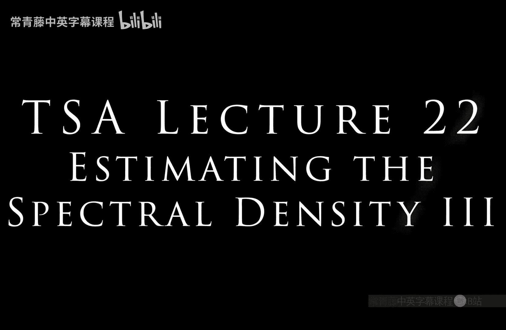
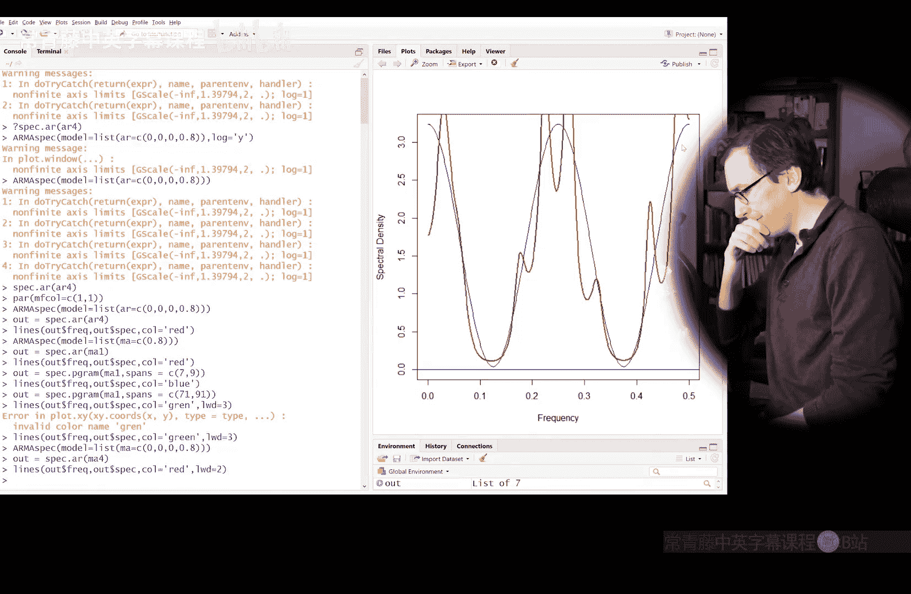

# 阿尔伯特大学【中英⚡时间序列分析｜STAT479-2021-Time-Series-Analysis】-p22-P22-Lecture-22：-Estimating-the-Spectral-Density-III--BV1nwqYBDEos_p22-

And welcomel back to another lecturer of statisticstistics， 47，9 time series analysis。 Today。

 we are nearly done with our lectures for this course and we're going to be talking about estimating the spectral density for the third time。

 in fact， but don't worry， it's going to be really interesting today we're going to use。

Parametric methods。🎼あ。

So so far whenever we've tried to estimate the spectral density。

 thus far we've used the periodogram and smooth versions of the perioddiogram。

 this falls into the category of non-parametric statistics。

 but as we learned a few lectures ago if we have an armor process we can just compute the spectral density of that armor process exactly now we don't have the actual armor process that we want to work with。

 but what we do have is we have the ability to estimate to fit an armor process to our data and if we do that we can just compute the spectral density of the fitted model rather than the spectral density of the data itself so how do we do all of that in today's lecture we're going to be looking a lot at R code because one thing we haven't done so far is actually tried to work with real R code and it's going to be important because there's lots of different ways to compute the spectral density or to estimate the spectral density in R and we're going to look at all of these？

Methods and more in the second half of today's lecture， so let's get back to the notes。

And welcome back to another lecture of statistics 479 time series analysis today we're going to well be looking at how to estimate the spectral density for the third time we're going to do a little bit more follow up in the notes or a little more I should say an extension of what we did before in the notes and then we're going to look at some R code as to how to actually estimate a spectral density in our studio which is going to be well hopefully even more useful than looking at all of these notes so so far。

We've looked at a lot of different methods。 We looked at estimating well just computing the periodogram via the Fourier transform。

 We looked at different types of。Ways to combine our data。

 we looked at Bartlett's method where you take little like SNPps of your time series and then average the periodogram over those SNPps。

We've also looked at a lot of other different methods of various ways to band and taper and combine our estimates of the periodogram that is the intensity of the signal at a given frequency。

 but averaging over multiple frequencies in order to improve our estimation。

 and what we got out was a bunch of chi- squared statistics， asymptotically that is。

 which allow us to do things like hypothesis test and confidence intervals which are always good times。

Now there's one other method that I want to talk about today and that's a parametric approach because so far everything we've been doing can fall into the category of nonparmetric statistics。

 what we're effectively doing is just trying to estimate while the autocovariance transform that into a periodogram and the spectral density and estimator for the spectral density。

 but there's no explicit parametric model assumed。Now what we're going to do is assume a specific parametric model that is we're going to pretend that our data is an autoaggressive process or an armor process and then figure out how to estimate the spectral density based on that assumption and it turns out that you can actually get a lot of good results by trying to fit first fit an armor process to your data and then computing the spectral density for that process rather than computing the spectral density for the data itself。

So not sure if that's 100% clear， but we're going to jump into the notes and see how this all works together。

 so let's get into that。All right， so the main topic of today or this short version of written notes is going to be not periodic para metric。

Estimation。Of the spectral density。But first， I wanted to talk a little bit。Um， first， though。

 we're going to talk a little bit about that Daniel colononel again。With two Ls。Assuming I yes。

 I believe it's with two Ls So when we go into R right， the Daniel kernelel。

 this was a way of smoothing out the periodogram when we're trying to estimate the spectral density。

So the way I presented it last time was we'll just keep it in blue as a side note。For a sequence U T。

 which is real valued， what we can do is we can construct a U1 T。Which is going to be a。

 I guess three point moving average， you could say in the sense that I'm just going to average three adjacent time points together。

 and again， this is a kernel it can apply to any sequence of numbers in our case。

 we're going to apply it to the period the estimated periodogram。

And then I also mentioned that there's a modified Daniel then well。

 the next thing we would do there is we would iterate this to get a U2 and a U3 and so on。

 which would be smoother looking and then there was the idea of a modified Daniel colonel。

Which looked something like。UT minus1 over4。UT over two。

UT plus one over four Now I didn't do this in complete generality。

 This is how I presented it last time， but I realized that when trying to write up some R code for today's lecture I realized that actually you can generalize this well you can extend this to larger windows right you could instead take。

This first guy， and you can。To like really just keep switching colors and be annoying about it。

 well to use green now， we could have a， I guess a kernel of length。I'll use H。

 I'm a little bit hesitant to because we always used H as a lag， but。We can do that。

If H is an odd number， we can have Ut minus h over 2 plus all the way to UT plus all the way to UT plus h over 2。

 and we can divide all of these by H。And similarly。

 what we can do is we could get a modified kernel where the modified kernel is going to well。

It's kind of annoying to write out for general H， I guess， basically。

 I'll just hand wave my way past that and say。Do as。Before。But。Um， I guess shrink。

The value at the endpoints。Which is going to look roughly something like。

U T minus h over2 divided by we'll say c1 and then u T minus H over 2 plus 1 divided by C2。

U T divided by C2。UT plus H over 2 minus1 divided by C2 and then we're going to bring C1 back for the final。

Point。I believe this is what's going on in R we'll look at some examples well actually we can extract the Daniel kernel from some of the behind the scenes functions in R so what we'll do is we'll actually plot some of these kernel functions out just to get a sense of what they look like but I believe it's going to do something like this。

 but you always have to be a little careful because there's so many different ways that you can。

I guess， you know， initialized or you can start one of these things in you can code it up in R and they're all going to。

They're all going to kind of do the same thing which is they're going to smooth out the periodogram and there's no real right answer as to like how big the window should be or how small it should be if you should modify the ends if you should iterate this multiple times because remember in the last lecture we started with U1 here but we could iterate it to get a U2 which is going to look like a triangle U3 which will look a little bit more like I guess piecewise quadratic even though it's going to be extremely discrete so anyway that's just a quick little note on Daniel kernelel there。

 shout out to all the Daniel kernels out there。And now what I want to do is actually get back to the main topic of today's lecture。

 or at least the written part of today's lecture， which will be the parametric estimation。So。

Basically， instead。Of。Computing。The periodtogram。Directly from the data。From。The data。

This is the non parametric way to do it。We could instead。Fit。Thin fit and armma。PQ model。And。I guess。

Get the periodogram from that。Get the periodogram well from our Arma PQ model because if you remember。

 I think it was three lectures ago when we talked about this idea of filtering and we said well we could start with a white noise process now we know that it's going to have a constant spectral density then if we want to get the spectral density for some arm process。

 we can use the characteristic polynomial， the autoregressive polynomial and the moving average polynomial and we can effectively multiply use that polynomial evaluated the complex exponential point to figure out what what the。

What the spectral density for an Ar process would look like now again that's all mathematical。

 we're not basing that on the data， we're saying that if we have an a stochastic process that follows an autoregressive moving average。

 I guess， model， then we can compute what the spectral density should look like exactly based on the coefficients。

In practice， nobody just hands us an ArO process and says， here you go， go have fun with it。

 they hand us some data， but we can use that data to estimate phi and theta and then we can from there compute the perioddiogram。

Right， so。Step one。Compute。The P hat。And。Theta hat and then step two。Compute。F hat x。

 which is going to be our estimate of the periodogram for some value， well， for any value。

 I guess omega in the interval closed interval minus1 half to plus1 half。Okay。In fact。

 we can actually do even a little bit better。So。Instead。Of。Fitting。And Arma。Pq。We can。Just fit。

And A R。A RRP process。To the data。Which is i。e。Estimate 12。I guess choose。A P based on。

 say AIC or B IC or whatever。And estimate。Fi hat， I。

Or I'll just say Phi hat for all the different auto aggressive parameters phi。All right。

Why would we do it that way Well for one that's how it's implemented an R。

 which is a terrible reason to do it that way， but its kind of hints that probably somebody smart thought to themselves that we should just worry about the autoregressive piece and not the moving average piece So if you go into R which we'll do later in this lecture you'll see that you can compute the spectrogram based on fitting an AR model to your data so what that does is it basically uses the AR function to fit an AR model based on P while choosing P based on AIC。

I think it's AIC or possibly one of the other criterion， but usually it defaults to AIC。

 always good to check how every individual coder coded up their algorithm。

 regardless once you calculate those coefficients phi。

 you can then turn it into an estimate of the spectral density that is we can get a periodogram out for that。

U。And it turns out that in fact， doing this just for the AR function or the AR process is really just as good as trying to do it for the Arma process and there's going to be a result that we'll talk about in a minute that will prove and say。

 okay if we fit an AR model it's going to be good enough for estimating the spectral density now personally I haven't tried to see if fitting trying to estimate an Arma model or some more complex model and then using that to compute a spectral density will get you any benefits over just using the AR so for this course we're not going to sort of explore that topic though I think it would be an interesting thing to explore because honestly it seems like you could try to fit other time series models and then compute spectral density from it。

In this case， the answer that we're going to do is fit an AR model， compute the spectral density。

Well， we're just going to jump down to。Kind of the answer。Which is well。So after。Computing。

Estimating。Let's say Phi one hat。Through Phi P hat。Well， we get。

We get that the estimate of the spectral。The estimate of the spectral density F hat x here at some omega is going to just be the estimate of the variance of the white noise process that underlies this right because remember that we always have some white noise process that's behind the scenes。

 its variance is going to be sigma squared， we don't know what sigma squared is。

 but we can estimate it as sigma hat squared from the fitting the parametric model to our data。

Then in the denominator， what we're going to have is the squared modulus of the autoregressive polynomial。

 the estimated autoregressive polynomial evaluated at e to the minus 2 pi i omega。Squared。

And this is exactly what we did again a couple lectures ago， but now we're doing it with the data。

 a couple lectures ago we just didn't have hats everywhere。

 now we have hats everywhere so we're estimating all of the parameters via the data。U。So basically。

 we can also get some asymptotic results here， which is nice。So first of all， let's box this off。

There we are。Okay， so。Asymptotically。We have。That， well， our estimator。F hat。X， omega。

Divided by now it's going to change。 Remember before we had a chii squared thing in the dominator。

 I'm going to， I'll write that again just so we can see it again。 But in this case。

 what we're going to have is a one plus。The square root of 2 p over n。Times Z。

 which is going to be our like threshold for the normal distribution， our Z score at。

1 minus alpha over 2。And this is less than or equal to。The spectral。Density。

 which is less than or equal to F hat X omega divided by the same thing。 but now we're going to。Wait。

 making this。Yes， actually， yeah， what I should do is I should say we have to add not one minus alpha I got it backwards。

 we want to。So we figureig out which way are we going here， this is going to be a negative number。

 we want that thing to be smaller。No， I had it right。One minus alpha over two and then over here。

Just making sure I get my subscripts correct。2 p over n and this is going to be the alpha over2。So。

Just to make sure we're clear what I mean by those Zs in the denominator。

Is that if I had a normal distribution？That looks like that more or less than。

I'm going to have two points。 I'm going to have a。Z alpha over or not alpha over two a Z alpha over two。

 which is going to be a negative number such that this area sums up to。Alpha over two。

 and I'm also going to have another point， which is going to be z1 minus alpha over 2。

 which is the same idea so that this area here is alpha over 2 or the complement of it is one minus alpha over  two。

Okay。So now what we have is we have something that converges and we get something to a normal distribution。

 slightly different than what we had before because what we had before， if I can go find it quickly。

 yes。So this is。For comparison。Before。We had。That our estimated。Periotogram， right。

 We had something like to。Times the non parametrically estimated periodtogram at some。Parameter。

 remember， I had to have that weird little omega J to the T here。

 I don't in the in the case of parametric estimation。

 I don't need that because I can evaluate this for any omega in the case of the nonparmetric estimation。

 we had the periodogram itself coming from the data and we couldn't just estimate that at any given。

Any given omega。And there was a chi squared with two degrees of freedom。

 one minus alpha over two here。Less than or equal to Fx omega。

 less than or equal to2 times the perioddiogram again at omega t omega subj。Tea。

Ki squared2 alpha over two。So again， we have two different ways of computing a confidence interval for our spectral density at some frequency mega。

 we can do this via the periodogram estimated non-parametrically and then with a chi squared statistic or what we can do is we can use a parametric model。

 fit an AR process and then use the normal distribution so these are equivalent ways to approach this and there are pros and cons to each if our data is really close。

 well first of all if it's coming from an autoregressive process。

 we probably want to fit in the autoregressive process to it， and even if we have an Arma process。

There's a good chance that we can fit an auto regressive process to the ArA process that's close enough in the sense of a infinite causal linear process that we can still get a really good estimate here。

On the other hand， if we have some kind of crazy process。

 maybe we want to approach it more nonparmetrically， but we're going to do some examples。

 so maybe we'll try to gain some intuition as to which works better when we actually do some examples in R。

Now， there is a couple little things to note so。So note。From the theory。

 which we are not going to cover， but there is a reference in the that textbook by Shemwe and Ster。

 if you want to know more about this is that note that from。The theory。We。

Require remember this thing up here is asymptotic。Let's get another color there。

Now this is I already said it asymptotically right that's kind of a key word here so what that means that the data size T has to go to infinity oh yes's right I always forgot I was using T but the textbook where I was notice noting these remarks uses n so we're going divide by T being our total data size not n。

Anyway， what we require is we require。Tea to go to infinity。But we also require that。

P cubed over T go to 0。 That's a weird looking thing。 The first time you see it。

 What it's basically saying is that the order of the auto regressive process has to grow slower or than the data。

 specifically at like this cubic rate， so。That means that we don't want P the order of the autoaggressive process to go off to infinity too quickly。

 it can go to infinity， but it can't go to infinity too quickly。And specifically。

 why would we care about P going to infinity？And the point is that recall。That for a。卡锁。

Making sure I get the right word there， Arma。PQ process。We。Can write。

That X T is actually just going to be an infinite causal sum in this case， I guess we'll take。

I forget which index I used to use we'll just take I。

 I think I was using I from0 to infinity of psi I。W T minus I。I did it backwards。

 I wanted a invertible that is very much a true statement， but。What I actually wanted。

 so we're going to keep that。 but what I actually wanted was to say。If it's invertible。Arma。P Q。

 sorry， it's so easy to get those two backwards。 Which one do I want。 Well。

 what I want is if I have an invertible armma P Q process。Then。What we can do is we can write Xt。

Equal to W T plus a sum I from one to infinity of。Pi I。

 I probably should be careful using pi because we actually did use pi up above as the actual number pi。

 the ratio of the diameter to the or the circumference to the diameter， whichever way it goes。

Regardless， these are the coefficients for our invertible representation。

So what I'm trying to get to here is that this is an。Infinite。AR process。But。

Pi I will go to zero very fast。So ultimately most of the pi eyes are not going to matter when it comes to fitting an AR process。

 an AR model to armA data that's coming from an ArRA process， right。

 we're fitting an AR model to data from an ArA process。And technically。

 if the moving average piece is， I guess， exists it's if Q is greater than or equal to one。

Then we'll have and assuming it's invertible， which we do。

 then we can write this as an infinite AR process， but typically those coefficients pi will have well they have to go to zero quickly enough mathematically。

 and typically they'll go to zero very fast。As a result。

 we don't need to have a very large value of P， and we don't necessarily have to have a very large value of p in order to estimate a spectral density here。

 we could just take p equal to say five or 10 or something like that。

Much as we saw if we tried to use the AR function in R to fit in the autoaggressive model。

But we can make this a little more precise。With an actual theorem here before we conclude。Al right。

 so ultimately， you know， this seems like a reasonable approach right。

 we can fit a model to our data and just compute the spectral density from that fitted model。

 but it's always good to have some type of theoretical guarantee rather than just kind of saying。

 yeah， that that that kind of makes sense So what we do get is we get a theorem which。

We will not be proving in this course as we are nearly done here。

And I just want to hit some of the most useful bits before we have to wrap it up。So four。

A stationary。Process。X T。This could be。Right， the point is here is that this could be an Arma process。

 but it could be other something else that's just not Arma。Harma。Or。Not Arma。Or whatever。

The point is is that this is a very general statement we're just saying we have a stationary process。

 great。Then。4。Any epsilon greater than zero， it's always a。

Good time when you get to have any epsilon greater than zero。We。Can or。Maybe there exists a P。

There exists AP P。Greater than or equal to zero， I guess if we had white noise， it would be zero。

 so greater than or equal to zero such that。Writing。Such that for。How do I want to write this。

 let's try y for Yt。Equal to the sum in this case we'll take k from 1 to p of phi K Y T minus K plus Wt。

So this is just。And A R。P process， I guess I should say this it also exists so。So there exists a P。

Maybe not such that。And so make sure my English is correct for any epsilon greater than0 there exists。

 say P greater than or equal to zero and。There exists， say Y T。

 which is an auto regressive process of order P， such that。

The difference between the spectral density of x。For our general or whatever stationary process and the spectral density of y。

Our。Specifically， our auto regressive process of order P is going to be less than epsilon。

 and this is for all。Omega in minus1 half。What half。That for all is actually quite nice， right。

 because it means it holds uniformly for all mega。But。I guess on one hand， yeah。

 we could probably there could be ways to strengthen this I guess。

 but I'm not going to I could ramble on and think about this， but we're not going to do that now。

And then the other thing is we have this。Where。P is finite。And。Y T is causal。

So it's nice in that sense， so what does this theorem say well it basically says。In words。That is。

For any stationary。X T。We。Can find。And。ARP。Process。With spectral density。

Really close in the sense of epsilon。Really close。To。We'll just say spec then spectral density of。

Wait， which one are we doing？We can find an AR process with a spectral density really close to the spectral density of。

X， T。So that's kind of neat， right？It almost feels like a density type argument right。

 where it's like how polynomials are dense in the sense of you can approximate continuous functions via。

Polynomials， in this case it feels a lot the same way where you're saying that okay。

 I have a stationary process， it's going to give me whatever crazy spectral density I could imagine and there's going to be an AR process that's really。

 really close to it， so let's fit an AR process to our data and use that as an estimator。

 a representation of the spectral density for our process。How does this all work well。

 we're going to find out， but we're going to have to jump into our studio to do that。

 so I will see you in a minute and we'll come back in our studio。And welcome back。

 And now we're in our studio where the first thing I've already done is loaded in a whole bunch of time series libraries。

 T S A T series forecast and the。😊，Asa AS TSA library just so we have plenty of them to work with because I always forget which functions lie in which library or package I guess I should say。

 technically they're called packages yet you use library function to load in the package so。

I always find that terminology kind of strange Anyway I've also set a random seed here two479 I sometimes forget to do that my apologies this time I remembered so you can follow along at home if you'd really like to。

Anyway what we need is we need some data to work with so before we look at any real data。

 what I want to do is just simulate some autoregressive。

 some moving average data and see what we get so the first thing we'll do is we will use ama do Sim as we have done in the past and we're going to fit a model that is going to be an AR1 model and I'll pick my coefficient of 0。

8 because I like to have a large enough auto regressive coefficient that I can kind of see what's happening here and we'll pick 500 data points because why not you know。

While we're at it， maybe we can do a seasonal one an AR4 where I'm just going to put000 in here。

 so this would be like a seasonal AR1 model with a period of four， if that makes sense， right？

While we're at it， we could all do the same thing for MA just to create a nice set of data for us to work with so I can just change this to MA。

 I'm going to keep it try to keep it as simple as possible。And lastly。

 we can do the same thing with a four here and say zero， zero， zero。08。

 so that should give us enough data to start with。Just because I always like to look at the data before I start。

Let's look at the data and see what we get。So what I can do here is just say plot A1。

And it looks like that plot AR4， and it looks like， well， that。Ploot M A 1。And plot MA4。 so yeah。

 plotting time series not always the most interesting thing， they all look really noisy as。

 I guess a stationary process is you know， expected to do。Anyway。

 now we can do things that are a little bit more interesting first。

 I'm going to reset my plot here so I don't end up with。A whole bunch of little plots。

But one big plot to look at。So in R， you can find a lot of different functions。But one of them。

 I guess the main one we're going to look at is called spectrum Now notice that there's actually a spec dot AR。

 a spec dot p gra。 so autoaggressive periodogram， this is parametric。

 non parametric there's a spec dot taper if we want to do tapering much like we talked about in the last lecture When we applied specifically that coast will we。

We wrote down that the form， the functional form for that cosine bell taper， in this case。

 that's what that function spec taper does。The TSA library also has a spec function， which。

Kind of does the same thing as I guess， Spectrogram or Spec， sorry Spec。

 which wraps the AR and the P gra into the same function。

 So let's just look at that to see what it's doing。So this one in some sense。

 documentation is really not that interesting， it basically says。

Eimate the spectral density and we can either do it nonparmetrically via the periodogram or we can do it parametrically via estimating an AR model first。

And otherwise， there's not much going on here， so it can tell us more if we look at these two specific functions。

 let's look at the AR first。So here， spec。ar is going to estimate a spectral density by fitting an autoregressive process。

 just like we just talked about in the written notes。And there's not too much else going on here。

 you can select a specific order if you want， but otherwise it's going to use AIC to choose and like I said it's always good to double check how these functions work because they could use AIC。

 they could use BIC it all depends on who coded it up and what their favorite method is in this case it uses AIC。

 which is good it means to coincide with just the regular AR function。

 which is I think precisely what it's using to fit this so。That means assuming all the defaults。

 I'm guessing that it's going to use the U Walker equations to estimate the autoregressive parameters。

 Otherwise， there's really not much else here except oh， some authors， for example。

 this guy Thompson， well I guess Thompson's a last name so this person Thompson warns strongly that AR spectra can be misleading that looks troublesome on the other hand。

 if you read the textbook by Shemway and Stffer， they say that oftentimes different types of researchers will prefer to use this approach especially because it can get a lot of little。

Tight fluctuations in the spectral density that would be hard to catch in the data because if you try to fit a spectral density nonparmetrically and you smooth it out。

 you can get those big trends with smoothing， but you're going to miss that little fine detail。

 So I've heard both cases。 I haven't actually read what DJ Thompson has written in the 90s about this。

 So but there's a link。 So I guess if you really want， you can go check that out and see。

 you know why that author may or may not be a fan of the AR approach。Anyway， there's also the PGm。

Statistics really does have an art to it right it's like there's always 100 different methods to do the exact same thing and you always have to wonder well what's the right one or which one should I use and there's really never a good answer so try them all and get some intuition about what's happening with your data。

😊，Regardless， if we want to do the nonparmetric approach， we can use a smooth periodogram。

 so by default， this will not do any smoothing， but it will use the modified Daniel smoother or the modified Daniel kernel to do the smoothing。

I think there are ways in here to actually even modify the kernel more， but in this case。

 if you use the spans argument， what you can do is you can set a type of Daniel kernel to work with。

This also has the ability to do tapering if we want to apply a taper to our data before， Percy。

 I think by default， it does a 01 there。Regardless， there's not too much in the details， okay。

 the raw periodogram is not a consistent estimator of the spectral density。

 but adjacent values are asymptotically independent。

 so the point is you know a consistent estimator can be derived by smoothing the raw periodogram so in this case it's basically saying yeah。

 you probably want a smooth another interesting thing here is remember when we estimate the periodogram directly what we're doing。

Right is we are using a Fourier transform。 So in this case。

 what it does is it actually pads some zeros onto my data to get a power of two in order to get a really fast Fourier transform。

 So in this case， since I generated 500 data points。

 it'll actually pad on 12 zeros so it can do an FF。

 Now we didn't talk about this in the written notes。

 but there are ways to adjust some of the coefficients if you pad zeros onto your estimate。

 typically you would have to subtract or add to make sure that the amount of data。

 real data you have is there and you're not using the padded version right。

 because if I add on a bunch of zeros， that's not。I'm not creating new data。

 so I need to make sure that I still use T or in this case。

 n or whatever is equal to 500 in the equations， but R will take care of that for you。All right。

 well that was a lot of rambling about all these functions。

 maybe we should actually try them and see what happens。Let's start with a spec dot Pgram。

We can do this actually via spectrum itself， so maybe I'll do it that way so that we can see how it works。

In this case， I can give it my AR1 data。And the method， which in this case， we'll say is， I think。

 P gram， and what do we get？We get something that looks kind of， well， crazy， noisy。

Yeah it's not the cleanest thing one thing to note this is on the log scale So if you notice the vertical axis is actually decreasing in the number of decimal places right we have like 505。

50。05 and so on it's always good to know that in this case it's plotting as a log periodogram that's often the default there is just to keep on my random walk here through our studio in the TSA library。

 there is a periodogram function this one will default to plotting the periodtogram。

As a on the absolute scale。 So if I do this， you're going to see a bunch of what the periodogram would look like。

 but on an absolute scale not on a log scale so it does change it a little bit。

 so it's always good to know what you're plotting and what the axes are doing。

 but for now I'm going to jump back to this plot because right away， it doesn't look so great。

 it's kind of noisy。 it looks like it's roughly decreasing。

So maybe we should try to smooth it out and what we can do is we can use span and what span or spans。

 sorry with an S。 And this is going to apply our our modified Daniel kernel to the periodogram。

 So I can pick some odd numbers here， which is I have to double check what the parameter is。

 but it's going to be like the window， the width of the kernel。

 And I think the number of times that you。Apply it to itself to make it like a smoother thing。

Regardless if we do that， we get something that looks smoother now I could actually increase this a lot to like 31 and we get something that looks a lot smoother。

 So again。The more you smooth， the nicer representation you have of the。

Big trends in the periodogram here， but we lose a lot of the little details。

 So if there are little local peaks or fluctuations， over smoothing， willll destroy those and。

What we see is a big trend， which is start high， go down， all right， but again。

 we will lose any sort of local interesting features if we oversmooth like this。In contrast。

 if we were to。Just to do the AR process or fit an AR process we get well， yeah。

 a really smooth representation in this case， interestingly enough it seemed to fit an AR2 model to the data。

I think it just uses the AR function so we can see what it gives us yeah。

 it did actually give us a second coefficient incorrectly。

 but that second coefficient is really small so it probably doesn't have a huge effect on estimating things like the spectral density and notice that it also computed the variance here which is slightly lower at 0。

9 than our1， but it's not that much lower so we're still good。Anyway。

 this is the smooth or this is not the smooth。 This is the。Parametric version of the periodtogram。

 and this is our smoothed non parametric， this is our much less smooth non parametric and our well original one。

Now， interestingly enough， I think what we should be able to do is save this as spec。R， SPR。

And then what I want to do is go back。To the raw perioddiogram to see how well it fits it。

 That is how well。If I plot the two on top of each other using the lines function。Spec AR。Spec。

AndThen we'll just say color is red。 and yeah， there's what we have。What you have here is the。

Perioogram for the AR estimated AR function in red now or the spectral density。 sorry periodioogram。

 I'm getting the terminology backwards。 Perioogram is strictly coming from the DFT of the data。

 The red line is an estimated spectral density based on the estimated AR coefficients or the AR model here。

In some sense， the red line is kind of the right answer because。The data is an AR process。

 but we don't know that， I mean we know that in this case because I generated the data that way。

 but a priori we wouldn't know that， but you can see here how you get a very extremely smooth kind of version of this noisy periodogram it looks like here I accidentally plotted it over the smooth perioddiogram with like a weak smooth with a three3 if I plot the same thing over the this periodogram the two should presumably line up pretty close yeah so you can see that here the two the two spectral density estimators line up very closely to each other when we overs using the Daniel modify Daniel kernel。

There's like a ton of terminology here， so I kind of make sure I get this all right。嗯。

And that my voice holds out until the end of the lecture。Anyway。

 I want to look at what would happen if we do this to the other functions。

 the other data sets that I generated， but first I want to look at the kernel。

 so we don't it doesn't really tell us what it's doing with respect to the modified Daniel kernel。

 but luckily R is open source。So if I just type this in， I can get the horrendous source code。

 no offense to the coder it's actually I mean probably really well done。

 but any source code looks kind of nasty when you just plotted out like this without any syntax highlighting or otherwise anyway you can see in the source code where like the FFT is computed you can see other things。

But specifically somewhere up here， we have a command that says， well， if spans is not null。

 then use the function modified Daniel kernel on it， so let's see what that does。嗯。

So if I apply this， now I think this percent， this is。This percent slash percent is dividing by two。

U。I guess removing the remainder or something， but I can double check that to see exactly what it's doing Anyway。

 we can use the kernel function tell it we want modified Daniel。

 which is what is hard coded into this。 So presumably you could I guess you could use the there's a T S kernel。

Argument somewhere hiding in here， I forget where it is， So you might be able to。

 if we really wanted to figure out how to specify your own kernel， but honestly。

 they all kind of do the same thing， they smooth out the process。

 so might as well just stick with modified Daniel right now。Anyway， if we look at this。

 it's going to spit out some coefficients at us， which while we stare it， it might not mean a lot。

 but if we were to plot the coefficients that had spit out at us，Then what we would get is something。

 let's say type is equal to B。We get something that looks like that so it's almost a triangle in this it's almost like a linear up and a linear down。

 but just not quite。On the other hand， if I did that 31，31， I'm going to get， well。

 something that is。Just like a triangle， but there is a noticeable difference here here。

 the window is stretching from minus 30 to plus 30。

 whereas over here it's just stretching from minus2 to plus 2。So there is a big difference there。

 that's interesting， maybe that's a one whatever it doesn't matter。U。

What's interesting to note here is that they're both doing， they're both filtering or smoothing。

 I should say with something that looks kind of triangular， but this one is a much wider window。

 so it's spanning over about 60 different frequencies， whereas the other one when I use3。

3 is only spanning over like five frequencies here， so that's what really makes the difference。Now。

 if I just start like， you know， haphazardly changing the values here， like if I change this to 15。

Now we have something that looks linear but with a flat top here。

 so it's kind of saying that all of these middle frequencies get evenly weighted and then we taper on the edges so again it's all of these little dots are the coefficients that correspond to the weights for a weighted average。

If it's just a big flat line， then I'm saying equally average them all equally。

If it's sort of a linear line like this， then it's saying that for every point closer to the center。

 give it a higher weight。In contrast， if I switch this to 15 and 13。

 I think I should get something polynomial。 like maybe not。 Oh， I got the same thing。 Intering。

 Maybe my intuition is off with respect to what these parameters actually mean。

Oh well no worries I think we can actually play around with this a little bit more just to get some idea yeah。

 if we take it to one extreme we get something that's going to look like just a big average in this case it's like we're just averaging all the data points equally so again you can play around with this just to get a sense of what's actually happening。

In practice， you know， there we go， I got something that looks maybe slightly more quadratic in a sense in the sense that it's kind of rounded at the top rather than just like a flat top。

So okay， there' I said， you can do this forever， but effectively it just shows you an idea of what these kernels look like when I change the span parameter in this function call。

All right。Okay。Well， now that we've done that。Let's go back and plot some more spectral densities because we can do this for an AR 4 process that is our seasonal model。

And oh， we get something that looks quite different now。

 we get this kind of little W shape almost with this spike right in the center。

Which is quite interesting in this case it got the right answer。

 which is that we need an AR for process and just to look to see what the coefficients are at fit you can see that we have very small values for the first three and then a big one for the fourth one so it's it's not fitting a seasonal model but it's getting pretty close to it by noting that these coefficients are all small。

 the last coefficient it's big。If instead we were to use the perioddiogram without smoothing， yeah。

 it's a lot harder to notice that because you have these really big spikes like here that kind of obscure what's going on。

Now。In contrast， though， if we were too smooth it， not spams， spams。

Let's try that7 and9 one that seemed like a nice smoother like that's not so bad right。

 it still captures a little bit of noisy stuff going on over here， but you can roughly see the。

The trend and you have to remember that this is on the log scale。

 so this peak is a lot more significant than any of these other little peaks in here again log scale。

I guess if we would actually just use periodogram， we would see this much more blatantly right if we don't do it on the log scale。

 we just see our。Three spikes here， pretty clearly。Yeah。

 roughly I don't think there's much else you really want to do here。

 we could just have like a stupidly oversed version that's probably overkill， you get that W shape。

 but it definitely doesn't look like what we wanted right this shape looks a lot different than the AR one that we had before。

So over smooththing， bad， undersmthing， bad， how do you smooth exactly well。

 you have to just kind of take a good guess。Okay， but what happens if we do the MA process because the MA process is not an AR process if we try to fit an AR model to an MA data set。

 we get something that looks infinite， well， not infinite。

 but it looks like a high order process and oftentimes you see flipping signs in your coefficients here。

Okay， so。What's that spectrum going to look like？It's going to look like that。

RightAnd here's where yeah， you have to be careful with kind of noting some of these weird little bumps。

 right， because if you were to overs smoothooth this， you would。You would lose those。Again。

 without smoothing， it looks really terrible， you can't really get a lot of good information out of that。

On the other hand。Thats speck。Sppanand if we were to smooth。Okay， we get a lot of little humps。

 it's not really obvious what's going on here， I think。We can try。

 say a more aggressive type smoothing， just kind of play around with these parameters。

 you can get the rough overall trend right that it seems to start up high and drop down but what we do miss is we miss some of those little humps right that you would see in this case。

 I mean I guess we kind of notice that there's another little hump。

Over there at the end here is kind of popping up here a little bit。

 but it is a little bit harder to notice these。 And that's one of the reasons why I think people like using the parametric approach。

Again， assuming that the parametric model is the AR process is a good enough fit for your data。

And lastly， before we end this section， we're going to do a seasonal auto or moving average process。

 which。Yeah， if we try to fit that， we're going to get something crazy like an AR 16 model right because notice that these first three coefficients are completely like negligible。

 then we get a big one， then we get some small ones and then it's just like 12 is kind of big eight。

 I think fell off the kind of fell off the page here， eight and nine。So much for oh no。

 there's eight and nine。 wow， it's a terrible the way it kind of it did that。 but regardless， right。

 we have a lot of it's not quite clear what's going to happen here。 So let's。

Let's try to fit that once again。We'll do it with the P gra first if we under unsmooth that while we get that。

 at least there， we can kind of see some pattern and that it's kind of well up， down， up， down， up。

 but maybe if we smooth it， we can get a better sense of what is happening here。All right。

 so there's the up down， up down up thing happening， but we can also use， of course， the AR。Method。

 and we capture it a little bit more closely。 And you do see a lot of very peculiar little humps here up and down。

 So it's not the。It's not like it's not just a nice smooth curve like we saw before and remember what these correspond to。

 this corresponds to the intensity of different frequencies in our time series so there are points where the frequency doesn't like certain frequencies that don't exist at all and there are other frequencies that come in very strongly and remember if we were looking at white noise。

 it would just be a flat line all the way across， I mean a noisy flat line but ultimately just a flat line all the way across。

Which would tell us that all frequencies are represented equally here there are definitely some differences that we would have to take into account All right。

 so there's one other question about our theoretical or our simulated data， I should say。

 our simulated data that we might want to ask， which is。

What does the actual spectral density look like like the true spectral density well since we have an Arma process we can use the or Arma spec function from the TSA library to or package that is to actually compute this precisely now that's not to be confused with lowercase Arma do spec from the ASTSA library or package which does tests for causality and invertability based on the spectral density so。

Once again there's lots of time series packages， they all kind of do the same thing and they will have functions that are named almost identically to each other。

 I think they're all associated with different textbooks because yeah everyone who writes a textbooks figures put out in our package。

 which is a great thing， except when they all have the exact same functions that are all slightly different or do different things with the same names。

That's my quick little rant anyway， what I want to do。Is a par MF。Column。C two rows one。

 So what we're going to do is we are going to say Arma spec。And then for our model。Oh， I need a list。

For our model， what we're going to do is say AR。Is just going to be 0。8 and what do we get， well。

 we get something that looks like that。And what did we get when we fit a。Spectrum。

Fit the spectral density using the。AR method。Well we got something looks like that so yeah it's not so bad right the actual answer kind of tapers off more quickly probably because maybe it's because we fit an AR2 model here rather than AR1 Oh in fact we can do that。

Let's try it again， so if we reloot that first plot。But we come in here。

And we use spec dot AR and tell it that the order I want is one。Nope。

 it still gave me something kind of spread out so。And just making sure it's the same。Axes， yep， no。

 it looks good。Yeah， so regardless， we get something here that's a little bit more spread out in the way that it thinks the frequencies behave versus the true answer。

 which is a little bit more concentrated， but all right。Close enough， I guess。Now。

 what would happen if we did that seasonal model？Well。

 the seasonal model is going to look something like this。And the one that we fit to our data。

Is going to look like that So again， we still got the same roughly the same idea。

Oh no it's not on the log scale see that's what I was thinking， that's the problem。

 it's the top one is not on the log scale notice that it goes 5， 10， 1520 versus here， it goes you 0。

5550 so theres there's the difference。I had a feeling something like that was going to happen。

 Let's see if we can。Just say， nope， it's going to get mad at me if I do that。All right。

 so maybe we're stuck not being able to plot this on the log axis。Which is a little annoying。Yeah。

 I don't see any strict way to。I guess I could probably export it and then plot it the second time。

 but whatever， maybe we can plot the other one on a non log axis。We'll just double check the。Yeah。

Yeah， all right， well， we're just going to have to imagine in our head what's going on。

Because these functions don't seem to play nicely with each other。 They are from different packages。

 So so it goes anyway。Yeah， let's go back to here， I guess I rescind my previous comment。

Now what in the world is it doing there？R is just yelling at me now。

One that whatever we still got the picture that I wanted and if we plot this。

 we get roughly the same thing on the log scale。 So I recscinded my previous comment about the AR one。

 I think that the two fitted things look almost identical to each other。Oh， in fact。

 I have a better way to do this， sorry that I am more or less just kind of working extemporaneously here。

But。We can actually plot these on top of each other。And then it's going to look much better。

 So there is my crazy。I think this should work。 Let's see if it works。

 That's the this is the spectral density for precise the exact spectral density for a seasonal AR process with a period of four。

Now， if I call this out， that's going to plot it for me， of course。And then I say lines。Out。

Frequency。Alt spectrum and color is red。 Let's see if it gives it to me。 Yep， there we go。

So here is actually quite nice because you can see probably would have been better to plot these on the log scale。

 but whatever， you can see that it， you know， it does miss the intensity of this peak here。

 but it still does a pretty good job at kind of climbing up here in the middle and it gets roughly the main shape。

 which is some of the main points。What happens if we do this for an MA。

 so if I were to change this to MA and delete all of this？

We get something that again looks quite quite smooth there。

 but if you recall what happens when I fit my MA1 data。

 I guess something kind of bumpy right So in some sense。

 I guess over smooththing a nonparmetric estimator is perhaps a better way to represent this than using the AR way of fitting it。

But let's plot them on top of each other。Yeah， look at that。

So you can get a sense here that using the AR method for estimating the spectral density here is not doing as well as we would like。

 right， the true answer is going to be this black line。

 whereas from our data we got this crazy red line now what would happen if in contrast we were to fit this using the PGm method。

 and we were to smooth it， maybe not oversoother， let's try a sensible smoothing like 7，9。

 which is the one I was using before。Well， if we do that and we go back to our this plot。

Then we can plot blue， hope that no one out there is a red blue colorblin。

 I apologize if you are and actually yeah it still looks pretty terrible so right it's yeah not great in some sense。

We'll try and do one over smooth version just to see what happens now that looks more like the right answer。

But of course， you always have to be a little careful because if you overs smoothth。

 you don't know a priori that all of these humps shouldn't actually be there so working with real data is kind of a pain。

Where did my plot go？There's my plot。Let's call this green and then just make the colors terrible and we'll do LWD as equal to three so it's easier to。

Oh now it's just mad at me。Oh， because Gr is not a color。But green is a color。 All right。

 so there's my over smoothth。 this is actually quite interesting because notice how it kind of underestimates at the beginning and overimates at the end。

 that could be an artifact of the smoothing because。😊，Okay just in general。

 when you're smoothing something in statistics you're typically reducing the variance。

 adding in some bias so the fact that I oversmooth this to some absurd extreme and it gave me something that looks like a very low variance estimator。

 but something that certainly has some kind of bias as we move throughout the frequencies here so that seems to be hinting at what's going on here that we're having we've kind of gone a little bit too far with the bias variance tradeoff but。

Yeah， at least you get a kind of a smooth representation of what you think should be happening。

Anyway， that plot looks horrible， so let's try to make another one。

And the last one that I want to do if I can find my arm of spec is to look at what a seasonal。

MA model would or the spectral density for a seasonal M model with a period of four would look like。

 And oh， we got a little sort of wave up and down。 We still have that W shape。

 a little bit different than the one for the AR model。Yeah， so let's see what happens when we。

Try to fit that。Let's see that spectral density to it。And we don't want this。

 and we want to just switch back to AR。And yeah， remember last time we ended up with these random humps and again。

 a priori， we don't know if these hubs are supposed to be there or not。

 we can certainly smooth the mouth， but especially like when you see this。

 you might think to yourself well。Are these little hums actually features of my data or just the estimation method。

 so once again， if I go back to that true plot。What I can do is I can just plot right on top of it。

With red。And yeah， it again， it's capturing what's going on。

 but we do have some weird little fluctuations here that are not present in the actual spectral density。

And just for the sake of completeness， we can do the same little trick looking at。

Where is it here it is the smooth version， so if I set this to four and maybe let's let's increase this a little bit。

 but nothing。Too crazy。Okay， so that's well， not exactly the right answer。

 but it might be a little bit better， let's plot it over top of what we had before and see how well it does with respect to the black and the red lines。

Where is my lines there it is。Cool， so that blue line actually isn't too terrible it's still not it still has this interesting feature at the beginning where it kind of starts down and goes up rather than just decreasing and similarly。

 I think over here it's a little bit messier but。Yeah。

 so there's a whole bunch of examples of how you can estimate spectral densities in R。

 So what what's the takeaway here， like what do we。😊。

What do we gain from trying all this out Well what I think we notice is a couple things if your data is actually coming from an auto regressive model。

Then using spec dot AR is probably the right way to do it because it's just going to capture it really well。

Now， theoretically， if the data size gets really， really， really big， we should be able to use spec。

arR to fit a really good model to get a spectral density out that is really close to the true spectral density of the data generating process。

In practice， we see that even with an MA1 or an MA4。

 you do get some mess in there and that perhaps using the nonparmetric estimator and smoothing it out would be better。

 Now， when we smooth things， there's a bias variance trade off。 if we don't smooth。

 it's going to look really terrible as we saw。If we smooth too much。

 you might lose some of the interesting local features。

 you also just might under or overestimate at different parts because of the fact that there is now bias in your estimate so。

Yeah， there's a lot of different like it's a pain basically that's what I'm trying to say it's kind of a pain to figure out what you want to do when you're estimating a spectral density you have a lot of tools at your disposal and ultimately you're just going to have to try different tools applied to your data set try under smooththing over smooththing parametric nonparmetric。

 anything else you want to get an idea right about what's going on with your data because ultimately that's that's what we want。

 we want some intuition about what's happening with our time series data and。

When you see things like humps like this， you can start to get the sense that there might be some periodicity that is some seasonality in the model。

 if it's flat， it's going to look like white noise if the spectral density vanishes then or goes really small。

 then those frequencies are not represented in the data。

 right there's a lot you can learn by staring at these spectral densities。

And the only way to get it is well， to just stare at them a lot。All right。

 so that more or less wraps up everything I wanted to talk about with respect to spectral methods for time series。

 but luckily we actually still have two lectures to go so we can get some more bonus material in before this course is over and we'll talk about that and the new topics in the next lecture。

 so I hope to see you there。😊。