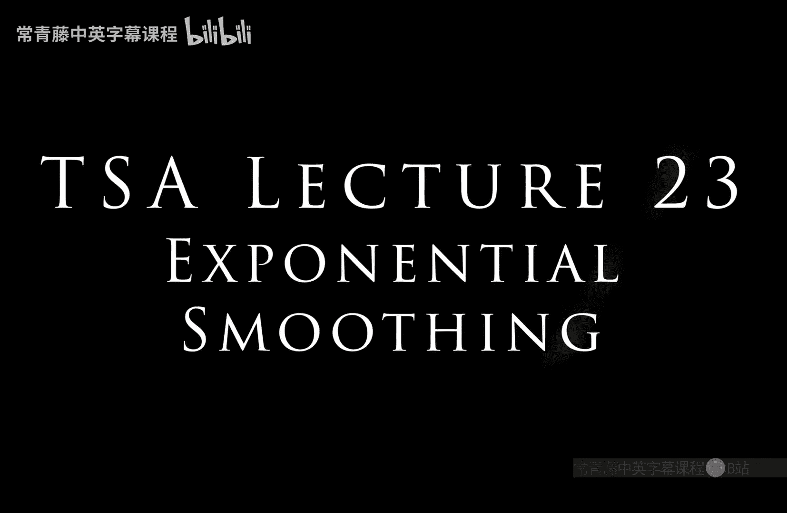
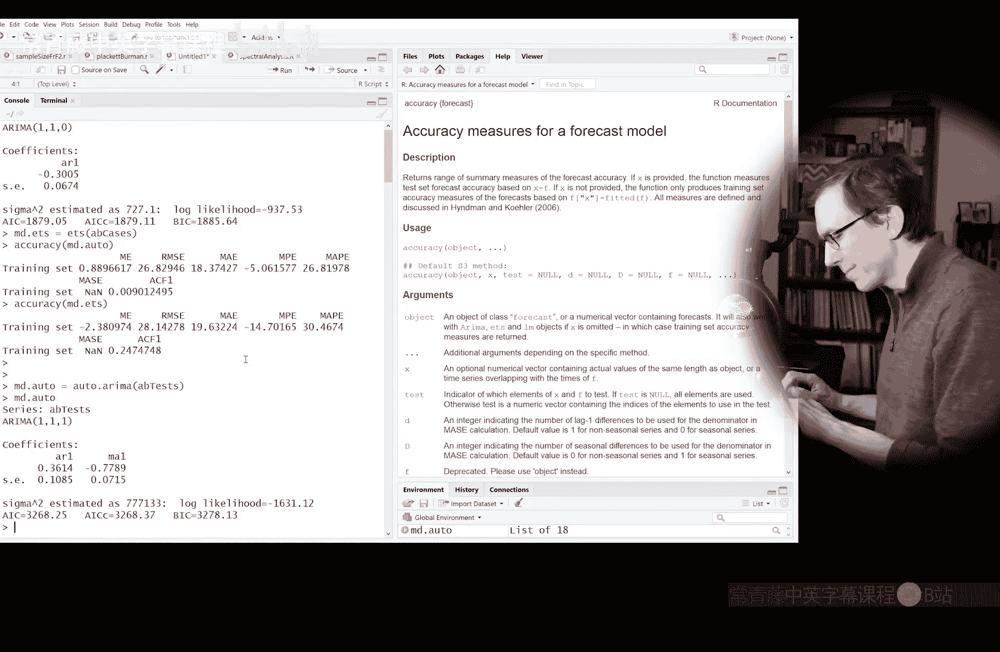

# 阿尔伯特大学【中英⚡时间序列分析｜STAT479-2021-Time-Series-Analysis】-p23-P23-Lecture-23：-Exponential-Smoothing--BV1nwqYBDEos_p23-

And welcome to yet another lecture of Staistics 479 time series analysis Today we're going to be doing a bonus lecture。

 no more spectral methods， we're going to be looking at something called Holt winters and exponential smoothing It's going to be a good。

🎼あ。

🎼So in this lecture， we're going to look at first just a smoothing method。

 something that we talked about way back at the beginning of the course。

 but we're also going to look at how it relates to the arema model。

 something that we spend most of our lectures discussing。

We're going to talk about different approaches to estimating and forecasting for this now there's an entire textbooks about exponential smoothing we're just going to scrape the surface look at some examples and try to get a sense of what it's doing just so you have that in the back of your knowledge in case you ever need to use it or you hear somebody talking about it and you want to kind of know what's going on now we're actually going to be looking at some our code specifically we're going to look at the Alberta covid cases and the Alberta covid testing from last year that is from。

February to about August in 2020 during the first wave and the following summer。

 we're going to use these methods that are implemented in the Holt winters function。

 which is in the stats package and something called ETS which is in the forecast package which is not Edmonton transit services though that also isn't so bad we're going to figure out how these functions work and we're going to compare them to modeling with the arema models to fitting an arema model to our data as we've done throughout the rest of this course now again there's so much more that you could do here and you could study but hopefully this gives you a sense of what exponential smoothing is so you can go forward and read more about it on your own if you're so inclined and with that let's get back into the notes and see what this is all about。

And welcome back to another lecture of statistics 479 time series analysis today we are on bonus material because we finished everything that I really wanted to cover in the course or at least the things that I covered in the course last year when we were under the various slowdowns that came with the onset of the COVID pandemic now that we have an extra two bonus lectures here we can fill in with some supplementary material that will certainly be interesting。

 I think should you ever need to deal with time series data in practice today's topic will be on exponential smoothing and Holt winters and these are different way a different approach。

To modeling and forecasting with time series， now I say a different approach because it kind of has a slightly different mindset involved。

 but we're going to find out that a lot of these methods are actually connected to certain arema models that we've already seen when we have when we've seen earlier in the course。

So we're going to do a just a quick overview of some of these methods in the notes and then we'll move into our studio and I'll show you how some of the functions work。

 This is a very quick overview。 There are entire textbooks on forecasting with exponential time series or exponential smoothing and things of that nature So there's a lot more to this topic that we're not going to cover today I'm just going to give you a brief overview some interesting little tidbits that you can then use to go further into this subject if you are interested so what's this all about well let's get into the notes and find out。

Now to the first topic that I want to talk about is called simple。Exponential。Smoothing。And。

This topic is one that we really could have covered way back at the beginning of the course when we talked about the moving average smoother。

When we first introduced the idea of a。Moving average。Smoother。

What we said was that we're going to take some time series Xt。

 and what we're going to do is we're going to create a new series ST。

 where what we'll do is we'll let's say average some adjacent values like Xt minus H plus。

X T plus actor。Dot， dot， dot。X T plus H all divided by in this case， I guess2 H plus one。

If we have just。A uniform average right not a weighted average in this case。

 we're just doing an I guess2 h plus one time unit moving average right to all I'm saying is this is something that we talked about way back at the beginning。

 I could just take a window slide it along my time series and average the points that are within that window together to create a new smoother time series now。

Here we have the idea of a finite。Window。But we could also do what's called exponential smoothing and in this case。

 what we do is we create a new smooth method， so this is the moving average。

If we wanted to do exponential smoothing。Wwhichch is sometimes called simple exponential smoothing。

 there's a lot of terminology here and it can be a little confusing you'll see like simple exponential smoothing。

 double exponential smoothing， linear exponential smoothing， Hol winters， smoothing or Hol winters。

 whatever there's a lot of different terminology， it can be a little confusing so。

We'll try to make some sense of it。 but yeah， just to be aware of the fact that sometimes you see someone use one term when they actually mean something else。

 it doesn't seem like it's strictly well defined all of the definitions。

 but roughly if somebody says exponential or simple， exponential smoothing。

 what they probably mean is doing something like this， which is，Taking。Basically， we define。ST。

 which is our smoothed time series to be， well， alpha times xt plus1 minus alpha times S minus1 and maybe we can say where。

Um。Well， I guess we would just start this and'd say， yeah。Where。S1。

 the starting point is just going to be x1。Okay， so what does this equation mean， oh。

 and I should also say。4。Some。Choice。Of alpha in0， one。So what are we doing with this equation here。

 what we are doing here is。This is a weighted average。Of。Current。Point。X T and。The previous。Smoothed。

Value。S T minus1。And here alpha is between zero and one。

 so if alpha would be one half what I'm going to say is the new point that I'm estimating is going to be half the or I'm smoothing I guess is' going to be half the newly observed value and half the previous smooth value。

 so in a sense it's building in some inertia into the system it's saying rather than just saying。X1。

 x2， x 3， x4， we're going to take those observed values， but we're going to have some。

Aggregating average in ST that we're going to sum up here with a weighted weight depending on alpha。

If alpha is equal to one， we just return the original series， there is no smoothing applied。

 if alpha is equal to zero， well， I guess in that case we just return x1 all the way through and it's super boring。

 but right these are the two extremes， and you'd have to choose alpha to decide exactly how you want to smooth。

So then the question is well why in the world is this called exponential smoothing because I don't see an exponent anywhere in here and what happens is if we actually iteratively write out this definition。

 so if we use this definition and we say that ST is going to be alpha Xt plus1 minus alpha times and then what's st minus1。

 well it's going to be。Alpha x， t minus1。Plus。1 minus alpha x， not x。S。T minus2。Okay。

So if we were to keep iterating this， what would we get。

 well what we would get is we would get a a well non infinite series， a finite series， let's say。

Something like the sum。Jy from。Let's see if I get this ride zero to， I guess。Well。T， let's see， well。

 I'm going to write it out and I'm going to figure out what my exponent should be after the fact。

What we're going to have here is we're going to have alpha times everything and then we're going to start with an alpha one minus alpha to the zero。

 one minus alpha to the1， one minus alpha squared and so on so this should be a well I guess just a J and then we're going to have an x t minus J and I guess we have to go all the way back to x is equal to or x1。

 so j would have to go to t minus1 something like that。

except there's one subtlety and that's what I had a feeling I was missing something the final data point is not multi or the the initial data point x1 is not multiplied by alpha because notice that alpha only comes in here。

And here， it does not come in over here。 So that means that the it's not really going to matter if alpha is。

Well， not really close to zero because。Yeah， zero in this case。

 becauseum what we would end up with is something like one minus alpha to the。I guess in this case。

 t minus1 times x1。So this is why it's exponential smoothing because it's basically so this is。

Effectively。A weighted。Moving。Average。Smoother。That。Uses。The entire。Past。

Because we're going all the way from our previous point， all the way back into the past。

 and we're in some sense。Dampening the influence of every subsequent past value by a factor of  one minus alpha。

 So as we go back again， if alpha is closer to one。

 then we don't rely as much on the past measurements。 If alpha is closer to 0。

 and then we're going to have a much smoother representation of our series。

 So this is just a smoothing method。 that can be useful。 And one thing that I didn't mention。

In the spectral setting is that。I'm going to say note。Smoothing。A as a what's called low。Pass。Filter。

So if you've done any like signals processing or signals engineering。

 you might have heard of lowpa filter effectively a lowpa filter is something you'd apply to a signal which would get rid of high frequencies high fluctuations I guess if you apply it to audio you'd get rid of those like sounds hopefully my pop filter here is actually stopping that airflow from being horrible into the mic but right if you have that high frequency static that you might get a low pass filter would well take care of some of that it would get rid of high frequencies in a signal and similarly if we have lots of little random fluctuations and our data these little stochastic fluctuations smoothing will smooth those out and in an effect we're doing the same thing as applying a low- pass filter which would get rid of high frequencies so there are some connections there we're not going to get into the details of signals analysis and audio。

process and all that stuff， but it is good to just be aware that there are these connections out there。

 especially with respect to the FFT that we talked about in the previous lectures。

 typically you can transform into the Fourier space into frequency domain that is and then you can just cut out you can apply a transformation that will cut out the high frequencies and then transform back or oftentimes you convolve with the correct thing but again that I'm getting a little bit sidetrack I don't want to get into all of that today。

Right， so that's the rough idea of the simple exponential smoother。 Now what I want to do， though。

 is go a little bit further and talk about the idea of a double exponential smoother。So。Right。

 the the rough idea。 So this is now the next section is going to be double。X。Financial smoother。

So roughly the idea is that。The simple exponential smoother is just going to smooth things out and again。

 I didn't make any assumptions about what x is， if x has any trends in it or if it's just a stationary time series。

 if it's just a stationary series， then the simple smoother is just going to kind of dampen those stochastic fluctuations up and down around the mean。

 but if there's a trend in the data， if we're increasing or decreasing people often like to use a double exponential smoother。

So what is that well simply put what we're going to do now is we're still going to start with the idea that S1 is going to be x1 so we start our smoother at whatever the first data point is。

But now we're going to have to define something else and that something else is going to be B。

And B1 is going to be the difference between x2 and x1。 So this is like the。The change or slope。

And B is kind of loaded notation， right because oftentimes we'll use B to correspond to like a slope or something in a linear model so。

Right the idea here is that we would start with this notation where we have two different things going on。

 we have our smooth time series starts at X1 and we have a change， the difference between x2 and x1。

And then we define。 So this is the like initialization。Then we would define ST。

To be alpha for some alpha of xt， so the same thing as before we choose an alpha which is going to tell us how much we're going to smooth。

But now what we're going to do is we're going to take one minus alpha and we're going to multiply it by S。

S t minus1 as before， but what we're going to do is we're going to include B。T -1。 So in this case。

 it's the。Previous smooth。Value。But we're adding something else， which is the。Well。

 I didn't define what B is going to be， but this is going to be like the smooth。mSlope。Or change。

Yeah， so I should probably tell you what Bt is going to be defined as because Bt and this is where it's a double exponential smoother in the sense that Bt is also going to have a。

A exponential smoother type look to it in this case we're going to need another parameter。

 say beta which is going to be another value between0 and 1， I'll write that over here。

 we need an alpha in 01。And a beta。In 01。Anyway， given that。

 what we're going to look at is the change in our smooth valueS minus1。

And we're going to have one minus beta times the previous。B T minus1， so effectively。

The BTs are kind of just like a simple exponential smoothing of the change in our smoothed time series。

Right so again， this is maybe a little bit like okay。

 we're just going a little one step further down the rabbit hole here。

 but sometimes you see this referred to as things like trend smoothing the idea that we have a we're we're considering how is the time series changing from one point to the next and again I have not。

Then I'm not an applied statistician who has spent lots of time doing time series analysis。

 but from reading through textbooks and some papers。

 I get the sense that people like this approach when there are trends in the data versus the simple exponential smoothing。

 but again， talk to an econometrician if you really want to see how some of these things are applied in practice。

 because that's not my expertise by any means。Now you can actually take this to something called triple exponential smoothing there's also additive versus multiplicative exponential smoothing there's a lot of crazy things here。

 what I want to do is I want to talk specifically about what comes into the R package or the R function。

 Holt winters because you'll see that name being thrown around a lot or that hyphenation of two names presumably I believe Holt winters are two different people though I'm not 100% sure on that so we should probably double check that。

All right， so what I want to do is I want to try to make more sense of these exponential smoothers in the context of things that we're already familiar with。

 that being the arema process。Because。We'll say fun fact。Yeah。Which is that simple。Exponential。

Smoothing。Is。Arima。Zero11 model。So that's interesting because on one hand we had this idea that I just want to have a smooth version of my time series on the other hand here。

 I have an are model which is sort of modeling the noise process here at least modeling my time series after taking a first difference as a moving average process so let's investigate this further and actually write it out。

In this case， if we consider our arema 11 model， what we would find is that we would have the first difference1 minus B applied to the time series Xt。

Okay， on the other side we would have。1 plus theta B applied to WT。Okay。

 so where do we go from there well what we can do is we can split this up and we find out that we have xt is equal to X t minus1 plus well then a couple things here we're going to have a wT and we're going to have a theta。

Wt minus1。Now。What we're going to get back to is that idea of the innovations algorithm。

 remember that the innovation algorithm was telling us way back in our notes。

 it was saying that what I could do is I could look at these residuals。

 like I look at the changes in my time series to kind of get an estimate of what the white noise should be。

The little fluctuations and then you use that as a way of doing forecasting。Well， in this case。

 what we're going to do right， is we're going to note that the well。We're going to make a note that。

Roughly what we're saying here is that the change in Xt is going to correspond a bit to the white noise process。

So if we wanted to do some forecasting and we wanted to say figure out what Xt is based on the previous measurements or the previous observations。

 what we would probably do is say， okay， well。I'm going to use the previous observation X t minus one now WT white noise at the current time is kind of like a stochastic fluctuation。

 it's unknown， but it's mean zero， so we would not include that。

But what we would want to do is try to figure out what the previous white noise WT minus1 is based on the data。

 the previous data。And one way to estimate or the white noise。

 I kind of hate saying that because it feels like I'm saying estimate a normal random variable。

 which is just a normal random variable， but right we can kind of think of the white noise here as a residual。

 the difference between the t minus first data point and the previous prediction of the t minus first data point。

Right。Okay， so now what happens if we rearrange this。

 what we end up with is something that's going to be。Hmm， I think I missed a minus sign somewhere。

Yes， I think I want a minus sign because ultimately what I want is something that's going to be like one minus theta x t minus1。

Plus theta X hat t minus1 so what we're kind of doing is saying that the the new prediction is going to be await weighted average of the previous prediction and the current observed data point right and this is the idea in this case the role of alpha above which has not quite fallen off the top of the screen here is being played by well this is the double exponential smoothing but same idea the alpha here is being。

Is being replaced by a one minus theta So where in the world did my minus sign go？All right。

 so the problem that I ran into here is that I realized that theta actually could be positive or negative。

 so I was out thinking myself， if I just followed the equation on this line and put it together。

 what I would have is one plus theta and then a minus here。Which looks a little weird。

 but if theta is negative， then we get exactly what I want。

 which is basically four theta equal to minus， I guess in this case。1 for。Alpha minus1。

What we would end up with is something like X hat T is going to be。

Alpha x t minus1 plus1 minus alpha X hat t minus1 were here x hat T would be our prediction and x would be the observed value so in a sense what we're doing the exact same thing we're predicting the next point based on a weighted average of the previous prediction and the current value。

 so while we introduce simple exponential smoothing as just a way to smooth out our data。

 it actually does have context as an narima model and thus we can use it for things like forecasting and whatnot and ask questions like okay how well does this model fit the data what's our forecasting accuracy things of that nature。

Now I believe we can actually do the same thing for the double exponential smoothing。

 sometimes called linear exponential smoothing， one thing actually I should probably put that in here。

 as I mentioned there's a lot of different terminology。

 sometimes you'll see this called linear exponential smoothing or double exponential smoothing。

Anyway， let's see if we can sort that one out without running into a little bit of trouble with all of and the terms。

So。I guess。Fun fact number two。Let's try。Arima。Zero，2， one model。

And see if I don't get lost with all of the parameters。 Al right。

 so the Irima22 model here is going to look something like。

What it's going to be our 1 minus b applied to xt and that's going to be1 minor plus theta 1 b plus theta 2 b squared applied to WT。

 Now if we put all this together as we did before， we end up with an Xt is equal to x t minus1。

 and then we're going to have a big string of white noises。

 we're going to have a oh I forgot to square this I know I did something wrong there。Yeah。

 we have to apply this twice because we're doing a second difference。Otherwise， yeah。

 that's not going to be as interesting。In this case， we would have a minus2。X。

T minus1 plus x t minus2， and on the other side， we're going to end up with what a Wt。A theta 1。

 w t minus1 and a theta 2 W t minus2 Okay， so if we rearrange these terms again。

 what we end up with is something that's going to look like2 x t minus1 plus X t minus or minus sorry got to get these minus signs。

 right？They are killers。Anyway， we get something that looks like this。Now。

 if we use the same minus two， if we use the same thought process as above。

What we can do is we can replace the Ws。With differences between our predicted and our forecasted or our observed and our forecasted values for X T so here if I'm let's say hat。

 so if I want to predict X T。Or I want to forecast it right what I can do is I can use the previous two data points。

 the WT gets replaced with zero just because again we don't have any information at what's happening at time T I'm assuming I don't have the data point X T in this example。

But we have the previous data points now for Wt minus1， however。

 we can try to estimate that by looking at the difference between x。T minus-1。And X。T minus1 hat。

And similarly， we can do the same thing over here。We can have an x t minus 2 and an x t minus 2 hat。

Cool， okay， so what happens when we put all of this together？Well。

The first thing we're going to get is we're going to get。

 let's see if we can keep track of everything here。We should get a。2。Plus， theta 1， X t minus1。

And then we're going to have a。Minus。Theta 1， x。Hat， T minus-1。

And then we're also going to have an X。Let's see if we can get this。A minus， okay。

 now we're going to have a theta2 minus1 X T minus2 and a well I guess I can just subtract this whole thing。

Minus。One minus theta 2。Minus。Theta to x hat t minus2。Right。

 I think that should be everything we need。Cool， and in fact。

 maybe it would be better to have written this first term here。In terms of。X T minus1。Plus the。

Smooth version。X t minus1 minus。Theta 1 x hat t minus1。

 and then the rest of this is kind of like minus。1 minus theta 2。

 x t minus2 plus since I factored out that。Minus sign， okay。

 so we have something that looks like that where do we go from there？All right。

 so this one's a little bit harder to interpret， but what we can do is we can notice。

That what we effectively have is we have the previous data point x t minus1。

 and then we have a difference of these two simple exponential smoothed values now it's not exactly like that because we have to consider that x hat is being smoothed by this entire process。

 but。Roughly， it gives you an idea of what's happening here in the sense that we could have something like an alpha 1。

 x t minus1 minus alpha or one minus alpha  one。Sorry。

 plus one minus alpha 1 x hat t minus1 and over on this other side， we could have something like a。

Alpha 2 x t minus2 plus1 minus alpha 2 X t minus2 hat。

 So you kind of get the idea of how we are kind of like iterating this smoothing method here。

 So yeah， I think the equations are a little bit harder to interpret in this case。

 but you can kind of get a sense about what's going on。 Now。

 if we look at the actual Holt winters method in the R code。

 you can find that it'll tell you exactly what it's going to do。 so。

What I'm going to write this out before we actually apply this in practice， so in R we have Holt。

Winters， which is just in the general stats package， the default stats package。

 and you can do either an additive or a multiplicative hold winters I guess forecasting。

So what does that look like well it gives you the formula that it does right in there。

 but it can be a little bit confusing if you first well。

 when you first stare at it so I thought we could write it out here initially。All right。

 so let's look at additive。Hld winters。In R， which is going to also have a， well。

 a kind of like a mean。A linear piece and a seasonal piece attached to it I didn't write this out before。

 but you can we'll look at the equation to try to make sense of what's going on。

 So in the sense of the R code what it tells you is that it's going to predict a Y hat at time T plus H so H step ahead forecast what is it going to give you well it's going to make that as a combination of A plus H。

Times Bt。plus。S， now my notation is going to change a little bit from above where I was using S as a smooth time series。

 S here is going to be the seasonal， seasonal bit that has some type of periodicity to it。

 So here we're going to do a T minus P plus1。Plus， and then they're going to have an H。Minus1。Mod P。

 which is kind of annoying to look at effectively what it's saying is that every H。

 I mean the rest of this is kind of annoying， but it's effectively just saying。Period。P。

So that every time H goes P steps， we kind of start over again。

So the Holt winters method of forecasting and modeling and forecasting here is going to use an equation that looks like this。

 But then ask the question well what in the world are A， BT and S T。

 So here we have A and this is going to be our smooth well， it's going to look a lot like the。

Like the double exponential smoother， but there's going to be a。

There's going to be a seasonal component here， so what it's going to be is it's going to be alpha which is going to be some parameter that we can choose or try to let the algorithm select。

And it's going to be Yt， which is our observed oh yeah。

 I'm using Yt because they're using Yt but I'm going to switch back to Xt just because that's the notation we've been using for the whole course Xt is our time series Now we have the present。

 the most recent present value Xt or the T value minus the seasonal bit and the seasonal bit here is going to be S T minus P so it's like saying I go back one season to see what the change is right that's intuitively what's going on here。

This is kind of like the present。And this is the last season。

So if we have monthly data and we have an annual season， it's like saying， okay。

 I have my observation for January 2021， I can go back and use my seasonal， I guess。

 smooth value from January 2020 and look at the difference。Anyway。

 we're going to have that difference in here and we're also going to have a one plus， not plus。A one。

嗯。Come on R or Microsoft a1 minus the previous value， A minus1。Plus。B， T minus1， okay。

What is that doing Well， what it's doing here is it's saying that we're going to have some type of a。

AT is basically like our smooth mean in some sense。

We're looking at how XT changed from the previous seasonal bit and weight that at alpha。

 and then for one minus alpha， we're going to have the previous AT value plus the change and BT is going to be like the slope or the smoothed change or trend parameter。

Um， or series， I guess。Anyway， for BT， we're going to have something that's going to look like beta and then we're going to have an at minus A minus1。

 so what we're doing here right is we're saying we're taking the current AT and yesterday's AT and looking at the difference。

 how much did it change and multiplying that by some weight beta。The other bit then becomes。

1 minus beta times the previous measurement b t minus1 so again。

I'm not expecting you to kind of absorb all of the equations here。

 but just to see the form of the equation， try not to get too lost in all of the notation。

 but just the form is all the same， a weighted combination of some change like the at minus A minus1。

And the previous observation B t minus1 or the previous point。Lastly。

 this smoothing method also includes a seasonal bit。

 which is going to be ST and we're going to have a new a new parameter gamma which is going to be between0 and1 and we're going to look at y t minus8 so this is kind of like saying how much is y fluctuating above like the smoothed average。

And then we're going to have a one minus gamma times the previous seasonal component。So again。

 it's kind of hard to interpret but this is roughly what's going on and this is the idea of a additive Holt winters predictor if we're going to do it multiplicatively I think things change a little bit I'm not going to write it all out because it's just going to be a bunch of messy formula but you can find it in the R documentation if you want to see how the formula change in the multiplicative case。

But more interestingly， what we're actually going to do is try to work with this model with real data and just get a sense of what's going on because I know this is the end of the course and we're going to just aim to。

Increase our repertoire of time series tools so that we have some ideas in our head if we want to try something else beyond just using ama。

 which was the main function we used to fit and predict time series models in this course。All right。

 and we're back in our studio it turns out I forgot to actually record my screen because well it's been a long term and we're almost there now。

 but that's why there's all this junk up on the screen already but what I did was I tried to load in the data set of AB of Alberta COVID cases。

 the data set that you've looked at in this course throughout the assignments and what we see is that you know we have that big first wave spike it drops down by I think the end of April kind of into May and then it starts to slowly increase as we move throughout last summer this is all 2020。

And what we wanted to do after you can see all my random code here that I already ran is I want to try to use Holt Winters on it。

 so if we go back to what Holt Winters function is， now this exists in the stats package in R。

The default one， what it allows us to do is to plug in our time series X as well as our parameters。

 alpha beta and gamma here again， alpha is going to be the overall kind of like filtering beta is going to be more for the trend and gamma is going to be the seasonal parameter these are all going to be values between zero and one。

And then there's a couple other things that you can do about starting values and whatnot。

 you actually don't have to set any of these， you can let the algorithm decide it for you so。

Here's the crazy formulation of this， we're going to ignore the seasonal part because while we don't have any seasonality in this data set。

 in fact， I think I tried accidentally running it that way because I didn't tell it to not fit a seasonal part and it got mad at me and said there's the period is not a non-existent here so we don't want to deal have a seasonal component。

But I also wanted to point out that there are two ways you can fit this there's an additive model。

 which is the one we're going try there's also this multiplicative one if that's something of interest。

 I'm not going to get into all the details on that。

 but you can quickly see that it looks very similar but some of the formulation has changed with how the seasonal component comes in and how you compute A and BT and well BT looks I think the same but at least how you compute A and whatnot as well。

Now one thing to note with this function is that if you don't tell it what alpha or beta or gamma value to use。

 it's just going to try to optimize them all based on the one step ahead prediction error。

 which is kind of neat it basically says I'm going to try a bunch of different alphas and betas and whatever in order to try to optimize the prediction error so what happens when you do that well I already did it but we will do it again so you can see it live。

Right what I can do here is I can go to my Holt winters function and I'm going to run it on the AB Alberta COVID cases data set again。

 it looks something like that I am going to say gamma is equal to false which basically says don't include that seasonal component in the model。

And what I get is something that looks like this。 So I get my alpha and my beta out here。

 beta is really small， which is kind of saying like the， I guess in this case， right。

 If alpha is large alpha in this case is large。 then the larger alpha is the more that we just rely on the previous observation to predict the next。

 So alpha equal to one is kind of like the random walk case where it's like it could go up or down。

 but the best we got is just use the previous observation，Meanwhile here we have beta。

 beta is quite small， so in that case we're actually relying on some like smoother trend and we have some coefficients here for like a mean and intercept。

 which don't really， I think， well， yeah， roughly。Anyway， what does this look like。

 well if we actually plot this forecast， we get something that looks like that。

 which almost has like this double vision look to it like am I seeing that correctly。

 I kind of see it looks a little bit blurry。Remember the alpha is quite large and if alpha is quite large。

 we're going to be using the previous measurement to predict the next measurement。

 so what I can do is I can actually go back here and manually choose alpha equal to1 and beta nonexistent and what that's going to do is it's going to basically say I'm going to predict the next value based on the previous value and you take your whole time series and you shift it with no actual smoothing on the other hand if I set alpha equal to01 So now I'm going to have a very this is a simple exponential smoother and I guess something that looks like that right。

Where it's trying to use the previous values to predict the trend through this simple exponential smoothing now it's not really a great fit right you get this you can see pretty quickly that it's it's kind of lagging behind lagging is kind of a loaded term and time series。

 but it's it's falling behind in what it's supposed to be doing the actual cases are dropping down and it's very slow to catch up to it mainly because again。

 if I have alpha close to zero， there's a lot of inertia built into this。If I were to set beta here。

 let's try something like alpha is equal to1 half and let's include beta equal to1 half to see， oh。

 it's going to get mad at me。Okay， let's try beta smaller。 Nope， it's going to still get mad at me。

Well， that's always good。Yeah， I'm just being silly here。

 I already had beta in here and Rs just like， what are you doing， you're giving me two betas。

 I don't want two betas。So let's see what happens if we include both beta at one half and alpha equal to one half well now it actually is kind of a little bit better in the sense that it follows the time series a little bit more closely again。

 we're not optimizing the one step ahead prediction error that was done by those other choices of parameter where alpha is large and beta is quite small。

In contrast， we can do the exact same thing if I get rid of this。

 but keep gamma equal to false for the AB tests that is the number of COVID tests performed。

Now before we look at the results， we should look at what the actual data says in this case we see an increasing linear trend。

 roughly， I should say increasing linear trend， it's almost like there's a little bit of a change point in here when we move out of the first wave and then move into the summer when things down calmed down a bit。

But in this case， we get a smaller alpha actually， so a little bit more inertia in the system and beta still is。

 I guess quite small。In this case， if I were to plot this model。Yeah。

 it's going to look the same which is kind of like the same series slightly offset remember what we're basically doing here is we're trying to predict the next guy based on the previous guy but adding in some exponential smoothing so you can have a lot of fun just playing with this I mean I think sometimes the best way to learn about methods and statistics is just to experiment just to kind of see what happens when you apply these methods。

Right， so then the other thing I wanted to talk about is that there's another function called ETS with which exists in the forecast package now if you read some of the documentation on ETS you'll see the author saying that you should be using this function and not Hol winters because this one is better。

 I guess I can take his word for it。I haven't actually used either of these too much。

 but you can see that the same ideas occur。 We have an alpha。 We have a beta。 we have a gamma。

 We have something called damp here， which is for。Dampened time series。

 something that we didn't talk about， but that's another thing there's also this crazy model argument here and here for the model argument what you have to do is you have to put in an A and m or a Z。

Or I guess an N and A and M or a Z where what you get is you get additive。

 multiplicative and Z is automatic and then。Similarly for the second one is going to be for the the trend type so I guess here yeah they have n now included which is no trend So if you just want to do simple exponential smoothing and the same thing for the seasonal components so it looks kind of annoying but it's actually quite nice in the sense that you can run this almost automatically and they give you some examples like if you type in A and N you're saying do simple exponential smoothing。

There we go， or you can have MAM， which is the multiplicative Holt winters method with。

 I guess this yeah multiplicative seasonal bed here。

Oh no the additive bit there's an additive yeah so it has an additive bit for the trend Yeah so basically you can try lots of different things。

 The neat thing is that it'll just pick one for you so I haven't actually run this yet which is always fun to see what's going to happen live it's not technically live is it since I'm prerecording this so if it goes horribly I'll just edit it out but it could be fun to see what happens if I just give it the Alberta cases time series。

😊，All right， so what did it tell us？Well， we get some interesting things here。

 it comes up with an MAN， a man model， I guess this is for the multiplicative errors and additive trend and no seasonal component as we saw before。

 it estimates an alpha and a beta parameter， remember these things even though we didn't write down all the equations。

 these things are the smoothing it says right there there're the smoothing parameters。

 the larger the value， the less smooth， the smaller the value， the more smooth。😊。

It also does some states based stuff that we're not going to talk about and it gives us some AIC。

 which is always kind of nice to have that included in here。

So hopefully it's going to have a built in plot function for us。 Yeah， there we go。 And in this case。

 we actually get an entire decomposition with the so called level and slope。

 So it takes our Alberta Covid cases and it breaks it into two pieces the first being the。😊。

Kind of like the smoothed。I guess air or something how it's fluctuating up and down and then we have this kind of trend as well。

 I guess the fact that it's increasing a bit and then not as much so it's a you know。

 you can kind of stare at this for a little bit to try to make some sense about what's going on here。

 right。But it is kind of neat that you have this entire other method of。Of modeling that we can use。

We can do this the same thing to the AB tests。And we can look at it to see what we get out。

 it also picks the man model with actually fairly similar choices of parameters there。

And we can plot that just to see what we get and yeah。

 you kind of get this sense of what's happening here with respect to like the AT and the BT series smooth series on top of the actual observations。

But ultimately， you might want to ask yourself， is one of these？

Better than what we already did with Arma or not， right， Well。

 we could actually sort that out because we can use the accuracy function to test the forecasting accuracy of these methods。

So let's do a little throw down and see which method works better。

 right what we can do is we can fit。行。An MD auto， which I'm going to use auto Arma because I'm too lazy to pick a better one we'll use auto Arma to decide what the best series is for AB cases。

And we have MDd。au。Which is going to be an AR11 model。In contrast， we can do MDETS。

 as I did before in this case we're going to apply the ETS method to the AB cases and now we have two different methods。

 so let's look at the forecast accuracy。MD auto。Is going to give us a root mean squared error of 26。

8， whereas ETS is going to give us oh， a slightly higher root mean squared error， sadly。

 and I guess mean absolute air as well and these other ones。

there's way too many forecasting errors they really bug me that there's so many of them。

 but I guess everybody has their own favorite anyway it looks like in this case the Arima 11 has outperformed our friend our new friend ETS but what happens in the case of the tests Now I haven't actually run this I'm just doing this on the fly so we're gonna to find out together or you'll find out once you actually watch this video and I compile it and upload it regardless we can get our AB tests。

The auto Arna tells us that it should be an arema 111 model。

In contrast， if we jump back to ETS。What do we get if I can type this correctly？Well。

 let's go back to accuracy and find out in this case our root mean squared error as well quite big it just mean it's all relative right to the data in this case we have an 874。

9。For ETS， we have a oh 905， oh， and the mean absolute air is a 666， which is， I guess ominous。

Regardless， it looks like in this case， the auto Arma is picking a better model than ETS is with respect to forecasting air。

 at least the mean squared error and the mean absolute error。

So it does just give you an idea that there are other methods out there for fitting time series models doing prediction。

 this idea of both Holt winters and exponential smoothing is another aspect。

 there are a lot of connections to arema as I mentioned in the notes right。

 sometimes you'll see them just say IA for an integrated moving average model。

 but that becomes very popular as well。So right。What's the best way to model your data well you have to try other things and I would also encourage you not to just rely on the defaults here。

 the autoars and ETS automatically selecting a model for you。

 because ultimately you want to consider the data set you have and what type of models might be good to fit it and to do and to use for forecasting and whatnot。

It can be a little dangerous when you let the algorithm just sort of decide which model is the best for you now that being said that's what I did right here for testing purposes but going forward is always good to try multiple models out on your data just to see what happens because AIC BIC they might give you different answers and they also giving working with respect to prediction error。

 we might give you another answer as well so again all models are wrong some are useful as box said and every single person at every statistics conference has said as well so I figured I might as well jump on the bandwagon and say it here before we end this course。

Right so this was a bit of a shorter lecture， but this is all that I really wanted to talk about for today just to give you a taste of other methods that are out there in time series。

Going forward we have one more bonus lecture left so we're not quite done yet。

 so if you want to learn a little bit more about a different method tune into the next lecture and then we will slowly enter the end and do some review of what we talked about throughout this entire lecture course before we conclude this video lecture series。

😊，Right， so I will see you in。