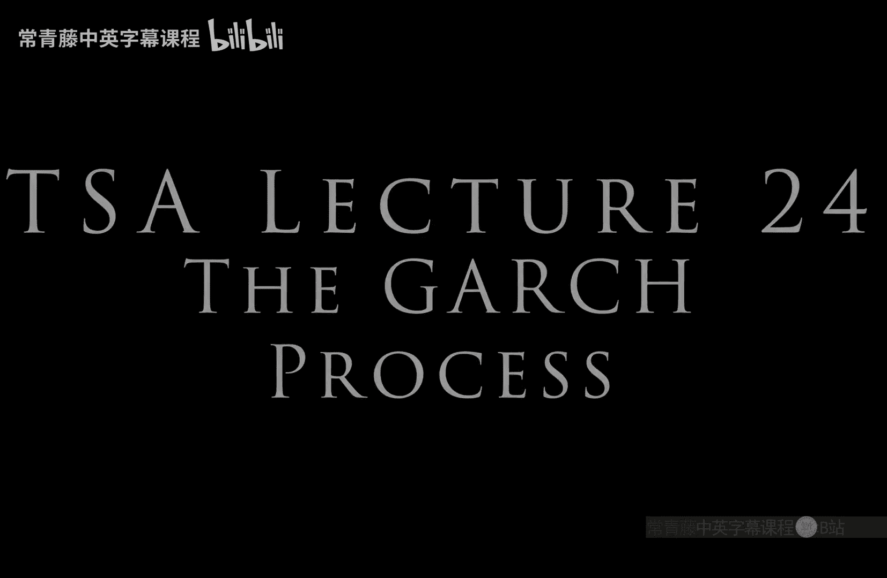
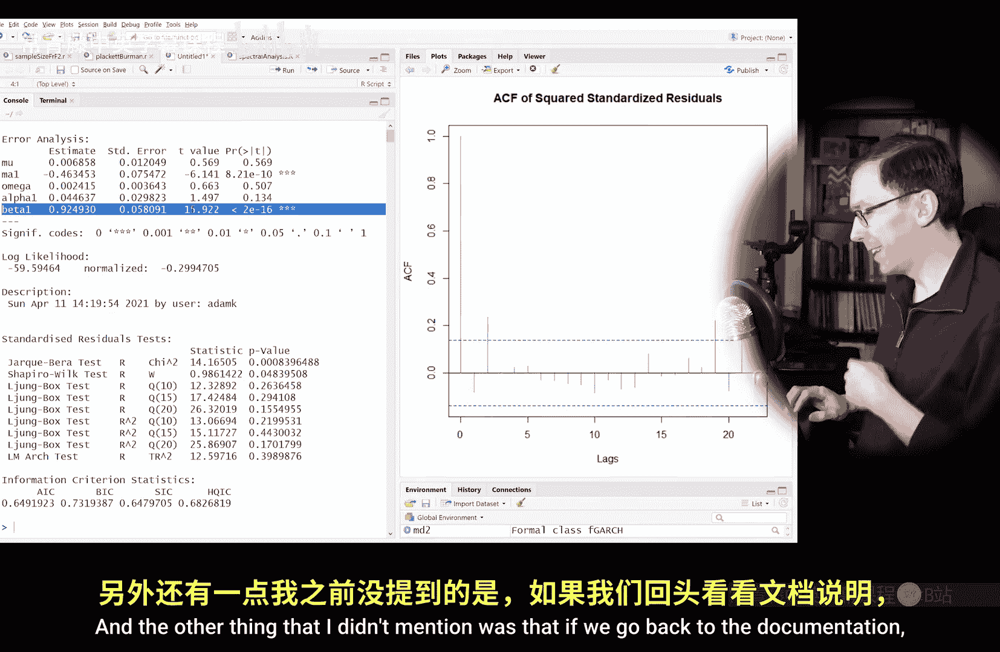

# 阿尔伯特大学【中英⚡时间序列分析｜STAT479-2021-Time-Series-Analysis】-p24-P24-Lecture-24：-The-GARCH-Process--BV1nwqYBDEos_p24-

🎼And welcome back to another lecture of statisticsistics 479 time series analysis。

 we have finished our notes today is the final lecture。

 the final content drivenn lecture and it's on a special topic and that topic is the Garch model generalized autoregressive model with conditionally heteros scastic variant or variation it's going to be a lot of fun and people in finance of it。

😊。

So in today's lecture what we're going to do is we're going to discuss this idea of the Garch process。

 it's a process that extends what we've already done for autoregressive and Arma models。

 but now we're going to focus on the variance because the one big assumption that we've made throughout this course is that the variance is never changing that is the variance of the white noise process underlying our time series。

 the variance is always going to be the same or at least it was always the same throughout this entire course and that's a pretty strong assumption because very often the variance。

 the volatility， the varianceing of our time series will change over time this is most notable in financial time series because it's very common that you'll be watching the price of some stock。

 some asset， some whatever and it's going to be fluctuating kind of randomly up and down。

 not changing too much but something happens and now it's going to still fluctuate kind of randomly up and down but。

Much more drastically and if there's an increase in the volatility that's something that we might want to know about if we're trying to do investments I don't know really anything about investing。

 but I do know some things about time series and today we're going to look at the time series models from our course but considering that the variance may change throughout time and this is going to be a new interesting topic。

 something to do a quick little overview before we end our course。

 so let's get into the notes and see what this is all about。

And welcome back to another lecture of statisticsistic479 time series analysis This is our final content driven lecture the next one is going to just be a recap of everything we've done and as with the last lecture since I've covered all of the main material that I set forth to do in this course after the end of the spectral methods we have another bonus lecture here but this one I think will be particularly interesting for all of those out there who are interested in financial modeling because we're going to be talking about the Garch model okay so what in the world is that well it's actually the Garch process GACH you can find it on the website in Vetopedia website that I was recently made aware of by one of my students and they have a nice sort of qualitative definition of it and they basically say well it's an autoregressive model but what is the CH right we know at AR。

I's autoregressive but C C is conditional hetero scasticity and the idea is that we can use such a model to estimate the volatility in financial markets or other things。

 it doesn't have to just be finance， but it is particularly of interest to financial institution who are trying to model volatility of stock prices。

 asset prices， bonds， investments， whatever else they do。

 I'm not really a finance person so I don't strictly know what they do。

 but my limited understanding of finance is that if you're watching the price of something。

 it very well may behave like a random walk in that case。

 well there's a 50-50 chance it's going up or going down。

 there's not too much you can do but no flip a coin。However。

 you could try to model the volatility because it's very common that you might have times where the price。

 while fluctuating randomly up and down， will fluctuate only a little bit。

 and then you might reach a point of increased volatility where suddenly the price will jump up and down a lot。

So depending on whether or not you like good stable volatility or more， I guess。

 a higher variance in your in your investments， well that's up to the people who manage such portfolios and hedge funds can figure that stuff out mathematically though。

 what we can do is we can write down an autoregressive process and we can change one thing and that one thing is that we can take the variance of the white noise。

And we can make it well heterochiastic， which basically means the variance can change because this entire course。

 the entire time I've been talking for the last 23 lectures， we've always had one main assumption。

 and that's constant variance or homogenous variance。

Now this is a standard assumption in so much of statistics if we do linear regression。

 homogenous variant， we do time series， homogenous variant， I do design of experiments。

 homogenous variant， we usually hope this is the case throughout statistics。

 it often is not the case， and that's why we need more sophisticated models to study this topic。

And that's what we're going to talk about today， we're going to look at the Garch process。

 which is the generalized autoregressive conditionally heterocaastic process。

 and it's a pretty good time， okay there's a lot that you could study about this we're not going to go into all the nitty gritty details。

 but at least I'll give you an overview of what this is and we can apply it in R and I can show you at least how to use one specific R function to fit such models to data because it can be a little。

 well it can be a little complicated， but we'll get all into that but first let's write down what this model is in the notes。

All right， so the topic。The topic of today's lecture is the， as I mentioned， Garch。

Model or processed whatever you want to call it， right？And the rough idea is that if we start。

 we can start with the idea of an AR1。And the AR1 process， which I've written down。

Probably a hundred times by now， right， it's going to look something like this。

And we'd have phi less than one in absolute value so that it's。A causal linear process， et cetera。

 et cetera， but the main thing， as I noted in the introduction here is that this is constant。Varance。

Sigma squared now in practice that often doesn't happen。

 you have variant that's going to be changing as time progresses right you can certainly imagine that you would have in the finance category you could have moments of high variability in the prices or low variability but。

Also， for example， in the case of COVID infections。

 mean we'll look at that at the end of this lecture today。

 but the idea there is that there are times when。Cases are spiking and day to day you might have high fluctuations in the number of cases and then when we come into a lull and there's not as many cases。

 you might have very low variability in the day to day cases。

 so those are things that we can all try to look at in the data。

But roughly what we want to do is we want to introduce a new variable here。We'll say introducing。

RT and RT is going to be the return。Using the financial lingo， the return or growth rate。

And the return or the growth rate can be written in two different ways the first way we can write it is as the change Xt minus x t minus1 divided by Xt minus1 in this case the return is basically saying well how much did the let's say price because it's the most natural setting for this if Xt is the price of some stock then we could look at the change in the price from time t minus1 to time T and we can normalize that by the price at t minus1 so it's like saying if I bought you know one stock at price at at time t minus1。

 then what's the percentage change one time unit later。

 you know whether we're watching this daily or monthly or annually or whatever。

 and that's going to be the return。Now there's another way that's sometimes more convenient。

 sometimes you'll see it written。As I'll say approximately。First difference of the log。Of Xt。

And these two things are actually almost the same because。For return rates that are close to zero。

Because if we were to take this equation here and we were to say take a log。And add one to it。Well。

 what happens， well， we'd have the same thing on the right hand side of the equation and we get something that looks like this。

T minus1 divided by x t minus1。 and when we。Well， simplify this。

 we find out that what we have is the log of X T divided by X t minus1， which is also just that。

Delta Nabr or whatever the first difference of the log of X T so that's true。

 but what do we know about the log of one plus R well the log of one plus R。

Is going to be approximately equal to R， this is for R close。To zero。

 you can see this by using Taylor's theorem and expanding the logarithm。

 using Taylor's theorem and basically throwing away all the higher order terms。

And this won't work very well if r is large， but typically the settings of interest we're going to have r is going to be a little bit above or a little bit below zero。

 a little bit of a positive gain or a negative gain。

 and in that case we can use this formulation as the。

First difference of the log of the original time series process。

And this is something that you will see people use in textbooks a lot。

 sometimes without even explaining it， they'll say we have a time series X。

 we're going take a log and then we're going to take a first difference and that's really where this is coming from again。

 when you take a first difference of a log， you're turning that subtraction into a division basically so you're kind of looking at a multiplicative change rather then an additive change but it's just good to be aware of and oftentimes authors prefer to use this formulation rather than the one with the Xt minus Xt minus1 divided by Xt minus1。

Right so now that we have that， the question is how in the world do we model this？

We're actually going to end up modeling this into pieces。

 so the first thing we're going to discuss is just the arch model so。First。We'll consider the arch。

One model。And the arch1 model is just the autoregressive model with this conditional heterocaasticity and a single。

auuttoregressive parameter again， you can imagine just like what we've done in this entire course we could certainly have P parameters for our autoregressive process in this case we're going to just start with one because again it is the simplest setting to get our head around before we make this more complicated。

Now the model is going to look a little bit different than before。

 so now what we're going to have is we're going to be modeling RT。

So we're going to have Rt here and it's going to equal。Sigmat T times。

I guess we can use WT for the white noise piece， WT。And then we're going to have。Sigma T。Squared。

And this is going to be some coefficient， which we're going to write as， I think alpha。

 because I believe that's what they use， they use， I think omega， but we'll use alpha to coincide。

With I think some of the textbooks。And not the R package。

 Al one or alpha n and alpha1 are going to be coefficients。

And we're going to have something that's going to look like this。All right。

 so let's stare at this for a second what are these things well we're going to have。

RRT is sort of as above。It's the return rate sigma t squared is the time varying。Variance。

Or I guess sometimes they might say volatility， but right it's it's the variance term。

 but now the variance term is varying in time WT here is still going to be Iid white noise。In fact。

 I think we can claim Gaussian。I believe I have to double check the R documentation。

 but I believe the R function that fits this uses a maximum likelihood approach based on the noise being Gaussian and so again。

 if we have Gaussian noise， we have this setting， we can do maximum likelihood all as well。

But we haven't gotten there yet we're still writing this all down and then we're going to have two different coefficients here。

 which is the sort of constant。And this would be the。I'll say AR1 or the arch， well， AR1。

 and these are the coefficients that we'd be fitting。Based on the data。

And note that here what we have is we have a square。So it's a little bit confusing。

 but what we're basically saying is the returns Rt are going to be modeled as well。

 some random Gaussian white noise to just random variable but multiplied by some variant。

 so what does this tell us？Well， this tells us a couple things， it says that。Well。

 I guess we need to do some conditioning first， but roughly what is telling this first equation is telling us is that the returns are going to be mean zero random normal random variables。

 but where the variance is going to be changing in time where we're still going to stick with mean zero here meanwhile the variance term。

 I mean this is a standard deviation sigma， but then the squared。

 the variance term is going to be affected by the return rate， if the return rate gets bigger。

 then the variance at that next time step， at t minus1， if the return rate is larger than at time t。

 the variance will be larger for the next return and vice versa if we have a return rate that is basically zero then the variance will reach its smallest value and I should point out just to make it explicit that note。

We need alpha zero and alpha one to be greater than greater than one， greater than zero as。

Sigma square t has to be positive because it's a variance。

 so it would be nonsensical to have negative values in there where you could possibly have negative variance。

 so we do have that restriction on this model that we have to take into account。Otherwise， yeah。

 we have a model here where we're modeling a， remember the return rate is a transformedversion of our time series XT。

 and we're modeling it as having a some sort of stochically varying variance term， all right。

Cool so what can we learn about this well first of all we might wonder why was it conditionally heterochiastic like where is that coming into play here well it turns out that we can try to figure out what the distribution is so of RT so if。

WT is Gaussian。And。U。Nope， I don't need an and if WT is Gaussian。Then。Let's consider the。

Well let's let's consider plugging this one equation into the other equation。

 so if I go up to my two equations there， what do I have I have something that looks like。

R T is equal to sigma T， which in this case is going to be。The square root of the lower。

 the second equation。Alpha not plus alpha 1 Rt minus1 squared， and this is all multiplied by WT。

So if we consider the fact that WT is just Gaussian white noise。

 then if we condition on the previous observation。Then the point is。

 is that this guy under the square root becomes constant and the distribution we have is going to be normal mean zero。

 and the variance is going to be now， I guess。Sigma squared。

Well we still need the variance of the white noise process sorry。

 I realized in the formulation I should say。We can。Assume。Just for， I guess identifiability purposes。

 that WT is going to be standard normal。The point being is that if it has a variance that's different from one。

 it would be the same as just scaling alpha not an alpha one。

We'd have some parameters that would be fighting with each other。

 so in this case we just standardize it and say that the white noise has is standard normal and then we try to estimate alpha not and alpha one because what happens is when I multiply the white noise by the square root of this thing。

 it multiplies the variance by well， that thing， so the variance is going to look like this。

So it means that the。The conditional process that is Rt conditioned on the previous observation is going to be mean zero。

And the variance is going to be dependent on that previous observation。

Now what we can do is we can actually square the above and kind of play around with this a bit。

If we square。The above。Equation。What we get， I mean the one that just fell off the top of the screen there it is。

 what we're going to have is an Rt squared is equal to sigma t squared Wt squared now what is the square of a normal random variable well W standard normal random variable is going to be a chi squared with one degree of freedom。

So if we square everything， now we're looking at the variant and the squared return rate and our WT squared becomes chi squared。

 so we're no longer。We no longer are Gaussian， but if we also。Write down。

The equation above that also just fell off the top of the screen。

Whi is this thing alpha 1 Rt minus1 squared， then we can subtract one of these from the other and what we end up with is a new equation so basically we take these。

 we subtract one from the other and we end up with something on the left hand side that's going to look like Rt squared。

Minus alpha 1。Rt minus1 squared minus。Alpha not and then on the other side。

 well when I subtract this from itself， what we end up with is a sigma t squared and then we have our white noise term。

W T squared -1。 So W T squared -1 is a centered。Ki squared1 random variable。

Because the chi squared with one degree of freedom has a mean of one。

 if I subtract one now it's centered， it has a mean of zero。

 otherwise nothing much has changed there。So what we can do is we can rewrite this entire thing is as a time series process that does not have Gaussian noise。

 but has some sort of centered chii squared type noise。

 that is if I rearrange the terms here a little bit。

What we get after rearranging is that R T squared。Is equal to alpha n plus alpha 1 rt minus1 squared plus we'll say new。

T where。New T is going to be a new noise term it's not going to be again it's going to be some type of scaled centered scaled chi squared noise term but it's still going to be it's still something we can work with right and now if we ignore the fact that there's this square going around here I mean we basically have something that looks like so。

We have something that's just an AR one process， this is just an AR。1。With a mean。And。No。Galausian。

Noise。Cool， so what can we do from there？All right。

 so the next thing we're going to do is try to figure out， well。

 now that we have a new time series process in terms of RT squared， we might want to know that what。

Is the mean。And variance。Of R T squared because now we're going to have our new。

Returns squared returns here are t as a time series as an AR1 process now the mean or the the noise sorry the noise term is going to be a little bit different than what we saw before。

 but ultimately it looks just like an AR1 process and we might want to know well what's the mean and what's the variance and what can we learn about this process so all the first thing to note is above that。

Conditionally。What we have is that the expected value of。RRT given， well， past values。

I guess all the way down to R1， say if we're starting at。

I guess we would have we could well we'll mathematically just assume there's an infinite past。

 I was going to say technically。If we're defining Rt as R T as X T as the difference。

 but at X T and Xt minus1 or the log， the difference of the log。

 then we have to figure out what x of zero is and that's going to be a pain so we'll just say infinite past etcter it ultimately isn't going to matter because this。

foollows the Markov type property where only the previous value is going to matter so I don't even need any of these dot dot dots in here I just need the previous value when I'm conditioning on the past values of my of the time series here and we saw above that this is just going to be zero because all will be left with if we condition on this bit is we're going be left with some。

Some some white noise term， but in this case what it's going to be is it's going to be a centered chi squared but it's still going to because it's centered it's going to be mean zero so we don't have anything peculiar going on there more interestingly though。

 is what happens when we consider the covariance。So。The covariance of our。Of our。

Returns time series R RT。The autocovariance， I should say the autocovariance of this thing comma now this is going to be kind of interesting right because in this case。

 if we see that this has a mean of zero， then what we can do is we can just say， well。

 this is the expected value of the product of Rt plus H and Rt。

So how do we go about trying to sort this thing out well。

 we can actually use something called the Tower property of conditional expectation。

 something that you may have seen in a probability course。

 but you may not have something that you would certainly look at in measure theoretic probability。

 but I'm not expecting that people have seen that yet。

 but it basically says that you can take the expected value of the expected value of。嗯。

The same thing， but then conditioning on the past。 so in this case。

 you condition on R T plus H minus1 all the way into the past and。

What you find when you do that is that you can actually take out。The RT here。

Because you've conditioned on it， so effectively with respect to the conditional expectation。

 it's constant。Yeah， I know conditional expectation is actually quite complicated。

 more than you'd expect when you first see it。But we're going to kind of skip over some of the details and just kind of note that if I take。

This guy out of the first conditional expectation then the second conditional the one。

 the inner one is zero and this entire thing is zero。

 and that's pretty neat because that means we have an uncorrelated time series。

So if the covariance is zero here， that means that our sequence Rt is uncorrelated。

It doesn't necessarily mean that the observations are independent of each other。

 it just means there is no linear relation in the sense of correlation。

 so it's a key thing to remember just because it's uncorrelated。

 does not necessarily imply independence， it's just， well uncorrelated。All right。

 so what else can we do with this？Well， we can work our way through and actually go back to。

Sort out the variance as well。So the variance。Of RT， I should say this is for age just to be。

pedantic and precise H is greater than zero to make that work if I want the variance of this returns。

 well what I'm going to get is the expected value of Rt squared。

Now we have Rt squared up here and we can use this to sort out what the mean is or what the mean of that is。

 which is the mean of Rt squared， which is the variance of Rt。Right。

 because if we go back to that equation above， what we find is that。

The mean of Rt squared is going to be alpha not plus alpha 1 times the mean of Rt minus1 squared。

 but by stationity， these are the same thing plus that other term。

I think I used new the Greek letter， but that's going to be mean zero as noted above because it's based on a centered chi squared so that doesn't do anything and what we find is that since these two expectations are the same we end up with something that's going to look like the mean I'm going to write mu for mean is going to be what alpha。

Divided by1 minus alpha1 and not to v， make sure I get that right。

So you can find what the mean of the or what the mean of the squared returns is。

 which is the variance。Of the returns。 so here alpha not is right。

 just going to be the constant value。 It's basically。Maybe I should try to interpret these things。

 right， Alpha not is kind of like the。Lower。Bound。On the variance。

It's the lower bound on the variance because if we scroll way back up here。To when I wrote this down。

 right， when I'm looking at sigma T squared， the smallest it could possibly be is alpha not because we're enforcing that alpha 1 is positive or non negative and R T squared also has to be non negative。

 So the variance can be at smallest alpha not。 So it's basically like saying。

What's the smallest possible variance I could have in my financial system， you know， meanwhile。

 Alpha one is the。Well， I'll just call it the arch parameter。The arch1。Perararameter。

And the larger it is the well， the bigger the variance is right for my returns process。

 my squared returns process Rt Now we note here is that just based on this equation in blue what we have is that while we know that alpha1 has to be greater than zero or greater than or equal to zero but if it's equal to0 it's kind of boring but it has to be greater than it can't be negative certainly。

 and now we know that it has to be less than one or else we would have like an infinite variance for our returns process that's bad and it certainly can't be greater than one or things just get weird so we see the same type of。

Result that we would have when we were looking at causal linear processes in the form of an AR1 process that we would need our AR1 coefficient to be less than one in magnitude。

 in this case we needed less than one， but we still want it to be positive or else。

 this doesn't make sense because we're basically modeling a variance term， not a mean term。

 in this setting。Now。What would happen if we wanted to try to compute the variance of R squared。

 well that becomes a little bit more complicated。So what if we want the variance？Of R squared。Well。

 that's like I said， a little bit harder to sort out， but what we can look at is the fourth moment。

 the first thing we would want to do is note that maybe I'll get rid of that question mark。

The variance of r squared is going to be r squared squared， the fourth moment。Minus the square。

Of the second moment of the， I guess。Yeah， because we're basically computing like the variance of a variance。

Now I'm not going to derive this， you can fight your way through it if you really want to。

 I'm just going to write down the answer for this fourth moment。

The reason being is that I want to interpret the formula。

 so if we fought our way through this calculation， what we should end up with。

Is something that's going to look like three times alpha n squared divided by1 minus alpha1。Squared。

And then there's going to be a second piece and that second piece is going to be one minus。

Alpha 1 squared divided by 1-3。Alpha1 squared， which is kind of a messy formula。

But there is a key thing to note here。And that specifically， this denominator。Which only works。If。

Alpha 1 is still greater than or equal to zero， but less than one third。

 otherwise the variance of the squared returns process， I forgot to put a t here。T， T， T， T。

Would be infinite or you know it would be nonsensical otherwise。

 so we have even more restrictions on the parameters if。We want to consider this squared process。

Yeah， and what you would find is that。Yeah， basically what you would find is that。嗯。

I would say I'm just going to well， skip to the answer， which is based on the fourth。Moment。Of。R T。

We see that。It is what they would call in the jargon termslepto。Curttic。Which is a very obscure， you。

 it's just a weird term， it basically means。Heavytailed。Heavier。Then， Gaussian。Tales。

So if you look at the errors， for example， you might have your nice normal distribution and you have something with。

Heavier tails。Which are just you know sometimes they call them fatter tails or heavy tail distributions so that's all that you can really you can derive from this and identify that right basically what we have is we have some type of process it's a time series process。

 but the。The tails of the distribution will be a little bit heavier than just a standard。

Homost scastic， Gaussian white noise type of setting。All right。

 so all of those equations get a little messy， but let's just summarize what we've seen about the arch1 process。

So what does the returns process T do Well this is basically like an uncorrelated。Noise process。Um。

 with。Heavier。Taaleles。Then Gaussian。So it's kind of neat。

 it basically means that if we take our time series and we take a log and a first difference of that log。

 what we get is some kind of uncorrelated noise process， but where the variance can still change。

 right？This is。When。Z less than or equal to alpha1。

 less than not less than or equal to strictly less than one。 Meanwhile。

 if we look at the squared process， what we find is that this thing is actually an AR。One process。

Assuming。That zero is less than or equal to alpha one is strictly less than one third。

 otherwise the variance would be infinite。You can still kind of think about a process like that。

 but yeah， it would be not ideal。I mean。In some sense。

 you could think of like a random walk as having an infinite variance in the case that you would run it back。

 you if werun it infinitely back in time then it would have like an infinite variance。

 so it's not infinite variance doesn't just shut us down completely in this topic。

 but if you have alpha one less than a third then you have a nice AR1 process that has a finite variance and everything so that's always good。

Right。So I don't really want to talk about。Well。How to fit this。

 but I'm going to just say really quickly。How to。Fit。This model。And what we're going to do。

Is use our good friend maximum likelihood estimation the maximum likelihood estimator strictly。

 I guess in this case， that is it's conditional。MLE。

 because what we'll be doing is conditioning on the previous observations。

 much like I wrote way back up at the top here somewhere where I said that the conditional distribution of this Rt is going to be normal mean zero with some variance depending on whatever the previous Rt minus1 measurement is or return rate squared。

So I don't think there's anything too novel or enlightening about writing down the maximum likelihood equation。

 so I'm not going to do it， but roughly it's the same thing we always do， which is we write。

We write the joint likelihood as a product of conditional likelihood。 We take a log of that。

 We get a system of equations after taking derivatives with respect to the two things。

 we're trying to fit here， which is alpha not again， that baseline variant or constant term。

 an alpha1， which is， in some sense， the。Auto regressive parameter。

 it's kind of like how much the variance will change with respect to the return rate from yesterday。

 but more interestingly is the idea that we can actually combine what we can， first of all。

 we can make this a。Well there's a lot of things we can do right we can we can make this more interesting by adding different types of time series models together so。

I'll say thus far。The arch。Model。Is only。4。The noise。

Or the I guess stochastic piece we're not considering the mean right， we're not looking at trends。

 we're not even looking at how X T might change like a stochastic process we're just looking at the variance term sy that is。

Specifically， we're looking at Sigma T or Sigma t squared and Rt our transform series。

But we might want to know how the time series value itself X T。

 let's say the price of some asset is changing and that's where we can actually start to combine things so we could have。

Some extensions like an arch。With。I guess covariates。Or some。Linear covaria a bit in this case。

 what we could do is we could have that X T。Is equal to I need some notation here， I guess we can do。

Beta。Dot Z T some other well Z could be a time series。

 it could just be some other covariates measured at any time right and then we could have a noise process which I don't think I used epsilon now I used WT above good I'm going to use epsilon。

Epsilon T， so when you stare at this equation it looks a lot like linear regression。

 but I'm not thinking of it as linear regression and thinking of it as a time series we're here。

We would have some， I'd expand this and get something like beta 1， Z T1 plus beta 2。

 Z T2 plus whatever， I don't really want to use P because P is usually my auto regressive。Yeah。

 P is overused in statistics， whatever， basically we would have I'll just end it with。Fine。

 we'll just use P because it's always P dimensions， maybe we'll use D for D dimensions。

 even though D is usually the order of the integrated part， the differentcing so。

And I am running out there there are just too many different indices in this in this subject I cannot keep we'll just use P and hope that I don't run into a notation conflict later。

 but the point is is that I could have other time series that are driving the mean of the process XT and then my epsilon here is not really just epsilon IID noise。

 but it would be some。And epsilon here would be some arch process。Yeah。

So this is how you can think about trying to combine these things what you would do is you could use the arch model to focus in on the noise and then you might have。

Some type of covariates， for example， driving the trend or the mean of Xt， right isn't。

This isn't a trend in time like we could have something like that too， right。

 I could have alternatively， I could have something like。Beta not plus beta 1 T plus some epsilon T。

 which would be an arch process。 These are all different ways of looking at this right here I would have some linear trend。

Whereas in the first model I'd be treating it as having some other covariate so again maybe x is the price of some stock and Z is the price of some other stock or maybe it's the price of some in like some I don't even know what the right word is resource like oil or something so as oil changes the price of I don't know Amazon changes because they got to ship stuff and shipping burns a ton of oil right so maybe that's going happen right it's just a hypothetical example but something you could imagine。

Anyway， we don't actually have to stop there and that's what's really neat is that we can actually combine our other processes。

 we can combine our auto regressive process， for example， we could have something like an。😊。

An auto regressive。1。Crossed with an arch。One or something or an arch P or whatever in that case we could actually have a process that looks like xt is equal to phi X t minus1 plus epsilon t where epsilon t is again going to be my arch process here in each case。

So again， you can kind of go down the rabbit hole and start combining these and this is only using auto regressive pieces we can actually extend this to use even into a more complicated settings。

Yeah， let's talk about a few more extensions。I'm kind of just hitting these fast because I want to highlight what is out there and then of course。

 if you're interested， you can always spend more time fighting your way through all of the equations and whatnot。

So far we've only talked about an arch order one process， we can also do an arch order P process。

 of course， in that case， all we'd really be doing is changing the equation from or the equation for sigma squared to be sigma squared is equal to alpha n plus alpha 1 rt minus。

One squared as before， but now we're going to keep going down the little rabbit hole here all the way to alpha P R t minus1 squared。

Not t minus1 t minus p， of course。So in this case， right， we can。Basically， sigma squared t depends。

On previous。P previous returns。So that would be one way that we can extend this from a depending on the previous time step to depending on the previous P time steps and once again yeah we can fight our way through a bunch of likelihoods。

 I don't really want to do that because it's annoying and it's so messy。

But more interestingly might be something called the Garch。

 which is how I started this section by saying there's something called a Garch process。

 which is the generalized G for generalized autoregressive conditionally heterochiastic process if we look at the Garch 11 process。

 what we would have is equations once again we would still have this RT is equal to sigma。T。

 W as above。But our sigma squared T equation， remember， we always get two like a pair of equations。

 Sigma is driving Rt and Rt is driving Sigma。Where this model affects things is going to be in how we define stigma squared or how stigma squared at time T is represented in this case。

 we would have something that looks like alpha not。Plus， alpha 1。R t minus1 squared。Plus， beta1。

 sigma squared t -1。So now we have our。1， and are one。

I kind of don't like the notation that they use because。

I feel like beta should be more like the autoregressive piece but actually alphas the autoregressive piece because if we shove it into the above equation then it looks more like an autoregressive piece。

 whereas if we again shove it into the above equation the beta looks more like a moving average piece it can be a little confusing based on our previous discussions on the arema process so try not to get to hung up on the notation but this would be like a standard notation for a garch 11 process。

 I assume people say garch but I've never actually heard anyone sayGch so hopefully that doesn't sound stupid。

Regardless， yeah， that's。Like okay， so yeah， it's actually probably a good thing to point out why you can think of this as an Arma 11 process。

 so similar to above if we were to square this thing。And combine the two of them。

 so if I were to basically square， square and square。And combine the two。

 what I end up with is something that's going to look like。

Rt squared is equal to alpha n plus alpha 1 plus beta 1。

R squared t minus1 plus some noise term new T minus beta 1 new T minus1。 So again。

 skipping some of the steps， but just giving you the impression that what we have is something that's going to be like an A piece and something that's going to be like an MA。

Pace， which is where the terminology comes from it's really A and MA for R T squared if that kind of makes sense all right。

 and that's more or less everything I wanted to say about the gar or the generalized autoaggressive conditionally hetero scastic model。

 of course， if you really wanted to， you can extend this to a。Garch PQ。

 you could also have some type of Arma。Let's say P Q crossed with a。Gararch P prime Q prime model。

 and in this case， what you'd basically have is one process here， which is driving the。Hetterero。Tot。

 get all the vowels in there。Sastic errors， and then this would basically be driving more like the mean of the process。

RightThis is affecting the X T and this is affecting the errorss。

 which I was calling epsilon T above and it's quite interesting because you could actually use these arch or garch models to then do everything that we've been doing in time series but for the variances or the volatility so if for example going back up to this1-1 equation here if I had a time series where I was estimating the volatility or the variance sigma and I had my return then I could do a forecasting for what the volatility tomorrow would be so that's kind of neat if I have a measure of I have let's say financial time series and I have measures of that I can compute the volatility the return rate then I can start forecasting volatility and that could be quite useful because hey maybe if the volatility goes up。

 we want to get out of the market because we get scared I'm not really sure what finance people do exactly but it。

s like a reasonable approach， things get volatile， you don't know how much you're going to you know the potential for losing a lot increase is of course the potential for gaining a lot might also increase so whatever the hedge funds do is kind of opaque to me。

 but this gives you an idea of，What these models will look like and I think it's a really interesting extension。

 something that is different than what we've talked about so far in this course。

And of course there's a lot more to look at， but instead of fighting our way through more equations。

 we're going to jump into our studio and see what we can talk about with respect to the volatility of the COVID pandemic and I think that would be a lot of fun。

 so I'll see you right over there。All right， and we are back in our studio one more time and this time what we're going to be looking at is the F Garch library or package that is。

 which is a well。8pe。Package that will， as they say。if they're going to hit enter。

Right a collection of functions to analyze and model headro scastic behavior in financial time series models。

 but I've never found financial data to be that interesting。

 so we're going to look at COVID data instead， which is why I loaded in the Alberta COVID cases。

 the data set that we've been looking at throughout this course。

 or at least you have in the assignments。From the beginning of the pandemic in February through last summer in 2020。

 so just staring at the raw time series， what do we see。

 we see that it does jump up during that first wave and it does look like there could be an increase in the volatility。

 then suddenly we have this period after the first wave where everything's pretty calm suddenly it looks like the volatility could have increased here a little bit in the latter half of the summer。

 before the second wave took off in the fall。Here in Alberta， that is。

So how do we work with this type of data？If we go back to the documentation。

What we can use is the Garch fit function。Garch fit if I can spell that correctly， excellent。

And it even has a built in formula for us， so it starts by just fitting a Garch 11 model to our data。

 so I'm going to leave it like that for now。Let's try the data a but I need to forget that oh wow it that's right it has some it is actually peculiar it's one of the first R packages I've ever seen that has some default data set I'm not actually sure what that data set is but it just fit a model to it so we're going to ignore that。

Because what I forgot to do is I forgot to transform my data， I don't want well。

I don't want this right， as my input， what I want is I want the。We'll call it。Log difference。

 Alberta， COVID， so I guess LD ABC， and in this case。

 right what we can do is we can have a log of this thing and we're going to take a first difference。

And now we can plot this， this would be effectively like the return rate on your COVID investment。

 I guess。And it looks something like that and this is actually quite neat to just stare at alone because right away。

 you see that early on it looks like not even in。Not even in say during the first wave。

 but as the first wave was just starting， you see that it seems to fluctuate much more than as we move on now again。

 strictly based on the theory that we discussed this should look like some type of uncorrelated process but it may not right if we look at the ACF。

 we actually do see a little bit of a spike here， not a big spike but there is a little bit of a negative spike there and our PAF again we do see a little bit of a negative spike at a lag of one。

So again， it's。What kind of model should we try to fit to this， Well。

 what we're going to do is go back to this and I'm going to fit the default model。

 The default model is to not have any type of。嗯。Arma piece。

 but just to use the Garch model with parameter or 11 setting so I hit that and what we get is a whole bunch of crazy output this function I'll be honest I've just looked at it for like the first time when I was preparing for this lecture it has a ton of output and it's just mind blowlowing the amount of output that it spits out at you。

But let's just see running with all the default parameters。

 what happens if we look at a summary because the summary is going to be a little bit nicer to look at than all this stuff and okay。

 let's start at the top。So what do we have here well we have okay。

 I love the fact that I even have a title in here。They talk about the mean and the variance in this case where our data is going to be modeled as a Garch 11 the conditional distribution is normal。

 presumably you might be able to change that yeah somewhere in here where they have norm whatever S norm is and some other things as well so there are a lot more dials that you can turn on this function。

 we're not going to get into all of them but I will show you at least a couple of the ideas。

Now we have coefficients， so what in the world are these coefficients because we've got mu omega alpha 1 and beta it's a little。

Confusing when you first stare at this， because mu， I believe， should be an overall mean。

But mega is going to correspond， I believe， to alphaaught in our equations from the notebook that we were just in。

 remember what we had for the Garch 1，1 model， we had alpha n， we had alpha 1， and we had beta 1。

 so alpha 1 and beta 1 are here。I believe this is alpha not even though the if I can understand the way that they write this where they don't give you a ton of documentation on what all of these things mean。

 but I believe that's what they mean by mega and then mu would be like an overall mu I think of the process x。

Tian。Or it might just be the difference between okay because alpha not is not strictly the that's probably what it is alpha not is not the mean。

 so presumably we can actually recover me if I understand this correctly what we should be able to do is。

That forget doesn't really matter The point is that we fit our parameters we get our usual type of thing we would see in a regression。

 we have our standard errors， we have our t values。

 we have our P values we find out that we get a little bit of significance for the alpha parameter we get a pretty strong significance for the beta parameter here and even more so。

😊，We get a whole bunch of crazy tests on the residuals， so when you look at this and you think okay。

 what is going on here well the。😊，Okay， I'm not sure Jark。

 I hope it's Jark Bra test is a goodness of fit test， presumably they're doing goodness of fit。

With a chi squared statistic， Shapiro Wilk is a test for typically for I think normality。

 and I believe this is based on R for residuals， r squared for squared residuals。

 and then we've got a whole bunch of different young box tests， and whatever LM arch is。

There's a ton of different hypothesis tests being done here。They're basically。

 we can hand wave past it and basically say these are goodness of fit test， which are saying。

 how well do the residuals seem to fit kind of。IID， whatever distributions。Well。

 in certain cases they don't in certain cases you do get insignificant test statistics。

 so when I see this， my first thought is okay， we probably didn't do a perfect job at modeling our data because these goodness of fit tests。

 whatever specific goodness of fit their testing are often coming up with significant P values。

Note that we also get an AIC and a BIC and an SIC and an HQIC because you can never have enough information criteria out there so you have whichever one is your favorite you can work with it for model selection。

The other thing that's really neat about this package is it has one of the most extensive plotting functions ever so if I want to plot this model it's going say okay I'll give you 13 different plots。

 which ones do you want like wow that's quite impressive I have to say it even has a little menu so I could plot the original time series which looks like that but more interestingly is plot number three because plot number three is the series with two conditional standard deviation superimposed so you sort of get this idea of the computed standard deviation of the。

Of the process right， sort of how the air is changed。

 and I think that's kind of a really neat plot to look at。

You can get other things like ACF and crosscorrelation residuals etctera the QQ plot at the end is quite interesting it's a QQ plot of the standardized residuals this is always a good visual tool to use to determine whether or not your residuals look like they have a normal distribution it doesn't seem so bad but you do notice that especially in the one side of the tail here and even in the other tail it does start to differ from this line so it's not perfect so again。

When I stare at this， I think to myself， we could probably do a little bit better with the model that we're fitting。

 so let's try that。Because I didn't actually fit， well I didn't actually put any thought into the model I was fitting here。

 All I did was fit the default model， which was this Garge 11 model。

 but we could actually add more things in here now the syntax。

 I don't know if they're going to give me an example of the syntax or if I'm just going to have to write it out myself。

Hopefully， they give a nice model of the。Now they're not going to do it， are they？All right， fine。

 well we'll just do it ourselves。Because they seem to only like fitting the Garge 11 model because I guess that's the model of choice。

Again， remember this model is just for the air， so when we start to see other changes。

 the fact that we actually see。An ACF for our。What did I call that LD ABC when we see that we have some type of correlation at a lag of one。

 that's different than what we should be seeing right we should hopefully if we take the。

The the difference of the log of the time series process。

 ideally what we would see is something uncorrelated like we talked about in the notes。

 we said that RT would be conditioner would be an uncorrelated time series。

With a variance that can vary， but we don't quite see that so what we should probably try to do is include something else in our model like an autoregressive or moving average piece so why don't we try that and see what happens let's get back to the syntax。

And we'll see if I can get this right。What we need to do is we need to give it a formula。

And the formula， yeah， is going to equal， it's kind of a weird notation。

 but we it's going to be tilde， which is kind of like the output。

 which I'm going to leave this blank， which is just the time series。

 is going to be in terms of I'm going to say Garch。1，1， let's keep that in there。

 But I'm also going to include an armma 1，0。 So now I have an auto regressive piece that's also in there driving。

I guess the this process as well as the Garch model。

 and I need to get rid of that question mark and we'll call this MD1 and it's going to give me tons of output。

And an error。Why is it giving me an error I think I just tried this like a second ago before doing this lecture so。

Okay， so that's the problem。We have some very finicky notation where I have to put the Ar process first and the Garch process second or else it's going to spit an error out at me saying。

 hey， the mean has to be wanted AR MA or Arma because I guess it's taking the first thing to be the。

Driver of the mean and the second thing to be the driver of the variance here so again we get tons of output when we run this。

 but if we instead just type in summary M1 well get something a little bit nicer to look at and now we have a new parameter here and AR1 parameter。

So again， we still have the mean of our process。 We have now an auto regressive parameter for our process。

 and that one is getting a fairly significant P value associated with it。 This omega term。

 which is like the alpha not term， which is kind of like。😊。

The mean value for the variance or the lower bound， sorry。

 the lower bound for the variance term is not significantly different than zero in this case。

 alpha 1。It's like。Kind of getting to significant， but again it's not it's not a strongly significant term whereas beta is still very strongly significant now more interestingly。

 if we look at these goodness of fit tests， which are，Way too many goodness at fit test。

 but that's okay。The P values are starting to look better now some of these are still significant at the 5% level but before they were absurdly small。

 so suddenly it looks like okay， the fit might be a little bit better and more so the AIC here is smaller now let's see if it'll just give it's not going give me the answer。

 is it。All right， well。I do have AIC here， which is this 0。

684 and if we tediously scroll up until we find the previous model that I fit without the autoregressive piece。

We have an AIC of 0。83 and saying BIC is 9。9， whereas now the BIC is if I can get to the bottom。Is 0。

76， so we do see a decrease in some of the information criteria indicating that this second model looks better。

I also love the fact that they even save。My name here as Adam K for who ran this and what time I did this so I guess you can see exactly when I'm recording my lecture you know a little bit of a look behind the camera I guess to see when this is actually being recorded it's quite hilarious I've never seen an R package actually record the user and timestamp when this was computed。

Hm not sure why， but it's kind of neat anyway， let's go back and look at some of those plots。

Because if we go back now， we can again， we can look at this plot three， which I think is quite neat。

 which again looks at the volatility here the。It models this and we have our standard deviations here。

 two standard deviations of where we think this like variance is because remember what we're doing is。

Apart from that autoregressive piece that I fit put into this version of the model。

 what we have is we have a time series that we're thinking of as more of some type of uncorrelated noise process。

 but where the variance is changing and the gray lines are trying to look at like how wide the variance is as we move through time。

We can also look at that QQ plot again and it looks a little bit better。

 typically when you're looking at a QQ plot， you don't really care about what's happening in the far tails。

 you just want to look at the bulk of the data and say okay。

 most of the residuals are more or less following the normal distribution with a couple of crazy outliers as you often see in the tails。

Otherwise there's a whole bunch of other plots you could do。

 you could look at the ACF of the standardized residuals。

 that's kind of nice because it says oh look the residuals are looking like they're uncorrelated。

 that's always a good sign you can do the same thing for the squared residuals if you really want to they seem to have something else possibly going on here so。

Again， like often in time series， you could spend a lot of time trying to fit models to your data。

 maybe we'll fit one more just because why not we're still here。Let's see if we fit and oh man。

 I hit all that output。Maybe if we fit in this case。

And Arma 11 along with a oh that's quite interesting。

 So we have an Arma 11 and a Garch 11 and what we see is that the AR alpha piece is now looking not significant。

 the AR1 piece for the actual mean is looking not significant。

 but both the MA and the beta terms are looking quite significant。 In this case。

 the AIC and the B IC have decreased ever so slightly。

 but it hints at maybe what we should be doing is removing。

The and the AR pieces isn and just fitting some MA pieces。And it gets mad at me for some reason。

 order of P must be greater than zero， okay， yeah， so it doesn't like that。All right。

 but it's okay with that so what if we just fit an MA1 for the mean piece and then we look at the summary of this thing again and now we get an even smaller AIC and BIC again marginally smaller but still looking better and at least most of these goodness of fit tests are giving us statistics that are not strongly significant except for maybe this first one indicating that we probably have a pretty good fit for our model here in terms of one MA piece driving the mean of the process and a significant beta term here driving the heterochasticity or the volatility of the process。

Right so that is more or less everything I wanted to say about this type of model it's a really neat tool。

 it seems to be super popular for people who do finance。

 I don't do finance really so I'm kind of experiencing this for the first time。

 but I think that there's a lot of power in here you can see and the other thing that I didn't mention was that if we go back to the documentation。

 you can make these models even more complicated because。

We included just sort of a mean， but you can also include a skewness term。

 there's a shape parameter you could include， which is most likely I'm guessing a shape parameter for the distribution。

 I haven't actually investigated what that is。Right you can change the conditional distribution there's like these skewness and shape parameters and there's so many other little knobs that you can turn here to try to fit this type of model to your data so you can get some very complicated models fit to your data using this function and it's quite neat so I'd encourage you to go out and try it yourself especially because I know a lot of you in your projects for this course we're looking at financial data and we didn't talk about this so I wouldn't have expected you to use it。

 but if you're keen I would definitely if it were me I would go back and probably take brush off the data set you were looking at and see if there's any type of hetero scity to the variant of the process because。

It is something that is quite common， actually， I mean we saw it here with the COVID data and it's obviously really popular for financial data。

 but probably shows up in other areas as well。All right with that we have finished the course content that I had outlined in fact we finished more than the course content with these extra two bonus lectures here thanks to the speed at which I seem to be lecturing now that everything is edited down on video to a more or less good extent we will have one more lecture it's going to be a recap of everything we've done just to try to summarize where we started where we went or where we traveled and where we ended up here at the end of this course so thank you as always for watching and I will see you in the final recap lecture。

😊。

