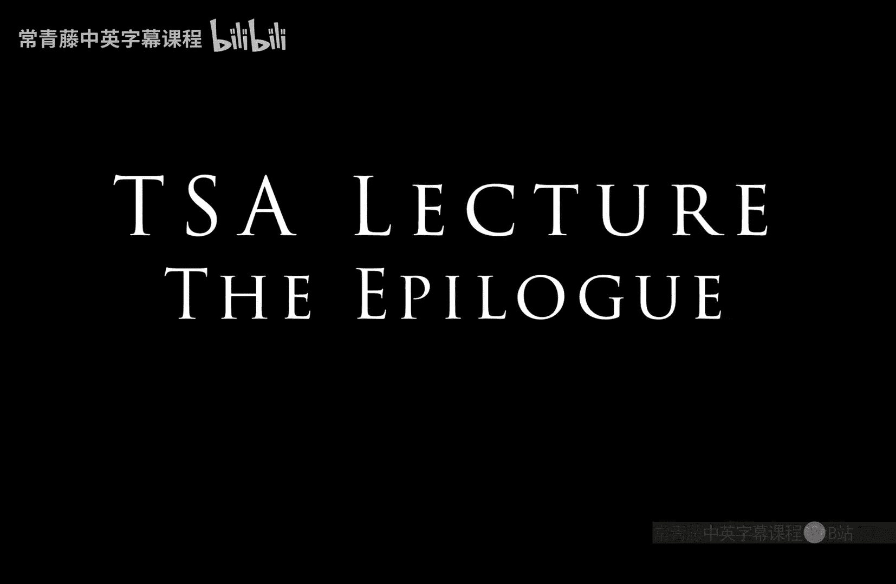
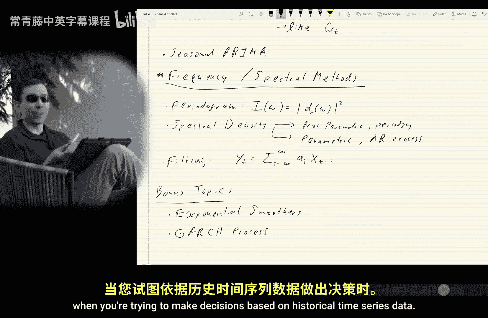
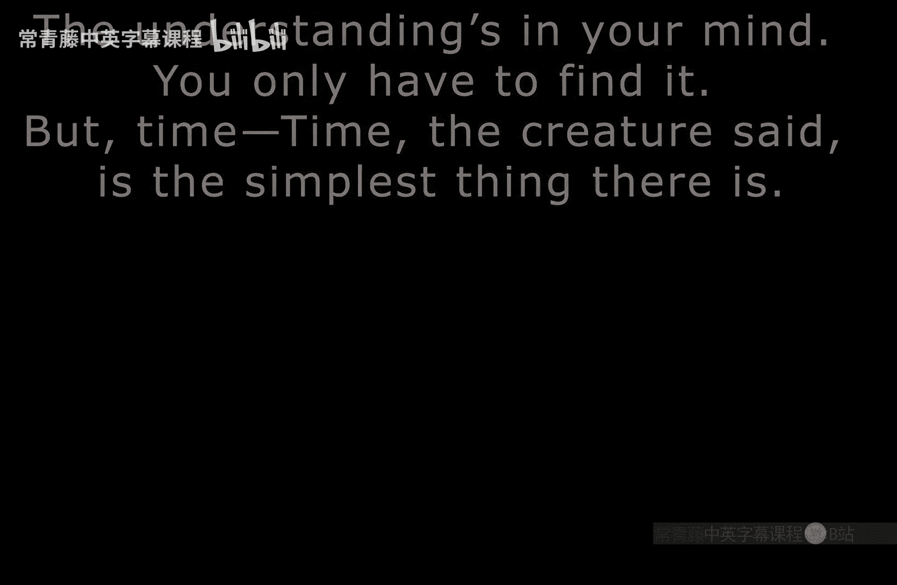

# 阿尔伯特大学【中英⚡时间序列分析｜STAT479-2021-Time-Series-Analysis】-p25-P25-Review-Lecture--BV1nwqYBDEos_p25-

🎼And welcome to the final lecture of Statistics for79 time series analysis。

 It is a good day we have completed the course， congratulations on presumably watching all of the previous other lecture videos before getting to this point today we're just going to do a recap we're going to talk about where we started and where we have well arrived now after 30 plus hours of lecture videos。

😊，🎼あ。

So the weather's looking pretty good for Edmonton， so let's get right into the notes and see what this is all about。

So time series is a really neat area of statistics。Effectively。

 well it combines a lot of different things right on one hand it's a little bit like regression。

 it's regression， but in regression we assume that all of our observations are independent of each other in time series we explicitly know that there're not independent there's going to be some temporal correlations that we have to deal with。

On the other on one hand， we're trying to fit models to look at our data， but on the other hand。

 our models very often are just trying to model the noise of our process because if we have a stationary process。

 a stationary noise process is a lot like just pure noise。

 it's going to be a bunch of random fluctuations up and down following some well stationary distribution through time。

 but depending on the behavior of our stationary process。

 we can learn a lot about our time series and how it behaves and。

What we can do with it right with respect to understanding it， estimating， modeling。

 forecasting all key pieces。Where did we start Well。

 we started this course by effectively just looking at types of noise。And in that case。

 we introduced well white noise and we also introduced the auto aggressive and the moving average process。

 right， so what we ended up with is white noise。The AR and the MA process that were introduced way back at the very beginning before you realize that that was more or less what we'd be talking about for the entirety of this course because these are really the three main building blocks and we kind of introduced them on day one。

The other main thing we introduced way back at the beginning of the course is the idea of the autocovariance function。

So the autocovariance。Is another critical piece of this course because just about everything we've done in this course has come from the autocovariance function if we want an ACF plot。

 autocovariance， we want to estimate parameters for a model autocovariance。

 we want to estimate the spectral density， autocovariance， it's all autocovariance in this course。

But we also did talk about the idea of cross covariance and stationity。So again。

 if we have two time series， which is very common in practice。

 we might be interested in cross covariance， how the two vary or are correlated with each other。

 and then we spent a lot of time talking about stationity。

And stationary is another key thing in this course because we need this。To do statistics。

Because we can only do statistics if we。Know that the thing we're trying to estimate is not changing if the thing we're trying to estimate is changing。

 then we can't do statistics， we can't take a sample mean if the mean is changing throughout time。

 it's not going to work the same with the auto covariance， we can only really estimate。

Oh yeah I forgot I had windchms over here if we want to estimate the autocovariance from our data or look at an ACF plot or something。

 these only make sense if our process is stationary because ultimately to estimate these things we're going to take some type of an average but we're going to be averaging across different time points and it only makes sense to average across different time points if the thing we're trying to estimate。

Is invariant across those time points that make sense。

So stationity is kind of a key part of this course。

 it's one of the main things that we discussed throughout this entire course。

Now we talked about estimating the mean and the auto covariant and even detecting white noise a little bit。

 so we did things like mean estimation。And variance estimation。It's very。Interesting。

So we had mean and variant estimation。We also talked about， I guess I should say， auto。Covariance。

Autocovariance estimation， we also looked at， well， the ACF plot。And detecting。White noise。

Because ultimately if we just have white un white noise process。

 we'd kind of like to know about that， but again， in practice we don't know a priori if our noise is white noise if it's coming from some moving average process。

 an arm model， the autoaggressive piece， there's so many different little tweaks that would still look like noise。

 I mean if that's one thing maybe you've taken away from this course it's that if you plot out some stationary process。

 it's probably going to look just like a bunch of static noise。

 but there could be interesting features hidden in that noise， or there might not be。

 it might be white noise in which case it's just in some sense not interesting because it's just as random as it could possibly be。

Right， well that is roughly what we did in chapter one of these notes in chapter two we actually started to look at statistics。

 so in chapter2。We actually did statistics with time series。Mystical models。Now。

 when we're doing statistical models with time series。

 the first thing we looked at was just linear regression。And as I mentioned before。

 it's fine to try to fit a linear regression to look at a linear trend in your data。

 in your time series data， but you do have to just be aware。

That the least squares estimator is not meant to work with correlated observations， right。

 so the big。The big note here is that least squares。Assumes。Independent。I guess uncorrelated。

 let's be precise。Uncorrelated。Observations。So when you're dealing with applying linear regression to a time series。

 you have to remember that。Okay， you're probably going to get the same thing you would if you tried to fit a time series model with a drift。

 but in the case of a linear model， we are assuming that the air or the observations are uncorrelated。

 the errors are uncorrelated with each other， which is explicitly not the case when we have an autoregressive or a moving average process to work with。

 so that's just a key thing to remember if you try to use linear regression to analyze time series data。

But we can do a lot more， well， oh yeah， there's one other extra bonus section that I include in chapter two。

 which is the idea of smoothing。Smoothing is。Good stuff now it's very much a qualitative。

Topic in the sense that there's never like a。Right way to smooth or the proper amount to smooth your data。

 it's more just a technique you can use to try to figure out what the trends are present in your time series data。

You have to be a little bit careful about smoothing because you don't typically want to smooth your data。

And then do statistics with it because that will change the probabilistic properties of your data。

 Sthing is more of like at the end， you can just look at what you get， you can smooth it out and say。

 a look， that kind of goes like up and then down I guess there's a there's like a trend there or something to that effect right。

 It is a very。Useful tool and there's lots of different methods as we discussed。

 there's that locally weighted scatter plot smoothing method， there's cubic sps。

 there's kernel smoothers， there's simple just moving average smoothers that take the moving average process and filter a time series using a moving average。

So again， lots of different ways to smooth， just remember how to when to use it and when not to use it because that's really the key thing。

 you can get yourself into a little trouble if you start mixing smoothing with statistical methods that are assuming more stochasticity in your data because smoothing ultimately will remove a lot of the noise。

In this way， it acts like， as I mentioned in the spectral sections of our notes。

 it acts like a low pass filter， it takes away high frequencies or fast fluctuations or this high frequency noise in our data and just leaves the smooth。

 I guess， low frequency trends that we would have in a time series data set。Anyway， after that。

 we moved into discussing the Ama model。Which we've spent most of our course talking about。

So the aroma model， the autoregressive integrated moving average model。

 well in this section what we did right is we talked about the auto regressive piece。

 we talked about the moving average piece， we put it all together and we introduced the aroma model and we discussed all of the different kind of aspects of this one of the key things to remember is that。

😊，Basically。More。Then one。Model can。Fit。Your data。Because ultimately you have to worry about things like redundancies in the parameters。

 you have to worry about the fact that you could have something that's causal or non-causal。

 you could have something that's invertible or non- invertible right and what we found was that stochically you can have different types of time series processes that behave exactly the same that are indistinguishable。

 stochasticically。So what we have to do is we have to be very careful when we're using these models。

 and that's why we typically。We typically enforce。Ideas like。Caity。And invertability。Invert。

Dbil I kind of spelled that right close enough， I think there's an extra T in there bill T whatever you get the idea we also want to make sure。

No， common。Factors。In the AR。And MA pieces。Right， because in that case。

 it's almost like having your model in lowest order or lowest terms。

 if you have common factors that's going to cause problems when you go to look at things like the characteristic polynomial。

All right， so in this section， what we also did was we talked about testing for stationity and testing for auto correlations。

So some of the main things we are interested in this course is asking questions like is。

My data stationary。Right， or is。My data uncorrelated。So right in this case。

 we have this two different questions that we want to answer and there are tons of statistical tests out there that we can use to answer these methods or we can use to answer these questions。

😊，Again， for the idea of having uncorrelated data， well that goes right back to the box Pierce and the Young box tests we looked at both of those and again they asked the question of you know do we have significant autocors in our data we also looked at things like the Durban Watson test and that bru Godfrey test which in these cases are going to look at the residuals of linear models and a lot of these a lot of these tools don't just apply to time series。

 they apply linear models in general and that's why you can find them in the LM test package in R because you're testing the residuals of a linear model and you want to know well。

 do my residuals actually look uncorrelated if they don't look uncorrelated。

 well there's probably more work to be done to figure out where those correlations are coming from or how we can model those correlations。

We also looked at the idea of testing for stationity right and that was the augmented Dickie Fuller test was the main one we talked about in this course in that case it's one of many so called unit root tests because we talked about before that if we have。

Non stationary。Data or a nons stationationary armor process， there's going to be a root。

From the autoregressive part of the polynomial that lies on the unit disc of the complex plane。

 and that's going to give us a non stationary process。 So when you do one of these unit root tests。

 your null hypothesis。Is saying that I believe my root lies on the unit disk and the alternative is that it does not。

 so the null hypothesis is that my data is nonstationary or my time series is nonstationary with the alternative hypothesis being that it is stationary。

 that all of the roots lie far enough away from the unit disk that we can claim safely that we have a stationary time series process。

So it's a little bit confusing because whenever I stare at that。

 I always want to think that the null hypothesis is going to be stationity。

 but it's not it's nonstationity， so it is a little bit confusing and it's a good thing to remember when you're looking at running such tests on your own data。

Yeah。And yeah， there are more tests， I was sorry， there's also the Philip Perone test that is another method。

To basically do the same thing， test for stationity， much like the augmented Dickie Fuller test。

 now the Philip Barones test uses a slightly different way of computing the test statistic。

 but ultimately the idea is the same it's asking the question。

Is there at least one root of my characteristic polynomial that lies on the unit disc if there isn't？

Then we reject our null hypothesis and we say， aha， we have a stationary process。

 at least we believe we have a stationary process with respect to this test。

One of the other things to remember is that you always have to look at the parameters that come into play when you're doing these tests。

 things like degrees of freedom， things like lags and whatnot。

 it's always good to be able to test for these different things because you may not see a significant result in one setting you change some dials in your test and now you find a significant result。

 so always be aware of all those different things。We also in this section talked about the idea of ACF。

And PAF。Because these are really useful tools in time series to visually understand what's happening with our data。

Right the ACF is just the autocorlation function， it's symmetric。

 it has a lot of nice mathematical properties that are good to be aware of ultimately it's just also just fun to look at when we plot it out for our data and it can tell us a lot about where we might see significant autocorres and those significant autocors will tell us well at least hint if we might have an autoregressive or moving average process in our data。

Or both。We can also use the complementary tool， the partial autocor function。

 the PACF function to analyze our data。And remember partial autocorlation looks at the idea of partial correlation and extends it to autocor partial correlation basically says that two things are uncorrelated given another thing my standard example would be the price of your house on the price of your car they're probably correlated but they will be uncorrelated if you account for a person's income right if they have someone has more money they're probably spending more money on both their house and their car and vice versa so in that case conditioning on a person's income may make a car and a house price look uncorrelated with each other it may not I'm not actually I don't have data to actually pack this up I'm just using it as a hypothetical example。

啊。Anyway， right， the partial autocorrelation function basically says if I have some time series data。

I want to know if certain time points are correlated conditioned on all of the intermediate ones。

 so basically are these guys。Correlated。Correlateed。Given。All of the intermediate points。

And that gives us a new way to look at correlations in our time series data。

 What we found was that nice little chart， right that basically said something like。😊，ACF。PAACf。

And A R。And MA。RightIf we have an AR process， then the ACF， well it decreases geometrically。

 whereas the PAF will vanish。After。Lag。P right it just it becomes zero and then of course with data it's never exactly zero we'd still have some noise there are some little fluctuations about zero。

 but mathematically it would just equal zero after lag P and we see the reverse for the moving average process in this case the ACF will vanish。

After。Lag。Q， but the PAF will decrease geometrically。So again。

 these are two useful tools to really try to understand what's happening with a given time series data set and once again。

 I like to just emphasize。Need。Needs to be， or maybe I shouldn' say not needs to be Xt。

 needs to be stationary to look at these plots。If your time series is not stationary。

 you can't do this estimation properly and what you're probably going to see is just extremely big spikes everywhere for your ACF and PAF so in some sense you can use that to determine if you have a nonstationary time series because you're going to just see massive correlations everywhere for something that's nonstationary。

 typically massively positive correlations， I'm not sure if you could ever get a lot of negative correlations because negative correlations are a bit stranger than positive correlations to deal with。

Yeah， basically， these are two really useful tools。

 both mathematically and visually from a data analysis perspective。All right。

 so the next big thing we talked about in this lecture course is the idea of both estimation。

And forecasting。Whi are two big things that we'd want to do with time series right so we have our time series data sure we can look at it and we can try to sort out what's going on。

 but ultimately we want to estimate parameters for a model and we want to forecast because almost certainly if you're watching something evolve over time。

You don't just care about where it started and where it went to get here。

 but where it's going in the future， I can't even almost imagine any time series setting where you wouldn't be interested in forecasting right whether it's finance I want to know。

 am I going to make money in my investment or not， is it the environment。

 are we all going to be living in sort of like a desert in a couple years。

 instead of this nice chiy Edmonton？Right， whether it's COVID cases。

 you know am I going to have to keep staying in my backyard house here and hide away from everyone or is everything going to get better right whenever we're watching something over time we want to forecast and there are some interesting well complications that arise when you try to do forecasting。

So what we looked at in that section was forecasting for the AR process and then more generally for the ArRA process and then seasonal models。

Remember that or recall that for the AR process。We have our friends， the Eule Walker equations。

Generally， estimation and forecasting for an AR process is。Well， it's the easiest setting。

 I guess you could say for time series right because we have the U Walker equations。

 they're really nice to work with， they're easy to compute。

 you can do it by hand as you had to do in one of your assignments。

And you can estimate your parameters， you can use things like AIC to determine how many terms you should include in your model and ultimately you can do forecasting and the nice thing about forecasting with the AR process right is that。

For forecasting。We only。Need。The previous。P observations。

Assuming we have an ARP process that we're working with， right。

 then we only need the previous P observations to forecast the P+ first observation in our time series。

Of course we still want the entire data set because we would use the entire data set to estimate the parameters Phi1 through Phi P for our model。

 so more data is still good， but the nice thing is is that we don't have to use the entire data set in order to try to estimate or forecast future time points and that makes it very easy to run。

That's in contrast to doing the same thing for the armor process。

Because if we have an arm process with a say non-trivial moving average component。

 well we don't have this nice setting where we can use the U walker equations instead we end up using maximum likelihood estimation and again there were two different approaches we had a conditional and and versus an unconditional maximum likelihood and the difference again was that when you conditioned you got a nice linear system of equations if you don't condition you have a-line system and yes computers can do that these days but you know back in the day you really wanted everything to be a linear system of equations because if it was linear you could solve it fast if it's nonlinear you're kind of stuck。

These days。Non nonlinearar is still hard for a computer to do， but it can be done。

 and oftentimes it is done like in the R packages that fit ArRA or Ama models to our data。

The other issue is with forecasting。Because forecasting now requires。All of the data。

Because when we're trying to deal with them， well， all of these moving average pieces。

 we're going to require data going in some sense， as far back as we can we had that。

Kind of goofy setting where we could imagine that we had infinite data。

 which is really nice mathematically， it doesn't work in practice。

 but at least mathematically we could consider having infinite data。

 data going into the infinite past and then we could consider modeling based on that in practice we don't have that。

 we have finite data and that led to a couple different methods that we could use for for forecasting right。

Yeah， we had， I guess， well， what was it Durban Watson and the innovations algorithm。Or no。

 Durban Levinson， I always get that backward， Durban Watson was the test。

 the statistical test for before， for our residuals， Durban Levinson or Levinson， Durban。Yeah。

Levinson remembered this is basically。How。To solve。A system。Of equations。Using。Our a tops matrix。

Which has applications in numerical linear algebra as well and things like numerical ODs and whatnot as well as time series that was one method that we saw we also looked at the。

So it's actually hard to read this laptop with sunglasses on。We also looked at the innovations。

Algorithm and one of the key things to about innovations is that these are basically the residuals。

For。One step。Ahead。Forecasts。And they behave a lot like white noise。 So they're basically like。

I'll sayWT hat， even though I don't necessarily like the idea of estimating white noise because white noise is just white noise but。

Roughly it's kind of like that， it's kind of it's like the best handwavy way to explain it is to say that if we're looking at the difference between what we believe the teeth observation is and what we saw the teeth observation to be。

 what's left over is a residual， it's a lot like the white noise process。

 the idea being that if we try to estimate those objects。

Doing forecasting with respect to those innovations， those。Those residuals。

Can often be easier in certain cases than trying something like Durban levinson now again both of these are really complicated and kind of annoying equation wise to write down so i'm not going to be testing you on the。

You know， nitty gritty details of these methods， but it is good to know what's out there and what these。

Our packages are doing when you try to actually do fitting and forecasting an estimation and things like that。

All right， we also had a seasonal。Yeah。Arima or sarima。And in some sense。

 there's nothing really too new going on with seasonal。Models。

 it's really just saying that we have another AR and or MA piece， maybe even a seasonal difference。

 and we're only applying it every。Well， I don't want to say P， who I guess P， every so many。

 every period， every so many time points。So this is very， very common in data because oftentimes。

You're watching data that has some cycle to it， whether it's annual cycles in temperature。

 whether it's quarterly cycles in I don't know， finance。

 whether it's daily cycles in say the sunlight coming down here on May。

Right you often have these cyclical behaviors in your time series and it's important to try to look for seasonal models。

 but ultimately a seasonal model is not really anything that profoundly different from a nonseasonal model it does take some effort though to try to fit them you have to consider well what's a reasonable period you could try to estimate it from your data like the autoarma function does where it just says I just have some data。

 I don't know what it is so I'm just going to try to guess what a good period is。

Or you can try to make an educated guess based on the context of your problem if you have daily observations。

 weekly periods are very common or monthly， you know。

 if you have monthly data annual every 12 months， you might see a cycle。

 so there are always these things to be aware of when you're trying to look at real data。

 real time series data。Now。After that， we moved into the frequency domain and things got more fun。So。

In the frequency domain， maybe actually the last chapter， which was frequency。Slash spectral methods。

So in the frequency domain now the idea being that we can do a lot of the same things we were trying to do before。

 but we can do them from the perspective of well， frequencies rather than from time and the main thing that we looked at throughout this is the perioddiogram。

Remember the periodogram is the squared， what I forget my notation now it was something like I of omega。

 and this is the squared magnitude of the discrete Fourier transform。Applied to our time series。

 so you have a time series， you can apply a discrete Fourier transform。Now ultimately。

 the discrete Fourier transform is like so many things in this course。

 just a giant system of linear equations that you don't typically want to have to solve directly。

So what do you do， you use a fast Fourier transform the FFT。All right。

 so the key thing that we try to figure out in the frequency setting is the periodtogram。

And I guess one of the reasons is it will tell us the intensity of different frequencies that are present in our time series data and we can use that to look for things like cyclic behavior。

 we talked about the periodic process very quickly which is a different type of stationary。

 stochastic process that's a little bit different than our Arma processes that we spend so much time looking at in this course。

Those ones specifically have very strong frequencies that we might be trying to detect through the periodtogram。

But the periodogram is also a way of estimating the spectral density。

 so the spectral density is another kind of key thing。So much so that we spent， I think。

 three different lectures talking about different ways to estimate the spectral density。

 right there's kind of the non parametric approach。Approach which is based on well。

 the perioddiogram。There's also the parametric approach。Which is based on， well， the AR。嗯。Process。

So again， two different ways to look at estimating a spectral density。

 we could just compute the periodogram。And use it， but that's not often the good way to approach it What we can do instead is we can try different techniques for improving our estimation things like banding things like Bartlet's method where you kind of cut your data into pieces fit periodograms to each piece and then average the periodograms again。

 remember we're assuming we have a stationary process so that the periodogram for the first half of the data should be the same as the periodogram for the second half of the data。

 Another reason why stationary is kind of a key theme throughout this entire course and we really need to have stationary process a stationary process if we're going to use any of these techniques。

Anyway， yeah you can try to average multiple periodograms together， you can use banding。

 which is like averaging multiple frequencies together， you can smooth， which is using that。

Daniel kernelnal method， which is just another way of applying different types of weights。

 it's kind of a more generalized way of banding in order to try to smooth out the periodogram as the nonparmetric estimator of the spectral density as much as possible。

Now you could also take a parametric approach， this is one that people also like to use now I'm not an applied。

I guess engineer type person who does a lot of time series data。

 so I don't know what people like to use in practice in different fields。

 whether it's financial data or whether it's more signals processing whether it's environmental data。

 they might have their own preferences but all I can say is that there are different methods。

 some people like the non-parmetric approach， some people like the parametric approach based on the AR process in that case you just fit an AR process to your data。

 presumably the function in Rs using the U Walker equations I think it just uses the AR function fits those parameters uses AIC and then it computes the spectral density directly from that process because as we talked about before。

We can kind of filter a time series and we can identify how that will affect the spectral density。

The idea of filtering。Right if we have some Y T， which is equal to the sum。

 I from we'll say minus infinity to plus infinity of。

I think it was AI X T minus I right now we have a filtered version of the time series X based on some coefficients a。

 and what we found is that there's an easy formulation for how such filtering will affect the spectral density so if we have white noise。

 the spectral density is constant， every frequency is equally represented as all the others are。

But we can filter that using the way that white noise turns into autoregressive and moving average and more general armor processes。

 if we do that， then what we can do is we can quickly figure out what the spectral density is for a general armor process as we did in。

 well， one of the lectures on a spectral methods。So in the end。

 all of these spectral methods are really just giving us a different way to look at our time series data by looking at the spectrum。

 the spectrum or the spectrum that is the periodogram or some estimation of the spectral density。

 we can get an idea of what frequencies are most prominent in our time series data。

 and again that'll give us some ideas of how to think about this data。

It can find useful cycles for fitting seasonal models。

 it can also just find well deviations from white noise right because if we have a white noise process we should see a flat periodogram or spectral density if we don't see that we have a pretty strong indication that we don't have white noise。

And yeah， that was mostly the entirety of the course right at the very end of the course we had some bonus topics。

Which are quite neat in their own respect， right we had the idea of exponential smoothers。Yeah。

Which just give us another tool for fitting models time series and doing forecasting and things like that。

 This was a slightly different approach than what we did before。

 but we did see that it is related closely to the Arma， the arema process。 We also looked at。

The garch process。Right the idea that so far in all the other parts of this course。

 what we assumed was that we had white noise driving behind everything else。

 there was always white noise and that white noise had a constant variance。Well。

 that doesn't necessarily happen in practice， right， in fact。

 very often the variation will change as we move through time。

The Garch process will try to take that into account。

 it's one of the reasons why finance people love it because volatility。

 whether if you have your stocks or bonds or whatever， just like random walks。

 there's not too much to do， but you can still model the volatility。

 are we fluctuating a little bit up and down or are we fluctuating a lot up and down and that can make a big difference。

 when you're trying to make decisions based on historical time series data。

All right， so that is more or less a recap of everything we've done in this course， like I said it's。

It's a really large topic and time series is one of these areas that has tons of research going into it because whenever you come up with an interesting thing in statistics。

 you can almost turn it into another entire research proposal or PhD thesis by saying，huh。

 what if we add a time dimension and do everything again。

 but in time and that's effectively what time series is。

 but the things become quite complicated with correlations in time？

And so much of classic statistics is based on uncorrelated independent data。

 that time series gives us some tools with how to think about our data when there are possible correlations involved。

And yes， this entire course was more or less just the arema model and autocors。

 mean that that 90% of like everything we did was just those two things。

 but there's so many little intricacies into how do you work with this， how do you estimate it。

 how do you model it， how do you think about this， how do you work with real data。

 it's a very fun exploratory topic， and I hope that you've learned a lot in this course。

 I hope that you will go out and try dealing with more time series yourself。

 maybe someone will actually pay you to go out and do time series analysis if you're working for some firm because time series data is well everywhere and it is a very useful to know how to work with it。

So again with that thank you so much for coming to all of these lectures presumably you came to all of these lectures if not go back go to the lectures then come back here and i'll thank you for coming to all of these lectures it's definitely been an experience talking to my camera and imagining a big audience of bright shiny happy faces smiling back in me the whole time hopefully that's what you're doing sitting at your computer staring at your screen there。

😊，And if not， well。I don't actually have any data to suggest otherwise。

 so I'm feeling pretty good about myself。Anyway， thank you again and yeah。

 good luck looking at all of this data going forward and using all that you've learned in the real world。

And with that， thanks as always， and hopefully I will catch you again in another lecture course。

 possibly in person， and if not， you can always find me here online somewhere in the internet。😊。

