# 降维技术-｜-Dimensionality-Reduction-p01-P01_降维技术--BV1UAxvztEPi_p1-

Hey there， I'm happy to welcome you to another video series in which we will explore four different dimensionality reduction techniques。

🎼Chances are a lot of you have come across these methods and research papers or even applied them in psychic Learn but have you ever wondered what's happening behind the scenes If so great that you are here we will learn all of that in the next videos Based on your wultting we will deep dive into each of the techniques and also have a bit of hands-on experience The goal is really to get a proper understanding that allows you to select the right method for your problem。

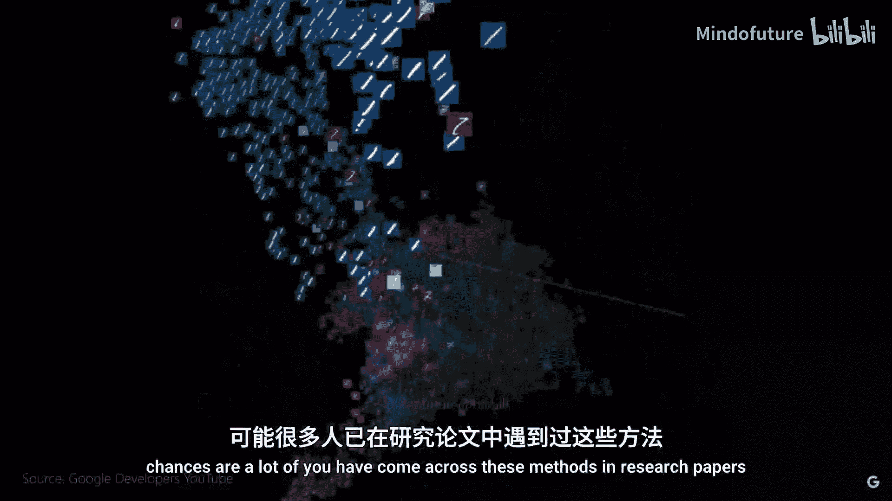

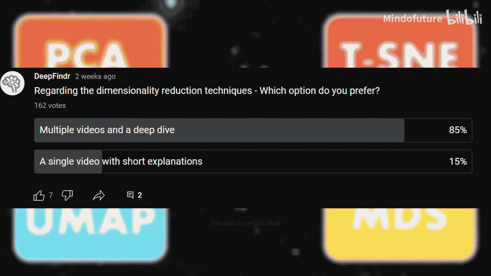

So let's get started In this first video we will talk about the basics of dimensionality reduction and discuss some of the terminologies such as manifold learning or the curse of dimensionality from image data like Ms to word embeddings in language models to the molecular space there are many situations where we have high dimensionmensional data which we try to better understand and visualize human perception is limited to the three-dimensional space and therefore multivariate or multidimensional data somehow needs to be converted to a lower dimensionmensional space that is depictable and comprehensible。

Pixels， for example， have thousands of dimensions， but the plot on the top left does a pretty good job at clustering the Mnes data set。

Therefore， these techniques are absolutely central for data analysis In this series。

 I'm mostly interested in using these techniques for the sake of visualizing data。

 usually embeddings， it is however， also common to reduce the number of dimensions to improve machine learning algorithms to create these low dimensional representations we can choose from a variety of techniques which can be categorized in various ways here we will just distinguish between linear methods and nonlinear methods。

 nonlinear approaches belong to the field of manifold learning。

 which can be further divided into local and global techniques。

 which means if they just look at the neighborhood or if they consider the entire data set。

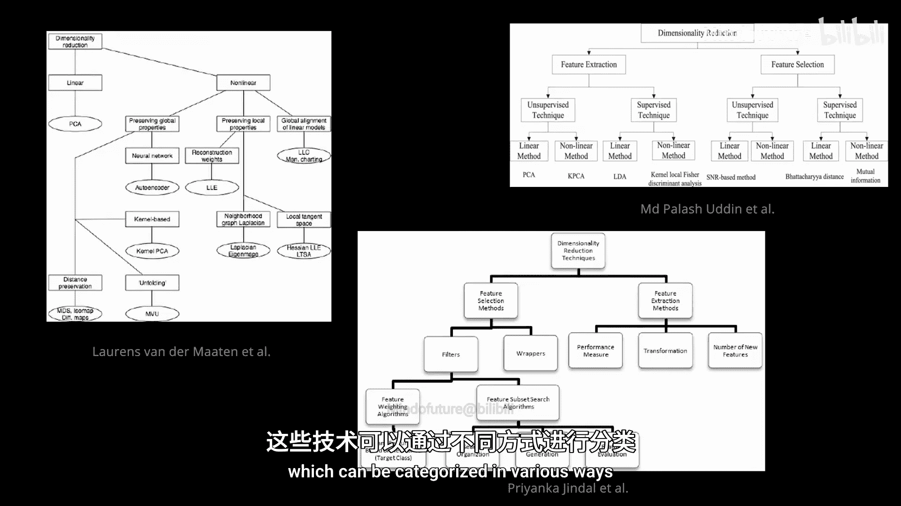

A classical example of the linear methods we will talk about is the principal component analysis。

 most of you are probably familiar with it。Then we will also talk about the linear variant of multidimensional scaling called metric MDS。

 a global technique considered in this series is the nonlinear variant of MDS called non metric MDS。

As a local manifold learning approach， we will look at the popular Tni。 and lastly。

 we will discuss U map， a method that can be considered to fall somewhere between local and global approaches。

 Besides the one mentioned here， there are， of course， plenty of others， which would， however。

 extend the scope of this series。 This also includes neural network based techniques like auto codes。

Again， this is just one way of grouping the techniques。 and hopefully。

 this provides a rough overview。 Now， let's quickly revisit the overall concept of dimensionality reduction。

 There's a way to mathematically formulate this idea。

 We all start with a set of high dimensional data， for example。

 N samples with a dimensionality of M dimensionality here simply refers to the number of coordinates needed to describe a data points In this example。

 it equals to 10。 This is the original data space。 Let's assume there exists a metric that allows us to define how similar data points are in this space。

 We will call this metric D M。 Our goal is to transform these data points into a low dimensional representation。

 which allows us to， for example， visualized stem。In this example。

 we choose a dimensionality of two and call the samples y， and in this two dimensional space。

 we also have a metric which allows us to quantify data similarity。

The idea of most dimensionality reduction approaches is to optimize a mapping function that transform the high dimensional data into a lower dimension while。

 and this is the important piece， preserving the ratio of the distance metrics and therefore approximate the original data space。

Of course， it's impossible to squeeze all of the information of 10 dimensions into two because there are simply less degrees of freedom。

 Therefore， this mapping will have an inherent error。

 Most of the time the actual information contained in the data is less relevant。

 and instead we care about the topological structure of the data。

 which means the relationship between points in how they are arranged in space。

 but there is a difficulty because all of this is based on distance metrics。

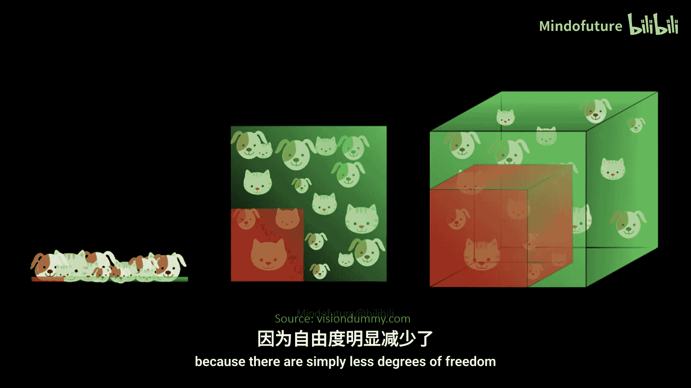

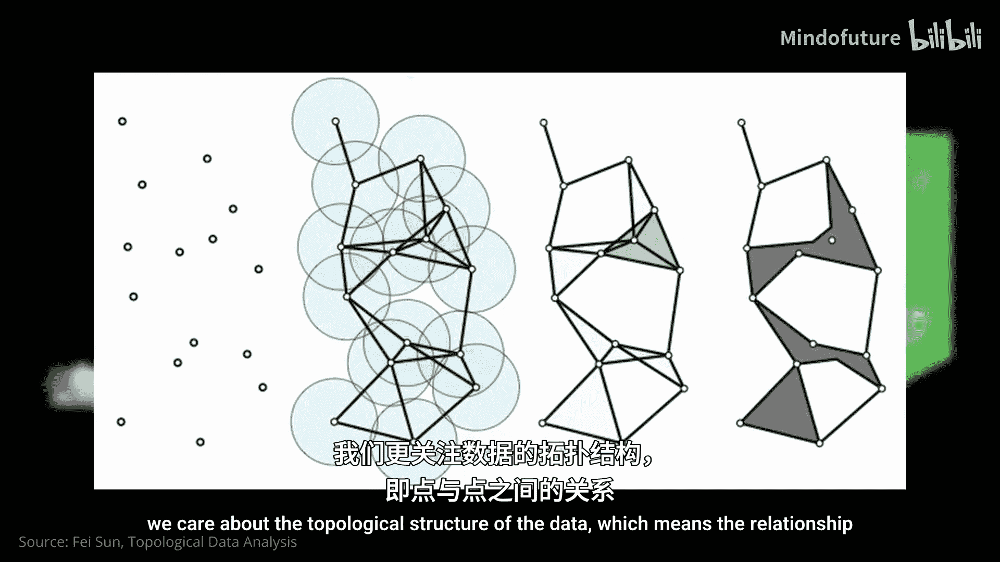

There are some pretty interesting studies， for example。

 the paper on the surprising behavior of distance metrics in high dimensional space that highlight that distance metrics become less meaningful in higher dimensions。

The so called curse of dimensionality was coined by Bellllman in 1961 and exactly describes what's happening here。

 I assume that many of you are familiar with it。

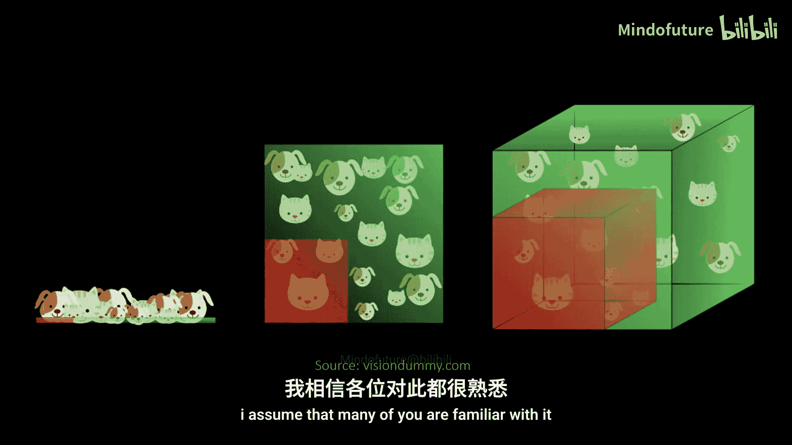

Basically， the higher the number of dimensions， the more uniform the distance becomes。

 This is especially the case for the Euclidean metric。

This phenomenon of distance concentration is also a reason why many machine learning algorithms struggle to separate data when the data points have too many dimensions。

 Having more features is therefore not always better。

 What you can also see here is that absolute values of the distances become larger。

 which means the more dimensions， the further away the points are from each other。 Visly。

 this reflects the wellknow fact that most of the data spreads out to the shell and edges of the data space。

 rather than lying inside of the volume。 These visuals are from a great tutorial on the curse of dimensionality from visiondmy dot com。

 The link is in the video description。😊。

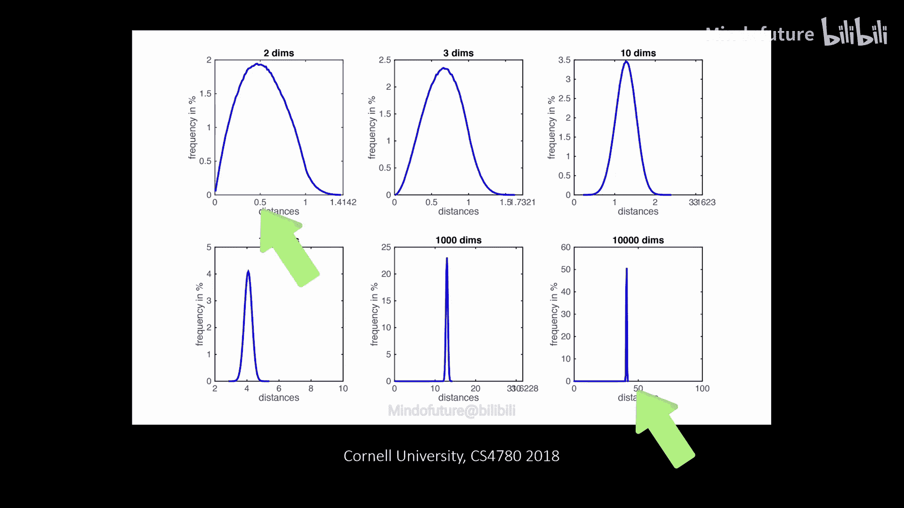

Okay， so this might have been a refresher for most of you。

 but it's crucial for understanding some of the following concepts。

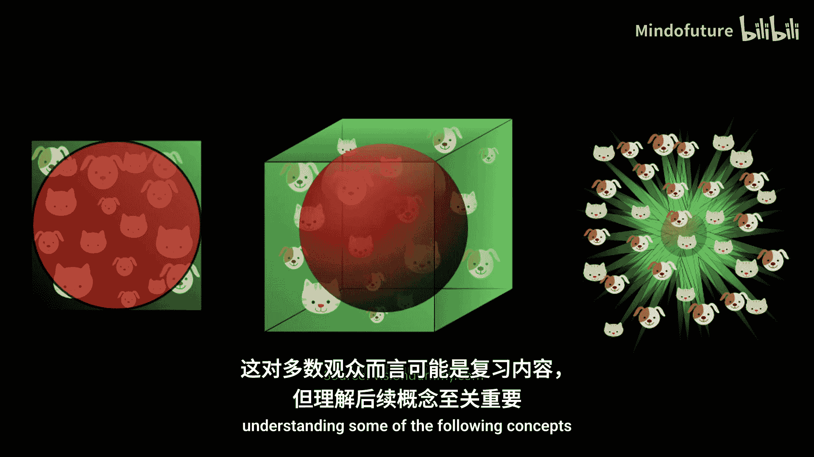

🎼Before we move on and discuss how to solve the issue with the curse of dimensionality。

 let's take a moment to look at the sponsor of this video， which is brilliant。org。

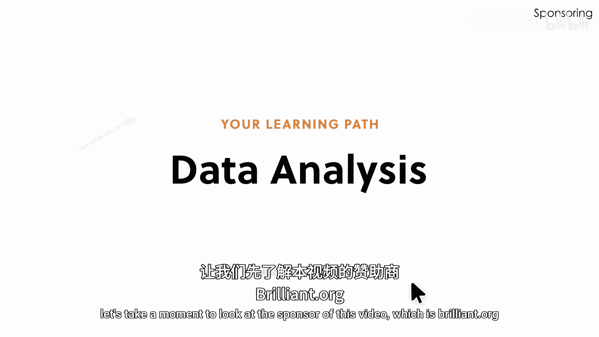

Brilliant is a free and easy way to learn math， data science， and computer science interactively。

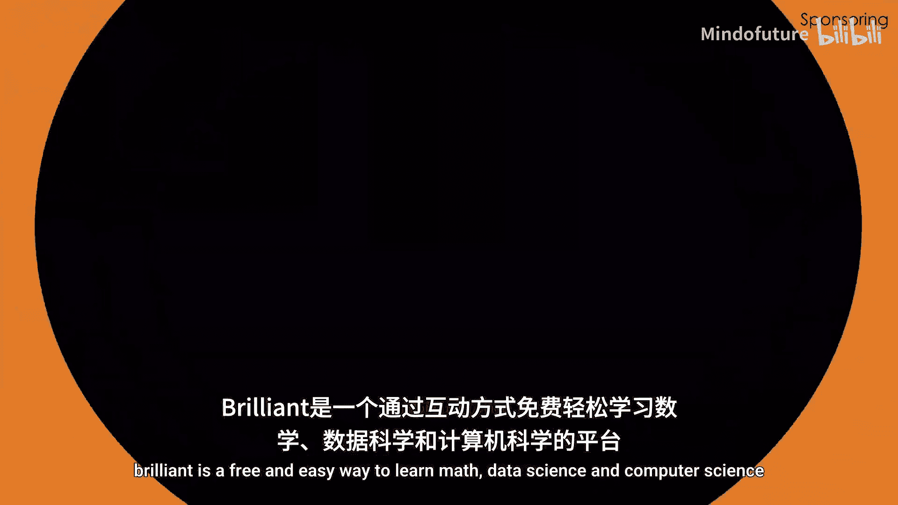

🎼There are thousands of lessons from basic to advanced topics， including neural networks， Pro theory。

 programming， La language models， and many more。 What I personally like about this learning platform is that you can use it on every device like mobile phone。

 computer or tablet and therefore can learn stuff wherever you are。 Nowadays。

 people spend a lot of time in the Internet and brilliant is a great way to spend your time meaningfully by learning new things every day。

😊，🎼All of the learning is possible in a fun and gamified way as you can see here。

 and in a future video of the series， we will also dive a bit deeper into some of the causes to get a feeling for what it's like to learn with Brilliant。

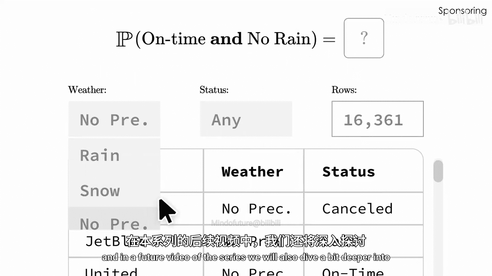

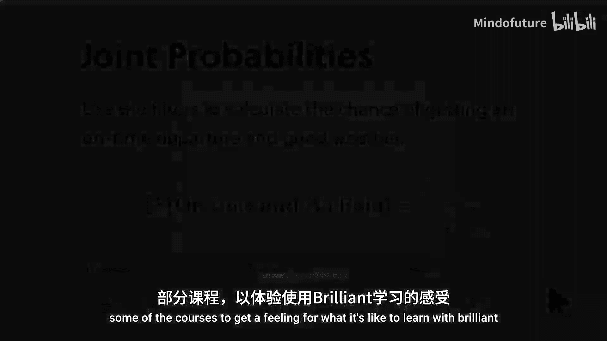

🎼If you want to try this， you can use the link in the video description and the first 200 will get 20% off also there's a free 30 days trial for everyone。

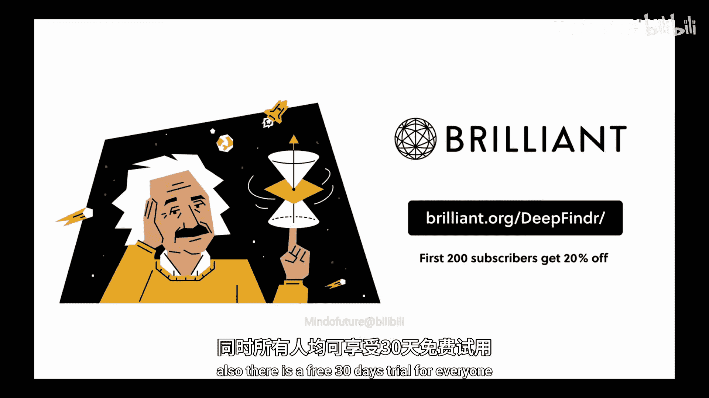

Back to dimensionality reduction。 Let's remind ourselves of the difficulties when dealing with many dimensions。

 We realize that it's getting more difficult for distance metrics。

 as well as machine learning models to operate on high dimensional data。

 But there is hope the data might， in reality， have a lower intrinsic dimensionality than the original data space。

This opposite effect to the curse of dimensionality is the so called blessing of non uniformity。

 which means that the data is typically not uniformly distributed in the original space and therefore can be reduced into a lower dimensional space。

There is a pretty intuitive example for this， namely faces。😊。

Images of faces consist of thousands of pixels which span a high dimensional space。

 The blessing of non uniformity tells us that most real world data sets don't spread out uniformly。😊。

For the face images， this means that we observe a specific concentration in a pixel space。

 This gets even more obvious when we realize that we are able to describe faces with only very few attributes such as the hair characteristics。

 shape of the lips and so on。😊，This means faces have an intrinsically low dimension， And therefore。

 the actually relevant information lay on the lower dimensional space。

 There's also pretty cool paper on finding the intrinsic dimension of image representations。

 which is linked in the video description， So called manifolds are a useful framework to understand all of this from a mathematical point of view。

 The data like the face images we've just seen， is embedded in a multidisal space。

 This is also called the ambient space。😊，The data itself， however。

 might actually lie on a surface which can be found in a smaller dimensional space。

Such a topological space is called manifolds。 A term origining from the mathematician Reman。

 who used it to refer to the variety of topological spaces， which can fold in unique ways。

 Mathematically speaking。 a manifold is a description of a flat geometric surface that locally behaves like the Euclidean space。

 What this means is that moving through the manifold is easily possible as the neighborhood is always well behaved。

 There are different types of manifolds and also manifolds with specific names。 In fact。

 you can find a large collection of different types。

 But I won't go into further details in this video。 This is just to give you some ideas。

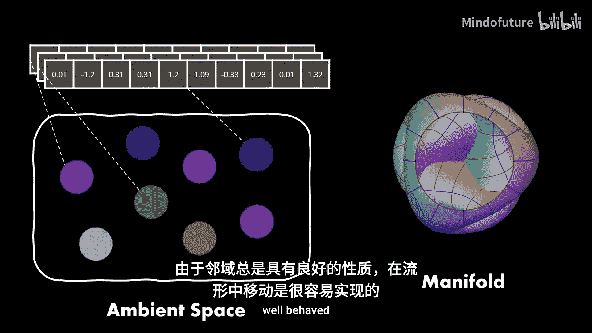

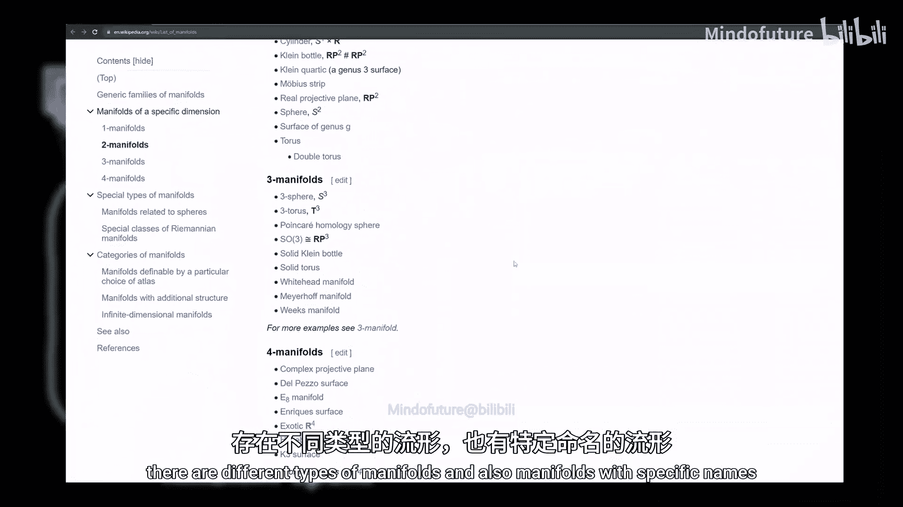

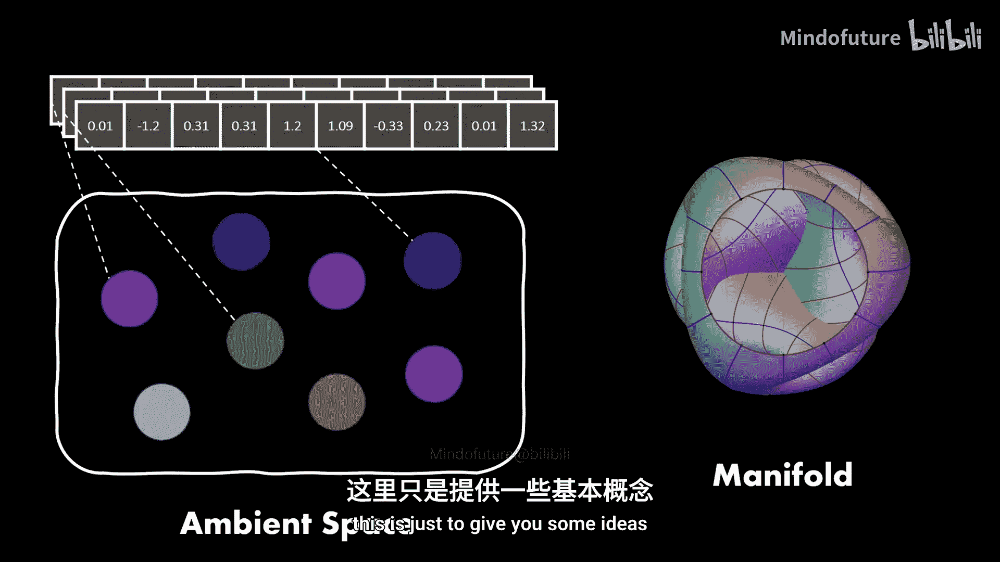

One dimensional manifoldts are lines and circles， two dimensional manifolds or spheres or the plane。

 and， of course， the probably most prominent manifolds the planet Earth。 the Swiss roll data set。

 which you can see here， is a benchmark for evaluating dimensionality reduction techniques。😊。

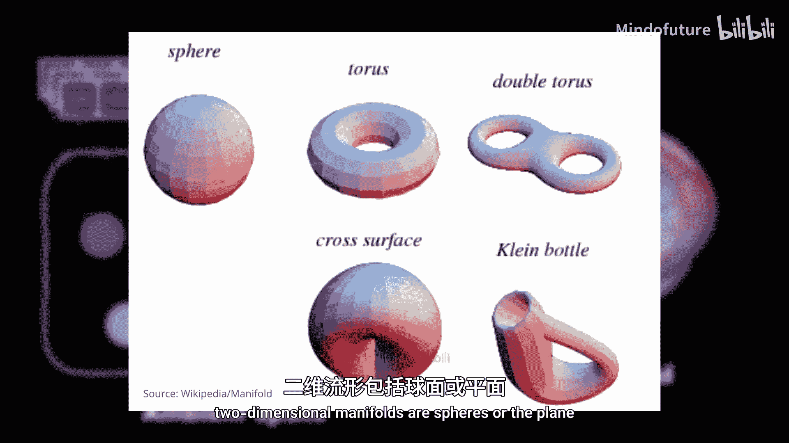

It's called like that because it looks like the tasty Swiss cake。

 which comes in many different flavors。Anyways， on the left。

 the data is embedded in three dimensions and forms a curved manifold。

 We also say that the data lies on this manifold。 A successful manifold learning algorithm。

 is able to unroll the data into the shape on the right。

 which is the lower dimensional2 deep plane manifold。 And in many cases。

 data can be separated more effectively on specific manifolds。

 which improves the performance of machine learning algorithms Now。

 what I've just described is also known as the manifold hypothesis。

 which posits that many high dimensional data sets actually lie on low dimensional latent manifolds and latent is the keyword here。

 because usually we don't know how they look like。 That's why some of the techniques captured in this series belong to the class of manifold learning approaches because they approximate the underlying low dimensional manifold。

 For the last minute。😊。

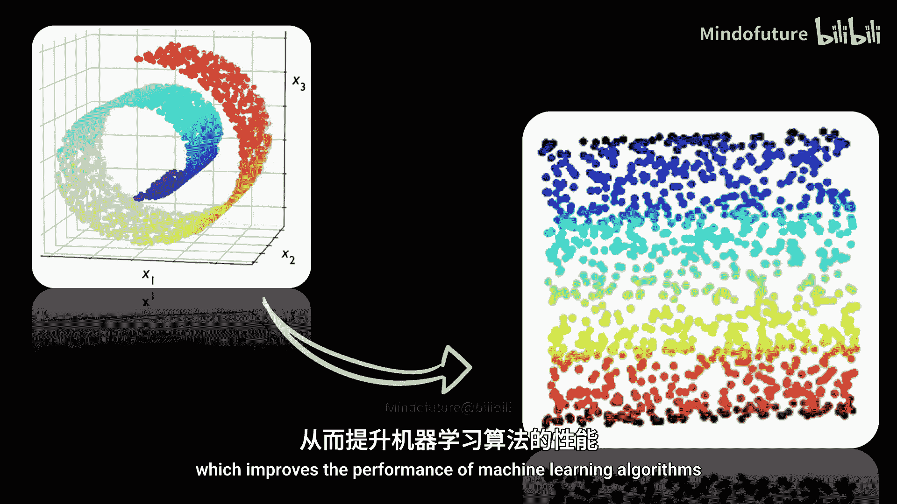

Let's have a look at some randomly selected real world applications of dimensionality reduction。

 A variety of methods are used in computational biology， for example， on gene expression data sets。

 this paper uses UM to analyze genetic interactions and clustering of genes。

I think that's a very nice way to make sense of the data。

Dimenssality reduction is not only applied in the supervised setting。

 but sometimes all of the data is projected into a smaller dimension and clustering is applied afterwards。

 Here's an example for unsupervised anomaly detection in heating systems performed on time series data。

And one last example that demonstrates that dimensionality reduction can be applied on pretty much any data set in analysis of the Dow Jones index using different dimensionality reduction algorithms。

 The different clusters indicate data points with certain characteristics regarding the dynamical behavior of markets。

 For example， stock market crashes or pandemics。 Overall。

 a great example for preserving topological information on a lower dimensional manifolds。Finally。

 here are three takeaways from this short introduction。🎼First。

 they are linear and nonlinear as well as global and local techniques to perform dimensionality reduction。

🎼Secondly， dimensionality reduction tries to transform high dimensional data into a low dimensional space while preserving the data structure。

🎼And finally， data might lie on low dimensional manifolds， we can try to learn them。

🎼And that's it for this introduction In the next video。

 we will have a look at principal component analysis the probably most popular dimension reduction technique。

 Thanks for watching and see you soon。

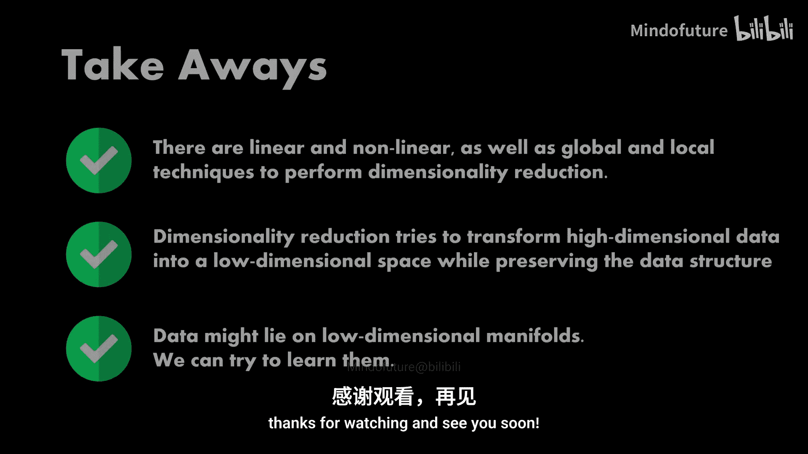