# 降维技术-｜-Dimensionality-Reduction-p02-P02_主成分分析（PCA）--BV1UAxvztEPi_p2-

🎼Welcome back to the second part of this dimensionality reduction series。

 The method we discussed today is PCA， the wellknown principle component analysis。

 which was first introduced in 1901 by Carl Pearson。 This video is structured as follows。

 We start with some intuition about the technique。 Then we'll look into the algorithmic details。

 And finally， we apply PCA on a data set and do some visualizations。 Let's go。

There are many great resources that vent into the creation of this video such as Peter Bloom's amazing blog post on PCA。

 but also the PCA for data Science book， for example。

 as always you find everything in the video description。

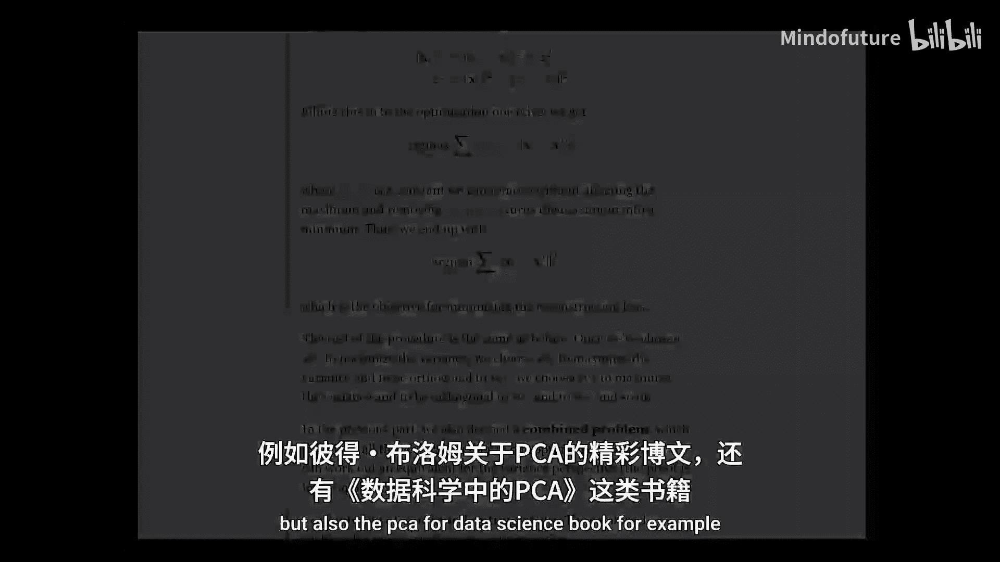

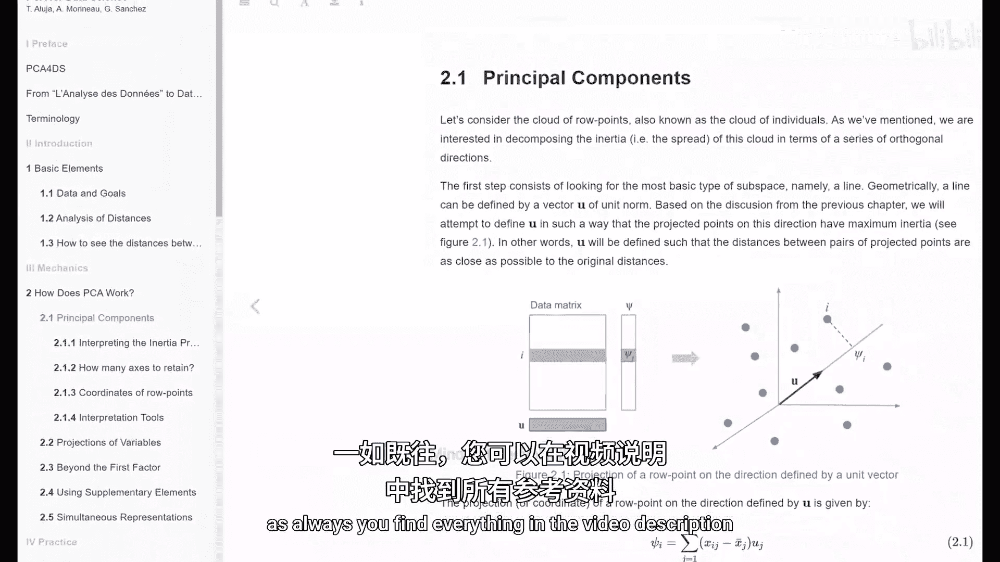

Let's start with building a conceptual understanding of how PCA works for this。

 let's assume we have a bunch of observations， and here for simplicity we only have two dimensions。

 x1 and x2。 The corresponding data in tabular formats could look like this。

 The central idea of PC is to reduce the number of dimensions by finding so called principal components。

These principal components are uncorrelated， and we only keep the most informative ones to reduce the dimensionality。

 We will learn more about them soon Here， We don't have many choices。

 So we will reduce the 2 D data into one dimension。 If you've read other PC tutorials。

 you most likely heard that this technique tries to retain as much variance as possible in the data。

 I always found this a bit abstract and therefore construct a little example to better understand it。

 This data set represents the relative size of a city in X1 versus the cost of living in X 2。

We immediately observe that this data is kind of redundant because in most cases。

 the size of the city correlates with the cost of living。 So basically。

 one value can be computed from the other one。We will highlight two data points， namely Rome。

 which is much cheaper than other big cities。 And on top， we have New York City。

 which is pretty expensive， but also pretty big。 These are just made up examples。

 How would you squeeze this data set into one single dimension while preserving as much information as possible。

And information is mainly the relationship between data points here。 You could only use the X is x1。

 which reflects the size of a city， but you could also use x 2， which reflects the cost of living。

In fact， there are many options。 We could also use this line as a new axis。

 or we could use this line。 So which one is better。 Obviously。

 the green line somehow captures more of the data。 This spread can also be calculated。

 namely by measuring the variance。😊，The formula of variance for a single feature is defined as follows。

 We subtract the mean from all values。And square them to make the distances positive。

The result is then summed up and divided by the number of samples。 Overall。

 variance is a measure for the spread of data。When data points are far away from the center of the distribution highlighted in red here。

 we have a larger variance。

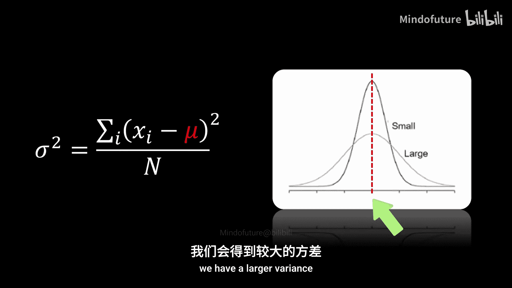

If they are closer to the center， we have a smaller variance。 Now， going back to our data set。

 let's have a look at the variance of our two new axises。

The longer axis has a pretty large variance and the smaller one has also a smaller variance because there is less spread along this axis。

Now when we take a look at how the data looks like along these axises。

 we can see the variance even more clearly， certainly these distribution plots are not perfectly precise。

 it's just a sketch。At the beginning， we said that we want to reduce the 2D data into a single dimension。

 so let's do that。 Now this can be done by projecting the data onto the new axis。

 We will later see how such a projection is performed in practice。

Now all of our data points lie along one single dimension。

 each of our originally 2D data points is assigned to a single value along these axiss in Tular form。

 this would look like this。And when we remind ourselves of the cities from the beginning。

Which were Rome and New York City。 We see that the left axis captures much more of the relationship between the data points and the right axis is kind of crampmed。

 In fact， the extreme case， which is a variance of0。

 would mean that all points lie at the same value on one axis。

 Certainly when all data points look the same， It's harder to distinguish between them。

 and therefore， variance can serve as a measure of information in data。

What we can see here are the two principal components of our data set。

 Both of them capture information about the size of a city， as well as the cost of living。 Therefore。

 you can see these access as a combination of our original features。

But the interesting piece is that these combinations capture even more information than the individual features would。

 That's why they are called principle。 They are the main axis in our data set。

 It's no coincidence that I chose exactly those two axises as they together capture all of the information in the data。

This can be displayed in the so called Sc plots， which shows the explained variance of each principal component。

And now dimensionality reduction comes into play。 typicallyyp we only keep the principal components that retain most of the variance in the data。

 so here we would just keep the first principal component and still have 90% of the information of the 2D case。

In other words， we drop less informative principal components。In practice。

 this means all of the points are projected onto this new axis， which looks like this。

Then we can get rid of the two features and only use the new axis。

And our selected principal components summarizes our data set in a lower dimensional space。

 Of course， we can extend this principle to many dimensions， such as high dimensional images。

 Here is an example for the principal components of a face image data set。

Think of them like as through the pixel space that capture most of the variation between faces。

 Usually， these are face characteristics like the shape of the nose and so on。 Remember。

 in the introductory video， When I said that faces can be reduced to their lower intrinsic dimensionality。

 That's exactly what PC is doing here。 The principal components for face images are called eigenfaces。

 because they correspond to the eigenvectors of the face image space。

 We will learn more about that in a second。 The cool thing is that you can reconstruct any face based on these spaces vectors。

😊。

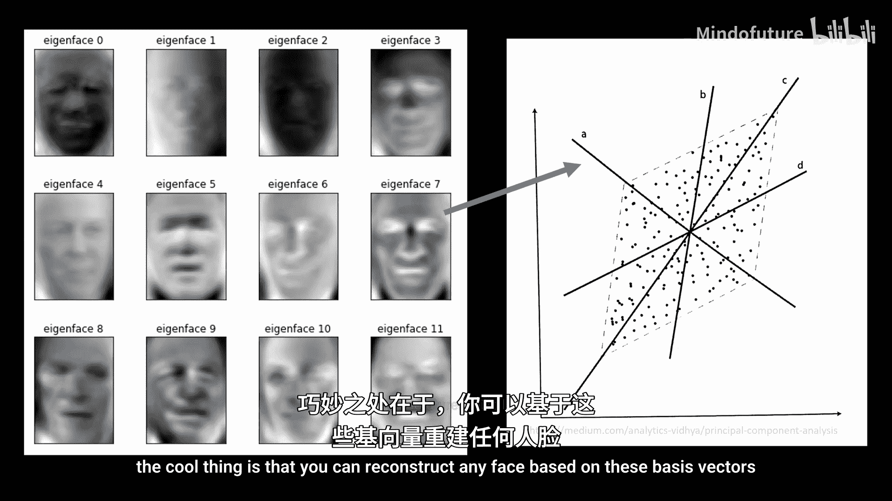

Here's an example of exactly thats。 The image is reconstructed as linear combination of the eigenfaces。

Of course， reconstructing data based on the principal components has an inherent loss of information if the number of principal components is smaller than the original number of features。

I also like this visualization by Peter Bloom。 It shows how the face characteristics change when walking along a principal component or eigenface。

 This is just like walking along our newly created axis in the previous example。😊。

Principple components are orthogonal to each other because otherwise they would capture correlated information。

 more specifically they form an orthogonal basis which we will learn more about later in this video。

 technically speaking PCs projecting data into a new coordinate system where the axis are the principal components and this is called a basis transformation because it translates。

 rotates or scales to observations。This also means that for a n dimensional data set。

 we will end up with n principle components of which we just keep the most valuable ones typically。

 One last remark， the classical PC is a linear method because we are only allowed to draw straight lines for this dataset set。

 we will capture more variance using such a curved axis， but this is not possible。

 but there is an extension called kernel PC， which also allows to perform nonlinear dimensionality reduction。

 but we won't cover it in this video。🎼Now that we've gained a comprehensive understanding of PCA。

 let's delve into the details of identifying these principal axis。

Gemetrically， we are looking for the line with the minimal distance to all of the points。

 this is nicely shown in this animation。When we project the data onto this best fitting line。

 like we've done before， we preserve most of the information in higher dimensions。

 these lines become planes or hyperplanes。The first idea that might come to your mind is that we need to perform some sort of optimization。

 such as minimizing the sum of square distances， like it's done in linear regression。

We could do this in principle， for example， fitting a line with gradient descent。 It turns out。

 however， that there exists a more efficient， closed form solution to finding principal components。

 When explaining PC， there are many different ways to approach this technique。

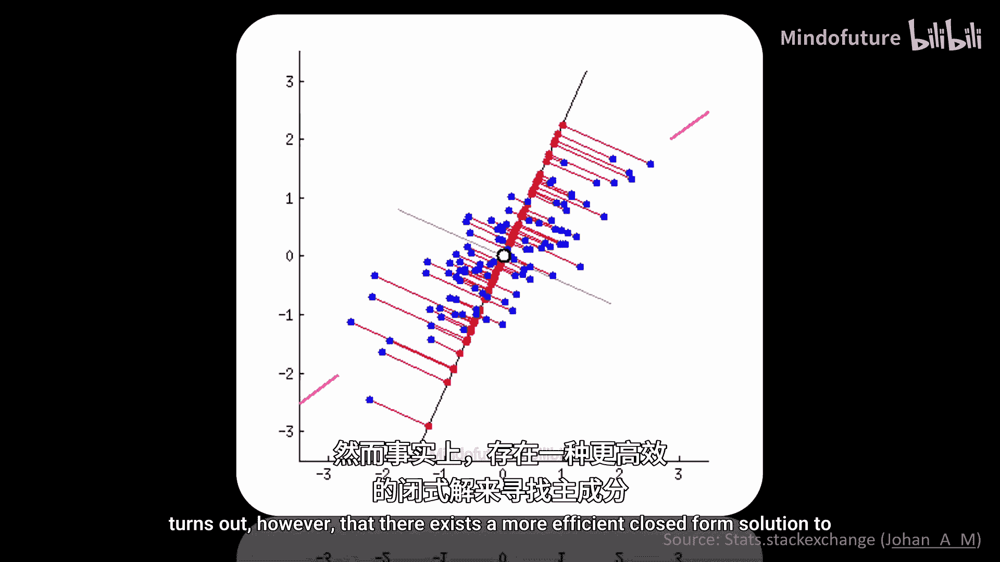

Some explanations are geometric interpretations。 We try to find the line with the minimal distances。

 Others involve lots of linear algebra， and some also talk about finding the direction of maximal variance。

At the beginning， it might be difficult to accept that all of these views lead to the same way of finding principal components。

In fact， minimizing the square distances is equivalent to maximizing the variance In the video description。

 I've put a nice blog post that mathematically derives this result in detail。

 It's based on Lage multippliers， but I won't further discuss it in this video。

 Instead of deriving it mathematically， we will take a look at this intuitive visualization by Alex Williams。

😊。

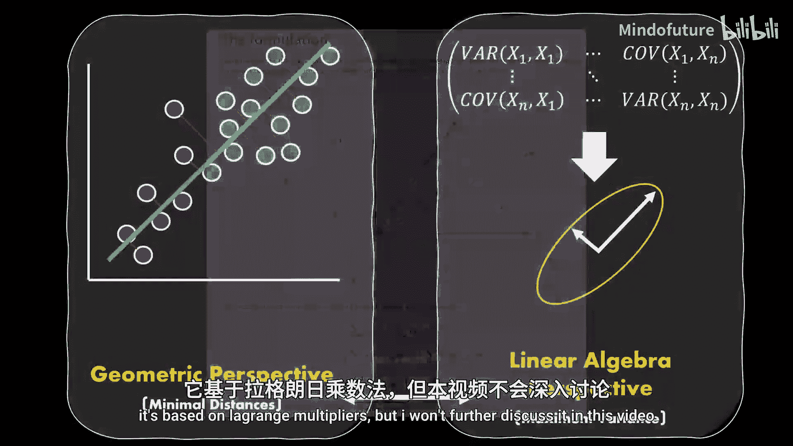

The spreads of variance along the principal axis is displayed in blue here。

The distance between a data point and the axis is displayed in RE。Using the Pythagoras theorem。

 we realized that the maximum variance and minimum distance are reached at the same time。

 and therefore it doesn't really matter which perspective we choose。 In fact。

 all optimization problems arrive at the same solution in the end。Okay， so what is this solution？

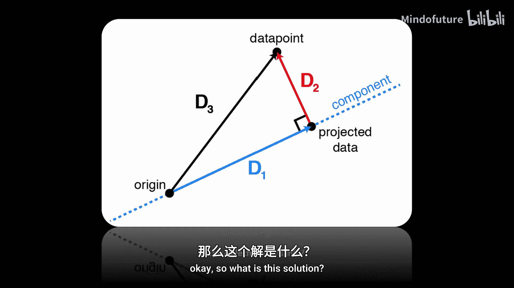

The efficient closed form solution to finding the principal components starts with the covariance matrix。

 This just naturally arises in a mathematical solution。

 The covariance matrix shows the variances of variables on the diagonal and covariances between variables on of diagonal positions。

The variables could， for example， be the cost of living and the size of a city。

 like in the example from the beginning， the covariance between two variables is the sum of the product of their deviations from their respective mean。

 divided by the number of observations， like shown in this formula。

It tells us about the relationship between features and generally expresses the covari of two variables。

 meaning if they move together in the same direction。Just for completeness。

 the difference to correlation is that correlation measures the intensity and direction of a relationship。

 whereas covariance only measures the direction。Correlation is also called normalized covariance。

 but it's not so important at this point。As we are interested in the direction of the largest variance。

 it absolutely makes sense to look at the variability in our data set expressed by this matrix。

Let's have a look at a few examples to get a feeling for the covariance matrix For this data set。

 we have a slightly higher variance of 1。3 for the feature x2。

 and the two variables move in the same direction。 therefore the covariance between the variables is also high and as you can see the covariance matrix is symmetric along the diagonal。

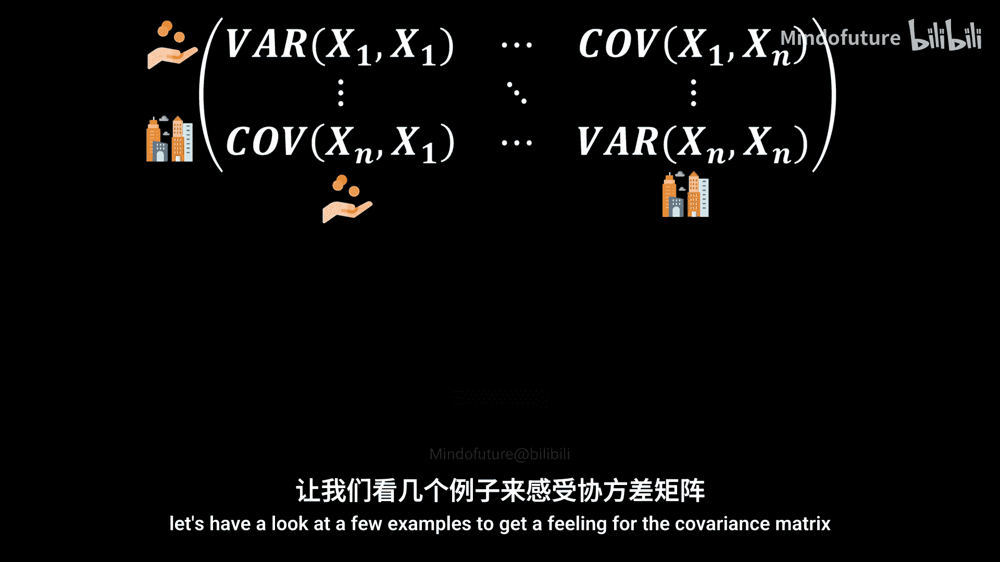

This example shows a slightly lower variance for each of the variables and no clear trends how they would move together。

 Therefore， the covariance is quite low。 This means knowing the value of one feature doesn't tell us much about the other feature。

Finally， here we have the same variances like in the first example。

 but the covariance is negative as we have a joint negative trend。

So the takeaway of this is that the covariance matrix tells us about the variance and joint directions of the variables before we move on and discuss why the covariance matrix is relevant for finding the principal components。

 let's discuss some linear algebra basics which will be needed to understand the following points in a coordinate system are typically described with the value for each axis。

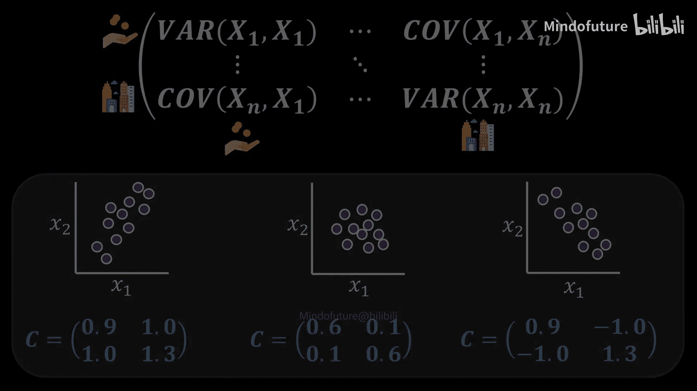

If we write one comma2， it means nothing else but one times the first basis vector plus two times the second basis vector。

This makes data points nothing else but vectors themselves。Now。

 every matrix can be associated with a linear transformation that， for example。

 translates or rotates the vectors which are data points。If we for example。

 have this matrix and multiply it with our data point vectors。

 we can use the general matrix multiplication rule to calculate the transformation。

 What this means is that each row is multiplied with the coordinates of the data points and this moves the data point to a new position。

So let's do that for the points on the left when we pluck them into the expression on top。

 we end up at these new positions。The original data space was spent by unit vectors and looks like this。

 When we visualize the target space， we see what kind of transformation the matrix on top is performing。

 Its stretching and scaling all of our data points from the unit sphere into the ellipse space on the right。

 Now， linear transformation have some unique characteristics。

 and one crucial characteristic can be described by so called eigenvectors。😊。

These are the vectors that don't change the direction under transformation。

Let's say we have this red in blue vector and applied a matrix transformation and thereby move the vectors to these positions。

Here， the red vector still points into the exactly same direction like before the transformation。

 while the blue vector points somewhere else。The red vectorctor is what we call an eigenvector because it's not changing direction under transformation。

Furthermore， the length of the vector corresponds to the so called eigenvalue。

 it's a measure for the intensity of the stretch in the vector's direction。

A very intuitive example of an eigenvector is when you point your arm into the air and spin in circles。

 Then your arm is the eigenvector of the rotation transformation， as it doesn't change the direction。

More formally， the eigenvector equation looks like this。

All it says is that multiplying an eigenvector V。With the matrix A。

Leads to the same result as multiplying the eigenvector with the corresponding eigenvalue。Therefore。

 the vector's direction is unaffected。 The only thing that happens is that it is multiplied by some scalar。

 just like we've seen in a previous example， Usually， this is called diagonalizing a matrix。

 because instead of our matrix on top， we can just multiply with a diagonal matrix of eigenvalues。

 Later， we will also quickly talk about how to calculate eigenvectors and eigenvalues。

 E with this knowledge， we can now discuss how the principal components are found based on the covariance matrix。

 According to a theorem called the spectral theorem。Any symmetric matrix。

 like the covariance matrix always has real eigenvectors and eigenvalues。

 The set of all eigenvalues of a matrix is also called the matrix spectrum。

 That's where the theorem's name comes from。 This means that every covariance matrix can be diagonalized and the amazing thing for PC is that eigenvectors of the covariance matrix correspond to the principal component。

 So the direction with the highest variance。 And the eigenvalues correspond to the explained variance of each principal component。

😊。

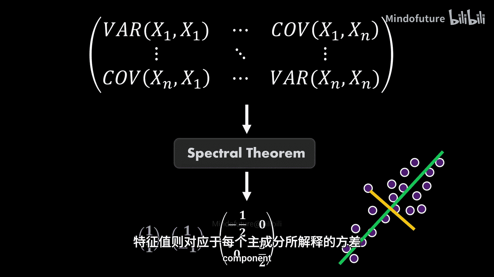

Now， where is this surprising fact coming from？The covariance matrix formulation naturally arises from the mathematical optimization problem that we want to solve。

 I won't go further into the details here， but if youre interested in finding out how the mathematical formulation looks like。

 have a look at the links I've added to the video description。😊。

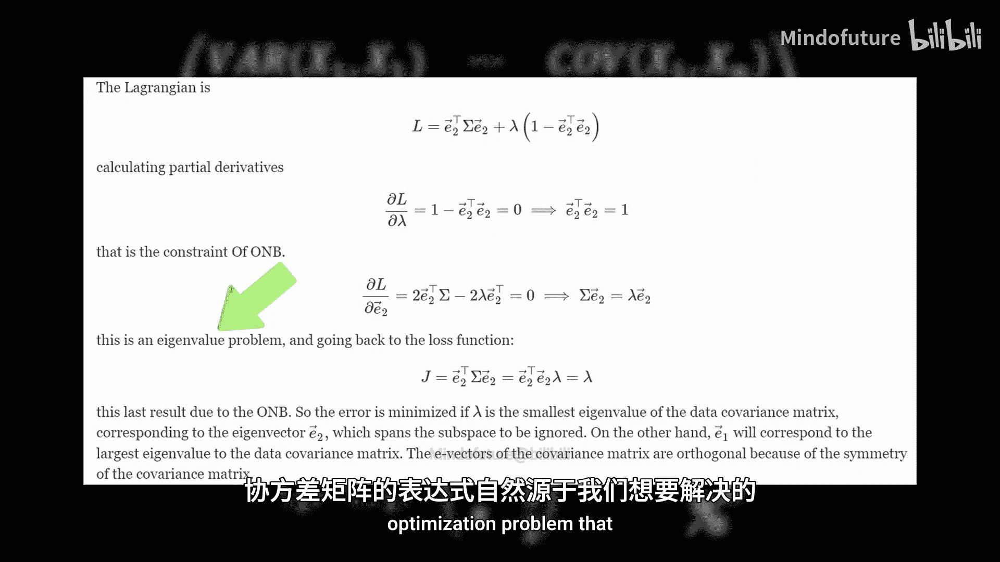

Now we should have everything in place to quickly go over each step of the PCA algorithm。

The first step is to center the data。Centering the data means that the data is exactly at the origin of the coordinate system。

 this can be achieved by subtracting the mean of each feature。

Some implementations additionally scale the data such that it has unit variance。

The reason for doing all of this is to have the same contribution of each variable。

 as you can imagine， all of the projections only work if we have the same ranges for each of the axiss。

Step 2 is to calculate the covariance matrix。As we now know。

 the covariance matrix helps us to find a closed form solution to identifying the direction with the highest variance。

 It tells us about the variances of variables and between variables。

 meaning to which degree the variables vary together。

 The formula variance is shown on top covariance on the bottom。 In both expressions。

 x bar represents the mean vector of the corresponding variable。

 The third step is the eigenvalue decomposition。😊，As we've learned due to the covariance being a symmetric matrix and applying the spectral theorem。

 the covariance matrix can be diagonalized。The eigvectors correspond to the principal components and the eigenvalues。

 to the variance along the vectors。 This is an example of how it could look like。

 The two vectors are the two principal components， as well as the eigenvectors of the covariance matrix。

 The bluevalues are the eigenvalues。 And as you can see。

 the spread of principal component 1 is about three times as big as principal component 2。

But how do we actually calculate eigenvectors， This eigen decomposition is performed with some more linear algebra。

 starting with solving the characteristic polynomial for the matrix。 Finally。

 I have to be honest with you when you calculate PCA using your favorite programming library。

 most likely no eigen decomposition is performed in practice。

 singular value decomposition is computed。😊。

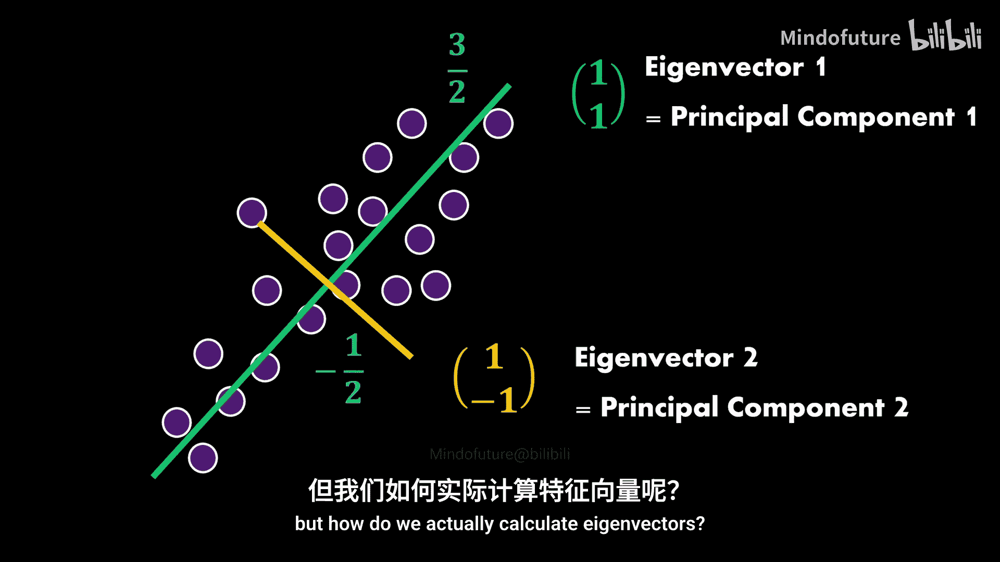

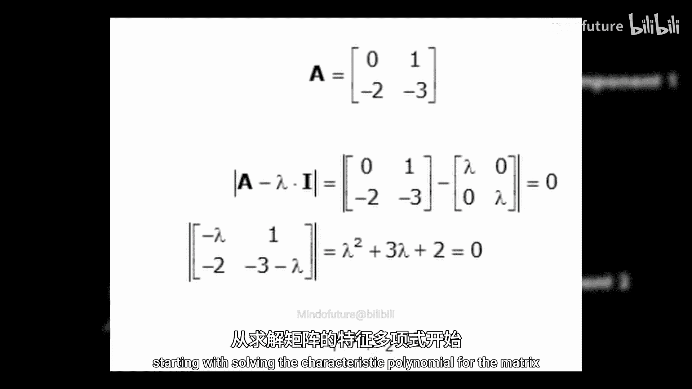

The probably most crucial reason for this is the runtime complexity of the two methods。

Eigen decomposition has a cubic complexity， while a singular value decomposition has a much smaller one。

 depending on the shape of the data matrix。 SVD is a more general matrix decomposition technique that can also handle rectangular matrices。

 Remember， eigen decomposition only works on squared matrices。

 It also has many other applications beyond PC。 It calculates singular values and singular vectorctors just like eigenvalues and eigenvectors。

😊，When using SVD on the dataset set， we don't have to calculate the covariance matrix as we can apply it directly to the dataset set。

 That's another reason why S VD is typically faster。The results of SVD and eigen decomposition are。

 of course， the same。Okay， so does this mean we don't need eigencomposition at all， Not quite。

 remember when I talked about kernel PCca at the beginning to learn nonlinear principle components for this technique。

 the data is mapped using a kernel function In this scenario。

 the singular value decomposition doesn't naturally extend to theline mappings and we need to make use of the eigen decomposition on the covariance matrix。

 Okay， the last step is to use the eigenvectors to project the data onto the new axis。

For our example， from the beginning， this projection is performed as follows。

 We take our two dimensional data matrix。Multiply it with the calculated eigenvectors or principal components and get the transformed data on the principal component axis。

 So that's exactly what we see here。 And that's the corresponding data。

 symmetric matrices always have orthogonal eigenvectors。

 That's why the principal components are orthogonal to each other。 So they are at right angles。

Because they are orthogonal， it also means that they have no correlation。

 That's why PCA is set to project data into a deco correlated basis。

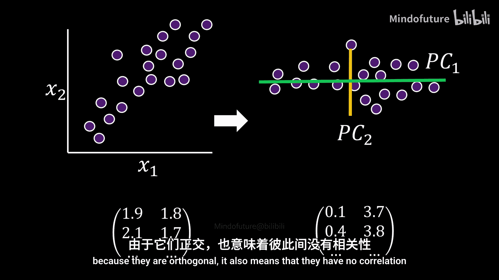

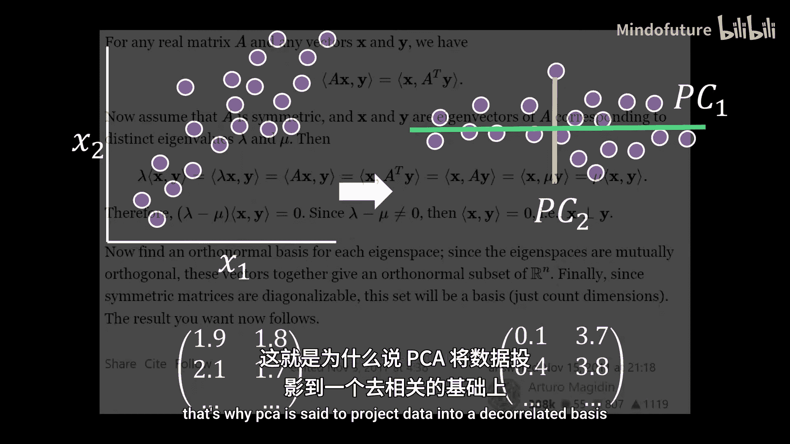

It's also quite easy to prove this mathematically again for this。

 you find another a link in the video description。

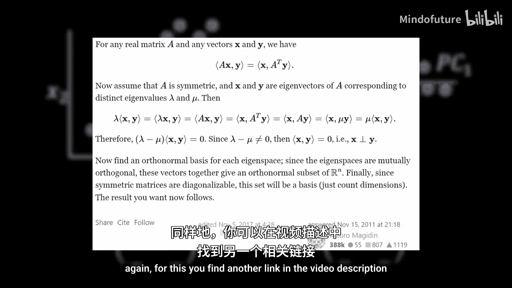

Obviously， we want to reduce the dimensionality。 Therefore。

 we only project onto the principal components with the highest variance。

 This can be determined using eigenvalues。So again， we take the data matrix。

 select only the eigenvector with the highest eigenvalue。

 and obtain the projections onto the first principal component。

And we finally end up with these projections。 And that's the corresponding data。

 So that's the full picture。 And now let's go ahead and apply this on a real data set。 Okay。

 so this is the notebook and you can find the link in the description。😊。

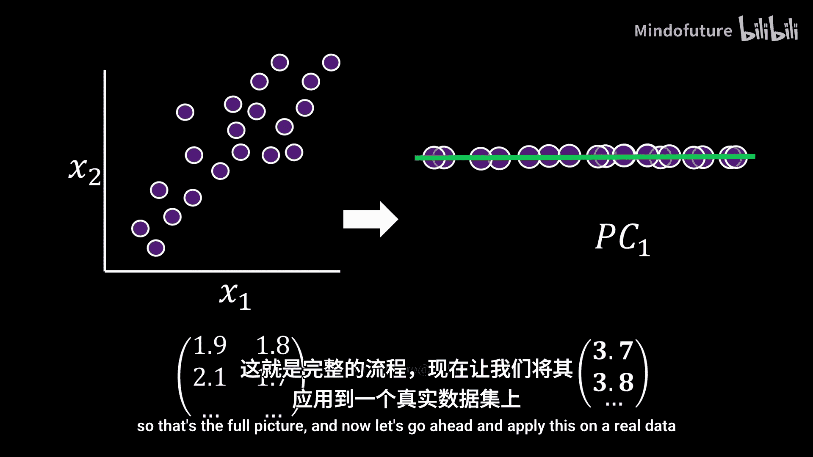

I selected a wine dataset set from Psychic learn， and this wine dataset set has a bunch of features that describe different characteristics of a wine。

 and we have three classes of wines。 I don't know exactly what they stand for。

 but overall we have around 200 data points with 13 features。 Now here I define two functions。

 One is building a simple seaborn and scatter plots。 The other one is using i volume。

 a very nice library to create 3D visualizations。😊，So let's run that。

 and it will also automatically install I volume if it's not yet installed。

Now let's start with the first technique and I just wanted to point out here that you can use Nmpy to also calculate eigenvalues and eigenvectors using this linear algebra package and you can use numpy couff to calculate the covariance matrix and here are examples for the first three eigenvectors and eigenvalues of the covariance matrix。

Okay， now the 2D projection is pretty simple， of course we use the easiest package you can use。

 which is psychic learn and here we import PCA and as you can see it gets imported from decomposition because it performs a decomposition。

In detail， it performs singular value decomposition as you can read in the documentation。

We will also time the execution so that we can compare later the different dimensionality reduction techniques。

 and now we just call fit transform and this will perform the the single value decomposition。

 and then we visualize this and it will show this picture。

 So we have the three classes in a two dimensional space。

 And what you can do with this PCA object is you can also extract the。

Eigenvalues and eigenvectors using explained variance ratio and components。So that's quite nice。

And then secondly， just because we have three dimensions。

 let's also use them so we can also make a 3D plot。 I like this library。

 It's very nice for visualization。😊，And this might， in some cases， help to even better。

Represent data。And that's pretty much it。 So we will continue this notebook in the next video。

 looking at the other techniques。

To finish this video， I quickly want to go over this table。

 which we will extend with the other dimensionality reduction techniques。And for PCA。

 we can say it's a global technique because we incorporate all of the data at the same time。

 It's linear because we project onto linear principal components。 Of course。

 there are also extensions to non linearity。It's a project based method because of this decomposition approach。

 The main purpose is to use the principal components for data analysis and visualization。

It's deterministic when we rerun it， it will lead to the same result。

 which is not true for all of the techniques。The computational complexity depends on the decomposition approach and ranges from cubic for eigenvalue decomposition to squared in a case of singular value decomposition。

The only real hyperparameter is the number of principal components which can be identified with a screen plots。

Then the key idea is to decompose the covariance matrix into eigenvectors and eigenvalues。

 and finally some other applications are dennoizing compression or correlation analysis。🎼Awesome。

 that's it for the first technique in this video。 In the next video。

 we will have a look at multidimensional scaling。 Thanks for watching and see you soon in the next one。

😊。

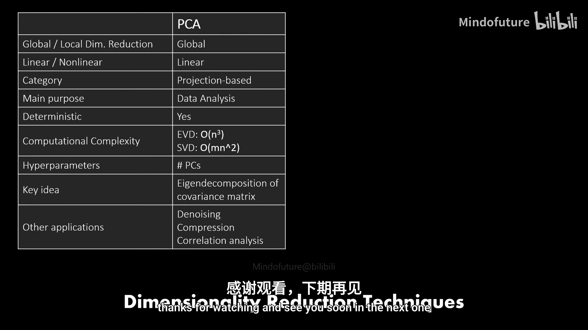

