# 降维技术-｜-Dimensionality-Reduction-p03-P03_多维尺度分析（MDS）--BV1UAxvztEPi_p3-

🎼Hi， everyone。 Welcome back to part 3 of this dimensionality reduction series。 Today。

 we will have a look at multidimensional scaling or short MS。

 It might not be too popular in machine learning， but it' definitely popular in statistics and has its roots in the 1950s in a publication by Togggeson。

 Since then， there have been many significant improvements of the technique， and therefore。

 MS can be viewed as a class of techniques instead of a single method。😊。

In this video， we will discuss three variants of MDS。

Just like before we look into the algorithmic details and also some code for this video。

 I've been digging into details on some pretty old websites and you might think why should I even bother looking at these old methods？

Many of the ideas from last century are still relevant and even the basis for machine learning today。

 I came across this quote by Shepard， one of the MS authors。

 which says the idea of representing objects as points in space had occurred to me while I was an undergraduate student in 1951。

The embeddings we use in large neuraler networks today are nothing else but a modern version of this idea。

 Therefore， I think it's important to familiarize with some of the classical methods。

 because many ideas of today have their inspiration from the past。

 Let's start with a short introduction。 What multidimensional scaling is and what we need it for。

 For most of the dimensionality reduction techniques。

 The starting point is a data matrix with features along the columns and observations in the rows。

For M S， it's a bit different because we assume to start with a distance matrix。

 This matrix contains the distances between all points based on some distance function。

 just like in the literature， we can use delta to refer to the entries of this matrix。 Of course。

 we can always calculate the distance matrix from the data。

 But M S also works if we don't have access to the raw features。

 We will see in a second where this assumption comes from。

 Then the idea is like for all dimensionality reduction techniques。

 to map the data into a lower dimensional space。 But with the goal of preserving the distances between the observations。

So the spatial configuration on the right is supposed to reflect the distances in our distance matrix。

This is also where the name comes from。 We want to scale our distances into the multidimensional space on the right。

 Let's use an example to understand why we start from distances。

 MDS has its origins in psychometrics， where it was proposed as a method that should help to better understand the human judgment of similarity。

We can， for example， collect rankings of the similarity of different pairs of emotions。

Here we have a surprised， happy and sad face。The numbers represent if people find two emotions similar or not。

 For instance， surprised and happy seem to be very similar with the value of 0。7。

 We don't have a data matrix for these observations。

 which means we don't have numeric features describing the emotions。

 This means that the actual data space is latent to us。Using M S。

 we can now visualize the emotional space only based on these distances。

 And this visualization might， for example， reveal that joy and surprise are often perceived as similar。

😊，Similararities can always be converted to dissimilarities， and disimilarities reflect distances。

 which are used in Ms nowadays。 There are some mathematical differences between similarity and dissimilarity and also numerically similarity tends to have more close to0 values。

 but we won't really discuss this further and just keep in mind that Ms typically operates on dissimilarities。

 Finally， distance matrices always need to be symmetric for this method。 Therefore。

 we can just use the upper or lower triangular part of this matrix。 Also。

 the diagonal can be ignored as the distance of a point to itself is always0。

 So these entries are what we end up with。 The number of distances for n observations can also be calculated using the Gaussian sum formula on the right。

 Now that we have a rough idea what Ms is all about。 let's take a look at the mathematical framework。

 For this， we will use the standard example for all M S。

Flight distance between cities。 This is well suited because it allows us to intuitively define the relationships as distances or dissimilarities。

 Here we have five cities and their distance in miles in a symmetric distance matrix。

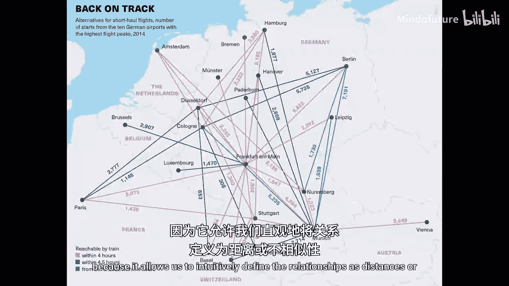

Given such a distance matrix， the task is to find the optimal distance preserving low dimensional map。

Finding such a map means that we need to find a set of vectors in a p dimensional space For the orange point。

 we would for example， look for these coordinates。The challenging part is that we need to maintain the distance to all other points。

 according to our distance matrix， and that's exactly what's meant by scaling the distances in MDS。

As mentioned at the beginning， each of our distances in the matrix is typically denoted with lambda I J。

 representing the distance from point I to Jane。 The low dimensional distances can also be displayed in the distance matrix。

 These distances are denoted with D I J。What we want to do in MDS is to approximate the distance matrix such that each individual distance is approximately the distance of the original matrix。

We can use an arrow measure like the square distances to optimize the approximation。

How to solve these approximations will be explained in the next minutes。

As mentioned in the beginning， M D S is not one single algorithm。

 but instead a collection of methods。 There are different ways to categorize them。

 but on a high level， there are these three subcategories。

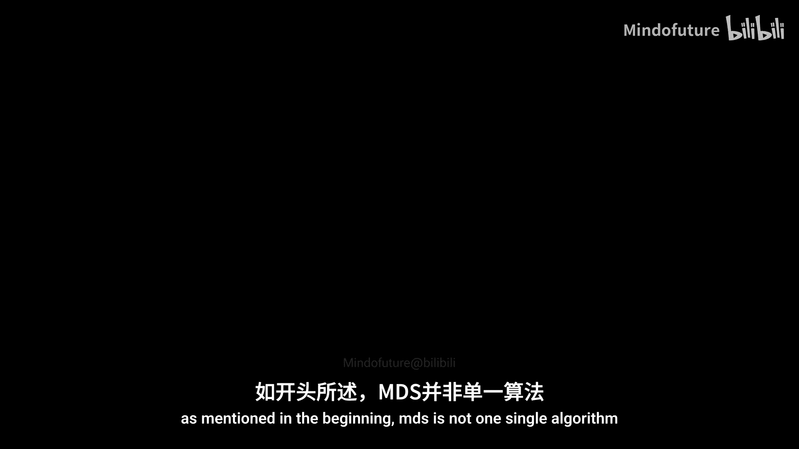

The first one was independently published by Toggguson and Gower and is called the classicalical MDS。

 It share a lot with principal component analysis， and that's why it's also termed PCA principle coordinate analysis。

Under the hood， it uses eigen decomposition to find the optimal mapping。

 This projection only works if we assume the distances to be Euclideian。

A more general form is called metric MDS， mainly published by Shepherd and Coska。

 which uses an iterative algorithm to find a solution。Here， the distances might be non Euclidean。

 and in the following， we will also discuss different metrics and what a metric is in general。

Classical MDS can be seen as a special case of metric MDS。 Finally。

 non metric MDS can be used in the case of qualitative relationships。

 This is the case when we have no direct distance information， but just an ordinal ranking。For this。

 a monotonic function like ascending or descending is applied to the distances。

Just like with metric MS an iterative optimization algorithm is used to find a solution。

 So this is a high level overview of what we will discuss in this video。 Just one more remark。

 If you look through the literature， the notations can be quite confusing sometimes。

 And I realize that they are not always consistent。 Therefore， here。

 the explicit explanation for this video。 Lambda I J are the original distances， D Ij。

 the distances in the mapping space。 and D Ij hats are called disparities。

 which will become relevant in the last part of this video。

 Let's begin with the classical multidimensional scaling。

 which is also known as principal coordinate analysis or tousen Guer MS。😊。

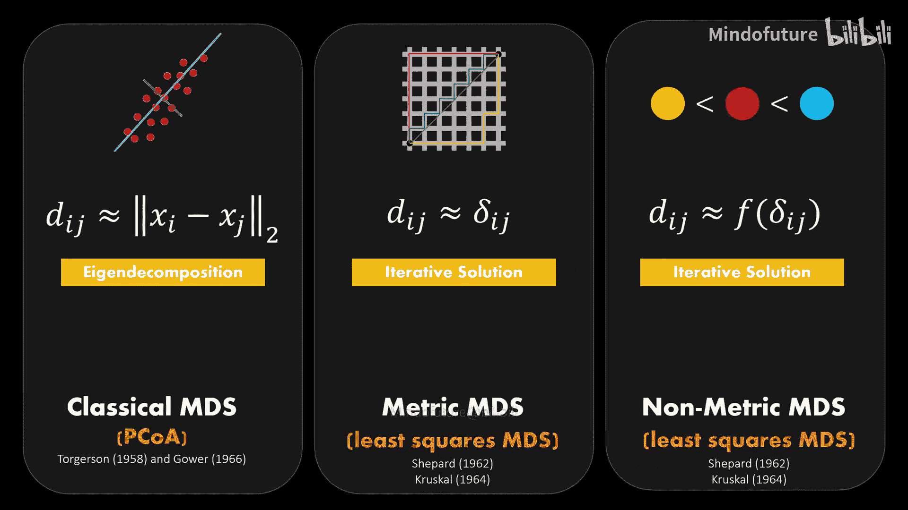

To fully understand this first method， it's recommended to watch the previous PCA video as there will be some overlaps。

Just one note， if you want to learn what is happening under the hood when using the good old psychic learn MS implementation。

 feel free to skip to the metric MDS part。 Instead of the classical decomposition approach explained in the next minutes。

 metric MS uses an iterative algorithm。 Therefore， the following explanation of classical MDS will be rather high level。

 and we will focus on the psychic learn implementation。😊。

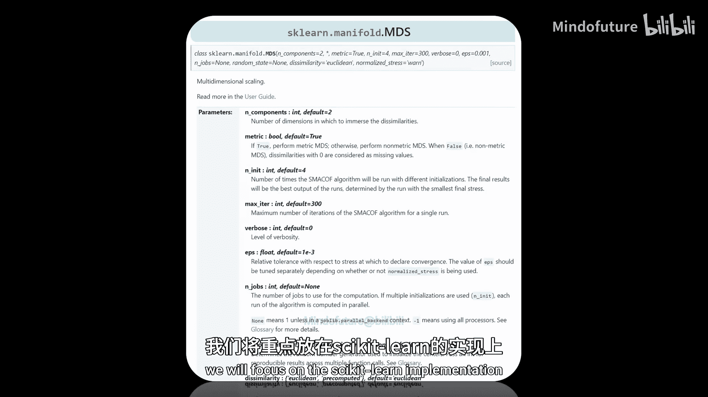

The classical MDS algorithm consists of three steps。 First， we construct a so called gram matrix。

Then we perform eigen decomposition on this gram matrix。 And finally。

 we project the distances onto new coordinates。 Let's understand this step by step。

What is the gram matrix and why do we need it for classical MDS。

 we assume that the distances are Euclidean distances for two vectors， Xi and Xj。

 the Euclidean norm corresponds to the inner or scalar product of the distances。As an exercise。

 you can easily calculate the Euclidean distance for these two two dimensional vectors。Now。

 the twist is that our situation is exactly the other way around。

 We have the distance and want to find the vectors。

 So the numbers in orange here that generate our distance matrix。😊，In order to find these vectors。

 we need to reformulate this expression such that we can obtain the coordinates from it。

The inner product can be rearranged such that we have this equation and for details how to rearrange the inner product。

 have a look at the links in the description。Here， we， however， still have some dependencies on X。

 I and X J。 These dependencies are， however， the scalar product of X， I and X J with themselves。

 This is nothing else than the distance to the origin of the coordinate system。Consequently。

 we only have distances on the right side of the equation and are completely independent of the coordinates of X I and X J。

With this simple trick of linear algebra， we can find the coordinates by calculating the elements on the left。

If we do this for all points， we end up with the inner product matrix。

 which is also called gram matrix named after the Danish mathematician yrgen gram。

 So here we have the closed form equationsion that defines the gram matrix S。 technically。

 this is nothing else but the previous term written in matrix representation。

The D squared is the result of the element wise multiplication of all distance elements。Additionally。

 we can see that the so called centering matrix C is multiplied twice。

 It's simply removing the row and column averages such that the rows and columns are centered。

This centering is needed to incorporate translational invaris。

 This means we want to be invariant to shifts of the points。

 meaning that the distances should stay the same if the coordinate system moves As a summary。

 we have to go in the reverse direction to recover the data matrix from the distances。

Because the grant matrix is symmetric and positive definites。

 it can be diagonalized through eigen decomposition。So the next step should be familiar to you。

 we can use the eigenvectors to project the data， just like in the last video。Keep， however。

 in mind that this classical PCA approach only works if we have Euclidean distances。

 because otherwise we can't do the reformulations we just did。

 The final step is to use the eigenvectors to project the gram matrix to find the points of our configuration。

For this， we multiply the eigenvectors with the square root of the gram matrix。

 The square root naturally arises when we reformulate the eigen problem。😊。

In order to reduce dimensionality， we can just keep the first n eigenvectors belonging to the largest eigenvalues。

 Here's just like with PCA， the first coordinate contains the largest variation and explains most of the distance relationship。

One remark about this solution， is not unique because the coordinates of the configuration can be rotated or reflected and still lead to the same distance matrix。

 So in this reverse process， all information about location and orientation is lost when calculating the distances。

After this quick PC A refresher， let's move on with the most widely used version of MS called metric MS。

 It's based on a least squares loss function and sometimes also called least squares Ms。Previous。

 we have the assumption that the distance matrix is Euclan。

 but it turns out that there are plenty of other distance metrics available。

 So metric Ms is a more general algorithm that finds a mapping for any distance function。

 The downside is that we can't make use of any closed form solution like in the previous section。

 And therefore， metric MS uses an iterative optimization algorithm。😊。

You can see a couple of common distance metrics beyond the Euclidean distance， as we will see later。

 we can pass the algorithm any distance matrix and get a good low dimensional approximation。

Before we， however， look at the details， let's first define the term distance more precisely。

 Mamaticly， a distance metric needs to satisfy three axioms。 First。

 distance needs to be positive and the distance to a point itself0。 Secondly。

 distance needs to be symmetric。 So the distance from I to J is the same as from J to I。And finally。

 a distance metric needs to satisfy the triangle inequality。

 which means that the sum of the shorter distances between three points always needs to be larger than the longest distance。

 like visualized in this triangle。Importantly， a distance function is called metric distance if it satisfies the triangle inequality。

If not， it's called a non metric distance。 That's also where the names。

 metric MS and non metric MS come from。If you want to learn more about metrics。

 especially which metrics exist。 I've linked a great blog post in the video description。 Now。

 let's talk about the metric MS algorithm。 As already mentioned， it's an iterative method。

 The steps can be outlined like this。 First， we need to initialize the low dimensional points。

 and this can happen randomly， but there are also more advanced strategies。😊。

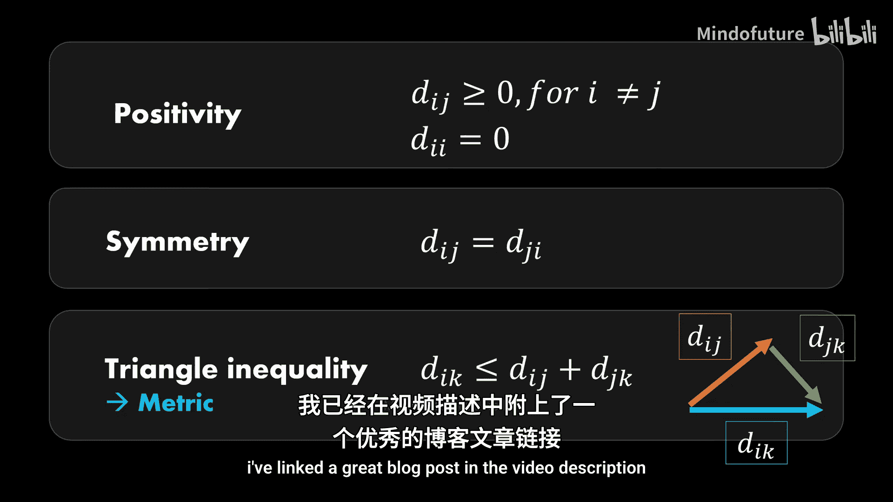

Then we need to calculate a distance matrix for the low dimensional map and don't mix this up。

 the original distances can still have any distance metric。

 but the low dimensional approximation is usually displayed as Euclidean distances because this is simply most intuitive for humans。

In the next step， a loss function called stress is calculated。

 which compares the low dimensional distances with the provided distances。And finally。

 some optimization procedure， like gradient descent， is used to minimize the error。

Step1 and two don't need any further elaboration， So let's talk about the loss function of this optimization procedure。

 What is the stress function。The raw stress function is defined through this equation。

 It's a simple square distance between the original distance matrix and the distance matrix of the low dimensional configuration。

 The summation in the stress formula implies that we can exploit the symmetry。So visually。

 the above term is simply the square distance between the leftover matrix elements pretty straightforward so far。

This dress function is one of the most significant improvements of M S。

 Shepard first presented the idea， and his colleague， Coscal， finally proposed this loss function。😊。

The word stress simply stands for a standardized residual sum of squares and is a variance measure。

An improvement suggested by Cotcal is to additionally normalize the stress。

This raw stress function is sensitive to the scaling of distances。 If another scale is applied。

 the stress value changes。To work around that， the stress function has a normalization term。

 which reduces the distances to the same unit。 The denominator is simply a scaling factor that makes the whole term invariant under uniform。

 stretching or shrinking。So this is another improvement that makes the method more robust。

Another convenient property is that normalized stress is between 0 and 1。

 Coscal also provided an empirical evaluation that suggests which values of normalized stress are acceptable。

Generally speaking， every stress value higher than 20% indicates a very bad fits of the real distances。

 There are several variants and extensions of the stress function。 They louv introduced weights。

 W I J。 that indicates the importance of a distance。

 A nice side effect is that this weights can be used to handle missing data。For all missing entries。

 the weights are simply set to 0。 Salmon stress is another M S arrow function presented by John Salmon in 1969。

 And this last function is better with preserving small distances by giving them more weights in the fitting procedure。

 Besides the empirical orientation using the stress values from Coscal。

 there is another way to assess the goodness of the M S fit。

 The shepherd diagram named after its inventor shepard is a scatter plot between the actual distances and the distances in the low dimensional space。

 An ideal fit would have all points on the diagonal。 Let's discuss the last step of metric Ms。

 How do we minimize the stress function。 In general。

 pretty much any optimization algorithm of choice can be used。

 Coscal originally proposed a gradient descent like algorithm。

 similar like the one used in neural networks。 gradient descent， however。

 doesn't guarantee a good solution。😊，As the stress objective function is non convex。

 one of the most important contributions of theluv to MS is the smack of algorithm。

This optimization approach stands for scaling by majorurizing a complicated function。

This class of methods can also be found under the name minimization by majorurization。

 And that's exactly what psychic Learnn uses when you call the fit function。

 So what is this majorization。

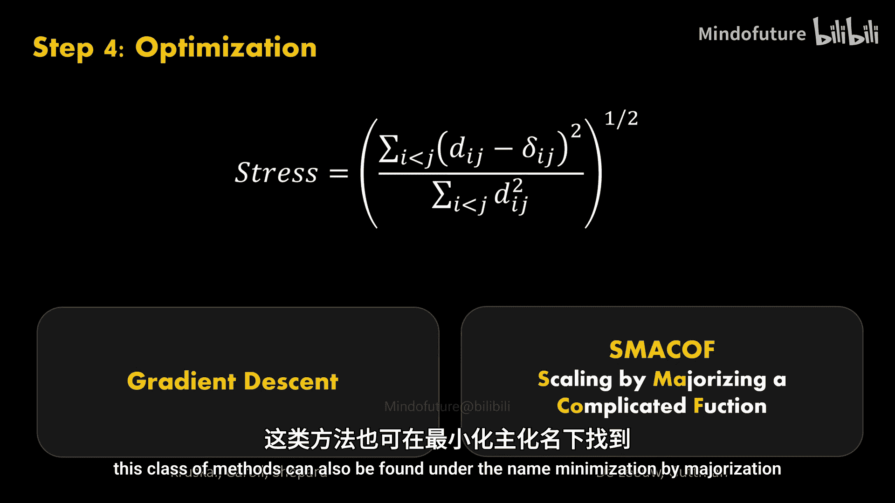

In a nutshell， this approach exploits the convexity of a function in order to find a minimum。

As stress is a non convex function， a convex surrogate function is defined to minimize the objective。

 This means that stress is wrapped in a simpler function。

 The algorithm then iteratively minimizes the meurized stress function through supporting points。

The advantage of Smackov is that it guarantees a monotone convergence。

 You can think of it like sandwiching the stress function in order to minimize it without actually touching it。

 The exact details of this method won't fit into this video。

 But there are plenty of websites to read more about it。

 There is also a visualization of metric M D S in Coska's original paper from 1958。

 on the left is the starting configuration。 And on the right， the final configuration after 50 its。

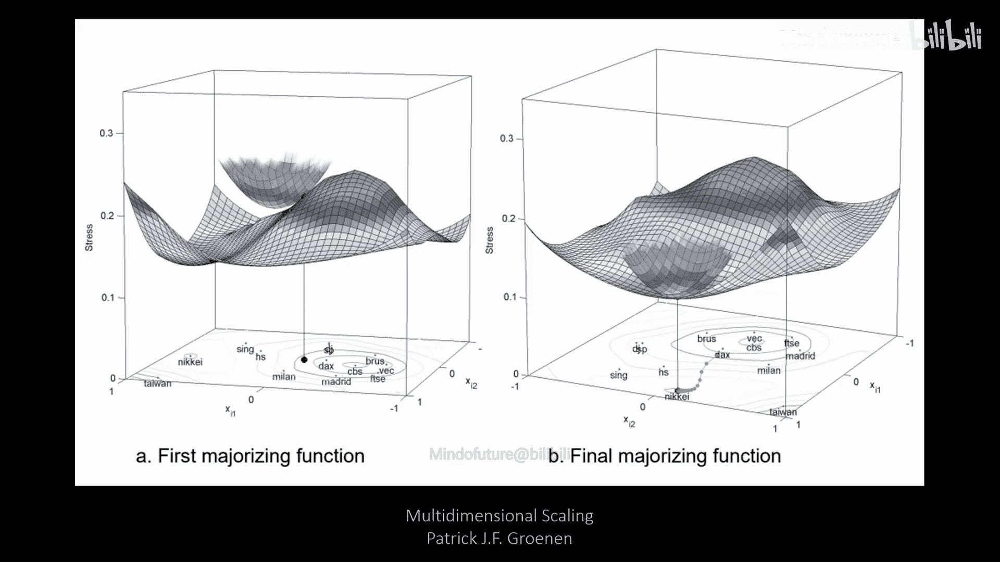

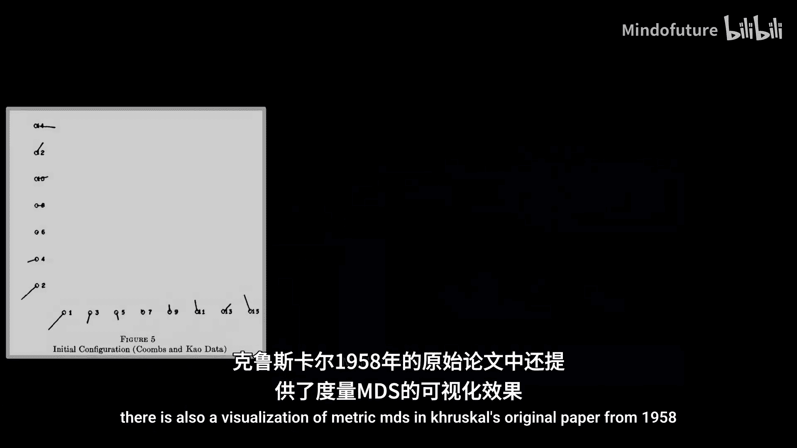

As with all optimization algorithms， local minima are a problem and is recommended to run M S several times with different starting configurations。

 One last open question for a metric M S is， how do we choose the optimal dimension for the low dimensional configuration Here we find an answer again in the coastcal paper。

 We simply run the algorithm several times and plot the stress values versus the dimension。

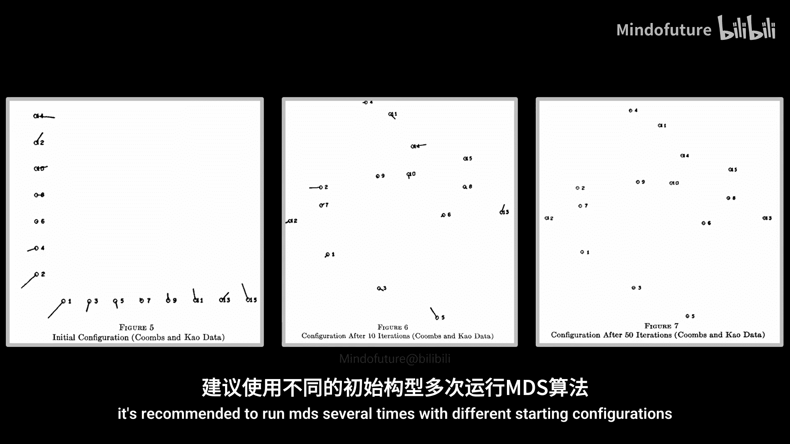

Effectively， this is a scrap plot like in PCA， and we can now make use of the elbow criterion to find the dimension with a sufficient approximation。

🎼It's natural that higher dimension leads to smaller stress values because we have more space to position the points Before we go ahead and implement Ms for our custom data set。

 Let's have another look at the sponsor of this video series， which is brilliant dot org。

🎼Brilliant is a free and easy way to learn math， computer science， statistics。

 coding and much more interactively。 Let's say for example。

 you need a refresher on linear algebra then you can simply go to the foundational math section and try the Vs course。

😊，🎼As brilliant is also available on your phone， you can integrate these courses into your routine and become better day by day I'm a big fan of interactive courses as they simply maintain a much higher level of attention and as you can see here it's actually a lot of fun to go through the exercises Another thing I really like about brilliant is that they have a variety of courses for very rare and interesting topics。

 including quantum computing， computational biology and many other concepts in technology。

🎼Brilliant offers a free 30 day trial， which is a great way to try it out。

 You can use the link Brill。org s deepfiner to get 20% off the premium subscription。😊。

One thing I wanted to recommend is to take a look at the implementations of algorithms you are using for MDS。

 for instance， you can precisely see what is happening under the hood。

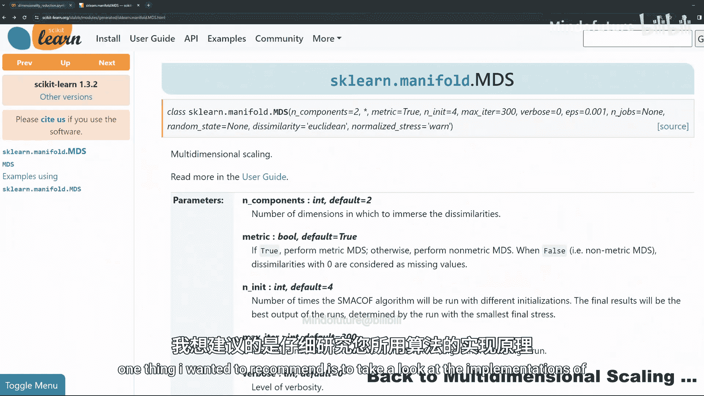

If you scroll up a bit， you can see that there is a function called smackoff and also one called smackov single。

And here you can see what exactly is happening when you fit this function。

So we will talk about non metric MDS in a second， but if you use metric MDS。

 you simply use the thesimilities or the distances。

 and additionally you calculates the distances as Euclidean distances for the low dimensional configuration。

And down here you can see that the stress values computed。

 and we have a couple more steps optimizing the values， and that's pretty much it。

 So all that is happening is mainly what I've just described。 Now， as always。

 let's have a look at this in action。 And again， let's load the wine data sets and the visualization functions that such that we can see what the embeddings look like。

Going to the MDS section。There is one detail which is quite useful。 You can pass the MS algorithm。

 pre compute it。Distances， and this is what we will also do。

 So we won't let the algorithm automatically calculate distances。 but instead。

 we want to start with a distance matrix。 So using our wine data set。

 this calculates a distance matrix。And this has a shape of 178 times 178 because that's the number of samples we have。

And typically， Manhattan distance， which is the L1 normm。

Works better in higher dimension than the Euclidean distance。 And here is just。

A heat map of the distances， only visualizing the lower triangular。And given that。

 we can now pass that into the MDS implementation。 and for this， we instantiate MDS and we say first。

 we want a 3D。Ebedding。And we say we don't want to use normalized stress， but we use metric MS。

 and we pass in precompd because we want to give it the distance matrix we've just calculated here。

 And then what you give it when you fit the matrix is exactly this distance matrix。

 So there are two modes， Either you pass it a precompd distance matrix。

 or you pass it the raw features。 Then it will automatically calculates。The metric you specify here。

 for example， you can put in Euclide in here and it will calculate that for you。Okay， so we。

 when we run this。It will give us this visualization。And I think for higher dimensional data。

 MS is not perfectly suited because distances are simply a problem in higher spaces。

 but this is still acceptable。 And as I put here， Manhattan distance typically works better than Euclidean distance。

And there you can't use normalized stress and metric M S at the same time。

 I'm not entirely sure why that is the case。 But because of that， we have to print the raw stress。

 it would be better if we had。The normalized stress， which is between0 and 1。But still。

 this is the stress value。 So that's the overall deviation between the low dimensional mapping and the original distances。

And then we can run this for two dimensions as well， and we get this plot。

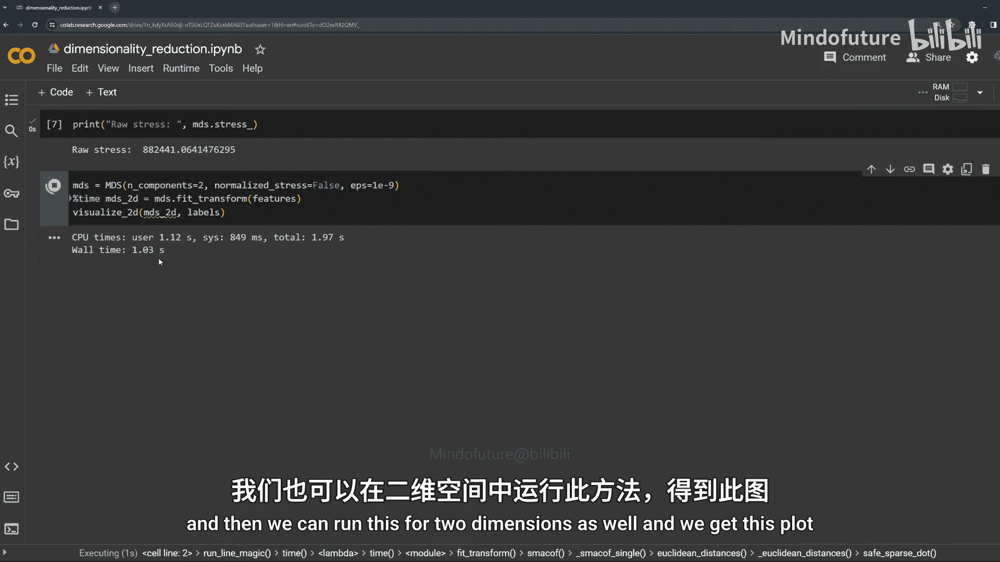

The last technique discussed in this video is the non metric variant of MDS。

Non metric distances are distances that violate the triangle inequality。

We can easily construct such an example by defining the distance as zero whenever the same animal occurs on two images。

And one， if the animal doesn't occur。This certainly violates the inequality because the two upper distances are0。

 while the one on the bottom is1。Another common example is ordinal data When we rank data according to similarity。

 it can also happen easily that the triangle inequality is violated。

That's where the name non metric MS comes from。 Ordinal data is， however。

 quite useful because it allows us to express distances simply based on comparisons。

And comparisons are most of the time easier to calculate than actual distance values。

 The goal of ordinal M S is therefore to find a configuration that preserves the order of the distances。

 like in the original distance matrix。 This order can be simply defined by arranging all distances in an increasing order。

In this example， the distances between blue and yellow are the smallest in the matrix and therefore also need to be the smallest in the low dimensional map。

The important question now is， how do we ensure that the distances order is preserved For this。

 Coscal has introduced a monotonic function that maps the original distances to so called disparities denoted by D hat。

Generally speaking， a monotonic function is a function that preserves order。

 Given the original distances， the function output should also yield the same order。Therefore。

 the function F is always non increasing or always non decreasing On the right。

 you can see a collection of some monotonic functions。

 and we are particularly interested in the ordinal one。These functions， of course。

 have some parameters that need to be learned In the case of the ordinal function。

 these parameters can be learned using least squares monotonic regression。

 or also called isoonic regression。 Fitting such an ordinal function looks like the red line in this image。

The monotonic regression can be solved using an iterative algorithm called Po adjacent violus algorithm。

 but we won't go into further details here。Using the fitted line。

 we can now compare the low dimensional distances against the disparities such that we optimize for the rank order and not the actual distance values。

The optimization procedure of MS only changes slightly by using the disparities predicted from the monottonic regression model。

 The rest basically stays the same， meaning that we also use smackov to optimize the stress function。

Consequently， in ordinal Ms， we learn both the parameters of the monotonic function。

 as well as the coordinates of the data points。 To finish this video。

 let's further extend our comparison table。 MS is a global technique as we consider all points at the same time。

😊。

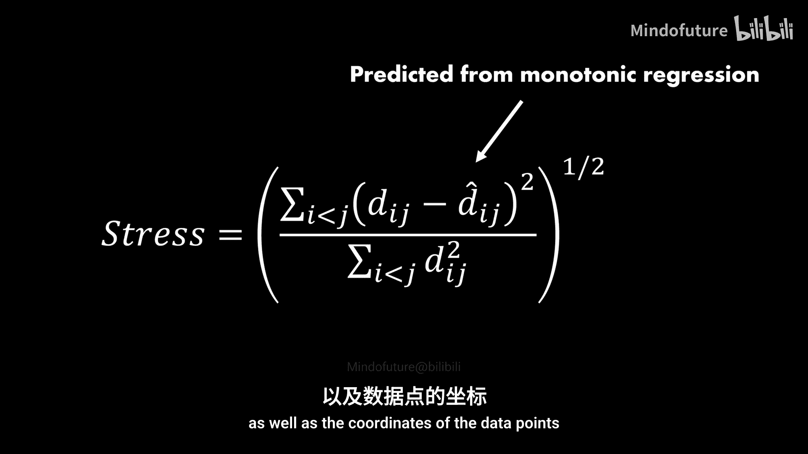

Classical MDS is just like PCA a linear method。 The iterative metric and non metric MDS are both nonlinear。

 Classical MDS or PCA is a projection based method。 The others are a manifold learning techniques。

 The main purpose is visualization of the distance matrix， but also mapping to the Euclidean space。

Classical MDS is deterministic。 The other variants， however。

 aren't because of the randomly chosen starting points。

 Classical MDS has a cubic complexity as it needs to find the eigen pairs of the gram matrix。

 The other variants are roughly quadratic。 Most of the time MDS is just used on smaller data sets。

 They are， however， also approximate versions of the algorithms available。

 The main hyperparameters are the used metrics。 the chosen dimensionality。

 The number of iterations and the stressed toleranceance epsilon。

The key ideas are eigen compositionposition in the case of classical MDS and an iterative algorithm that minimizes the square distances in the other cases。

Finally， MDS has many applications， among others， also gene clustering in computational biology。

🎼That did for this video， hopefully this helped you in some way to shed some light on multidimensional scaling。

 Of course I just scratched the surface in this video and therefore feel free to have a look at the links in the description if you want to learn more。

😊，Thanks for watching and see you soon in the next video where we will discuss Tney。

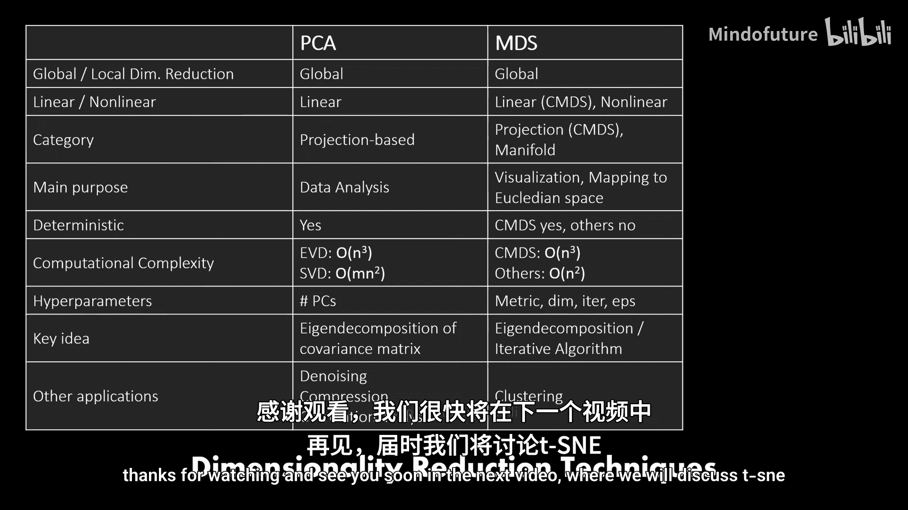

