# 降维技术-｜-Dimensionality-Reduction-p04-P04_t-分布随机邻居嵌入（t-SNE）--BV1UAxvztEPi_p4-

🎼Welcome back to part 4 of our dimensionality reduction series。 In this video。

 we will delve into the details of Tne， which is one of the most commonly used dimensionality reduction techniques。

 It also seems that my viewers mostly use Tsni as their method of choice for you guys。

 I think it also makes sense to familiarize with Um， which will be discussed in the next video。😊。

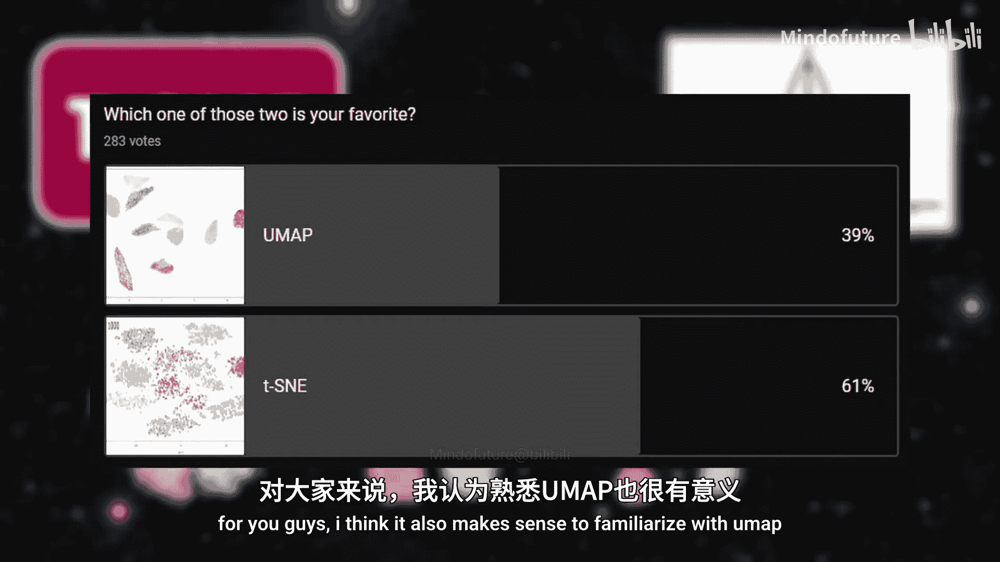

🎼As you might know， Tesney is considered a manifold learning technique。

 so let's recap what this exactly means。 Tsni is a nonlinear technique and often produces a better low dimensional embedding compared to linear methods like PC。

 Here you can see an example of the embedding space for the Mnes data set。

 which contains images of handwritten dits。 We can see that the 2D representation is much more organized in the case of Tni。

 But what is the reason for this。 in a nutshell is's because PC tries to map the global Euclidean distances between all points into the embedding space。

 And apparently， Euclidean distance is not a great choice in higher dimensions。

 This problem was already mentioned in the first video of the series。

 which relates to the curse of dimensionality， trying to preserve pairwise distances in the low dimensional space is impossible because the less dimensions。

 the less space we have left to position the point。😊，Consequently。

 the distances will converge towards 0， which means we need to place all the points close to each other。

 That effectively leads to one big cluster like we've seen in this image。

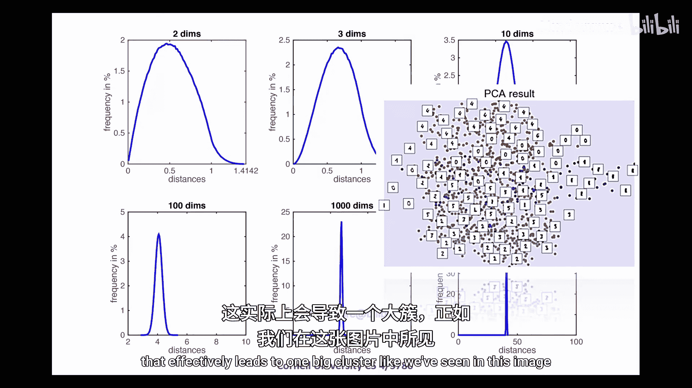

The same applies for M D， S， which we've discussed in the last video。

 A good way to visually understand why Euclidean distance is not ideal is to look at the manifold of the Swiss roller data set。

 as PC A makes use of Euclidean distances， the points on the top。

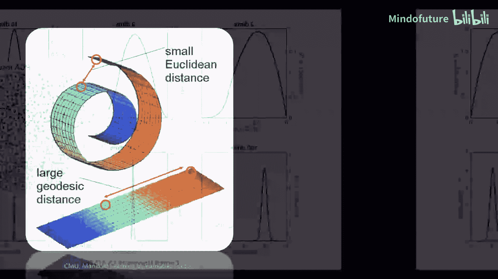

Will be close to each other in their bedding space as they have a small Euclidean distance。

 even though we would not consider them as direct neighbours。

The right distance for properly unrolling the Swissrow data set is called geodesic distance and is shown on the image below。

It is defined as the shortest curve on a surface that connects two points。

 and the surface is the manifold of the Swiss roll， in our case。

It turns out that we can approximate the geodesic distance by building a path from neighbor to neighbor。

 And that's also a fundamental idea of Tsney， As also mentioned in the name。

 It's a neighbor embedding technique。 Having that set in the following。

 I will guide you through the basic ideas， some improvements of the algorithm。 And finally。

 how to make it scale to millions of data points。We will mainly look at three important contributions to build the basis for how Tesney is implemented in most libraries to day。

 The first paper was proposed in 2002 by Geoffrey Hinton and Sam Rovi's and is called stochastic Ne embedding or shortne in a follow up paper by Lawrence Vannda Martin and Jeffoffrey Hinton。

 A couple of improvements were proposed that LED to Tsney。And finally， Barnes Hatsney。

 presented by Lawrence Vannda Maten， provides the tool box to scale Tsney to millions of data points。

 And this historical outline will also serve as agenda for this video。

 So let's start with the first paper， stochastic neighbor embedding。😊。

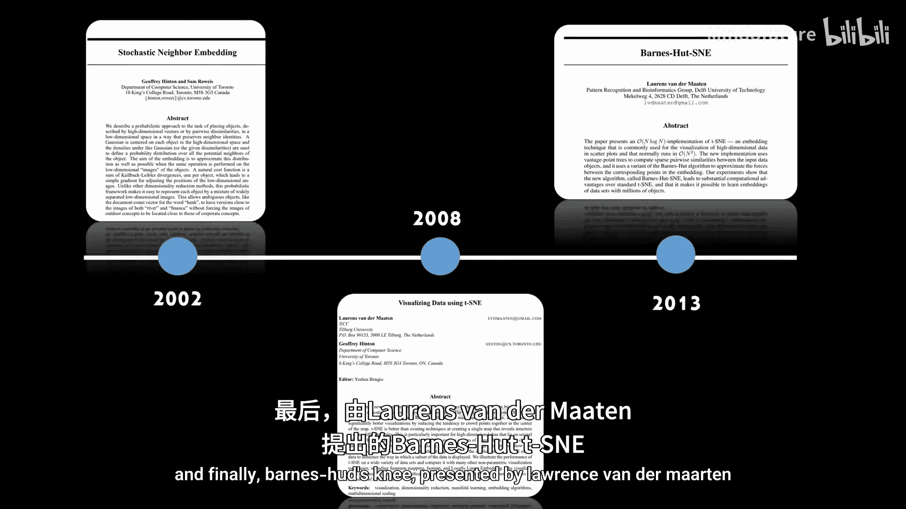

🎼The foundational paper called Sne presents the basic idea how to map high dimensional data into a lower dimensional space。

 In the following， we will quickly discuss each of the steps of the algorithm and summarize the full thing at the end of this chapter。

 Following the notation of previous videos。 The high dimensional data is called X and lower dimensional data。

 such as a single dimension here is denoted with Y。 As always。

 our goal is to preserve the structure of the original data。

 Let's take this simple 2D data set as an example。 The first step of se is to calculate pairwise distances。

 typically using the Euclidean distance function。 And this leads to this distance matrix。😊，But wait。

 we said we can't successfully preserve global distances at the lower dimensions。And that is right。

 and because of that， SNE will introduce a way to only look at the local neighborhood of each point。

Before that， however， it is still required to know all of the distances between the points in order to decide which ones are actually neighbors。

 So we won't get around this step。 What's happening next is that S converts the distances to probability distributions for each point。

On the right， you can see a Gaussian distribution that corresponds to the red points。In the paper。

 such a distribution is called a conditional probability because we condition on the distance to a specific point。

 like the red point here。

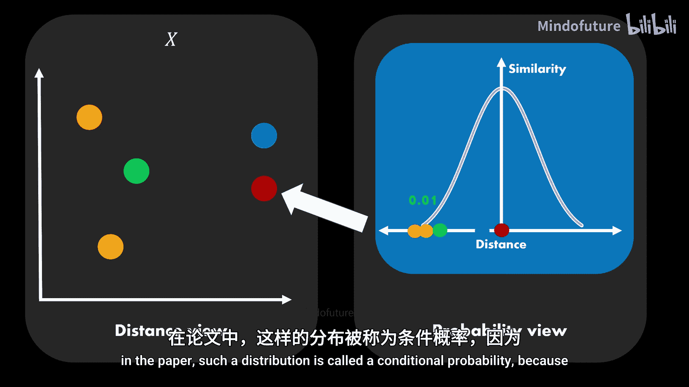

The y values of this probability distribution are now expressing the similarity between points。 Okay。

 wait， So this came out of nowhere。 We converted the distances to a point to a probability distribution。

 such that closer points have a higher value and further way points have a lower value。

 A good way to justify this is to think of these distributions as a weighting of all data points。

 As a result， far away points become very irrelevant。 And therefore， we sort of relax。

 Our dimension scaling problem。 As we don't have to pay too much attention to them。

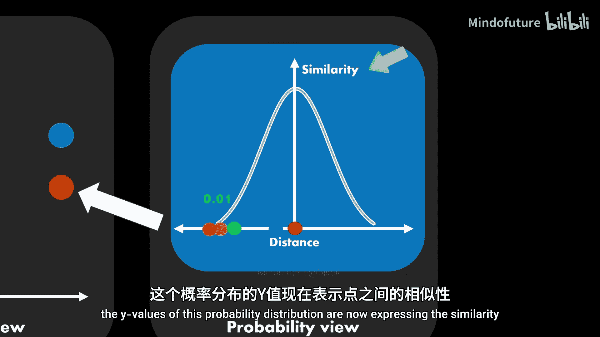

In this example， the green， orange and yellow points have very small similarities。

 and the blue point has a rather high similarity。Now， to be fair。

 introducing probabilities is not too well motivated in the paper。

 and I'm also not sure if probability is the right term。

 as there are not really stochastic events here。 but we will just accept this notion in the following。

 Also， there is no need to draw both sides of the Gaussian distribution here。

 because distances are typically positive for visualization reasons， I will， however。

 always use the full Gaussian bell。 This conditional probability can also be expressed in an equation like shown here。

😊。

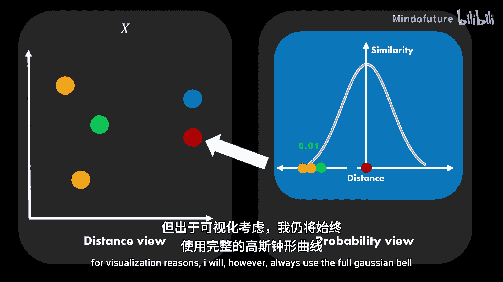

The red point is highlighted as X Y。 remember we are still operating in the high dimensional space X。

In the equation， we find the Euclidean distance between the red points and a neighbor point J。

This distance is then plugged into the formula of the Gaussian normal distribution。

 where we also find the variance sigma。You might remember that Gaussian distributions have two parameters。

 the mean and the variance。 The mean is simply zero here because the distance of the red point to itself is0。

Finally， the whole term is normalized over all points to get a probability value between0 and 1。

 which makes sure that the data is represented equally so regardless of the density。

So that's basically how we can calculate the similarity value from the distance。Okay。

 so it looks pretty well for our initial example where we have a Gaussian centered around the red point and the blue point is mapped to 0。

3， which is relatively high。The other three points are mapped to very low similarities。

 like the green point to 0。01。 Overall， we are happy。😊。

Let's have a look at another point's perspective， such as the green point here。Here。

 we realize that the distribution is somehow not perfectly suited。

 The blue point is still mapped to a relatively high probability value。

 even though we don't really want it to be included in our cluster because the blue point was not really a neighbor。

 So we're not happy with that。It turns out that it's unlikely that the same variance value is optimal for all points。

In dense regions， a smaller value is appropriate。 Idely。

 we would like to see something more in the direction of this distribution。

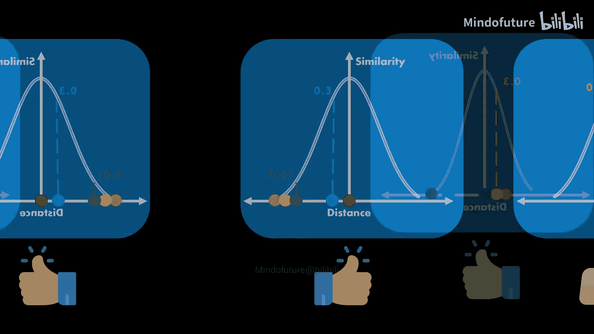

As you know， variance controls the width of a Gaussian， and by making it smaller。

 we assign a smaller value to the points at the tails of the distribution。

This adjustment is also happening systematically in S， which brings us to the term perplexity。

 perplexity is a hyperparameter and can be seen as a measure for how many neighbors we want to include for each point。

If we set it very high， it will lead to very compact clusters。

 as all points are in the neighbour of each other。 If it's a lower value。

 the low dimensional space will be more distributed。

 as only a few neighbors are included under the hoods perplexity simply controls what we just adjusted manually。

 namely， the variance of the Gaussian distribution of each point。As you can see。

 a high perplexity value is expressed by a flat Gaussian distribution and a low value corresponds to a peak distribution。

Perplexity is mathematically defined as follows。For a conditional probability distribution。

 which is the neighborhood probability of a point I。

 it equals to2 to the power of the Shannon entropy of this distribution。

The Shannon entropy is a popular tool in information theory and measures the average amount of information。

 General speaking， the entropy increases if the variance increases。

 because the flatter the distribution， the more uncertainty we have。

I've put a nice blog post in the video description if you want to go deeper into entropy。

By putting this entropy into the exponents， the perplexity tells us approximately how many neighbors our Gaussian colonel covers。

And therefore， perplexity balances between preserving global and local structure。 So at this point。

 we know two things。 First， we should adjust the width of the distribution for each point because it is not optimal to use the same variance every time。

And secondly， we can use perplexity to measure how many neighbors a distribution currently captures。

So ideally we would like to capture the same number of neighbors for each point。

 so what's left is we need to find the optimal variance for each point such that we have the same complexityity value for all of the points。

In order to find the optimal variance for each point。

 most of the libraries perform a binary search that finds a perplexity as close as possible to what we specify as hyperparameter。

 such as 30 in this example。In a nutshell， binary search goes through a list of audit values and evaluates one variance at a time by calculating the perplexity。

Then the maximum or minimum bound is moved until a suitable approximation is found。

This algorithm is faster than trying all of the values in the list。

 for example here we could find a close to 30 value already for the second sigma and can terminate the search。

 and this search can be easily parallelzed for each data point。

 which you can also see in the psychic learn documentation。

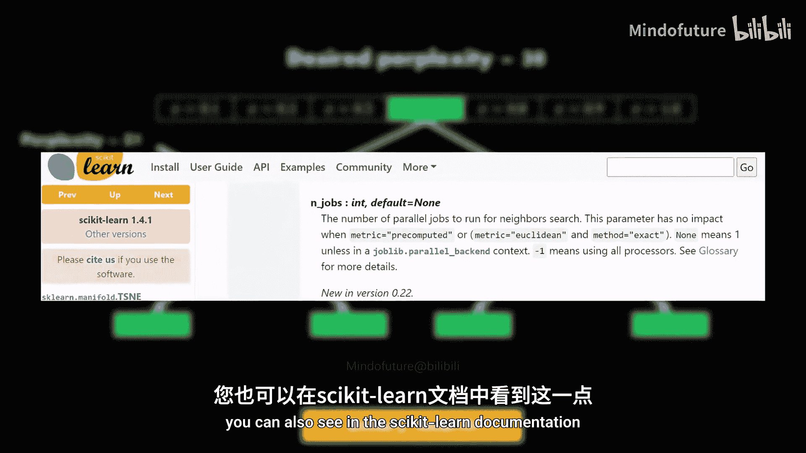

The last step is to apply the same principles to the load dimensional mapping。

This means for each point we have two probability distributions。

 one for high dimensional data denoted with PJI and one for the low dimensional em bedding space denoted with QJI。

The last step of S is to compare these two distributions to evaluate how similar the neighborhood is。

 This means we evaluate the y values for P and Q and need to compare them how close their similarities are。

 A popular measure for comparing distributions is k gl divergence or short Kl divergence。

 It simply sums over all of the points and all of the neighbors of each point and compares the function values according to this formula。

If you want to get a feeling for this loss function。

 I highly recommend to pause the video and plug in the values of the green and blue point here。

Trust me， this will be very useful for understanding this video。

You will realize that this loss function weighs values close to the center more than values at the tails of the distribution。

And that's exactly what we want to put more emphasis on close neighbors。

 So if a close neighbor in the original P distribution is embedded far away in the Q distribution。

 then we receive a large penalty for that。As the name implies。

 this lost function measures the dirgs between the distributions， and therefore。

 we want to minimize it。 Also， note that we can only move the points in the Q distribution and P is fixed。

 Just a side note。 a good way to verify the quality of the Tsney fit is to use the shepherd diagrams that we've learned about in the last video。

 It's simply a scatter plot between the high dimensional distances and the low dimensional ones。😊。

I've not seen many people doing this， but it's an excellent way to build more trust into the TN results。

Finally， for minimizing the cost function， gradient des is used。The gradient of our cost function。

 which is K L diversions， with respect to Y has this simple form。In the teaney papers。

 the authors provide an intuitive explanation how to interpret this gradients。

 It's simply the resort force created by a set of springs between a specific point。

 such as the red points and all other points of the low dimensional mapping。

These springs repel or attract points depending on whether the distance is too small or too large compared to the high dimensional similarities。

In the gradients， the first term measures this mismatch。

 So if the distance is too large or too small。And the second term expresses the force of the spring。

 So how strongly should we repel or attract。You can even reformulate this gradient to separate the attractive and repulsive forces。

Interestingly， this corresponds to a socalled end body simulation， which is relevant in physics。

 So our se or teasney mapping can be seen as a set of particles that pull and push each other。

 and we update the positions until a steady state is reached。

 So let's quickly summarize the steps of the traditional snee algorithm。

 We start with initializing the lowdial points randomly or running PC for a starting configuration。

 Then we compute the pairwise Uuculeideian distances between all points。 After that。

 we introduce locality by applying Gaussian distributions to the distances。

 Then we find the sigma values of each points distribution using a binary search such that each point has roughly the same number of neighbors。

😊，And finally， we optimize their positions by improving the KL divergence between the low and high dimensional probability distributions for each individual data point。

🎼So that's it for sne。 Now， let's have a look at Tne In a nutshell。

 It's just sne with a couple of improvements， but the overall algorithm stays the same in order to understand why we even need improvement。

 Let's quickly discuss the crowding problem， which motivates the most important change。

 namely the T in Tne。Imagine we have a data set that is arranged in a two dimensional space like this。

In order to map this to the one dimensional space， we can simply arrange the points in a line。 Now。

 how well does this mapping preserve the distances of the original data？For this。

 we can have a look at the neighbor probability distribution of a specific point， such as green。

Again， the distances correspond to similarity values， and the blue point is furthest away。

 If we compare this with the distribution of the high dimensional green points。

We realize that the blue point has been placed too far away in the low dimensional embedding。

 The orange and red point seem to have more or less the right values。

 but the blue point has definitely a too small similarity。

 The issue here is that no matter how we arrange the points in embedding space。

 we will always have the situation that some of the points are not as close as they should be。

The reason for this is simply that the intrinsic dimensionality of the data is too large for the number of dimensions we have chosen。

This situation is exactly what the crowding problem describes when we can't preserve the right distance to all neighbours。

 because there is simply not enough space for it。Because the blue point is not perfectly placed yet。

 there will be a small， attractive force between blue and green， as indicated by the spring。

This force stems from the last term of the KL diversions loss。

 which punishes deviations between the distributions。

Let's see what the results of these forces between points looks like。As you can see，nee on the left。

 which suffers from the crowding problem， has a hard time to form clusters because during optimization。

 the small forces will make all points clump together。

 Tne on the right alleviates this problem and is able to form clear clusters。

 So how is Tney doing that。 The basic idea is to use a probability distribution that simply assigns a higher value to these problematic points。

 And this simply reduces the unwanted forces as the deviations between the similarity values is much smaller。

 In a sense， you can think about this as having a broader neighbourhoods in the low dimensional space。

 which allows for a bit of  error。😊，The distribution that is used for this is called students T distribution。

 and that's where the T and TN is coming from。As you can see in this comparison。

 the T distribution has heavier tails and this will assign higher similarity values。

This allows the points to be further away and still have a relatively high probability。

 So here you can see the situation even more clearly。

 the blue point from before gets a much higher value assigned。

 which reduces the deviation to the original distance and hence reduces the forces between points。

 So the takeaway of this is， there is not much we can do about the missing space in low dimensions。

 but we can allow for some error， which we will do by using the t distribution。

 usings this distribution also brings some additional advantages beyond alleviating the crowding problem。

 First of all， we don't have to perform binary research to find the variances。

 like for the Gaussian distribution。 And instead can always use the same distribution for all points。

 more specifically， this is the t distribution with one degree of freedom。😊，Secondly。

 the calculation of the probabilities is computationally more efficient because we don't have to calculate exponentials like in the Gaussian distribution。

🎼So this was definitely the most significant change in TN。

 but let's now also quickly discuss other things that were adjusted to make the optimization more efficient symmetric probabilities have been introduced。

 Here you can see an example of the similarity of blue， given the green point， which is 0。15。😊，Now。

 what if we turn things around， what is the similarity of green given blue？🎼Somehow。

 we would expect that the similarities between them are equal。 We realize， however。

 that this is not the case。 Besides being a bit unsatisfying。

 this also has a negative effect on outliers in our data。

 The blue outlier here will always have a small probability in the neighborhood of each other points。

 This not only makes the blue point very set。 but most importantly doesn't include into the cost function。

 In other words， it doesn't matter where we place the blue points in the low dimensional space。

 because it will never be really considered in the loss function。 Therefore。

 the authors propose to average the conditional probabilities to get joint probabilities。

 This allows the outliers to contribute to the cost function。

 Another nice side effect of this is that the gradient calculation is simplified。

 which leads to computational benefits。 Finally， the third。

 most important improvement is early exaggeration。 Let's first discuss。😊。

What the underlying problem is that the authors try to solve here。

Assume we have two dimensional data and that is forming two clearly defined clusters。

When initializing the low dimensional space randomly。

 we might have a starting configuration like this。 So each of these 2 d points is mapped to one point of the one dimensional line。

After optimization， we would expect two separated clusters on this axis。

 When we start the optimization now， the KL divergence loss will activate attractive forces between similar points and repossive forces between points that should be distant from each other。

😊，So differently coloured points will repel each other。

 and points with the same colour will move together。

 The result without early exaggeration would look like this。 But wait。

 that's not quite what we expected。 What about the blue guy on the left。Well。

 because of all of the repulsive forces by the orange cluster in the middle。

 the blue point has no chance to move to the other side。

The simple way to solve this is to increase attractive forces for the first couple of iterations。

 as indicated by these thick green arrows。This allows the separated blue point to overcome the repulive forces in order to move to the other side。

After some iterations， the attractive forces return to normal。

 such that clear clusters can be formed。All of these things can be controlled in the gradient。

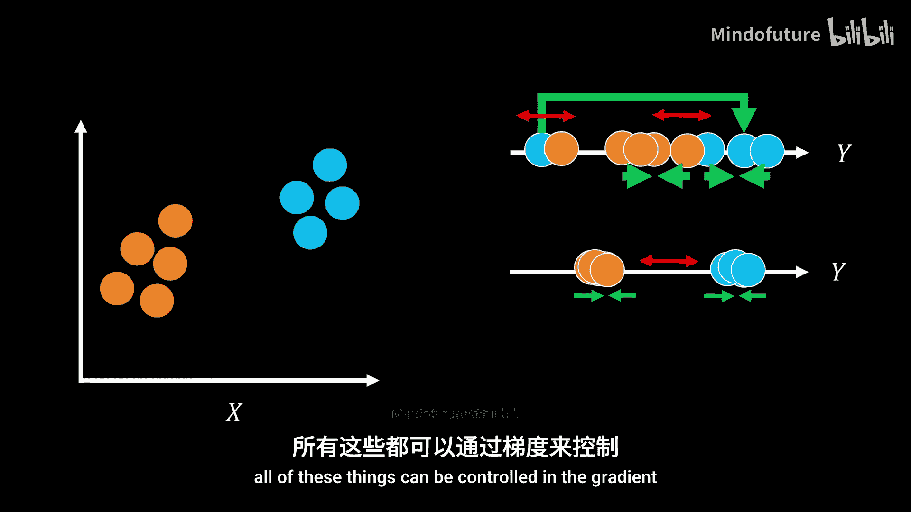

If you are interested in more details， I can recommend to take a look at this paper。

 which performs a comprehensive analysis of the attractive and reposive forces expressed by the gradient of the loss function for completeness。

 early the exaggeration simply multiplies the attractive forces of the gradient with a factor greater than one。

😊，🎼Applied to a real data set like the genomic mouse data set on this image。

 the differences look like this。 On the right， Tsney forms more densely packed clusters。

 So as a wrap up early exaggeration， symmetric probabilities and the introduction of the T distribution for low dimensional space。

 where the main improvements presented in the Tsney paper。

 There were some additional minor things that I didn't address here。

 such as adaptive learning rates to avoid local minima。 Now。

 let's give ourselves a short interactive break by clicking through one of the causes of the sponsor of this video series。

 which is brilliant dot org。😊。

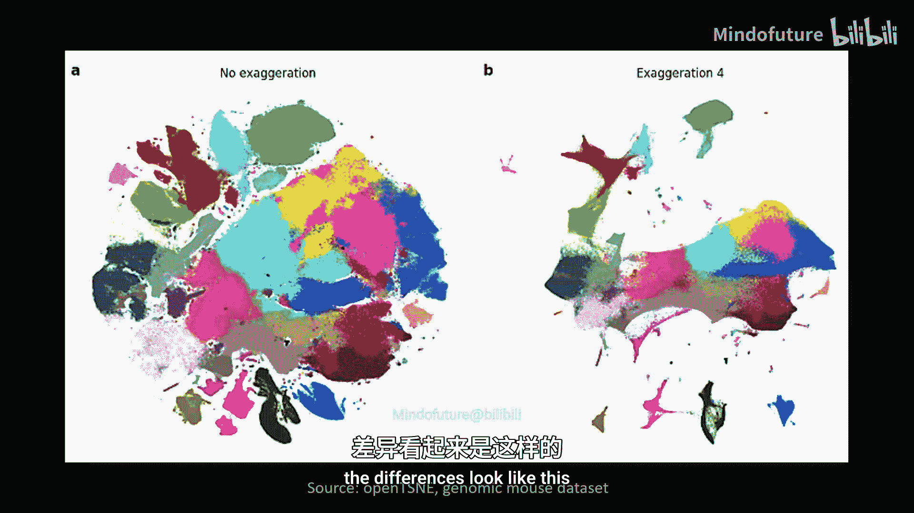

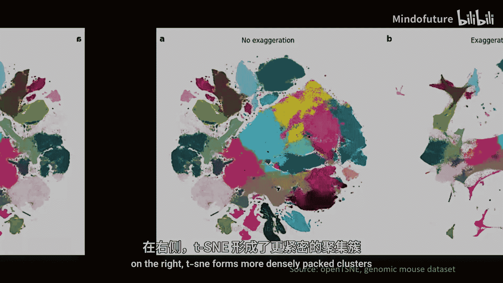

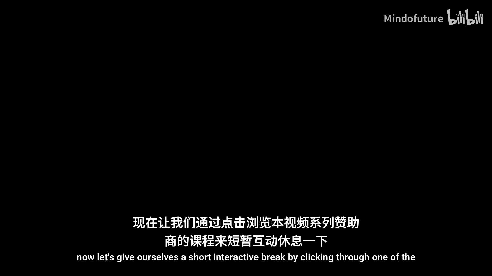

🎼Brilliant offers plenty of interactive courses for data science。

 programming and tech in general to give you some more insights。

 I thought it makes sense to click through a few lessons from a very recent topic namely large language models。

🎼I know that my viewers have advanced knowledge so I already jumped a bit ahead and completed the first few sessions Here you can see the lessons on tokenization so how language models convert text to a dictionary used for model training You can go through these lessons on your phone whenever you have time and therefore have the chance to stay up to date every day you can get started for free for a full 30 days using the link brilliantll。

org/deepfinder and the first 200 to sign up using this link will get 20% off the annual premium subscription。

Now it's time to go through some code and after that we will shortly discuss the Barnes Hut S。

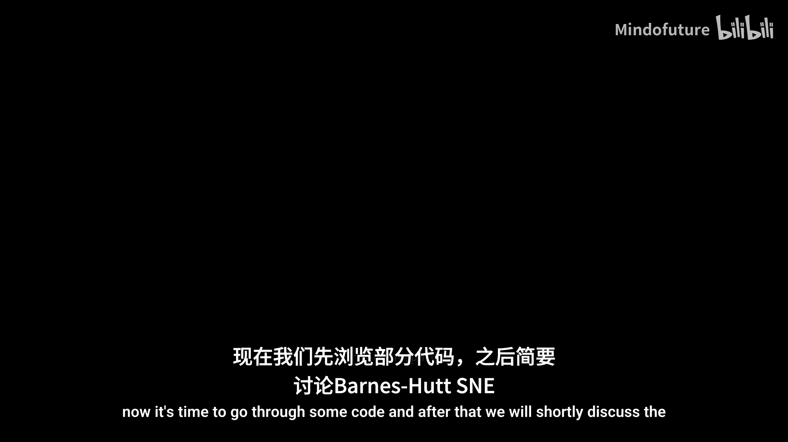

So originally I wanted to go a bit deeper into the programming stuff。

 but this video is probably already too packed for this So we will just have a short look at the TN implementation in psychic learn So as you can see here it says TN minimizes the KL divergence of the Gaussian and the students T distribution queue So that's exactly what we just talked about and you can see that there is the Barnesat method which we will discuss after this coding section and if you don't use Barnat it will use the exact computation and here you can also see that we perform or the method performs gradient descent and this gives you the KL dirgence and here we also have the options to define early exaggeration which we just discussed and when we move up a little bit。

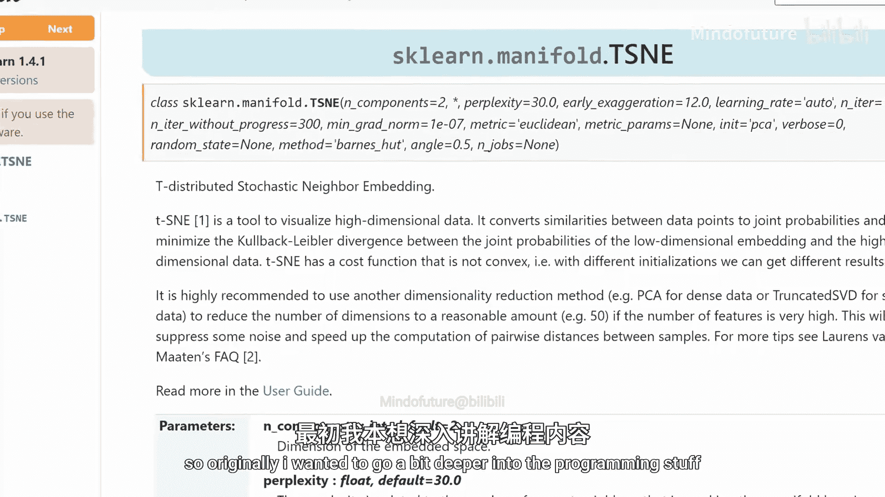

Then we can find the fit function。Right here and here are a couple of things。

 So the learning rate and that kind of stuff for the gradient descent。And in addition to that。

 we can， it will use Bars hut or the exact computation。

 And you can also pass it another pre computed metric。 So typically。

 it's calculating Euclidean distance。 So this is exactly the parawise parawise distance part。

 which we discussed at the beginning of this video。And based on these distances。

 it's then converting them into joint probabilities。

 So we've also discussed that these are these symmetric probabilities， and for that。

 it will perform the binary search。

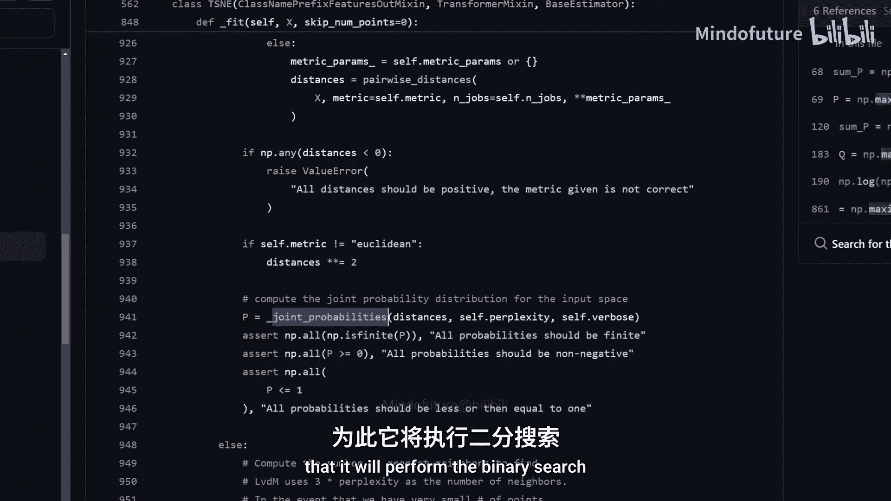

Alright， based on the implementation， let's now run this first couple of cells to get the data set and now let's have a look at TN。

Using psychic learn。 again， I won't do anything fancy here。

 This is just to quickly go over the parameters。 So n components is how many dimensions we want。

 Let's choose 3， because we have this 3D plot。 Again。

 Perplexity defines how many neighbors we want to have in the neighbour of each point。

Then early exaggeration defines how strongly we want to scale the attractive forces when running early exaggeration for the first couple of epochs。

 and then we have here some properties for the gradient descent then in it we can specify PCA to start with a PCA configuration。

Let's run that。And the final thing is， end jobs。And end jobs is because for performing the binary search。

 we can parallelize that， as mentioned before。 And so we will just choose for workers here to do that。

 And this is what the embedding looks like and。

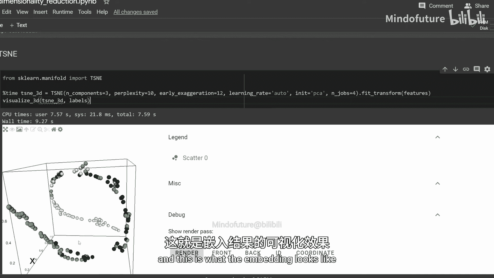

Just like before， we can also do the same thing in 2D。

 If you need a great guide to better understand the parameters and the effects of each of the parameters of Tney。

 I recommend to check out thisill dot pop， which has a great blog post regarding this。

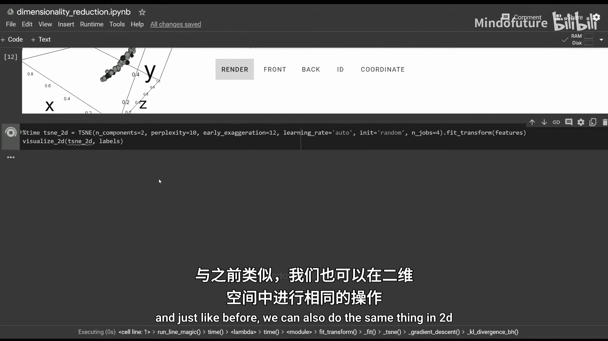

🎼This also helps to understand or to realize that Tne is actually not useful for clustering。

 because it doesn't guarantee that any of the information within or between clusters， make sense。

 The last thing we will discuss here， only on a high level is barns hat Tni。

 which actually is very important because it allows to scale Tne to millions of data points。

 So we've just had a look at the documentation。 And we saw that there are two ways to compute embeddings。

 either you use the exact way， which has a squared computational complexity， or you use barns hs。

 which has a lock linear complexity。 So it's much more efficient。

 Remember when I previously talked about how S is connected to end body simulations from physics。

 Well， it turns out that the runtime also used to be a big issue in that domain。

 especially when you deal with millions of particles。😊。

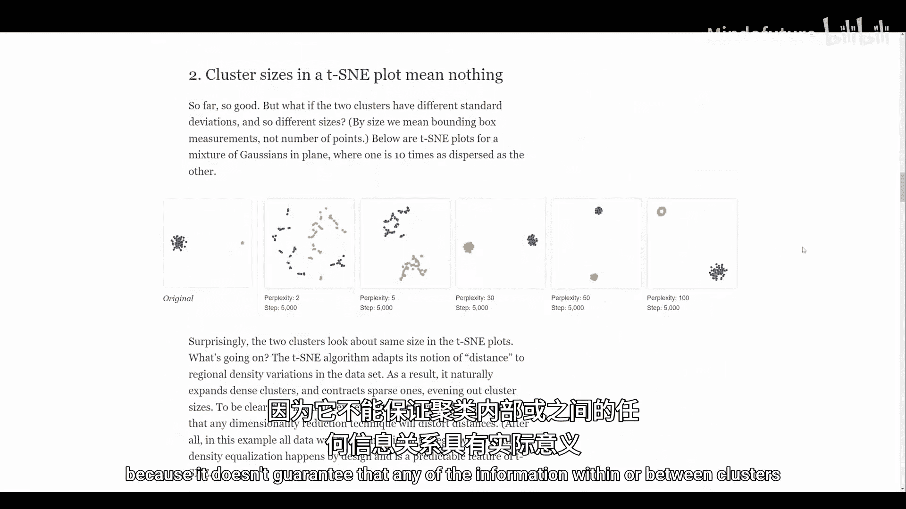

Joshua Barnes and Pete Hus came up with an approximation algorithm for solving and body simulations more efficiently。

 The basis for this approximation is to divide the space into cubic cells。

 which summarize the particles in the cell using the cell' center。

The exciting idea of Lawrence Vannda Martinten was to also transfer this to our good old Tney algorithm。

Imagine we have millions of points and need to compute pairwiseise distances， probabilities。

 and all of that for every single point。Using Barn's hat's approximation。

 we can alleviate the problem by summarizing the points belonging to the clusters。

 So instead of using all points of each cluster， we can just take the center。

 The second step of barn's hat is to build a socalled quad tree。

 which summarizes all of the points belonging to a specific cell in a tree structure by traversing this tree。

 we can efficiently calculate the repossive forces between the clusters。

 This allows to approximate the repassive part of the gradients by using only the centers of each cell。

😊，So eventually， there is much more we could talk about when it comes to accelerations of Tsny。

 but this was just a quick peek to give you some intuition about what is happening under the hood。

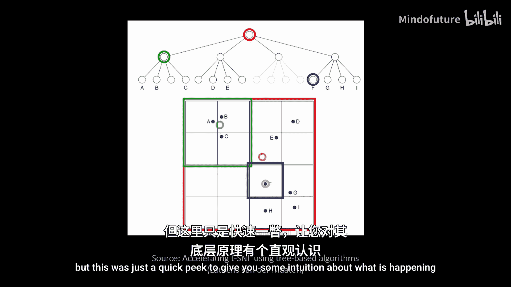

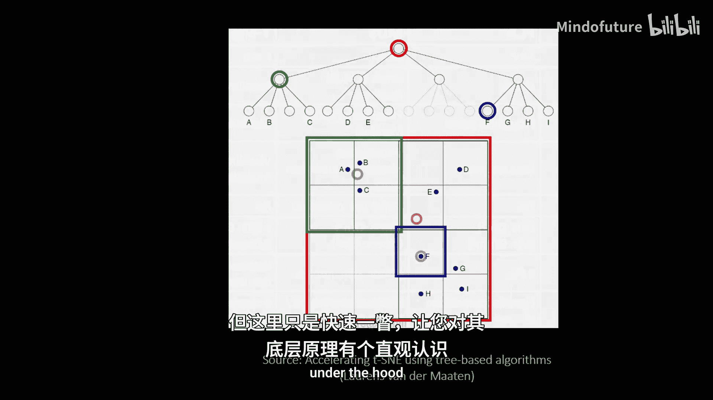

Finally， let's go over our dimensionality reduction comparison table。 First of all。

 Tesney is a local technique， as the embeddings are based on each point' neighborhood。Secondly。

 this method is non nonlinear as we can approximate arbitrary shapes。

And that's why it also belongs to the manifold learning techniques。

🎼The main purpose is visualization to gain intuition about the data as the name implies TsN is stochastic。

 and that's because the objective function is nonconvex and different initializations lead to different minima。

 We learned that Barnes h is an efficient lock linear approximation of TN because TN itself has quadratic complexity。

 The most important parameters are perplexity， early exaggeration and everything related to gradient descent。

 The key ideas to use each points' neighborhood to create embeddings。 Finally。

 it's important to note that TsN is in iterative algorithm。

 and we can apply it to new data like in the case of PC。

 That's why there are also not many other applications other than visualization。 Allright。

 this was a lot。 and that's it for today。 Thanks again for watching and see you soon in the final part when we look at Uab。

😊。

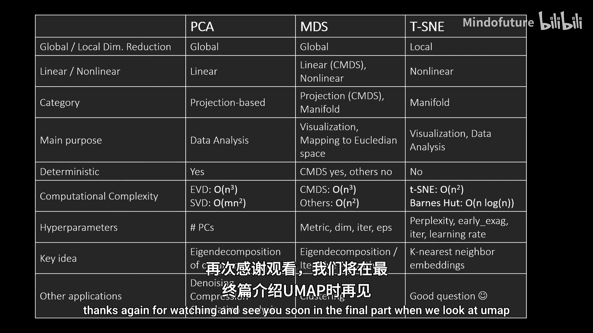

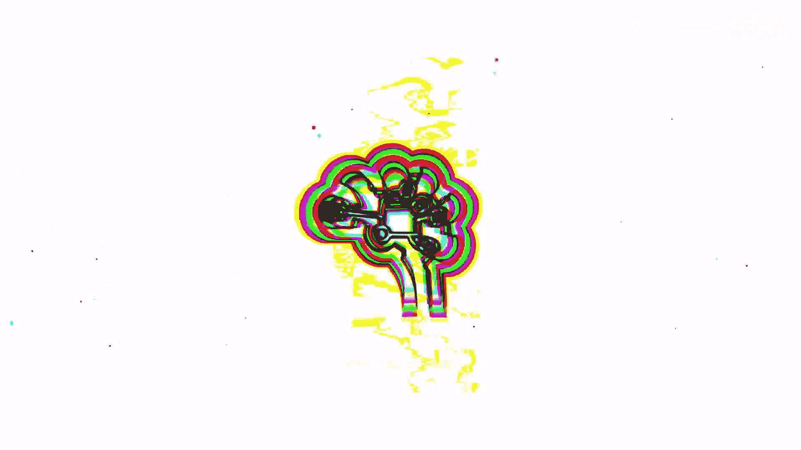