# 降维技术-｜-Dimensionality-Reduction-p05-P05_均匀流形近似与投影（UMAP）--BV1UAxvztEPi_p5-

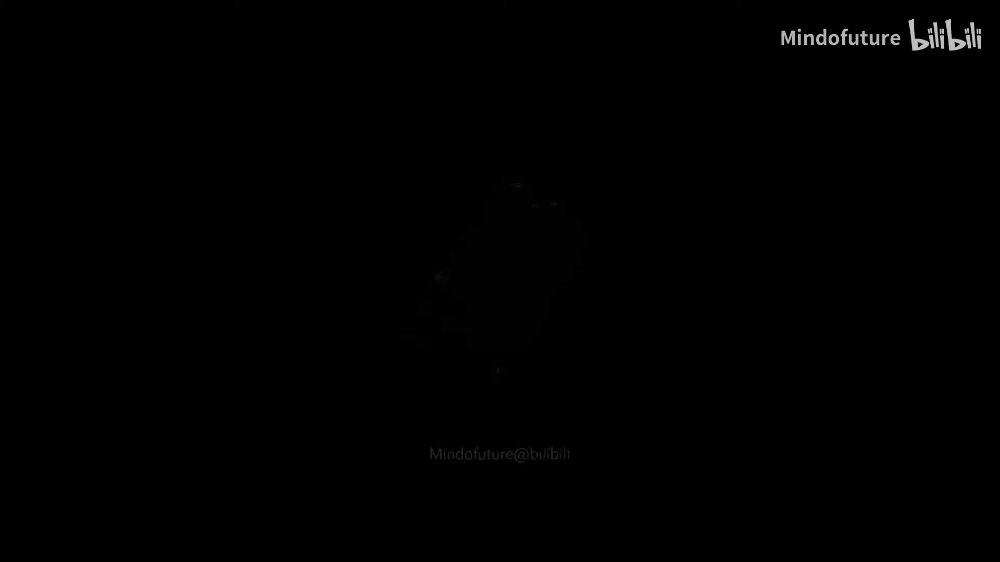

🎼Hello everyone and welcome back to the final video of this Diality Red series So far we've had a look at PCA。

 MDS and TN and now it's finally time to talk about one of the most recent methods which is UM。

According to some memes on Reddit， UMap appears to be superior over TsN。

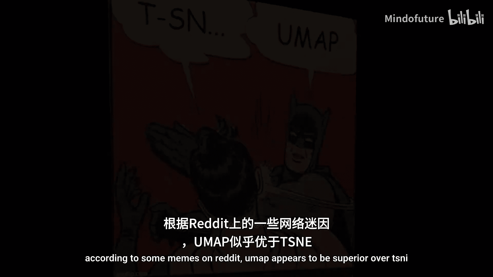

🎼But is this actually true to answer this question。

 we should begin with discussing if there is at all anything that we would like to improve in Tsney。

The techniques we discussed so far are somewhat located at the extremes when it comes to what kind of information is preserved。

MDS， for example， is trying to preserve all global distances。

 and we learned that this is not ideal because it's simply not possible in a low dimensional space。

Tisney， on the other hand， restricts itself to only look at the local neighborhoods and therefore might miss the overall structure in the data。

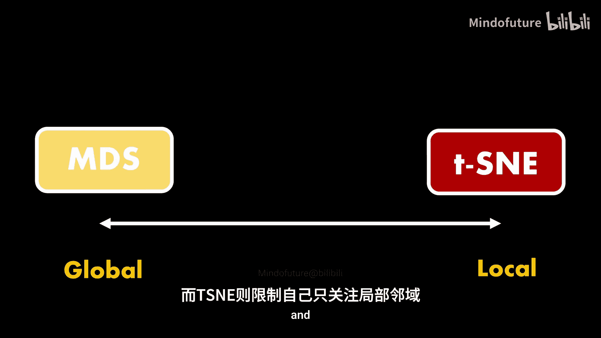

That's also the reason why distances between clusters of Tney points are meaningless。

 The main argument for this behavior is typically that the K L divergence loss used in Tsney doesn't care about the global structure。

 Now， Um claims to preserve both local and most of the global structure of data。

 So it sits somewhere in between。This comes from how the algorithm is designed by paying more attention to the overall geometry of the data。

Well， but there is some discussion around it。 A paper by Kobaach and Lindaman has， for example。

 shown that these differences mainly arise from how the algorithms are initialized。

So there is no evidence per se that Umap has any advantage over Tsney in terms of preserving global structure。

 One clear advantage， however， is the computational complexity， which is close to Linear。

 and therefore faster than the quadratic complexity of the traditional TN。

 as this plot from the documentation shows Um is clearly faster when the data site sizes become larger。

 and the comparison also includes approximations of Tney like Barn Tus。

 which is indicated by the Green Line。 Having cleared up these rumors， Let's now talk about Um。

 UM stands for Uni Manifold approximation and projection。

 The technique was published in 2018 by Leland McKins， John Healy， and James Melwell。

 which are researchers from the Canadian Tut Institute for mathematics and computing。

A historical site note， William Tutz was a British Canadian mathematician。

🎼Reading this paper was very refreshing as it is one of the most comprehensive papers that I've read in the last years。

 in order to understand UM， we will have to make a short journey into the world of topological data analysis。

 In the paper there is a complete section on the theoretical motivations drawn from this field。

 and therefore， we will first build the foundations to understand the rest of the technique。

 As you know， data usually corresponds to a set of points。

 which are arranged in a high dimensional space also called the ambient space。

 Each feature corresponds to a new dimension。 Now， topological data analysis or a short Tda is interested in the shape of the data in the space。

 or in other words， the manifold In the TDA toolbox。

 there are different methods that help us to extract topological and geometric features of the data。

😊。

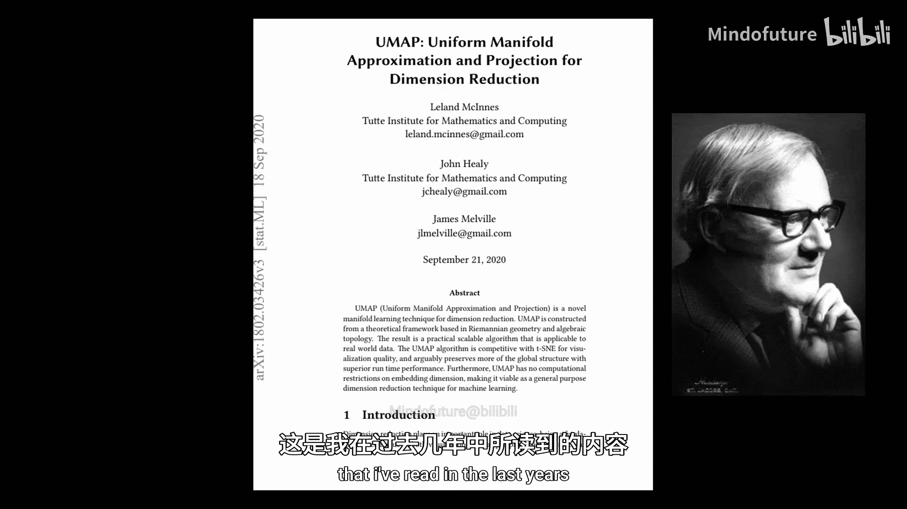

This mathematical field is also called homology。Such features can for example， be connections。

 loops or holes in a data set， and they can reveal interesting details about our data。

So the set of points on the right doesn't give us any topological information per se。

 So how do these methods calculate topological features， All of this is based on triangles。

As you might know， surfaces are often approximated using triangles， and this is， for example。

 used in computer graphics and video games。 Triangles are the simplest polygons and a nice property of triangles is that we can construct all other polygons with them。

 which is called triangulation。 What's even nicer， We can generalize triangles into higher dimensions。

😊。

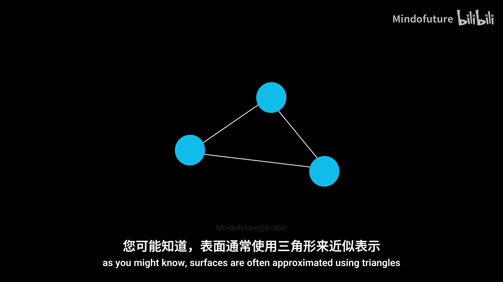

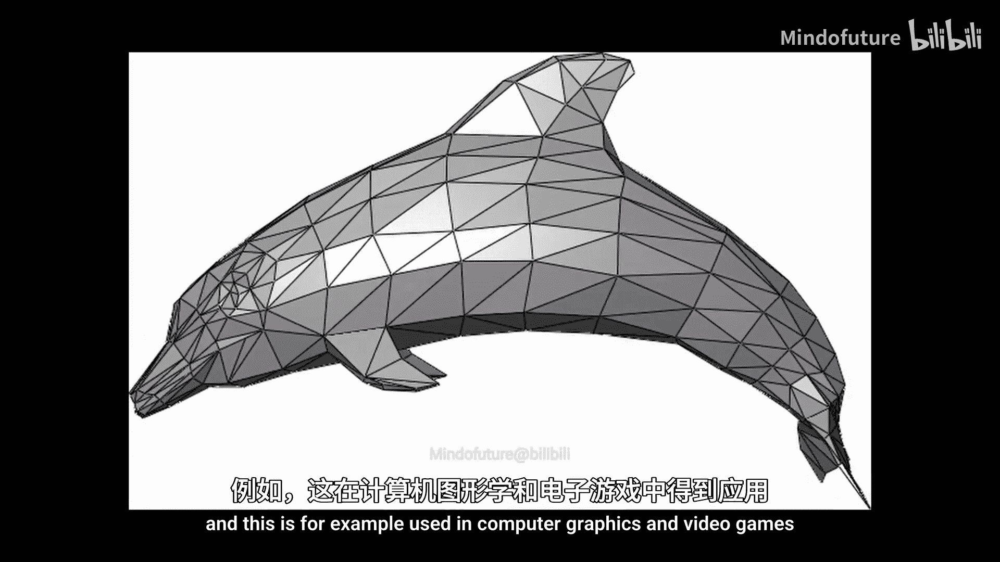

The triangle we I saw is a 2D example for 3D， we call it a tetrahedron。

These generalizations are also called simpleimplices。

One of the most basic ideas in topological data analysis is to simply glue simplelices together along faces to approximate the geometry in the data。

 The result of that is a so called sial complex， which we can see on the right。

 don't take this sketch too seriously， however， because it's just based on0 and1 simplelices。

The takeaway is that we can resemble the topological structure our data by cluing together simpleimplices。

 Later， we will see that a similar approach is used in UMap to learn the local structure of the manifolds for TDA。

 we can now calculate all of our geometric features on this graph directly。

 which is quite convenient。So far so good。 the last question is。

 how do we actually build such a s complex， So how do we glue these things together。

 The general approach used in TDA is called filtration。

We simply put balls of a fixed radius epsilon around each point。

And whenever these balls overlap in certain ways， we connect the points。

This automatically generates a graph for each radius epsilon in sial homology。

 All of this is defined much more concretely。 And， in fact。

 there are different ways to build these structures For U map。

 we mainly care about the Vietorious Ris complex， which is determined by the0 and one simple。

 a great Python library called Chioto TD A has a nice visualization of the filtration procedure。😊。

As you can see with each new radius epsilon， the shape is evolving and we get a pretty good feeling for how the shape of the data looks like。

 which is of course also true for higher dimensions。For UMap。

 this little introduction is probably sufficient at this point。

 but I will talk about one more detail because I simply find it important。

Given this evolving structure， we now have different levels of topological features。

 There's a large hole in the data set at some point。

 which gets destroyed again once the radii becomes too large。

So what level of granularity is the right one to make this even more concrete。

 If we perform filtration on such a shape， we will get information about many small holes。

 but also a big hole。 So how do we know which hole is the feature we are interested in。😊。

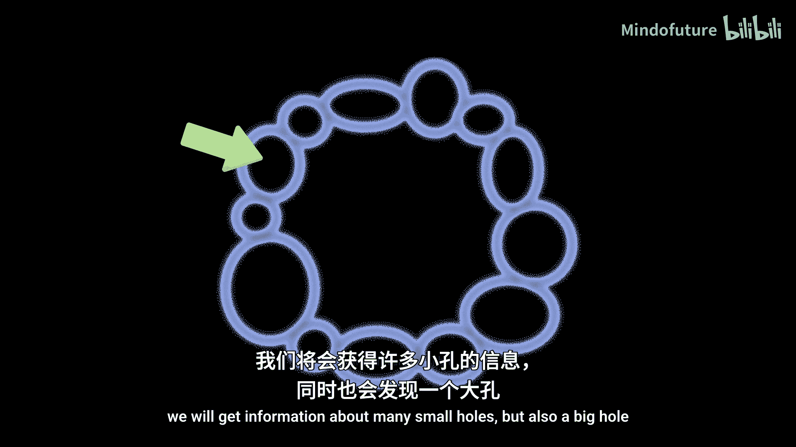

This is where persistent homology comes into play。 It simply tracks the beginning and end of these features throughout the filtration procedure。

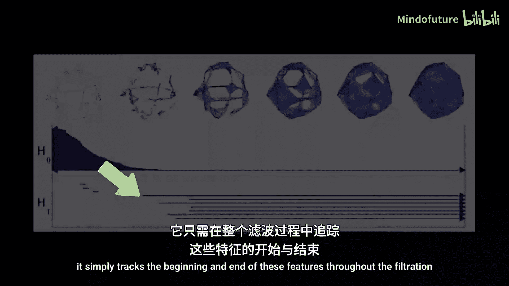

That's also where the name comes from， it checks which topological features are persistent over the radiI。

Thinking about Uap again， topological theory provides guarantees about how the manifold of the data can be captured in a meaningful way。

 And that's why we started this video with this quick primer。

 We can now discuss the Uap algorithm in two steps。 First。

 we construct a topological representation using the viious Fris complex。

 which effectively gives us the can nearest neighbor graph。

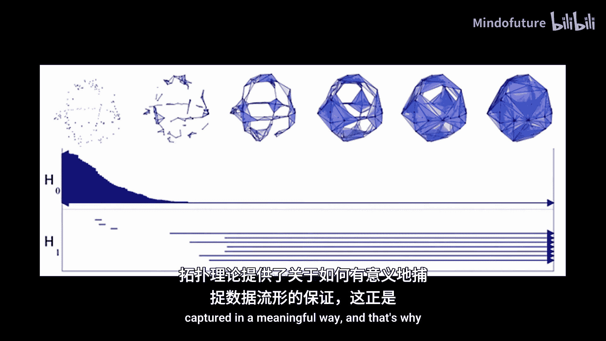

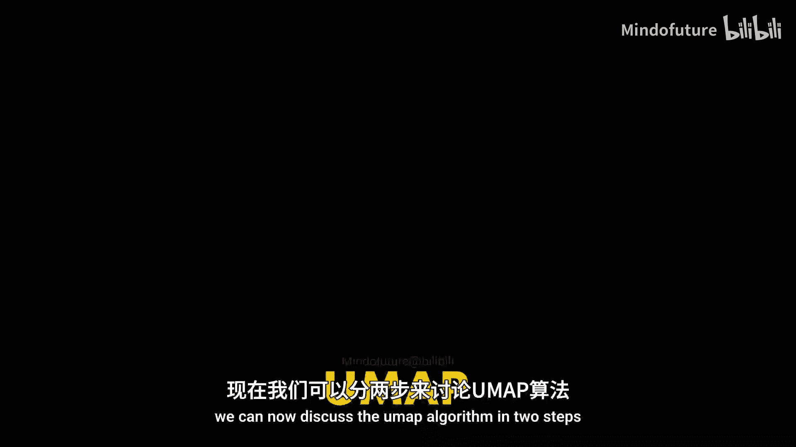

Secondly， we find a low dimensional representation that has a similar topological structure。

 and this in the end is a graph layout optimization in the Euclidean 2D or 3D space。

The actual implementation is quite simple， but the authors emphasized that the mathematical framework serves as a foundation to justify the approach。

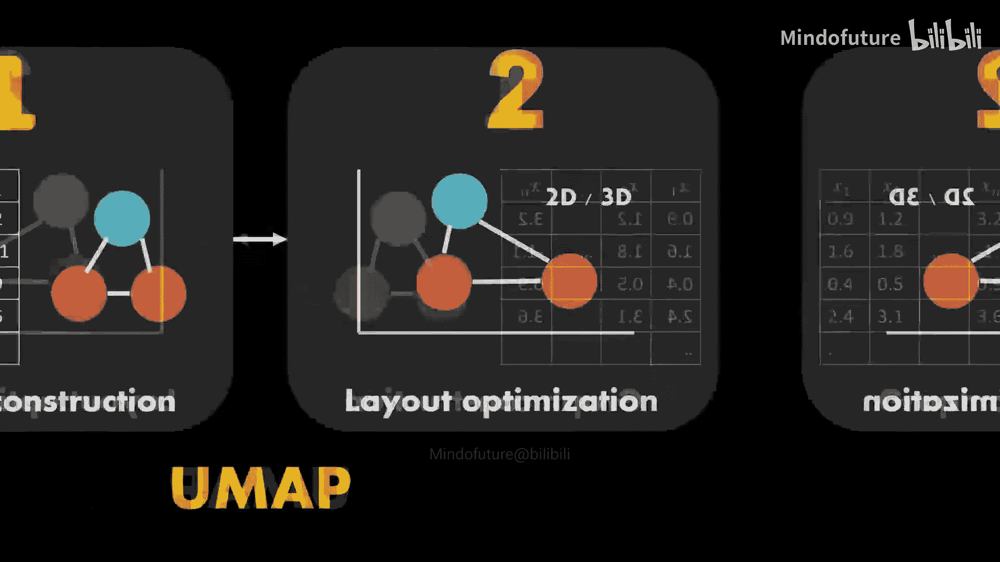

Let's discuss the first step in more detail。In the TDA introduction。

 we learned about the vi Ris complex and how it can be built using filtration by putting a radius around each point。

We will do something similar in UMap。An immediate question now is which raius should we pick to construct a s complex that approximates the manifold on which the data lies？

There is no one size fits all radius for all data sets， and therefore UMap has a hyperparameter。

 which is the number of neighbors。In order to understand why it's not a radius anymore。

 we will have to dig a little deeper。 All of this has to do with the U and U map。

 which stands for uniform。 Let's assume our data lies on this manifold。

If the data is uniformly distributed on a manifold。

 a consequence is that we always roughly capture the same number of neighbors if we position a ball with a radius somewhere。

In this example， we have six neighbors for a given radius。 This would make it quite easy for us。

 as we could always choose the same radius epsilon and capture the topology at the right resolution for the entire manifold。

 There's even a theorem， the nerve theorem， which proves this observation from a mathematical point of view。

 If the data is uniformly distributed on a manifolds。

 a simple complex of the cover of the data will approximate the manifold correctly。

 All of what we've just seen is also formulated mathematically in the paper in Lemma 1。

 Given a Romanmanian manifolds in an ambient space。 and given a bunch of locally constant points P。

 we can approximate the geodesic distance using balls centered at each point。😊。

This means if the data is uniformly distributed， like in this example。

 the geodesic distance on the manifold is simply one divided by the radius of these balls。

 which is simply the average distance between points。

The only problem is that real world data doesn't behave that nicely。

 The data might be scattered around like this。 If we place a ball with the same radius on this collection of points。

 we might get a different number of neighbors for each of the points。

 And one first issue we observe is that the two points on the bottom are isolated from the rest of the points。

In the end， we， however， want to have one global S complex that covers all of the data。

The problem here is that the previously mentioned Nf theorem doesn't apply any more because the data doesn't cover the manifold sufficiently。

 Another problem is that at some places， the balls cover too much。

 which results in very high dimensional simpleimplices。

 That's also not ideal because it simply doesn't reflect the global manifold structure and area。

All of this would be much nicer if the data was uniformly distributed， but what can we do about it？

UMap is called uniform Manifold approximation for a reason。

 so there must be a way to introduce uniformity， and that's exactly what the authors do。

Looking at Lemma 1 once again， the author simply decide to give each point an individual distance function such that the data is approximately uniformly distributed with regard to that metric。

 This way， the assumption of uniform distribution still holds。

 and we are able to approximate the geodesic distance， according to this lemma。

 I found this sketch by Tom Hasgood， which nicely visualizes the effect of this individual distance functions。

😊，To force the data to be uniform， the geometry changes。

 Sprsely clustered regions will shrink and densely clustered ones will be enlarged。

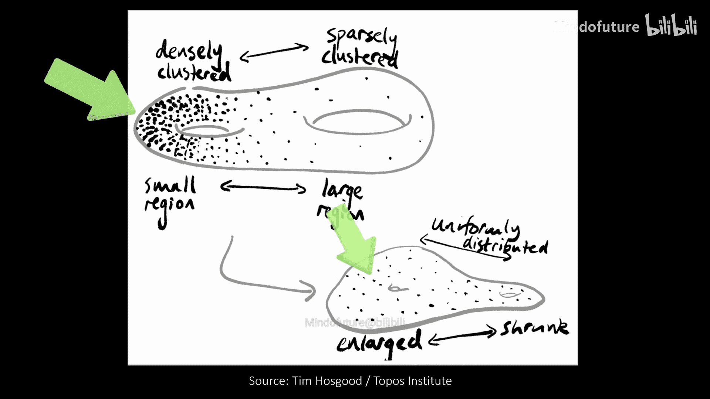

Practically， this means that the balls around each point stretch to the cave nearest neighbor of the point。

Choosing K equals 2， it could look like this in dense and sparse regions。

Instead of choosing the radius， we now simply choose a value for the number of neighbors。

 This is more convenient because choosing actual distances is very data set dependent。

 whereasas a default value， for example，10 neighbors works quite well for most of the dataset sets。

 If we would build a s complex out of this information。

 it would result in a simple graph that looks like this。With our local metric。

 we can now also measure distance between the points。

 and therefore we can also include information about how close the neighbors are。

This means our radioius can be interpreted as the probability that a connection exists。In practice。

 an exponential decay is used around each point to give more weight to points that are closer in the neighborhood。

 This information can also be used in our graph， namely by putting weights on the edges。Here。

 the first neighbor receives a higher weight because it's closer to our center points。Unfortunately。

 using this approach， it can still happen that points become isolated because they are too far away。

 simply because the exponential decay assigns a very small value to them。

The authors decide to add a local connectivity constraint such that the decay starts beyond the first neighbor。

 This eventually looks more or less like this。As you can see。

 we have no exponential decay until the first neighbor。

 and then the exponential decay starts beyond the first neighbor In our graph。

 this leads to a connection weight of one for the first neighbor and then to smaller weights for all other nearest neighbors。

Except for having no isolated points， this also has further beneficial implications。

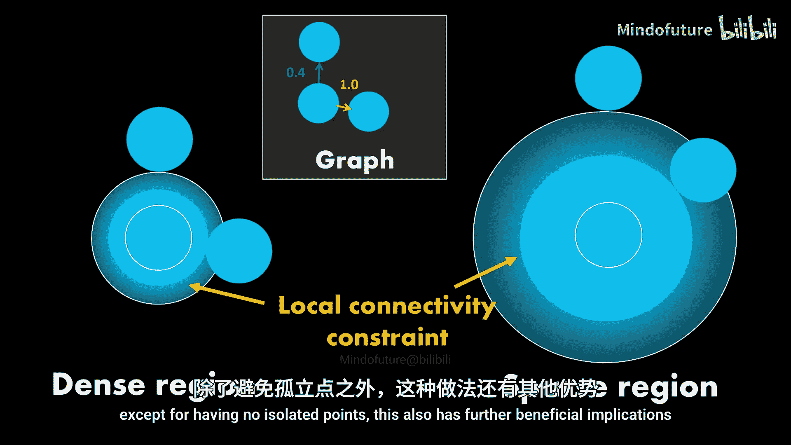

As distances in the high dimensional space tend to be larger to the first neighbor。

 the distance distributions are typically crammed together。

 we've also seen this in the previous videos of the series。As you can see。

 when introducing the local connectivity constraint。

The distributions become a bit wider because it stretches out to the first neighbor。

This result can also be demonstrated mathematically and shows that Um is not simply building a k nearest neighbour graph。

 but many considerations went into the design of the method。

In the documentation for the U Python Library， there' is also nice visualization of the whole graph construction。

 As you can see， the circles around each point stretch to the first neighbor and then start to decay exponentially。

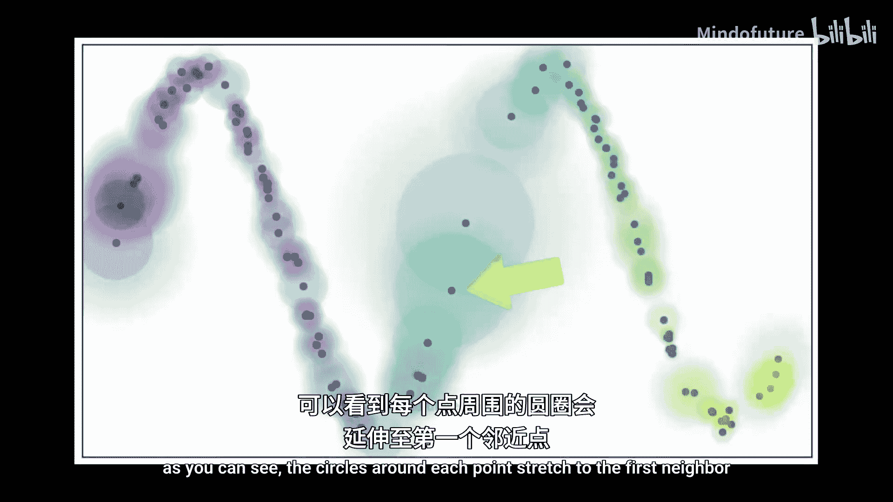

All we've just seen is mathematically expressed in the paper using the following distance function。

 This formula eventually defines how large the radiI around each individual point are。

And as we know by now， this is controlled by the number of nearest neighbors Kate。

 Let's begin with the term on the left。 Here， we find the exponential decay around the centre point that waste the neighbors according to their distance In the exponent。

 we find this complex looking term， which is nothing else but the local connectivity constraint。

 which is discussed visually by subtracting row I， which is defined as the minimum distance among the nearest neighbors。

 We make sure that the exponential decay starts only beyond the first neighbor。

That's because subtracting the first neighbor's distance leads to negative values which are replaced by0 because of the maximum operator。

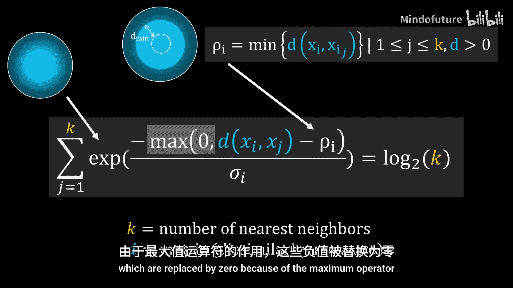

And anything to the power of 0 is one。 So we will always have a connection probability of one。

 It's also possible to visualize this distance function， which you can see here。

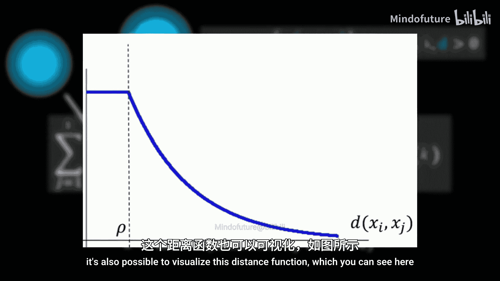

Finally， Sigma eye is a normalization factor that allows to control the intensity of the decay。

If we now sum over the decay distances to all nearest neighbors。

 we roughly want a ball to capture the probability mass of lock 2 of K。

 There's not much information in the paper by lock 2 is used。

 But I read on Github that empirically this leads to better results。

 K simply acts as a global constant that defines how locally we want to estimate the metric。

 If we set it to a higher value， we will have larger balls around each point and capture more of the global structure。

 At this point， one or the other might spot some similarities with Tney。

 I will talk more about this later in this video。 So given this new distance function。

 we now have a local view for each individual point in the data set。

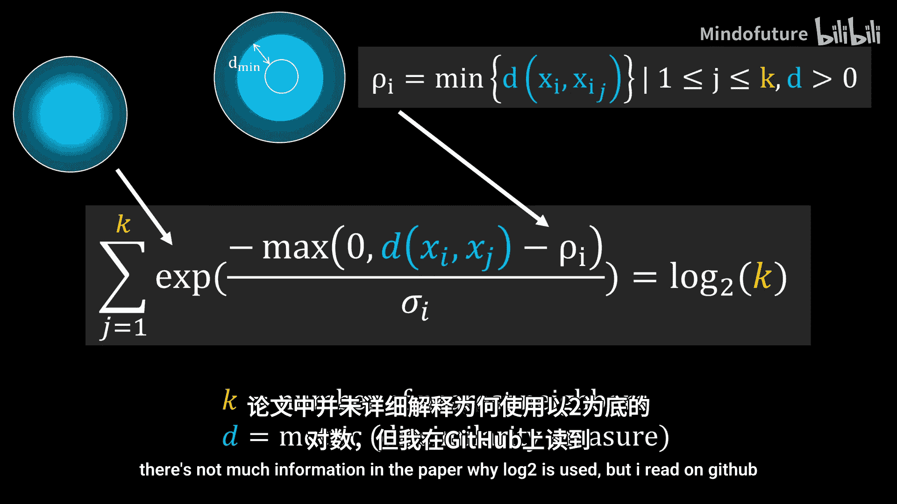

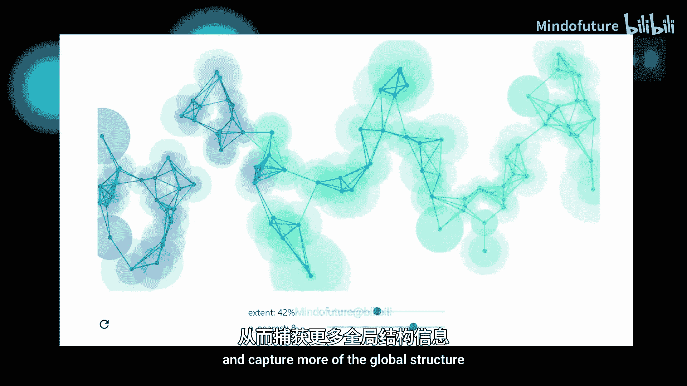

For a specific number of nearest neighbors， such as2 here。

 we get a radius around each point that connects the points to all neighbors within the radius。

 This gives us a graph for each data point。 Most specifically a weighted graph。

 as we can also put the connection probability on the edges to indicate which points are closer than others。

 Note that the edge weights between node are not a symmetric relationship。

 One note might be a nearest neighbor over not a node， but not vice versa。😊。

The real challenge now is to combine all of these individual weighted graphs into one large S complex that represents the entire manifolds。

 How would you come up with， for example， this subgraph。

 given the individual weighted nearest neighbor graphs。

Do we take the max of the edge weights or the average or what do we do？Mathematically speaking。

 we have different local metric spaces for each data points and want to merge them into a joint s complex。

The math section of the paper tells us exactly how this can be done。

 namely by converting the graphs to fussy sial sets。In fussy simple sets。

 the membership is not binary， but instead a probability between0 and1。

And that's exactly the situation we have with our et weights， and in fussy topology。

 there exists already a clearly defined operation for merging representations。

 which can be found in definition 9 in the paper。The basic idea behind it is that the combined edge weight is the probability that an edge exists minus the probability that no edge exists。

 This combined weight then represents the probability that at least one of the edges exists in this formula。

 a corresponds to the adjacency matrix of the graph。 We won't get too deep into the math here。

 but if you want to read more about it， I've added a more mathematical slide deck to the video description。

Following this merging approach， we have a mathematical guarantee that we obtain an appropriate topological representation of the whole data set。

 Now the full picture， we started withdrawing balls around each point to build a s complex。

 Then we made these balls stretch to the ca' nearest neighbor to ensure local uniformity over the manifolds。

😊，Then we added exponential decay beyond the first neighbor to have edge weights that correspond to the distance。

 Finally， we found a mathematically grounded way to merge all of the local views of the topology。😊。

🎼And eventually， we have a weighted K nearest neighbor graph that represents the structure in our data set。

 So now let's talk about the second step， which is how do we produce a low dimensional embedding that preserves exactly this structure。

 We start with our high dimensional weighted nearest neighbor graph。

 Let's call it H for the low dimensional 2D or 3D space， we initialize the points somehow。 Later。

 we will also discuss different ways to do this， But let's focus on more important things first。

 For this set of points， we apply the same procedure as in the high dimensional space。

 which gives us another K nearest neighbor graph with weighted edges， which we call L。😊。

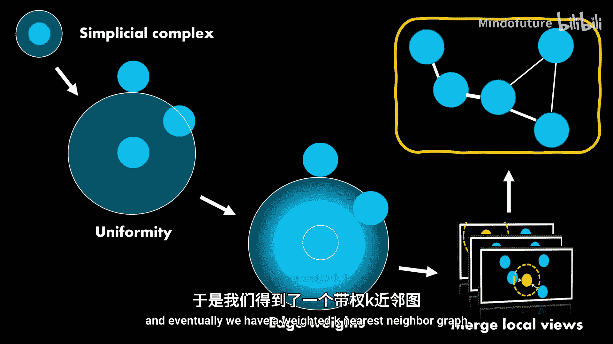

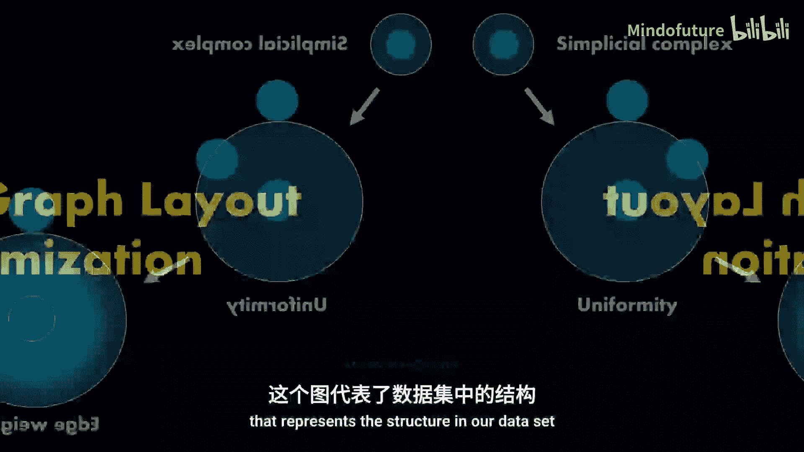

Now， we want to change this low dimensional graph， such that it approximates the high dimensional one as good as possible for this。

 We need to compare the two graphs somehow。 I don't know if you ever try to compare graphs。

 but it's a challenging problem Here， we luckily have a one to one correspondence for the notes。

 because we can simply say this high dimensional point belongs to this low dimensional point。

As a result， the only thing we actually need to compare are the edges or more specifically。

 the edge weights。

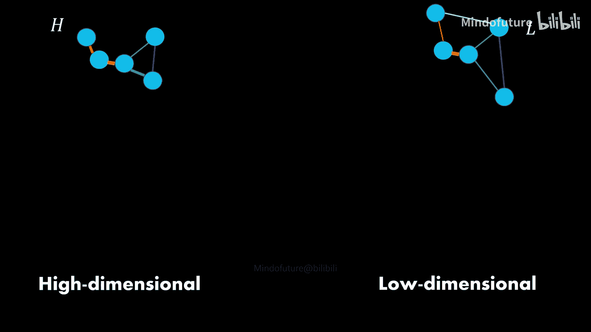

When taking a look at the UMap Python implementation。

 we can see that the comparison between these graphs is nothing else but the comparison of their adjacency matrices these are the adjacency matrices of our two graphs and the entries can be simply interpreted as edge probabilities。

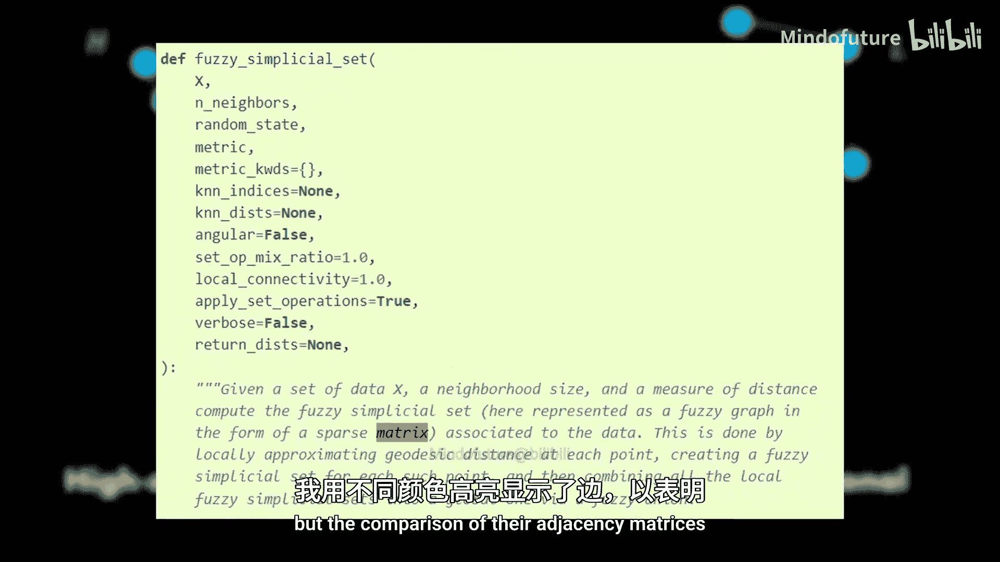

I highlighted the edges in different colors to show that the graphs can have a different number of edges。

 and therefore， it doesn't suffice to only compare the existing ones。

 but also the non existing edges。 In other words， the adjacency matrix will consider everything at the same time。

 and therefore is the only reasonable choice here。😊。

By moving the lower dimensional adjacency matrix closer to the high dimensional one。

 we end up with a graph that approximates the original graph H。Okay。

 so how do we actually compare the two adjacency matrices。

 Do we subtract them from each other or what is the right way， The edges are simply Bnooli variables。

 and therefore it makes sense to use the cross entropy over all existing edges。

 Let's inspect this formula closer。Cross entropy simply compares the edge probabilities for the high and low dimensional graph for both cases when edges exist and when edges don't exist。

On the left are all of the existing edges and on the right。

 the adjacency matrix shows one minus the edges which gives values for the non existing edges。

The first term then simply makes sure that the low dimensional points are close to each other when they have a high edge probability。

 and the second term makes sure that the points with low probabilities will be far away in the embedding space。

 Using this loss function， we can simultaneously optimize the position of all points。

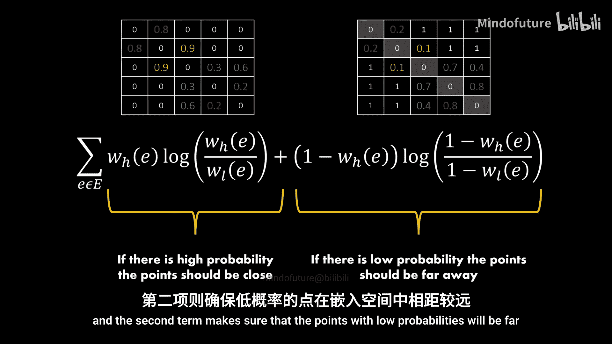

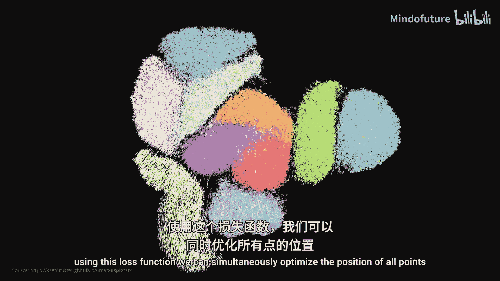

You probably already guessed。 We can adjust the coordinates of the low dimensional points using stochastic gradient descent using this loss function。

 The authors mentioned that using this loss function corresponds to a force directed graph layout algorithm。

This simply means that the points push and pull each other until a steady state is reached。

 We've also seen this in the Tsny video in case you are interested。

 it is even possible to derive the exact attractive and reposive forces。

 Given this optimization function。 Y I and Y J correspond to the coordinates of two low dimensional points for edges between these points with higher weights。

 The attractive forces are stronger， whereas lower weighted edges have stronger reposive forces。😊。

You can find more details about this in the U map paper。

 So those were the most important aspects of U map。 And before we do a little bit of hands on coding。

 let me quickly talk about four more minor things that are used in the actual implementation。

 We haven't talked about how the key nearest neighbors are actually found。

As this needs to be done many times and therefore should be fast， the efficient。

 canous neighbor descent algorithm is used。 It has an empirical complexity that is close to linear。

 It's an approximation by only looking at neighbors of neighbors instead of the full data set。 Next。

 the actual loss function is slightly simplified as some of the terms can be removed。 Additionally。

 negative sampling is used to not deal with all negative edges in the adjacency matrix。

 This speeds up the optimization。 Finally， the initialization of the low dimensional points is not random。

 but the authors use a technique called spectral embedding。 I won't go into the details here。

 but you can simply think of it as a technique designed for graphs。 or more specifically。

 their adjacency matrix。 and this leads to a better starting position for the low dimensional points。

😊。

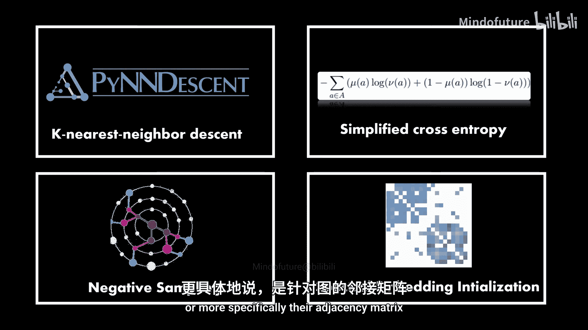

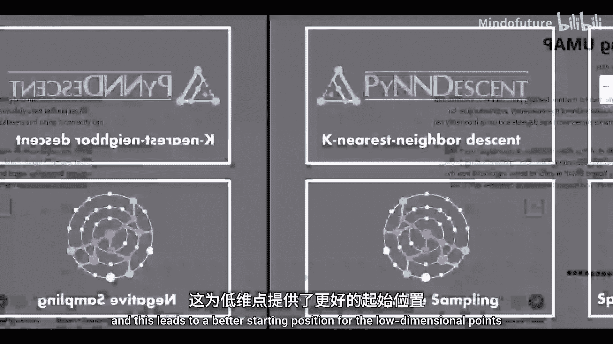

Now let's do a little bit of hands on coding。 And before that。

 I can recommend to take a look at this website， which is built by different researchers from Google。

It's an excellent playground to experiment with UM hyperparameters。

The certainly most important hyperparameter of UMap is the number of neighbors。

This interactive visualization helps to get a feeling for it。

The second most important parameter is Min disk， which controls how tightly the points clump together。

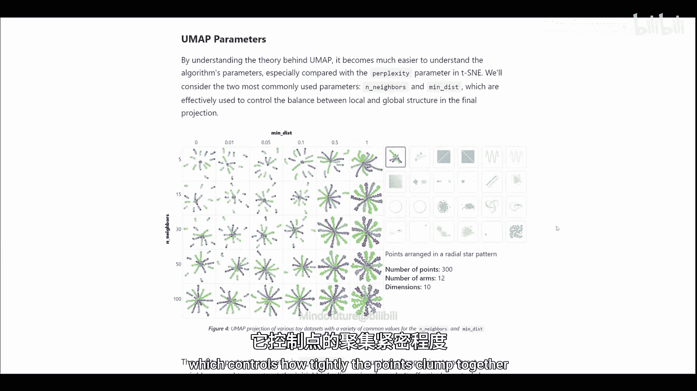

Okay， so just like before we run the dataset cell in order to have access to our dataset set。

 So as you can see， we import Umap from Umap， so not from psychic learn。

 And the reason for that is that Um has not been added to psychic learn so far and there have been some tickets where people ask if Umap will be added in the future。

 which would be， of course， quite convenient。 but the justification also makes sense which is simply that the Um package itself is already nicely maintained and there are not many reasons to included in psychic learn。

 Okay， so we can use Um using the Umap class and then we define the number of components in this example we have three because we have three dimensions down here。

 And then number of neighbors is。

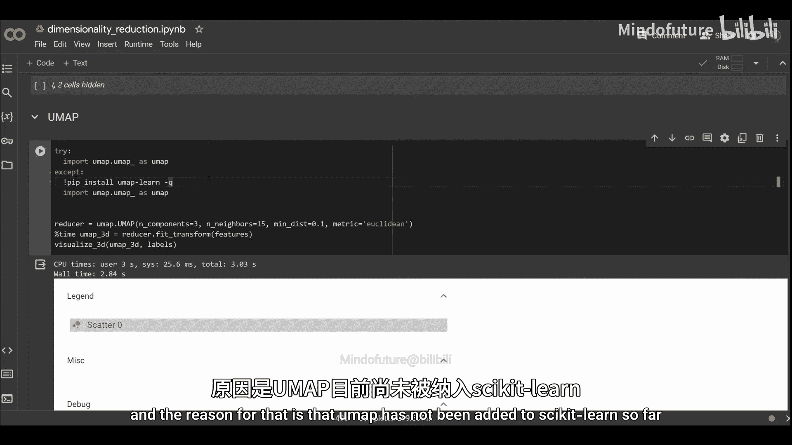

How many nearest neighbors we want to use in that algorithm。

 And then Mins defines how closely the points can be。

Placed next to each other in the low dimensional embedding。 And then we can also use metric。

 which defines the metric we want to use to calculate the distance between the points。

 And if you want， or if you need more help with the parameters。 the U map documentation is excellent。

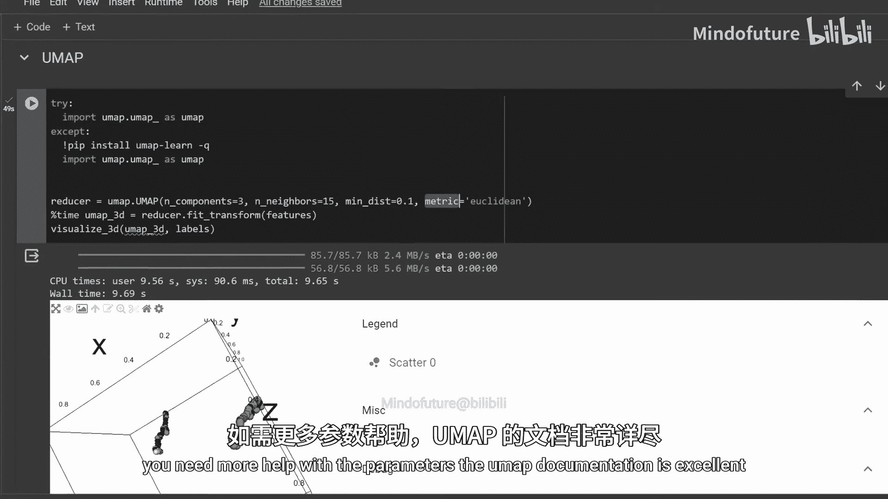

And there is also a lot of examples。 and those four are basically the main parameters of U map。

 So it's quite simple。And when we run this， we can also call fit transform form like before。

 And this leads to。Arrangements like this， and we can also do it for the two dimensional space。

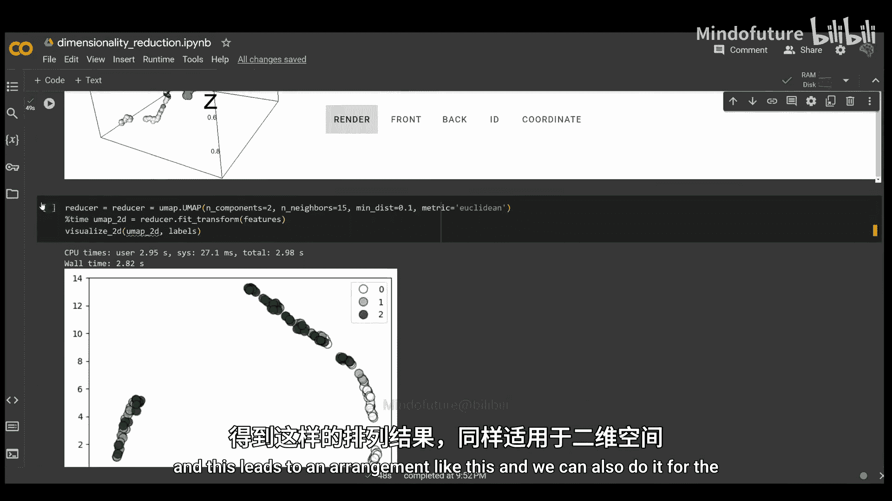

To finalize this video， let's quickly revisit the connection between TN and UMap。

UMap and TN are quite similar in many aspects as they both create low dimensional embeddings based on the nearest neighbors。

When we look at the distance functions， we spot a few similarities。

 both use exponentially K and have a sigma to control the intensity。Um， in addition。

 has the local connectivity constraint， which has beneficial effects for maintaining the global structure In Tesney。

 we used perplexity to adjust the resolution scale between more local and more global views。 In Um。

 we can use the number of nearest neighbors， which is not just more intuitive。

 but also easier to pick。 There's literature that discusses more connections between those two。

 and it is argued that Um is simply a special case of Tesney。

 Let's complete the series by filling out the comparison table that we used throughout the videos。😊。

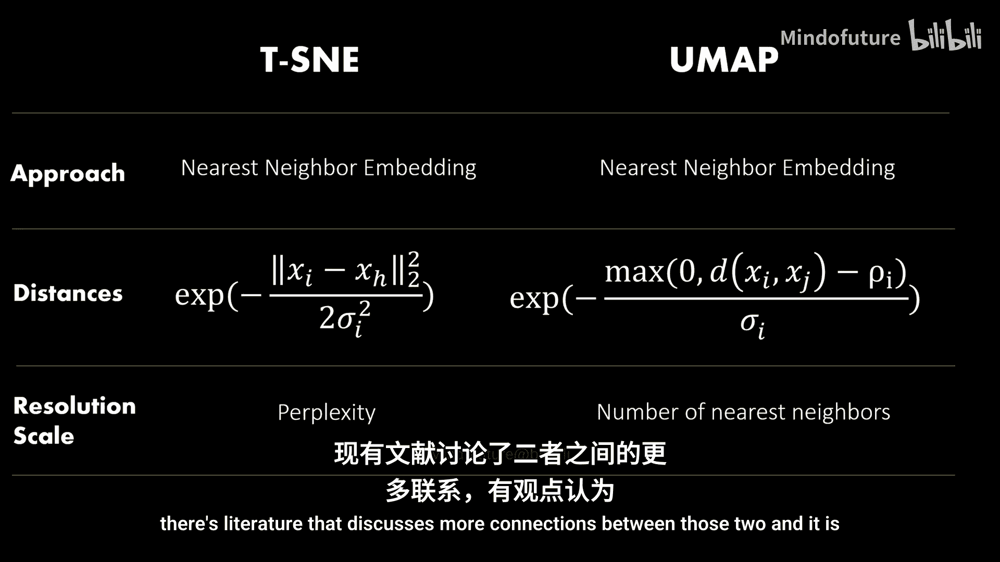

UMap is a local and nonlinear manifold learning technique。

 that's because we try to approximate the manifold using the nearest neighbors of each point。

The main purpose is visualization and data analysis。

It is not deterministic because there are stochastic components that come from the approximations used to speed up performance。

The computational complexity of Um is N to the power of 1。14。

 and this bound comes from the nearest neighbor descent algorithm and was estimated empirically。

 We also discussed the two most important hyperparameter。 The number of neighbors and mend。

 The key ideas motivated mathematically and aims to build a fuzzy symbolial complex。

 and this in the end， leads to a canies neighbor graph。 Um has become very popular in bioinformatics。

 But beyond that， I haven't looked into any other applications。

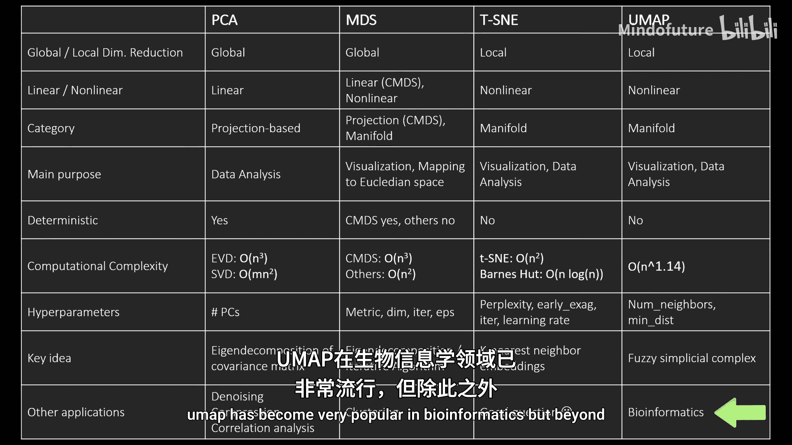

Congratulations with this you have successfully completed the Diality Reduction series In total。

 this summed up to around two hours of videos and I hope it served as a solid foundation to get you started。

🎼With these four techniques we have， however， just scratched the surface and there are plenty of other methods out there。

 maybe I will add more videos to display playlist in the future。

So thank you for watching and see you soon。

