# 陶哲轩《人工智能与数学｜Terence Tao at IMO 2024 AI and Mathematics》中英字幕（豆包翻译 - P1 - GPT中英字幕课程资源 - BV1c946eVEPu

Hello， everyone。Hello。Hello everyone。Some of you， their contestants， are very young。

 so perhaps you do not know who is Professor Ternce Taow。So just a few words of introduction。

He participated at the IMO when he was for the first time when he was 11 years old。

 and he received a bronze medal Next year， he came back and he received a silver medal。After that。

 at the age of 13， he received a gold medal and he was the youngest participant to receive a gold medal。

Then。He， I don't know。 Get bored， and he went to university。

 and he didn't participate at the Imo anymore。 Now。

 he is a professor at the University of California， L A。

And I can say that he is definitely the biggest I amO star。 and， of course。

 one of the most influential mathematician of our time， especially for you， Professor Darren Star。😊。

Thank you。 I'm very having you back here at an IO。The time I had AMM was one of the most fun times of my life。

 I still look back on it fondly， I hope we all had fun， not just in the competition。

 whether you get a good score or not， but also in the social activities。

 it was really they always host a really good event here。😊。

So my talk is on AI and more generally machine assistance in mathematics。

 so you've all heard about AI and how it's changing everything。

 I think earlier today there was a talk by Deep Mind on how they release a new product alpha geometryometry that can answer some im geometryometry questions now。

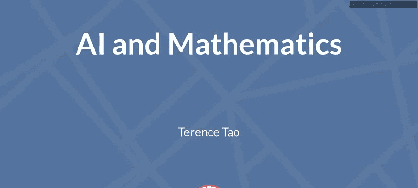

And there will be a presentation on the AI Ma Olympia right after my talk， actually。

 so please stay after my talk for for that。So I'll be talking more about how these tools are beginning to change research mathematics。

 which is， which is different from competition mathematics。 instead of having three hours。

 whatever to solve a problem。 You take months。 And sometimes you don't solve the problem。

 Then you have to。Change the problem。 It is definitely not the same as math competitions。

 although there some some overlapping skills。So it's over exciting。

 and it's beginning to be transformative。 But on the other hand， there's also a sense of continuity。

 We've actually been using computers and and machines to do mathematics for a long time。

 And it's just the nature of the way in which we're doing it is changing。

 But it actually is following on a long tradition of， of machine assistance。😊，嗯。So， okay。

 so here's a question。 how， how long have we been using machines to do mathematics？

 And the answer is thousands of years。 I mean， okay。

 here's a machine that the Romans used to do mathematics。

 Look at the abacus on the early early machines is even some earlier ones。Okay。

 so that's kind of boring。 Okay， that's not a very smart machine。 What about computers。

 how long have we， we use some computers do to mathematics。That's about 300400 years。

 I think that's bit weird because you know， the modern computers we didn't have the electronic computers book。

Until the 1930s and 1940s。But computers weren't always electronic for that。 They were mechanical。

 And then before that， they were human。 The， The computer was actually a job profession。

 someone who computes。

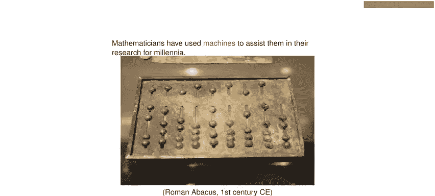

Here is a cluster of computers during the World War。 so to compute ballistics and other things。

 they had a whole cluster of computers who were hugely girls because they had the men of fighting the war with us adding machines and it was basically and there were programmers who basically just told the girls what to do。

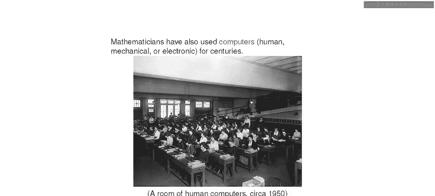

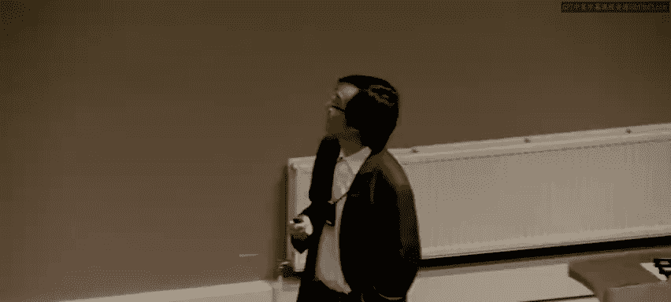

The you know， the basic unit of computational power at the time was not the CPU。

 It was the kilo girl。 It's a kilog hour。 So how much how much computation you can do by with 1000 girls working like this for one hour。

So， but we've been using computers actually even before that。

 as I said since the 1700s or even earlier， the most basic use of computers in those times was to build tables。

 So of the login tables of Napiier， you know if you wanted to compute science and co-sines and so forth。

 you used a computer to generate these huge tables。

 when I was two in high school we still in our curriculum。

 learn how to use these tables that were just being phased out。

Because now we had calculators and now computers。We still use tables today， I mean。

 in mathematical research， we rely on tables。 we call them databases now。

 but it's still the same thing。There are many， many important results in mathematics that were first discovered through tables in number theory。

 one of the most fundamental results in number theory is called the prime number theory。

 It tells you roughly how many primes there are up to a large number of X and it was discovered by Lejonder and Gaus。

 they couldn't prove it， but but they conjected to be true because Gauss and others they basically had computers。

 In fact Gaus himself was a bit of a computer。 to compute tables of the first millionian primes and tried to find patterns。

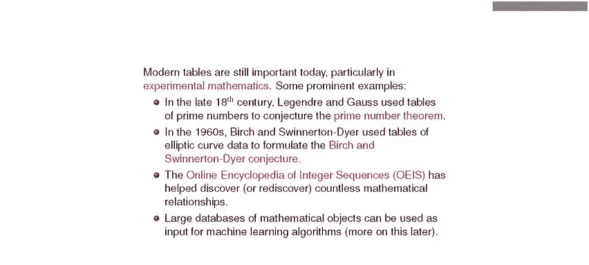

And then a couple centuries later， there's another really important conjecture。

 so the panormal the was eventually proven in like 1907 or so。

 but there's another really central problem in number theory called the Bur Sw and die conjecture。

 which I want to talk about here。 but it was also first discovered by looking at lots and of this time。

 tables of data about electrictic curves。

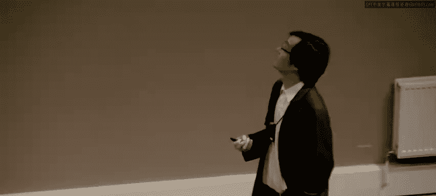

A table that lots and lots of mathematicians use now， including myself。

 is something called the online encyclopedia Inger sequences。 Maybe you've encountered it yourself。

So you may recognize many integer sequences just from memory， like if I tell the sequence 1，12，3，5。

813 you know what that is as if you're actually sequence and the OEIS is a database of hundreds of thousands of sequences like this and many times when a mathematician is working on a research problem。

 there is some natural sequence of numbers associated maybe there's a sequence of spaces depending on n and you take compute the dimension or how many or the cardinality of a set or something。

 and you can compute the first five or six of these or10 these numbers put and then compare it into the OEIS and if you're lucky。

 this sequence has already been been put there by somebody else who has and it came from it was discovered from a completely different source coming from studying some other mathematical problem and then that really gives you a big clue that there's a connection between two problems and many。

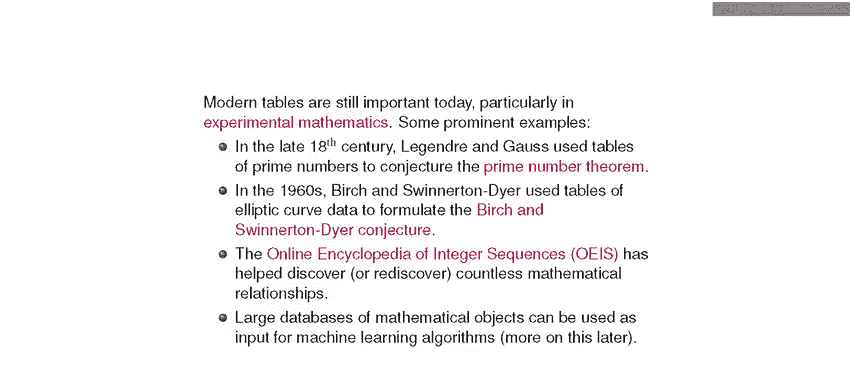

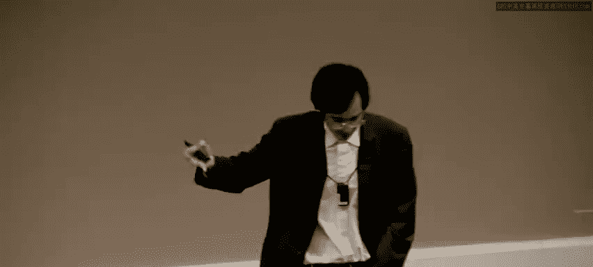

Many promising productive research has come up that way。Okay， so tables。

 one of the earliest ways we've been using computers。

 most famous when you think of using computers to do mathematics。

 you think of number crunching the former name for this is scientific computation So you just even want to do a very big calculation and you just do lots and lots ofritic。

 you source it out to a computer。 And so we've been doing that since the 1920s。

 maybe the first person to really do a scientific computation was Hendric Lorenz So he was tasked by I think the Dutch to figure out what's going to happen。

 they wanted to go a really giant diyke the athlete diyke and they wanted to know what happened in the water flow。

 And so they had a models and fluid equations。 And so he used a whole bunch of human computers actually。

 to work us out。 he had to invent floating pointtic to do this。

 So he realized that you wanted to get a lot of people to do a lot of calculations very quickly。

 you should represent lots of numbers of different magnitudes as floating points。So， of course。

 we now use computers to model all kinds of things if you're solving linear equations or partial differential equations。

 you want to count some commatorial do some commatorial calculations。

 you can also solve algebra problems So in principle。

 like all the geometry questions not quite all but many of the geometry questions you see olympias can be solved in principle by scientific computation。

 there are these algebra packages that can solve you can turn any geometry problems involving 10 points and some lines and circles into a system of equations of 20 real variables in 20 unknowns and just wack into stage or maple or something。

 unfortunately， once it gets beyond honest of the size。

 the complexity becomes exponential or even double exponential And so until recently it was not really feasible to just brute force these problems with just standard algebra packages but now with。

Assistance it's more promising。So you heard to talk about that this morning。

Another type of scientific computation that has become quite powerful is what are called satilvers。

 satisfiability solves。 So these are meant solve basically they solve logic puzzles like if you have 10 statements that or maybe 1000 statements that are true or false and you know that maybe if the third statement is true and and the six statement is true。

 then the seven statement must be false and if you've given a whole bunch of constraints like that。

 a SaATs will try to take all this information and conclude know can you prove a certain combination of these sentences or not。

And then there's a more fancy version of a sat server called an S T server satisfiability module theories where you also have some variables X。

 Y and Z， and you assume some laws like like maybe there's an additional operation and is commutative and associative and you plug in these laws as well as some other facts。

 And you try to just brute force， Can you deduce some conclusion out of some finite set hypotheses。

 So those are quite quite powerful。 But unfortunately， they also scale they don't scale world at all。

 Again， the time complexity to solve them grow exponentially。 And so once you get。😊。

Pass 1000 or so propositions。 it becomes really， really hard to。

 for these sostruct run in any reason on of time。But they can actually solve some problems。 So。

 so one recent success， for example。Here's a problem in commatorics。

 which probably will only ever be solved by computer。

 This is this will not be possible to solve by by a human， I think unassisted。

 So it it concern what was called the Pythag triple problem。

 which was which was unsolved until until this big computer sat silver calculation。

 So the question is， you take the natural numbers。 And you color them two colors。 red or blue。

But the question is， is it true that no matter how you color these two the natural numbers。

 one of the colors must contain a Pythag and triple， ABC。

 three numbers which form the massage for language like 345？And so this was not known to be true。

 We have no sort of human proof of this， but we have a computer proof。 It is now known that in fact。

 you don't need all the natural numbers。 You just need to go up to 7824 that no matter how many ways you can color 7824 into two color classes。

 one of them will contain a Pth triple Now there's two to the 7，8，24 such classes。

 you can't do it by brute force。 Okay， so you have to be somewhat clever。 but it is possible。

 And then if you do that。And then a77，8，2，5。Sorry， once you do have 7，82，5。

 you must have a pathogenthgon triple， there is an example of 7。

824 where there's no pathogenthgon triple when you need the class。So that's approval。 actually。

 I think it it's the at the time， it was the world's longest proof ever。

 I think now is the second longest proof。 the proof required a 7 CPU user computation。

 and it generated a proof certificate。 So the actual proof is 200 TB。

 although since been compressed to a mere 86 GB。😊，嗯。

So this is one way in between using computers just to do enormous， basically enormous case analysis。

 So that's fairly obvious way to use computers。 But in recent years。

 we're beginning to use computers in more creative ways。

So there are three ways in which a computers are being used to， to do math language。

 I think I really excited， particularly when they are combined with each other。

And with more classical databases， know， tables and and symbolic computation， scientific computation。

So first of all， were using machine learning， neuraler networks to discover new connections and find out ways in which different types of mathematics are correlated in ways that you would not see as a human or unlikely to see as a human most especiallyly there a large language models。

 which are in some sense， very large versions of machine learning algorithms。

 which can take natural language like chat GT in cloud and so forth and they can sometimes generate possible proofs approaches to problems。

 which sometimes they work sometimes they don't youll see a bit more examples of this actually in the talk aftermath。

But then there's also another technology which is just becoming usable by the everyday mathematicians。

 which are called formal proof assistance。 So these are languages。 so know languages。

 computer languages you use using to write excecutable code programs that do things formal proof assistance are languages that you write to check things to check whether a certain argument is actually true and actually gives you the conclusion from the data and these have been fairly annoying to use until very recently and they're becoming now somewhat somewhat easy to use and they are facilitating a lot of interesting math projects that wouldn't have been possible without these proof assistance and they will combine very well in the future with the other tools I described here。

So， so I want to talk about sort of these more modern ways to use machines and and computers to do mathematics。

 So I think I started with proof assistance。Yeah， so the first really computer assist proof， maybe。

In history was the proof of the whole color theorem every plane a map can be colored using 24 colors that was proven in 1976。

 this was before proof assistance there wasn't really it wouldn't really be called a computer proof nowadays it's a proof which it was a massive computation like half of which was done by a computer and half of which was done by humans。

嗯。The way they prove the full color theorem is that you basically induct on the number of countries and you show that if you have a massive map。

 there is some subgraph of countries， there's a producer list of about 100。

2000 special subgraphs and every big graph of countries had to contain in some sense。

 one of these subgraphs that was one thing they had to check and then they had to check every time you had a subgraph。

 you could replace that subgraph with something simpler and you could fourcol the simpler thing you could color the main thing and you have to check these properties。

 I think they called dischargechargeability and Reducibility for each of these 1000 or so so graphs。

😊，I think one of these tasks they could do by computer， although this was a 1970s computer。

 I think they had to enter in each graph by hand into this one program and check it。

 the other task was actually done by a human computer。

 one of the daughters of one of the authors actually had to spend hours and hours is manually checking I think the reducibility。

 it was very tedious And and the process was not perfect。

 There were lots of little mistakes and they had to update the table。😊。

So it was not by modern standards as a computer proof computer verifiable proof。

 that was only came much later in the 90s， where there was a simpler proof using a mere 700 or so graphs。

 But now all the things that need to be checked。 it was a very precise water fine list of properties。

 And could you could write code in your favorite computer language C or Python or something。

 And you can check it in a couple pages。And a couple of hundred lines of code in like a few minutes with a modern computer。

嗯。And then to actually check that is completely to write a proof that goes all the way down to the axioms of mathes that was done in 2005 using a proof of language called Kock。

 I think it now renamed Ro。嗯。So that was one of of the first proof。 And see。

 there's a huge gap between sort of when the proof first appeared。

 and then when when we actually could， could completely verify by computer。

Another famous example is the Kepler conjecture for sphere packing This is a really old conjecture of Kepler from the 17th century。

 it's very easy to state， you take a whole bunch of units spheres and you want to cover three- dimensional space as efficient as possible so there's sort of an obvious way to try to pack spheres is the triangular packing sorry like the way you pack oranges at a accuracy store。

 there's also a dual packing called the cubic packing which has the same density。

 so there's a density of about 74% which is of the obvious packing and the question is is that the best possible。

And this turns out to be a surprisinglyly hard problem。 In two dimensions。

 the exact packing is not too hard to show。 it's the best。Only very recently in 8 and 24 dimensions。

 do we know the answer as a great work of Yesosovska。 Maybe she talked about it yesterday。嗯。

But but three was， was3 is the only other case that we know except for one， which is trivial。

 But yeah， surprisingly difficult to prove。 Again， there is no completely human readable proof that of this conjecture。

 There is a strategy。 So， of course， the problem is that there there's infinite many of these。

 of of of， of， of these。Of these fears， and the density is asyhnttic thing。 So it's， it's not a fine。

 It's not a priori a finite problem。 you can just store a computer。

But you can try to reduce it to a finite problem。 So there' is a strategy proposed by Toth in the 50s。

 So every time you have a packing， it subdivs space into these polyhedral called void regions。

 so the polytope of a sphere。 It's just all the points that are closer to the center of that sphere than to all the other spheres。

 so you can sort of split up space into all these polytopes and these polytopes have certain volumes。

 you can also count their faces and the surface areas and so forth。

 And so they all have these statistics。And the volumes like the packing density is very closely related to sort of the average volume of these regions。

 So if you can say something about kind of how these volumes or these polytopse depend on behave on average。

 then you could get at least maybe some upper bound onto how efficient these packings can be and you can try to make relations between these polytopes。

 like if one polytopbe is very big， maybe this forces the nearby wants to be very small and so maybe you can try to find some inequalities connecting。

connecting the volume of one or cell to another。 And so talk。

 maybe you should just collect lots of lots of these inequalities and then do some linear program or something。

 and hopefully you can you can just derive the right bound of this magic pile of32。

 which is the density from all these inequalities So people try this there are many attempts。

 some even claim success。 but none have been accepted as actual actual proofs。😊，嗯。

So the problem was eventually solved by Thomas Haes and his call others so。

He did more basically the same strategy。 but but using lots of technical tweaks。

 he changed the cells fromvono cells to slightly more fancy cells。 And instead of taking the volume。

 he invented the single score。 you're assigned to each of these it's the volume possible minus lots of little ad hoc adjustments。

But again， with the aim of trying to create all these linear inequalities。

 between these different scores and to eventually get upper bound of density and to hopefully hit exactly the optimal density。

嗯。So it's a very flexible method too flexible because there's too many things you can try。

 can there's so many ways you can set up a score and so forth。 So there's a quote here。

 So semi Ferguson was the。 sorry the name。 So H and Ferguson realized that every time he encountered problems in trying to minimize his functions and so forth。

 he could just change the score and tried again But then all the things that they checked they had to redo。

 And so the scoring function became more and more complicated。

 they worked on this for almost a decade， I think and it became it became more more complicated。

 but each change cut or use my work。😊，This incessant fiddling was unpopularably with my colleagues。

 Every time I presented my work in progress at a conference， I was minimizing a different function。

Even worse， the function was mildly incompatible with what I did in earlier papers。

 And this required going back and patching the earlier papers。嗯。But they eventually did it。

 So in 1998， they announced that they had finally found a scope which obeyed a whole bunch of linear inequalities in 150 variables。

 which they minimize and got their thing。Initially they did not plan to make this a computer assist proof。

 but as the project became more more complicated。 it was inevitable。

 they had to use more and more computers。 Yeah， so the proof was enormous by standards in 1998。

 it was 250 pages of notes and 3 gigytes of computer programs and data it actually had a very tough time getting referee Yeah so it got sent to the top general mathematics。

 one of the top analyst mathematics and it took four years to refer of panel2 referees and at the end they said they were 99% certain of the corrects of proof but they could not certify the corrects of the computer calculations and they did a very unusual thing actually is that they published the paper with a little caveat editors saying this They have since removed that caveat actually at the time。

 there was a lot more controversy as to whether a computer system proof qualified as an actual proof now I think if we have much more comfortable with it。

嗯。But even after it was published， there was doubt about whether it was really， really a proof。

 So this was maybe the first major high profile problem where it was really a big incentive to really formalize this in completely all the way down to first principles in a formal proof language。

And so Ha was in created a language Well a modification of of existing languages to， to do this。

 He called it the flype Project。 He estimated it would take 20 years to， to formalize his proof。

 but actually with the help of 21 collaborators。 He actually finally mere 12 years and。

 it finally got appeared in 2014。😊，Okay， so， so we now have sort of complete confidence in this particular result。

 but it was quite a painful thing to do。So moving now to in the last few years。

 we've now figured out sort of a better workflow for how to formalize。 It's still tedious。

 but it is getting better。 So Peter Scher who is a very prominent young mathematician。

 George was Meist， for instance。 So he's famous for many， many things。

 but he created this this amazingly promising。😊，Area mathematics it's called condensed mathematics。

 it deploys the power of algebra category theory and all the tools from algebra to apply to functional analysis。

 The theory of functional spaces like B spaces and so forth。

 which an analysis has really been resistant to the of algebra。

 but this area mathematics in principle， could allow one to solve questions in at least functional analysis。

 certain types of questions with algebraic methods。 So he set up this whole category。

 these things called condensed groups and condensed vector spaces would take too long to explain what condensed means。

Yeah， basically his thesis is that all our categories of function spaces that we learn in our graduate classes are incorrect。

 or they're not particularly natural ones， they're ones of better properties。😊。

But so he set up this theory。 But there was this one very important vanishishing theorem， which。

 which he needed to prove。 Okay， so I've stated it here。

 but I'm not going to explain what any of these words mean， these symbols mean。But there was。

 there was a very technical vanishment of a certain category thetic group that he needed to compute。

 And without this， the whole theory is doesn't have any interesting consequences。

 So this was sort of a foundation of his theory。So， so he wrote。

 he wrote a blog post about this this result。 He said he spent a whole year getting obsessed with the proof of this theorem。

 getting going almost crazy over it。 In the end， we're able to get an argument pin on paper。

 but no one has dare to look at the details of this。 So I still have lingering doubts。Yeah。

 with this theme， the hope that this condensed woman can be fruitfully applied to functional analysis stands or falses。

This thees of the utmost foundational importance。 So being 99。9% show is not enough。

He said he was happy to see many study groups on contestment mechanics throughout the world。

 but they all stopped short of the proof of this theorem。 This group was not much fun。

 So he says this may be my most important thing day， better be sure it's correct。😊。

So he was also very incentivized to。To formalize this theorem now in in a more modern language pre is language called leanan。

 So leanan is language that has been developed quite a lot in recent years。

 it comes there's a crowdsource develop this massive math library。

 So rather than driving everything from the axioms of mathematics。 it becomes very tedious。

 the more advanced you go。 and this type of maths is very advanced。

 So So there is central math library in lean that can sort of has already proved lots of intermediate results。

 like the type of things you would see in say undergraduate math course。

 I say fundamental calculus or basic things a group theory or topology so forth。

 These have already been formalized。 And so you have you have a standing base。

 you're not starting the axioms。 You're starting roughly a undergraduate level math education。

 still a big gap to where you need to go， but but it helps。But in order to formalize this。

 they had to add many extra。 So the math library was not complete。 It's still not complete。

 There's lots of areas of mathematics。 This is a homoological augment theory ofos theory that needed to be added this library。

 But in a mere 18 months， they were able to to formalize this theorem。😊，So。

And the proof was basically correct。 there were some minor technical issues。

 but nothing really major was discovered。 They found some some nice simplifications。

 There were some technical steps that were just too hard to formalize。

 And so they were forced to find some shortcuts。But actually， one of well。

 the value of this project was more indirect。 Firstly， they greatly added to Leans math Library。

 Okay， so so now the math Library can handle lots of abstract algebra much to a much greater extent than could before。

 But also there was other supporting software that got set up that future formalization projects that I started using。

 including some that I did。😊，So for example， one tool that was set up in the course of this project was what's called a blueprint。

 so taking a huge you know like 50 page proof and trying to directly formalize it is really painful know I mean you have to keep the whole proof in your head。

But so what we've realized is the right workflow is that you take a big proof， you apply。

 you first write what's got a blueprint， which sort of breaks up this proof into like hundreds of tiny little steps。

 each step you can formalize separately and then you just put them all together。

 you try to break up a huge， huge argument into lots of little pieces and so you write that first and then and then different people on your team can formalize different parts of different steps of your argument。

So they also， as a byproduct of this polar， they also have this a very nice blueprint。

 Thiss why if you actually you want to to read the proof as a human。

 the blueprint is the best place to go to now。嗯。Another spin of of of this。 So there's now also this。

 you know， this formal proof， which is tens of thousands of lines long。

 But now there's efforts to try to convert that back to a human readable proof。

 So another thing has been developed。He said there are now tools you can take a proof that's being written in say this language lean like so here's an example where there's a proof written of a topological problem and they convert it back to human readable proof so all this text here is a proof that is computer generated from a formal proof。

 So it looks like a human proof。 it uses the same sort of math language but it's much more interactive。

 you can click on any location I can't do it because it's a static PDFf。

 but you can click on any location here and it will tell you wherever you are the hypothees what you're trying to prove what is the variables。

 if it's a step that is too short you can expand it and it will explain where it came from and you can go all the way down the axioms if you want。

I think this is a great。 I think in the future textbooks we've written in this interactive style。

 You formalize them first。 and then you will， you， you can。

 become much more interactive textbook than currently。嗯。Inspired by this。

 I myself started the project to formalize。 So I recently I last year。

 I solved a problem in commonators with several people， including Tim Gals， who see in the audience。

😊，So it's a problem in commonx。 it's not super important what the problem is。 Okay。

 there's a subset of okay an energy tube。 So's think of Zor2 to the end。

 like what's called the heming cube。 and it obeys a called small doubling。

 then there's a certain limit to how big it be。But it doesn't really matter what the statement is。

 but a common statement We proved it the proof is about 33 pages， and we formalized it in。

relatively record， that actually is probably still the fastest formalized actual research paper in three weeks in a group project of about 20 people。

Using all this blueprints machinery that had been developed in short this project。

 So basically it makes the task of proving things much more open and collaborative and you get all these nice visualizations。

 So as I said， the first thing you do is that you take your big theem and you little pieces。

 So the theme that we have we call PF explain why So that cosmos little bubble at the bottom of of this graph here。

 and then we introduce all these other statements which and so proof of PR has to depend on several previous statements and these depend previous statements as well。

 So theres dependency graph。 and the different colors depending on whether you formalize them or not。

 So a green proof a green bubble is a statement that you've formally proven in your language a blue bubble is one that hasn't yet been formalized but is ready to be formalized all the definitions are in place。

 doesn't someone needs。didn't do it。 And a white bubble even the statement hasn't been formalized yet。

 someone has to write in the statement。 So is you get this tree of tasks。

 and then the beauty of this project is that you can get all these people to collaborate on different pieces of this graph independently。

😊，嗯。So， you know， every little bubble corresponds to some statement and you don't need to understand the whole proof in order to just work on your little piece。

 So can know this was a problem in commontros but but the people who contributed there were people probability。

 There were people who not even mathematicians。 They were computer programmers。

 but it was very good at sort doing these little mini puzzle type things。

 And so everyone just sort picked one one thing one bubble that think they could do they did And in three weeks。

 we did the whole thing。 it was a really exciting exciting project。 know， in mathematics。

 we don't normally collaborate with this many people。

 maybe five people is the most I've normally seen。 It's because when you collaborate on a big project。

 you have to trust it。 everyone's math is correct。 and pass a certain size。

 this is just not feasible。 But with a project like this this lean compile automatically checks。

 you cannot upload anything that doesn't that doesn't will get rejected。

 So you can collaborate people。

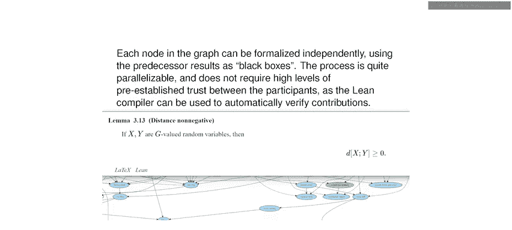

ve never met before。 So yeah， I met a lot of people， I wrote a lot of the letters of recommendation。

 actually coming out of this project。嗯。Yeah， so yeah， this is of an example。

 like this is like one little piece of proof know， So。

 so this this is what a proof looks like in leanan。 It's not exact。 I mean， if you know the language。

 it's human readable， but it looks a little bit， It looks a little bit different。Unusual。Yeah。

 but it really sort of decouples the the task proving things into into many different sort disjoint skills。

 You can have some people who see the big picture and of organize things into into little pieces。

 And then you you have people who just who don't necessarily know all the mathematics。

 They can just work on little little pieces at a time。

 So I think this will be a more and more common way of doing mathematics going forward。

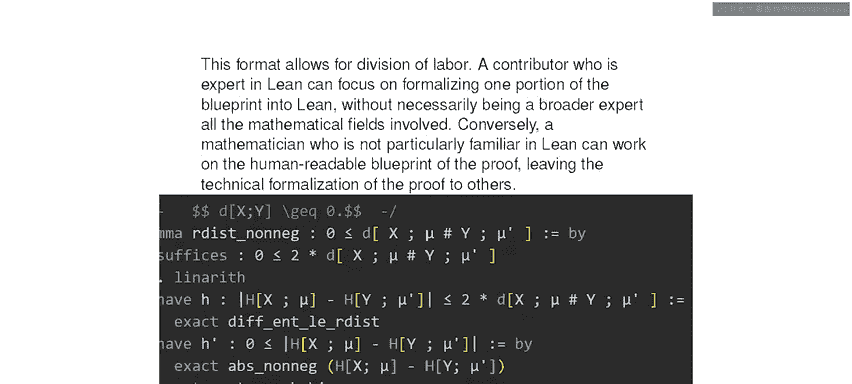

It， it still is painful to do。 like the tools are not really。

They're getting better and user friendlier。 but you still need to have like some expertise in programming。

 I would say it takes maybe 10 times longer to formalize a proof than you write it by hand。

 On the other hand， if you want to change your proof。 So for example。

 there was There was number 12 that showed up in this theorem。 we later improve this 12 to 11。

 we got a slightly stronger theorem。 And normally， if you do that you rewrite the whole proof。

 or like you could maybe cut and paste12 to 11， but then you have to check。

 you didn't make any mistakes when you did that。But actually， when we formalized this。

 then we got the improvement。 It only took a few days to change the12 to 11。

 We just changed the 2 11 somewhere。 and then the compiler complained at like five different places。

 Now a certain this very specific parts of were not working and we could just targeted do some targeted fixs。

So， in fact， so already for some specific types of doing mathematics。

 already proof the formal approach is actually faster。Yeah。

 so now there are actually quite a few big proof formalization projects going on right now。 I me。

 the biggest is Kevin Buzzard's project。 he's just got a big grant to formalize film this last theorem intervene。

 He says it will take five years to do the most important parts of this proof。

 He doesn't claim to do the whole thing in five years。

 but that has been an interesting part it got It's already underway。So that is form proof assistant。

 talk about machine learning。So machine learning yeah。

 so these are using neural networks to predict answers to various questions that you can use in many many ways。

 I think I'll skip the first way of discussing it， is which is to use neural networks to get solutions to P equations。

 which is a very exciting new tool in PD D， but I will skip it。嗯。

I say talk about another application of machine learning to not theory。

 So not theory is' quite a fun area of mathematic。 It's an interesting area that it brings together many。

 many different mathematics。 And they don't really talk to each other。

 So a knot is just a loop of string or curve in space that is closed and two knots are equivalent if there's some way to continuously deform one knot to another。

 which in a way that in which you not allowed the string is allowed across itself。

 And so the basic question in not theory when are two knots equivalent。 give you two knots。

 is there some way to turn one into the other。 And the way you approach this question normally is that you develop these things called not invariance。

 So these are various numbers sometimes also polynomials that you can attach to a not。

 and these numbers don't change no matter how continuously deform the knot。

 So if two knots have different invariance， they cannot be equivalent。😊，So there are many。

 many types of knots of invariants。 There's something called a signature。

 which still count you flatten the knot and you count crossings。

 whether the crossings go over and under and and you create a certain matrix and so forth。

 And can there's a certain integer called the signature。 So that is one type of not invariant。

 there's some famous polynomials called the Jones polynomial and the home polynomial which are connected to many areas of mathematics。

 but it won't talk about。 And then there's called hyper hyperbolic invariance which comes from geometry。

 you can take the complement of the knot。 and that is actually what's called it's usually a hyperic space。

 it comes with a certain geometric structure has a notion of distance and you can compute it this volume and some other invariance。

 And so these are invariants that are real or complex numbers。

And so every knot comes with some combinatorvaris like signatures。

 and it comes with these geometric invaris， like these hyperliccanvaris like oops。

So here is a whole list of of， of norths with various of the hyper qualitying variant。

 There's something called the hyper volume and the homoological cusp shape and so forth。

 And these are real and complex numbers。But no one knew of any link between these two。

 So there are these two separate ways to create statistics of norths。 And they didn。 was no。

 There was no connection between them。So it was only very recently that people started using machine learning。

To， to tackle this problem。 So they created databases of millions of knots。

 which actually was already slightly an non task。And they trained a neural network on this。

 and they found that after training the neural network。

 you could give it all the hyperbol geometrytry invari。 And like 90% of the time。

 it predict it will guess the right signature。So you created this black box。

 and it will tell you how the the signature was somehow hidden somewhere in these geometric variants。

But it didn't tell you how was。 It was this black box。So。

 but that's still useful because once you have this black box， you can can you can just play with it。

 So what they did next is very simple analysis。 is what's called salliency analysis。

 So what does black box does， it takes about 20 different inputs。

 one for each hypergan variant and which is one output the signature。

 So once you have this black box， you can just tweak each input， You say what if I change one input。

 how likely is it to change the output and。😊，Of the 20 inputs that they found。

 they found that only three of them actually had played a really major role in the output。

 The other 17 were barely relevant。 And it wasn't the three that they expected。 Okay。

 They expected the volume， for example， to be very important。

 And the volumess are be almost relevant。 there are three， Yeah。

 something called long translation and the real and complex parts of of meon translation。

 There are these threevaris that were the most important。

So once they identified the ones that are most important。

 they could just plot directly the signature against those three particular inputs。

 and then they could eyeball rather than use a new network。 they used the human network。

 you then say， oh， okay there's some obvious patterns here。 And so by staring at these graphs。

 they could actually make conjectures as to what was actually going on。

 So they made a conjecture based on this， which turned out to be wrong actually。

 But they actually used I think they turned back to the neural network to actually show that it was wrong。

 But then the way that it failed they could correct it。

 and they found a corrected version of the conjecture， which actually did explain this phenomenon。

 And then once they found the right statement， they were able to prove it。

 So they actually have a theoretical explanation of why the signature is so closely related to this particular。

To these particular statistics。 So this， I think， is。

 is a way in which machine learning is being increasingly used in in mathematics。 You know。

 it doesn't directly solve the problem for you， but it gives you all these really useful hints as to what the connections out and go where to look them。

 But you still need the human to actually make the connections。嗯。And then finally。

 we have the large language models， which are the most splashy and made the most news。 You。

 neural networks we've been around for 20 years。 but longest language was already also been on 5。

5 or so years， but they've only become sort of human level in in output very recently。😊。

So you've all probably heard of G4， this is a chat GT's current model so yeah very famously when G4 came out there was a paper describing its capabilities and they fed it basically a question from the 2020 IMO it is a slightly simplified version if you study the 20 IMO's not exactly the same form。

 but it's a simplified form。And for this particular question， actually， you give it the question。

 and it actually gives a complete correct solution。this question， it actually solved an IO question。

 Unfortunately this is an extremely cherry picked example。

 I think they tested hundreds of imO level questions and I think they had a success of about 1%。

 So this particular problem they were able to solve and they had to format the problem in the right way to get the solution。

😊，But， but still， this is， this is quite amazing。On the other hand。

 the funny thing about these tools is that things that humans find difficult。

 AI can do very easily sometimes， but things that humans find easy。 AI often struggles with。

 it is a very orthogonal way of solving problems in a very related paper or presentation they asked the same model to do a basic ethnic computation7 times4 plus8 times 8 and the model which is just guessing the most likely output based on the input basically the answer is 120 and then it paused and said。

 okay maybe I should give an explanation Y 120 so they did a step by step but when they did a step by step。

 they actually arrived at the actual answer which is 92 and not the answer which they started with。😊。

So then if you asked， wait， but you said that it was 120 and they said， oh， that was atypo， sorry。

 the correct answer is 92。So， you know， they're not solving the problem by first principles。

 they're just guessing at each step of of the output。 what is the most natural thing to say next。

 And the amazing thing thing is sometimes that works。 but often it doesn't。 And it's still， yeah。

 I mean it's still ongoing how to to sort of make it more accurate。

So people are trying all kinds of things。 you can connect these models to other more reliable software。

 So in fact you will see a presentation where there's a large language connected where you don't do the computation yourself。

 you outsource to Python in that case。But another thing you can do is that you can force the the language model to only produce correct answers by forcing them the to output in one of these pre and languages。

 And if it doesn't compile， you send it back to the， to the AI and the A has to try again。

Or you can try to teach it directly。The same problem solving techniques I use to solve I M O problems。

 you know， you know， try simple examples， proof of contradiction。

 You have try to actually prove step by step and so forth。So people are trying all kinds of things。

 It's still nowhere near。 well， okay， we， we're not near able to you know， solve a large majority of。

 say， mathly problems， let alone math research problems， but we making progress。嗯。

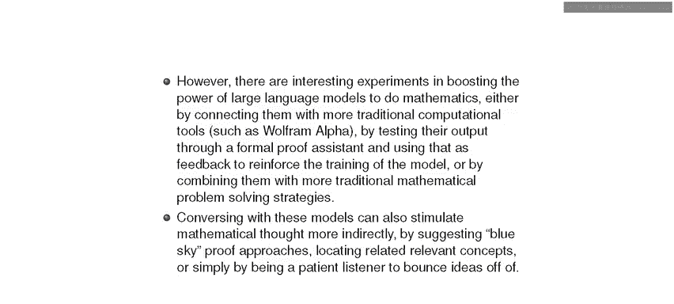

Besides being able to。Actually， solves directly。 actually。

 it's also useful to just as someone as as a muse。 actually， I've also used these models myself。

 I've experimented with various problems I had a commential problem。

 which was trying a few things and they weren't working。 So I as an experiment。

 I just tried asking G what other techniques would you suggest to solve this question。

 and it gave me a list of of 10 techniques of which like five of which I already tried obviously not helpful a couple were not helpful。

 But there was there was one technique I had not tried。

 which was use generating functions for this particular question。

 which once was once they suggested it， I realized it was the right approach。 But I I had missed it。

So just as someone to converse with， it is somewhat useful。 It is not great right now， but is。

 it is not completely useless。嗯。There's another。Type of AI assistance that become very useful for proof assistance。

 actually， as I said， writing formal proofs is a very tedious task。

 I mean it's like any really fusy computer language。 you have to get the syntax exactly right。

 if you miss a step， it doesn't compile。 but there are tools So I use something called Github Copilot。

 you can write down half of a proof and it will try to guess what the next line is。

 And know about 20% of the time guesses something close to being correct。

 And then you can say I'll accept that and say So in this case。

 I was trying to prove the statement here lies in gray the one that coalpi suggested。

 it turns out the first line is useless。 but the second line which you can did solve this particular problem。

 So you can accept you can can't accept the input because it won't necessarily compile if you already know how the code works。

 it saves you a lot of time。

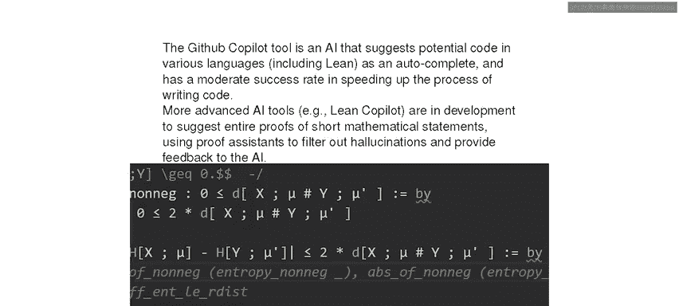

嗯。So these tools are getting better。 So right now， they can maybe like if a proof is19 or two lines long。

 they can they can fill it automatically。 There are now experiments to sort of iterate an AI suggesting a proof。

 And then you feed it back to the compiler。 and then if it compiles wrong。

 you send the error message back and we're beginning to sort of proof that like full or five lines long。

 they can be going to find by this method。So， you know， of course。

 a big proof is like tens of thousands of lines。 So it's nowhere near the point where you can instantly get get your proof formalized immediately。

 but it is already a useful tool。Okay， so where are we now？

So there are people who are hoping that in a few years we can use computers to actually solve math problems directly。

 I think we are still a long way away from that for very narrowly focused problems。

 you can sort of set up specialized AIs to handle just a very narrow band of problems but even then they're not fully reliable。

 can they can be useful。😊，But still， yeah， so for the next few years， at least。

 they theyre basically going be really useful assistance and。

 and beyond the sort the brute force computational assistance that were， are already familiar with。

And people are trying as creative things。I think one one direction。

 which I find particularly exciting。 hasn't really been successful yet is that hopefully AI to become very good generating good conjectures。

 I mean， if you we really saw a little example the knots where they could already sort of conject to those connection between between two different statistics。

 So you know， there's just the hope that you just create these enormous data sets and and feed them into an AI and they will just automatically generate what's some nice connections between different mathematical objects。

 This hasn't really we don't really know how to do this yet。

 partly because we don't have these massive data sets。

 But I think this is that would that would be possible。 one thing I'm also excited。

 this is a type of that just doesn't exist yet。😊，Right now， because proving themes is such a painful。

Painstaking process。 we prove one the at a time。 or maybe two or3 if you are efficient。 But with AI。

 you could imagine in the future。 instead of trying to prove solve one problems you take a class of 1000 problems and you say。

 okay I'm going tell you AI try to solve these 1000 problems with this technique And。

 I could solve 35% of these problems with this technique about this technique。

 And I can solve this percentage of problems。 if I combine them， I can do this。

 could start exploring the space of problems rather than each separately。

 And this is something you either cannot do right now or you do over a process of decades dozens and dozens of papers slowly figuring out what you can and cannot do various techniques。

😊，But， with these tools， you could really do。 I mean， you could really sort of thought。Skate。

Doing maths on on a scale， which is really not really unprecedented。So， you know， I mean。

 the future is gonna to be really exciting。 I think， you know， I mean。

 theyll well still also be be proving the the old fashion rate。

 in fact we'll have to because we can't we won't be able to guide these AI unless we also know how to do these things ourselves。

 but we'll be able to do lots of things that we can't do right now。😊，啊。Okay， I think I will stop it。

 so thank you very much。

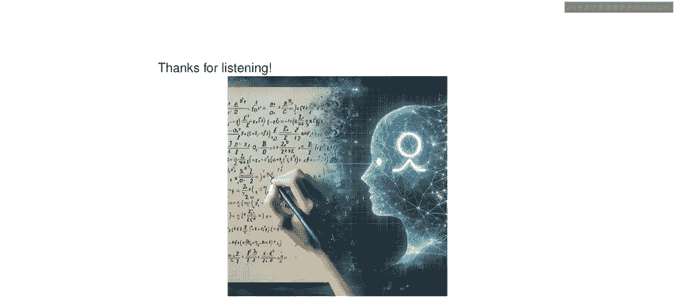

Part。👏So。👏We are on a tight schedule， but I was told we have time for maybe three or so questions。

 So if people will raise hands。And。系。这 사的不。Thank you。Can you hear me。Thank you。

 That was a beautiful talk， I particularly loved about formalizing mathematics。

 but one thing that was you didn't mention was V Waldsky who left Amateurbra geometryome because he made a mistake。

😊，And started formalizing homotopy type theory， I would be interested to know if you have studied this and have any comments on it。

Right， yeah， So we thought cute， Yeah， he was worried about a crisis in certain areas of mathematics。

 including some that that he created。That yeah， the proofs were so abstract and sophisticated that there was no way to verify that they're completely true。

 Yeah so he proposed changing the foundation of mathematics to a high audit type theory。

 homomo type theory， which is more robust like if you change the underlying of mathematics。

 a lot of what you prove a lot of what you prove in this theory is still true。

 there are proofasist languages that are based on the sort of homo type theory。

 lean is not actually by design because lean wants to formalize a lot of traditional mathematics。

 which is not written in this language。嗯。I do hope in the future there will be multiple。

 I there are multiple professors and languages with different strength and weaknesses。

 One thing that is not we don't have right now is automatic ways to translate proof in one language to another。

 That's one place where AI I think will be very useful。 once we have that。

 then we can we can if you have a different philosophy of your foundation mathematics。

 could just hopefully we can just translate a proof that has been formalized in one language to another。

 And everyone will be convinced。 includingky was still alive。 hopefully。😊，Yeah， yeah。 So I mean。

 there， there are multiple approaches to to formalizing mathematics。 and we shouldn't just。

 certainly we shouldn't just fix on on one particular standard just yet。嗯，好。哇，系嗯。Okay。

It's a random process that will not be quite relevant to the topic of the talk。

 but I was recently applying for PhDs and the advice I was given by the professors was basically along the lines of the longer the better。

 so it seems like there's kind of a general agreement that mathematicians need somehow it would seem to me grow up to big ideas。

So from that perspective， how do you think about your decision about going to the university at such a young age。

 Did you think it how it influenced you as a mathematician and as a human being and。嗯。Well。

 I was I had some very good advises， both as。嗯。At the high school and undergraduate and graduate level。

I mean， I don't think it's， it's a race。 I mean， you you go to university when you're ready to go。

 you shouldn't go just because you， you are told you need X years or something to do this。

I think it's different for different people。You know， I mean， it was very important for me。 I mean。

 I went to。To undergraduate when I was 13 but at a university that was very close to where I live。

 so I lived with my parents and they drove quite a lot actually to the university for all my classes if I didn't have that I don't think I would had a good experience So it really you know I mean okay I did my university at a very young age doesn't mean everybody should do that。

Yeah， there's no single answer to this question。Thank you。Yeah， okay。

So another kind of more general question， given that that you've contributed to truly myd mathematical fields。

 How do you go about choosing your next research topic in problem you want to solve And also what's your it number。

Okay， well my other is too。 That's easy， but。I actually don't know。 mean I mean。

 early on in my career， know， I had advisors who suggest problems to me。

 nowadays often it just comes by serendipity。 I mean， math is a very social activity。

 go to lots of events So I mean after this I'm going to to a math conference in Edinburgh and I'm going talk to a lot of people actually connected to to this P conjecture thing actually and likely Ill have an interesting math conversations and maybe some research question come out of it。

 I do have some long-term projects that I would like to something that I'd like to solve。

 but but increasingly I find that it's the questions that just come up by conversation other mathematicians that I didn't know I'd be'll be talking so much about AI I can't about two years ago。

 for instance， I think it should be sort of。😊，The future is going to require more flexibility and I mean there will still be people who will specialize in one topic and just one topic and be it with the world expert in X。

 but increasingly I think there'll be more and more people who will move around over time and just they will find interesting new mathematics every few years just by talking to other people。

Okay。I think we have to move on， actually。 So the next speaker is Simon Coyle， X T X。

 who will talk about the AI Metlympia。

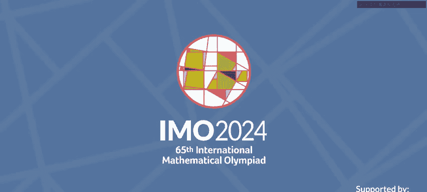