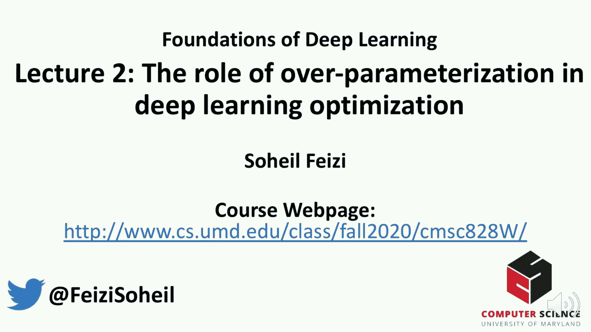
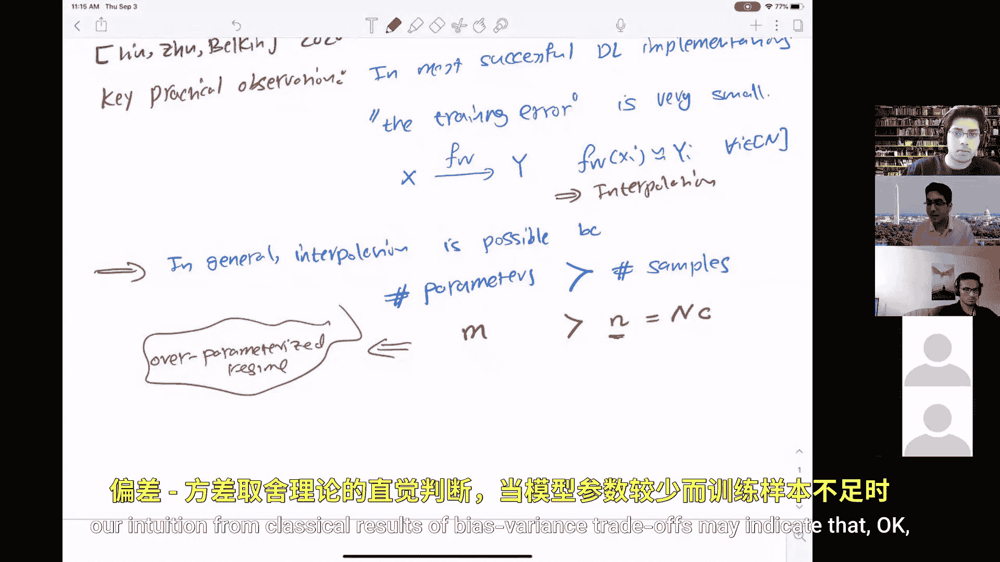

# 马里兰大学【中英⚡深度学习基础｜CMSC828W-2020-Foundations-of-Deep-Learning】-p02-P2-Lecture-2----Deep-Learning-Foundations：-the-role-of-over-parameterization-in--BV15rpCz9Ed8_p2-

So in today's lecture， we are going to talk about optimization problems in deep learning。

So here is our agenda。For today's lecture。Optimization。Problems。In deep learning。 and in particular。

 we are going to focus on the role of。Over parameterization。

In deep learning optimization problems and as you'll see in this lecture。

 next lecture and also in a couple of lectures that we are going to spend on the generalization over parameterization is in fact very important aspect of many deep learning problems that you're look into。

So last time we started with an ERM problem。SoVR。Getting a training set and we are minimizing our weights。

W。Based on the average loss of or model over training samples。最后。12 n loss of F W of X I Y I again。

 just to recall the notations that used x is there in D dimension。

 let's say we are looking at the classification problem with C label so while y will be in a finite field with C elements。

And the question is how to solve this optimization problem， because in general。

 we will have a non convicts。Optimization problem because。For neural networks。

 F of w is a nonlinear function and。The whole objective will be a non convex problem。

AndWe saw some pictures。If he had a convex loss， if my loss was like this。

 I was very happy because I can use gradient descent or stochastic gradient descent。

 follow the negative direction of my gradient and eventually converge to W star。And this was good。

 we were happy， but in the non convicx case we argued that the laws can be very complicated so we may have some some bad。

Loow callss， So this is my W star。But here I have a。

Poor or bad local or we can even have like some saddle points These are the points that the heian they have it has both positive and negative eigenvalue。

 so you may have like some you know saddle point problem as well。Right， but interestingly。

 in practice。愿 we。Run gradient descent or a stochastic gradient descent。

They work pretty well to optimize deep learning optimization problem they work。Pretty的。Not always。

 but in many cases， they converge to pretty good solutions。So the question is why？

So we know we are in a non convex setting。And we know in the non convex setting。

 we have a lot of issues， we have pool locals， we can have saddle points。But surprisingly。

 and somehow magically， a stochastic gradient decent or gradient decent。

 they converge to pretty good solutions。And this was a topic of a lot of interesting research in the last couple of years in foundations of deep learning。

All right， so today I'm going to mainly talk about the recent work by。六。Zoo and Bellkan。

It's a very recent for， I think the draft was on archive on in February 2020。

 so if you posted the paper on coursese web page， I'll follow some part of the paper during this lecture。

So let's start with some intuition。So， one key practical。Observation。Is that in most？

Successful deep learning implementations。Successful。Eep learning。Implementations。The test。

 the training error。The training。Error is the error that I compute over samples in my training set。

It can be very small。Almost 0。So remember， in our training。

 our goal is to find the function Fw mapping x2 ys。Right， and if my function is able to。Basically。

 approximate will each y in my training sample， I'll have a very small。trainingining et all。

So in terms of generalization， we'll talk about it in the next lectures。

 but just focusing on the training error so we can almost get a zero training error in general and why is that the case because usually the models that we use。

 the deep models that we use， they have a lot of parameters。

 so the models they have a lot of flexibility in terms of interpolating my XY relationships in my training set。

So that is basically the main reason。 So in general。Interpolation。

 so when we have a zero training error， this is basically interpolation。

Because I'm interpolating XY relationships， almost precisely using a neural network that I'm using as my model。

So in general， interpolation。Is possible。Especially when。The number of parameters in my model。

Is larger than the number of my training samples。So if you have， let's say， 10 samples。

 you have 10 x's。That we want to map those xs to y's。 And then you have。

 let's say you're using a model with 0 parameters。 So you have00 degrees of freedom。

Prooughly speaking， and you have 10 equations that you want to map access to Vi。

 so you'll be able to achieve almost zero error in such cases。

So we'll basically call the number of parameters m for oral model。嗯。And the number of samples。

 I'm going to refer it with a small N。Remember the capital N is the number of training samples we have。

 but for each sample my label can have C classes right so in order to achieve like the exact interpolation I want to make sure that I'm predicting each of the components of my labels correctly for each samples so in other words I have n data points that I want to interpolate and we say we are in an over parameterized regime when my number of parameters n is larger than my number of samples so this is called over parameterization。

Or over parameterized。Rising。Okay， so I see there are some questions， let me pause。

Right so there's a question it says when the number of parameters is larger than the number of samples when we're in an over parametermetized regime isn't bias overfitting huge this is an excellent excellent question and in fact or intuition。

From classical results of bias variance trade offs may indicate that okay。

 so you have no a lot of parameters and you have few。

