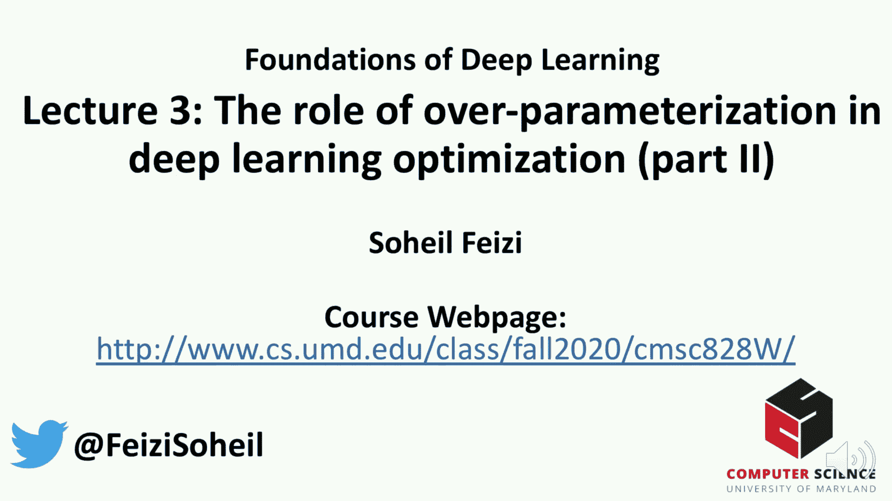
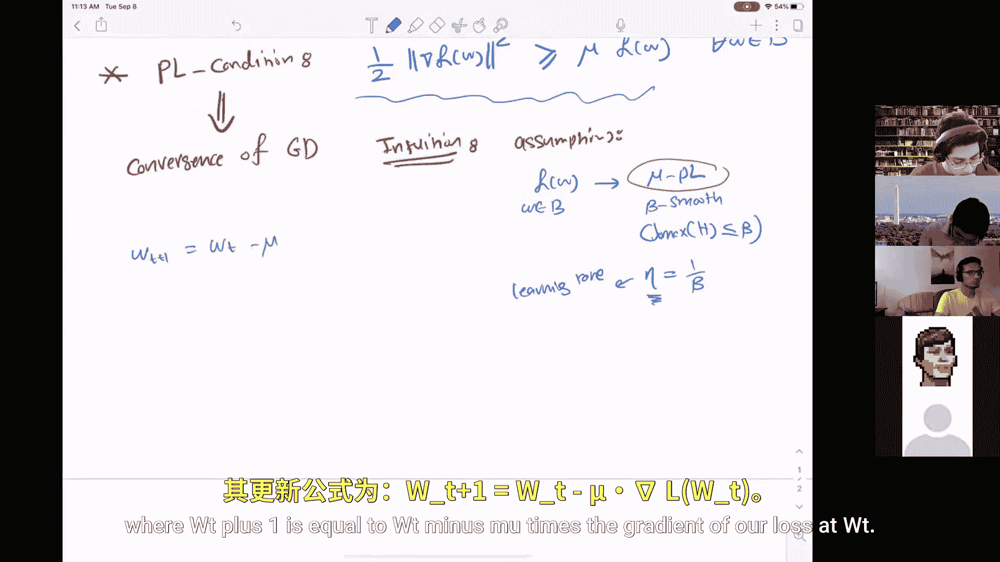

# 马里兰大学【中英⚡深度学习基础｜CMSC828W-2020-Foundations-of-Deep-Learning】-p03-P3-Lecture-3---Deep-Learning-Foundations：-the-role-of-over-parameterization-in-D--BV15rpCz9Ed8_p3-

Alright， so last time。So be considered。The case when our training error is very small。

 So we had almost0 training error。0 training。E and impact in a many practical deep learning implementations。

 this is impact the case so when are training get is zero so we are in。Basically， the interpolation。

Re行。So what do I mean by that when we have training sets like Xs？And my eyes。1 to n。

 So I want to be able to interpolate my relationship， the relationship between x and y。

 So I want to learn a function if。With parameters w such that if I apply this function over my input Xs。

 I would get my labels Yi。For all my training samples。

So we abused a little bit of a notation and we wrote these systems of nonlinear equations like Fw is equal to y。

 so x here is implicit。And w is the parameter vector m dimensional so we have m parameters and why we assume lives in an in dimensional space and when we say the system is over parameterized。

 we mean M， the number of parameters is larger than n， the number of samples。呃，行。

And here this small N， when we are in a multi label classification or regression problem would be equal to the number of samples times the number of classes that we have so this is the number of samples。

That we want to interpolate and these are the number of parameters that we have in our model。

And we saw some examples that the solution of the interpolation may not be actually unique right so let's say you are in a three dimensionmenal space。

 let's say this is the manifold of all of the ws that satisfy your first equation when you apply your model to X1。

 it will give you the exact label y1 and let's say this is the other one when you apply your model to x2。

 you will get y2 and the intersection would be the manifold。Of my optimal Ws， W stars。

 and in fact they are not isolated and that's one of the differences between over parameter and under parameter regime。

So in order to find these solutions， we define a loss function。

 mostly we use the quadratic loss because it is easier to analyze。

 but some of the arguments that we covered impact can be applied to other loss functions。

And we minimize this loss function using gradient descent。

And we want to understand or a stochastic gradient descent and we want to understand why gradient descent in this regime find a good solution。

 W star for us that can exactly interpolate the input output relationships。

 that's basically the whole idea of you know the previous lecture and today's lecture。All right。

 in order to understand this。Remember this loss function in fact can be non convex right so if it was convex。

 we did not have any issues so this loss function can be non convex and in fact it is what we showed it is essentially non convex even in a local region the Haitian can have positive and negative evalue so even locally it is not convex。

So one very important condition that we discuss in order to show the convergence is the PL condition。

So visit a loss function or any function satisfies the P condition if。

I look at the magnitude of my gradient。The magnitude squared is greater or equal to a constant mu times the value of loss function for let's say all w in a particular region that I'm considering。

Or so if my loss function satisfies this inequality。

 then I would say that loss function satisfies mu P condition。And at the end of the previous lecture。

 I stated the exact theorem that when we have the PL condition。We would get conversions。

Ofgrading descent。Under the assumption that our law satisfies peer condition and some other assumptions。

All right， so today first I'm going to give a little bit of an intuition what is going on with this PL condition right so you'll have like the magnitude squared of the gradient greater or equal to a constant times the loss value。

 what is going on here so why do we need this condition。

In order to say something about the convergence of gradient de。Okay。

 so let me pause because I see a few questions。So there is a question about。

The isolated and non isolated。Optimum with respect to the manifold， when we are in a nonisol fashion。

 let's say you basically have two points so there is a path connecting the two points at all points on that path there are also optimal solutions for my optimization but then you are in an isolated fashion in that underparized。

 then you may have one solution here， but the neighborhoods of that solution won't be an optimal solution for the optimization。

All right。The other questions are about logistics， I'll have an officer after today's lecture。

 maybe you can ask again those questions in that officer I'll be happy to answer those questions。

Okay。Let's move on。Okay right， so what is the intuition behind？The PL condition so we want to see。

 in fact this condition， even though it may look a little bit strange at the beginning。

 this is really， really intuitive and very simple you know condition that immediately leads to the conversions of gradient descent even in non convex cases。

Alright， so basically the assumptions that we have here for the。For the loss。Function。

So here we are assuming。My loss function in a ball that contains the trajectories of gradient de。

 so that's something I'm going to discuss in a little bit。So this loss function is new PL。

So that's the P condition， you also assume it is beta smooth。It means the hesian。

 the eigenvalues of Hesian are bounded by a particular number， let's say beta。

Again Haitian doesn't have to be PSD so we just need the bound on the curvature values that's all and we also had an assumption on the learning rate so obviously your learning rate cannot be very large because in that case you know even in the convex setting the gradient descent we don't have a guarantee of the convergence and we are assuming the learning rate which is AA is sufficiently small。

Let's say it is one over beta， the largest iconenvalue of your hesian， so this is the learning rate。

So these are roughly the assumptions that we have。The beta smooth assumption in the convex setting again。

 in the proof of the convergence of grade and this the convex setting。

 we have some balance on the values， eigenvalue of the Hasian。

 even though we are in that case assuming the Hasian is PSD。

 we also have a learning grade the assumption on the learning rate that should be sufficiently small so。

Extra assumption that here we have is that instead of like convexity。

 we are assuming the law satisfies the mu PL condition。And we are basically going to analyze。

The dynamics of gradient descent where Wt plus 1 is equal to Wt minus mu times the gradient of or loss。

At WT。