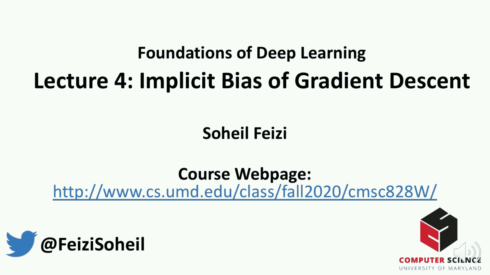
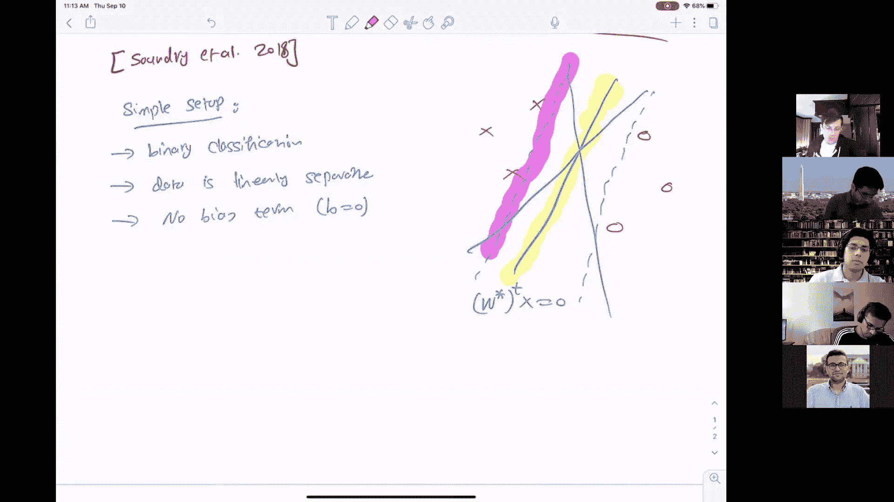

# 马里兰大学【中英⚡深度学习基础｜CMSC828W-2020-Foundations-of-Deep-Learning】-p04-P4-Lecture-4---Deep-Learning-Foundations：-the-implicit-bias-of-gradient-descent--BV15rpCz9Ed8_p4-

好吧。Okay， so let's start today。 we are going to。Talk about implicit bias。

Of gradient descent and a stochastic gradient descent。

Let me first recap quickly what we covered in the last two lectures about deep learning optimizations so we saw that we can in the interpolation regime when our training error is very small。

 so we ended up with nonlinear with some nonlinear systems of equations。FW is equal to y。

 so there's an x here， which is implicit， so w lives in M dimension。

 y lives in an n dimension of the space and we argued that we are in an over parameterized regime where the number of parameters is larger than the number of samples。

And we considered different loss functions， but the most popular loss function that we considered was the quadratic loss。

And the idea is to minimize this quadratic loss using gradient descent。And we showed that in。

And over parameterized regime， even though the optimization is noncomvex under some certain conditions。

 we could。Basically， yeah you're right， so there's a typo here so we could basically find an optimal solution for these nonlinear equations or an optimal solution that minimizes our last one。

So we had some examples， for instance， if I have three a model with three parameters。

 only two samples in two dimensional space， I would have。Basically， this is why one manifold。

That satisfies one of my equations， if w of x1 is equal to by 1。

And I'll have another manifold like this。That will satisfy FW of x2 for my second training point is Pro of Y2 and the intersection of them will be the manifold of my W stars。

Now you can see that when we are in an over parameterized regime we have more parameters than a number of samples。

 so we won't have like in general we won't have one unique solution。

 they'll have like a manifold of optimal solutions。

 potentially infinitely many W stars that can interpolate X Y relationships in our training set。

So the question is， you know again， you know， there were a lot of interesting questions about the generalization because the idea is that if you have a lot of parameters in your model and you have fewer number of samples。

 then you may have a bad generalization， even though or error in training is small。

 if you go to the test set， then your error is going to be very large so then you're not learning anything useful for more training set。

But in practice， it doesn't happen when we are using over parameterized deep models in several complex data sets that well talk in the next lectures。

So one of the reasons is because of the implicit bias of gradient descent or a stochastic gradient descent。

It may be the case and we'll see some examples today that when you are running gradient descent or a stochastic gradient descent。

 you are not adding any explicit regularization to your objective right so your objective is going to be again a loss function like a quadratic loss that you are minimizing it so you are not。

Adding any L2 regularization on the parameters to restrict the parameter space in order to help the generalization。

 but perhaps because of the dynamics of gradient descent or a stochastic gradient descent among all of these solutions we are going to find a quote unquote good solution。

 a solution with a good generalization property， a solution that may have some implicit bias in itself so that's perhaps one reason that we see a good generalization behavior of such over parameterized regimes in over parameterized models in practice right so that's the whole idea of today's lecture and it will be a good transition to the next lectures that we'll be talking about generalization properties of deep models。

All right， so for that I'm going to focus on one recent paper by。So three。And others。

 I think the paper was in 2018， there are a few followup papers on this。

 but I like this paper because it starts with a very simple setup and we can build some intuitions about this problem。

 what is happening but there are some interesting followup papers on that so I'll refer you to those papers to read more recent results。

So as I mentioned， this paper has a very simple setup。

So we are going to consider a binary classification。

We are going to assume the data is linearly separable， so at the beginning no neural networks。

 so let's understand this problem just for linear model。Data is。Linenily。Separable。And in fact。

 we are going to assume there is no bias there。P 0。So if I want to draw a picture。

 I would draw a picture like this， so I have some linear reseparable data and a binary classification regime。

And I don't have any biasster here。 So any line。I have W star transpose x。Is equal to0， it will。

Classify my samples correctly， so this should be a line。 it has a little bit of a curvature。

Let me read through this。😔，I think。Is it better？Not a completely straight line。

 but I think it should be fine。So this is basically the setup that we have here。

 but you can see there are infinitely many such lines right so you have all of these lines。

That will achieve0 error。In your classification， basically your test error is zero。

So which line do we want which by line I'm mean plane。

 so which plane do we want to choose among all of these planes do we want to choose for instance this particular plane。

Or this particular plane。Or maybe something， something else。

I see some answers to it Phil says max margins and Kyle says middle to maximize margin， yes。

 so the idea is to pick a max margin plane which would basically this plane so let me highlight this。

So this plane will have a maximum margin on either side to more positive and negative samples。Or SVM。

 yes， that's basically the SVM support vector machine solution。

So let me ask you this question and I'll pause also like you know to take your questions if you have any questions so far。

 why do we want to pick a max margin plane among all of these planes？

What is the property of this max margin plane that we like to pick this as your classifier and not for instance。

This plane。Right， so I see some answers。Better generalization， that's a good answer。

 stability to perturbations。It prevents overfitting confidence levels。

 I think all of them are correct answers， in fact max margin has very good properties of all of these good properties and in particular it has a good generalization property so if you have a test sample。

 a test data set you may have some samples maybe close to your training samples but not exactly similar to your training samples so if you're using a max margin classifier then you have a better generalization property。

Okay。Any questions so far？