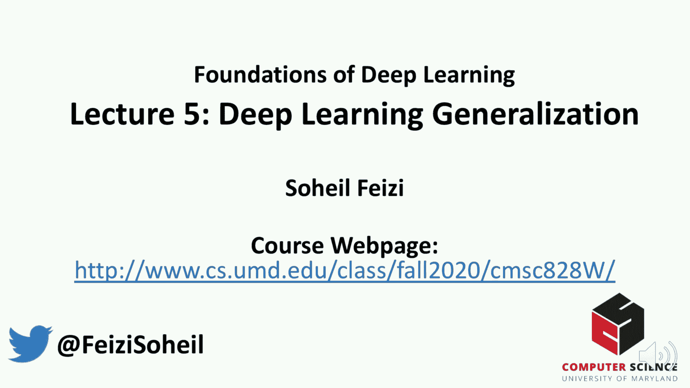
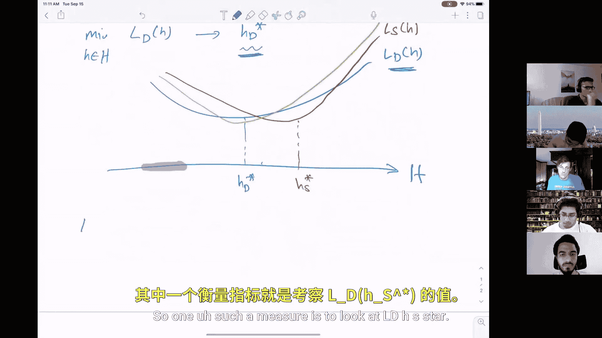

# 马里兰大学【中英⚡深度学习基础｜CMSC828W-2020-Foundations-of-Deep-Learning】-p05-P5-Lecture-5---Deep-Learning-Foundations：-deep-learning-generalization--BV15rpCz9Ed8_p5-

Okay， so let's start。So as I mentioned today we are going to talk about generalization in deep learning。

 so before diving into some recent results in deep learning generalization。

 I'm going to quickly overview some classical generalization results in learning in general。

 and then we are going to see what kind of these which one of these results extend to the deep learning setup and which ones don't。

OK呃。All right， so let's start with setting up this problem。 we are given a training set。

Let's say my training set。Is like this， so I have in samples。I'm going to call these samples by Z。

That includes my X I and YI， both my features and labels。And we'll have in samples。

So as you you know as you know we covered the last lecture。

 so we are going to define a loss function and we are going to fit a function to be able to predict by using X so my goal is to let's say for a function in my hypothesis class in my function class I'm going to define a loss。

Fction。Over my training set， not like because you know we want to see how this loss extends to the test set。

 so I'm going to index it with S to be clear， so for a given function H I'm going to evaluate my quality of my function or the training set by looking at the ERM objective。

 which is just looking at the average loss that I'll see over different training samples that I have。

So this is also called the empirical loss。Over。Training。Okay。

 so one assumption that we have here is that these samples that I have in my training set。

These Z eyes。Which is basically X I and Y's， they come from a distribution Pxy。

 so there's an underlying distribution that generate these samples。

But the problem is that I don't know about this distribution。

 I have observed some samples from this distribution。

 but I don't know a closed form or a parametric form of this distribution， so this is in general。Un。

 so the only thing that I know is that I basically have some samples from this distribution。

So since I don't have access to the underlying distribution what I'm going to do。

 I'm going to minimize my empirical loss over the training set。

So I'm going to pick a function H from my function class， from my hypothesis class。

 to minimize this empirical loss。And this is the function that I call HS star。

 so this is the best function or a good function that minimizes my training loss。Okay， but。Ideally。

 I want to pick a function that minimizes my population loss if I had access to the underlying distribution。

 of course， I don't have that distribution， but let's see what is the ideal case， my ideal case。

Is to look at the population norm。So here， my loss， I'm going to denot it by LD of H。

 So this stands for the distribution。 and here I'm going to look at。

These that are distributed according pxY， let's say I have access to this distribution and I'm going to look at the expected loss。

For a given function H。So this is going to be my population because obviously， you know。

 unless you know we have some assumptions about PxY in practice， we cannot compute LD of H。

But let's say if I could compute LDRH， I could potentially pick a function age from my hypothesis class that minimizes the population loss。

And we call this HD star。So this is the solution that minimizes the population loss。

So there's a question H here is my function and capital H is the hypothesis class function class。

 for instance， if you are optimizing over neural networks。

 H would be one instance of a neural network with a particular parameter set and capital H would be set of neural networks with the particular architectures and particular activation functions。

Okay。So again， my goal is to learn a good function used in my training set that also has a good performance in the test set or in the population setting。

 and that is the whole idea of generalization bounding generalization error of the training set function。

All right， so let's look at the picture。Here， let's say I have one dimensional function class。

 hypothesis class， is for simplicity。Okay， so if I look at the population loss。

 my population loss would be something like this， let's say my， this is the LD of age。

And here I have HD stop， this is the one that minimizes。Perhaps should the。This is the minimizer。

 so this is H star。Okay。So this function that I describe here。

Is not random right so I'm looking at the expectation of my loss over pxY so I'm basically averaging out every possible randomness in my population loss so this function is not random so if you give me pxY if you give me the underlying distribution。

 I can just deterministically compute this function and plot dysfunction function so this is going to be my population loss。

But what about the empirical laws？So in the empirical laws here。We have randomness。

Through S I'm drawing NID samples from my population distribution。

 and based on that I'll get one curve for my empirical loss。

So let's say I draw NID samples and it happens that I get。Maybe a loss function like this。

 This is my impical loss。Over training set S。はい。But this curve has randomness if I throw draw another NID samples from my distribution。

 I may end up getting another curve I may end up getting let's say。A curveb like this。

 so this may be for another training set is prime of age。Alright， so。

The minimizer of the empirical laws for a particular training set will denoted by HS star。

So the whole idea of learning theory and understanding the generalization of the models is that I want to make sure that my performance over a particular training set can be generalizable to a new training set so if you give me some new samples let's say my test set then I'll have also a good performance on that set so in other words somehow I want these curves to be close to each other I don't actually need these curves to be close to each other on some part of the some part of the。

You know， hypothesis class that they are not performing well so I'm not going to select them。

 but at least over functions that I'm going to select in my training。

 I want those functions to also have a good performance in the population sector。Right。

 so that's the whole goal。Okay， so in order to do that。

 we can quantify different measures to see if a particular function。

 HS star has a good performance in the population or in the test。So one such measure。嗯。Is to look at。

LD。

HS star， So if I evaluate my。