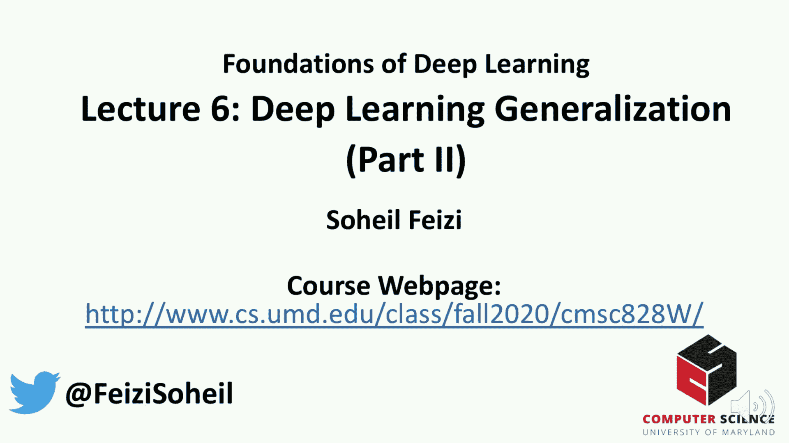
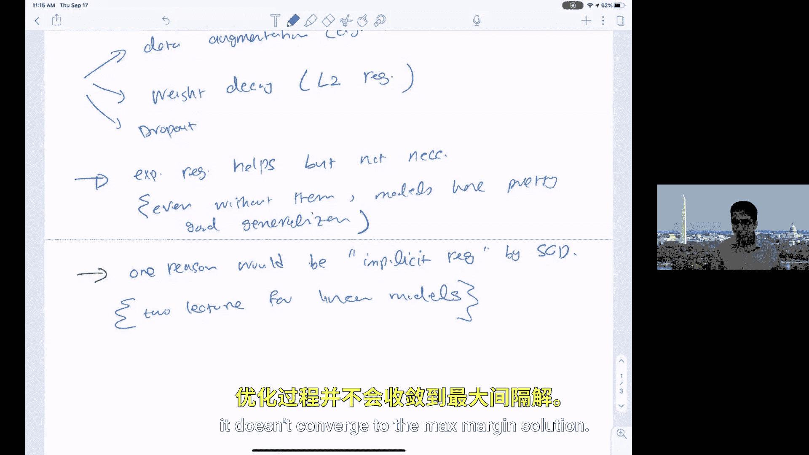

# 马里兰大学【中英⚡深度学习基础｜CMSC828W-2020-Foundations-of-Deep-Learning】-p06-P6-Lecture-6---Deep-Learning-Foundations：-deep-learning-generalization-(part-II)--BV15rpCz9Ed8_p6-

Today， we are going to continue talking about。Result in deep learning generals。All right。

 so last time we started talking about。Thank ETL paper， really good paper。

 I encourage all of you to read it。So just to recap about the results of that paper that you covered。

 so they perform these randomization test。If you have a training set。X， I，Y， I。

So you have end training samples。What they do is that they they randomly shuffle the labels or they have some other experiments that they can partially shuffle the labels。

Let's say we are looking at the full random case， so the labels are fully random。

In the case that we covered and we saw that in this case， okay。

 the model is going to have a very poor generalization because my test error。

is going to be half in the binary classification case because there is no structure between X and y relationships。

 my training error is going to be very small， which was very surprising that shows the neural network has capacity has complexity in order to fit to random labels。

 and that basically indicated even though here we have a large generalization generalization gap is half。

That indicated that some of the complexity measures that we discussed last time， for example。

 product market complexity。Or we see dimension， they are not sufficient。To。Explain。The behavior。

 the generalization behavior in deep learning to explain。Generalization。Behavior。

In deep learning and I'm emphasizing on not sufficient right so there are still pretty useful complexity measures。

 but there may be some other things going on in training deep models， for instance。

 you may have some implicit regularizations or some other factors that also contribute to the good translation behavior that we observe oftentimes。

 in deep learning。Okay。嗯。All right， so another interesting observation。In the paper is the following。

So you may think that okay， if you have random labels。

 then neural network is going to the optimization of neural network is going to have some difficulty to basically conversege to a good solution。

And maybe we can use some convergence rates or some properties of the trajectories of SGD in order to say to basically to talk about the generalization behavior of neural networks。

 but what they have observed is that in fact the neural network optimization is not much more difficult if you train on random labels in terms of convergence rate。

 they have like the like you know it may be like two or three times slower， on average。

 but it is not like significantly slower than if you train your neural network on true labels of your data。

So it's a very neat observation， so let me just summarize this neural network。Optimization。Is not。

Much more。Difficult。Training。嗯， randomom papers不。So in terms of like， for instance。In terms。

Of conversions。Praise， that' true。So therefore we cannot use this measure cannot。Explain。

Generalizability。By itself， so it is not sufficient again， just to look at， for instance。

 the rate convergence or some of measures that we got from the training of the neural network in order to explain the generalization behavior。

All right， so this shows okay， we cannot use you know complexity measures right rather marker complexity or V dimension that only depends on the hypothesis class。

 also probably we cannot use just the behavior of the training optimization of neural network in order to explain the generalization behavior of neural networks。

And they also looked into the role of explicit。い。Regularization。Okay。

 so far we have trained neural networks using ERM， so no regularization is there。

 but we can add regularization right， so what kind of you regularizations people they use in practice。

 you can do data augmentation， which is a very common。Be of adding regularization， for example。

 you're adding random cropping of your images。Your training。

 you add like different maybe you know you know lighting or something else to your training set and then you know this acts as an explicitel polarization。

Or you can do like an L2 regularization or。What it is called weightit decay。TK。

 which is basically the L2 regularization on parameters。Or you can do a dropout。

So drop out you basically randomly dropping out some of the you know either nodes。

 neurons or some of the edges， and it acts as another form of explicit regularization in your training。

All right， so they have tried these explicit regularizations and obviously they observe that these adding these explicit regularizations health generalization right so the generalization improves because you are restricting your search space but even without the model is still generalize as well right so although like adding an explicit generalization。

 explicit regularization is helpful to reduce the gap between your training and test laws but it is not necessary right so without even then your model has a pretty good generalization。

Okay， just to summarize。Basically， explicit。Regularization。Helps。But。Not。Necessary， so even without。

遇到 them。The have shown that models have pretty good。Generalization。Alright。

 so now you may think that， okay， even though if if in the case that we don't have an explicit regularization。

 it may be the case that when we are solving my ERM using a stochastic gradient descent。

 it may add some implicit regularization to or optimization。

 and maybe that's why we have a good generalization。 So one conjecture would be one reason。Would be。

Some implicit。Regularization。I SGD。Let so we study this。Two lectures ago。 two lectures ago for。

Linear models and impact in。For linear models， we show that SGD， say。

 using logistic loss converges to。Max margin solution。

 which is basically the L2 regularization on the base and that has a pretty good generalization。

 but in general model it is still not obvious what types of implicit regularization asGDs causing obviously for a more general neural network doesn't conversege to the max margin solution and that's something that we'll discuss in the robust。

