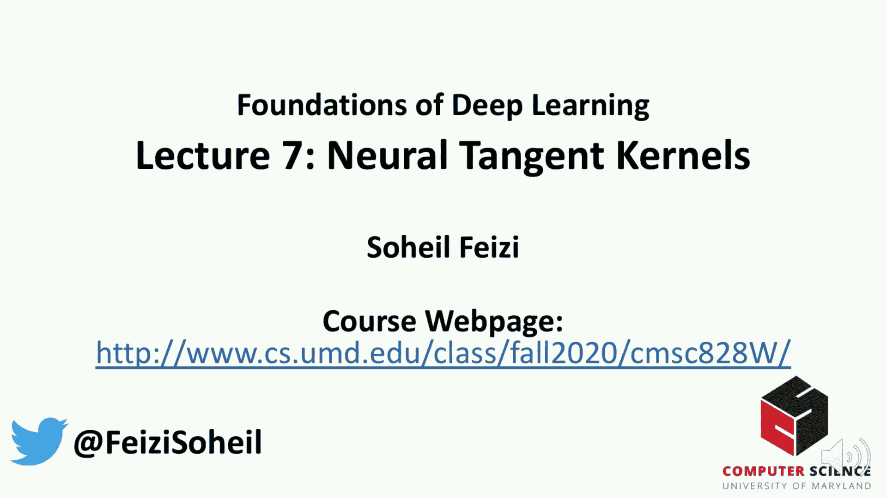
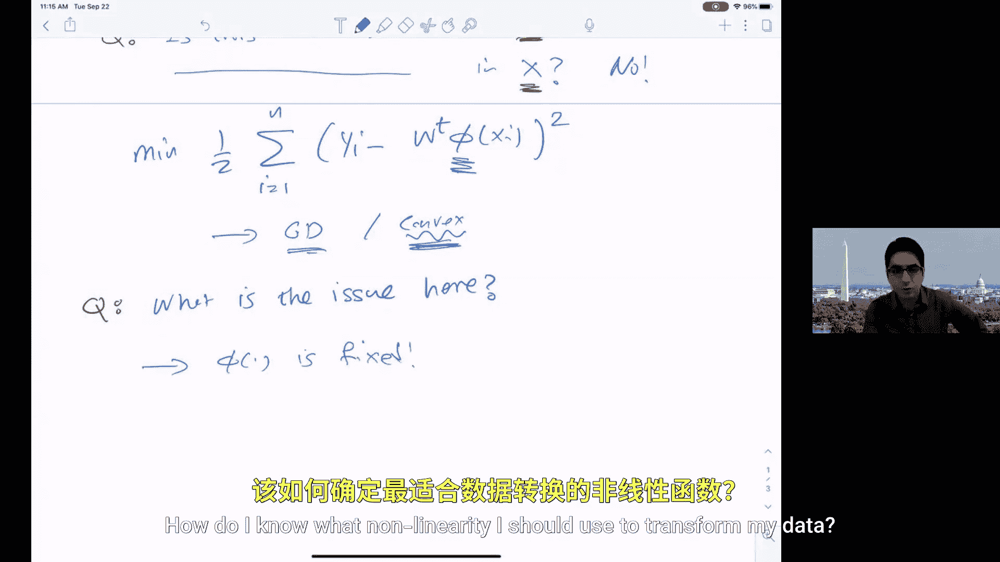

# 马里兰大学【中英⚡深度学习基础｜CMSC828W-2020-Foundations-of-Deep-Learning】-p07-P7-Lecture-7---Deep-Learning-Foundations：-Neural-Tangent-Kernels--BV15rpCz9Ed8_p7-

All right， let's start， so today we are going to talk about neural tangent kernels。First。

 I'm going to briefly overview you know the kernel methods and the kernel trick in learning。

 and then I'm going to talk about specifically neural tangent kernels and what are the success and failure stories of them。

Alright， so let's again start with our favorite。Learning method， which is linear regression。

Everything is simple in linear regression。So。Basically， we have a data set。With npoint， X。

 Is and y Is。Let's for simplicity， assume。The labels are in real and the Xs are in the dimensional space。

And we are going to consider a linear model， so I'm going to show my model with this function FW and X W represents my model parameter and x is my input。

 so for simplicity I'm even ignoring the biast you can put one in your X as one of the features and absorb the biaser in this model。

So this is a simple linear model that we are considering。

And the loss function that we often use is the quadratic loss， so we have the loss function。

In this form。That I'm looking at the difference between my output and F of W。X， this is my Y I hat。

 So this is my prediction。 I'm looking at the squared difference between them。

 and the objective is to minimize this loss。And pick a model parameter w for that。All right。

 so this is a convex optimization onconstrain convex optimization that is good。

 you know how to solve it。We use gradient descent in order to solve the optimization problem。

And I'll just write one update at iteration T that we use。

I'm going to show my weights at iteration T plus one with WT plus one。

 it is going to be fall to WT minus or learning rate that can actually be you know depending on the iteration gradient of my loss function it's a gradient of my loss function。

Evaluated at WT。So what is this gradient？So this gradient is nothing but。

Gradient of this quadratic function。 So we have。Y i minus if。WXI times the gradiental。

FW X I with respect to W evaluated at W T， right， So what is this term。

 What is the gradient of F W T X I。With respect to W。And my if is this。Good， so it is just X right。

 It's a linear model grading with respect to W is X。 So this is nothing but just X。

 So the interesting thing here is that here we you know this term does not depend。 It is static。

It doesn't depend。Doesn't。Depend。On WT， So it is just X I X is fixed because it's a training set that we have。

 it's a sample from the training set。And we know for sufficiently small learning grade。

 we have shown a few times， I think in the last lectures that we converge to global optimizer for this optimization。

All right， so what is a kernel method？Now I want to introduce a little bit of a nonlinearity to my model。

So instead of considering my features， my samples excise and D dimension instead I'm going to look at the transformations of them potentially in。

A larger dimensional space than the dimension that we had before。

So this D capital D can be significantly larger than the small D， so it's a linear。

 potentially this is a non linear。Transformations of my input。RightJust to give you an example。

 suppose your D is3 and your x's。Or in this form， x1 x2 x3 with three features。

Now instead I'm going to look at the transformation of x， let's say with polynomials of degree 2。

 so I'm going to look at x1， x2， x3， so these are my features and I'm going to look at x1 times x2。

 x1 times x3 x。Two times x3 so on and so forth right so I can expand my feature space using different nonlinear potential potentially nonlinear functions that we have here so a little bit of an abuse of notation here I'm representing x1 the first feature of my x don't confuse it with you know the first sample X1 here。

Okay， so。Alright， so we can。Use this in our model and let's say our model is still。

In the form of FW and x。W transpose， but no instead of x I'm going to replace it with5 x。

 So this is the model I'm going to use in my prediction。So， question。Is this model。Lineage in。W。

Is this model。Lineage。InW。Good， so the answer is， yes。

Right so I haven't done anything so x is my input， x is fixed， it is my training data。

 I can transform it with whatever， so the point here is that this Phi transformation is fixed。

Right so unlike neural networks that we optimize over these transformations here it is fixed。

 I pick a particular transformation and I'm good， so I can argue that basically the model is linear in parameters x。

 but is it linear in x， is the model linear in x？Yes， obviously， no。

 because of this nonlinear transformation， even though we are。

Assuming this transformation is fixed nevertheless there's a nonlinear model that we have in it so it is kind of you know the best of the two worlds right so we wanted to have a linear model in the model parameters because that's where we are optimizing or model that's the space that we are optimizing or model and still we are going to have a convex optimization in W but here we have a little bit of a nonlinearity in or mapping X and that's that's good。

So here the optimization。We have is the following， so we are minimizing again。

Let's say a quadratic loss。Instead of x， I'm going to replace it with5 x squared。

And then use gradient descent。Again， this is still a convex optimization。

 so this is convex optimization， so gradient descent with a sufficiently small learning grade is going to converge to global optimizer of this optimization problem that we have here。

Okay， so。Then it is good。 But what is the issue here， So why don't we。

Use as if this is the best of the two world。Why don't we use this in practice instead of deep models？

So I have nonlinearity here。And it is convex， right， so that is。Pretty good。Okay， very good answers。

 Yes， the first point here is my Phi is fixed。How do I know what nonlinearity I should use to transform my data so it is fixed？

It is not very satisfying。