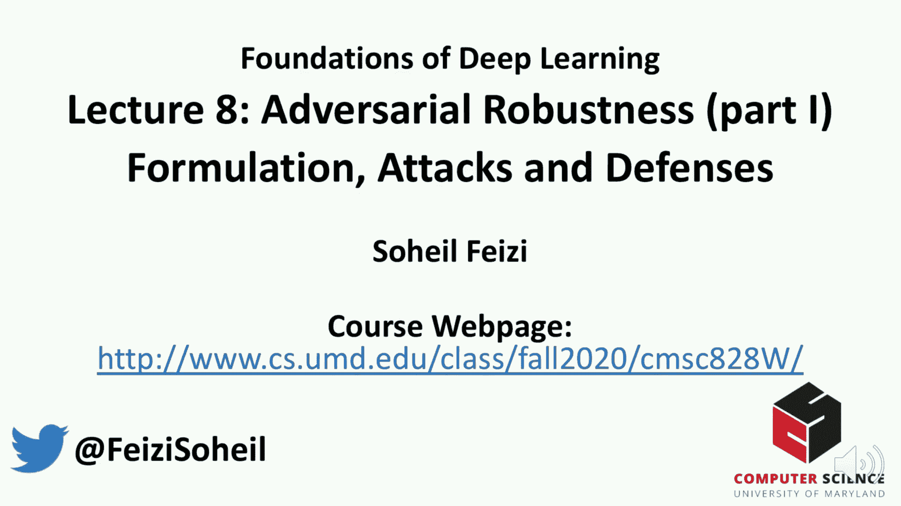
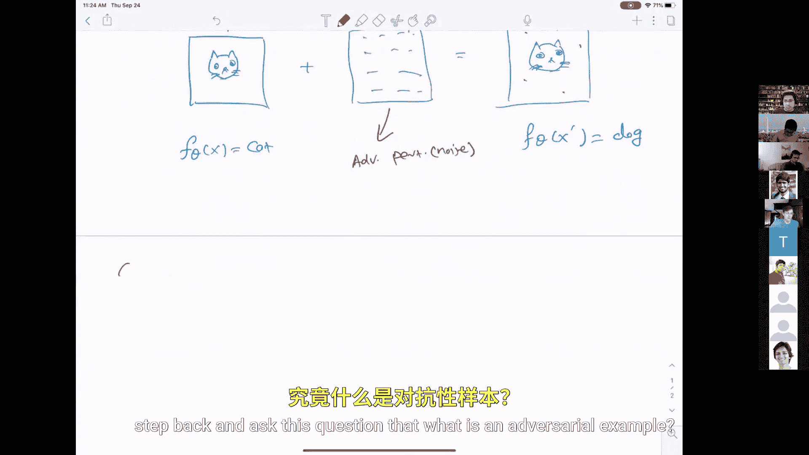
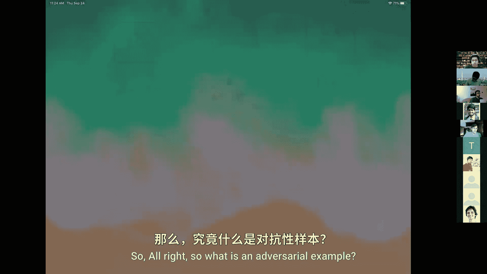

# 马里兰大学【中英⚡深度学习基础｜CMSC828W-2020-Foundations-of-Deep-Learning】-p08-P8-Lecture-8---Deep-Learning-Foundations：-Adversarial-Robustness：-Formulations,--BV15rpCz9Ed8_p8-

Let's start， So today we are going to talk about adversarial robustness。So let's start with。

The basic setup that we'll be considering in today's lecture and also in a couple of future lectures that we'll talk about adversary robustness。

So recall in standard ERM。二。Have a data set。With an。En points， let's say， X to。X X I Y I。

 I range from one to n， so this is my data and we usually assume XI lives in a D dimensional space and let's consider here the binary the multilabel classification problem with C classes that we have here。

All right， so in a standard ERM， we are solving the following optimization。

 I'm minimizing the average loss on my training set。

And I'm picking model parameters data that achieves the minimum loss。

 So I'm looking at the expectation of a loss function if theta or N。Why。

And this expectation is over my training set。So I denote that with P X， y。扫班。

So this is basically the formulation that we had before。The loss if theta X I and y。Okay， so this is。

Accuracy or loss on the training set that you're considering。But in the generalization lectures。

 we argue that at the end of the day， what we care is the accuracy。On。The test set。

That's basically the goal that we。We have here and the idea is that if you are minimizing your error or youre you maximizing your accuracy on training samples and you're learning a model based on that。

 hopefully if the number of samples is you sufficient。

 when you apply it to the test data when you apply your model to the test data。

 you're going to have also like a good performance。For instance， an Inet。

Which has about  a000 classes。There were quite a few successful models in the last couple of years。

 I can just give you a rough idea around 2010 that this performing model。

 if I look at the classification。Erero rate。In 2010， it was about 28%。

Around 30% so this was like the best model on the test set， the classification accuracy。

 and since then we have improved。So the classification error。

 the models they are trained in a better way， the architectures that we use theyre better so in fact。

 we could obtain an error rate of。Roughly speaking2 to 3%。On image。And just to note。

That the human classification rate because if you have humans to classify these samples。

 they can make some errors， on average humans they make about 5%。Classification error。

For this data so it's close to 5% so in fact， the models that we have。

 they perform as good or in some cases better than how humans would classify these examples。

So that's a great result。But is it enough， are we done。

 are we done with Inet and with classification？So this is a really good result。

 So the answer is not so fast。Exactly， so classification。

Errror or accuracy on test set is a very important measure and you know these results because of that are quite significant。

 but by no means it is sufficient， so we need to also understand other aspects of the model。

 especially if we want to deploy them in practice in in in real life applications and one of those aspects is robustness。

Allright， so robustness has been you know studied in different settings even for classical models like linear regression PCA or some other classical learning methods and there are different views you know that you can think about robustness。

 you can think about robustness to you know natural variations in your data right so if you have some you know images maybe the lighting is going to be different in the test time。

 maybe the backgrounds of the images can be different in the test time so these are somehow natural variations that could happen in the test time and that's one way to think about robustness and we'll be talking about that kind of robustness you know which is distributional robustness or robustness to other domains in some of the lectures during the course but today we are going to focus on one specific type of robustness called adversarial robustness。

All right， so what is an adversarial example or an adversarial attack。

 let's say you have a good classifier on imageNe and it classifies your images pretty accurately。

 let's say we have。Cat image。 So I'm gonna。Do my best to。Traw a decent cat。Okay， not that。

So this is my input X and my classifier。Classifies this correctly as a cat so that's good and that's what we we were hoping to get from our classifier。

 but we have realized that if you perturb this image just slightly。

Do you add like a little bit of a noise to it， I'll call the deelta very small amount of noise you would。

Still get like an image that will look like a cat。Same image， but you may have like small。

 really small noise in your image。And even you can make this delta very small that this noise is imperceptible。

 so you don't actually humans won't be able to tell the difference between x and x prime。But you can。

Design your delta， your perturbation vector in a way that now my model is going to predict a different label for this image。

 so my model is going to predict for instance， a dog label for this image。

And that is not good right because this is still the same image， it's for humans， it is still a cat。

 but you make these really imperceptible changes and it can fill the label from models prediction。So。

 this deelta。Perturbation vector that we have， we call it adversarial。

Perturbation vector or noise vector。An X prime that we have here， we call adversarial example。

For the give X。Okay， so。Let me see there are some questions。Does it depend on the amount of noise。

 Yes， I'll talk you know what are the noise models that you know that we will consider and we consider So here。

 just roughly speaking， the noise is small， you know it's kind of a you know a perturbation of your image that is imperceptible。

So Mike， yes， go ahead。 Professor like， how do we define what is the same for human。

 Like when does it。Stop being the same。That's a good point， so I'll answer that。

 you know hold on to that question， so I'll address that directly next。Okay so that's a good point。

 in fact let's step back and ask this question that what is an adversarial example？

🎼。

Allright， so。我的。