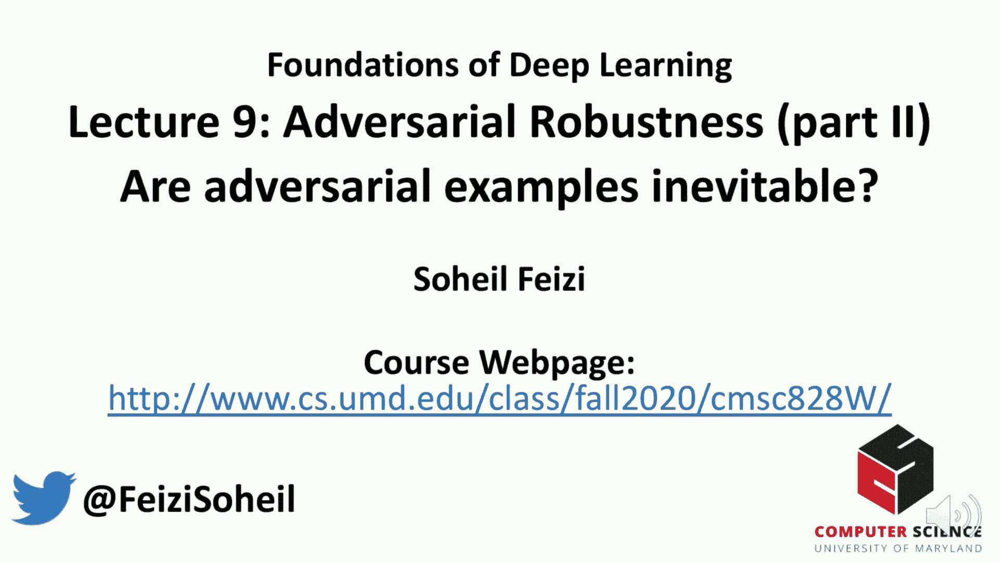
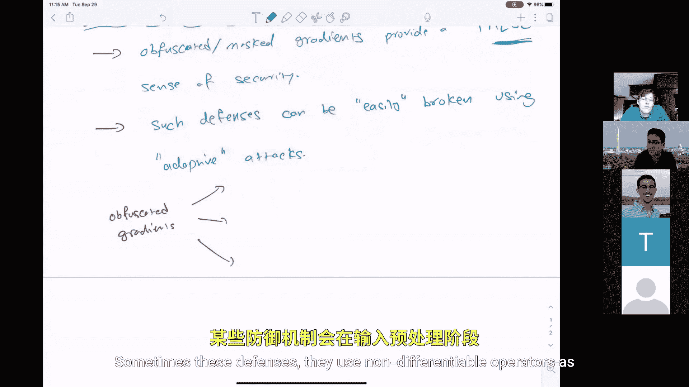

# 马里兰大学【中英⚡深度学习基础｜CMSC828W-2020-Foundations-of-Deep-Learning】-p09-P9-Lecture-9---Deep-Learning-Foundations-by-Soheil-Feizi：-Are-Adversarial-Exampl--BV15rpCz9Ed8_p9-

Let's start today's lecture， as I mentioned， we are going to continue talking about adversarial robustness。

All right， so a brief recap of this stuff we covered in the previous lecture。

 so we talked about the formulation of adversarial。Robustness， and we talked about attacks。

And then we talked about。Defenses。So briefly speaking in the attack problem。

The goal is to craft an adversarial example X prime such that to maximize the classification loss of my model。

 let's say f theta x prime。Given the label， the true label that we want to misclassify or samples against that label subject to X prime to be within a threatread model of x with a particular parameter。

 let's say row so and we mainly talked about LP threadread models where we in LP threadread model we have basically x prime。

Minus x， the LP norm of it is less or equal to rural。

 but there are some non LP threat models that I'm going to talk about them in the next lecture。Okay。

 so that's basically the attack problem and we solve this using approximately using gradient decent。

In the defense， we introduce adversarial training， so instead of a regular ERM。

That minimizes the average training loss again we are going to minimize training loss but not on training samples on the worst perturbations of training samples so i'm looking at the average training loss。

But inside the expectation， I'm looking at the attack problem for each of my training samples。

 so basically I have the attack problem。Subject to basically the threat model that we consider。

So that's called adversarial training， which is a pretty effective defense。

One good thing about adversarial training is that it is not particular for a specific threat model like L2 or Empinity。

 so whatever threat model that you have here you can include in your inner maximization constraint and robotify your model against that particular threat model。

And we basically do alternating SGD。To optimize data and PGD to approximately solve the inner maximization problem。

All right， so but there are many other heuristic defenses。

 empirical defenses that have been proposed in the literature， I see a question Phil， go ahead。

Are we going to talk about convergence of alternating G？

That's a great that's a very good question so as you can see unlike the standard ERM that we have a single minimization we have a meanm optimization problem right so it is not a regular optimization that we discussed in the first parts of the you know this course so I'm going to spend one lecture on just understanding meanm optimization either in convex concave or nonconvex nonconcave setting later on because meanmax optimization is also as you know useful in GNS and other types of problem so I'm going to spend one lecture about that but you know roughly speaking here you can you can imagine that here we do have a good conversions at least you know approximately so we'll be talking about that you know more in the future。

Very good question。Okay， so as I mentioned， there are many other heuristic。Or empirical defenses。

Heuristic。Or empirical。Defenses and people are really clever。

 they you know they propose different you know ways to you know defend a model。

 maybe add like you know coding or you know discretization step at the beginning before you feed your eggs into your network or maybe randomly change your network architecture。

 you add some stochasticity to your network and see if it increases the robustness of your model。

 just you know to give you I'm not going to go into the details of any of these empirical defenses。

 but just to give you a brief idea in ICLR 2018。Probably six， seven such empirical defenses。

Have been proposed。诶。And they basically showed that these defenses further robustify models。

 classifiers， either on MNS or on CR， against different threat models like2 L infinity。

 so they have reported pretty good numbers about them。All right， but。Inね。

Follow a paper in a subsequent paper by Attali Carlinian Wegner。Yeah。嗯。In ICML。ICML， I think， 2019。

So I think 2018， actually， So what they showed was that。Most of these empirical defenses。

 they fall into this category of gradient masking or obfuscated gradient。

 so they are not really robustifying the model what they are doing is that they're making gradient computation to be more difficult for the attacker and since most of these attack algorithms that we have here they are based on gradient descent right so the core component of gradient descent is to be able to compute gradient of your loss function reliably if you cannot compute the gradient reliably than potentially those types of attacks they are going to they are not going to succeed against these defenses and that's why they reported good numbers in terms of robust you know accuracy of these defenses against those types of attacks。

 but the argument in this paper is that。These obfuscated or mass gradients。

 they can provide actually a false sense of security。Right， so obfuscated。Or mask。Graredandients。

Provides。Oride。It falls。S of。Security right so because you think that okay。

 yeah I did like these you know quantizations or coding or randomizations and you know I you know applied like a PGD attack or FgSM attack and wow my robustness is like 80%。

But that's false， that's because you know you have basically just made computation of the gradient more difficult and given that information。

 the attacker can basically circumate these types of mass gradient defenses。So in other words。

 such defenses。Can be。I would even say easily。Broken。Using。What is called adaptive。Attacks。

By adaptive attacks， we mean that we have already seen the defense and what defense is based on so we try to basically have a tailored attack for that particular defense。

All right， so that's basically the gist of this really， really nice paper。

 so I encourage all of you to read this paper， especially if you're working in adversary or robustness area。

But briefly， they identified different sources of gradient obfuscation in the paper。

 so I'll just summarize that finding。So we have。Ofuscated gradients。

That can come from multiple sources， sometimes these defenses。

 they use non differentiable operators as a pre processing of the input。

