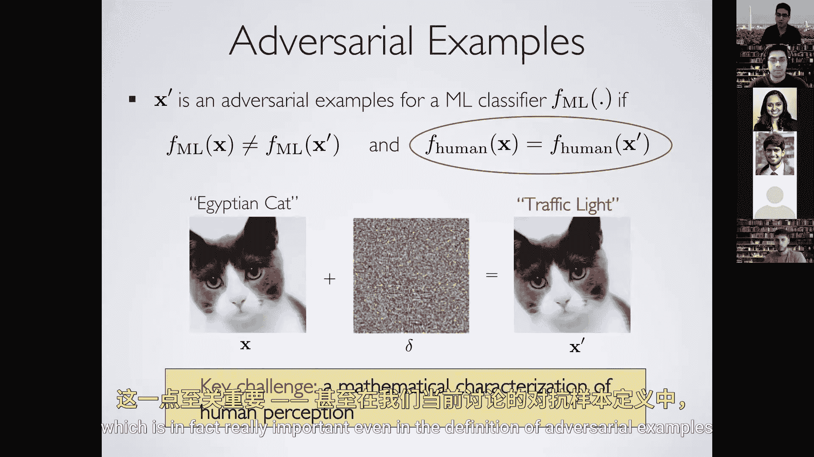
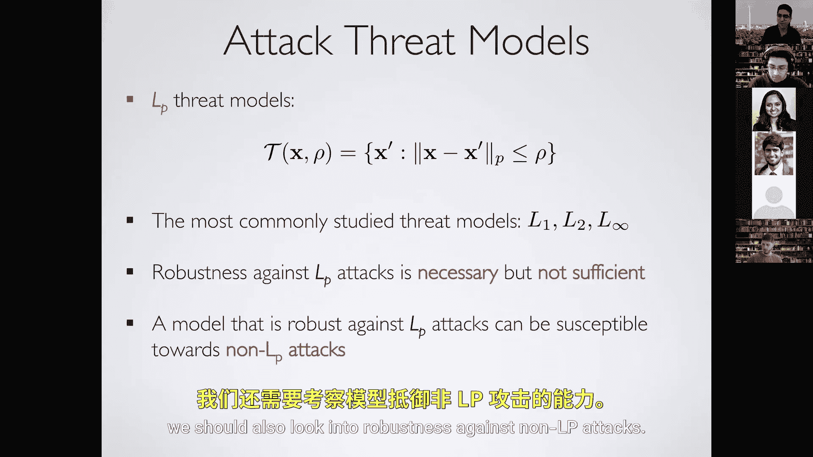
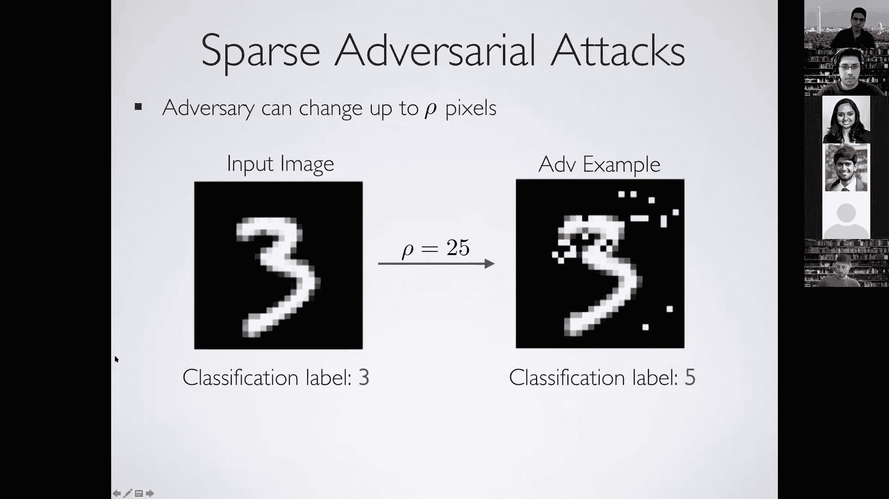
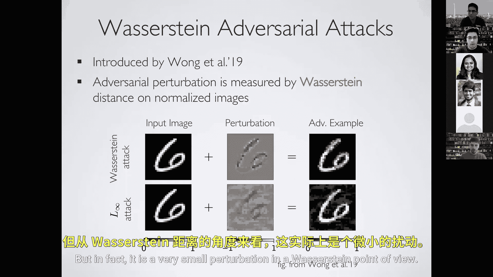
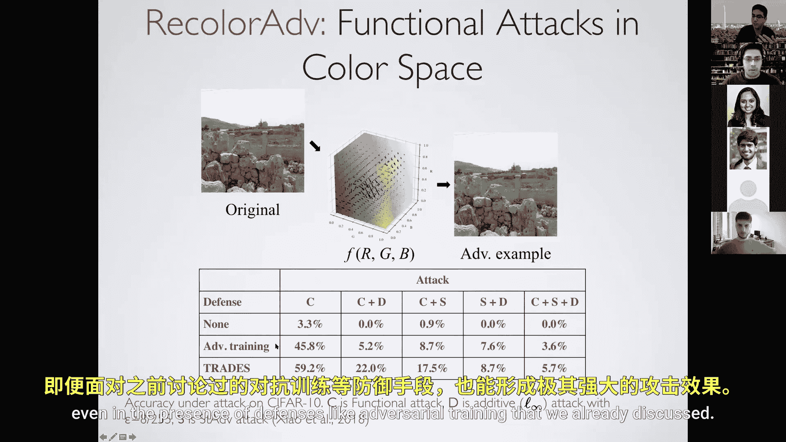
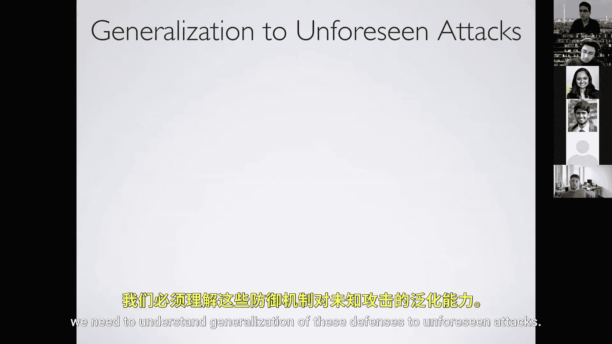

# 马里兰大学【中英⚡深度学习基础｜CMSC828W-2020-Foundations-of-Deep-Learning】-p10-P10-Lecture-10-Deep-Learning-Foundations-by-Soheil-Feizi：Provable---Generalizabl--BV15rpCz9Ed8_p10-

So let's start today we are going to talk about provable and generalizable adversarial defenses。

 so I'll have a quick recap of what we have already covered and then I'll basically switch gears to talk about certifiable defenses and at end I'll be talking about generalizable defenses。

All right， so unlike last times today， we are going to use the slides in order to cover more space。

Allright， so you know what adversarial examples are。

 these are examples like X prime where humans classify x and x prime the same way。

 but my model would predict different labels for x and X prime。

So one key challenge in adversarial robustness is that we don't have a good mathematical characterization of human perception。

 which is in fact really important even in the definition of adversarial examples that we see here。

Okay， so we discussed about this problem before how we get around this problem in the adversarial attack。

 in the adversarial attack， the goal is to create adversarial examples to mislead a classifier。

 so we're basically maximizing a classification loss given that X prime is within a particular threat model。

 and that's how we basically ensure that humans would classify X and X prime the same way by imposing this constraint on X prime。

So this called a threat model， we this is often non convex in a general case and we solve it using。

 as we discussed before using oftentimes projected gradient descent or some other variants of。

All right， so therefore each attack is specified by this attack algorithm and the threat model that we use in the attack optimization problem。

All right， so what are the threat models that we have seen already LP thread models where we look at the LP distance between x and x prime to be within a particular treasure row？

The most commonly used threat models are L1 L2 andinfinity。However。

 robustness against LTP is very necessary to argue about the robustness of the model。

 but by no means it is sufficient。Why is that the case because we can come up with non LP attacks that can break even very good defenses for LPT model so in order to argue the robustness of the model in general。

 we should also look into robustness against non LP attacks？

So what are the non LP attacks， one example is sparse adversarial attacks。

 when adversary can change up to raw pixels in the image in order to craft an adversarial example。

Another example is Washingtonstein adversarial attacks it's introduced in 2019 here that adversarial perturbation is measured by Washingtontenstein distance and normalized images。

 so I'm going to talk about Washingtontenstein distance in more details later on in or lecture about generative models but you can just think about Washingtontenstein as a distributional distance between two distributions and here we are going to normalize images to be represented as distributions and the perturbation is going to be measured as a distributional distance between your input distribution and your perturb distribution。

So here you see one example that you may have some special perturbations because of the Washington Center model and craft an adversarial example。

 and measuring these types of perturbations in LP is going to be a really。

 really huge LP value between your input and output because for instance。

 if you just shift or you rotate your pixels a little bit that will pose a really large LP。

Constraint LP distance， but in fact， it is a very small perturbation in a Washingtonstein point of view。

All right， so there are other nonLP thread models， for example。

 we introduced one thread model called functional adversarial attacks in last year's Ns and the idea here is very simple here the adversarial perturbation is a function of input features。

So here in LP， the perturbation is defined almost independently from the input without any constraints coming from the input。

 but here the perturbation that we defined is going to be a function on the input。

 so if you have for instance， red pixels， white pixels or gray pixels in your image。

All white pixels they are going to change similarly all gray pixels they are going to change similarly。

 so there's like this global constraint that coupling them via a dysfunction that we define and in fact you can couple these threat models you can have a combined adversarial attack that uses combined threat models to have a strong grand attack。

just to give you one really simple example of use of functional adversarial attacks in practice。

 one attack that we developed is called recall color a。

Where we adversarially recall images right as I mentioned these perturbations are global perturbations in the image。

 if you have a blue sky， all of these pixels are going to change simultaneously to maybe a lighter blue or a darker blue。

 so therefore even though your perturbation is more constrained the imperceptibility of them is going to be increased so you can have a larger amount of perturbation without being perceptible from a human point of view。

You can take a look at the paper about the empirical performance。

 but what we have observed is that combining different types of attacks， spatial attacks。

 recaller attack and additive attack is basically providing us like a really strong attack。

 even in the presence of defenses like adversarial training that we already discussed。

All right， that's was a brief recap about attacks。😊，Now， let's have a brief recap about defenses。

As I mentioned， one really popular defense is adversarial training。In a standard ERM。

 our goal is to pick model parameters data that minimizes the average training laws。

 but in adversarial training we are minimizing the average training laws not on training samples on worse perturbations of training samples。

So one good feature of adversarial training is that you can plug in different threat models for your inner maximization problem right so here I'm showing it for L。

 but you can recap this inner maximization for other threat models as well。Again。

 we already discussed this， but we saw this adversarial training using alternating SGD for solving alternate minimization and PGD for solving inner maximization。

 which is the attack problem。And again， adversarial training is coupled with a specific attack for solving the inner maximization。

 what is the attack algorithm that you use and what is the threat model that we are using to constrain or perturbation。

😊，ButAs I mentioned， there are many other heuristic defenses， for example， six。

 seven defenses were introduced in ICLR 2018。嗯。For different threat models。

 robustifying classifiers on different dataset sets。Allright， that was a briefly couple of defenses。

Now， when we have a defense， we can think about adaptive attacks when adversary wants to break these particular defenses。

The attack， as I mentioned， has either an attack algorithm or the threat model。

Let's assume the adversary is nice enough to use the same thread model that the defense uses。

 usually adversaries are not nice by definition， but let's say they are nice enough。

 and they will only change the algorithm， the attack algorithm to break or defense。All right。

 so we discussed this last lecture。In a follow up paper in ICML。

 it has been shown that almost all of these empirical defenses can be broken and we discussed the source of these false sense of security coming from gradient masking or gradient obfuscation。

 notably one defense was not completely broken and in a later paper this defense was broken as well。

So what it says it says empirical defenses can be vulnerable against adaptive and stronger attacks。

 even within the same truth model so this is like a nice adversary。

 so my adversary is not changing the threat model。At this point。

But why adversaries should be nice by definition theyre adversaries right so they can actually use a different thread model to break the defense if you want to deploy them in practice。

So in that case， we need to understand generalization of these defenses to unforeseen attacks。

These are the cases when attackers don't obey。