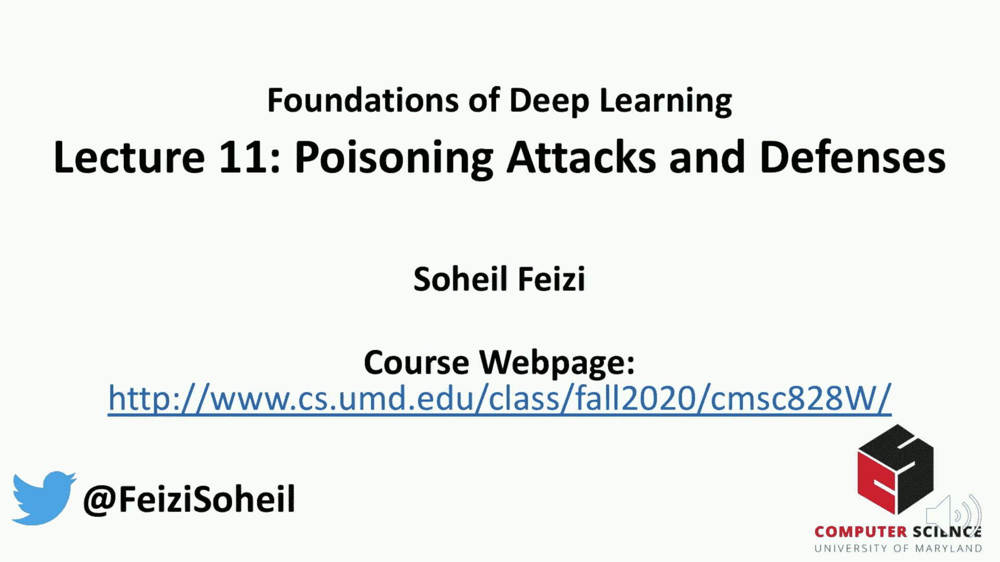
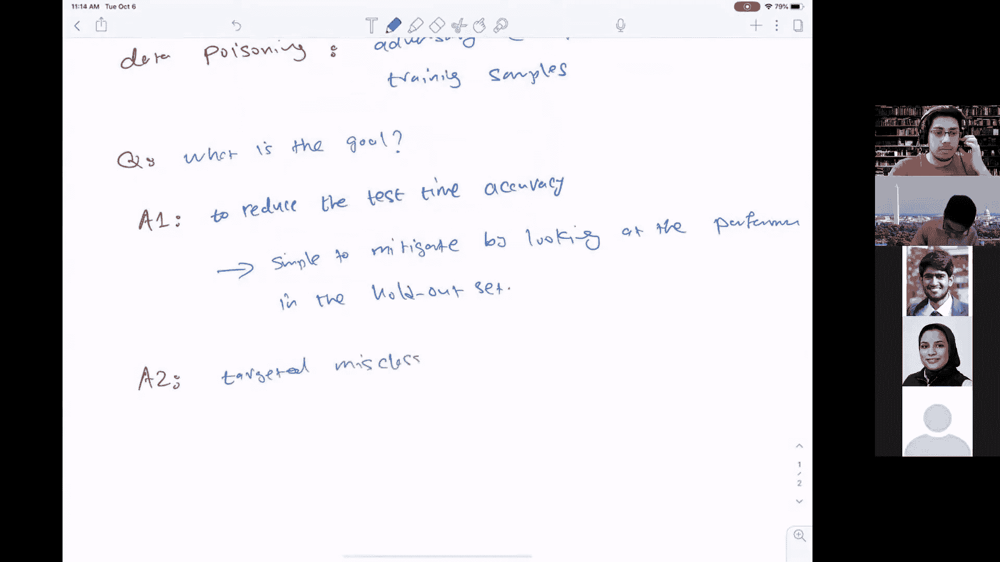

# 马里兰大学【中英⚡深度学习基础｜CMSC828W-2020-Foundations-of-Deep-Learning】-p11-P11-Lecture-11---Deep-Learning-Foundations-by-Soheil-Feizi-：-Poisoning-Attacks-a--BV15rpCz9Ed8_p11-

Okay， let's start。Today we are going to talk about poisoning attacks and defenses。

So let's quickly lookcap what we have already covered about adversarial robustness。All right。

 so far the problem that we talked was in this form。you have a training data。

Then you run your favorite optimization solve like SGD， you train your model。On this training data。

And say your model is。It deep。Model。And then we talked about adversarial vulnerabilities of these models in the test time or in the inference time。

 so in the inference time you're given。One image， let's say a digit of two。 So this is the in。

Friends time or test time。Also you want your model to be effective on making the correct prediction on this particular example。

 but we have seen that an adversary can add some perturbations or do some other types of perturbations on this image in order to mislead the classifier。

 so your classification for the sample， for example， is going to produce a label of three。

 which is an incorrect label。So this is called inference time or test time atdversarial attacks we have talked about you know different ways to。

Attack the system different ways to defend the system， we talked about gradient masking。

 gradient obfuscations， we talked about understanding this problem in high dimensions using isoparametric inequalities and we talked about provable defenses and we also talked about against LP and nonLP attacks and we talked about generalizable defenses to unfores attacks so in the last three lectures we spent quite a bit of time on this particular problem。

But one other vulnerability of deep models may come actually from the training side。

 from the training data。So deep models often require large data sets in order to have a good training。

And in practice， we may not be able to trust all samples in our training。Because for example。

 some of these image data that may be just scrapped from the internet and we don't precisely know who the source of those images are in order to trust those sources you to use those images in our trainings so that's one way that or model can be vulnerable against adversaries。

So in other words， deep models。As I mentioned， they require。Large。网图打通。Training data and in practice。

 it is hard to basically verify each of the training samples because we don't know the in most of the cases we don't know the source of these samples in order to be verified and trusted。

So， hard to。Verify。Trust。Training。三。Allright， so therefore it is possible that an adversary can perturb some of these training samples or can create some bad training samples such that if we use those bad training samples or model in the test time is going to have some strange behaviors on one or multiple test samples。

So therefore that's basically the definition of data poisoning。So， here。Adversary。Can perturb。

Some of training data。Okay， so。That's basically a different type of vulnerability that we may have in training deep models in practice and in fact you know there was a recent survey of a you know few of these you know big tech companies and you know data poisoning is perhaps you know more worrisome for many of these companies than just inference time adversarial adversarial。

Okay， so first let's understand what is the goal， what is the goal of data poison。

In the inference time attack or goal was very clear。

 so we had like one image like two and we want that image to be misclassified by the model if we adversarly perbed them。

 but what about the data posing， what is the goal that we want to have？Yeah。好的。All right， any。

 any ideas？So let me look at the chat box。 There are some comments。

Are we considering the data that has been intentionally pertbed or it is just by wrong labels or noise no no no no so here it is you know adversarly adversarial perturbation data is often noisy you may have some you know wrong labels here and there and that's a part of the process and usually that kind of random noise doesn't you know degrade the performance too much and you know that's not something that we're considering here so here we are considering adversarly perturbing some of these training samples in order to you know achieve some goals and that's basically my question the question is what is the goal of data poisoning。

What is the goal of poisoning attack？So one answer is maximize the training loss。

 that can be a good goal， you know， from an adversarial point of view， I mean。

 or you can even think about it you may want to decrease the accuracy or even the test time accuracy if you have a good general。

To teach the model wrong concepts， that's very good。Maximize test time error。 That's。

 that's very good。 So all of them are good answer。 So let me start with， you know， the first。Answer。

 which。Which was to basically reduce the test time accuracy。

I'll just poison my dataset set and in the test time， you know。

 my accuracy is not going to be very good。All right。

 but this is not really boorrisome because usually we have like a holdout or a validation set and these samples are you know assumed to be clean。

 you know， they are not poisoned validation sets because these are smaller sets perhaps can be you know。

 trusted and verified。Therefore， we can just look at the performance of the model on that validation set and see oh like the performance is not good so we know something fishy is going on in or training。

 so therefore from a practical point of view， this may not be the main concern here。

So this is simple。To。Mtigate。By looking。呃。The performance。In the holdouts。That's a good goal。

 but as I mentioned， it is not really worrisome for us。So the second。Answer。

 the second potential answer， which is you know more worrisome。

 is to cause some targeted misclassification。

Here we want to call。