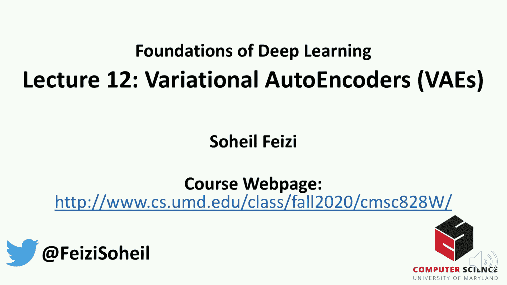
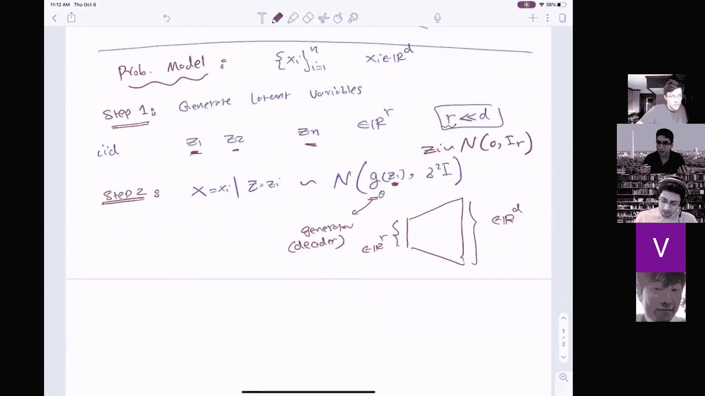

# 马里兰大学【中英⚡深度学习基础｜CMSC828W-2020-Foundations-of-Deep-Learning】-p12-P12-Lecture-12---Deep-Learning-Foundations-by-Soheil-Feizi-：-Variational-AutoEnc--BV15rpCz9Ed8_p12-

All right， let's start。So today we are going to start talking about deep generative models。

 we'll start with variational autoenrs VAEs， and hopefully we'll be able to cover some different variations of VAE like beta VAEs。

 hierarchical VAEs and VQ VAE as well。All right， so let's start。

What is the goal of a deep generative model or generative model in。General， so we are given。

A data set。Let's say I have。In samples， again， this is my training data。

My goal is to learn a function that can generate realistic but synthetic or fake samples from this data set。

 So that's basically the goal of。Having a generative model。Learn a function to generate。Realistic。

What's fake。Samples。First， I want to be able to generate samples that look like my samples in the training set。

 but they are in fact new samples。So why is this important？

It deals with a fundamental question of learning the underlying distribution of a dataset。

And if you could learn a distribution for a data set you can deal with a lot of other problems that we have in machine learning。

 for example， you can think about dennoing。You can think about in painting。

You can think about domain。Transfer。If you have a good generative model， so for example， if you。

 let's say you have images of cats and dogs and then I give you an image of a cat。

That is noisy or has some part of it missing。Then if I have a good generative model。

 I may be able to do in painting and fill in the missing parts， or if you are given an image。

From a summary scene。And then you want to get some samples from like a winy scene。Again。

 if you are able to learn some distributions of these data sets。

 you are able to tackle these types of problems quite efficiently。So therefore。

 we are not just interested in generating samples right so it's an important problem but。

If we learn that underlying distribution we'll be able to deal with a lot of these other applications and problems based on the functions as we learn from or deep generative model so that's basically the motivation that we have here and there are different families of deep generative models so we'll start today with VAEs and then we'll talk about GANs and then we'll talk about flow based models in the next lectures。

Okay。Alright， so how would you generate。Samples。That look like samples coming from your dataset set。

In order to do that， we need to have a probabilistic model to say how my samples that I see in my dataset is already being generated。

嗯。Al so what is a good probabilistic model that we can consider so we are going to consider a two step probabilistic model first I'm going to generate some latent samples from a known distribution let's say Gausian distribution this is a distribution that is very easy and efficient to generate samples from and then I'm going to learn function that maps these random samples to samples that look like samples coming from my dataset so I'll have basically a two step way to model the underlying probability distribution for my dataset。

Right， so step one。I'll generate。Laned。Are your opposed。I'm going to do it in IID fashion。Okay。

 so remember again， my training data I have。N samples。

 I want to see how I can model generation of these n samples。

 So what I'm going to do in an IID fashion， I'm going to generate N。Samples in my latent space。

 Z 12 Z N。So if my samples are in thedisional space。

 maybe these latent samples are going to be in a smaller dimensional space because the underlying assumption is that many of these natural samples like images they lie on a lower dimensional manifold。

 so I don't need to use the full capacity of a Ddisal space in order to approximate underlying distribution that I have。

So these samples potentially will be in。And art dimensional。

Space R can be significantly smaller than the。And the way I'm going to generate these samples。

 each of these samples are going to be coming， let's say from a normal distribution with zero mean and identity covariance matrix。

Easy PC so far， so I want to see how I can generate n samples First。

 I'm going to generate n samples from a normal distribution。 That's my step form。All right。

 so in step two。I need to somehow create my samples in the data access from these。So in other words。

 I need to somehow model the conditional distribution of， let's say X。

If it is equal to X I given z if it is equal to Z so I need to basically model that conditional distribution。

 so we are going to model this again using another Gausian distribution because it is easier to work with Gausian distribution so I'm going to say this is a normal distribution it's a Gaussian distribution with the mean that depends on of course as Z I that I have here。

And maybe with some covariance for simplicity， I'm just going to assume the covariance is a scaled version of the identity function。

And let's say the parameters of this function G is being represented by theta。

So this G function is like my generator。So this is my generator。

Function remember the input of this G doesn't have to be in in the dimensional space。

 it is in fact in many cases in a smaller space than my actual samples。

 so this G if I want to visualize it it will be a function like this。So it goes from。

And R dimensional space where my latent variables live to a de dimensional space where my actual samples in my data lifts。

All right， so that's basically the generator function。

 or sometimes it is called the decoder function as well in especially in the context of the VA。

 so that's it， that's my probabilistic model。So if you give me a data set。

 I pick I'm going to generate n samples from a normal distribution。

 and then I'm going to basically push them through this function G。

 get the means and generate samples from a Gaussian distribution with the mean G theta of z and covariance of sigma squared identity。

All right， so therefore for a given a model， I can generate samples。

But I don't know what is what is a good theta so theta is my model parameter。

 I want to pick a theta in order to be able to generate realistic samples right for。

