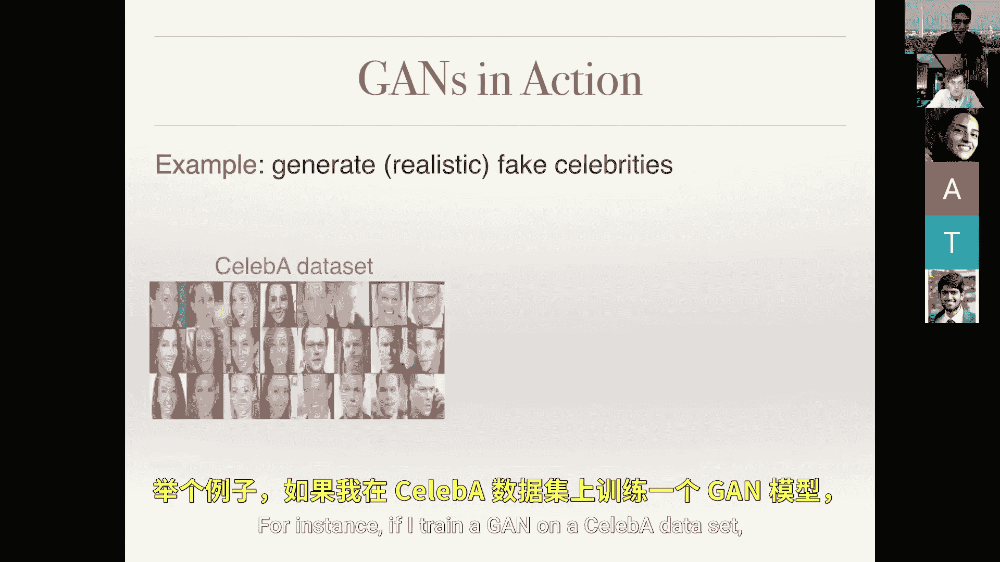
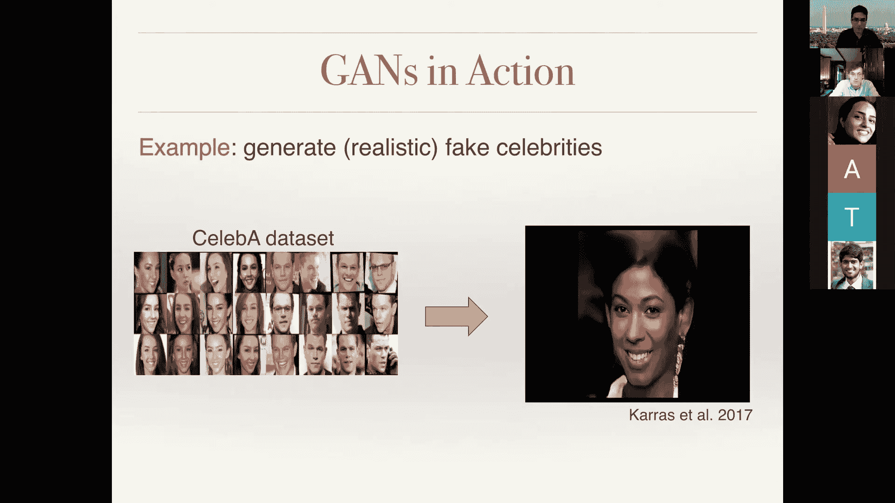
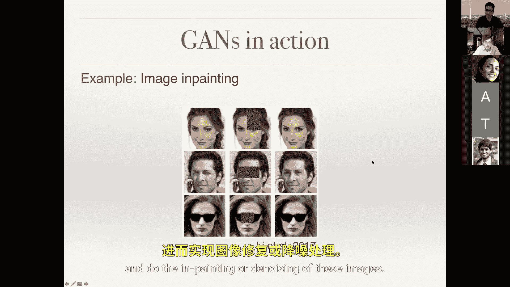
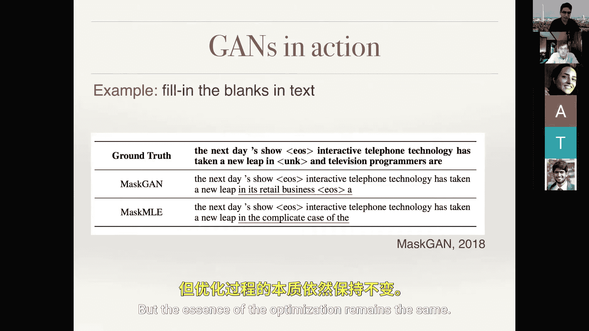
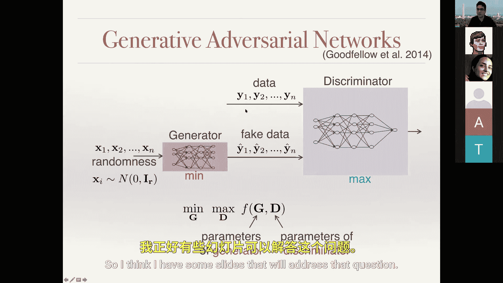

# 马里兰大学【中英⚡深度学习基础｜CMSC828W-2020-Foundations-of-Deep-Learning】-p13-P13-Lecture-13---Deep-Learning-Foundations-by-Soheil-Feizi-：-Generative-Adversar--BV15rpCz9Ed8_p13-

Let's start today we are going to talk about another generative model called generative adversarial networks or GNS。

Allright， so the goal of a generative model as we talked in the last lecture is that if you are given a data with finitely many real data points。

 my goal is to learn a function in order to generate potentially infinitely many realistic but fake data points。

All right， so a classical approach to think about this problem is via maximum likelihood。

 so we fit an explicit model to the data using maximum likelihood and then often we learn the parametric distribution of the data set then we can generate more and more samples from that distribution。

😊，And we in the last lecture， we talked about this approach。

 We saw that in a complex data set for a complex data set。

 the maximum likelihood optimization is intractable。 And instead。

 we maximize a lower bound on the likelihood function， which is called the。

Variational lower bound or the evidence lower bound and that can be done quite efficiently and that's actually like the main idea of variational autoenrs that we discussed in the previous lecture。

All right， so。Today I'm going to talk about another view to this problem via generative adversarial networks or GNs。

Gans， they don't have an explicit model probability model for the data。

 but I'm going to attend of today's lecture。 I'm going to。Discus that， in fact。

 there are some implicit probability models even within GAN's framework that we can leverage in order to compute some statistics like likelihood statistics for samples。

All right， so let's start with Gs。Applications。Right， the one。

Main application of these generator models is to generate realistic samples from a data。

 for instance， if I train again on a selectA data set。

Then I'll be able to generate realistic but synthetic samples。

 so none of these samples that you saw here， they were in the training set。

 but my model because it learns how to represent distribution of faces in this particular data set。

 it is able to generate more realistic but fake samples from the statustism。All right。

 that's just one application。

Other applications that we can think about about， you know GNS is domain adaptation or domain transfer。

So let's say you have some images from a summertime and then you want to change the domain of these images to the wintertime or you have zebras and horses and you want to have a domain transfer in that sense。

So learning again， learning a generative model is at the heart of these problems as well。

 so I'm going to talk about domain adaptation and out of distribution generalization next week。

 but as you can see it is very important for all of these problems in order to have a good understanding of the underlying distribution of the data in order to tackle these problems。

All right， so you can apply cans on other。Moalities than images， for example。

 you can apply it on music and to have again， to generate music for you。And it's certainly not bad。

Better than how I would play。So other applications involve image in painting。

Here you're given an image， maybe a part of it is missing， but if you know the generative manifold。

 then potentially you can project these images back on the manifold and do the in painting or thenoing of these images。

嗯。Similarly in the NLP or in the text， if you are given some fill the blanks task。

 you can if you learn a good generator model for this task。

 then you can basically fill in the blanks based on the manifolds that you learn for your generator model。

 so for the NLP the Gs is a little bit of a different nature because here we deal with discrete variables。

 but the essence of the optimization remains a。

All right， so what are generative adversarial networks or Gs？

Introdcing 2014 by Goodfeel and other authors。So here's the problem， you are given n data points。

 these are my observed samples， let's say these are n images that I'm observing。

And first I'm going to generate in random samples from a distribution。

 let's say a Gaussian distribution by Gaussian because it is easy to generate samples from a Gausian distribution。

Then I'll have a generator whose goal is to map these excess to some fake distribution。

 These are Y hats that I have here。 So that's the goal of my generator to create。Fake。

 but hopefully realistic data from these random random noise。Yeah。All right。

 but generator needs some help right so it cannot generate realistic samples without even looking at the at the data directly or indirectly So we'll have another component called discriminator in the picture whose goal is to provide。

Useful feedback to the generator in order to guide the generator to produce better quality samples。

 so that's the goal of the discriminator。So if you think about it。

 this generator function aims to minimize a distributional distance between my observed data and my fake data。

 while the discriminator whose goal is to somehow discriminate finds a function that maximizes potentially the projected distances of real and fake data using that function。

Or I think practice we。Characterize generator and discriminator functions。

 often using deep neural networks because of their really strong expressive power in many applications。

 especially on images。So therefore， the optimization that will end up is in the nature of a min Max optimization。

 so we are minimizing over G parameters of the generator。

 maximizing over d parameters of the discriminator， a function that depends on G and D。All。

 so what is this function I'm going to talk about that， but that's basically the general idea of Gs。

All right， so before going forward， you know here you know we recall call ingenrative adversarial networks and sometimes people think that this discriminator you know acts as an adversary like an adversarial robustness it's not the case right so here the discriminator provides really helpful feedback to the generator in order to guide it is output to be realistic synthetic samples。

So one other note is that usually the images that we observe they in high dimensional spaces。

While the randomness， the noise samples that we generate。

 they may live in a smaller dimensional space， it is similar to the VAE。

 if you remember or latent samples， they potentially live in a smaller dimensional space compared to the images that we have here。

Okay， so let me see if there are any questions。So Amir is asking why does this learning setting overpower the generator minimizing the MSC so I don't understand the question what I mean is why not so why wouldn't the like fake data minus real data squared minimization over the parameterss of the generator not work compared to this setting？

Okay， so hold on on that thought， I think you know I have some slides that will address that question thank you。

Okay。