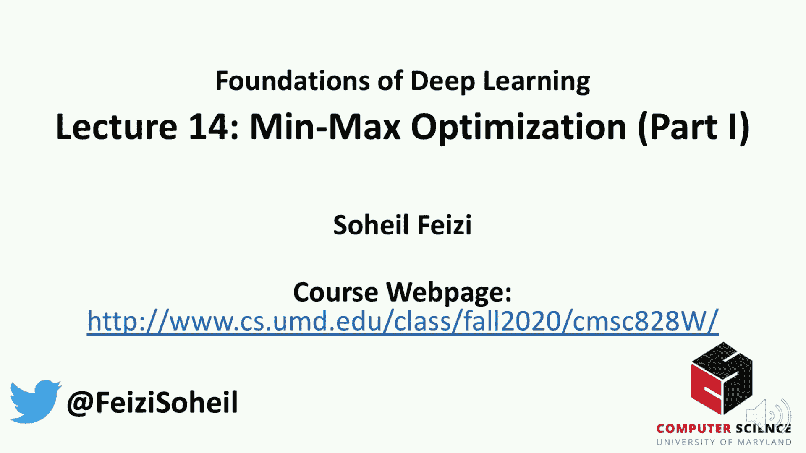
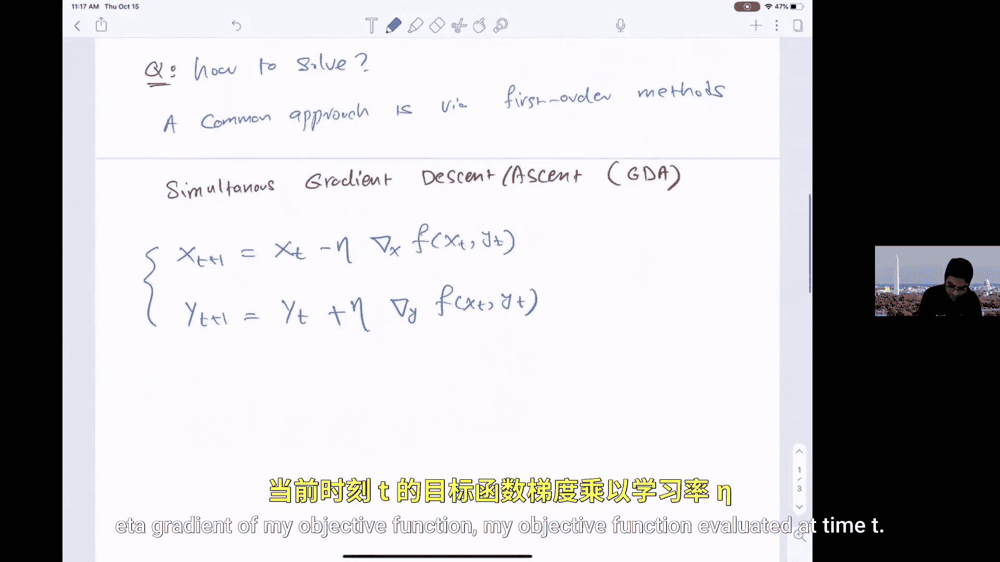

# 马里兰大学【中英⚡深度学习基础｜CMSC828W-2020-Foundations-of-Deep-Learning】-p14-P14-Lecture-14---Deep-Learning-Foundations-by-Soheil-Feizi-：-Min-Max-Optimizatio--BV15rpCz9Ed8_p14-

Let's start today we are going to talk about mean Max optimization problems。

You have already seen various applications and various formulations that。

Minmax optimization problems appear， for example， we saw some examples of mean Max in adversarial。

Learning。Then we were doing adversarial training toify or robustify models。

Last lecture you saw one example of Min Max in training generative models like Ns。

And there are many other examples that mean Max optimization problems become relevant， for example。

 in multi agent reinforcement learning。Among many other problems。Okay。Allright。

 so today I'm going to cover basic results， classical results in the Minm optimization。

 and then I'll talk also about recent very recent results in this area so'm。

In part of today's lecture， I'm going to use some materials from my good friend' talks， Casteta Cals。

And I think he has。Very interesting papers and results in this area and some talks also on YouTube that you can you know take a look to get a more theoretical。

View to these problems from a computational complexity point of view。Spec thing。Okay， let's start。

 So what is the problem。That we are going to consider today。

 we have a minimization over x variables belonging to， let's say， a set Cal X。

 and we have a maximization on y variables。And we are。Or objective function is in the form of Fxy。

Okay， so this is called a zero sum game。So why it is zero sum。

Because you can think about both players maximizing an objective。

 player y maximizing F and player X maximizing minus F so the reward for these players will be P sum 20。

 so that's why it is called zero sum game。And in general。

 X and Y can live in a high dimensional space。So one assumption that I'm going to make throughout today's lecture is that F is smooth and continuously differentiable。

So if is a nice function。Not sure if it is convex concave at this point。

 but we are going to make this general assumption。All right， so what is the goal of my？Optimization。

 so my goal is to find a global solution or call sometimes called global saddle point or global equilibrium。

For this mean Max optimization or。It so my， I want to find。Let's say X star Y star。

 It is called global。Solution or。The global。Sattle point。我。A global equilibrium。Okay。

 so what are the properties of this global solution that I want to have？W a star， I want。

The the y player， the max layer， the y star that it has。

 it should be optimal for all other values with respect to all other values of y if I pluging X star in my objective function。

So， this Y star。Is the arc max of my objective function if I plug in。

X star so if my X player uses X star as it is value， so this function will be a function of y。

 this y star is the best so the player， the max player does not have any incentive to change the value y stars through another value。

And same for exit star。 So if I fix my。Y to be y star in my objective function。

 So this objective becomes。A function of x， and X star is the minimizer of this objective function。

 So there's no incentive for the mean player to change the value from X star to another thing。

So another way to write these two equations in one formula would be。

 let's say I have x star and y star， so this should be less or equal to F。X， Y star。

So if I fix y star， this X star is the minimizer。Of this objective function。

 So if x star y star is less or equal to F x and y star and y versa。 So if I fix my x to be x star。

 y star is the maximizer。So I have the other side of the inequality for all。X and y in。

 let's say my feasible set， let's say S。Contains all pairs of x and y's that are feasible for my optimization problem。

All right， so that's the goal。That's you know， you know。

 the purpose of solving this optimization to see if we can find these global saddle points or equilibriums or solutions。

Okay。So the question is how we can solve this optimization right。

 that's the because were in some level in practice。

 we get like these optimizations mean Max and adversarial robustness in Gs and at the end of the day。

 we want to solve。These optimizations efficiently and see if。

 in fact those solutions are global solutions for that optimization。So how to solve。

How to compute X star Y star。Right， so you have already， you have already seen。

Some solvers for this mean Max optimization problem， can you recall？

So in Gs or in adversarial robustness， how do we solve this mini Max optimization problem？

Altterernating gradient descent。Yes， yes。 So that's basically a first order method。

To solve a mean max optimization problem， so a common approach。Is， let's see why our first。Or the。

Methods。So a popular first order method that we have already seen is something called alternating gradient descent ascent or a slightly simplified version of it is called simultaneous gradient descent ascent。

我GDA。All right， so here we are going to take one gradient step。

For to optimize both x and y at the same time。So what are my updates？I have。

 let's say except time T plus1 would be the same as。Ex that time T I'm minimizing。

 so I'm going to go in the negative direction of the gradient minus eta times。Greient of mine。

Function evaluated at point computed in time T。And similarly， my。

Why at T plus 1 would be Y at T plus y plus。Because we are maximizing。

Eta gradient of my objective function。My objective function evaluated at time T so this is cost simultaneous because。

