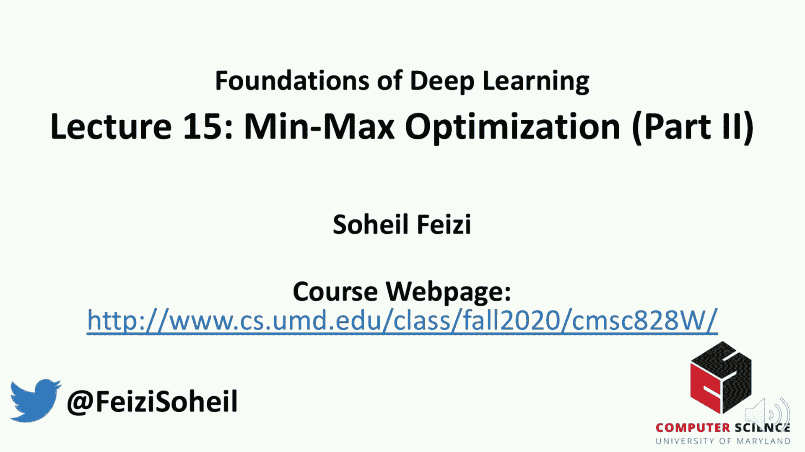
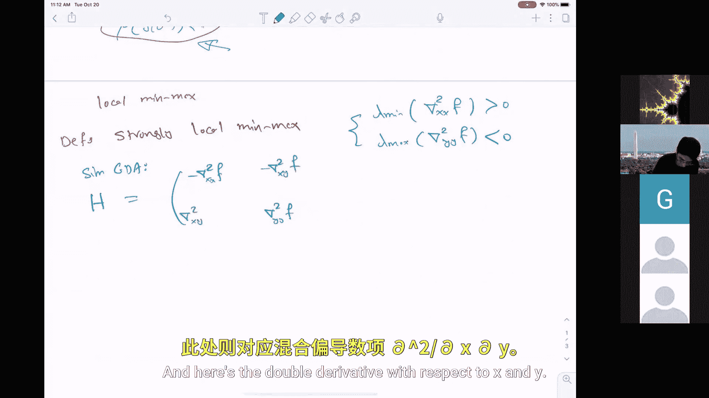

# 马里兰大学【中英⚡深度学习基础｜CMSC828W-2020-Foundations-of-Deep-Learning】-p15-P15-Lecture-15---Deep-Learning-Foundations-by-Soheil-Feizi-：-Min-Max-Optimizatio--BV15rpCz9Ed8_p15-

Let's start。Today， we are going to talk about non convex concappe mean Max optimization problems just to quickly recover what we covered last time。

So we started talking about non convicts。Yeah。Okay。Mean Max。By first setting up the goal。

 so here our goal is to potentially find some local meanm solutions defined as the following。

 so we define local mean Max。Let's say you have x star and y star and my optimization is mean over x max over y。

 I have an objective which is smooth and differentiable。So in the local mean Max definition， we have。

Fx is star by star x is the minimizer， so this should be less or equal to。F over all x's。

If we are looking at global mean Max， but in a local mean Max。

 we want this inequality to hold at least locally for a neighborhood around x star and by star。

 similarly we have the other side of the inequality。

 so if this is true for all x and y in a local neighborhood around my X star and y star。

 if we call this a local mean Max。Okay， then we talked about the stability of。Or dynamics。

 we talked about asymptotic stability。When we start close to my point x star and y star。

 my dynamics don't push me away， so I remain close to that point and if it in fact converges to x star and y star。

 we say it is locally asymptically stable。So the other definition of stability is linear stability。

Or if we just use stability， that's what we are referring to。And in the linear stability， if you。

 for instance， look at the dynamics of gradient， simultaneous gradient， de and ascent。

Radian the then asend so you get the following dynamics theta plus one the is basically X and y。

 so we。Have the following fixed point solution where f is equal to theta t plus Eta times the gradient vector。

So just to recall， theta is x and y。And here， gradient vector。

Is gradient the negative of my gradient with respect to x and the gradient with respect to y。

 So why do I have a negative here， Why don't I have a negative for y。

You're minimizing x and maximizing Y， that's why Yes， exactly。 So here I have a plus sign。

Because I'm minimizing over x， so I need to have a negative sign in front of my gradientdium。Okay。

 great， so we talked about the Jacobian of this dynamic。

Which is the gradient of my F with respect to theta。And Jacobian can be written simply as。

Identity comes from the first term eightta times gradient of the gradient vector will be the hesian。

So I have the HM matrix。And Hian matrix is。The fall。Okay， so in linear stability。

 we want the spectral norm of the Jacobian matrix to be less or equal to one。Here， if I look at。

All of the eigenvalue of the Jacobian note that here。

The Haitian is not a symmetric matrix if you look at these two terms。

So one is the negative of the other term， so the Haitian is not a symmetric matrix。

 therefore the Jacobian is not going to be a symmetric matrix。

And my eigenvalue will have both real and imaginary parts。 But what I care is the。Magnitude。

Of the eigenvalues， and if the largest magnitude of my eigenvalues is less or equal to one。

 I say it is linearly stable。Yeah。Okay， so this is also called a spectral model。

And then we had a lemma saying that if I'm linearly stable。If my dynamics is linearly stable there。

The spectral norm， spectral radius is strictly less than one。Is strictly less number。

 not less or equal to1， so this is row of J。Then it implies asymptotic stability as well。

So therefore， at the end of the day， this is one of the main conditions that we care about。

 so I want the Jacobbian matrix to have the spectral radius to be strictly less than。Okay。呃。

All right， so。Let's have one more。Definition， let me see if。If there are any questions。

 you can just write it in the chat box or。Ask your question。Onmuting yourself， so there's a question。

 what was the definition of linear stability， it's basically it。So in linear stability。

 I want the spect radius。Of my Jacobian to be lesserti one。If it is strictly less than one。

 then it implies asymppootic stat。Okay， so。We had the definition of local mean Max evolve。

So let's define。Strongly。Local mean。Right， so in strongly local mean Max， Okay。

 so remember in x I want to be you know， my x start to be a local minimizer。

 So my Haitian with respect to X should be PSD locally in the strongly local mean Max， my Haian。

 I want to be。Positive definite， So eigenvalue I want to be bounded away from0。So here。

 lambda min of my H M with respect to x， I want to be。

On the debate from zero not p equal to zero in local mean max is greater or equal to zero similarly for why I'm maximizing so I like to be locally concave the Haitian should be positive negative semi definite in the local mean maxs。

 but in a strongly local mean max sense my I want my lambda max。Of the Haian。

To be strictly less than。list than one。Okay， so that's the definition of strong low and you'll see why we need this definition。

Okay， so。Let's understand this a little bit better right so in order to have asymptotic stability or linear stability。

 I want the spectral radius of my Jacobian to be strictly less than one。

And I know my Jacobian is just identity plus eight times the Haitian matrix。

 so let's understand the Haitian matrix a little bit better so Hasian matrix that we have for simultaneous。

Gradian the NMSN is in the following form。so I have。Then。OM it is vector X here。

HM with respect to y here， and these are the double derivative with respect to X and y。

 and here's the total derivative with respect to X。

Okay。