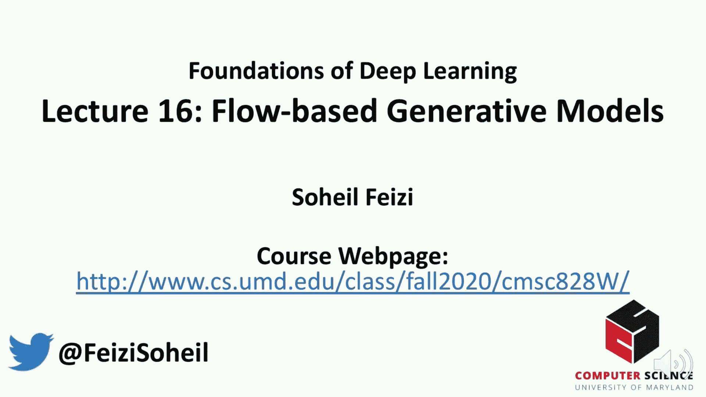
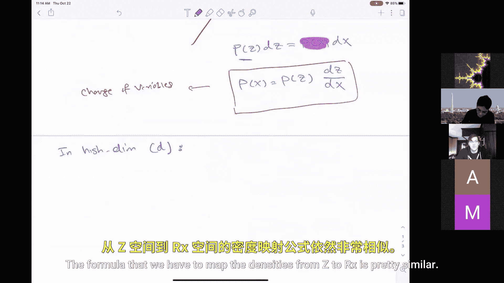

# 马里兰大学【中英⚡深度学习基础｜CMSC828W-2020-Foundations-of-Deep-Learning】-p16-P16-Lecture-16---Deep-Learning-Foundations-by-Soheil-Feizi-：-Flow-based-Generati--BV15rpCz9Ed8_p16-

Yeah。Let's start。Today we are going to talk about another class of deep generative models。

 namely flow based generative models。Okay， so as before， we are given a data set。

Let's say with n samples， x12 xN， these can be n images that you have and each of these Xs。

 they live in a de dimensional space。の。Again， we are basically back to a probabilistic model like Ve。

 So we start with。A model like this that I'm going to。Generate some latent sample Z。Let's say， from。

And normal distribution。But here the dimension of z is going to be the same as dimension of x。

 unlike VAAE that we had a smaller dimension for z， we are going to use the same dimension。Next。

 I'm going to use an inverible or objectivejective function to map z to x。

 So my x is going to be equal。To， let's say， a function generator function with parameters theta of Z。

And the important point here is that we want this function。To be objectiveive。And therefore。

 invertible。 So in other words， words for each Z。I have one corresponding X and vice versa for each X。

 I have one corresponding Z。 So there is this bycheative mapping。

Between my latent space and my image space， my access space。Okay， good。

So this defines a probability distribution， obviously for x。

So we refer to that probability distribution by Pta Tx， yes， it is a one to one mapping between theX。

And theta is basically my model parameters， all of my model parameters are shown by theta。Okay， so。

If I want to go from Z。Space to X space。So I'm going to use the function G G theta is the function I'm using。

 That is my generator。This process is called either generation or sampling process。Generation。我。

Sampling。But the good thing about。This probabilistic model is that I have a one to one correspondence between x and Z。

 So I can actually go from x space to Z space。 I know what is the exact latent。

Sample for a particular image that I observe。So that process is called inference step。Alright。

 so how can I go from x to Z， I can。Go from x to z using the inverse of my function G。

 and I know function G by assumption is invertible。

 So the inverse exists G theta inverse for simplicity， I'm going to show it with F theta。F sub。

 So F is a function taking us from x to Z。 G is a function taking us from Z to X。

 and they inverse of1 nano。Okay， so one assumption that we have throughout today's lecture is that F。

And therefore， G is a differentiable。Differentiable function。Just to。

Not worry about potentially some non differentiable， non differentiable。Points。

So there's a question what is p theta that's the probability density of x。

 so your z is according to a normal density， then you then map z to x using a function then you get another density function so that will be P theta of x。

Okay， so this sounds like a good。Good probabilistic model to start with because Z is a random variable。

 normal random variable can be easily sampled and if G is a rich class of functions。

 let's say neural networks， then we can come up with very complex densities in the X space potentially can represent data sets like images。

Okay， so。But what are the bottlenecks， what are the issues in this particular formulation？

I see a lot of questions in the chat box， let me actually pause and see if。

There are some questions why do we need a differentiable function you know it is you know you can have red functions as well。

 but not to get into the technicalities of measures zero non differentiable points because in training we are going to train them using SGD methods we are assuming everything here is differentiable。

Oh okay， great， I'm happy that you guys answer each other's questions。Very good。Okay， so let's。

Look at one example。Let's suppose my dimension is one one dimensional case。

And a function that maps the Z space to the X space is。Something like。Like this。

It should be an inverttable function， right that's a G function。Mapping Z2 X。Okay。

 so I have a density。In the Z phase， that's the density I know it's a normal density。So I know。

 for instance， what is the probability if I look at an interval with the very small length of Dz？

I know what is the probability that my Z is going to end up in this particular integral。

 and that is basically the density function。PZ times Dz， which is the length of that interval。Now。

 if I look at the corresponding mapping of this particular interval in the X phase。

So the amount of the probability in mass should be conserved and this is equal to px density of x times dx。

 the length that we have for that particular interval。

So this is like a very famous and kind of elementary equality to map densities from one space to another space。

 therefore we have pz times dz should be equal to px times dx。So if I want to I have a P。

 I want to find Px right so that's the density in my image space。NPX is going to be equal to P Z。

Times Dz over Dx。It's the change of variables in the。

In computing the density functions right so usually in any probability one01 courses。

 they cover this equation。Okay。Now， what happens in higher dimension， So this was an elementary。

Mapping。Densities from one dimensional space to another one dimensional space。

 what happens in a high dimensional space？Let's say， we are。诶。In a two dimensional space or maybe 10。

000 or 100，000 dimensional space。The formula that we have to map the densities from Z2x is pretty similar。

 so px is going to be。

