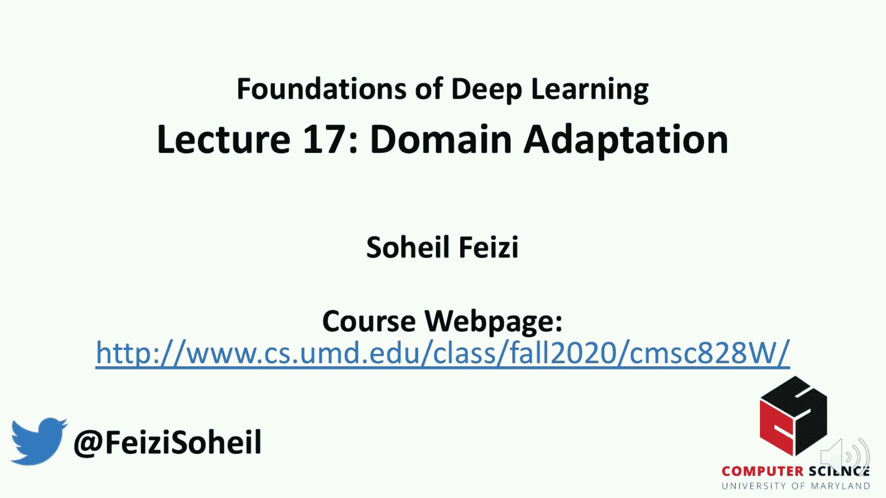
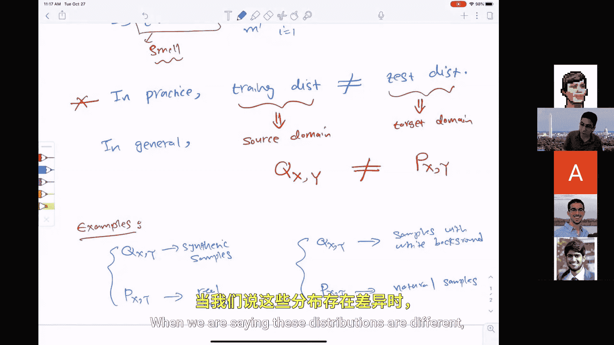

# 马里兰大学【中英⚡深度学习基础｜CMSC828W-2020-Foundations-of-Deep-Learning】-p17-P17-Lecture-17---Deep-Learning-Foundations-by-Soheil-Feizi-：-Domain-Adaptation-(--BV15rpCz9Ed8_p17-

Let's start today we are going to talk about domain adaptation problem。

Let's recap the type of problems we have already seen。So far。

 we have looked into a learning problem where we are given a training set。Let's say we M samples。

 so we have Xs。I'll just call them train to make them explicit that they're in my training set， YI's。

 my labels， train， I have， let's say M samples。Potentially coming from a distribution。

 so that's my training distribution。I denoted with Q X and y。

 it's a joint distribution between my features and labels。All right， so I learn。A function， mapping。

X to y， right， so that's the learning process。So how we learn that we define a loss function。

And then we minimize the average error on the training set。

So I pick my model parameters data by minimizing the average error that I have。Over my training data。

If theta X I。Train。And by eye。Training。So this gives me theta star。So that's not the ultimate goal。

 though right， so we have seen in the generalization lecture that ultimately what I hear is that if I take this function。

 a play the star and apply it to my test set。I want to have a good performance。

So let's say I'm given a test set。X I test。Why I test。Let's say， I have。

M prime samples from the test set。But again， the assumption is that my test samples。

 they are coming from the same distribution as my training samples， let's say part of your imagenet。

 you're doing for training and you're keeping some of the images for your test stand validation。

So over this test set， we compute the test error。By evaluating。The function that we have computed。

Over。The test samples that have not been used during the training。はい。So， the whole。

Goal of generalization and optimization par that we covered is to learn a function that this test error is small。

So it's smaller， better for us。And we have seen that if we have enough samples you know training the generalization gap。

 the difference between the training error and test error would be small and also we have seen that in over parameterized models。

 even though the number of parameters is larger than the number of number of samples number of parameters is larger than the number of samples again we observed that the training and test error differences can be small。

 so the goal was to train a model on the training set and if it does well then using these results we can make an argument that the model is going to do well in in the test set as well。

So that's basically the setup that we have covered in the first part of this course in terms of optimization and generalization natures。

Okay， so。The question is， is this a realistic setup。Or not。So what do you guys think？

So I see one answer， no， why is that， why isn't this a realistic setup？

Okay so I see one answer it says the same distribution of the training set and the test。

 so if you think about the assumptions here， so I'm assuming my training samples coming from distribution Q X Y and also my test samples。

 they come from the same distribution。That's the he assumption。That we have。Okay。Here。

But in practice。This may not be the case， so in practice。Draing。

Distribution can be different than the test distribution。Rightい。呃。So， in general， we。

If you want to consider a more general setup。We refer to the set that we are training on as the source domain。

And the set that ultimately will test on， we refer to it as the target。我明。And again。

 the distribution of samples in the test domain， let's represent them by Q Xy。

Can be different than the distributions of samples in the target domain。 Let's refer to it as P X， Y。

 So these two distributions can be different。From one another。Okay， so let's look at some。

 let me just see if there are some comments。Okay， good answers。So， then。

Will be in this situation that either our training or test distributions or source and target distributions are going to be different。

 Let's look at some examples。Okay。So， you may have。Your Q X。

 Y be representing some synthetic samples。These are easier to generate in many applications and you want to train your model on these synthetic samples。

But at the end of the day， you want to deploy them in。In real word applications。

 then you will have real samples and these real samples may have some natural variations。

 maybe the lightings would be different， maybe there would be some other natural variations in the image in images or your samples that you had not seen in your synthetic samples。

I or your。Source domain。Can be samples， for example。With a particular background。

 let's maybe a white background。So you are looking at images。

 the object is being highlighted and the backgrounds have been whitened。

So you train your model it you know the background shouldn't make a difference in your let's say classification because the object。

 the main object remains in the image， but if you do that and then you apply your model in。In。

Real applications， you。Need to evaluate the performance on some natural samples。

With various different backgrounds that it may happen。So because of these examples。

 and you can come up like with zillions of other examples for this， this is a very important problem。

To understand when we can train a model on a particular distribution of samples and deploy it on other samples from coming from another distribution。

So one point that I want to make here is that。When we are saying these distributions are different。

I need to highlight that they are somehow related。