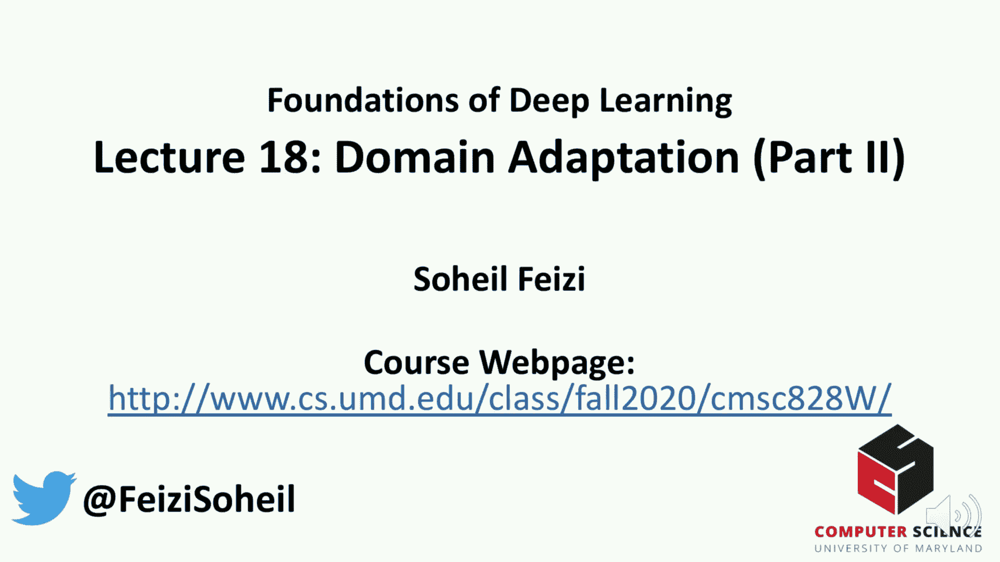
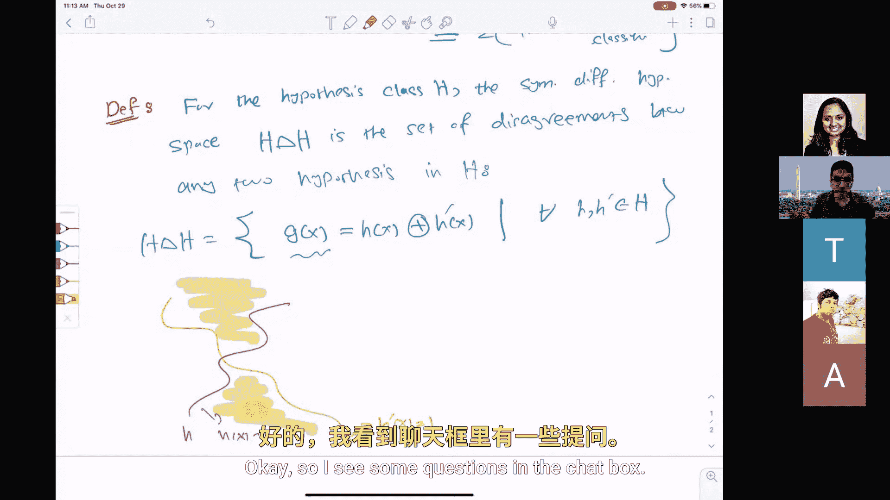

# 马里兰大学【中英⚡深度学习基础｜CMSC828W-2020-Foundations-of-Deep-Learning】-p18-P18-Lecture-18---Deep-Learning-Foundations-by-Soheil-Feizi-：-Domain-Adaptation-(--BV15rpCz9Ed8_p18-

So let's start today we are going to continue talking about domain adaptation problem。

 let me quickly recap what we covered last time， so we are given a source domain。

We represented it with distribution Q X y， so we are observing m samples from the source domain。

 the samples comes in the form of XIS， subS， XIS and YIS。Again， for simplicity simplicityity， okay。

 so let me actually be general so we observe MS samples from source form， these are label samples。

From the target domain。These are labeled。Samples from the target domain mean。

 we observe only onlabeled samples the target distribution P， I observe。

 let's say M samples in the form of。X， I T。Ale， so the goal is to learn。A function。

H from my hypothesis class that at the end of the day， what I care is the the target error。

 So I look into the target error for this age。And that's the。Expectation on。

Labeled target samples right so in the test time I'm going to have labeled target samples and I want to evaluate how I perform。

In in labeled target samples， so that's basically the goal in order to learn a function using labeled source samples onlabeled target samples in order to perform well in labeled target samples。

I see there's a question， please go ahead。I just wanted to know whether this problem can be extended where the source samples are underbuilt。

So samples are what？Un labelbeled unlabeled。If source samples are unlabeled， then。You know。

 it is not quite clear what kind of functions you can learn。

Clustering type of algorithms then it was sure， yeah。

 so you can you can think about you know domain adaptation not for a supervised task。

 but for maybe an unsupervised task Yeah for sure yeah but here or focus basically a classification problem and we want to learn a function in my source domain plus some onable target domain in order to perform well in the in the target domain yeah。

 but you can think about some you know other variation there are so many other variations of this problem so I'm basically just going to focus on probably the most standard one and hopefully you know you'll build some you know muscles and you know tools and techniques in order to be able to think about other related problems。

Yeah， thank you Sure Okay， so last time we started talking about what are the assumptions that we have in order to be able to achieve goals of domain adaptation。

 one assumption was covariator shift that we want the conditional distributions of QmpP to be the same the other assumption was that the joint error should be small if I had labeled target samples then I wanted to be successful otherwise it's not going to be an easy problem and the third assumption was that we need like sort of a relationship between my source and target excess。

 the unlabeled source and target samples and that's what we characterize using H divergence。

So the H divergence is defined as。Between， let's say QX。

 these are the marginal distributions of source and target。

I look at the world age that gives me the biggest difference between the probability of。

Samples on one side of my classification boundary coming from the source versus。

Samples that comes from the target and they fall into one side of my decision boundary。And again。

 we are considering a binary classification in all of these examples and we looked into many examples to build intuition about this H divergence measure which is really intuitive so at the end of the last lecture but the SA was that this quantity can be computed quite efficiently by training a classifier to classify source versus target on labelbeled samples in fact theres a factor of two here。

So in fact， half of this or you know H divergence is related to the classification loss。

 two times1 minus。The classification laws。If I'm training a classifier to classify source and target distributions。

So that's basically the stuff we covered last night。Okay。

So I'll start with the definition here and then I'll state the main theorem that。

That quantifies the target error based on quantities we have in the training time。Okay。

 so what is the definition here， so for a hypothesis class H。

 I'm going to define a symmetric difference hypothesis space。For the。Hypothesis class。Hge。

 the symmetric difference。Hypothees。Space。In order by H Delta H is。The set of。Disres。Is agreement。

Between。Any to。Hypothees。In age。So in other words， I'm going to pick any two hypothesisses。

 let's say H。Ex。And hx prime， h prime x， and I look into the disagreements between them。

 that's basically the X or function。We are thinking about the binary classification。

 but all of these can be easily extended to the multi label classification。

 so I'll talk about that later on。So defined this defines a function。And if I look at for。

All pairs of H and x prime H prime in my hypothesis， then the set of all h's。

That I'll get will define my symmetric difference hypothesis space represented by H delta H。

 so it will be the set of all Gs， the xhors between H and x prime。

 such that H and x prime belongs to my hypothesis space H。

All right so this may sound a little bit complicated， but it is in fact really simple。

 let me draw pictures just to show you how simple it is。

Let's say I pick one function from my space age。So h of x is one on the right hand side。

Let's say you pick another function， h prime。Let's say it is one on that side of the classification boundary。

 Alright， so I want to define a function G， which is their X O。 Let's look。 So in this part。

Today they I create disagree。HMH fund。I see agree why H is one what about h prime if it disagree right so because h is1 h prime would be0 so in this part they disagree same as here so they disagree so my G would be a function mapping the highlighted area to one other parts to zero So if I just look at the place that HG maps to one it will be the highlighted area in this picture so quite simple。

Okay， so I see some questions。

y。