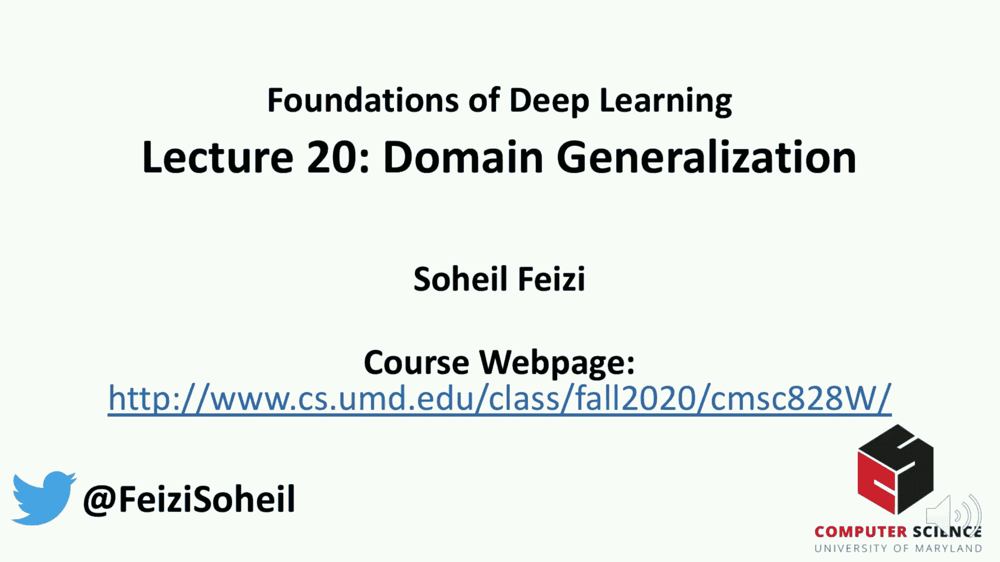
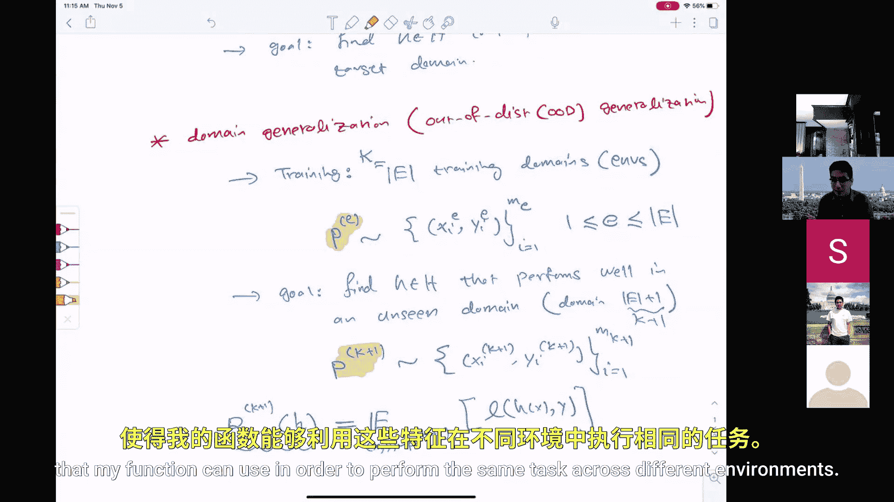

# 马里兰大学【中英⚡深度学习基础｜CMSC828W-2020-Foundations-of-Deep-Learning】-p19-P19-Lecture-20---Deep-Learning-Foundations-by-Soheil-Feizi-：-Domain-Generalizati--BV15rpCz9Ed8_p19-

好。All right， so let's start。Last lecture。We talked about the problem of。Doomain adaptation。

What was the problem in the training during the training？We are given， labeled。

Samples from the source domain， and we are given unlabeled samples from the target domain。

So let's say I have。Some source samples they are labeled。Hes a labeled。Source。Samples。

But we also have。On label samples from the。Target domain me。Only labeled。Targetets。Samples。

And the goal was to find a hypothesis， a function trained on these data that we have in the training in order to perform well in the labeled target sample。

So， the goal is to find。Let's say function in my hypothesis class。That performs。Well。indy。Target。都梅。

And we talked about practical methods。😊，And。Assumptions in order to make sure that this goal is achievable right so we have three assumptions if you remember one was covariate shipped。

Assumption that says the conditional distribution of labels given X's should be the same we had the assumption that the joint error on the source and target if we had labeled target samples in the training should be small and the third assumption was that。

Source unlabeled source and target， they should have some sort of relationship with each other with respect to the hypothesis class and for that we characterize H divergence between source and target。

 these were the main assumptions and we saw some upper bounds on the target error based on different components that directly reflects these assumptions。

And we talked about practical methods that people they have developed in order to deal with this problem。

 mainly the idea is to find an embedding of your source and target X features in a space such that their distance。

 their distributional distance is small so they're somehow aligned to each other。

 and that is measured by a Washingtonstein IPMs， MMMMD classification errors so on and so forth。

 so that's basically roughly speaking the topics that we covered in the last two lectures about domain adaptation。

All right， so today we are going to talk about a related problem to domain adaptation。

 it is called domain generalization。Or sometimes it is referred to as。Out of。Distribution or OD。

Generalization。Okay， so what is the setup here？Alright， in the training。

We are going to have label samples， not from one domain， label samples。

 potentially from multiple domains。Let's say I have。E domains。 I have。 These are my training。

Doomains。Or environments。And I'm going to receive label samples from each of these domains or environments。

That's the distribution for an environment。E is represented by P。

Sup E and we are receiving some number of samples。From this particular domain。so诶。I have X I。E and Y。

 I。e for the environment E。And how many samples I have， Let's say I have。AndE samples。

So I receive labeled samples for all of the environments I have。Okay。Yeah。So what is the goal here？

The goal here is that if you train a model on these labeled samples from different domains。

You train a single model。And you take that model and apply it to a new domain or a new environment。

 an environment that had not been seen during the training。

We want to have a good performance in that new unseen domain or environment。

 and that's why it is called generalization， so we want to learn a hypothesis a function。

 a function from our hypothesis class that has a good generalization to unseen。

Doomains and environments。So， here the goal。Is to again。Find a function in our hypothesis。

That performs。Well。In。An on scene。都明。Work environment。 Let's say， my domain is。诶 domain mean。

E plus one， I have。So let's， you know， for simplicity， let's call this K， I have K domains。

So this will be domain K plus1。So I。In the test time。

 I observe samples from distribution PK plus one。According to。This particular distribution。

 I don't see it in the training。Yeah。Let's say we observe Mk plus one samples。

So I'm going to apply my function， evaluate my function。Over samples coming from this distribution。

I'm going to look at the error that I observe。Using that hypothesis function that we be use in the training and this is going to be my error in the new environment so I refer to this as。

Error in the。New environment， environment K plus one using。Hypothees H。

So we want to pick a hypothesis H that minimize a function H that minimizes this risk in the unseen environment。

 so that's the goal of domain journalismization。Right， so I see a couple of questions。

Are there any constraints between these environments about how they should be related to excellent question？

You can see like the problem is not well defined at this point， right because。第。My new environment。

 My new domain。Is completely different than the domains。We have seen during the training。Then。

Why should I be able to learn a function in the training domains to be able to have a good performance in the new oneen environment？

Yes， these environments and domains are related to each other。Oh。In a hand baby fashion。

 we assume that there are some underlying code and code imvariant features that my function can use in order to perform the same task in across different across different environments right so I'll give you some examples so hopefully that will。

