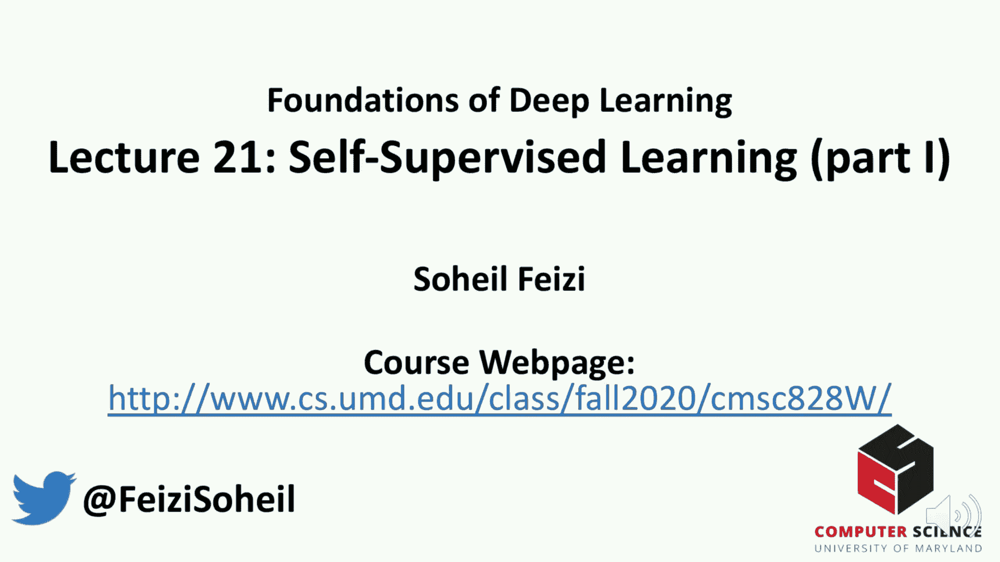
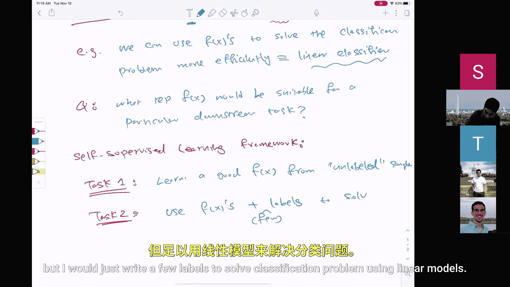

# 马里兰大学【中英⚡深度学习基础｜CMSC828W-2020-Foundations-of-Deep-Learning】-p20-P20-Lecture-21---Deep-Learning-Foundations-by-Soheil-Feizi-：-Self-Supervised⧸Con--BV15rpCz9Ed8_p20-

Let's start。Today we are going to talk about self supervised learning。

So let me briefly recap the supervised and unsupervised learning frameworks that we have covered in different lectures of this course。

In。The supervised learning。We are given a label dataset set， we are given Xs。And my eyes。

Let's say we have M samples。These are label data sets that we have。And as we have discussed。

 labeling is expensive in different applications， sometimes impossible because of that we also looked into unsupervised。

Learning problems。Where we don't have vis， we don't have labels， we only have access。Okay。

 in supervised learning the task was clear， so we are given some training samples x xs and ys。

 so we want to learn a function and in the test time we are given an X and we want to use that function in order to predict a label。

In unsupervised learning， we have a little bit more flexibility in defining the task that we are trying to solve。

 for example， we looked into generative modeling where the。

Task is to generate realistic about synthetic samples from you know the same underlying distributions that generated my training samples and we looked into different methods to deal with this problem like GNs。

Variational autoenrs， flow based models。Et cetera。All right。

 so today's goal is a little bit different than either supervised and unsupervised。Lair。

So in today's goal， we want to find powerful representation of。Different types of data。

 These are also called embeddings of data。 So we want to find these powerful representation。

 So if you are given X as your data， again unlabeled， we don't have labels。

 It is similar to the unsupervised learning setup up。 So we want to find a representation。

 a good representation。Tation of X。Okay， so what do we mean by a good representation right so how can I evaluate if a representation is good or not so we would argue in the topic we cover during this lecture that a good representation is a representation that will allow me to solve some downstream tasks。

Quite efficiently。For example， if you are interested in image classification problem。

I want to use instead of using X。In my classifier， I want to be able to use my representation of excess F of access in the classification problem and solve it more efficiently than the case that I use excess in as my input right for example。

 you may say if this representation is good then。Even though I don't have labels。

When I'm training my embedding my presentation。I expect to。

See samples coming from different labels to somehow cluster together。

 therefore they will be linearly separable if that's the case。

 then I can just train a linear classifier on top of my embeddings on top of my representations in order to perform the classification task quite efficiently。

Right， so let me just write this up。 One example is that the。Can use F of x these。

Representations of my inputs。To。Solve。The classification。Problem。More efficiently。For example。

 we are going to just use linear。Classifiers。On F of x and see how we perform。So you would say， okay。

 so why I'm using a linear classifier on EOX。So what what should I compare against so yeah so you can use linear classifier on x it is not going to work well。

 especially on image data sets because we know there are a lot of nonlinear dependencies among features in my data so linear classifier on x is not going to work out。

 but if I have a good representation then。A linear classifier potentially can work well on the representations of X that I have。

 But the interesting point here is that。In learning these representations， I don't know。

My downstream task yet。So I don't have the labels in order to learn these embeddings。Of course。

 the two objectives， as we are going to discuss， the downstream task。

 which is the classification task and the task of learning these representations。

 they should be somehow related to each other so you cannot you know learn the representation on images and then let's say my downstream task is to use these representations to I don't know。

 like predict the election results。 So the task should be somehow related to each other but。Priory。

 we don't know the labels in order to learn these representations。So， that's basically the。呃，第。

Kind of framework that we are going to be discussing today。 So as I mentioned。

 the question here is that。What are the relationships between the representation learning and the downstream task in order to make sure this whole framework is successful？

In other words， what？Representations。FOV。Wouldood。Be suitable。For。A particular。Down a stream。

On stream task。Okay。So if you view this framework in basically you can view this framework in two steps。

 right so this is called the self supervised learning framework。So in step one。

 basically I'm solving task one。In task one， I want to find a good representation of my data from unlabeled data。

Learn。It good。Representation of data from。So this is very important unlabeled。Samples。

And usually on labelbeled samples are much easier to collect than label samples。

 So we have a lot of data to deal with task。So， in task 2。This is my downstream task。

 this is how I'm going to evaluate。My embeddings， my representations， I'm going to use F of X。

 the representations of my samples。In a linear classification problem to see how I am doing。

Use F of x says。Plus， labels。So here I have labels， maybe few， you know， not a lot of labels。

 but I would just write a few labels。To solve。

Classification。