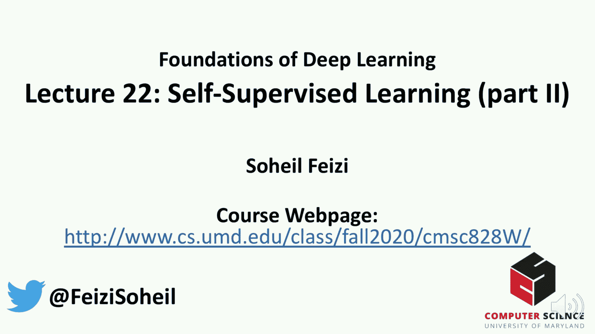
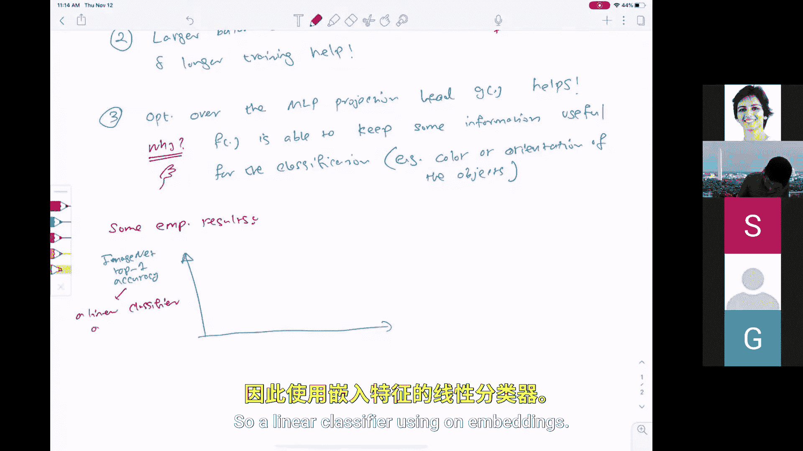

# 马里兰大学【中英⚡深度学习基础｜CMSC828W-2020-Foundations-of-Deep-Learning】-p21-P21-Lecture-22---Deep-Learning-Foundations-by-Soheil-Feizi-：-Self-Supervised-Lea--BV15rpCz9Ed8_p21-

Let's start today we are going to continue talking about self supervised learning。

 focusing on contrastive learning。Mainly today we are going to focus on the theory side of selfupervised learning。

 but let me briefly recap what we covered last lecture。

 we mainly focus on one of the state of the art selfupervised learning methods called the Slier。

It was introduced quite recently。Andで。Framework is that you start with an image X。

 then you look into two views of this image from one augmentation family。Say X I Til the， X J Tilde。

These are two correlated views。And then you learn an encoder embedding function。

To map them to the embedding vectors。But what they also proposed。

 they have this nonlinear projection map。G， that maps H to zs。

G is often like an MLP with one hidden layer， and then they define the loss function。呃。

Based on similarities。Between pairs of these coming from two views for a particular image X。

 And we discussed the。The loss function。The loss function is similar to other contrastive loss function with some minor differences。

Okay。So in the paper， they have some interesting practical observations。Which。

Improve the performance that they get at the end of the day。 So one observation is that。

Composition of data augmentation is important in self supervised learning。

 at least in their experiment。I think they have looked into three families of augmentations。

 color jing， corping the image and adding gouch and noise。

 and if you do only one of them compared to composition of multiple augmentation methods。

 the latter works better in terms of the performance evaluated using a linear classifier on top of the em beddings that are obtained。

So that's one observation。 the second observation is that。

Larger batch sizes and longer training help self supervised learning。It'做 in the。

Supervised learning batch sizes often are not too large right so here in selfservised learning。

 remember when we are randomly selecting some negative samples on these similar samples。

 we are doing it from the batch and we want to have small colla probabilities in terms of if you are if your samples or from the same class。

 we don't want to randomly select those samples。As dissimilar and that that can hinder your performance。

 so that's one reason that larger batch sizes help in selfupvised learning and they empiricaledly observe if they let it on for longer time。

 it also helps。So the third observation， which is quite mysterious， is that optimization。Over。

The projection had。The MLP。Projection ahead。Which is a G function helps。

So previously in other self supervised methods， we have an embedding function F。

 and then we get these。H vectors and then we define similarities or the similarities between H vectors that we we obtain。

 and that's basically what has been done before。 What they propose is that they apply another nonlinear function。

 they obtain theses， and they define the loss function。

 the contrastive loss function on top of these it would be okay similar to the previous cases。

 if these would be considered as their embeddings， but they consider hs。

As their embeddings and i'm sure they have evaluated both of them and the quality of Hs are better and that's why they are doing it this way so one justification。

So it is not very clear what are the theoretical justification for adding a nonlinear projection head and getting rid of it in the inference time。

 but one justification that they have。呃。Is the following？That if。Here is able to。Keep。

Some information。Useful。For the classification。For example， color。Or orientation。Of the。Opportities。

So in terms of the classification。There are some correlations between some potentially noninformative features like color orientation of the object with the label。

 so if you have you know all of the cats are somehow inoriented in a particular way。

 if you rotate the cat is still a cat， but in your training and in your test there may be some correlation between some of these valuable like orientation with with the label and having such additional valuables。

can improve your downstream classification and their hypothesis is that by training G Z gets rid of such spur correlations among the features and therefore the classification task is a little bit harder。

 but age retains some of them and therefore it can be good for the downstream classification task。

That's one conjecture that they have。And you know， this is an empirical observation。

 So it's pretty pretty hand baby。Explanation about this project。Okay。

So I'll finish the practical part by just the。Showing some empirical results that they have obtained。

The empirical results are pretty impressive。So， they look at。The imagenet top one accuracy。

When a linear classifier is trained on top of the embeddings， so that's the evaluation that we have。

A linear。Classifier。诶。Using。On embeddings。

