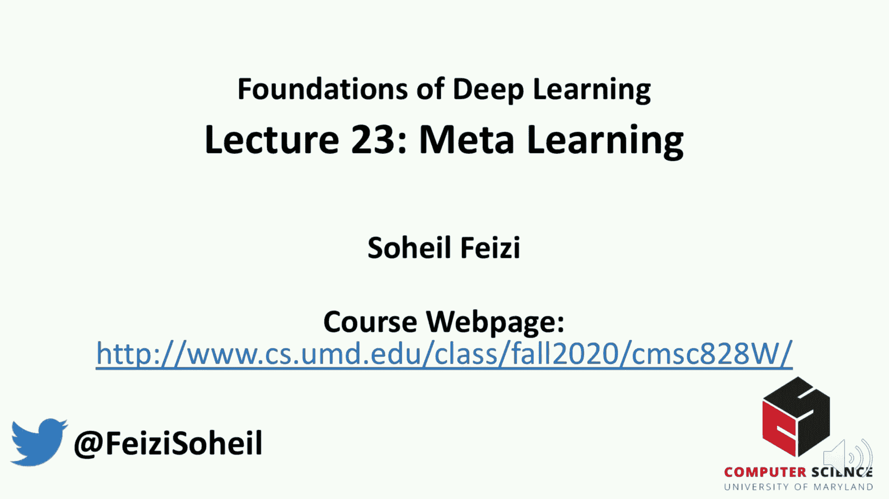

# 马里兰大学【中英⚡深度学习基础｜CMSC828W-2020-Foundations-of-Deep-Learning】-p22-P22-Lecture-23---Deep-Learning-Foundations-by-Soheil-Feizi-：-Meta-Learning--BV15rpCz9Ed8_p22-

Today we are going to talk about metal learning。So let me start with some motivation first and then dive into some technical formulations of meta learning and current state of dark methods for meta learning。

So in many applications， you know we don't have large training data sets so we have talked about supervised learning。

 we have talked about unsupervised learning like GANs， VAEs。

 we also talked about self-servised learning where we don't have access to the label data。

 but in some cases we have just not many even label data set。

So that's basically the regime that we are going to。You know。

 think about it when the number of samples you know training cities is small。But interestingly。

 if you know for humans， even with few samples， we can basically perform pretty well on some basic learning tasks like for example。

 image classification， so how humans can learn to adapt to new tasks with even very few examples。

 but current you know supervised models require a lot of training samples。

 that's basically going to be the caveat that we are going to talk about。

So let me put it in writing in many。Applications。We don't have。Enlarge。Training。Data set。

But interestingly， humans。Can adapt。And basically learn。On the fly。So why is that， why can humans。

 why can we learn on the fly and adapt？To a new task。Even with few training examples。Maybe。

 you know let me be a little bit more specific， you know， just you know， to warm up。

Let's look at one example to make sure that we。We are all on the same page。 You know， I'm not a。

 I'm not a really good artist， you know， I'm not even like a， you know， an okay artist。

 but let's say I have two types of drawings。My drawings in the morning。You know， I have a good。

 you know night's sleep so I'm。I'm happy I have my coffee， so I I'm drawing shapes like this。

 so there's this， there's maybe。Something like this。I have another drawing。Maybe something like this。

Okay， and maybe after workday， I have some drawings in the evening。Maybe I have a very long day。

And I。Draw stuff like this。You need shapes。Okay， so。These are the first column。

 there are my drawings in the morning， the second counter are my drawings in the afternoon。

 and now this is my training set。And now I'm going to give you guys one example。In the test time。

To determine if this example is a drawing。From a morning time。Or。Evening time drawing。Okay。

 are you guys sweating？Alright， so。I have six。Examples in my training set， three per label。

I have two labels。And in the test time， I give you one example， and I want to see if this example。Is。

More likely to be drawn by me in the morning or in the evening。So what do you guys think？

So I have two votes， maybe more of you can write up your responses in the chat box。Oh， amazing。

 like almost everyone。Says it's like an evening drawing that's amazing。And in fact， that's right。

 that's correct， it's an evening drawing。Okay， so。Look at this learning task， right。

 So I have a binary classification problem。I have two labels and I have three examples。Per class。嗯。不。

😡，Humans。Almost all of you， all of you in， not almost all of you could correctly predict the label in the test time with just a few examples so。

Why is that the case？How come humans are really good in。Doing this task with very few examples。

What are your thoughts？Yeah。I cannot train a deep supervised model with just three examples per class and then expect it does well in the test time。

 just a regular supervised model。Contextual learning， good。 So basically one point is at all。

 like you're looking at the textures。You know here the curves are in the morning drawings。

 the curves are smoother， you know， but here they're sharper。

 you know we have edges and that's the feature that you guys use in order to determine if it was a morning triangle an evening drawing。

Right， what？Basically， we have a lot of prior knowledge， prior information about drawings。

And we are using。That prior information， in addition to these few examples that we have in order to make。

A good prediction in the test time。The key here。Is to。Use。Prior。Knowledge or information。In。In呃。

Basically， performing。And you。Task， so we are not starting from scratch。

So we are not starting from like knowing nothing about images about shapes and stuff and then you know trying to solve this classification problems。

 so we have all of the prior information in our brains and when we look at examples in this particular task。

 then we can immediately use that prior information。

 maybe adapted a little bit in order to make it tailored to this particular task， for example。

 looking at just smoothness or sharpness of the curves and then use that adapted information in order to deal with this new task。

So that's basically the key goal in meta learning。

So basically the question is how？