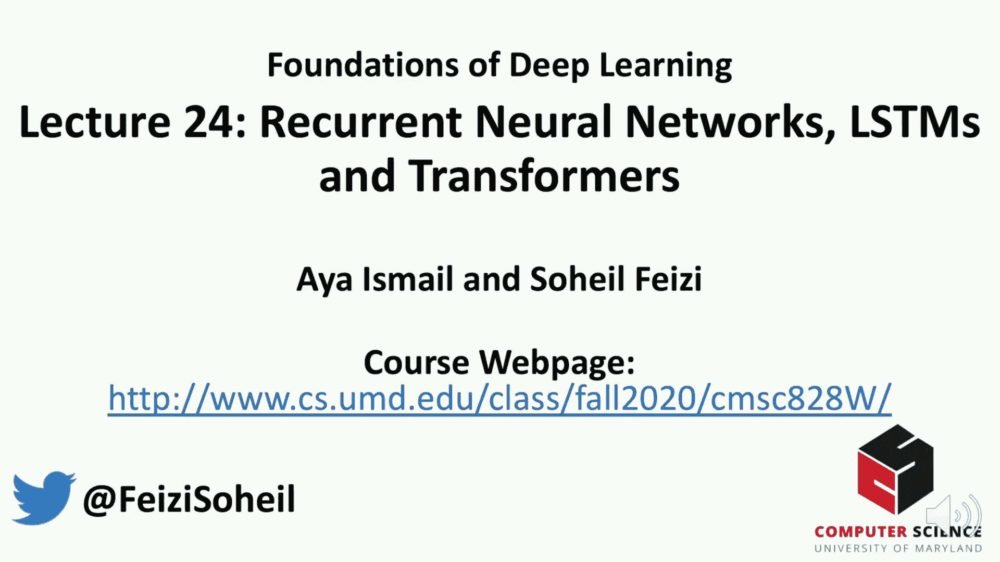
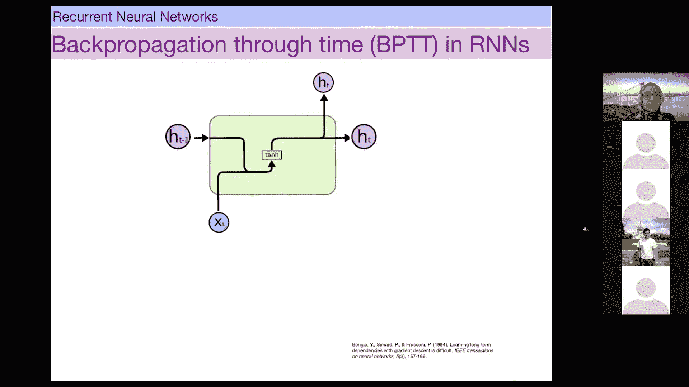

# 马里兰大学【中英⚡深度学习基础｜CMSC828W-2020-Foundations-of-Deep-Learning】-p23-P23-Lecture-24---Deep-Learning-Foundations,-Guest-Lecture-by-Aya-Ismail：-RNNs,-L--BV15rpCz9Ed8_p23-

We are very happy today to have Aya S who is a course TA and a PhD student in the University of Maryland to talk about neural architectures。

 including recurrent neural networks， eestians and transformers。

 AA is an expert in this area and also in deep learning interpretability and we are very happy to have her know tell us more about different recurrent neural architectures without further ado。

 Aya， the mic is yours。你去私下。So。So far what we have looked into is these one to1 setups where for example you have a fixed size input and you produce a fixed size output and in between that there is a neural network so this network we looked into feet forward network and convolution network and this setup was fine for many applications such as image classification。

 but it's not very flexible， meaning that we don't always have a fixed size input so sometimes we have a variable size input for example in cases where you have language and you have a sentence which has different length and then you want to make a prediction so an example of that is in sentiment analysis when you look at a review and want to know if this is a positive review or a negative review or if you have a sentence and you want to complete a complete。

With the next word so you have a variable size input and you want to make a single up also this is applicable in time series forecasting so for example。

 if you have stock the previous history of a stock and you want to predict the next forecast the next talk so all of these are impossible with the previous setup so people started to think about so what can we do with this variable size input and that's where recurrent neural networks came in。

😊，So what is a recurrent neural network ourcurrent neural network is this architecture where it has a hidden state and it takes an input and produces an output and this hidden state。

😊，I basically basically is recurrent in the sense that every single hidden state takes the previous value the value of the previous hidden state。

 so if we unroll it it's going to look like this。😊，So here our current hidden state。

 H of T is a function of the previous hidden state， Ht minus1， and our current input X of T。😊，So。

If we zoom into a little bit into the architecture， we can find we can。

 it kind of looks like this where we have our current input here。

 we have our old hidden state and we produce the new hidden state and in between them there is a1H。

So basically， this F of w is just a weight matrix which we multiply by the previous hidden state。

 another weight matrix we multiply by input， and then we pass that through 10H and that's our next input。

So one reason we are we're using the tanN H here is that we want to add non nonlinearity to our neural network。

So。One thing we want to note is that these weights are shared across cells。

 so we have the same weight at different cell locations。And just these weights keep。

Getting up the H ofT getting coupon gets updated by the previous hidden state and the current input。

And if we want to make a final prediction， we multiply this HFT with another weight matrix to produce this YFT。

 which is our。Okay， so let's take an example， a really simple example。

 let's say that we have a language model and a language model is basically。😊。

If you have like for example， a vocabulary and you have a couple of words and you want to make the prediction to the next word so here we have a really really simple vocabulary with only five words I am very not and hungry and we have a training sequence which is I am very。

😊，So every single word we're going to present it as a word embedding。

 so since we only have five five words we're going to so I is going to have like one at the beginning and zeros。

And then am is going to have zero one and then followed by zeros and so on and so forth。

 so if we want to pass this through a recurrent network how do we do that so first we need to have。

We need to have the previous H previous hidden state， but since this is the first time。

 so we'll just initialize a vector by zeros and then we're going to multiply。

This weight matrix with the input。Pass it through a 10 H and also we have this previous hidden state and then we're going to calculate this current hidden state。

We're going to repeat that again with M。And then， again， with varied。And after that。

 make we want to produce the next word， which we are going to multiply the last word。

The last the last hidden state with a weight matrix and then we have an output and in this case。

 for example， a reasonable output would be hungry not not so I would want the model to tell me I am very hungry。

So this is a very simple example of a recurrent network。😊，So let's look at training this metric。

 but before I go in， does anybody have any questions？So far。Okay， moving on。 Aya。

 can I ask you a question， Yes， so why1 H， Y not。So we wanted to be in sorry。

 we wanted to be as like a soft transition， so the first one was the vanilla RNs were 10H。

 but after that we kind of started to use sigmoid and 10h and the one property of 10H is that it gives us this output from negative one to one。

So that's kind of， this is why we use1H here。Thank you。好。Okay， so。嗯。So here。

WellSomebody asked was H of Y different from other two metrics yes because it's multiplied by this hidden it has it might have different dimensions and it's multiplied by these hidden layers not multiplied by。

So yeah it has it's different from the other thematics has anybody used Relo there's a lot of recurrent networks and a lot of cell architectures I'm not sure if anyone has re inside of them or not of course you can have re like after the after the recurrent network pass so if you have like for example your output can pass then through re and a a dense layer and so on and so forth。

 but the cell itself I'm not sure if anyone has a re inside the cell。😊，Okay。

 so let's look into training this network so so they'll talk a little bit about training recurrent network in the beginning。

 so what we do is that we make a forward path。And calculate a loss。

And this loss depends on the problem that we're trying to solve so for example。

 we can have if we're doing a classification then maybe the loss can be across entropy loss and if we're looking at a regression such as in forecasting it can be means square error。

So once we calculate this loss， we back propagate through the network and update the weights。😊。

And we do that by taking the Greek step like Hil described in I think that was the first lecture。

And this is called back propagation through time because we basically。

 if you think about the input as different time steps。

 we move forward into time and then we back propagate to update the weight。

 so this is known as back propagation through time。Yeah。

So let's take a deeper look into how this back propagation through time happens。

 so this is a single cell。

And we can say that we have this weight matrix here。

