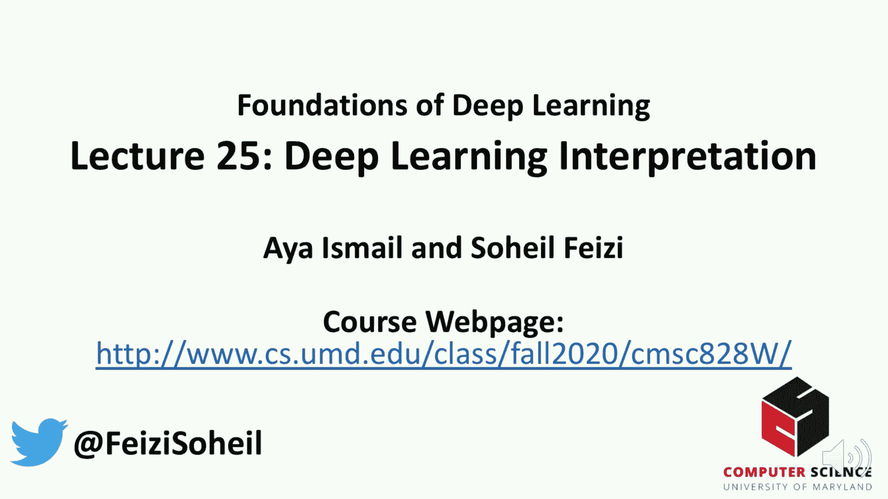
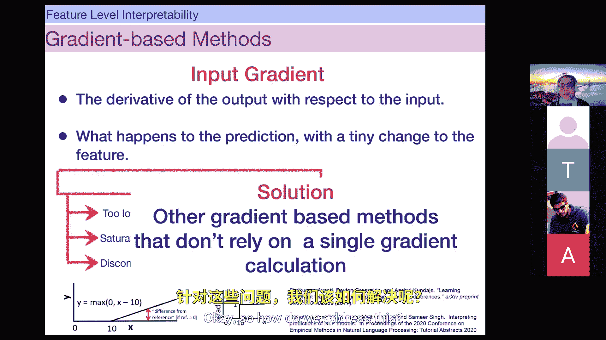

# 马里兰大学【中英⚡深度学习基础｜CMSC828W-2020-Foundations-of-Deep-Learning】-p24-P24-Lecture-25---Deep-Learning-Foundations,-Guest-Lecture-by-Aya-Ismail：-Deep-Le--BV15rpCz9Ed8_p24-

Let's start we are very happy again today to have Aya smileile to talk about interpretability in deep learning Aya is a PhD student in the University of Maryland and she's an expert in this area so we are very happy to have her tell us about this problem and recent advances in this topic without further ado Aya screen is yours。

Oh。Thank you， Samil。Okay， so we'll be talking today about interpretability and deep learning。

 so basically what we have is we have an input and then we have a black model。

 a black box model and then we get an output and by model interpretability。

 what I mean is that I want to understand why a model made a certain prediction。

So why do we care about interpretability and why can't we just trust the model and use the decision that it makes without understanding why it made that particular decision well the main reason is because in real world applications accuracy is simply not enough so let's take a look at some examples where we would need interpretability。

So for example， if we have a model that is used that is used in industry and then we need to identify if it has undesirable behavior so basically we want to make sure that it's making the correct decisions for the correct reasons like for example an AI was used to for to see if a person should get bill or not and then after using a people like notice that it's giving the bail decision based on color which and it was so basically if somebody was black he was likely not to receive bail then other people so we may need to make sure that if making the correct decisions and that is for the correct reasons another case is that what if we want to improve our model performance if we know why the model is making a prediction then we can just simply go and try to fix it and get models with better performance。

😊，One other reason we might need this is for scientific discovery so basically neural architectures take all of these inputs and try to understand patterns and underlining distributions that we as humans might not know ourselves and in some cases we would really want to know this like for example。

 if a neural network is used for to to classify human brain activity we would want to know so what areas in the brain are responsible for what functions this would be very useful in many scientific applications。

😊，And the last thing， well， basically sometimes applications are too critical to just say that while we made this prediction and that's it。

 for example， medical applications you kind of have to explain to the and user there why you made this application and you can just say that well it's because we have this black mark model and it said so。

😊，Okay。Okay， now that I hopefully convinced you that we model interpretability is really important。

 let's dive into a little bit about interpretability methods。😊，Okay。

So first we have we can have baked in model interpretability。

 what do I mean by by that that we have this model and we train it to explain itself so when it has't when it's given an input it's able to provide an explanation of why it made a decision for that input。

Another another interpretability option is feature level interpretability。

 which is basically we want。 we have a group of features。

 and we want to know the contribution of every feature in the final prediction。😊。

There is also instance level instance based explanations where if we have a test example and it made a prediction。

 we want to know which training example we're responsible for that prediction。😊，And finally。

 there's this global decision rules where we want to understand the global the global reason why the model is making a certain prediction。

 so kind of high level understanding of the model itself。😊，So basically。

 what we're going to be focusing on is future level interpretability for this lecture。😊，Okay。

 so again， for feature level interpretability， we're going to define it as that if we have a train model and we have an interpretability method。

 what it does is it assign an important score for every feature that correlates to the importance of that feature for a given prediction。

😊，And this is shown through saliency map， which is basically a feature score map。

So there's different types， two main types of saency maps， there's perturbation based saency maps。

 which is basically means that， well I take my input and I pass it through my model and I get an output。

😊，And then I perturb an input one of the features， I perturb one of the features and I pass the new input to the model and I get another output。

😊，And basically the contribution of that feature is the difference the change in the output of the model and there's different ways we can do that so for example there's this leave one out method where it just removes the feature altogether and see how the model is affected there's feature ocillation where you kind of perturb the feature a little bit and see how that affects the model and there's other methods as as well so another another class of sadiency methods are gradient based saldiency methods and these are kind of more popular。

😊，So there is a huge list of gradient based salliency method and this is not like all of the method that we have。

And every conference there is a lot more coming out so basically let's take a look at gradient based methods a little bit so the first thing we have is input gradient which is basically the simplest thing can we can get so we have this input we pass it through the model and then we have a probability for every class so we take the class with the highest probability and then we calculate the partial derivative of the output with respect to the class with the given input。

😊，And what this partial derivative is showing me it shows me which features do we need to change the least to get the change to get the most change in that particular class and we end up with the salency map which basically what it does is that it highlights the important features in it highlights the important features and that needed for that model okay so why does so what does the partial derivative mean and why does it make sense and how is actually doing this well if we if we kind of plot it basically what what it means is that we the derivative is basically this tiny change in the feature input so here if this is the input then the derivative is basically the small change the a really really tiny change and that's why it kind of represents the output when we change the input。

😊，Okay， so this is the most basic method that people can use when it comes to gradient these methods。

😊，And it has some limitations so one main limitation is that it's。

It's very it's very sensitive to small perturbation so for example here if we just move move this input a little bit in either spaces。

 we get a very different gradient。😊，Another problem is that we can have this saturated output with that lead to augment intuitive gradients so if we look at this example here we have y equal x1 plus x2 if x1 plus x2 is smaller than one and one otherwise so let's say that we have x1 and x2 both are equal to1 and we want to calculate the gradient and then we get this gradient is0 so what does that mean it means that both features aren't important or。

😊，We't， it's really not intuitive and doesn't help us understand what's happening。🤢。

We also can have discontinu gradient problem where we have an input and that so where we have。

 for example， here， y equals the maximum of 0 and x minus 10。😊，And then when you plot the gradient。

 it's basically the step function where it's zero， and then it's one。First it has two problems。

 one is that the sudden jump， the other one is that the gradient doesn't show anything about the value of how exchange is at all。

Okay， so how do we address this so people started to say， well， you can't really rely on us。

