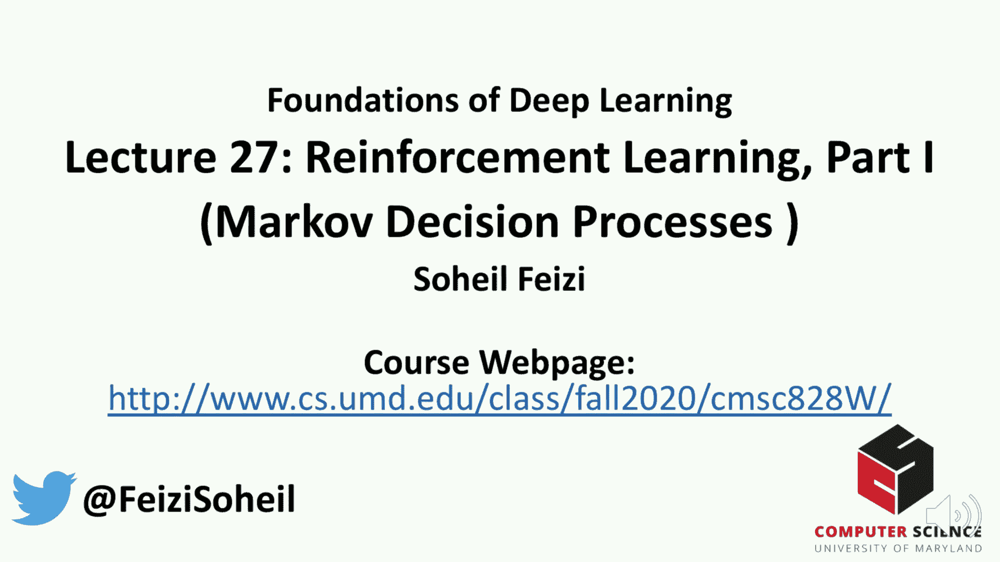
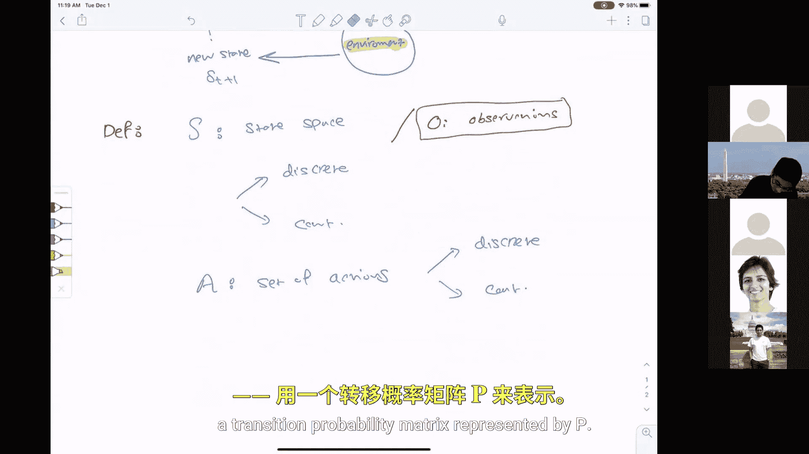

# 马里兰大学【中英⚡深度学习基础｜CMSC828W-2020-Foundations-of-Deep-Learning】-p25-P25-Lecture-27---Deep-Learning-Foundations-by-Soheil-Feizi-：-Reinforcement-Learn--BV15rpCz9Ed8_p25-

Let's start。Today we are going to talk about reinforcement learning。

So so far we have talked about supervised learning， unsupervised learning。

 self superervised learning and some related problems。

The main goal in reinforcement learning is to understand sequential decision making problems。

So that's going to be our main objective。To deal with sequential。Decision。Making。Problems。

 and what I mean by that， it means when your current decisions influence your future decisions。

 Remember， that wasn't the case， for example， in the classification problem。

 in the classification problem， whatever you classify for an image。

It doesn't influence your classification for the next images， but in many cases。

 your current decision， your current actions， can influence your future decisions and actions。

So other boards。有。Current。Decisions。Can。Affect。Hture。Decisions or actions。So what are the examples？

Of such decision sequential decision making problems， obviously in yes。

 exactly chess is one example right or other games that are interactive so you make a move。

On a board。 and then the the state of that game changes。 And based on that。

 you need to make another decision。 So your're。Your future decisions depend on your current decisions。

 so what what are other examples。Oh， that's a good answer， life， yes， so you make a decision。

 for example， you all made a decision to take this course。

And that decision will affect hopefully positively your future decisions。So that's an important。

Aspect， what are other machine learning examples？For such problems。Paath planning， yes。

Robotics definitely， robots， when they go explore or try to do a task。

 their present decisions will have the same property that will influence their future decisions。

Games， yes， all of them are。Examples， so let me write some of them up games。Robotics。You know。

 self driving cars， right， is a which is an important。Cars， finance。Et cetera， so as you can see。

 it's a very important。Chong of problems that we need to have a better understanding of。Okay。

 so in all of these problems or most of these problems， let's say we have。An agent or user。

And this agent。Deciidedes to take a particular action at a particular time。

 so let's say this is the action that the。Agent takes if you are playing a game， you decide to move。

Me know， one of your， you know， checkers or something on the board in a particular fashion。

 So that's your action。 and that action can。Change the state of the game。

 So you basically we based on this action that you are taking， we。We have an environment。

I'm just being very proud here。And。It will take us to a new state in the environment。

And so you have a new。State of the environment based on the actions that you have taken。

 So we started in， let's say state ST and we end up in state ST plus1。

So that's basically the dynamics that we have and then again this is a loop right so now you are a new state。

You take a new action， and then。Based on the environment that you have。

 you will be taken into a new state and this process repeats。

Is there no perception that's a good question so hold on to that question so I'll make it a little bit more precise what we mean by all of these states and actions in a second。

So let's start with some definitions。Okay， so let's say S is is my state space。

What I mean by that it is the sufficient description of the system。

So if you you know are for example， designing a self driving car the velocity the lane you' are at the cars next to you the positions of the cars nearby all of them they define a particular state right so if you look at all possible。

Descriptions， sufficient descriptions of the underlying system that will be a particular state and the set of all states will denote by capital is。

 which is the state space。So， in some cases。We don't directly observe this state。

 right so we have some observations。AndSo。Okay。Maybe if you're designing again back to the self drivingriving car example。

 maybe another car is blocking your view， so the state of the problem may be different than what you're observing so you may not have a full observation。

 you may have a partial observation。And that's an important aspect of this problem， but。

At least during today's lecture， we are not going to talk about partial observation。

 so we are going to consider the case that the agent can observe the entire state。

 so we have a full observation of the state when we are at a particular state。Okay。State。

 states can be represented， either as。Discrete。Or continuous variables。So for example。

 if you are playing chess， then based on the positions of the board， you have a discrete space。

 a discrete space， but if you are， for example representing velocity or some other continuous variables。

 your states will be represented by you know continuous variables and in general。

 you can have a mixture between both discrete and continuous variables。

Then we are going to consider a set of actions represented by a set。Of。Actions。And again。

 similar to the state， actions can be either discrete。

Variables or they can be continuous variables you can say， for example。

 turn left or right this is a discrete variable。 it's a binary variable in fact。

 but you can also have continuous actions， for example， you can say。

To have the following speed and speed is a continuous continuous variable。Right。

 so that's state action。We also need another notation another concept to basically we have sta here。

 we have actions here， we need another thing to represent the environment right so it's a very broad term what I mean by the environment。

So for that， we are going to have a probabilistic representation and characterization of the environment using。

A matrix， a transition probability matrix represented by P。

So P easy。