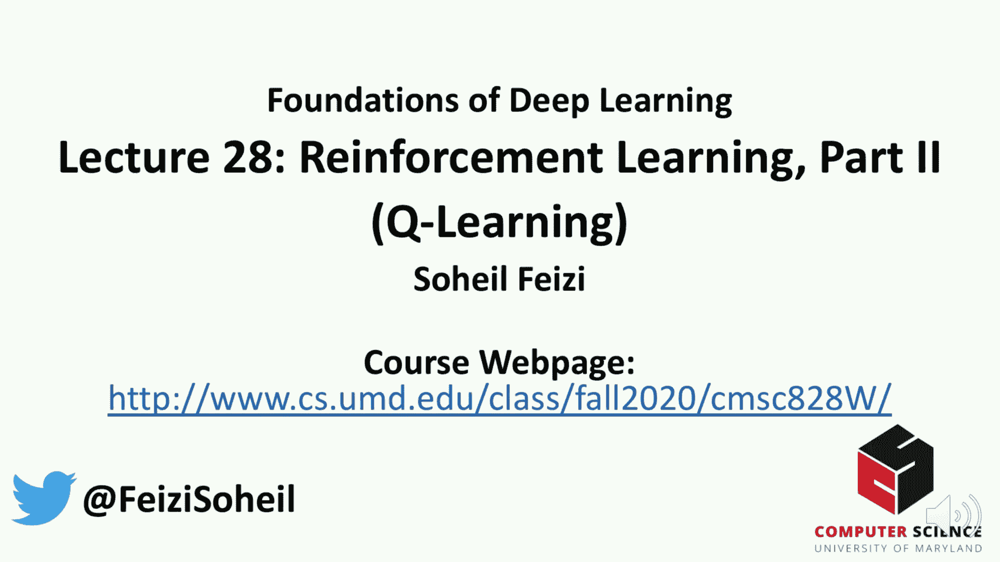
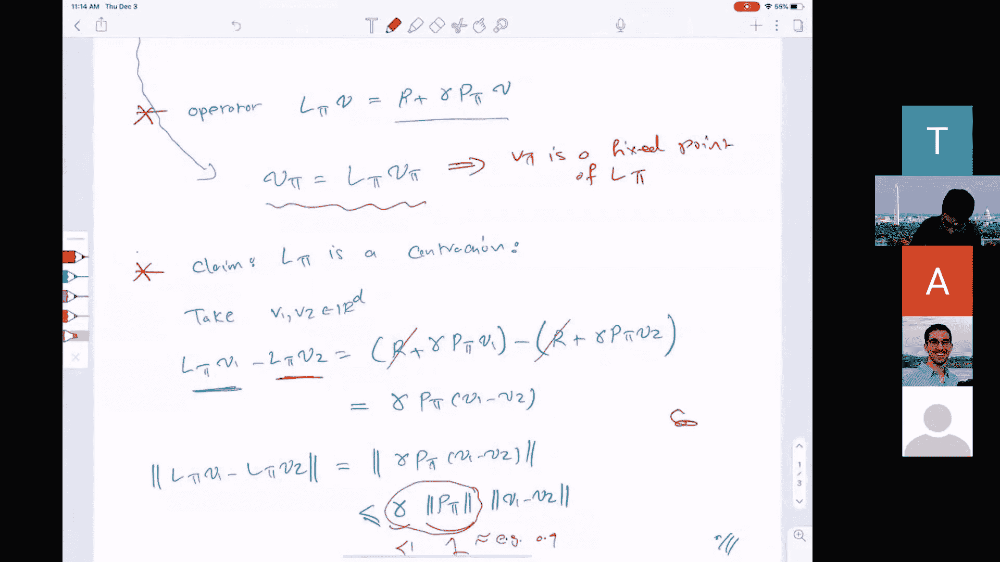

# 马里兰大学【中英⚡深度学习基础｜CMSC828W-2020-Foundations-of-Deep-Learning】-p26-P26-Lecture-28---Deep-Learning-Foundations-by-Soheil-Feizi-：-Reinforcement-Learn--BV15rpCz9Ed8_p26-

Let's start。Today we are going to continue to talk about reinforcement learning。

 so I'll briefly recap what we covered last lecture and then we continue to talk about MDPs and then move to talk about deep reinforcement learning。

Okay， so last time we talked about the broader setup of MDP。

 so we have finite90 states finite actions， we have a transition probability according to a Markov chain。

 we defined value function， which is the。The total， the expected of award that you。

That you gather if you start from a particular state and you follow policy pie。

 so that's the value function。And we also define the Q function or action value function。

That says if you start at the state S your first action is according to a and then follow policy pi。

 what would be the。Average total reward that you are going to collect。

So the first question that we ask is how to evaluate evaluate function or Q function if you are given a particular policy pi and policy pi is a function mapping state fractions。

So as I mentioned in MDP， we focus on deterministic and stationary policy function and that's without loss of generality for MDP。

Okay， so。We had this recursive formula for the value function that if you look at the value function at a particular state。

 there is a reward immediate reward in that state and then。There's a gamma。

 which is the discount factor。 and with some probability， you are going to。End up in another state。

And then you compute the value function in that state。So that's true for all。

States in my state space。Okay so I can write that in a matrix form， we did that last time。

 we defined vectors V pi that combines values， value functions in different states。

 this is equal to the vector R that combines the rewards in different states plus gamma times。

Transition probability matrix， it's a D by D， these the number of states， a matrix。

 the idea element shows the probability of transitioning to s prime from a particular state s times b pi。

So we had this recursive formula combining all of these individual recursions。

So in order to evaluate it， we had two options， one is easy to think about this as just a matrix vector product equation and then solve it for V pi in that case we have v pi is equal to identity minus gamma times P sub pi inverse times R。

And we argue that this matrix is always invertible。Why is that？😮。

Just want to see if you guys are awake on following。Why is this matrix invertible？

IMvalue larger than zero， why is that？Because。P sub pi is a stochastic matrix。

 the eigenvalues are always less or equal to in fact it has an eigenvalue which is equal to one in magnitude。

 but gamma is a number between zero 1， so it shrinks it is eigenvalues when you subtractive with the identity you get an invertible matrix。

But this matrix inversion can be expensive， so that's what we we thought to have an iterative approach in order to compute。

对吧李方程。Okay， so。He defined this operator， so this is called value iteration。

So we define this operator。Yeah。El sub pi。Apped to a vector。

 any vector v would return r plus gamma times pi sub pi times that vector。Therefore。

 this equation that I have here can just be written as v pi is equal to El pi times v pi。

In other words， Vpi is a fixed point。Of this function。鱼派。Is a fixed point。Oh， it's that point。

All right， so last time I claimed that this operator El pi is a contraction。

 meaning that if it applies to two vectors， it shrinks the distance between the two。Is it。

Contraction。And let's look at the proof of it。 It is very simple， but that will。

Potentially build some intuition for you， so let's take two vectors V1 and V2 in a D dimensional space because we have these states。

And let's apply El sub pi to these two vectors and see what happens。

I apply L apply to V1 and look at the difference when I apply to V2。

So L sub pi of v1 is according to this particular definition that we have。

 it is equal to r plus gamma Ps sub pi times v1。Minus s sub pi B2 again， it is similar。

equalal to R plus gamma times T S times V2。Okay， so if I look at this， there are some terms。

That can cancel each other out。 So I get。Gmma times P sub pi， we run minus B2。Now。

 if I look at the norm difference， there is a vector。

 So if I look at the norm difference between S sub pi of v1 minus s sub pi of v2。

 that is equal to the norm of gamma times p sub pi v1 minus v2。Okay。

 so here gamma is a gamma can come out， it's a number and we can use some inequalities that upper bounds this norm。

 so gamma comes out so I look at the spectral normal P sub pi and multiply it with the normal p1 minus e。

All right， so I know the spectrum norm of pizza pie is actually equal to is largest eigenvalue。

 which is one。But here gamma is something less than one。So therefore。

 this whole number is going to be something strictly less than one， let's say 0。9。For example。29。

So that's the definition of a contraction， so when I apply L S sub pi to V1 and B2。

 it shrinks the distance。Between。Between the two。Okay， so what is the implication of this result？

Now let's suppose I have I start from some initialization we want some random vector。

I have v sub pie。Maybe I should。Because I belong。Say it is just an initialization vector for my value functions let's apply。

il sub pi。To these two vectors。What is going to happen to the result？So if I apply L sub pi to V1。

 okay， first， let's say if I apply L sub pi to B sub pi。Am I going to get a point here or here？

Or somewhere else the same point， right， Because it's a fixed point。 So if I apply El sub pi。To be。

Pi， it's going to remain the same because that's the fixed point。Solution for SI。Okay。

 now my iPad flows。嗯。In the pando。嗯。No， pen didn't I。

Okay， oh， okay，9 folks。