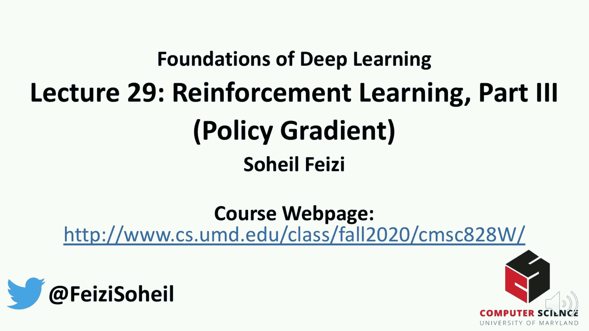
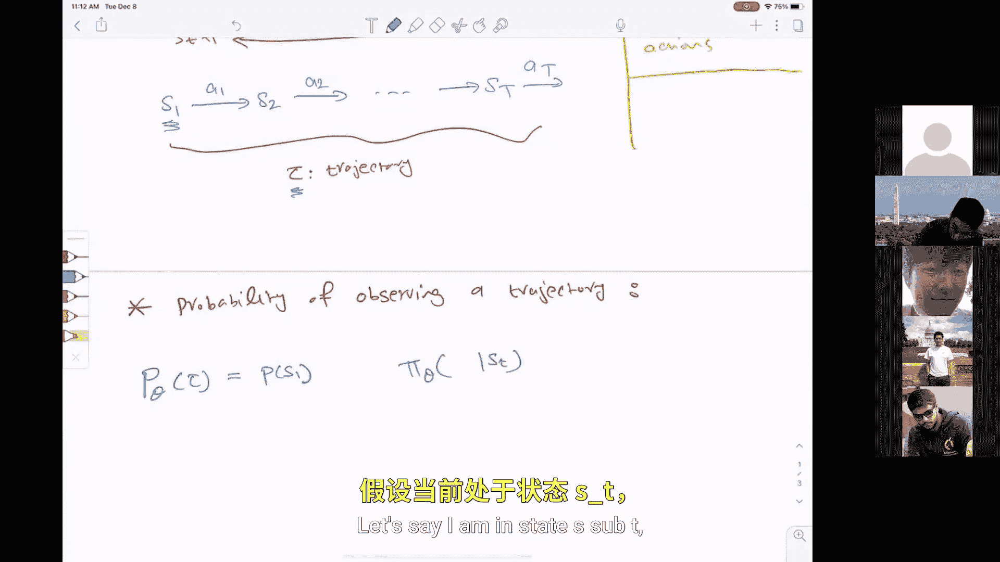

# 马里兰大学【中英⚡深度学习基础｜CMSC828W-2020-Foundations-of-Deep-Learning】-p27-P27-Lecture-29---Deep-Learning-Foundations-by-Soheil-Feizi-：-Reinforcement-Learn--BV15rpCz9Ed8_p27-

Okay， let's start。Today we are going to continue to talk about reinforcement learning。

So in the last lecture we talked about Q learning and policy， the idea was to。

Basically characterized either the Q function or the V function using neural networks。

 and then by computing the arc max of the Q over different actions。

 we can compute the policy in order to see in what actions we should take in different states。

But as I mentioned last time， we have thought about different optimization problems。

In either supervised learning or unsupervised learning， and majority of them we have。

Try to approximately solve it using gradient descent or different variations of it so the question is can we use gradient descent in order to tackle the reinforcement learning problem and that's going to be the main goal of today's lecture。

So cold。Is to。Basically solve this optimization right so you have a value function that tells you what is the expected reward if you start at a particular state。

Depending on the policy that you are following， policy pie and。

We want to maximize this over different policies。Can we take gradient descent in order to solve this optimization problem？

Can we use？Gradian descent。To。Optimize。Over apply。All right， what do you guys think？

I have this optimization problem， I want to maximize the value function。

Let's say starting at a particular state S。Is it possible that I just？

Take the gradient of this function with respect to pi based on the stuff we have learned so far。

Or what are the potential bottlenecks？Any ideas？Okay， so I have won a couple of responses。

 it says if pi is differentiable。Another response is or domain for pi may not be continuous。

 very good。Ddisional， if we need power to map discrete stage actions。I think all of them are。

Or answers in the right direction so the answer is yes we can。

 but we need to parameterize the pi function because if you're thinking about the discrete mapping from your discrete states to discrete actions。

 then that function is not going to be differentiable。

 so we need to come up with the function for pi that is nice and differentiable。So the answer is yes。

 in fact， we can。But we need to。And I rise。The pi function。Okay， and。During this course。

 we have Laen one。Good choice for parameterizing functions would be to use deep neural networks。

 So we are going to use。Neural networks。In order to do that。Remember， in the last lecture。

 we use neural networks to parameterize either Q function or the B function。

Here it is a little bit different here we are using neural networks to parameterize the pi function。

For my pi function。Let's say would be a function with parameters datata mapping my states。

To my actions。So if I want to have a picture， let's say a time T you are in state S。

So you have a neural network。And at the end of the day。You are getting。

An action A of T and here the action can be a discrete action or it can actually be a continuous action so I'll talk about some examples of it later on today。

So that's going to be our policy function， pi theta， it gives me。An action， A sub T， given the input。

S sub T， where I'm at particular state。Now I have this action。

 then it's going to go to my environment。With the transition probabilities that we don't know。

Then I'm going to end up in another state。Yeah。It's t plus one， and this loop continues。So I start。

 let's say in in state S1， I take a particular action a1， I go to another state。

Depending on the transition probabilities in my environment。

Then my policy tells me to take another action。So on and so forth and here we are going to for simplicityity。

 we are going to consider the finite horizon case when we have T steps。So because of that。

 they actually don't need to worry about the discount factor。

So this whole thing I'm going to refer to as a trajectory。Yeah。Without。

 I mean like a sequence of states and actions。So one note I want to make here is that。Here。

 the policy function depends on the state。But in some applications。

 you may have partial observations。And in those cases。

 then your policy function would input that observation and then output your action。

I just want to make that the mark here。Impartial。Observation case。パイ theta。Would be a function。

Mapping。Observations。To actions。So if you're interested， you can look at the literature for this。

 but we are not going to。Covering partial observation case today。Okay。

 so let me pause and see if there are questions so far。So if not， let's move on。

Now I want to compute probability of observing a particular trajectory。Okay。

 so I give you a particular trajectory tau， and I want to see what is the probability that this trajectory is being observed using a model depending on the policy pi sub theta and the environment。

The transition probability is coming from the environment。

So that's the probability I'm going to show with P of theta of tau。

 that's the probability of observing a particular trajectory， so the initial state。

Is just like the probability of being in that state。PL S1。

And then I'm taking a particular action using the policy network。

 let's say I am in state S sub T and my policy tells me to take this particular action with。

