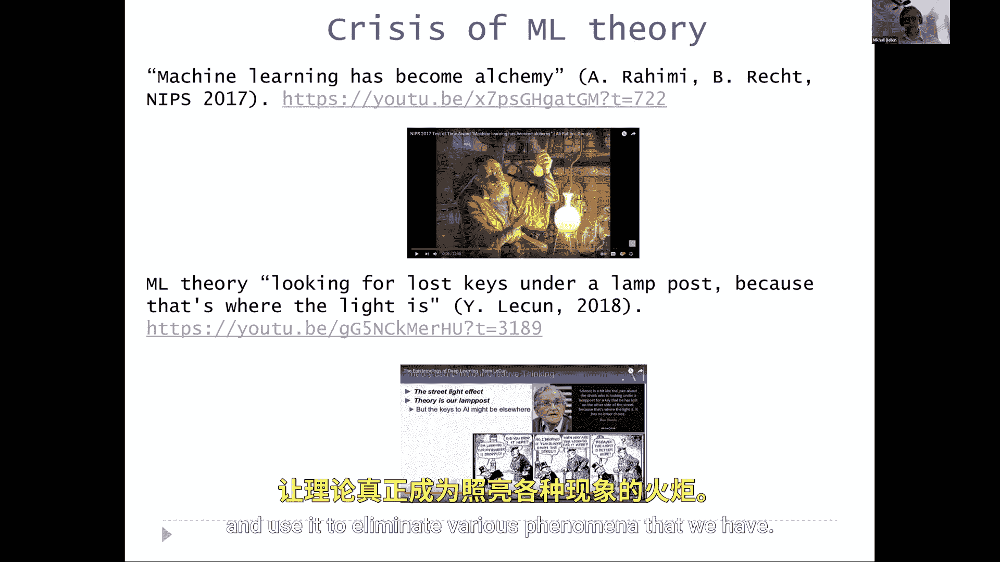
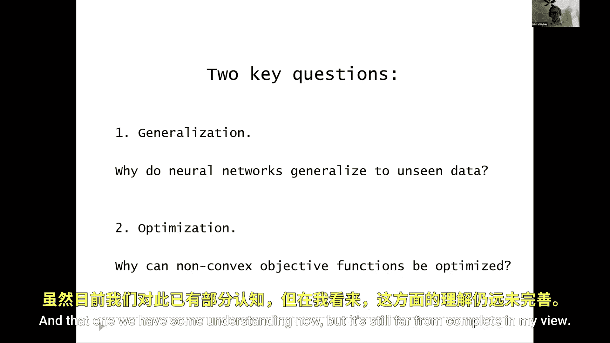
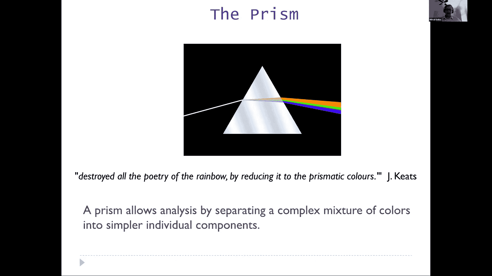
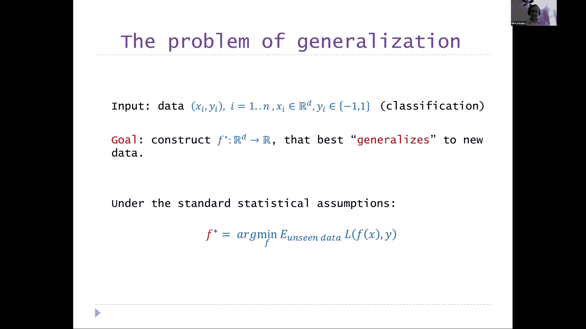

# 马里兰大学【中英⚡深度学习基础｜CMSC828W-2020-Foundations-of-Deep-Learning】-p29-P29-Deep-Learning-Foundations：-Misha-Belkin's-Talk-on-deep-learning-through-the--BV15rpCz9Ed8_p29-

Yeah。Thank you very much Dehe， thank you for inviting me。 Great to be here。 So yeah。

 so what I would like to talk about today is。😊，The second of for overview of of some of the。

Remarkable phenomena that we have observed deep learning recently and well not so recently。

 the case may be and in particular。嗯。How interpolation sheds life。On some of this phenomenon。

 where sort of it leads。Both theoretically and to some extent， practically as well。

So what I am going to be talking about is primarily based on this kind of review paper that I wrote recently。

We chip here in African America last year。So well， as we know。嗯。

Deeploing has been a great success in the last 10 years or so。

One thing which we have observed is that。You know it's based on very complex structures oh by the way I should I should say。

 please don't feel free to interrupt you with any questions and I will try to also monitor chat but you know feel free to interrupt you I'm more' than happy to slow down and you know answer anything。

😊，monitor the chat for you so if there are any questions in the classroom or in the chat。

 I'll just like ping you。Thank you。So yeah， so we have the thread complex structures， you know。

 things like this， and there are lots and lots of parameters。

And there are also lots and lots of hyperpar and training parameters in different various aspects of this mathematical object。

 which make them quite non transparent， quite difficult to understand so we have something which works well。

😊，But not something that we understand well， and I think recently we have started to gain some understanding of the phenomena of these objects and the associated phenomena and what I should point out is that a lot of our understanding really not even maybe so much an understanding of deep learning as such。

 but actually understanding of phenomena of machine learning more generally。

Think which we sort of knew before。You'll see some quotes， for example， from Leo Bman。

 but also sort of didn't know so it's it's a little bit puzzling so things which were observed but yet。

Somehow， not。Fully digested or fully accepted。Okay， so。Let's。

Sort of see what the issue is and it's kind of， you can say that this you know。

 this idea that this very complex neural network。Perform so well precipitated the crisis of machine learning theory。

I mean， on one hand， there was the。Very nice talk。In 2017 by Ali Rahimi and Ben Re。

And they basically argued that pursuit learning has become al。In the following sense， you know。

 alchemy is kind of a preci chemistry。YouYou have。Youll have a kind of preific point of view that you do certain manipulations and sometimes they're successful。

 but you don't have a sort of rigorous view on what makes them successful and whatnot so you tune some parameters you play with the things you get results。

But it is not clear what。Make those results， there is no somehow overarching theory for this。

Kind of counterpoint to that is that point。But by Jan Le。Who said that。

Machine learning theory looking for lost keys on the lamppost because that's where the light is so there is a cartoon of。

 you know a drunk looking for。You know the lost keys under the light。

 of course there is no reason to think that the lost keys were actually lost under that lamp post。

So from that point of view， right， we have a theory， but the theory。

Is explaining something else and it's not really useful。To offer understanding machine learning。

 of course， in general。There is no reason that a theory has to be like a lampos that it has to be attached to this you know a source of light needs to be attached so hopefully we can sort of detach it and use it to eliminate various phenomena that we have so now you know they have been recognition of this issues and Jan Lequon of course that the diploidic breaks of basic rules of statistics much much before that Leo Breyman。

A prominentmin statistician from Berkeley who used to be Berkeley。

 he actually wrote in 1995 this nice notes reflections after referring papers for nips。

And he basically was asking the following question。

 why don't heavily parameterized neural network cover feed the data。

 what is the effective number of parameters？Why does it back propagation head for a poor local minimum and so on so there had been this understanding that something was a little bit off。

For quite a while。And so here are some of the here here are two of the key questions that have been puzzling and the first question is that generalization and why do neural network have so many parameters so complex。

 but they seem to generalize one in data quite well and do not seem to you know suffer from overfitting at least not too much and the second question is optimization and why can nonconvet objective functions be optimized。

And arguably we understand the second question now quite well。

 I will concentrate primarily on the first one。😊，And that's what we have some understanding now。

 but it's still far from complete。

In my view。So now to the Pri and why is interpolation is a priest， well， what does the priest do。

 the pism takes light。And it's splits。The white light， the white light， of course。

 is a mixture of different frequencies and it's plateted in its individual components and the individual frequencies as illustrated in this picture。

😊，So it takes something which is complex like the white light。

 and it makes it a sum of something which is simple like individual frequencies。So in some sense。

 I think interpolation plays the same role in machine learning。I that it takes complex。

very complex setup and it's pleated into kind of this individual phenomena which are easier to understand and I'll discuss what this means。

So basically， the idea is that you want to allow analysis by separating a complex phenomenon or something much。

Simpler。

呃。Where this individual components can be analyzed separately。

So let's now get down to it and let's first see though and the planet first I will discuss this sort of classical approach you can call a optics approach to the problem of generalization and then I'll point out what was the crisis of machine learning。

 kind of our modern interpretation of that， why doesn't it explain， what it should be explained？So。

What do we have well in machine learning as usual？We have。Data， X， I， Y I。

 and we can think about a simple classification problem。Xi data points in RD， for example。

 images cats and dogs。And whyi is level。Minus one for cat and one for dog。

And the goal of machine learning in general is given this data。To construct。

A function from the space of images。2。R to of specifically minus one and one in this case the best generalizes to new data well now what does generalization mean in this case if you sort of think about standard statistical assumption and I'm sort of fu that it's somewhat familiar。

You would like to。

You ask。