# 马里兰大学【中英⚡深度学习基础｜CMSC828W-2020-Foundations-of-Deep-Learning】-p30-P30-Deep-Learning-Foundations：-Andrew-Wilson's-Talk-on-How-Do-We-Build-Models-Th--BV15rpCz9Ed8_p30-

It's really great to be here， I'm Andrew Wilson， I'm a professor at NYU。

 I work on Bayesian machine learning and probabilistic modeling and I would say fundamentally although I've actually worked on quite a wide variety of different projects on some even non-baesian involving incorporating symmetries into neural nets and physics inspired deep learning etc ce。

 what really unifies a lot of my work is a desire to understand prescriptive approach to model construction towards building intelligent agents that can learn and make decisions without human interventions and arguably that's what machine learning is about but I would say there's actually relatively little work on really trying to say understand neural nets and kind of used that understanding to build practically new methods and that's the kind of work that excites me most I think in that vein a lot of what is perceived to be mysterious about modern deep learning I actually think is fairly understandable。

Also a lot of what we claim seems to be unique and different about neural nets I think is arguably not that different from other model classes。

 so if I were to take a poll or ask you you know what is something about neural nets that's very different than other models we could try it I mean maybe just type something in the chat I have a guess as to what you might say。

Just looking for a one word answer。there。Answers from in person audience Okay feature extraction。

 okay， parameters。'It's like when people claim like when someone's writing a theory paper about neural nets and they're trying to claim okay。

 like it's crazy that these models generalized， why do they think it's crazy？

Over parameterization right like the the story is always we have these models with more parameters than data points therefore they can represent all sorts of solutions that achieve very low training loss many of which don't provide generalization and then there's another sort of claim that well if we use something like。

SGD or sastic optimization， then we converge to a subset points within a subset of those solutions that do generalize well。

 And so we're saved by the implicit biases of FGD and like every kind of claim there and chain in that that sort of logic I think is flawed So first of all our neural nets unusual in that they're overparameterized I would say no there are many models that have lots of parameters of Gaussian processes are an example of a model class with standard covariance functions that correspond to an infinite number of parameters they actually are more flexible than any kind of finite neural network yet they provide their best generalization relative to other models when we have a small number of data points and so that seems to be you know immediately in the face of all these claims that people make about overparmeterization there's also this claim if a model is overparmeterized we would expect it to。

Be able to provide a lot of solutions that can fit the data really well like there's some kind of flexibility there and while neural nets in practice are relatively flexible over parameteraization doesn't directly imply flexibility right it's a huge blunder to just treat parameter counting as some kind of proxy for model flexibility in general for instance we could easily come up with trivial examples where we just add all the parameters together right and we don't gain any flexibility at all and so there's a very indirect relationship between the number of parameters and the flexibility of the model class。

And then the next claim that's often made is because the model is flexible。

 there is going to be some kind of problem we're going to be like we've got lots of parameters。

 therefore flexibility even though it's not really something that follows it's kind of a nonsequior and then once we're at flexibility oh if it's flexible we're probably going to overfit really badly but why would we expect that to be the case I've just given an example of a model a Gaussian process which is more flexible than any neural network and not only does it not overfit。

 in fact it seems to be better than other models mostly in the small data regime and so clearly that isn't the full story that generalization is not all about flexibility it's kind of a multi-dimensional thing and it's also related to these so-called inductive biases which corresponds to maybe from a probabilistic perspective what types of solutions we might prefer versus what solutions can we represent and then the next part of that is okay well we've got this supposedly very flexible model it can have these solutions represent these。

that fit the data well but don't generalize but we're saved by the implicit biases of SGD and I mean there are few issues with this one is if we believe that to be true even without doing any experiments then basically our claim is that all we need to have this sort of like universal learning system that solves all of these problems very effectively in the real world is flexibility combined with stochastic optimization which of course is like a ridiculous claim when you phrase it in that way there are lots of ways of building flexible models and I don't think any serious sort of machine learning researcher actually believes that if we just throw SGD at those models then suddenly they'll be solving all of these interesting problems and so that just seems wrong and then the other objection I have is that we just know it's wrong from experiments like there are experiments training neural nets with full batch gradient descent so Tom's group has an interesting paper about this showing that generalization isn't actually hurt that significant。

by full batch training there are a lot of reasons we might want to use stochastic optimization。

 it can be very computationally convenient and so on。

 but it's not the reason fundamentally that neural nets tend to generalize a lot better than the alternatives。

And so I mean there're just there's just a lot of false conventional wisdom another thing that comes up a lot is that。

You know we should be surprised that we can train neural nets on data sets with random labels and that they can fit those data sets perfectly。

 but that they can still generalize on other problems where there actually is structure and so on A I don't think we should be surprised and I can explain why shortly but B this also is not distinct to neural nets we can replicate this behavior perfectly with other model classes and so in one of the papers it was assigned reading for this talk we actually show that you can perfectly recover those results with Gaussian processes and not just Gaussian processes you can do with other model classes and we have an understanding of why that's the case and it's partly because flexibility is all that matters you can have the flexibility to fit any data set but as long as you have inductive biases prior towards certain types of solutions then you should still be able to generalize on many reasonable problems another thing that's thought to be very distinct to neural nets is double the sense like this idea that as you increase the number。

of parameters in the model or the capacity of the model in some way you first start you know improving your generalization and then it starts getting worse corresponding to overfitting and then it starts getting better again。

 this is thought to be very surprising in something that is tied to deep learning it's not really we know we can reproduce that behavior with even linear models and so there's very little I would say that is mysterious or distinct to neural nets maybe there are a few things like I think that the geometric properties of the objective functions that we use to train neural nets is kind of unusual in an interesting way with structure like mode connectivity where you can walk from one say SGD train solution to another without really increasing the training loss at all along the way and the variety of models that you'll be traversing along these paths tends to provide quite a rich array of different functions on the test data that can be in songhold for improved performance and so on I think that is somewhat distinct to neural net。

Obviously there are some things that are a bit different about neural nets which is why we're using them for a lot of problems。

 but you know I would say that they're not as different as they're often presented from other model classes and they're not actually that mysterious a lot I think can be understood about deep learning from a probabilistic perspective and so that will be partly the purpose of this talk and let's just sort of build up that perspective from scratch on the whiteboard。

Let's suppose we have these data points and we're considering three different possible functions that could fit the data。

 so we have a linear function， a  cubic polynomial and the 10000 thread or polynomial and let's say we're only considering these three possible choices we have to use one of them which one would you choose if you wanted to fit these data points and make predictions up to say 1961 so feel free to just enter one two or three in the chat or we can take a vote for the inperson audience as well raise your hand if you would go with choice one。

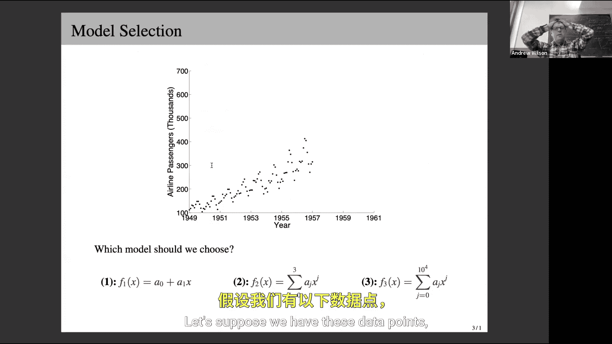

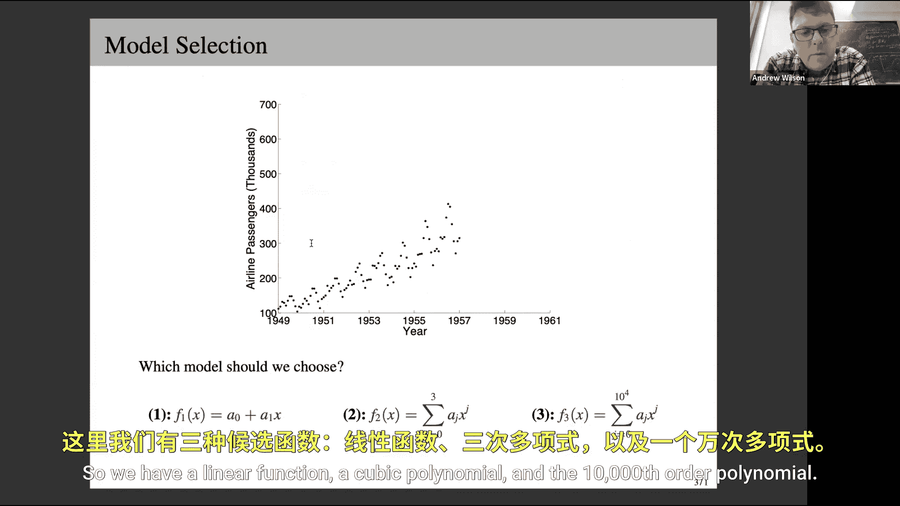

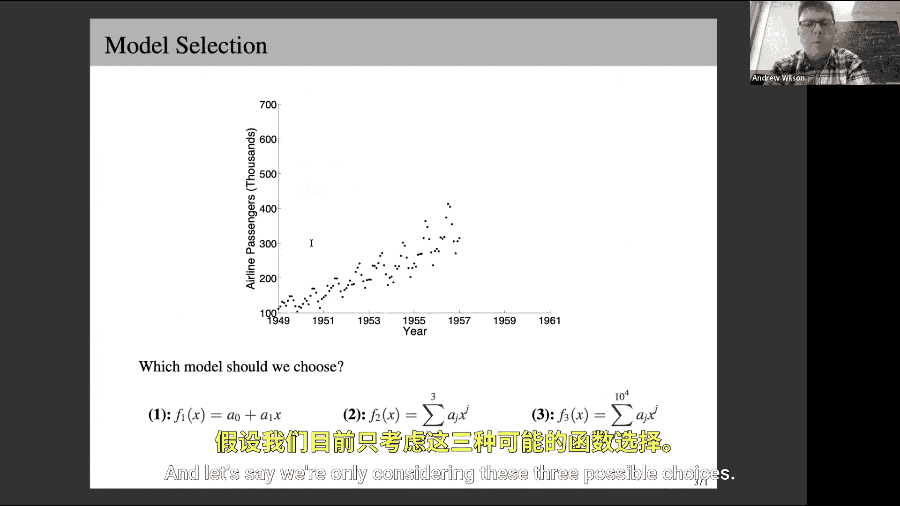

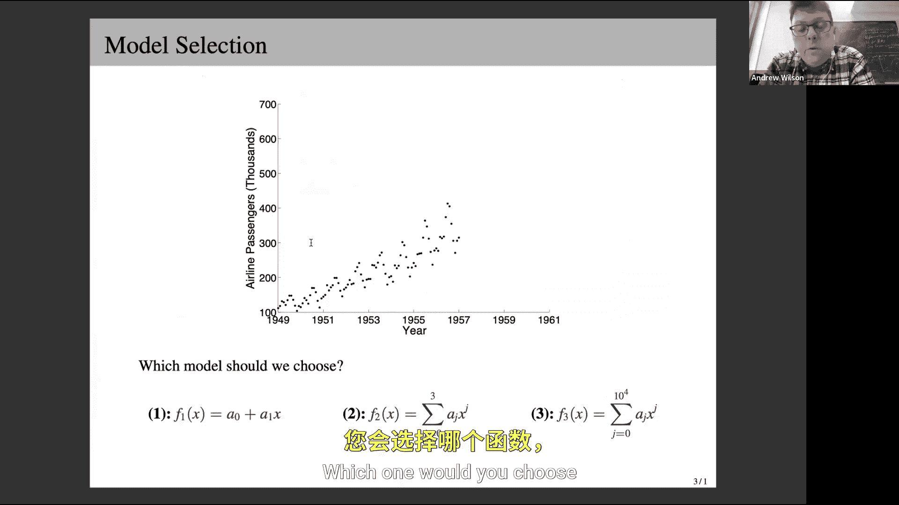

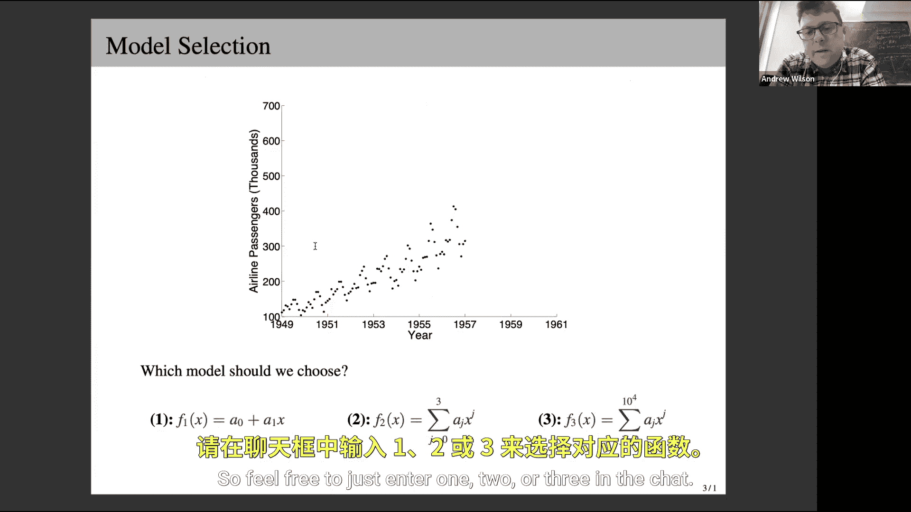

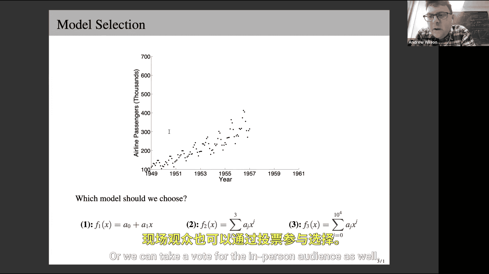

Yeah。Okay， most people I think。Choice two。Okay， choice three。

Is anyone choosing number three there are some in person audience but it iss not visible in the camera so okay so those are the people that did the reading I guess so yeah I'm going to argue in this talk that actually we would choose three and in fact we would be unsatisfied with the level of flexibility in choice3 because we believe the real world is a sophisticated place and we need sophisticated models to capture that structure and as long as we have a reasonable way of learning these models we should be able to get closer and closer to the ground truth and make better and better predictions and so I would say that I prefer choice3 because it's more flexible than choices one or two but it's also insufficiently flexible。

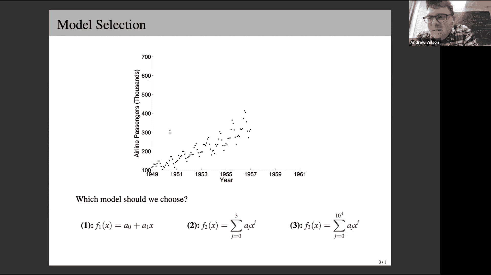

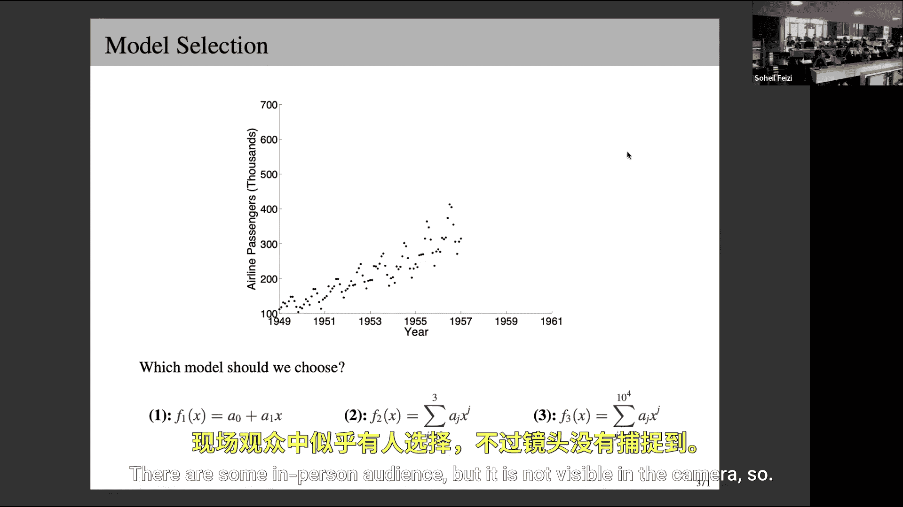

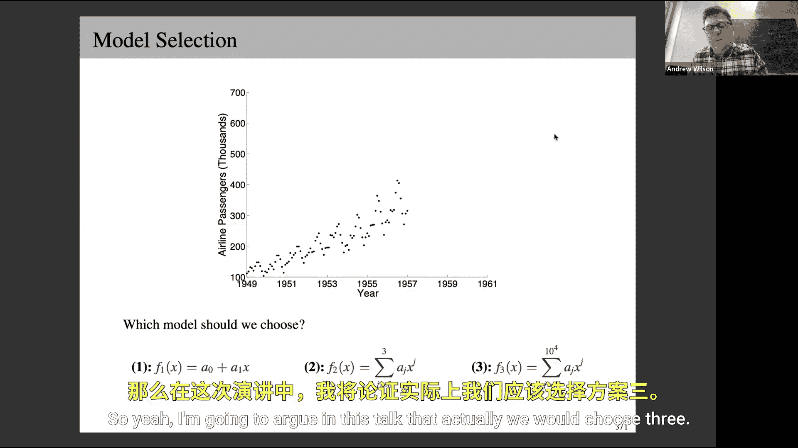

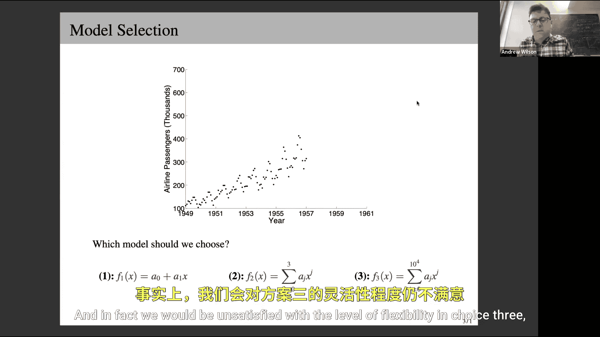

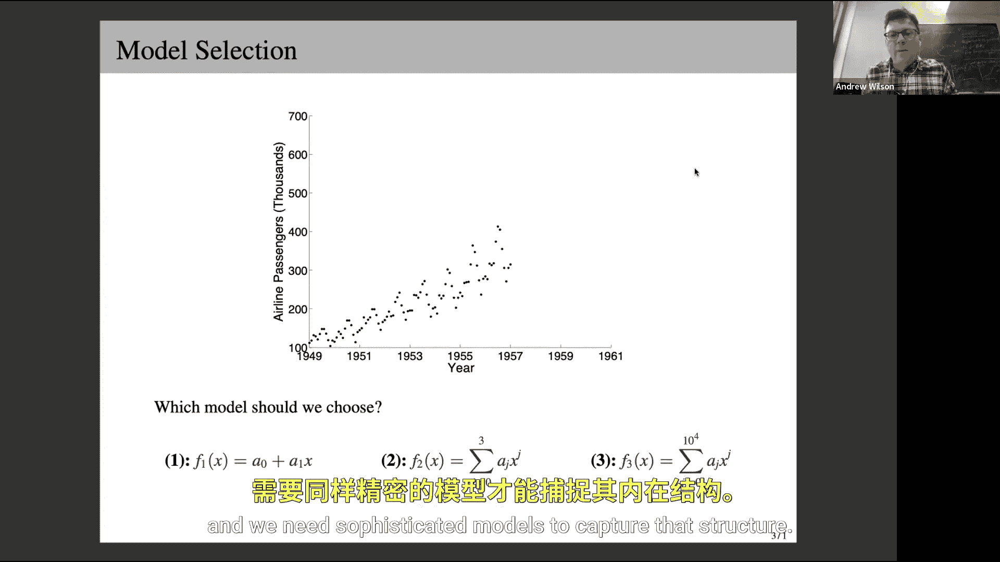

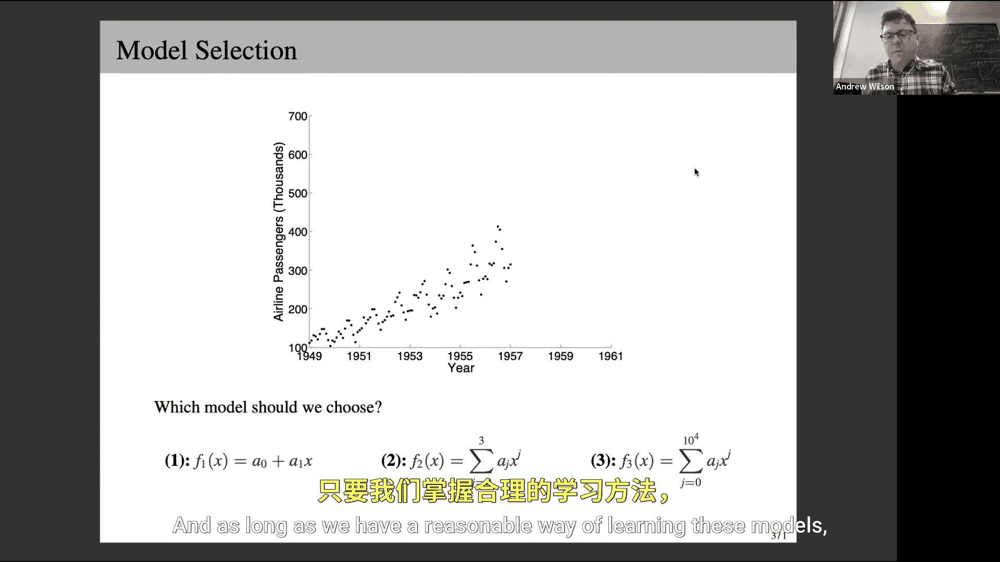

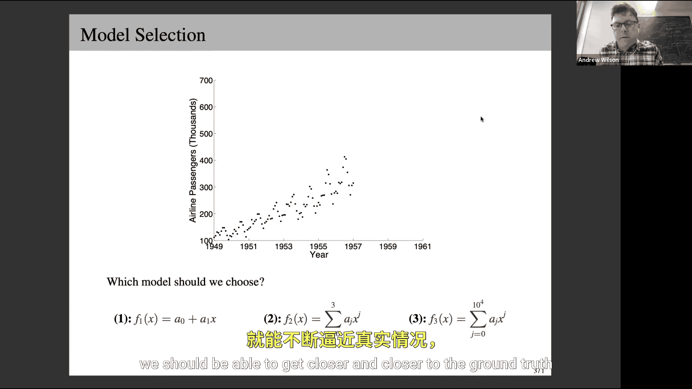

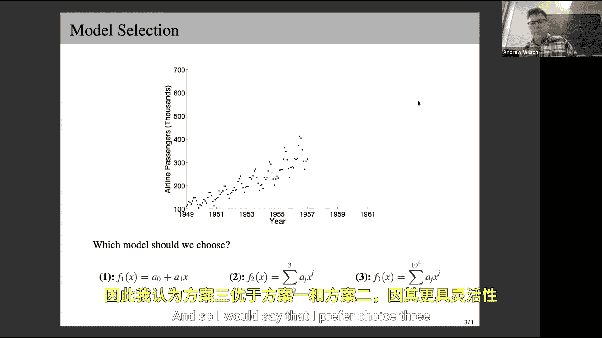