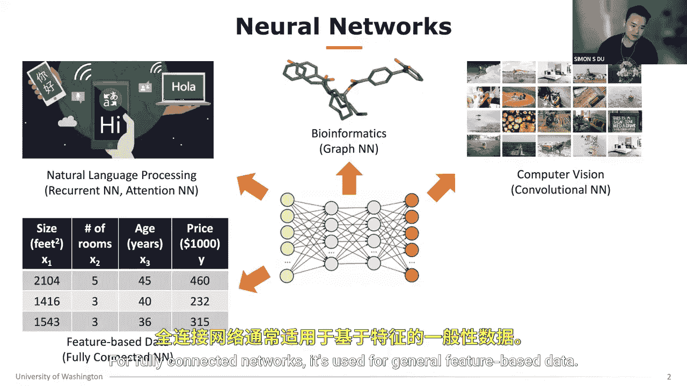
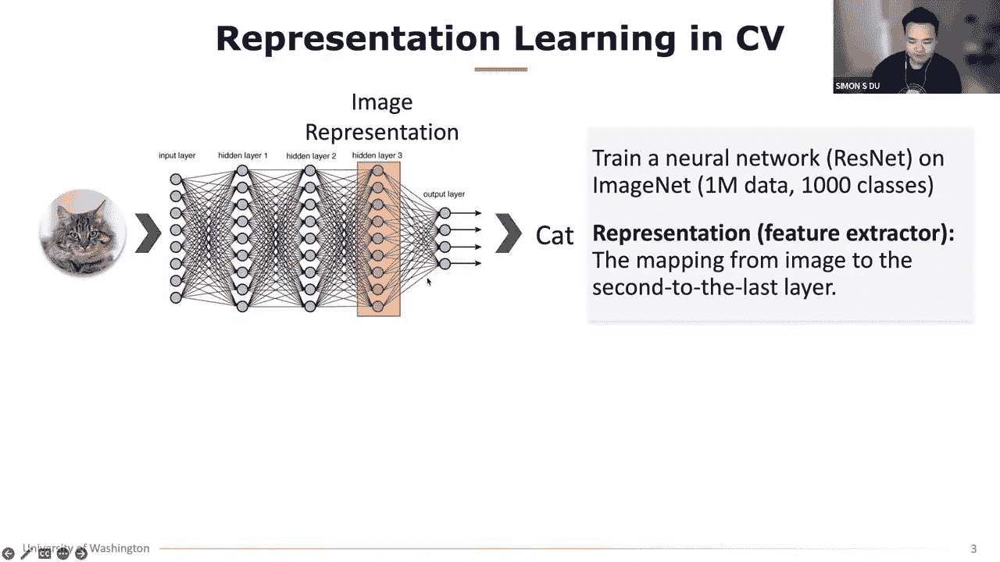
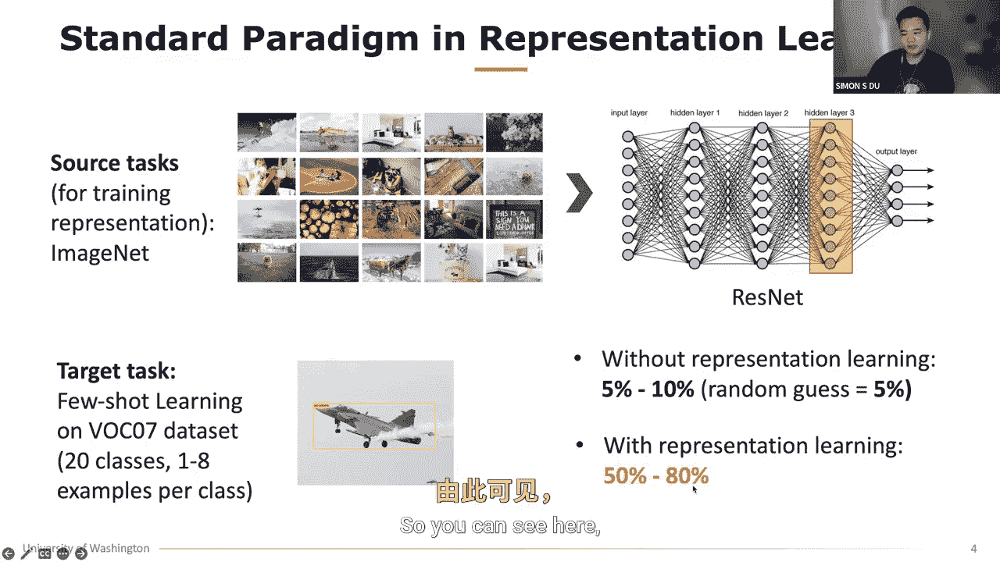
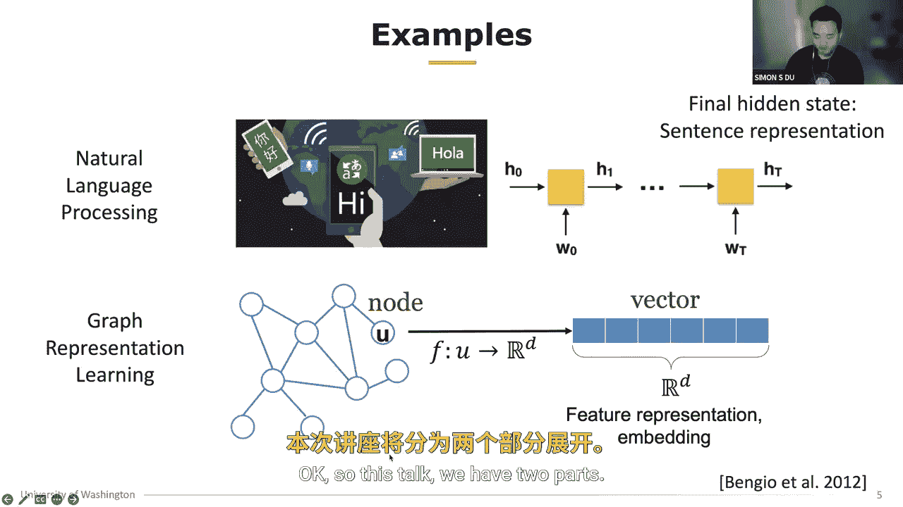
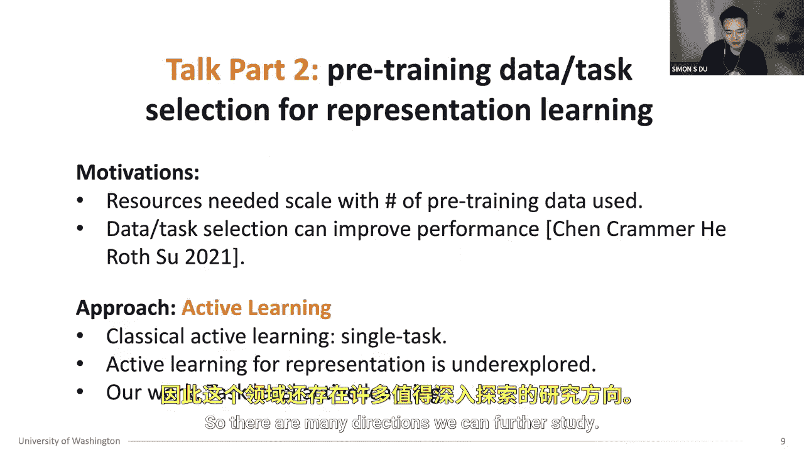

# 马里兰大学【中英⚡深度学习基础｜CMSC828W-2020-Foundations-of-Deep-Learning】-p31-P31-Deep-Learning-Foundations：-Simon-Du's-Talk-on-Passive-and-Active-Multi-Task--BV15rpCz9Ed8_p31-

Let's get started so so since this is a deep learning course。

 I don't think I need to motivate neural networks anymore。

 but generally you know deep neural networks have been more successful in I mean applications with different architecture like configurationation bioinformatics where we use some graphph neural networks for natural language processinging。

 use RN transformers for fully connected networks you may use you' use for general feature based data and we use policy neural network Q network for reinforcement。

😊。

Right so today I'm going to talk about one particular use of neural network， it's drug learning。

 so here let me first give you an example。😊，How we use neural network to learn a good representation。

So this is a very standard usage of representation learning so first we try to learn a good representation okay so by representation we mean so in this talk at least we mean the representation is the second to the last layer okay which is here so basically you have some input image and you have when you're at work which maps this image to goes through several layers and you have the to the second to the last layer so now you have a vector here so this vector you can view it as a representation for this image。

😊，Okay， and this mapping or this new network from here to here， you can call it feature structure。

 which is a map that a function that maps the image to a vector okay。😊。

And the second to the last layer is your reputation。😊，So usually you will train this neural network。

 this representation on a very large data set okay so here this maybe even four or five years ago you just train on image and now that you even train on some larger data okay so basically you need to train on a very large data in order to learn a good feature extract for the image。

And the usage of this representation learning is to that it is useful for the other task okay so you may train this representation on the imagenet。

 but this representation you learn is actually useful for many other tasks for example here you have a new task you will just keep those layers keep those representation or this feature structure and then you just retrain the last linear layer so this is one use of representation so you will this is a fixed feature instructor and then you will train a support vector machine on top of the learned representation。

😊，Okay， so this is how you use the learn computation for， say， a downstream task。

So here let me give you a more concrete example。😊，So。Here。

 let's say we train a representation function with architecture of grassnet。

 Okay and you train on imagenet。 So you target downstream task。

 is's we call fu learning task say this will see 7 dataset。

 this fu learning tasks in the sense that there are 20 classes。

 but there are only1 to 8 per examples examples per class。 So it you know。

 yout have very few shots per class。 so if you don't use representation learning at all。

 you can use whatever method you want to use like SVM hand class features or your words。

 you can only get the 5% to 10% accuracy。 Okay remember。

 you have this a 20 class classification problem。 So you， if you do random guests。

 the accuracy will be 5%。So， you know， because you have very limited data。

 you can not do much on this very challenge of you know， which is fuel short learning tasks。However。

 if you use representation learning， so you first train the RaNet on imageNet and then you use this feature letter and then you just really train the last linear layer。

😊，This last senior layer just trained on this previously trained presentation。

 you can directly boost performance through 50% to 80% okay。

So you can see here this is a huge improvement compare with results using representation Learn so this is high introduction of how we use the representationation learning practice。

 although there are many different variants of representation learning I think you know later in the course we also learn them All right so this is for configuration but representationation learning is you know a general methodology it also use many other areas like vector language processing where roughly can for if you use RNA you can view the hidden state as a representationation for the sentence and for graphing network you can you can learn good representationation for each node and you can use representation for downstream say node classification and other tasks。

😊，Okay， so this talk we have two parts， the first I will develop the theoretical foundation for representation learning we study like under what kind of conditions that representation learning actually probably improve the performance of a downstream task so we study what an necessary and specific conditions and want to understand from mathematical point of why representationation learning actually helps。

😊。

Okay so this is a part one so to motivate the second part let's again look at the recent trend in representationation learning so nowadays you know this representationation learning model are become bigger and bigger okay so you can see from this plot from 18 to 22 you know the model size have seen increased a lot okay orders are from magnitude2。

😊，And also the data sites used for pre training also increased a lot you can see here this。

 you know for language applications， we use 35 billion words to train a code presentation the main reason is that you know those data used for pretraining is kind of cheap you know。

 for example， for language models， you just train them on using Wikipedia or those online articles where you can access them very easily So you know data is pretty cheap for pre training。

So in you know， generally speaking for machine learning， you should use as much data as possible。

 right， So， and you know， those big companies， tech companies， Google Matt。

 they just train the big models using billion of data。😊。

And you can see there they actually improve a lot in terms of the performance as well。However。

 on the other hand， you know most of people are not you know work for those big tech companies and especially for smaller labs organizations you don't have the resource to train those big models right for example for this famous GP3 model it has 175 billion prompters and use this number of data and you know basically you need to train on 10。

000 GPUs and there's some estimation for the total cost its like 10 million and generally you don't have 10 million to train a single model right。

So in practice， in many scenarios， especially for smaller organizations。

 So and suppose you have some task that。You don't you know， not language transmission。

 but some other tasks like say biology or some other practical scenarios。

 you have limited resources Okay， say dollar GPUs engineers。

 but you only have one or a few target onstream tasks。

 say I just want to improve the traffic prediction and you still want to leverage all existing data from the from everywhere from you know from all cities However you don't have enough resource to actually train a big representation learning or pretrain model just like G3 okay so how do we do it。

So second part of talk we will talk about the recent methodology we developed to actually to you know actively select the most relevant pretraining data so the motivation is falling。

 you know generally you know the resource you need to train the big models scale with the number of pretraining data you uses generally if you have more data you need more GPU more years for all the task relevant working to do。

😊，But here， if we can reduce the number of data for pre training。

 then we can actually reduce the resource you need。

And another motivation is a recent finding that you know it's not always that you have more data you it' always helpful。

 the data quality is more also very important Okay so you can you know carefully select the most important data for pre training which can already improve the performance a lot。

Okay， so。For a second part of talk we'll talk about our recent method of using active learning to you know select the most relevant pretraining data so we can reduce the data number of data you need for pretraining and thus you reduce the resource you actually need for pre traininging So this is you know different from the classical active learning which you know you only have one task there's no pretrain and's more like a super learning second but you select which data but here we will actually select which task so we'll talk about what are the tasks means there and to select most relevant task for the target task you really want to solve。

Okay， and I believe this is a relatively new area like， you know。

 active learning has been studied for super learning you know， extensively。

 but active learning for representation learning is still under four。

 so there are many directions we can afford study。😊。

O。All right， so this is an outline of today's talk。

 I to first talk about the theoretical foundation of supervised multipas representation learning and there's a key notion that is。

😊。