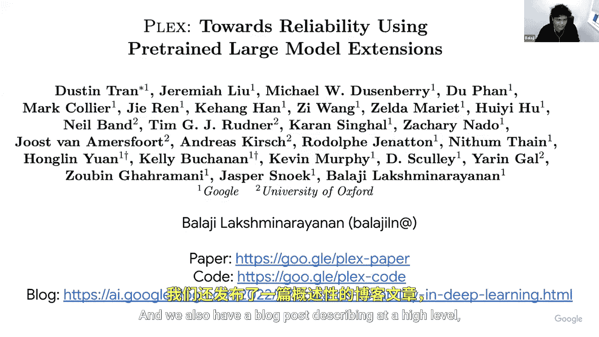
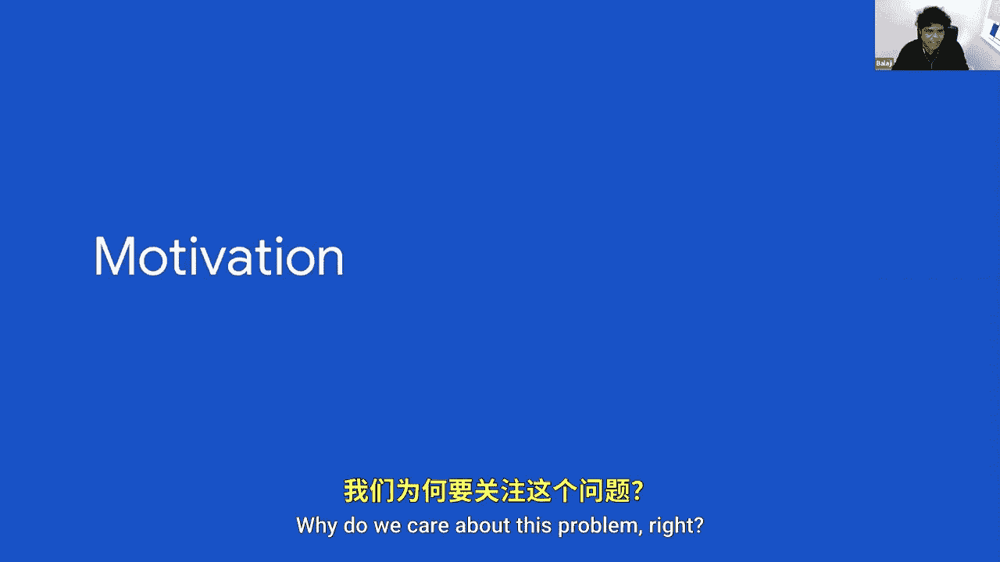
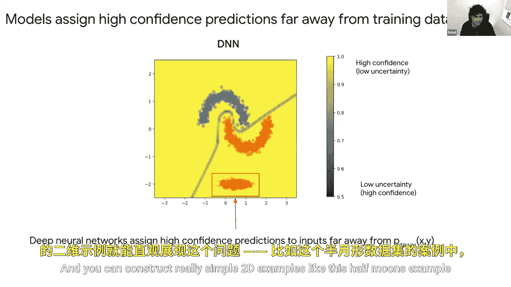

# 马里兰大学【中英⚡深度学习基础｜CMSC828W-2020-Foundations-of-Deep-Learning】-p32-P32-Deep-Learning-Foundations：-Balaji-Lakshminarayanan's-Talk-on-Reliability-via--BV15rpCz9Ed8_p32-

Yeah thank you so much for the invitation it's great to be here so today I'm going to be talking about our recent work on PLX which builds on a line of work on scalable probabilistic deep learning and I'll try to highlight or also sometimes people just present the end product in some sense of the research rather than the stepping stones and the motivations I'll try to give a bit of like the backst and all the missing pieces and the hypothesis so that in case it's helpful to folks in the audience here and this is obviously joint work with lots of awesome collaborators both within Google as well as ya and Girl's group at Oxford。

Yeah so I have the links here so feel free to take a look and we also have a blog post kind of like describing at a high level which is a bit more introductory for this so what is the motivation so let's before we what is the motivation why do we care about this problem right like so。

We want to be able to quantify uncertainty in deep learning and these slides are from our Europe tutorial a few years ago you can take a look for more details but I'll just be concise and give some background the reason we care about uncertainty is that good uncertainty estimates can help us understand when we can actually trust the models's predictions so for classification problems。

 uncertainty means could just mean like not just outputting the top1 label but also an associated confidence score and for regression problems it could mean not just outputting like a mean but say a mean under variance it could be as simple as that so but at a high level in probabilistic deep learning the name of the game is to return distributions over predictions rather than a point prediction。

And good uncertainty it going to be really useful to know when we can trust the model's predictions and it's going to become important in a lot of like don'tstream task as you'll see the rest of the talk。

And the other technology you may have heard a lot about is the so-cal order of distribution robustness。

 so a lot of machine learning was studied in the so-cal IID setting where the test distribution is assumed to be from the same distribution as the training。

 but this assumption is frequently broken in the real world and lots challenging applications and we are now there's a lot of interest in the so-cal OD setting where at a high level OD you can think of really means as like not IID and where the test is not the same as strain and obviously we need to make some specific assumptions on the cases that they typically study and some examples of like there is a shift are。

Covari shift where I'm just trying to give a taxonomy of the types of like OD shifts that we also study in like the reason this becomes really challenging I really want to right from the point that this I think one of the grand challenges of machine learning in my opinion and the reason really being that there's only one way to be IID but this count classes you can be like OD and it's really to truly tackle the robustness issue。

 we really need to be able to understand models it's a robust to like a whole different it's a much more challenging problem thats what I'm trying to hopefully influence upon you and some examples of data is a shift are covariator shift where we assume that P of Y given X is fixed that P of X changes between train and test the so-called openet recognition setting where we assume that new classes belonging to inputs may appear at test time which are not seen during training data and this occurss a lot in like scientific applications。

嗯。As well so where like for instance， if you're training like you know models on like genomic sequence identification and so on we actually don't know a lot of the classes people are discovering like new classes all the time right like so if you train to class based on historic data and try to apply it in the real world this you really need to be。

Not just have accurate models， but actually OD detection to really enable MLl to be successfully applied in some new some of these applications。

 so this becomes really important in those applications and subpopulation shift obviously where frequencies of data subpopulations change and other things and。

So but this is kind of like an incomplete list this whole people are I encourage you to really take look at this literature。

 there's other types of shifts such as like label shift and other distributions as well so there's an incomplete list too and these are challenging enough on their own as you'll see and the reason I think this is really interesting to study is。

But。Deep learning really achieves it works really well on like IED shifts。

 but on OD shifts the models are still not as great as we would like them to be and a case in point is this benchmark you may all heard of called Im at C from whom this paper by Dan Hendrickx and Tom Li where what they basically showed is。

That if you take like models which do really well on like imagenet the clean test set so as to speak and evaluate them on even on like slightly if they may not even be like at those even like natural corruptions the models start failing and I really like this data because it gives you like a no for controlling the amount of ODiness first to speak so it can you can measure the model of performance on the clean set and as you go further and further away you can kind of like progressively increasing the distance between test and train you can see how the models fail and the reason why I talk about both OD and uncertainty jointly is that the importance of uncertainty becomes particularly important when you have out distribution like so it's inevitable that the model is going to make mistakes when as you progressively go out of distribution but it's important for models to know what they don't know and so that they can at least say like you know when。

They are likely if they signal in their through their uncertainty when they are likely to be wrong。

 they can only trust the model let's say in the vicinity of the training data and as they go further and further away trust the model prediction less in some sense that's a kind of behavior。

 the ideal behavior that they can't like expect and we did this benchmark to just like test whether how good is a model calibration for this on this problem so。

This plot is from our benchmark paper in 2019 and the X axis shows the shift intensity so the test the typical test has like no corrections that's the usual test set and you can see the model accuracy is here and as you progressively increase the shift intensity then the model accuracy starts dropping but the question you might wonder is well if the model accuracy is dropping but to the model no is the fact that the accuracy is dropping reflected in the model confidence so we ask this question to evaluate the performance of model uncertainty as a function of like distribution shift and we did a large scale benchmark at that time with all the popular methods at that time。

And we looked at in particular what's called expected calibration error。

 so calibration error for folks who are not familiar you can think of it as some sort of like metaarch accuracy in some sense so it really measures the agreement between the confidence which is the models predicted probability of correctness right so when the model says 80% confidence it says I think 80% correct that's its own predicted probability of correctness and the accuracy is the observed frequency of correctness you actually measure the ground truth labels and then we measure whether it's a correct or not and calibration really just intuitively you can think of it as the agreement between the model's own estimate of its correctness this is its actual correctness and reality so we would ideally like these to be aligned very well that's called a calibrated model and one way to do this is to measure what's called the expected expected calibration error which is just really bill the probabilities and measuring this discrepancy between the two one of the surprising things that we。

😊，In this paper was that the model calibration also gets really worse with distribution shift and this is kind of like a problem because。

The models are making more mistakes but they don't know that they are making more mistakes so it's really hard for practitioners to know when the models say give us like a 80% probability you trust it or not right like so and for safe deployment this is a big problem and this is what we mean by like you know neuralance do not know when they don't know and that's a problem we want to fix so ideally we would want this line to be as flat as possible so that if there are calibrated estimates it can leverage the uncertainty to decide when to trust the model or not and。

The other problem I also want to highlight like the other go back to the openet recognition that I kind of like briefly touched upon and in open set the fundamental issue is that the models may produce high confidence predictions really far away from the data even on classes if you're train like a classified on like MNT and then you show it like pictures of let's say fashion MNT which are completely different semantic classes it'll still give like very high confidence predictions and that's really at the heart of the open set recognition problem and you can construct like really simple like 2D examples like this half moon's example where if you visual。

