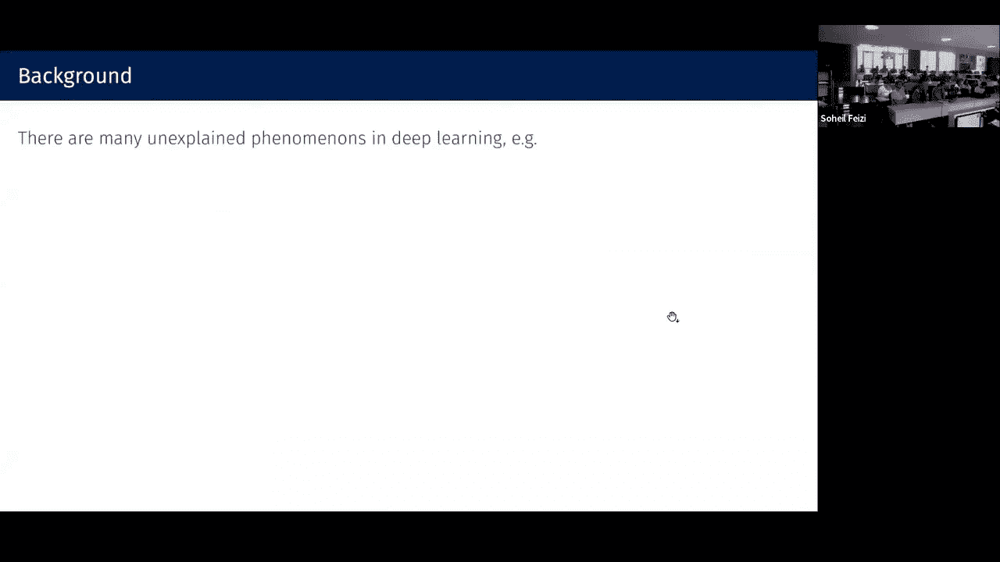
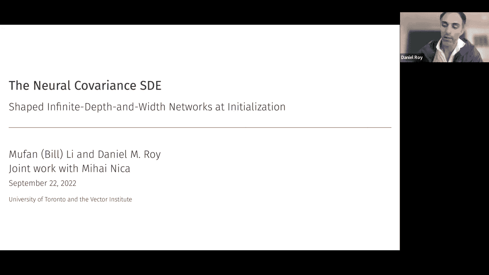
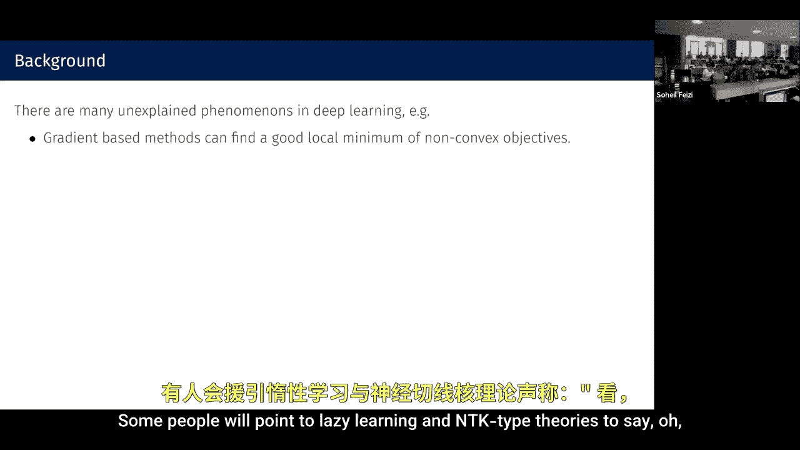
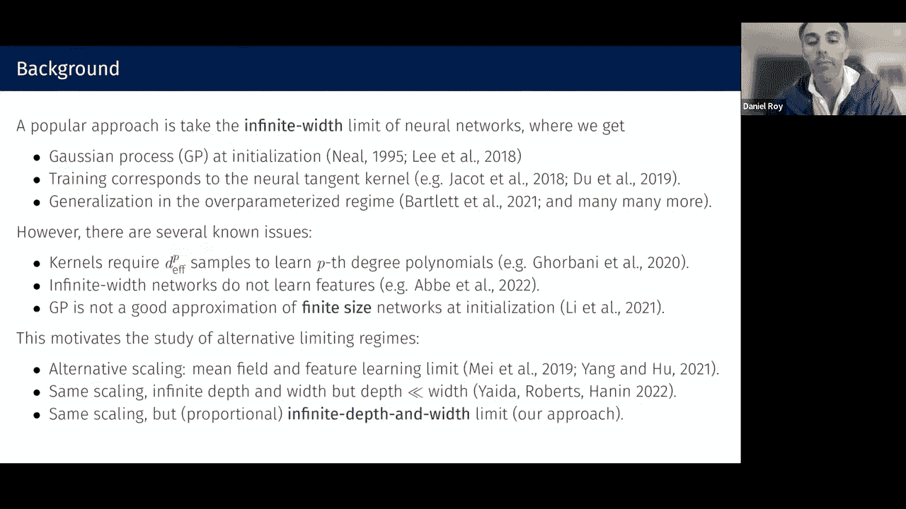
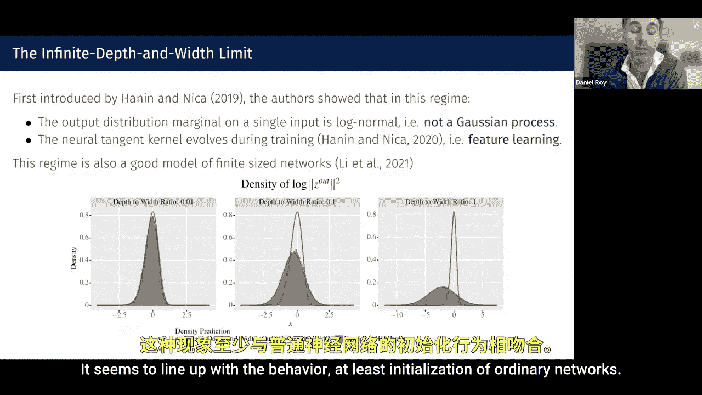
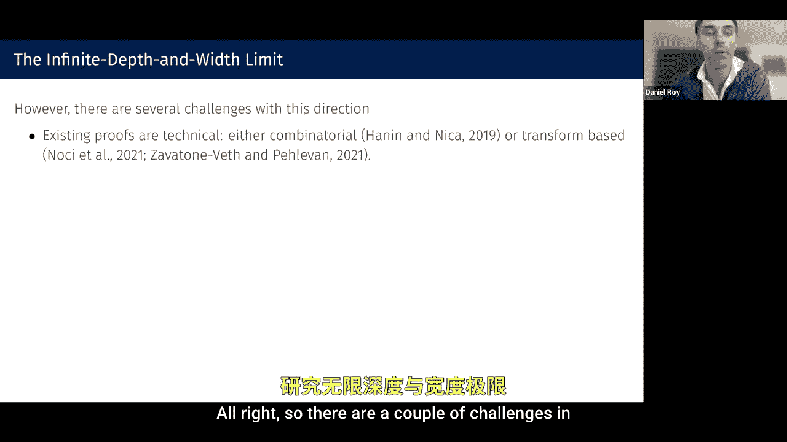

# 马里兰大学【中英⚡深度学习基础｜CMSC828W-2020-Foundations-of-Deep-Learning】-p33-P33-Deep-Learning-Foundations：-Daniel-Roy-and-Mufan-Li's-Talk-on-＂Neural-Covaria--BV15rpCz9Ed8_p33-

Thanks very much for the introduction and thank you for having us。

we're going to be talking about this work on the neuralference SDE。

 this is work that was recently accepted to Ns。And it's his second contribution to this growing literature on infinite depth and with networks that we've contributed。

And when I say we really move on， who's going to be speaking and shortly。

 has been leading this project along with expert guidance of Miha Nika。

 our colleague at Guelph who along with Boris Hannon。

I did some of the very first work on this infinite depth and width limit。

Let me get started。Yeah I can see my slides are advancing just fine good all right so you there you know there are many unexplained phenomena in deep learning i'm going list two of course I could I could probably have like six slides and that would even be like not all the unexplained phenomena but like you know to the ones that puzzle people very early on were how are these gradient based methods finding good local minima and you know because the objective is noncomvex。

😊，You know， some some people would point to lazy learning and NK type theories to say oh。

 we now understand this， but like that's really in those those you know in those settings right you know in the in the。

And arbitrary networks， we don't really have a complete theory yet。

And then there's also the question of statistical phenomena with deep learning and it's really not obvious yet why overparamats models are generalizing to test data。

these models trained by procedures like SGD can interpolate the data so meaning they get zero training error and despite the enormous capacity of these models large enough to memorize noise essentially。

Still generalize there's something going on there and of course there's been advances recently so you know again in the say in these indicate limits and i'll return to these later you can you know you can lean on classical theory for linear your predictors。

 but that doesn't really explain thing and so you in the last few years a theory of benign interpolation has。

Started to be mapped out and that's quite exciting， but still。

One of the challenges we face and understanding deep learning is that the mathematics of deep learning is quite intractable and。

We don't really have we don't really have a simple analytical model for deep learning that we can rely upon nothing like say linear regressiong there's a good reason why linear regressiong is like the model everyone leap to to say develop the initial theories of interpolation and things like that。

😊，All right。So the approach that we're going to take here is one that're not the first to take this we're going to identify and analyze an infinite limit so like we're going to paradoxically study a infinitely large neural network and that infinite limit is going to simplify some aspects of finite objects and will arrive at some more tractable and at the same time this is only really interesting if the limit object remains a good model of finite sized networks all right so like I said this is a path that's well trodden and in some sense like the well-known infinite width limit is an example of this approach to under neural networks and that infinite width limit it's been known for quite a long time one of my colleagues at Toronto back in 1995 observed that infinite with limits of neural networks in one hidden layer yielded Gaussian processes that's been extended quite dramatically to more complex architectures more recently。

And then you know then subsequent to that development and building on it in a strong way。

 people describe the kind of way that training works in this infinite with limit in terms of the so-called neural tangent kernel。

 which would orinarily be a random object but in this infinite with limit becomes a non-random almost surely object and so that that's quite interesting now the description of the neural tangent kernel is actually can be is described in part by the conjugate kernel which which was characterized in this GP limit at initialization so you know these two theories interacted know the first the development of the theory of initialization became part of the theory of training later on。

 something I'll emphasize。This infinite with limit yields detractability which then you know people turn into theories of journalismization in this infinite with limit and you know under interpolation and lots of other exciting things so despite all this exciting progress there' are several known issues so first of all kernels are just you know certainly the types that you get out of like say certain infinite with limits or just definitely weaker you know the sample complexity of learning things like polynomials isn't what it should be you know is you know worse than with you know real neural networks。

The the infinite width limit you get in the antiK limit doesn't do feature learning as some of the people have observed the Gaussian process is even forget about training。

 even at initialization， the Gaussian process is not a good approximation of kind of like typical shaped finite neural networks and initialization and there's more references references then this paper of hours here。

 but you know we provide a really simple statistic which is this way off if you compare say the prediction given by GP theory and what goes on in real networks。

So you know these problems with the infinite width limit right which basically say yes。

 it's a very simple very very simple model and allows you do all this analysis。

 but you're not analyzing the right object， so that motivates to save alternative alternative limiting regimes。

😊，One one change you can make is like fundamentally you can change the scaling or I won't go into details of what that exactly works how exactly works。

 but kind of like you know you're kind of training the last layer much faster is maybe not so accurate but like our picture the difference so that gives you so-cal meanfield and feature learning limits that have been studied recently and shown to be maybe useful for anticipating the effects of hypercram or tuning。

This work is about this keeping the same sort of scaling。

 making both depth and width infinite now's there's been there's a body of work working in this area。

If the depth is in a sense， I'm not going to make precise here much smaller than the width。

 but they're both diverging， then you get， well in that space is a limit that Yada Roberts and Hannon have been studying and in several subsets of those have made contributions on their own as well。

 Hannon has a body of work on this and my own。

This work today we're going to be talking about the same scaling。

 so we're not like doing something different with the last layer。

 and we're going to study infinite depth and width。

 but we're going to be taking depth and width to be proportional to each other in the sense that there's going to be a fixed aspect ratio。

You can think about， you know， there's a shape to my neural network in a particular aspect ratio and the network is getting wider and taller or deeper。

According to this aspect ratio， we're studying this limit。Yeah。

So this particular limit we're studying was first introduced by Hannon and Nikika and Nikker are a co author。

And they have a couple results in this model already so the output distribution。

Now if we look at a single output and look at marginal distribution。

Or you know distribution is say it's norm， then it's log normal。

 whereas that's not what would happen from a GP。And but it is but it is but that matches up with practice you find you find that distribution in practice with like ordinary sized。

Neurural networks。The neuraltent kernel， which is， you know。

 so in the infinite limit the neuraltent kernel is fixed throughout training。

 but if you observe the neuraltent kernel or measure it during training。

 you see in ordinary networks， you see it's evolving。And you can prove。

 which means that you that one particular feature， which is arguably the essential feature of the NK limit。

Doesn't match up。In contrast in the infinite depth and width limit。

You can prove and this is a result by Hanika that the Nk is evolving it already has a derivative at time zero。

So that initialization。And。What you see is you know besides getting that qualitative feature right you actually get some you know remarkable lineup at least initialization。

 so what we have here is the distribution of the output log of the square output so you know relatively simple statistic of like you a single input what's it looked like after you pass through deep network and initialization。

The histogram is the actual data， that's an actual network producing a histogram。Um。

 the uh the curve that's way off the you know， on the left， the curve is like， you know。

 there there's all the curves are basically on top of each other。

 but the curves that are way off and the other two figures。

 that's the NtK kind of or G GP rather prediction。And there's another curve which maybe you can't see。

 which lines up exactly the histogram， that is the infinite depth and width limit。

And these plots were produced in work that move on lead。

 and this is part of our assignment studying this model， it seems to line up with the behavior。

 at least initialization of ordinary networks。

All right， so there are a couple challenges in studying the infinite depth and width limit so there's existing。

